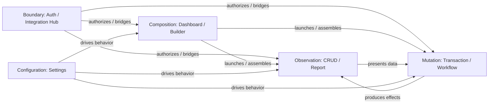
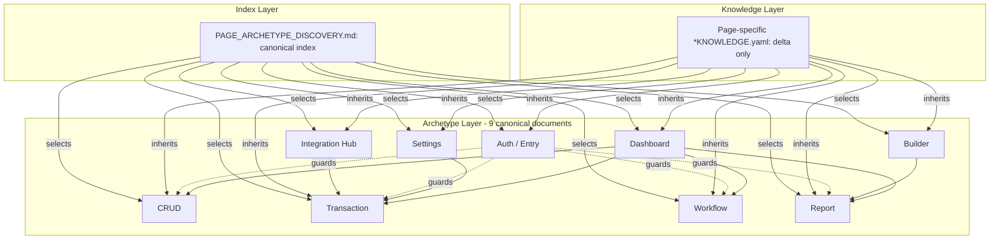
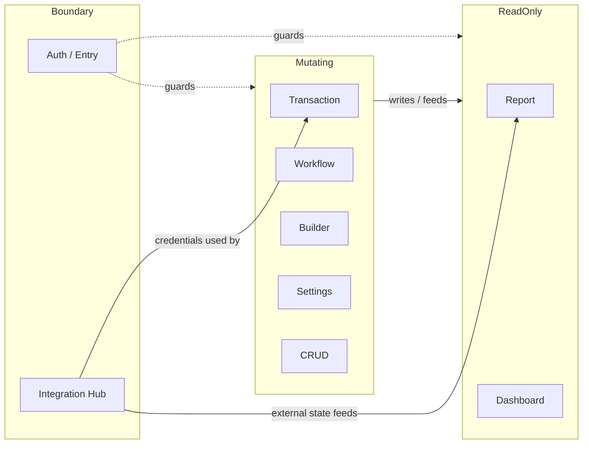
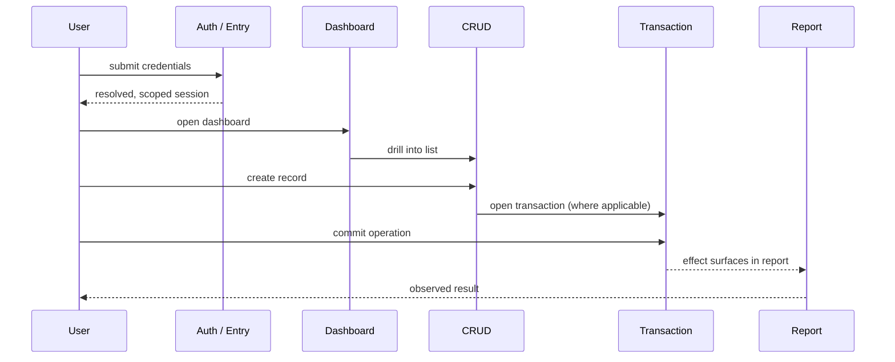

# Archetype Relationships — Hermes Browser Ontology v1.0

**Document Type:** Ontology relationship specification — companion to the canonical archetype layer
**Status:** Canonical — stable for years
**Part of:** Hermes Browser Ontology v1.0
**Companion documents:**
- `PAGE_ARCHETYPE_DISCOVERY.md` — canonical index of browser archetypes (entry point).
- `HERMES_BROWSER_ONTOLOGY.md` — the whitepaper (philosophy, contracts, stability, versioning).
- `HERMES_BROWSER_ONTOLOGY_v1_RELEASE.md` — official release notes.
- `CRUD_ARCHETYPE.md`, `TRANSACTION_ARCHETYPE.md`, `WORKFLOW_ARCHETYPE.md`, `REPORT_ARCHETYPE.md`, `DASHBOARD_ARCHETYPE.md`, `SETTINGS_ARCHETYPE.md`, `BUILDER_ARCHETYPE.md`, `AUTH_ARCHETYPE.md`, `INTEGRATION_HUB_ARCHETYPE.md` — the nine canonical archetype contracts.

**Authority Note:** This document defines *relationships between browser interaction behaviors only*. It is deliberately independent of any business domain. No entity, field, rule, endpoint, or persistence mechanism is asserted here. Where it states that an archetype "feeds" or "drives" another, it states a browser-observable navigation and data-flow expectation (the browser observes one surface producing the input, side effect, or entry point that another surface consumes), not an implementation dependency. The normative language used here — Hermes MUST, Hermes SHOULD, Hermes MUST NOT — matches the canonical archetype layer exactly.

---

## 1. Browser Ontology Overview

The Hermes Browser Ontology is the minimal, complete, and stable set of browser-interaction contracts that describe every administrative and operational surface in the application. It was discovered once (see `PAGE_ARCHETYPE_DISCOVERY.md`) by classifying the application's route table and page inventory by **dominant repeated browser interaction pattern**, not by business domain.

The ontology is layered:

1. **Index layer** — `PAGE_ARCHETYPE_DISCOVERY.md` selects and references the nine archetypes.
2. **Archetype layer** — nine canonical documents, each owning the full generic behavior of one interaction contract.
3. **Knowledge layer** — future `*KNOWLEDGE.yaml` per-page files that inherit an archetype and declare only page-specific deltas.

A page is a transient instance. An archetype is the durable interaction contract. The ontology exists so that Hermes learns the small number of behaviors the application is built from, instead of learning one hundred pages individually. This collapses maintenance cost, preserves transfer to new pages, applies QA rules uniformly, and reduces token weight by inheriting behavior instead of repeating it.

The nine archetypes are: **Dashboard, CRUD, Transaction, Report, Settings, Builder, Workflow, Auth / Entry, Integration Hub**. They are grouped into five families, described in Section 2.

---

## 2. Archetype Families

The nine archetypes are organized into five families. A family is a grouping by the *kind of browser state* the archetype primarily manipulates or observes. Families are not archetypes and do not add behavior; they are the lens used to reason about how archetypes relate.

### 2.1 Mutation

Archetypes that change domain-observable state through a browser session.

- **Transaction (Live Tender)** — executes a multi-step, side-effecting operation and commits it in real time.
- **Workflow (Stateful Lifecycle)** — moves a record through discrete state transitions with side effects and recovery.

Mutation archetypes are the producers of the system's committed effects. They MUST observe server-derived results (totals, stock, status, balances) rather than trust client-computed values. They MUST NOT assert success until the browser observes the server's authoritative verdict.

### 2.2 Observation

Archetypes that read, present, or explore already-existing state without changing it.

- **CRUD (Master-Data / Operational List)** — read-first collection management; mutation is a deliberate, usually modal, sub-flow.
- **Report (Analytical / Statement)** — aggregated, read-only presentation with filters, totals, and export. May issue a request carrying filter parameters but MUST NOT mutate any observed record or state.

Observation archetypes MUST treat presented data as read-only. A Report MUST NOT mutate. A CRUD page's mutations are confined to its explicit create/edit/delete sub-flows; the default collection view is observational.

### 2.3 Configuration

Archetypes that load and persist configuration which drives the behavior of other archetypes.

- **Settings (Configuration)** — loads current configuration and persists changes; persistence, refresh, and reset behavior.

Configuration is cross-cutting: a saved value can drive the behavior of Transactions, Builders, and Reports. Settings MUST declare that the saved value is server-authoritative and that it survives reload; it MUST NOT treat a locally written value as truth before server confirmation.

### 2.4 Composition

Archetypes that assemble, arrange, or aggregate constituent parts into a larger whole.

- **Dashboard (Overview / Navigation Hub)** — aggregates widgets and KPIs into a situational-awareness surface and launches deeper flows.
- **Builder (Publishable Artifact)** — composes an artifact (content, layout, theme, version) and publishes it to a render surface.

Composition archetypes assemble parts supplied by or surfaced into other archetypes. A Dashboard composes entry points into CRUD / Transaction / Workflow / Report. A Builder composes an artifact that the public render (a Builder-public-render instance) and Reports consume.

### 2.5 Boundary

Archetypes that sit at the edge of the application: they gate entry or bridge external systems.

- **Auth / Entry (Identity Gate)** — authenticates, registers, verifies, and gates entry; route protection and tenant/role scoping.
- **Integration Hub (External-Service Console)** — configures, monitors, and operates an external integration from inside the admin.

Boundary archetypes are preconditions and bridges. Auth / Entry is the universal precondition: every other archetype assumes a resolved, tenant-scoped, role-capability-checked session. Integration Hub bridges external state into the mutating and observing archetypes. Both MUST treat provider or frontend evidence as evidence only — backend authority wins.

---

## 3. Family Relationships

### 3.1 How the families differ

| Family | Primary browser state | Writes? | Read-only? | Role in a journey |
|--------|----------------------|---------|------------|-------------------|
| Mutation | Committed domain effect | Yes | No | Producer of effects |
| Observation | Presented dataset / collection | No (CRUD sub-flows excepted) | Yes | Consumer / presenter |
| Configuration | Persisted config value | Yes (save) | Yes (load) | Driver of behavior |
| Composition | Aggregated whole / published artifact | Yes (Builder publish) | Yes (Dashboard view) | Assembler / launcher |
| Boundary | Session / external bridge | Indirect | Yes | Precondition / bridge |

### 3.2 How the families complement each other

The families form a coherent loop rather than a hierarchy:

- **Boundary** authorizes the session and bridges external state in.
- **Composition** (Dashboard) launches the journey and (Builder) assembles artifacts.
- **Observation** (CRUD / Report) presents the data the user acts on and the results of acting.
- **Mutation** (Transaction / Workflow) changes state.
- **Configuration** (Settings) tunes how the others behave, and is itself observed and acted upon by the others.

No family is sufficient alone. A Transaction without Boundary is unauthenticated; a Report without Mutation has nothing to show; a Builder artifact without Composition's publish step is invisible; a Dashboard without Observation has no widgets; a Settings change without Boundary scope can corrupt downstream behavior.



---

## 4. Archetype Comparison Matrix

The matrix compares the nine archetypes on the dimensions a browser tester reasons about. Each archetype is defined authoritatively in its own canonical document; this matrix is a decision aid, not a redefinition.

| Archetype | Primary Goal | Primary Browser State | Dominant Interaction | Primary Assertions | Typical Components |
|-----------|--------------|----------------------|---------------------|-------------------|--------------------|
| CRUD | Manage a record collection | Collection view (read-first) | Search / filter / paginate, then create / edit / delete | Rows render; search/filter/paginate work; create/edit/delete persist; validation blocks invalid submit | Toolbar, data region, modal/drawer, pagination, row actions |
| Transaction | Execute a committed operation | Working session (cart/line + payment) | Build lines, validate, tender, commit, confirm | Receipt/confirmation on commit; server-recomputed totals; idempotency HIT is byte-equal; rollback = zero partial state | Workspace, cart panel, payment modal, receipt modal |
| Workflow | Progress a record through states | Item status / timeline | Open item, perform transition, observe side effects | Status reflects transition; illegal transition blocked (401/403); side effects appear; timeline ordered | List/filter, detail drawer, action buttons, status badge, timeline |
| Report | Observe aggregated data | Loaded dataset / derived totals | Filter, read, export, print | Totals reconcile to lines; filters change dataset; export scope matches; no mutation | Filter bar, totals row, table/chart, export/print |
| Dashboard | Situational awareness + navigation | Widget set / scope filter | Switch tabs, change scope, drill down | KPI cards render values; widgets not blank-spinner; tab switch updates panel; drill-down navigates | Tab bar, cards/charts, quick-nav tiles, scope filters |
| Settings | Persist configuration | Config form + persisted value | Load, change, save, refresh, reset | Fields populate from load; save persists across reload; reset restores defaults; gated controls disabled | Form sections, Save/Reset, capability gates |
| Builder | Compose + publish an artifact | Draft / version / published state | Edit, preview, publish, roll back | Draft saves without publish; publish visible on public route; rollback restores version | Editor/canvas, palette, version history, preview, publish/rollback |
| Auth / Entry | Gate entry + scope session | Session / route guard state | Submit credentials, refresh token, hit guarded route | Valid login → role home; 401 → refresh then retry or logout; guard redirects forbidden | Login/register/verify forms, route guards, language switcher |
| Integration Hub | Operate an external integration | Connection / health / config | Test connection, save config, inspect health/log | Test-connection clear success/failure; secret masked on read-back; health reflects provider | Provider cards, test button, health badges, config form, message log |

---

## 5. Primary vs Secondary Archetypes

### 5.1 The rule

**A page has exactly one Primary Archetype.** The Primary Archetype is the archetype whose dominant, repeated browser interaction pattern defines the page. Hermes MUST load the Primary Archetype first and in full.

**A page may inherit multiple Secondary Archetypes.** A Secondary Archetype is an additional interaction shape the page also exhibits. Hermes MUST inherit each Secondary Archetype's behavior as an add-on capability set layered on top of the Primary Archetype. The Secondary Archetype is never the page's defining shape; it is a supplementary contract.

This is the canonical model already established in `PAGE_ARCHETYPE_DISCOVERY.md` (Section 4 notes): pages with two archetypes are primarily one but carry a secondary interaction shape; the primary is loaded first, the secondary is inherited as an add-on.

### 5.2 Why secondary inheritance is safe

Secondary inheritance does not redefine the page. It composes capability sets that already exist as canonical documents. Because each secondary behavior is inherited from its own authoritative source, there is no drift: the page gains "also behaves like a Report" without re-describing reporting behavior.

### 5.3 Examples

| Page (illustrative) | Primary Archetype | Secondary Archetype(s) | Why |
|---------------------|-------------------|------------------------|-----|
| Workflow page with an embedded approval form | Workflow | + Auth | The lifecycle is primary; the transition action is gated by the session and capability scope. |
| Product catalog with a quick report export | CRUD | + Report (Integration Hub where provider-side) | The list is primary; an aggregated export view is a secondary observation shape. |
| Finance dashboard with configurable KPI widgets | Dashboard | + Settings | The overview is primary; widget configuration is a secondary configuration shape. |
| Storefront builder with auth-gated editing | Builder | + Auth | Composition/publish is primary; editing requires a resolved, scoped session. |
| Treasury transfer with an approval step | Transaction | + Workflow | The tender/commit is primary; the post-commit lifecycle is a secondary transition shape. |
| Marketplace shell | Workflow | + Dashboard | The request lifecycle is primary; the tabbed landing is a secondary navigation/overview shape. |
| Orders list with a settings-style filter config | CRUD | + Settings | The list is primary; persisted filter/scope configuration is secondary. |
| WhatsApp integration console | Integration Hub | + Settings | The external bridge is primary; its credential form is a secondary configuration shape. |

The same rule governs all pages: **one Primary, zero or more Secondary, never a redefinition.**

---

## 6. Browser Knowledge Layer

The Browser Knowledge layer is the thinnest layer in the ontology. It sits beneath the archetype layer and above the running browser session.

### 6.1 What Browser Knowledge is

A Browser Knowledge artifact (a future `*KNOWLEDGE.yaml`) describes **one page**. It names the archetype(s) the page inherits and declares **only the delta** — the page-specific facts the archetype layer does not know:

- **Route** — the page route(s) and any record sub-routes.
- **Entity name** — the human and system name of the record type, where applicable.
- **Unique fields** — fields specific to this page's forms and columns.
- **Unique business rules** — page-specific rules observable in the browser.
- **Special validations** — validations beyond the generic contract.
- **Page-specific exceptions** — deviations from the archetype's default shape.
- **NON-EXISTENCE assertions** — endpoints or flows the browser MUST assert absent (e.g. 404/405), not assume working.

### 6.2 The inheritance delta

```mermaid
graph TD
    A[Browser Knowledge: page-specific delta] -->|inherits| B[Primary Archetype: full behavior]
    A -->|inherits| C[Secondary Archetype(s): add-on behavior]
    B -->|references| D[Ontology index: PAGE_ARCHETYPE_DISCOVERY.md]
    C -->|references| D
```

**Browser Knowledge inherits Archetype + declares only delta.** It MUST NOT duplicate the inherited behavior. It MUST declare only page-specific behavior. The bulk of behavioral knowledge — search, pagination, validation posture, assertions, failure catalog, evidence collection, recovery — is inherited, not repeated.

### 6.3 Consequence

A class of change to the generic contract ("the list now supports column pinning") is made once, in the archetype, and every page that inherits it gains it. A class of change to one page ("this collection adds a required field") is made only in that page's delta. This is the maintenance-collapse property that makes the ontology durable.

---

## 7. Inheritance Rules

These rules are normative. They govern how Hermes composes the ontology at test time. They match the inheritance contract already present in every canonical archetype document (e.g. `CRUD_ARCHETYPE.md` Section 10, `TRANSACTION_ARCHETYPE.md`, `WORKFLOW_ARCHETYPE.md`, etc.).

1. **Hermes MUST inherit canonical behavior.** When a page references an archetype, Hermes MUST load and apply that archetype's entire behavior — its structure, contracts, assertions, failure catalog, evidence set, and recovery set — without the page re-describing them.
2. **Hermes MUST NOT duplicate inherited behavior.** A page-specific Browser Knowledge file MUST NOT re-declare search, pagination, filtering, create/edit/delete, validation posture, loading/empty/error states, assertions, failures, evidence, or recovery that already exist in the referenced archetype. Re-declaration causes drift and is a violation of the inheritance model.
3. **Hermes MUST declare only page-specific behavior.** A page-specific file declares only its delta: route, entity, unique fields, unique rules, special validations, exceptions, and NON-EXISTENCE assertions.
4. **Hermes MUST load the Primary Archetype first and in full**, then layer each Secondary Archetype as an add-on capability set.
5. **Hermes MUST treat the archetype as the source of behavioral truth.** Where a page delta and an archetype appear to disagree, the archetype's generic behavior wins unless the delta explicitly and narrowly declares a page-specific exception.
6. **Hermes MUST NOT introduce business concepts into the ontology.** Archetypes are domain-independent. Business rules, monetary semantics, ledger/posting rules, stock/quantity rules, and approval rules are page-specific deltas or lie beneath them — never in the archetype or relationship layer.
7. **Hermes MUST NOT introduce implementation details into the ontology.** The ontology references only browser-observable state: rendered DOM, network requests (URL, params, status), storage contents, console output, and navigation. Server internals are out of scope.
8. **Hermes MUST keep the ontology stable.** An archetype is updated only when a genuinely new browser interaction pattern appears that the current contract does not cover. New pages, fields, and UI polish do NOT justify editing an archetype.

---

## 8. Architecture Diagrams

### 8.1 Ontology layer stack



### 8.2 Family topology (mutating vs read-only, boundary guards)



### 8.3 Typical cross-archetype journey



---

*End of Archetype Relationships. Companion specification to the Hermes Browser Ontology v1.0 canonical archetype layer.*
