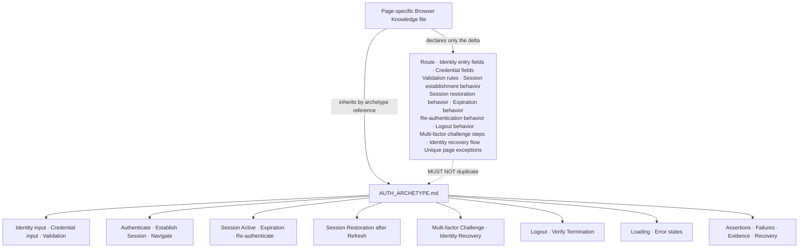

# Auth / Entry Archetype — Hermes Browser Testing Canonical Contract

**Document Type:** Canonical archetype — inheritance layer for Browser Knowledge
**Status:** Canonical — stable for years
**Layer:** One of the core inheritance layers beneath future `*KNOWLEDGE.yaml` files. This document expands ONLY the Auth / Entry archetype first identified in `PAGE_ARCHETYPE_DISCOVERY.md`. It does not redefine that discovery, nor any other archetype.
**Companion Artifact:** The Browser Knowledge generation skill consumes this archetype by name and layers page-specific deltas on top.
**Authority Note:** This document defines *browser interaction behavior only*. It is deliberately independent of any business domain and describes no authentication provider, no external identity mechanism, and no credential-transmission detail. No provider, field semantics, session mechanism, endpoint, or storage mechanism is asserted here. A future Browser Knowledge file supplies those; everything behavioral is inherited from this document. Where this document states that a session is established or expired, it states a browser-evidence expectation (the browser must observe the resulting navigation and route behavior), not an implementation detail. This document MUST NOT name or imply any credential-storage mechanism, transmission format, or server-side session technology.

---

## 1. Purpose

### 1.1 Why Auth / Entry exists

Some application surfaces exist to establish, restore, validate, and terminate browser identity. The surface is not a collection to be listed (CRUD), not a transaction to be committed (Transaction), not a record moving through a lifecycle (Workflow), not an aggregated read-only dataset (Report), not a configuration to be persisted (Settings), not a navigation/overview hub (Dashboard), and not a composition on a canvas (Builder). Its reason to exist is *identity*: proving who is using the browser, keeping that proof alive, recovering it when lost, and ending it on demand.

### 1.2 Why it is identity-first, not data-first

Every other archetype assumes an already-resolved identity. Auth is the surface that produces that resolution. It is the universal precondition: a user cannot reach a guarded CRUD, Transaction, Workflow, Report, Settings, or Builder surface until identity is established in the browser. The page is therefore oriented around identity input and the navigation consequences of success or failure, not around reading or mutating domain data.

### 1.3 Why it differs from CRUD

CRUD manages a uniform collection of records. Auth manages none. Its primary subject is the browser's identity state — established, active, expired, or terminated — and the routes that become reachable or unreachable as a result. Selection, search, pagination, and create/edit/delete do not exist here.

### 1.4 Why it differs from Transaction

Transaction executes a bounded, side-effecting operation and produces a receipt. Auth produces a durable browser session, not a document. Its success is observable as *navigation*: guarded routes become reachable and an authenticated state is established. The "side effect" of Auth is the session itself, which then governs every other surface.

### 1.5 Why it differs from Workflow

Workflow moves a record through discrete state transitions. Auth has no record lifecycle of its own; it transitions the browser's identity state (anonymous → authenticated → expired → re-authenticated → terminated), which is a different axis. If an identity surface also carries an approval or review flow, that is a secondary layer the page inherits from Workflow — it is not described here.

### 1.6 Why it differs from Report

Report is read-only aggregation. Auth is write-oriented to the browser's own state: it sets, refreshes, and clears identity. Even its "verification" steps (confirming an authenticated navigation succeeds, confirming logout terminates identity) are assertions about browser state, not reads of derived data.

### 1.7 Why it differs from Settings

Settings loads a configuration object and persists it. Auth establishes and terminates an identity; it does not configure a persistent preference object. Where Settings confirms "the saved value persists after reload," Auth confirms "the authenticated session persists after reload" — a different contract observed through navigation, not through a form field.

### 1.8 Why it differs from Builder

Builder composes a visible artifact on a canvas. Auth composes nothing; it validates identity and changes which routes the browser may enter. A Builder cares about placement; Auth cares about permission to be present at all.

### 1.9 Why Hermes should inherit Auth behavior

An Auth page is defined by its interaction pattern, not by what identity it resolves. Once the pattern is captured — how identity and credential input behave, how validation surfaces, how a successful authentication changes navigation, how an expired session redirects, how logout terminates access, how a refresh restores the session — that capture applies to any identity-entry surface, present or future. Re-describing the pattern per surface produces duplicated, drifting knowledge.

- **Transfer.** A new identity-entry surface shipped next quarter reuses the same contract. Hermes recognizes it on first encounter from the inherited layer instead of requiring a new knowledge file.
- **Single point of maintenance.** A change to the generic identity/redirect/session contract is made once, here, and benefits every Auth page at once.
- **Reasoning consistency.** Generic QA expectations (validation is observable, authenticated navigation is enforced, logout truly terminates, session restoration is verifiable, expired sessions redirect) are applied uniformly across all identity surfaces because they live in one place.
- **Reduced knowledge weight.** A page-specific file declares only its deltas (routes, identity/credential fields, validation rules, session behaviors, exceptions). The bulk of behavioral knowledge is inherited, not repeated.

---

## 2. Browser Identity

### 2.1 Typical characteristics

An Auth page is **identity-first**. Its dominant concern is the browser's identity state and the navigation that state permits. The page is typically entered either voluntarily (the user chooses to identify) or involuntarily (a guarded route redirects an unauthenticated browser to the identity entry). The surface is small and form-like: identity input, credential input, a submit affordance, and recovery/entry alternatives.

### 2.2 Typical interaction model

The user supplies identity and credential material, the browser validates it locally (format/required), submits it, and observes the outcome as navigation:

- **Success** → the browser establishes an authenticated state and navigates to a permitted destination.
- **Failure** → the browser surfaces a clear error and remains on (or returns to) the identity entry.
- **Expiration** → an authenticated session becomes inactive; the next guarded navigation redirects to identity entry or presents a re-authentication challenge.
- **Logout** → the browser terminates the authenticated state and returns to an unauthenticated destination.

Mutation of identity state is the page's only purpose. Everything else (what data the user will later see) is the concern of other archetypes.

### 2.3 Typical browser layout

- An application shell may be absent or minimal; an identity entry is often a focused, standalone surface rather than a content panel inside a larger shell.
- A **header / brand region** identifying the surface (optional).
- An **identity input** field (the value that names the party attempting entry).
- A **credential input** field (the secret material accompanying the identity).
- A **submit affordance** that initiates authentication.
- **Validation messages** attached to the inputs.
- **Alternative entries** — recovery, alternate identity-entry routes, or secondary challenge steps (e.g. a multi-factor challenge surface shown after credential entry).
- A **post-authentication destination** (a guarded route) the browser navigates to on success.

### 2.4 Typical navigation

- Reached directly via an identity-entry route, or arrived at by redirection from a guarded route when no authenticated state is present.
- On success, navigates forward to a permitted destination (often the application index or a role-appropriate landing).
- On failure, stays on or returns to the identity entry with an error.
- Guarded routes, when entered without an authenticated state, redirect to the identity entry (browser-observable redirect, not a server concept).
- After authentication, the browser may restore the originally requested guarded route (deep-link preservation) or land on a default destination, per the page's rule.

### 2.5 Typical user expectations

- Identity and credential inputs are clearly labeled and reachable.
- Invalid or missing input is caught by visible validation before submission.
- A correct submission leads to an authenticated, navigable state; an incorrect one shows a clear error without exposing why beyond what the surface intends.
- An authenticated browser can navigate guarded routes freely.
- After a browser refresh, the authenticated state is restored (guarded routes remain reachable) without re-entry — unless the session has expired.
- An expired session prompts re-authentication rather than silently showing stale, inaccessible content.
- Logout ends the authenticated state: guarded routes become unreachable and redirect to identity entry.

---

## 3. Expected Page Structure

An Auth page is composed of a small set of UI components. Not every page contains every component. The contract distinguishes **required** from **optional** and describes only browser-observable component behavior.

### 3.1 Required components

- **Identity input** — the field naming the party attempting entry. This is the definitional element of the archetype. If there is no identity input, the surface is not an identity-entry page.
- **Credential input** — the field carrying the secret material accompanying the identity.
- **Submit affordance** — initiates authentication.
- **Loading state** — an explicit indicator while the authentication is in progress.
- **Error state** — an explicit, recoverable presentation when authentication fails or the surface cannot be reached.

### 3.2 Optional components

- **Header / brand region** — identifies the entry surface.
- **Validation messages** — inline errors attached to identity/credential inputs.
- **Recovery entry** — a path to re-establish access when identity or credential material is unavailable.
- **Alternative identity-entry routes** — secondary entry surfaces (e.g. a separate registration or verification route) reached from the primary one.
- **Multi-factor challenge** — an intermediate surface presented after credential entry, requesting an additional verification step before the session is established.
- **Session indicator** — a browser-observable signal (visible only while authenticated) that the identity state is active; its absence signals an unauthenticated or expired state.
- **Logout affordance** — present on authenticated surfaces; terminates the identity state.
- **Re-authentication prompt** — shown when an expired session is encountered, requesting credential material again before restoring access.
- **Post-authentication redirect target** — the guarded route the browser lands on after success.

### 3.3 Component contracts (browser-observable only)

- The **identity input** accepts text and shows a visible label; required/format validation is surfaced inline.
- The **credential input** masks or protects its content from casual observation in the rendered DOM (the browser must not render it as plain, copyable text in a way the surface does not intend) and shows a visible label.
- The **submit affordance** is disabled or blocked while required fields are empty or invalid; it enters the loading state on activation.
- **Validation messages** appear adjacent to the offending input and prevent submission; they clear when the input becomes valid.
- A **multi-factor challenge** replaces or augments the entry surface after credential submission and blocks session establishment until satisfied.
- The **session indicator** (where present) is the browser-observable proof of an active identity state; its presence/absence is what Hermes reads to assert authenticated vs. unauthenticated.
- The **logout affordance** (where present) terminates the identity state and returns the browser to an unauthenticated destination; after logout the session indicator is absent and guarded routes redirect.
- **Loading / error** are distinct visible states; a successful authentication transitions out of both into an authenticated navigation.

---

## 4. Authentication Lifecycle

This contract describes the canonical path a browser session takes through an identity surface. It is descriptive of expected behavior, not a script.

```
Landing
   ↓
Identity Entry (reach the identity surface, directly or by redirect)
   ↓
Credential Entry (supply identity + credential material)
   ↓
Validation (client-side required/format checks)
   ↓
Authenticate (submit; browser awaits outcome)
   ↓
Establish Session (authenticated state created in the browser)
   ↓
Navigate (to a permitted guarded destination)
   ↓
Session Active (guarded routes reachable; session indicator present)
   ↓
Session Expiration (authenticated state becomes inactive)
   ↓
Re-authenticate (credential material requested again)
   ↓
Logout (terminate identity state)
   ↓
Verify Session Termination (guarded routes now redirect; indicator absent)
```

### 4.1 Notes on the lifecycle path

- Steps may be entered in any order; the path above is the *complete* set, not a forced sequence. A user may land directly on an identity entry without a prior redirect, or may be redirected mid-session by expiration.
- **Identity Entry → Credential Entry** is the bridge between an unauthenticated browser and an authenticated one; if entry is reached by redirect, the originally requested route may be preserved for post-authentication navigation.
- **Validation** is a browser-observable gate: it must block submission of malformed or empty input and surface the reason inline. It is not the authority on correctness — only the server's outcome (observed as navigation) decides success.
- **Establish Session → Navigate** is the observable success: the browser transitions to an authenticated state and reaches a guarded route. This pair is the core assertion of the archetype.
- **Session Expiration → Re-authenticate** is the decay path: an inactive session eventually requires credential material again; the browser must not silently present inaccessible content.
- **Logout → Verify Session Termination** is the closure that proves identity was truly ended, not merely hidden.

---

## 5. Browser Interaction Contract

The expected interaction model for every Auth page. These are behaviors Hermes should be able to exercise and observe.

### 5.1 Identity and credential entry

- **Supplying identity** — typing into the identity input populates it; the value is visible to the user as intended by the surface.
- **Supplying credential** — typing into the credential input populates it; the surface controls its visibility (masked or otherwise) and the browser must not expose it contrary to that control.
- **Validation** — submitting with empty or malformed input is blocked; inline messages identify the offending field; submission proceeds only when inputs satisfy the browser-observable rules.

### 5.2 Authentication and navigation

- **Authenticate** — activating submit enters a loading state and awaits the outcome; the browser observes success or failure as navigation/error, not as a server internals report.
- **Establish session** — on success, the browser reaches an authenticated state: guarded routes become reachable and any session indicator appears.
- **Navigate** — the browser proceeds to a permitted destination (preserved deep link or default landing).
- **Authenticated navigation** — once authenticated, navigating to guarded routes succeeds and does not redirect to identity entry.

### 5.3 Session lifecycle

- **Session active** — while the identity state is active, guarded routes are reachable and the session indicator (where present) is visible.
- **Session expiration** — after the authenticated state becomes inactive, the next guarded navigation redirects to identity entry or surfaces a re-authentication prompt; the browser must not render inaccessible content as if authorized.
- **Re-authenticate** — supplying credential material again restores the authenticated state and returns the browser to reachable guarded routes.
- **Session restoration after refresh** — a full browser reload, while the authenticated state is still active, restores the authenticated condition: guarded routes remain reachable and the session indicator (where present) returns, without re-entry.

### 5.4 Recovery and termination

- **Identity recovery** — a recovery entry initiates a browser flow that, when completed, returns the browser to an authenticated or re-entry state; Hermes observes the recovery screen and its outcome, not the underlying mechanism.
- **Multi-factor challenge** — after credential entry, an intermediate challenge may require an additional step; session establishment is withheld until it is satisfied; failing or abandoning it returns the browser to identity entry or the challenge.
- **Logout** — the logout affordance terminates the identity state; the browser navigates to an unauthenticated destination and guarded routes subsequently redirect to identity entry.

### 5.5 Focus and history

- **Focus management** — focus moves logically between identity input, credential input, submit, and any challenge fields; on error, focus returns to the first invalid field or to the identity input.
- **Deep links** — a guarded route may be addressable by URL; opening it without an authenticated state redirects to identity entry (preserving the target for post-authentication return); opening it with an active session renders the route directly.
- **History behavior** — successful authentication may replace the identity-entry entry in history (so back does not return to the entry) or push a new entry, per the page's rule; Hermes should record the actual behavior rather than assume. Logout similarly returns the browser to an unauthenticated history state.

---

## 6. Browser Assertions

What Hermes should automatically verify on an Auth page. These are browser-level observations.

- **Identity entry rendered** — the surface mounts with its identity and credential inputs present and reachable.
- **Validation enforced** — empty or malformed input blocks submission and shows inline errors; the browser observes the validation verdict, not only a server response.
- **Authentication success verified** — a correct submission establishes an authenticated state and navigates to a permitted guarded route.
- **Authenticated navigation verified** — after success, guarded routes are reachable and do not redirect to identity entry.
- **Session establishment verified** — the authenticated state is observable (guarded routes reachable; session indicator present where the surface defines one).
- **Session restoration after refresh verified** — after a reload while the session is active, the browser returns to an authenticated condition without re-entry.
- **Expired session redirect verified** — after the authenticated state becomes inactive, a guarded navigation redirects to identity entry or surfaces re-authentication; no inaccessible content is shown as authorized.
- **Re-authentication verified** — supplying credential material again restores the authenticated state and reachable guarded routes.
- **Logout terminates identity verified** — after logout, the session indicator (where present) is absent, guarded routes redirect to identity entry, and the browser is at an unauthenticated destination.
- **Multi-factor challenge verified** — where present, the challenge appears after credential entry and withholds session establishment until satisfied.
- **Identity recovery verified** — a recovery flow presents its screen and resolves to an authenticated or re-entry state.
- **Loading state** — a loading indicator shows during authentication and clears on completion (success or failure).
- **Error state** — a clear, recoverable error presentation appears on failure, with a path to retry.
- **No console errors** — the browser console shows no uncaught errors during entry, challenge, refresh, or logout.
- **No JavaScript errors** — the page remains interactive; no unhandled rejection leaves it frozen.
- **Browser responsive** — inputs, submit, challenge, and navigation respond within expected bounds; no permanent spinner.
- **Credential not exposed** — the credential input is not rendered as plain, copyable text contrary to the surface's intended visibility control.
- **No unexpected redirects** — authentication navigates only to the permitted destination; failure stays on the entry; logout navigates only to the unauthenticated destination.

---

## 7. Failure Scenarios

Generic browser failures Hermes should be able to detect on an Auth page. These are interaction/rendering failures, not domain errors.

- **Broken validation** — invalid input is accepted and submitted, or valid input is wrongly blocked.
- **Submission failure** — submit does nothing, submits twice, or enters loading forever with no outcome.
- **Failed authentication loop** — correct credential material is rejected, or the browser cycles between entry and a redirect without establishing a session.
- **Broken redirect** — success navigates to the wrong destination, a blank page, or an error; failure navigates away from the entry instead of showing an error.
- **Guarded route leak** — a guarded route renders for an unauthenticated browser instead of redirecting to identity entry.
- **Expired session mishandled** — an inactive session shows inaccessible content as if authorized, or redirects to an error instead of identity entry / re-authentication.
- **Session not restored** — after a reload, an active session is lost and the browser returns to identity entry unexpectedly.
- **False session state** — the session indicator (where present) shows authenticated while guarded routes redirect, or shows unauthenticated while guarded routes are reachable.
- **Broken logout** — logout does not terminate the identity state; guarded routes remain reachable afterward.
- **Broken re-authentication** — re-authentication fails to restore the session or loops.
- **Broken multi-factor challenge** — the challenge does not appear, cannot be satisfied, or withholds the session incorrectly (blocking valid entry or admitting entry without completion).
- **Broken recovery** — a recovery flow cannot be initiated, cannot be completed, or resolves to a wrong state.
- **Credential exposure** — the credential input is rendered as plain, copyable text or is otherwise exposed contrary to the surface's intended visibility.
- **History problems** — back/forward navigates to an unexpected identity state (e.g. back returns to the entry after success when it should not, or forward loses the authenticated state).
- **Unexpected redirect** — identity entry, challenge, or logout navigates away from the expected surface without user intent.
- **Browser freeze** — the page becomes unresponsive during authentication, challenge, or logout.
- **Timeout** — authentication or re-authentication exceeds its bound and the UI has no defined recovery.
- **Retry failure** — a failed authentication is not retried or is retried excessively, leaving the UI stuck.
- **Layout corruption** — inputs, messages, or challenge fields overlap, collapse, or render unstyled.

---

## 8. Browser Evidence Collection

What Hermes should collect when exercising an Auth page. Browser evidence only — no backend debugging.

- **Screenshots** — the identity entry, validation errors, loading state, error state, multi-factor challenge, recovery screen, authenticated landing, and post-logout state.
- **Console logs** — all console output, especially errors, warnings, and unhandled rejections during entry, challenge, refresh, re-authentication, and logout.
- **Network requests** — the authentication, re-authentication, challenge, recovery, and logout requests with their URLs, params, methods, statuses, and timings (observed from the browser's network surface, not from server internals).
- **DOM state** — the rendered structure of the identity/credential inputs, validation messages, submit affordance, challenge fields, session indicator, and error banners at the moment of interest.
- **Current URL** — the address before, during, and after authentication, challenge, refresh, and logout, to prove redirect and deep-link behavior.
- **Browser storage** — relevant local/session storage entries that influence identity state (read from the browser), observed only as browser-visible artifacts, never as mechanism.
- **Session indicator state** — whether the authenticated signal (where the surface defines one) is present or absent at each lifecycle step.
- **Redirect targets** — the route the browser lands on after success, after failure, after expiration, and after logout.
- **Loading indicators** — which spinner/skeleton was active and when it cleared.
- **Error messages** — the exact text and location of any surfaced error.
- **Timing** — durations for authentication, challenge, refresh restoration, re-authentication, and logout, to detect timeouts and freezes.
- **Browser events** — focus changes, history pushes/pops, and visibility/responsiveness signals.

---

## 9. Browser Recovery Behavior

How Hermes should recover from the failures in Section 7, using browser-level actions only.

- **Retry authentication** — re-enter identity and credential material and resubmit via the submit affordance.
- **Retry re-authentication** — after an expired session, supply credential material again and confirm the authenticated state is restored.
- **Refresh page** — perform an in-page refresh or a full browser reload to clear a stuck loading or error state.
- **Reload** — navigate away and back to the identity-entry route to rebuild a clean session state.
- **Recover after timeout** — after authentication exceeds its bound, reload or retry and confirm the browser returns to a stable state.
- **Recover after failed request** — observe the error state, then retry or reload and verify the surface becomes consistent.
- **Restore session after refresh** — after a reload, confirm the authenticated state is restored (guarded routes reachable) when the session was active.
- **Clear identity state** — use logout (or clear relevant browser storage scope that influences identity state, then reload) to return to a known unauthenticated condition.
- **Dismiss notifications** — close toasts/banners that may obscure inputs or the submit affordance.
- **Escape challenge** — abandon a multi-factor challenge via its cancel/back control to return to identity entry, then retry.
- **Navigate back** — use browser back to escape an unexpected redirect or broken sub-flow.
- **Verify termination** — after logout, attempt a guarded route to confirm it redirects to identity entry, proving the identity state was ended.

---

## 10. Inheritance Contract

This is the most important section. It defines the inheritance model that makes Auth a reusable layer.

### 10.1 The rule

**Every Auth / Entry page automatically inherits the entire behavior defined in this document.** A future Browser Knowledge file does not re-describe identity/credential input, validation posture, authentication-and-navigate behavior, session establishment, session restoration after refresh, expiration-and-redirect, re-authentication, logout termination, multi-factor challenge, recovery flow, loading/error states, assertions, failure scenarios, evidence collection, or recovery. Those are inherited by referencing the Auth archetype by name.

**Hermes MUST NOT duplicate inherited behavior in a page-specific file.** If an identity-entry page's knowledge file restates validation, authenticated-navigation enforcement, session restoration, expiration redirect, logout termination, or challenge mechanics, that is a violation of the inheritance model and causes drift.

### 10.2 What a page-specific Browser Knowledge file must declare

A page-specific file supplies **only the delta** — what makes this one identity surface different from every other. It declares:

- **Route** — the identity-entry route(s) and any linked recovery/verification/alternate-entry routes.
- **Identity entry fields** — the specific identity input(s) this surface exposes and their labels.
- **Credential fields** — the specific credential input(s) this surface exposes and their visibility controls.
- **Validation rules** — validations specific to this page's inputs that the generic contract does not cover.
- **Session establishment behavior** — the browser-observable outcome of success (the permitted destination, deep-link preservation, session indicator presence).
- **Session restoration behavior** — how this page restores an active session after refresh (what Hermes should observe as authenticated).
- **Expiration behavior** — how this page surfaces an expired session (redirect target vs. re-authentication prompt).
- **Re-authentication behavior** — how this page requests credential material again and what restores the session.
- **Logout behavior** — the logout affordance's location and the unauthenticated destination it produces.
- **Multi-factor challenge steps** — the intermediate challenge(s) this page presents and their observable completion criteria.
- **Identity recovery flow** — the recovery entry and its observable resolution.
- **Unique page exceptions** — any deviation from this archetype (e.g. this surface has no recovery entry, or establishes session without a credential input).

### 10.3 What a page-specific file must NOT declare

Everything behavioral already in this document: the identity/credential input contracts, validation posture, authentication-and-navigate behavior, session establishment/restoration/expiration, re-authentication, logout termination, multi-factor challenge and recovery flows, loading/error states, the assertion set, the failure catalog, the evidence set, and the recovery set. Re-declaring these in a page file is forbidden by the inheritance model.

### 10.4 Inheritance diagram



**Reading the diagram:**

- The page-specific file owns the **delta** only.
- The Auth archetype owns the **entire behavioral contract**.
- The arrow labeled *MUST NOT duplicate* is a constraint: anything the archetype already defines is inherited, never restated.

### 10.5 Inheritance model summary

```
Page-specific Browser Knowledge file
   └─ declares: route, identity entry fields, credential fields,
                validation rules, session establishment behavior,
                session restoration behavior, expiration behavior,
                re-authentication behavior, logout behavior,
                multi-factor challenge steps, identity recovery flow,
                unique page exceptions
   └─ inherits (by archetype reference): ALL of AUTH_ARCHETYPE.md
                identity input · credential input · validation
                authenticate · establish session · navigate
                session active · expiration · re-authenticate
                session restoration · challenge · recovery
                logout · verify termination · states
                assertions · failures · evidence · recovery
```

The class of change *"guarded routes now preserve the requested deep link through re-authentication"* is made once, in this archetype, and every Auth page gains it. The class of change *"this surface adds a second identity input"* is made only in that page's delta.

---

## 11. Scope Boundaries

This document defines **browser interaction behavior**. It explicitly does NOT define the following; those belong to page-specific Browser Knowledge files (or to layers beneath them):

- **Business rules** — domain logic that decides who may enter; this document only expects that entry outcomes are *observable* as navigation (success vs. redirect-to-entry).
- **Permissions** — what an authenticated identity may subsequently do; the archetype enforces only that guarded routes are reachable when authenticated and redirect when not, but does not define who is gated or what they may reach.
- **Credential storage or transmission** — any mechanism by which identity or credential material is held or sent; this document references only the browser-observable input and the resulting navigation, never the storage or transport technology.
- **Session technology** — any server-side or client-side session mechanism; the archetype expects an authenticated state to be *observable* (reachable guarded routes, session indicator) but does not define how it is maintained.
- **Authentication providers** — any external or internal identity source; this document never names or implies one.
- **Cryptographic or challenge mechanisms** — any technology behind validation, multi-factor challenges, or verification; the archetype expects the challenge to be *observable* as a browser step, not how it is computed.
- **API implementation** — how requests are formed, routed, or processed on the server; this document references only the browser-observable request (URL, params, status) as evidence.
- **Server processing** — any computation performed server-side on identity or credential material; out of scope.
- **Entity definitions** — the schema or identity of the party being authenticated; the archetype expects identity/credential inputs to be *present and labeled*, but their definitions are page-specific.
- **Validation logic** — the specific content rules for an input; the archetype expects validation to be *surfaced*, but the rules themselves are page-specific.

If a page's dominant interaction is a stateful lifecycle (approvals, transitions) layered on top of identity, it is a Workflow page that may *inherit Auth* as a secondary layer — but the lifecycle rules themselves are not defined here.

---

## 12. Stability

This document is intended to remain stable for years and to be extended rarely.

- **Defined by interaction shape, not domain.** Auth is expressed entirely in browser behavior (identity input, credential input, validation, authenticate, establish session, navigate, session active, expiration, re-authenticate, logout, challenge, recovery, redirects). Domains come and go; the interaction contract does not. A future identity-entry surface — whatever it resolves — will still take identity and credential material, validate it, establish an authenticated state observable through navigation, expire, re-authenticate, and log out.
- **New Auth pages inherit without modification.** When a new identity-entry surface is added to the application, its Browser Knowledge file references this archetype and supplies only its delta. This document is not edited for the new page.
- **Only new browser patterns justify change.** This archetype is updated only when a genuinely new Auth interaction pattern appears that the current contract does not cover (for example, a new universal identity-entry primitive, a new standard challenge lifecycle, or a new standard failure class). Incremental UI polish, new fields, and new surfaces do NOT justify editing this document.
- **Drift protection.** Because behavioral knowledge lives here and not in page files, a fix or clarification to the generic Auth contract propagates to every page at once. The stable center is this document; the churn happens in the page-specific deltas beneath it.

*End of Auth / Entry Archetype. Canonical inheritance layer for Hermes Browser Testing.*

---

## Browser Execution Checklist

- □ Identity entry rendered
- □ Credential input rendered
- □ Validation enforced
- □ Authentication success verified
- □ Authenticated navigation verified
- □ Session establishment verified
- □ Session restoration after refresh verified
- □ Expired session redirect verified
- □ Re-authentication verified
- □ Logout terminates identity verified
- □ Multi-factor challenge verified
- □ Identity recovery verified
- □ Loading state verified
- □ Error state verified
- □ Credential not exposed
- □ No unexpected redirects
- □ Browser history verified
- □ Console verified
- □ Network verified
- □ Evidence collected
- □ Recovery verified
