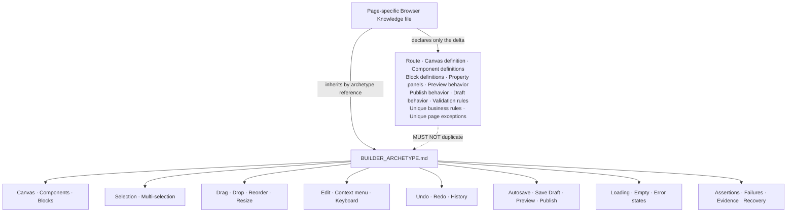

# Builder Archetype — Hermes Browser Testing Canonical Contract

**Document Type:** Canonical archetype — inheritance layer for Browser Knowledge
**Status:** Canonical — stable for years
**Layer:** One of the core inheritance layers beneath future `*KNOWLEDGE.yaml` files. This document expands ONLY the Builder archetype first identified in `PAGE_ARCHETYPE_DISCOVERY.md`. It does not redefine that discovery, nor any other archetype.
**Companion Artifact:** The Browser Knowledge generation skill consumes this archetype by name and layers page-specific deltas on top.
**Authority Note:** This document defines *browser interaction behavior only*. It is deliberately independent of any business domain and describes no page-builder, no CMS builder, and no business artifact. No entity, component semantics, render engine, publish logic, endpoint, or persistence mechanism is asserted here. A future Browser Knowledge file supplies those; everything behavioral is inherited from this document. Where this document states that a draft is server-authoritative, it states a browser-evidence expectation (the browser must observe the server's verdict), not an implementation detail.

---

## 1. Purpose

### 1.1 Why Builder exists

Some application surfaces exist to assemble a complex, browser-visible artifact out of smaller composable pieces. The surface is not a collection to be listed (CRUD), not a transaction to be committed (Transaction), not a record moving through a lifecycle (Workflow), not an aggregated read-only dataset (Report), not a configuration to be persisted (Settings), and not a navigation/overview hub (Dashboard). Its reason to exist is *composition on a canvas*: placing, arranging, editing, previewing, and publishing a structured visual artifact.

### 1.2 Why it differs from CRUD

CRUD manages a uniform collection of records through search, pagination, filtering, and single-record create/edit/delete. A Builder does not manage collections. Its primary subject is a single, mutable composition on a canvas — a graph of placed components and blocks — not a list of peers. Selection, drag, drop, resize, reorder, multi-select, and layered arrangement are first-class, whereas in CRUD those concepts do not exist or are confined to list rows.

### 1.3 Why it differs from Transaction

Transaction executes a bounded, side-effecting operation and produces a receipt or confirmation. Builder is open-ended and iterative: there is no single commit boundary. The user composes continuously, saves drafts, previews, and only eventually publishes. Undo/redo and autosave are native to Builder; they are not the defining contract of a Transaction.

### 1.4 Why it differs from Workflow

Workflow moves a record through discrete, often approval-gated state transitions. Builder has no approval lifecycle of its own. It produces an artifact; the act of publishing is a single terminal action, not a governed state machine. If a Builder page also carries approval behavior, that is a secondary layer the page inherits from Workflow — it is not described here.

### 1.5 Why it differs from Report

Report is read-only aggregation surfaced for analysis. Builder is fundamentally write-oriented: it creates and mutates a visible artifact. Even its "preview" is a render of the thing being composed, not a read of derived data.

### 1.6 Why it differs from Settings

Settings loads a configuration object and persists it wholesale. Builder composes a structured artifact from many independent, individually positioned, individually editable pieces. The unit of mutation is a component on a canvas, not a single form field.

### 1.7 Why it differs from Dashboard

Dashboard aggregates widgets and provides navigation entry points. Builder produces a deliverable artifact through direct manipulation. A Dashboard observes; a Builder constructs.

### 1.8 Why Hermes should inherit Builder behavior

A Builder page is defined by its interaction pattern, not by what it composes. Once the pattern is captured — how a canvas renders, how a component is selected and dragged, how a block is dropped and resized, how multi-selection behaves, how draft/preview/publish/undo/redo/autosave operate — that capture applies to any compositional surface, present or future. Re-describing the pattern per surface produces duplicated, drifting knowledge.

- **Transfer.** A new compositional surface shipped next quarter reuses the same contract. Hermes recognizes it on first encounter from the inherited layer instead of requiring a new knowledge file.
- **Single point of maintenance.** A change to the generic canvas/selection/draft contract is made once, here, and benefits every Builder page at once.
- **Reasoning consistency.** Generic QA expectations (server-authoritative draft, autosave observability, no stale canvas, undo/redo consistency, fail-closed on ambiguous state) are applied uniformly across all Builder pages because they live in one place.
- **Reduced knowledge weight.** A page-specific file declares only its deltas (route, canvas definition, component/block definitions, property panels, publish/draft/preview behavior, validation rules, exceptions). The bulk of behavioral knowledge is inherited, not repeated.

---

## 2. Browser Identity

### 2.1 Typical characteristics

A Builder page is **composition-first**. The dominant region is a canvas onto which components and blocks are placed, moved, resized, and edited. The page is write-biased and iterative: the user rarely lands in a "view" state; they land inside an editor. The persistence model is typically two-tiered — an ephemeral working state (the live canvas) and a persisted draft, with an optional published output.

### 2.2 Typical interaction model

The user manipulates the artifact directly on the canvas:

- **Select** a component or block (single or multi).
- **Drag** it from a library onto the canvas, or **move** an already-placed item.
- **Drop** to place, with position determined by the drop target and snapping/guidelines.
- **Resize** via handles.
- **Reorder** (rearrange) placed items relative to one another.
- **Edit** properties via a property panel or inline.
- **Preview** the composition in a dedicated mode or route without disturbing the working state.
- **Save draft**, observe **autosave**, **undo/redo**, and finally **publish**.

Mutation is continuous and reversible. The browser is expected to keep the working state and the persisted draft in a coherent relationship, and to surface that relationship (e.g. an autosave indicator, a "draft saved / unsaved changes" signal).

### 2.3 Typical browser layout

- An application shell (sidebar/nav) is assumed present; Builder is the content surface inside it.
- A **builder header** spanning the top: title, draft/save controls, preview, publish, undo/redo, autosave indicator.
- A **canvas** occupying the central, primary region — the composition surface.
- A **component library** and/or **block library** (palette) from which items are sourced, typically on one side.
- A **toolbar** with manipulation affordances (select, move, align, delete, undo/redo).
- A **property panel** for editing the selected item's attributes.
- A **layers panel / navigator** representing the composition as a tree or ordered list.

### 2.4 Typical navigation

- Reached via a route that opens the builder directly (optionally with an artifact identifier).
- May deep-link to a specific artifact or to its preview route.
- Preview is commonly a distinct mode or route that renders the composition as it would be published, isolated from editing affordances.
- The builder route is the canonical editing surface; the preview route is a read-only rendering of the same composition.

### 2.5 Typical user expectations

- The canvas renders immediately and reflects the current draft.
- Components and blocks are discoverable in the library and placeable by drag.
- Selection is visible (outline / handles); multi-selection is possible and clearly indicated.
- Moves, resizes, and reorders are immediate and reversible via undo.
- Draft state persists across reloads; unsaved or autosaving state is clearly communicated.
- Preview shows the composition as it will appear, separate from the editing surface.
- Publish makes the composition available through its published route without disturbing the editable draft.
- The view is consistent after a browser refresh: the same composition (and selection where appropriate) is restored.

---

## 3. Expected Page Structure

A Builder page is composed of a set of UI components. Not every page contains every component. The contract distinguishes **required** from **optional** and describes only browser-observable component behavior.

### 3.1 Required components

- **Canvas** — the central composition surface. This is the definitional element of the archetype. If there is no canvas onto which items are placed and arranged, the page is not Builder.
- **Loading state** — an explicit indicator while the builder, draft, or composition is being fetched or initialized.
- **Empty state** — an explicit, non-error presentation when the composition contains no placed items (or when no draft exists yet).
- **Error state** — an explicit, recoverable presentation when the builder or draft cannot be loaded.

### 3.2 Optional components

- **Builder header** — title and global controls (save draft, preview, publish, undo, redo, autosave indicator).
- **Component library** — a palette of atomic, placeable items.
- **Block library** — a palette of composite, pre-assembled placeable items.
- **Toolbar** — manipulation affordances (select, move, align, duplicate, delete, undo, redo).
- **Property panel** — edits attributes of the current selection.
- **Layers panel / navigator** — represents the composition as a tree or ordered list for selection and reordering.
- **Selection outline** — a visible boundary drawn around the selected item on the canvas.
- **Multi-selection** — a visible indication (e.g. multiple outlines, a marquee, a selection count) when more than one item is selected.
- **Resize handles** — draggable affordances on a selection for changing size.
- **Drag handles** — a grab region that initiates moving an item.
- **Context menu** — a right-click / long-press menu offering actions on the selection (edit, duplicate, delete, bring forward, send back).
- **Preview** — a mode or route rendering the composition as it would be published.
- **Save Draft** — persists the working state without publishing.
- **Publish** — makes the composition available through its published route.
- **Undo** — reverts the last mutation.
- **Redo** — re-applies a reverted mutation.
- **Autosave indicator** — communicates draft persistence status (saving / saved / unsaved changes / failed).

### 3.3 Component contracts (browser-observable only)

- The **canvas** captures pointer interactions; clicks on empty canvas deselect; clicks on an item select it; drags on an item move it.
- A **selection outline** is drawn only while an item is selected and disappears on deselect; it does not itself alter the composition.
- **Resize handles** appear on selection; dragging a handle changes the item's rendered size and is reflected in the property panel.
- **Drag handles** initiate a move; releasing outside a valid drop zone cancels the move and restores the prior position.
- The **property panel** reflects the selected item; editing a field updates the canvas immediately and is reversible via undo.
- The **layers panel / navigator** and the canvas are two views of the same composition: selecting in one selects in the other; reordering in one reorders in the other.
- **Undo / Redo** operate on the mutation history of the composition; they change canvas and layers/property state together and consistently.
- **Autosave / Save Draft / Publish** are distinct: autosave persists working state silently; Save Draft persists explicitly; Publish promotes the composition to its published route. None of the three necessarily implies the others.
- **Loading / empty / error** are mutually exclusive visible states for the builder surface at any moment.

---

## 4. Builder Lifecycle

This contract describes the canonical path a browser session takes through a Builder surface. It is descriptive of expected behavior, not a script.

```
Landing
   ↓
Load builder
   ↓
Load draft
   ↓
Compose (place components / blocks on the canvas)
   ↓
Select (single, then multi)
   ↓
Move (drag placed items)
   ↓
Resize (adjust via handles)
   ↓
Edit (change properties / inline content)
   ↓
Preview (render as it would be published)
   ↓
Undo / Redo (revert or re-apply mutations)
   ↓
Save Draft (persist working state)
   ↓
Publish (promote to published route)
   ↓
Refresh (browser reload)
   ↓
Verify composition persistence (the draft and/or published artifact survives reload)
```

### 4.1 Notes on the lifecycle path

- Steps may be entered in any order; the path above is the *complete* set, not a forced sequence. Compose/Select/Move/Resize/Edit typically repeat many times before any Save Draft or Publish.
- **Load draft** is the bridge between the persisted artifact and the live canvas; if no draft exists, the builder opens in its empty state and composition begins from scratch.
- **Preview** is non-destructive: entering preview must not mutate the working draft, and exiting must return to the exact editing state.
- **Undo / Redo** may be exercised at any point after a mutation; they do not require Save Draft or Publish.
- **Save Draft** and **Publish** are terminal-ish actions. Save Draft is reversible (the draft can be replaced); Publish is a promotion that should be observable on the published route without disturbing the editable draft.
- **Refresh / Verify composition persistence** is the closure that proves the composition was durable, not merely held in memory.

---

## 5. Browser Interaction Contract

The expected interaction model for every Builder page. These are behaviors Hermes should be able to exercise and observe.

### 5.1 Selection

- **Selecting** — clicking a placed item selects it (single selection); the selection outline and property panel update to reflect it.
- **Multi-selection** — shift/ctrl-click, marquee drag, or a layers-panel multi-pick selects more than one item; the browser shows a clear multi-selection indication and the property panel reflects the collective or the primary selection.
- **Deselection** — clicking empty canvas, pressing escape, or clicking away clears the selection.

### 5.2 Placement and arrangement

- **Dragging** — pressing on a library item and moving the pointer initiates a drag; a drag preview or ghost follows the pointer.
- **Dropping** — releasing over the canvas places the item at the drop location; snapping/guidelines may adjust the final position. Dropping outside a valid target cancels placement.
- **Reordering** — placed items can be rearranged relative to one another, via canvas drag, layers-panel drag, or explicit move actions; the resulting order is reflected in both canvas and layers view.
- **Moving** — an already-placed item is draggable via its body or drag handle; the move is live and cancels on invalid drop.

### 5.3 Manipulation

- **Resizing** — drag handles change an item's size; the property panel mirrors the new dimensions; resize is reversible via undo.
- **Editing** — the property panel and/or inline editing change an item's attributes or content; the canvas updates immediately; edits are reversible via undo.
- **Context menus** — right-click / long-press on a selection opens a context menu with relevant actions (edit, duplicate, delete, layer order); choosing an action applies it to the selection.

### 5.4 Keyboard and history

- **Keyboard shortcuts** — common bindings (delete, duplicate, undo, redo, escape-to-deselect, arrow-nudge) are observable; focus determines whether a shortcut affects the canvas or an input.
- **Undo** — reverts the most recent mutation to the composition; repeated undo walks back through history.
- **Redo** — re-applies a mutation undone by Undo; a new mutation after undo clears the redo stack (or the page defines its own rule, which Hermes should record, not assume).
- **History** — the undo/redo stack is consistent: canvas, layers, and property panel all reflect the same point in history after each operation.

### 5.5 Persistence and publish

- **Autosave** — the working state is persisted automatically; the autosave indicator reflects status (saving / saved / unsaved / failed). Autosave must not block interaction.
- **Save Draft** — explicitly persists the working state; the browser must observe a confirmation that the draft was saved (indicator or notification), and the saved draft must survive reload.
- **Preview** — renders the composition as it would be published, in a mode or route isolated from editing; preview reflects the current draft (or the latest saved draft, per the page's rule) and never mutates the working state.
- **Publish** — promotes the composition to its published route; the browser must be able to observe the published artifact on that route afterward, and the editable draft must remain unaffected.

### 5.6 Session and navigation

- **Deep links** — an artifact or its preview may be addressable by URL; opening it directly renders the correct composition or preview.
- **Browser reload** — a full reload re-initializes the builder and restores the draft (and, where appropriate, the working state) from the server; the canvas reflects the persisted composition.
- **Focus management** — focus moves logically between canvas, property panel, layers panel, and dialogs; opening an overlay moves focus into it and restores focus on close.
- **Session restoration** — after a reload or session recovery, the builder returns to a coherent state (draft loaded, no orphaned transient UI) rather than a blank or corrupted canvas.

---

## 6. Browser Assertions

What Hermes should automatically verify on a Builder page. These are browser-level observations.

- **Canvas rendered** — the composition surface mounts without a blank screen or frozen shell.
- **Components rendered** — library items (and any previously placed items) paint with the expected structure.
- **Selection verified** — clicking an item produces a visible selection outline and a populated property panel; deselect clears them.
- **Multi-selection verified** — a multi-select action produces a clear multi-selection indication and consistent panel/canvas state.
- **Drag verified** — a drag from the library follows the pointer and produces a drag preview or ghost.
- **Drop verified** — releasing over a valid target places the item at the expected location; an invalid drop cancels without placing.
- **Resize verified** — dragging a handle changes rendered size and the property panel mirrors it; undo reverts it.
- **Reorder verified** — a reorder action changes ordering in both canvas and layers view consistently.
- **Edit verified** — changing a property updates the canvas immediately and is reversible via undo.
- **Context menu verified** — right-click / long-press opens the expected menu and its actions apply to the selection.
- **Preview verified** — preview renders the composition as it would appear published, isolated from editing, and does not mutate the draft.
- **Undo verified** — undo reverts the last mutation and canvas/layers/panel state stay consistent.
- **Redo verified** — redo re-applies an undone mutation; history stays consistent.
- **Draft verified** — Save Draft persists the working state; after reload the draft is restored on the canvas.
- **Publish verified** — after Publish, the composition is observable on its published route and the editable draft is unchanged.
- **Autosave verified** — the autosave indicator reflects status transitions (saving → saved / unsaved / failed) during editing.
- **Loading state** — a loading indicator shows during initialization/fetch and clears on completion.
- **Empty state** — a clear empty presentation appears when no items are placed or no draft exists, with no crash.
- **Error state** — a recoverable error presentation appears on load failure, with a path to retry.
- **No stale canvas** — after Save Draft / Publish / Undo / Redo, the canvas reflects the authoritative state, not a pre-mutation or pre-action render.
- **No console errors** — the browser console shows no uncaught errors during the flow.
- **No JavaScript errors** — the page remains interactive; no unhandled rejection leaves it frozen.
- **Browser responsive** — drag, drop, resize, edits, and navigation respond within expected bounds; no permanent spinner.
- **Visual consistency** — rendered content matches structure (no overlapping, collapsed, or unstyled regions at the tested viewport).
- **Composition consistency** — canvas, layers panel, and property panel agree on the same composition at all times.

---

## 7. Failure Scenarios

Generic browser failures Hermes should be able to detect on a Builder page. These are interaction/rendering failures, not domain errors.

- **Lost draft** — a Save Draft or autosave does not persist; after reload the composition is missing or partial.
- **Broken drag** — a library item cannot be dragged, the drag preview does not follow, or the drag cannot be initiated.
- **Broken drop** — a drop does not place the item, places it at the wrong location, or places duplicates.
- **Broken resize** — handles are missing, do not respond, or resize the wrong item or axis.
- **Broken selection** — clicking an item does not select it, selects the wrong item, or cannot be cleared.
- **Broken multi-selection** — multi-select does not engage, drops items unexpectedly, or desyncs between canvas and panel.
- **Broken preview** — preview does not render, renders stale content, or mutates the working draft.
- **Broken publish** — publish appears to succeed but the artifact is absent on the published route, or publish corrupts the draft.
- **Broken autosave** — autosave never fires, fires endlessly, or reports saved while the draft is lost.
- **Undo failure** — undo does not revert the mutation, reverts the wrong mutation, or desyncs canvas/layers/panel.
- **Redo failure** — redo does not re-apply, re-applies the wrong mutation, or desyncs state.
- **History inconsistency** — undo/redo leave canvas, layers, and property panel disagreeing about the composition.
- **Layout corruption** — placed items overlap, escape the canvas bounds, or render with broken structure after a manipulation.
- **Rendering issues** — missing components, unstyled regions, overflow clipping, or visual artifacts on the canvas.
- **Race conditions** — overlapping autosave/draft/publish operations resolve out of order, leaving the canvas inconsistent with the persisted state.
- **Timeout** — a Save Draft / Publish / load exceeds its bound and the UI has no defined recovery.
- **Retry failure** — a failed Save Draft / Publish / load is not retried or is retried excessively, leaving the UI stuck.
- **Browser freeze** — the page becomes unresponsive due to a long synchronous render or runaway loop during composition.
- **Unexpected redirect** — Save Draft / Publish / preview navigates away from the builder without user intent.
- **Lost composition** — after reload, session restore, or recovery, the canvas is blank, partial, or corrupted despite a prior saved draft.

---

## 8. Browser Evidence Collection

What Hermes should collect when exercising a Builder page. Browser evidence only — no backend debugging.

- **Screenshots** — the canvas (empty, populated, multi-selected), library, property panel, layers panel, preview, and any loading/error/corruption state.
- **Console logs** — all console output, especially errors, warnings, and unhandled rejections during compose/select/move/resize/edit/preview/publish.
- **Network requests** — the load, draft-save, autosave, publish, and preview requests with their URLs, params, methods, statuses, and timings (observed from the browser's network surface, not from server internals).
- **DOM state** — the rendered structure of the canvas, selection outlines, handles, panels, dialogs, and state banners at the moment of interest.
- **Current URL** — the address, including artifact/preview identifiers, to prove deep-link and route behavior.
- **Browser storage** — relevant local/session storage entries that influence the builder (e.g. autosave buffers, draft identifiers, session tokens), read from the browser.
- **Canvas state** — the placed items, their order, positions, and sizes as actually rendered.
- **Selection state** — which item(s) are selected, the visible outline(s), and the property panel content at selection time.
- **Draft state** — the autosave/save-draft indicator status and any "unsaved changes" signal before and after a save.
- **Preview state** — what the preview route/mode rendered and whether it diverged from the editing canvas.
- **Loading indicators** — which spinner/skeleton was active and when it cleared.
- **Error messages** — the exact text and location of any surfaced error.
- **Timing** — durations for load, draft save, publish, and preview, to detect timeouts and freezes.
- **Browser events** — focus changes, history pushes/pops, drag/drop events, and visibility/responsiveness signals.

---

## 9. Browser Recovery Behavior

How Hermes should recover from the failures in Section 7, using browser-level actions only.

- **Retry load** — re-trigger the builder/draft load via the page's retry control or by re-navigating to the route.
- **Retry publish** — after a failed publish, re-issue publish and confirm the artifact appears on the published route.
- **Retry draft save** — after a failed Save Draft / autosave, re-attempt the save and confirm the draft indicator transitions to saved.
- **Refresh** — perform an in-page refresh or a full browser reload to clear a stuck state.
- **Reload** — navigate away and back to the builder route to rebuild a clean session state.
- **Recover after timeout** — after a request exceeds its bound, reload or retry and confirm the UI returns to a stable state.
- **Recover after failed request** — observe the error state, then retry or reload and verify the composition becomes consistent.
- **Restore draft** — after a lost/missing draft, reload and confirm the previously saved draft is reloaded onto the canvas.
- **Undo** — revert a bad mutation (e.g. a mis-drop or wrong resize) via undo.
- **Redo** — re-apply a mutation incorrectly undone, to return to the intended composition.
- **Reset browser state** — clear relevant browser storage scope that is corrupting the canvas, then reload.
- **Restore browser session** — after a crash or session loss, re-open the builder route and confirm the draft is restored coherently.
- **Dismiss notifications** — close toasts/banners that may obscure canvas controls or handles.

---

## 10. Inheritance Contract

This is the most important section. It defines the inheritance model that makes Builder a reusable layer.

### 10.1 The rule

**Every Builder page automatically inherits the entire behavior defined in this document.** A future Browser Knowledge file does not re-describe canvas rendering, selection, multi-selection, drag, drop, reorder, resize, edit, context menus, keyboard shortcuts, undo, redo, autosave, preview, publish, save draft, loading/empty/error states, assertions, failure scenarios, evidence collection, or recovery. Those are inherited by referencing the Builder archetype by name.

**Hermes MUST NOT duplicate inherited behavior in a page-specific file.** If a Builder page's knowledge file restates selection, drag/drop, undo/redo, autosave, preview, or publish mechanics, that is a violation of the inheritance model and causes drift.

### 10.2 What a page-specific Browser Knowledge file must declare

A page-specific file supplies **only the delta** — what makes this one compositional surface different from every other. It declares:

- **Route** — the builder route (and any preview/published sub-routes) for this page.
- **Canvas definition** — the shape, bounds, and coordinate model of this page's canvas (e.g. fixed vs. free, grid vs. flow).
- **Component definitions** — the specific placeable components this page exposes and their editable properties.
- **Block definitions** — the specific composite blocks this page exposes.
- **Property panels** — the property schema for each component/block on this page.
- **Preview behavior** — how this page renders preview (mode vs. route) and what state preview reflects (working draft vs. last saved).
- **Publish behavior** — what this page's publish promotes and to which published route.
- **Draft behavior** — how this page's autosave and explicit Save Draft persist and reload.
- **Validation rules** — validations specific to this page's components/blocks that the generic contract does not cover.
- **Unique business rules** — any rule that governs *this* page's composition in the browser.
- **Unique page exceptions** — any deviation from this archetype (e.g. this page forbids multi-selection, or publishes immediately on every save).

### 10.3 What a page-specific file must NOT declare

Everything behavioral already in this document: the canvas/selection/multi-selection/drag/drop/reorder/resize/edit contracts, context-menu and keyboard behavior, undo/redo and history consistency, autosave/Preview/Publish/Save-Draft mechanics, loading/empty/error states, the assertion set, the failure catalog, the evidence set, and the recovery set. Re-declaring these in a page file is forbidden by the inheritance model.

### 10.4 Inheritance diagram



**Reading the diagram:**

- The page-specific file owns the **delta** only.
- The Builder archetype owns the **entire behavioral contract**.
- The arrow labeled *MUST NOT duplicate* is a constraint: anything the archetype already defines is inherited, never restated.

### 10.5 Inheritance model summary

```
Page-specific Browser Knowledge file
   └─ declares: route, canvas definition, component definitions,
                block definitions, property panels, preview behavior,
                publish behavior, draft behavior, validation rules,
                unique business rules, unique page exceptions
   └─ inherits (by archetype reference): ALL of BUILDER_ARCHETYPE.md
                canvas · components · blocks · selection
                multi-selection · drag · drop · reorder · resize
                edit · context menu · keyboard · undo · redo · history
                autosave · save draft · preview · publish
                states · assertions · failures · evidence · recovery
```

The class of change *"the canvas now supports grid snapping"* is made once, in this archetype, and every Builder page gains it. The class of change *"this surface adds a new component with three properties"* is made only in that page's delta.

---

## 11. Scope Boundaries

This document defines **browser interaction behavior**. It explicitly does NOT define the following; those belong to page-specific Browser Knowledge files (or to layers beneath them):

- **Business rules** — domain logic that decides what a valid composition is; this document only expects that such rules are *observable* as validation or constraint in the browser.
- **Permissions** — what a given user may compose, preview, or publish; the archetype expects gated controls to be disabled/hidden but does not define who is gated.
- **Composition semantics** — the meaning, structure, or domain significance of what is composed; out of scope for a generic Builder contract.
- **Rendering engine** — how the canvas paints or how components are laid out internally; this document references only the browser-observable result (items appear, move, resize).
- **Publish logic** — the server-side promotion, versioning, or routing of a published artifact; the archetype expects publish to be *observable* on a route, but the logic is page-specific.
- **Database behavior** — how compositions or drafts are stored or migrated; this document references only the browser-visible effect (a draft reloads, a published artifact appears).
- **API implementation** — how requests are formed, routed, or authenticated on the server; this document references only the browser-observable request (URL, params, status) as evidence.
- **Server processing** — any computation performed server-side on a draft or published artifact; out of scope.
- **Entity definitions** — the schema or identity of the artifact being composed; the archetype expects components/blocks to be *present and editable*, but their definitions are page-specific.
- **Validation logic** — the specific content rules for a component or property; the archetype expects validation to be *surfaced*, but the rules themselves are page-specific.

If a page's dominant interaction is a stateful lifecycle (approvals, transitions) layered on top of composition, it is a Workflow page that may *inherit Builder* as a secondary layer — but the lifecycle rules themselves are not defined here.

---

## 12. Stability

This document is intended to remain stable for years and to be extended rarely.

- **Defined by interaction shape, not domain.** Builder is expressed entirely in browser behavior (canvas, components, blocks, selection, multi-selection, drag, drop, reorder, resize, edit, preview, draft, publish, undo, redo, autosave). Domains come and go; the interaction contract does not. A future compositional surface — whatever it assembles — will still be a canvas with selectable, draggable, resizable, editable pieces that can be drafted, previewed, and published.
- **New Builder pages inherit without modification.** When a new compositional surface is added to the application, its Browser Knowledge file references this archetype and supplies only its delta. This document is not edited for the new page.
- **Only new browser patterns justify change.** This archetype is updated only when a genuinely new Builder interaction pattern appears that the current contract does not cover (for example, a new universal canvas primitive, a new standard selection/handle lifecycle, or a new standard failure class). Incremental UI polish, new components, new blocks, and new surfaces do NOT justify editing this document.
- **Drift protection.** Because behavioral knowledge lives here and not in page files, a fix or clarification to the generic Builder contract propagates to every page at once. The stable center is this document; the churn happens in the page-specific deltas beneath it.

*End of Builder Archetype. Canonical inheritance layer for Hermes Browser Testing.*

---

## Browser Execution Checklist

- □ Canvas rendered
- □ Components rendered
- □ Selection verified
- □ Multi-selection verified
- □ Drag verified
- □ Drop verified
- □ Resize verified
- □ Reorder verified
- □ Edit verified
- □ Context menu verified
- □ Preview verified
- □ Undo verified
- □ Redo verified
- □ Draft verified
- □ Publish verified
- □ Autosave verified
- □ Loading state verified
- □ Empty state verified
- □ Error state verified
- □ No stale canvas
- □ Browser history verified
- □ Console verified
- □ Network verified
- □ Evidence collected
- □ Recovery verified
