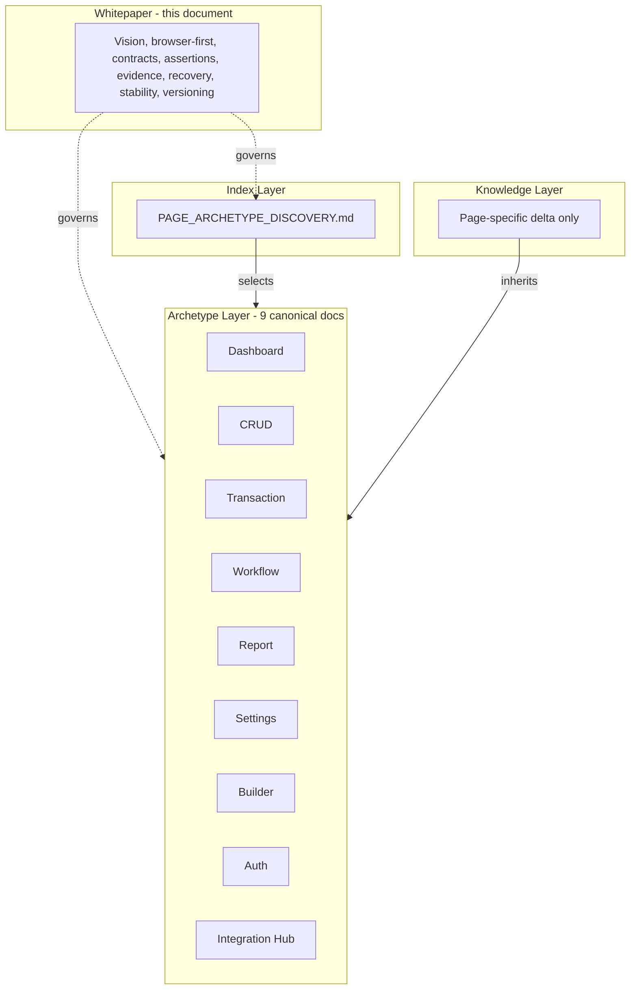
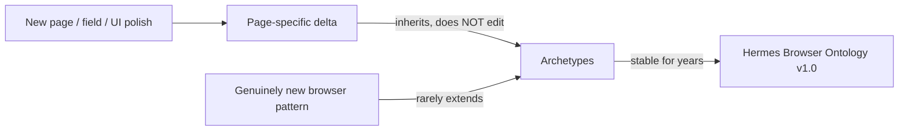

# Hermes Browser Ontology — Whitepaper (v1.0)

**Document Type:** Architecture whitepaper — philosophy and canonical policy for Hermes Browser Testing
**Status:** Canonical — stable for years
**Version:** 1.0
**Part of:** Hermes Browser Ontology v1.0
**Companion documents:**
- `PAGE_ARCHETYPE_DISCOVERY.md` — canonical index of browser archetypes (entry point).
- `ARCHETYPE_RELATIONSHIPS.md` — families, inheritance, composition, comparison matrix.
- `HERMES_BROWSER_ONTOLOGY_v1_RELEASE.md` — official release notes.
- `CRUD_ARCHETYPE.md`, `TRANSACTION_ARCHETYPE.md`, `WORKFLOW_ARCHETYPE.md`, `REPORT_ARCHETYPE.md`, `DASHBOARD_ARCHETYPE.md`, `SETTINGS_ARCHETYPE.md`, `BUILDER_ARCHETYPE.md`, `AUTH_ARCHETYPE.md`, `INTEGRATION_HUB_ARCHETYPE.md` — the nine canonical archetype contracts.

**Authority Note:** This document defines *browser testing philosophy and policy only*. It is deliberately independent of any business domain and free of implementation detail. No entity, field, rule, endpoint, or persistence mechanism is asserted here. Where it uses MUST / SHOULD / MUST NOT, it expresses normative policy that the canonical archetype and relationship documents enforce. The terminology, families, and inheritance rules stated here are identical to those in the rest of the ontology; this document is the single readable source of the complete Hermes philosophy and is intended to be understood without reference to any other file.

---

## 1. Vision

Hermes tests the browser the way a senior QA engineer tests the browser: by reasoning about *how a surface behaves*, not about what business it happens to be conducting. The Hermes Browser Ontology is the stable, minimal, domain-independent contract that lets an AI testing agent understand any administrative or operational page on first encounter, exercise it correctly, observe it faithfully, and recover from failure — without learning the application's business vocabulary.

The vision is a testing system that:
- learns **behaviors**, not pages;
- inherits canonical behavior instead of re-describing it;
- observes the browser as the source of evidence;
- fails closed when state is ambiguous;
- stays valid for years as the application's domains change beneath it.

This whitepaper states why that vision is correct, what the ontology is, and the guarantees it makes.

---

## 2. Browser-first philosophy

Hermes is a **browser** testing agent. Its truth surface is the rendered page, the network the page issues, the storage it writes, the console it emits, and the navigation it performs. Everything Hermes concludes is derived from observable browser state.

This is a deliberate boundary. The backend may be the system of record, but Hermes does not debug the backend; it observes the browser's experience of it. When the browser and a claimed server state disagree, Hermes reports the browser-observable fact and treats server-internal disagreement as out of scope.

Browser-first means:
- The **page** is the unit of testing, not the API.
- The **interaction pattern** is the unit of knowledge, not the entity.
- The **observable effect** is the unit of evidence, not the log line.

---

## 3. Why browser behavior instead of business behavior

Classifying pages by business domain ("this is inventory, that is accounting") produces a taxonomy that changes every time the product adds or removes a domain. Classifying by browser behavior ("this is a list, that is a transaction") produces a taxonomy that does not.

A Products page (inventory) and a Customers page (CRM) are the *same* archetype because a browser tester interacts with them identically: search, filter, paginate, create, edit, delete, with server-authoritative validation. Conversely, a POS Sale page and a Treasury Transfer page are *different* archetypes even though both move money, because their browser interaction shape differs (live cart + tender modal vs. validated form + posting).

Browser behavior is stable; business behavior is not. The ontology is therefore expressed entirely in browser interaction shape. Domains come and go; the interaction contracts do not.

---

## 4. Why archetypes exist

The application contains well over one hundred distinct routes. Documenting browser behavior for each page individually would produce one hundred near-duplicate knowledge files, massive maintenance cost when a shared table, modal, filter, or settings pattern changes, and inevitable drift as each copy lags.

Archetypes solve this. An archetype is the durable interaction contract shared by a class of pages. Teaching the contract once covers every page that uses it, plus every future page that will reuse it. The benefits are:

- **Maintenance collapse:** one archetype update fixes every page that uses it.
- **Transfer:** a new page shipped next quarter is recognized on first encounter.
- **Reasoning consistency:** QA rules (authority model, tenant isolation, idempotency, fail-closed) apply uniformly inside each archetype.
- **Reduced token cost:** a future Browser-Knowledge file references an archetype by name plus page-specific deltas; the bulk of behavior is inherited, not repeated.

A page is a transient instance. An archetype is the durable contract.

---

## 5. Canonical inheritance

The ontology is a strict inheritance system. The canonical archetype documents own the full generic behavior of each interaction contract. A page-specific Browser Knowledge file inherits that behavior by naming the archetype and supplies only its delta.

Inheritance rules (normative):
- **Hermes MUST inherit canonical behavior.** Load and apply the entire referenced archetype.
- **Hermes MUST NOT duplicate inherited behavior.** Re-declaring generic behavior causes drift and is forbidden.
- **Hermes MUST declare only page-specific behavior.** Route, entity, unique fields, unique rules, special validations, exceptions, and NON-EXISTENCE assertions.

Inheritance is by reference, not by copy. This is what makes the ontology durable: the stable center is the archetype; the churn happens in the page-specific deltas beneath it.

---

## 6. Browser Knowledge philosophy

Browser Knowledge is the thinnest layer. It describes one page: which archetype(s) it inherits and what makes this page different. It is a delta, never a rewrite.

The philosophy is *declare only the delta*:
- What the archetype already knows, the page does not repeat.
- What the page uniquely knows, the archetype does not preempt.
- What is browser-observable, the agent can assert; what is server-internal, it cannot and must not.

A Browser Knowledge file is therefore small, stable, and cheap to maintain. The intelligence lives in the inherited archetype, not in the page file.

---

## 7. Browser observable state

Hermes reasons only over browser-observable state. The complete set of observable surfaces is:

- **Rendered DOM** — structure, text, visibility, disabled/hidden state, class and style as rendered.
- **Network** — requests with URL, params, method, status, and timing, observed from the browser's network surface.
- **Storage** — local/session storage and cookies as read from the browser.
- **Console** — all console output, especially errors, warnings, and unhandled rejections.
- **Navigation** — current URL (including query), history pushes/pops, and route transitions.
- **Visual** — screenshots and rendered layout at the tested viewport.

State that is not observable in the browser — server internals, database rows, queue contents, projection internals — is out of scope. Where the browser presents a derived value (an aggregated total, a status, a KPI), Hermes observes that presented value consistently with the loaded dataset; it does not recompute it from first principles.

---

## 8. Browser contracts

A browser contract is the expected, observable behavior a page MUST exhibit for its archetype. Each canonical archetype document defines its contract in full: expected page structure, navigation contract, interaction contract, assertions, failure scenarios, evidence collection, and recovery behavior.

Cross-cutting contracts that apply to every archetype:
- **Server-authoritative validation.** Validation verdicts are observed from the server, not assumed from client checks.
- **Idempotency where side effects exist.** Duplicate submission MUST be observed as a single effect (byte-equal response, no second document).
- **No mutation from read-only surfaces.** A Report or Dashboard MUST NOT mutate observed state.
- **Evidence over assumption.** Frontend guards, badges, and callbacks are evidence only; backend authority wins.
- **Fail closed.** On ambiguous state, Hermes MUST NOT assume success; it reports the ambiguity.

---

## 9. Browser assertions

Assertions are browser-level observations Hermes verifies. They are defined per archetype and inherited by every page of that archetype. Representative classes:

- **Render assertions** — the surface mounts; required regions paint; no blank screen or frozen shell.
- **Interaction assertions** — search/filter/paginate work; create/edit/delete persist; validation blocks invalid submit.
- **State assertions** — loading/empty/error states are mutually exclusive and explicit; values survive reload where expected.
- **Authority assertions** — presented totals reconcile to lines; illegal transitions are blocked (401/403); NON-EXISTENCE endpoints return 404/405.
- **Hygiene assertions** — no console errors; no JavaScript crashes; no duplicated rows; no unexpected dialogs; layout coherent at viewport.

Assertions describe what the browser MUST show; they do not describe how the server produces it.

---

## 10. Browser evidence

Evidence is what Hermes collects to support an assertion or a failure report. Evidence is browser-only:

- **Screenshots** of each relevant state, including empty/error/loading.
- **Console logs** with errors, warnings, and unhandled rejections.
- **Network requests** with URL, params, method, status, timing.
- **DOM state** at the moment of interest.
- **Current URL** including query parameters proving deep-link and URL-sync behavior.
- **Storage state** that influences the view.
- **Visible notifications**, **rendered table**, **dialog state**, **loading indicators**, **error message text**, **timing**, and **browser events** (focus, history, visibility).

Evidence is captured from the browser. It is never reconstructed from server logs. Where a follow-up read is needed to confirm a side effect, Hermes performs that read through the browser and records the observed result.

---

## 11. Browser recovery

Recovery is the set of browser-level actions Hermes uses to escape a failure and return to a stable state. Recovery is defined per archetype and inherited by the page. Representative actions:

- **Retry** the failed load or submit via the page's retry control.
- **Refresh** in-page or full reload to clear a stuck state.
- **Close modal** via cancel/escape/backdrop to return to the collection.
- **Reopen page** to rebuild a clean session state.
- **Repeat search / clear filters** to confirm transient vs. persistent wrong results.
- **Navigate back / forward** to escape an unexpected redirect or broken sub-flow.
- **Reset state** by clearing corrupting browser storage, then reload.
- **Dismiss notifications** that obscure controls.

Recovery is browser-only. If a failure cannot be resolved from the browser, Hermes reports the unrecoverable state rather than guessing at a server-side cause.

---

## 12. Browser ontology families

The nine archetypes group into five families by the kind of browser state they primarily manipulate or observe:

| Family | Archetypes | Kind of state |
|--------|-----------|---------------|
| **Mutation** | Transaction, Workflow | Committed domain effect |
| **Observation** | CRUD, Report | Presented dataset / collection |
| **Configuration** | Settings | Persisted config value |
| **Composition** | Dashboard, Builder | Aggregated whole / published artifact |
| **Boundary** | Auth / Entry, Integration Hub | Session / external bridge |

Families are a reasoning lens, not a behavior layer. They explain how archetypes differ and complement each other (see `ARCHETYPE_RELATIONSHIPS.md` Section 3) without adding or redefining behavior.

---

## 13. Future extensibility

The ontology is open at exactly one point: the archetype set. It is closed everywhere else.

- **New pages** do not extend the ontology. They reference an existing archetype and declare a delta. The archetype documents are not edited for them.
- **New fields, UI polish, and incremental changes** do not extend the ontology. They live in page-specific deltas.
- **A genuinely new browser interaction pattern** — a universal list primitive, a new standard dialog lifecycle, a new standard failure class — MAY extend the archetype layer. This is rare; none has appeared across the 145 classified routes.
- **New families** are not expected. The five families are exhaustive over the kinds of browser state an enterprise admin surface manipulates.

Extensibility is therefore controlled: the ontology absorbs change beneath it (in deltas) and resists change at its center (the archetypes), which is what keeps it stable.

---

## 14. Stability guarantees

The ontology makes the following guarantees:

- **Stable center.** The nine archetypes and their contracts are intended to remain stable for years and to be extended rarely.
- **Drift protection.** Because behavioral knowledge lives in the archetypes, not in page files, a fix or clarification to a generic contract propagates to every page at once.
- **Transfer guarantee.** A future page reusing an existing interaction contract is understood on first encounter without a new knowledge file.
- **No terminology drift.** Naming, normative language, and contracts are identical across every document in the ontology (audited in the release process).
- **No conflicting inheritance.** The inheritance rules are stated once and enforced uniformly.
- **Domain independence.** No business concept enters the ontology; it stays valid as domains change.

---

## 15. Versioning policy

- The ontology is versioned as a whole. The current release is **v1.0**.
- **Patch (x.y.Z):** clarification of wording, correction of a description, or a non-behavioral fix that does not change any contract. No migration required.
- **Minor (x.Y.0):** addition of a new secondary capability, a new comparison row, or extension of an archetype to cover a newly observed universal browser pattern — without breaking existing page deltas. Page deltas remain valid.
- **Major (X.0.0):** addition of a new archetype or family, a breaking change to an inheritance rule, or a redefinition of a canonical contract. Requires a migration note and a re-audit of all page deltas.
- **Backward compatibility:** within a major version, existing page deltas MUST remain valid. A breaking change MUST increment the major version and publish migration notes in the release document.
- **Authority of version:** when two documents in the ontology disagree, the higher-versioned canonical statement wins; where versions are equal, the archetype's generic behavior wins over a page delta, and the whitepaper's policy wins over narrative prose.

---

## 16. Release history

| Version | Status | Summary |
|---------|--------|---------|
| Discovery (pre-1.0) | Superseded | One-time discovery of the minimal, complete nine-archetype set from the application route table and Admin Dashboard review. Produced `PAGE_ARCHETYPE_DISCOVERY.md` and the nine canonical archetype contracts. |
| **1.0** | **Current — Canonical** | Official consolidation release. Promotion of the discovery artifacts into a coherent, self-referencing framework: `PAGE_ARCHETYPE_DISCOVERY.md` becomes the canonical index; `ARCHETYPE_RELATIONSHIPS.md` defines families, inheritance, composition, and the comparison matrix; this whitepaper states the philosophy and policy; `HERMES_BROWSER_ONTOLOGY_v1_RELEASE.md` records the release. All documents cross-referenced and terminology-audited. |

---

## Architecture diagrams

### 13a. Ontology as a closed, stable system

### 14a. Stability through layered closure

*End of Hermes Browser Ontology Whitepaper. Canonical philosophy and policy for Hermes Browser Testing v1.0.*
