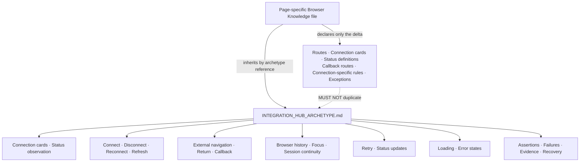

# Integration Hub Archetype — Hermes Browser Testing Canonical Contract

**Document Type:** Canonical archetype — inheritance layer for Browser Knowledge
**Status:** Canonical — stable for years
**Layer:** One of the core inheritance layers beneath future `*KNOWLEDGE.yaml` files. This document expands ONLY the Integration Hub archetype first identified in `PAGE_ARCHETYPE_DISCOVERY.md`. It does not redefine that discovery, nor any other archetype.
**Companion Artifact:** The Browser Knowledge generation skill consumes this archetype by name and layers page-specific deltas on top.
**Authority Note:** This document defines *browser interaction behavior only*. It is deliberately independent of any business domain and describes no external system, no provider, no transport, no authorization technology, and no connectivity mechanism. No provider, protocol, callback mechanism, endpoint, or storage mechanism is asserted here. A future Browser Knowledge file supplies those; everything behavioral is inherited from this document. Where this document states that a connection is established or broken, it states a browser-evidence expectation (the browser must observe the resulting status and navigation), not an implementation detail. This document MUST NOT name or imply any external system, provider, protocol, or transport technology.

---

## 1. Purpose

### 1.1 Why Integration Hub exists

Some application surfaces exist to establish, observe, validate, refresh, reconnect, and terminate browser-visible external relationships. The surface is not a collection to be listed (CRUD), not a transaction to be committed (Transaction), not a record moving through a lifecycle (Workflow), not an aggregated read-only dataset (Report), not a configuration to be persisted wholesale (Settings), not a navigation/overview hub (Dashboard), not a composition on a canvas (Builder), and not an identity gate (Auth). Its reason to exist is *connection*: proving that an external relationship exists, keeping its status visible, repairing it when broken, and ending it on demand.

### 1.2 Why it is connection-first, not data-first

Every other archetype assumes the relationships it depends on are already present. An Integration Hub produces and maintains that presence. It is oriented around connection state and the navigation consequences of connecting or disconnecting — leaving the application for an external surface, returning, and reflecting the resulting status — not around reading or mutating domain records.

### 1.3 Why it differs from CRUD

CRUD manages a uniform collection of records through search, pagination, filtering, and create/edit/delete. An Integration Hub manages none. Its primary subject is the browser-visible connection state of one or more external relationships — connected, disconnected, error, pending — and the controls that change it. Selection, search, pagination, and record edit do not exist here.

### 1.4 Why it differs from Transaction

Transaction executes a bounded, side-effecting operation and produces a receipt. An Integration Hub's connect/disconnect changes a durable browser-visible relationship, and its defining act is a *transition out of and back into the application* via an external surface. Its success is observable as status change and return navigation, not as a document or confirmation modal.

### 1.5 Why it differs from Workflow

Workflow moves a record through discrete state transitions. An Integration Hub has no record lifecycle of its own; it transitions the browser-visible connection state (disconnected → connected → error → reconnected → disconnected), which is a different axis centered on an external relationship. If a connection surface also carries an approval or review flow, that is a secondary layer the page inherits from Workflow — it is not described here.

### 1.6 Why it differs from Report

Report is read-only aggregation. Integration Hub is write-oriented to the browser's view of a relationship: it connects, reconnects, disconnects, and refreshes status. Even its "status" observations are assertions about a live connection state, not reads of derived data.

### 1.7 Why it differs from Settings

Settings loads a configuration object and persists it. An Integration Hub establishes and terminates an external relationship and observes its liveness; it does not configure a persistent preference object. Where Settings confirms "the saved value persists after reload," Integration Hub confirms "the connected status is reflected after return/refresh" — a different contract observed through status and navigation, not through a form field.

### 1.8 Why it differs from Dashboard

Dashboard aggregates widgets and provides navigation entry points. Integration Hub manages the external relationships those widgets and surfaces depend upon. A Dashboard observes connectivity indirectly; an Integration Hub constructs and maintains it directly.

### 1.9 Why it differs from Builder

Builder composes a visible artifact on a canvas. Integration Hub composes nothing; it validates and maintains an external relationship and changes which connection states the browser may observe. A Builder cares about placement; an Integration Hub cares about whether a relationship is live.

### 1.10 Why it differs from Auth

Auth resolves the browser's own identity. Integration Hub resolves a browser-visible relationship with an external party. Auth transitions the browser's identity state; Integration Hub transitions an external connection state and, in doing so, may send the browser to an external authorization surface and back — a leave-and-return navigation Auth does not perform for its own identity.

### 1.11 Why Hermes should inherit Integration Hub behavior

An Integration Hub page is defined by its interaction pattern, not by which external relationship it maintains. Once the pattern is captured — how connection state renders, how connect launches an external transition and returns via a callback, how status reflects liveness, how reconnect/refresh/disconnect behave, how a broken callback or redirect loop is detected — that capture applies to any integration surface, present or future. Re-describing the pattern per surface produces duplicated, drifting knowledge.

- **Transfer.** A new integration surface shipped next quarter reuses the same contract. Hermes recognizes it on first encounter from the inherited layer instead of requiring a new knowledge file.
- **Single point of maintenance.** A change to the generic connection/status/external-transition contract is made once, here, and benefits every Integration Hub page at once.
- **Reasoning consistency.** Generic QA expectations (status is observable, connect leaves and returns, callback is verified, disconnect truly terminates, stale status is detected) are applied uniformly across all integration surfaces because they live in one place.
- **Reduced knowledge weight.** A page-specific file declares only its deltas (routes, connection cards, status definitions, callback routes, connection-specific rules, exceptions). The bulk of behavioral knowledge is inherited, not repeated.

---

## 2. Browser Identity

### 2.1 Typical characteristics

An Integration Hub page is **connection-first**. Its dominant concern is the browser-visible state of one or more external relationships and the navigation that state permits or requires. The page is typically a focused surface presenting connection cards, each reflecting a relationship's status and offering connect/disconnect/refresh controls. It frequently transitions the browser away to an external surface and expects it to return.

### 2.2 Typical interaction model

The user observes connection state, then acts on it:

- **Connect** — launches a transition that leaves the application (to an external surface) and is expected to return via a callback, leaving the relationship connected.
- **Disconnect** — terminates the relationship; the status returns to disconnected.
- **Reconnect** — re-establishes a broken or expired relationship, typically via the same external transition.
- **Refresh** — re-reads the current connection status without changing it.
- **External navigation** — the browser leaves the application for an external surface (often in a new tab or a top-level navigation) and later returns.
- **Callback / Return** — the external surface redirects the browser back to a callback route that completes the connection.
- **Status / Error / Retry** — the page reflects liveness, surfaces failures, and offers retry.

The page's only purpose is managing these relationships and their browser-visible states. Everything else (what data flows through a connected relationship) is the concern of other archetypes.

### 2.3 Typical browser layout

- An application shell is typically present; the Integration Hub is a content surface inside it (or a focused standalone surface for a single relationship).
- One or more **connection cards**, each representing an external relationship with its name, status, and controls.
- A **status indicator** per card (connected / disconnected / error / pending).
- **Connect / Disconnect / Reconnect** controls per card.
- A **Refresh** control (global or per card).
- A **Retry** control where a connection has failed.
- A **loading state** while a connection action or status read is in progress.
- An **error state** when a relationship cannot be established, refreshed, or returned.
- An **external navigation indicator** signaling that the browser is leaving for (or returning from) an external surface.

### 2.4 Typical navigation

- Reached via a route that opens the hub directly (optionally scoped to one relationship).
- **Connect** navigates the browser away from the application to an external surface; completion returns it via a callback route.
- A **callback route** is the browser's re-entry point after the external surface; it is expected to land back on the hub (or a confirmation state) with the relationship connected.
- **Disconnect / Refresh / Reconnect** operate in place on the hub without leaving the application.
- Deep links may address a specific relationship or its callback route; opening the callback directly without a pending transition is expected to resolve to a defined state (connected, error, or return-to-hub), not a blank or looping page.

### 2.5 Typical browser expectations

- Each connection card clearly shows its relationship name and current status.
- A disconnected card offers a working Connect; a connected card offers Disconnect/Refresh.
- Activating Connect leaves the application and returns with the relationship connected (or an explained error).
- The browser session is preserved across the external leave-and-return; the user is not forced to re-identify on return.
- Status reflects reality: a connected card shows connected, an error shows error, and a disconnect shows disconnected — with no stale status lingering after the underlying change.
- Refresh updates the displayed status without altering the relationship.
- Disconnect truly ends the relationship: the card returns to disconnected and subsequent status reads confirm it.
- Failures offer a clear retry path rather than a silent dead end.

---

## 3. Expected Page Structure

An Integration Hub page is composed of a set of UI components. Not every page contains every component. The contract distinguishes **required** from **optional** and describes only browser-observable component behavior.

### 3.1 Required components

- **Connection card** — a surface representing one external relationship with its identity and status. This is the definitional element of the archetype. If there is no connection card (or equivalent relationship representation), the page is not an Integration Hub.
- **Status indicator** — per relationship, a visible signal of connection state (connected / disconnected / error / pending).
- **Connect control** — initiates establishment of the relationship (and the external transition).
- **Loading state** — an explicit indicator while a connection action or status read is in progress.
- **Error state** — an explicit, recoverable presentation when a relationship cannot be established, refreshed, returned, or disconnected.

### 3.2 Optional components

- **Disconnect control** — terminates an established relationship.
- **Reconnect control** — re-establishes a broken or expired relationship.
- **Refresh control** — re-reads current status without changing the relationship (global or per card).
- **Retry control** — re-attempts a failed connection action.
- **External navigation indicator** — signals that the browser is leaving for, or returning from, an external surface.
- **Callback surface** — the route/state the browser lands on after the external surface returns it; it completes or reports the connection.
- **Connection history** — a log or list of recent connection events (attempts, successes, failures, returns) for a relationship.
- **Multi-relationship layout** — several connection cards presented together, each independently controllable.

### 3.3 Component contracts (browser-observable only)

- A **connection card** presents a relationship's name and its current status; controls on the card act only on that relationship.
- The **status indicator** reflects the browser-observable connection state and updates when the state changes (connect → connected; disconnect → disconnected; failure → error).
- The **connect control** initiates the external transition; activating it enters a loading/pending state and navigates the browser away from the application.
- The **callback surface** is the browser's expected return point; arriving there completes or reports the connection and returns the browser to the hub with updated status.
- **Disconnect / Reconnect / Refresh / Retry** operate in place; they change or re-read status and never leave the application (except reconnect, which may repeat the external transition).
- The **external navigation indicator** (where present) is observable only during the leave-and-return; it must not persist as a permanent state.
- **Loading / error** are distinct visible states; a successful callback transitions out of both into a reflected connected (or error) status.

---

## 4. Integration Lifecycle

This contract describes the canonical path a browser session takes through an Integration Hub surface. It is descriptive of expected behavior, not a script.

```
Landing
   ↓
Observe Connection State (read current status of each relationship)
   ↓
Connect (initiate; browser leaves the application)
   ↓
Leave Application (navigate to external surface)
   ↓
External Surface (authorize / confirm on the external side)
   ↓
Return (external surface redirects browser back via callback)
   ↓
Verify Connected State (status reflects connected on return)
   ↓
Refresh (re-read status without changing it)
   ↓
Reconnect (re-establish a broken/expired relationship via external transition)
   ↓
Disconnect (terminate the relationship)
   ↓
Verify Disconnected State (status reflects disconnected)
```

### 4.1 Notes on the lifecycle path

- Steps may be entered in any order; the path above is the *complete* set, not a forced sequence. Observe/Refresh/Disconnect can occur independently of a full connect cycle.
- **Observe → Connect** is the bridge between a disconnected browser and a connected relationship; Connect's defining act is the leave-and-return, not an in-page submit.
- **Leave Application → External Surface → Return** is the external transition. The browser must preserve session continuity across it; the user must not be forced to re-identify on return.
- **Return → Verify Connected State** is the observable success: the callback lands the browser back and the status reflects connected. This pair is the core assertion of the archetype.
- **Refresh** confirms the displayed status matches reality without altering the relationship.
- **Reconnect** repeats the external transition when a relationship is broken or expired.
- **Disconnect → Verify Disconnected State** is the closure that proves the relationship was truly ended, not merely hidden.

---

## 5. Browser Interaction Contract

The expected interaction model for every Integration Hub page. These are behaviors Hermes should be able to exercise and observe.

### 5.1 Connection actions

- **Connect** — activating the control enters a pending/loading state and navigates the browser away from the application toward an external surface; the browser observes the departure, not the external processing.
- **Disconnect** — terminates the relationship in place; the status returns to disconnected and a subsequent status read confirms it.
- **Reconnect** — re-establishes a broken or expired relationship, typically by repeating the external transition; on return the status reflects connected.
- **Refresh** — re-reads current status without changing the relationship; the displayed status updates to match.

### 5.2 External transition

- **External navigation** — Connect (and Reconnect) move the browser out of the application. Hermes MUST observe the departure (URL change away from the application, or a new-tab/opened surface) without describing what occurs on the external side.
- **Return** — the external surface redirects the browser back to a callback route. Hermes MUST observe the return navigation and that it lands on the expected callback surface.
- **Callback** — arriving at the callback route completes or reports the connection; the browser then reflects the resulting status (connected or error) and returns to the hub. Hermes MUST verify the callback resolves to a defined state, not a blank or looping page.
- **Popup blocked** — if the external transition relies on a new tab/window that the browser blocks, the page is expected to surface a recoverable signal (e.g. a prompt to allow the popup) rather than failing silently.

### 5.3 Session and history

- **Browser history** — the leave-and-return transition produces a defined history trajectory. Hermes MUST verify the history is coherent: back from the hub after a successful connect does not strand the browser on a dead external URL, and the callback return is not an endless loop. The page's exact history behavior (replace vs. push) is recorded, not assumed.
- **Focus management** — if the external transition opens a new tab/window, focus returns to the application on callback; if it is a top-level navigation, focus is on the callback surface then the hub.
- **Session continuity** — the browser session is preserved across the external leave-and-return; the user is not forced to re-identify on return (observed as continued authenticated navigation, not as a re-entry prompt).
- **Retry** — a failed connect/callback/refresh offers a retry control that re-attempts the action and returns the browser to a stable state.

### 5.4 Status observation

- **Status updates** — the status indicator reflects state changes promptly: connect → connected, disconnect → disconnected, failure → error, refresh → current. Hermes MUST verify no stale status lingers after the underlying change.
- **External navigation indicator** — where present, it is observable only during the transition and clears on return.

---

## 6. Browser Assertions

What Hermes should automatically verify on an Integration Hub page. These are browser-level observations.

- **Connection rendered** — each relationship presents as a connection card with its name and controls.
- **Status rendered** — each relationship shows a visible status indicator reflecting its state.
- **Connected** — after a successful connect/callback, the status reflects connected and the card offers disconnect/refresh.
- **Disconnected** — after disconnect, the status reflects disconnected and a subsequent status read confirms it.
- **Reconnect** — a broken/expired relationship can be re-established; on return the status reflects connected.
- **Refresh** — re-reading status updates the displayed state without altering the relationship.
- **External navigation verified** — Connect/Reconnect move the browser away from the application as expected.
- **Return verified** — the external surface returns the browser via the callback route to the expected surface.
- **Callback verified** — the callback resolves to a defined state (connected or explained error) and updates status; no blank or looping page.
- **Browser history verified** — the leave-and-return trajectory is coherent; back does not strand the browser on a dead external URL and the callback is not an endless loop.
- **Browser session preserved** — the session survives the external leave-and-return; the user is not forced to re-identify on return.
- **Loading state** — a loading/pending indicator shows during connection actions and status reads and clears on completion.
- **Error state** — a clear, recoverable error presentation appears on failure, with a path to retry.
- **Retry** — a failed action offers a working retry that returns the browser to a stable state.
- **No stale status** — after connect/disconnect/reconnect/refresh, the displayed status matches the current relationship state with no lingering prior value.
- **No console errors** — the browser console shows no uncaught errors during connect, callback, refresh, reconnect, or disconnect.
- **Browser responsive** — controls, external transitions, and navigation respond within expected bounds; no permanent spinner.

---

## 7. Failure Scenarios

Generic browser failures Hermes should be able to detect on an Integration Hub page. These are interaction/rendering failures, not external-system errors.

- **Broken connect** — Connect does nothing, enters loading forever, or never leaves the application.
- **Broken disconnect** — Disconnect does not terminate the relationship; the status remains connected afterward.
- **Broken callback** — the external surface returns but the callback fails to resolve; the browser lands on a blank, error, or dead page instead of the hub with updated status.
- **Redirect loop** — the callback returns to itself or bounces between routes without completing, stranding the browser.
- **Lost browser session** — the session does not survive the external leave-and-return; the user is forced to re-identify on return.
- **Wrong return** — the callback lands on an unexpected route (wrong surface, error page, or unrelated destination) rather than the expected hub/confirmation.
- **Browser freeze** — the page becomes unresponsive during connect, callback, or refresh.
- **Partial connection** — status shows connected while the relationship is not actually usable, or controls remain in a transitional state after return.
- **Stale status** — the displayed status does not update after connect/disconnect/reconnect/refresh, showing a prior value.
- **Retry failure** — a failed action is not retried or is retried excessively, leaving the UI stuck.
- **Timeout** — a connect/callback/refresh exceeds its bound and the UI has no defined recovery.
- **Unexpected redirect** — Connect, callback, or disconnect navigates away from the expected surface without user intent.
- **Popup blocked** — the external transition's new tab/window is blocked and the page fails silently instead of surfacing a recoverable signal.
- **Rendering failure** — connection cards, status indicators, or controls overlap, collapse, render unstyled, or fail to paint.

---

## 8. Browser Evidence Collection

What Hermes should collect when exercising an Integration Hub page. Browser evidence only — no backend debugging.

- **Screenshots** — the hub with its connection cards/statuses, loading/pending state, error state, the external navigation indicator, the callback surface, and the post-return connected/disconnected state.
- **Console logs** — all console output, especially errors, warnings, and unhandled rejections during connect, callback, refresh, reconnect, and disconnect.
- **Network requests** — the connect initiation, callback, refresh, reconnect, and disconnect requests with their URLs, params, methods, statuses, and timings (observed from the browser's network surface, not from server internals).
- **DOM state** — the rendered structure of connection cards, status indicators, controls, callback surface, error banners, and external-navigation indicator at the moment of interest.
- **Current URL** — the address before connect, during the external leave, at callback return, and after disconnect, to prove external-transition and redirect behavior.
- **Browser storage** — relevant local/session storage entries that influence connection state or session continuity (read from the browser), observed only as browser-visible artifacts.
- **Connection state** — the per-relationship status (connected / disconnected / error / pending) as actually rendered before and after each action.
- **Loading indicators** — which spinner/skeleton was active and when it cleared.
- **Error messages** — the exact text and location of any surfaced error.
- **Timing** — durations for connect, callback return, refresh, reconnect, and disconnect, to detect timeouts and freezes.
- **Browser events** — focus changes, history pushes/pops, tab/window open/close, and visibility/responsiveness signals.

---

## 9. Browser Recovery Behavior

How Hermes should recover from the failures in Section 7, using browser-level actions only.

- **Retry connect** — re-activate the connect control and confirm the browser leaves and returns with the relationship connected (or a defined error).
- **Retry reconnect** — after a broken/expired relationship, re-activate reconnect and confirm return restores the connected status.
- **Refresh** — re-read status to clear a stale display and confirm the true relationship state.
- **Reload** — navigate away and back to the hub route to rebuild a clean session state.
- **Retry callback** — if a callback failed to resolve, re-initiate the connect flow (or use the page's retry control) and confirm the callback completes.
- **Recover after timeout** — after a connect/callback/refresh exceeds its bound, reload or retry and confirm the browser returns to a stable state.
- **Restore browser state** — clear relevant browser storage scope that is corrupting connection display, then reload.
- **Restore browser session** — after a lost session on return, re-establish identity (via the inherited Auth behavior) and return to the hub; confirm the relationship status is intact.
- **Dismiss notifications** — close toasts/banners that may obscure connection controls or the callback surface.
- **Allow blocked popup** — if the external transition was blocked, surface and act on the recoverable prompt, then retry the connect.

---

## 10. Inheritance Contract

This is the most important section. It defines the inheritance model that makes Integration Hub a reusable layer.

### 10.1 The rule

**Every Integration Hub page automatically inherits the entire behavior defined in this document.** A future Browser Knowledge file does not re-describe connection cards, status observation, connect/disconnect/reconnect/refresh, external navigation, return, callback, browser history, focus management, session continuity, retry, loading/error states, assertions, failure scenarios, evidence collection, or recovery. Those are inherited by referencing the Integration Hub archetype by name.

**Hermes MUST NOT duplicate inherited behavior in a page-specific file.** If an integration page's knowledge file restates status observation, external-transition behavior, callback verification, disconnect termination, or retry mechanics, that is a violation of the inheritance model and causes drift.

### 10.2 What a page-specific Browser Knowledge file must declare

A page-specific file supplies **only the delta** — what makes this one integration surface different from every other. It declares:

- **Routes** — the hub route(s) and the callback route(s) for this surface.
- **Connection cards** — the specific relationships this page presents and their labels.
- **Status definitions** — the specific statuses this page renders and their visual representation (beyond the generic connected/disconnected/error/pending set, where it extends them).
- **Callback routes** — the specific return route(s) the external surface uses and what state each is expected to resolve to.
- **Connection-specific rules** — any rule governing *this* relationship's browser behavior (e.g. a relationship that cannot be disconnected, or that requires refresh before status is trustworthy).
- **Exceptions** — any deviation from this archetype (e.g. this surface connects without leaving the application, or presents a single relationship only).

### 10.3 What a page-specific file must NOT declare

Everything behavioral already in this document: the connection-card/status contracts, connect/disconnect/reconnect/refresh mechanics, external navigation, return, callback verification, browser-history/focus/session-continuity behavior, retry, loading/error states, the assertion set, the failure catalog, the evidence set, and the recovery set. Re-declaring these in a page file is forbidden by the inheritance model.

### 10.4 Inheritance diagram



**Reading the diagram:**

- The page-specific file owns the **delta** only.
- The Integration Hub archetype owns the **entire behavioral contract**.
- The arrow labeled *MUST NOT duplicate* is a constraint: anything the archetype already defines is inherited, never restated.

### 10.5 Inheritance model summary

```
Page-specific Browser Knowledge file
   └─ declares: routes, connection cards, status definitions,
                callback routes, connection-specific rules, exceptions
   └─ inherits (by archetype reference): ALL of INTEGRATION_HUB_ARCHETYPE.md
                connection behavior · navigation behavior
                external transition behavior · status observation
                assertions · failures · evidence · recovery
```

The class of change *"the status indicator now distinguishes a rate-limited state"* is made once, in this archetype, and every Integration Hub page gains it. The class of change *"this surface adds a second relationship with its own callback route"* is made only in that page's delta.

---

## 11. Scope Boundaries

This document defines **browser interaction behavior**. It explicitly does NOT define the following; those belong to page-specific Browser Knowledge files (or to layers beneath them):

- **Business rules** — domain logic that decides what a valid relationship is; this document only expects that relationship outcomes are *observable* as status (connected vs. error).
- **Connection semantics** — the meaning or domain significance of a relationship; out of scope for a generic Integration Hub contract.
- **External systems** — any external party the relationship reaches; this document references only the browser-observable leave-and-return navigation, never the external side.
- **Protocols** — any connectivity or data-exchange protocol; the archetype expects an external transition to be *observable* as navigation, not how it is performed.
- **Providers** — any external source of a relationship; this document never names or implies one.
- **Authentication technologies** — any mechanism behind establishing or authorizing a relationship; the archetype expects an external authorization surface to be *observable* as a browser step, not how it is computed.
- **Transport** — any mechanism by which data moves; out of scope.
- **Server processing** — any computation performed server-side on connection state; out of scope.
- **API implementation** — how requests are formed, routed, or processed; this document references only the browser-observable request (URL, params, status) as evidence.
- **Validation logic** — the specific content rules for a connection action; the archetype expects status to be *surfaced*, but the rules themselves are page-specific.
- **Entity definitions** — the schema or identity of the relationship being managed; the archetype expects connection cards to be *present and labeled*, but their definitions are page-specific.

If a page's dominant interaction is a stateful lifecycle (approvals, transitions) layered on top of a relationship, it is a Workflow page that may *inherit Integration Hub* as a secondary layer — but the lifecycle rules themselves are not defined here.

---

## 12. Stability

This document is intended to remain stable for years and to be extended rarely.

- **Defined by interaction shape, not provider.** Integration Hub is expressed entirely in browser behavior (connection cards, status observation, connect, disconnect, reconnect, refresh, external navigation, return, callback, browser history, focus, session continuity, retry). Providers come and go; the interaction contract does not. A future integration surface — whatever relationship it maintains — will still present a connection state, leave the application for an external surface, return via a callback, and reflect connected/disconnected status.
- **New Integration Hub pages inherit without modification.** When a new integration surface is added to the application, its Browser Knowledge file references this archetype and supplies only its delta. This document is not edited for the new page.
- **Only new browser patterns justify change.** This archetype is updated only when a genuinely new Integration Hub interaction pattern appears that the current contract does not cover (for example, a new universal connection primitive, a new standard external-transition lifecycle, or a new standard failure class such as a new popup/redirect mode). Incremental UI polish, new relationships, and new surfaces do NOT justify editing this document.
- **Drift protection.** Because behavioral knowledge lives here and not in page files, a fix or clarification to the generic Integration Hub contract propagates to every page at once. The stable center is this document; the churn happens in the page-specific deltas beneath it.

*End of Integration Hub Archetype. Canonical inheritance layer for Hermes Browser Testing.*

---

## Browser Execution Checklist

- □ Connection rendered
- □ Status rendered
- □ Connect verified
- □ External navigation verified
- □ Return verified
- □ Callback verified
- □ Refresh verified
- □ Reconnect verified
- □ Disconnect verified
- □ Browser history verified
- □ Browser session preserved
- □ Loading verified
- □ Error verified
- □ Console verified
- □ Network verified
- □ Evidence collected
- □ Recovery verified
