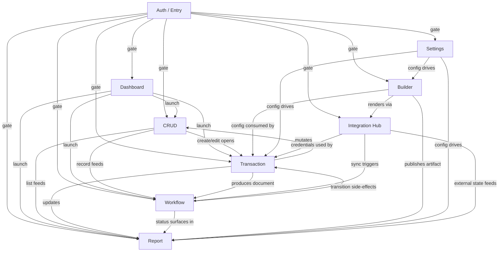
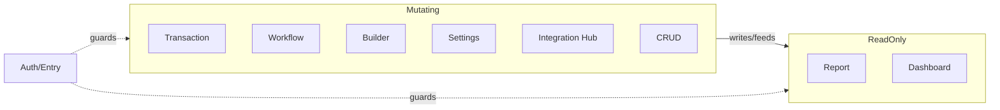

# Page Archetype Discovery — Hermes Browser Testing Foundation

**Document Type:** One-time discovery / canonical foundation
**Status:** Canonical — stable for years
**Source of Truth:** `.ai/hermes/POS_ADMIN_SYSTEM_DEEP_REVIEW.md` (the Admin Dashboard production review) cross-checked against the implementation route table in `PointOfSale.Web/src/App.jsx` and the page/component inventory under `PointOfSale.Web/src/pages`, `src/pos-admin`, `src/marketplace`, `src/marketplace-cms`, `src/super-admin`.
**Authority Note:** Per the project rule "implementation is the only source of truth" and the inherited `.ai-context` directive that the README/older docs are stale, the page list in this document is grounded in the actual route definitions (`App.jsx`) and the described component behavior in the review doc. No page, behavior, or capability has been invented. Where the review doc emphasizes front-end structure/risk, that is captured as browser-testable behavior; where it notes a component does not exist in the backend, that is captured as a NON-EXISTENCE assertion.
**Companion Skill:** `shopixy-browser-knowledge` (produces `*KNOWLEDGE.yaml` from this archetype layer).

**Ontology Release:** This document is part of the **Hermes Browser Ontology v1.0**. Its role in the release is the **canonical index of browser archetypes**. See `HERMES_BROWSER_ONTOLOGY.md` (whitepaper), `ARCHETYPE_RELATIONSHIPS.md` (relationships), and `HERMES_BROWSER_ONTOLOGY_v1_RELEASE.md` (release notes).

---

## 0. Canonical Index of Browser Archetypes

This section is the primary navigation entry into the Hermes Browser Ontology. It does not duplicate the canonical archetype documents; it references each by name and canonical file. Every archetype below is defined authoritatively in its own document. Hermes MUST load this index to select an archetype, then inherit the referenced document in full.

| # | Name | Family | Canonical Document | Current Status | Purpose (short) |
|---|------|--------|--------------------|----------------|-----------------|
| 1 | Dashboard | Composition | `DASHBOARD_ARCHETYPE.md` | Canonical — stable for years | Overview/navigation hub aggregating KPIs, widgets, and entry points into deeper flows. |
| 2 | CRUD (Master-Data / Operational List) | Observation | `CRUD_ARCHETYPE.md` | Canonical — stable for years | Manage a collection of records: search, paginate, filter, create, edit, delete, with server-authoritative validation. |
| 3 | Transaction (Live Tender) | Mutation | `TRANSACTION_ARCHETYPE.md` | Canonical — stable for years | Execute a multi-step, side-effecting operation in real time: build a line collection, validate, tender, commit, produce a receipt/confirmation. |
| 4 | Report (Analytical / Statement) | Observation | `REPORT_ARCHETYPE.md` | Canonical — stable for years | Present aggregated, read-only data with filters, totals, and export/print. Never mutates domain state. |
| 5 | Settings (Configuration) | Configuration | `SETTINGS_ARCHETYPE.md` | Canonical — stable for years | Load current configuration and persist changes; persistence, refresh, and reset behavior. |
| 6 | Builder (Publishable Artifact) | Composition | `BUILDER_ARCHETYPE.md` | Canonical — stable for years | Compose, persist (often versioned), preview, and publish/render a publishable artifact. |
| 7 | Workflow (Stateful Lifecycle) | Mutation | `WORKFLOW_ARCHETYPE.md` | Canonical — stable for years | Move a record through discrete, often approval-gated state transitions, with timelines, recovery, and side effects. |
| 8 | Auth / Entry (Identity Gate) | Boundary | `AUTH_ARCHETYPE.md` | Canonical — stable for years | Authenticate, register, verify, and gate entry to the rest of the application; route protection and tenant/role scoping. |
| 9 | Integration Hub (External-Service Console) | Boundary | `INTEGRATION_HUB_ARCHETYPE.md` | Canonical — stable for years | Configure, monitor, and operate an external integration from inside the admin. |

### 0.1 Per-archetype reference

Each entry below carries the six fields every archetype exposes in the ontology: **Name**, **Purpose**, **Canonical document**, **Current status**, **Short description**, and **Family**. The Family column maps the archetype into one of the five ontology families defined in `ARCHETYPE_RELATIONSHIPS.md`: **Mutation**, **Observation**, **Configuration**, **Composition**, **Boundary**.

#### 0.1.1 Dashboard
- **Name:** Dashboard
- **Purpose:** Overview/navigation hub. Aggregates KPIs and widgets, provides entry points into deeper flows.
- **Canonical document:** `DASHBOARD_ARCHETYPE.md`
- **Current status:** Canonical — stable for years
- **Short description:** Tabbed or widget-grid landing page with top-level filters (date range, store, warehouse), cards/charts, and quick-nav tiles that drill into CRUD / Transaction / Report / Workflow pages.
- **Family:** Composition

#### 0.1.2 CRUD (Master-Data / Operational List)
- **Name:** CRUD (Master-Data / Operational List)
- **Purpose:** Manage a collection of records: search, paginate, filter, create, edit, delete, with server-authoritative validation.
- **Canonical document:** `CRUD_ARCHETYPE.md`
- **Current status:** Canonical — stable for years
- **Short description:** Toolbar (search + filters + "Add"), data table with pagination, row actions (edit/delete), and create/edit modal or workspace with detail drawer. Read-first, act-second.
- **Family:** Observation

#### 0.1.3 Transaction (Live Tender)
- **Name:** Transaction (Live Tender)
- **Purpose:** Execute a multi-step, side-effecting operation in real time: build a line collection, validate, tender payment, commit, and produce a receipt/confirmation.
- **Canonical document:** `TRANSACTION_ARCHETYPE.md`
- **Current status:** Canonical — stable for years
- **Short description:** Primary workspace with a live cart/line panel, customer/variant selectors, discount controls, payment modal with method and idempotency, and receipt/confirmation modal. Hold/retrieve and undo/redo where supported.
- **Family:** Mutation

#### 0.1.4 Report (Analytical / Statement)
- **Name:** Report (Analytical / Statement)
- **Purpose:** Present aggregated, read-only data with filters, totals, and export/print. Never mutates domain state.
- **Canonical document:** `REPORT_ARCHETYPE.md`
- **Current status:** Canonical — stable for years
- **Short description:** Filter bar, summary totals row, table or chart, export/print buttons, and optionally a trial-balance/ledger tree. May issue a request carrying filter parameters but MUST NOT mutate any observed record or state.
- **Family:** Observation

#### 0.1.5 Settings (Configuration)
- **Name:** Settings (Configuration)
- **Purpose:** Load current configuration and persist changes; persistence, refresh, and reset behavior.
- **Canonical document:** `SETTINGS_ARCHETYPE.md`
- **Current status:** Canonical — stable for years
- **Short description:** Form sections (company/currency/print, catalog/payments/storefront toggles, shipping/payment methods, auth providers) with Save/Reset and capability-gated sections.
- **Family:** Configuration

#### 0.1.6 Builder (Publishable Artifact)
- **Name:** Builder (Publishable Artifact)
- **Purpose:** Compose, persist (often versioned), preview, and publish/render a publishable artifact.
- **Canonical document:** `BUILDER_ARCHETYPE.md`
- **Current status:** Canonical — stable for years
- **Short description:** Canvas/editor plus component palette or form-based editor, version history list, preview pane/route, and publish/rollback action that makes the artifact visible on the public/derived route.
- **Family:** Composition

#### 0.1.7 Workflow (Stateful Lifecycle)
- **Name:** Workflow (Stateful Lifecycle)
- **Purpose:** Move a record through discrete, often approval-gated state transitions, with timelines, recovery, and side effects.
- **Canonical document:** `WORKFLOW_ARCHETYPE.md`
- **Current status:** Canonical — stable for years
- **Short description:** List/filter of workflow items with detail drawer/page, action buttons (approve/reject/complete/refund/pay/moderate), status badge/timeline, and chat/notes thread where coordination is involved.
- **Family:** Mutation

#### 0.1.8 Auth / Entry (Identity Gate)
- **Name:** Auth / Entry (Identity Gate)
- **Purpose:** Authenticate, register, verify, and gate entry to the rest of the application; route protection and tenant/role scoping.
- **Canonical document:** `AUTH_ARCHETYPE.md`
- **Current status:** Canonical — stable for years
- **Short description:** Login/Register/Verify forms, role/tenant-scoped redirect after auth, protected-route wrapper, capability-route guard, forced logout on 401, and language switcher.
- **Family:** Boundary

#### 0.1.9 Integration Hub (External-Service Console)
- **Name:** Integration Hub (External-Service Console)
- **Purpose:** Configure, monitor, and operate an external integration from inside the admin.
- **Canonical document:** `INTEGRATION_HUB_ARCHETYPE.md`
- **Current status:** Canonical — stable for years
- **Short description:** Provider/credential cards, connection test button, health/status badges, configuration form sections (secrets, keys, endpoints), operational message log, and webhook/event status.
- **Family:** Boundary

### 0.2 Ontology navigation

- For the **relationships, families, inheritance, composition, and the comparison matrix** between archetypes, read `ARCHETYPE_RELATIONSHIPS.md`.
- For the **philosophy, browser contracts, assertions, evidence, recovery, and stability/versioning policy**, read `HERMES_BROWSER_ONTOLOGY.md`.
- For **release notes, major decisions, migration, roadmap, and the document index**, read `HERMES_BROWSER_ONTOLOGY_v1_RELEASE.md`.
- For the **per-archetype canonical behavior contract**, read the document named in the *Canonical document* column above.

> This index preserves the original discovery purpose of the document (one-time discovery of the minimal, complete archetype set from the application route table and the Admin Dashboard review). It is now the canonical entry point into the ontology. The discovery methodology, classification, page table, coverage validation, and future-usage pipeline in the sections below remain authoritative and are not redefined here.

---

## 1. Purpose

### 1.1 Why page archetypes exist

The Shopixy Admin surface (POS Admin + Storefront Admin + CommerceHub vendor admin + Super Admin + Marketplace) contains well over one hundred distinct routes. Documenting browser behavior for each page individually would produce:

- 100+ near-duplicate "browser knowledge" files,
- massive maintenance cost when a shared table, modal, filter, or settings pattern changes,
- drift, because each copy of the same pattern must be updated by hand and inevitably lags.

Hermes does not need to learn 100 pages. It needs to learn the small number of *behaviors* those pages are built from. A "Products" page and a "Customers" page share the same interactive contract: a searchable, paginated, filterable list with create/edit/delete modals and server-authoritative validation. Teaching that contract once (the **CRUD Archetype**) covers both, plus every other master-data list in the system.

### 1.2 Why Hermes learns archetypes, not pages

A page is a transient instance. An archetype is the durable interaction contract.

- **Maintenance collapse:** One archetype update fixes every page that uses it. One page-specific file update fixes only one page.
- **Transfer:** A new page the team ships next quarter will reuse an existing archetype 90% of the time. Hermes recognizes it on first encounter instead of requiring a new knowledge file.
- **Reasoning consistency:** The QA rules (authority model, tenant isolation, idempotency, fail-closed) apply uniformly inside each archetype. Encoding them per-archetype means they are applied uniformly across all pages.
- **Reduced token cost:** A future Browser-Knowledge YAML references an archetype by name plus page-specific deltas (endpoints, fields, invariants). The bulk of the behavioral knowledge is inherited, not repeated.

### 1.3 How this reduces Browser Knowledge maintenance

Future Browser-Knowledge artifacts become thin:

```
page -> archetype (inherited behavior) + page-specific overrides (route, endpoints, fields, invariants)
```

The archetype document owns the generic capability list, failure modes, and assertions. The per-page YAML owns only what is unique. The class of change "the list table now supports column pinning" is made once, in the archetype, not in 40 files.

---

## 2. Discovery Methodology

### 2.1 How pages were analyzed

1. **Extracted the authoritative route table** from `PointOfSale.Web/src/App.jsx` (the real navigation surface; this is implementation = truth).
2. **Read the Admin Dashboard review** (`POS_ADMIN_SYSTEM_DEEP_REVIEW.md`) section by section, capturing every page and component described: POS, Dashboard, Products, Layout, Payment Modal, Receipt Modal, CartItem, ProductSearch, Auth Store, Settings Context, API Service, POS Data/Stock/Runtime-Cache services, Commerce Hub APIs, Financial Math, CSRF, Cart Storage, custom hooks, and the Super Admin / Marketplace / Storefront / Treasury sub-trees referenced by the routes.
3. **Cross-checked the route list against the described components** to confirm each page's dominant interaction shape (does it transact? list? report? configure? build? coordinate a workflow?).
4. **Classified by browser behavior, not business domain.** A "Products" page (inventory domain) and a "Customers" page (CRM domain) are the *same archetype* because a browser tester interacts with them identically. Conversely, a "POS Sale" page and a "Treasury Transfer" page are different archetypes even though both move money, because their browser interaction shape (live cart + tender modal vs. validated form + posting) differs.

### 2.2 Classification methodology

Each page was assigned to exactly one archetype based on its **dominant, repeated browser interaction pattern**:

- Does the user **execute a live, multi-step transaction** with a cart, validation, and immediate side effects? → Transaction.
- Is the page a **list with search/pagination/filter and create/edit/delete**? → CRUD (master data or operational).
- Does the page **display aggregated read-only data with filters and export**? → Report.
- Is the page a **form that loads config and persists it**? → Settings.
- Does the browser build/persist/version/render a **publishable artifact** (storefront, homepage, CMS page, promotion, smart offer, theme)? → Builder.
- Does the page **move a record through discrete approval/state transitions** (orders, marketplace requests, refunds, payouts, reviews)? → Workflow.
- Is the page a **high-level navigation/overview hub with widgets and links**? → Dashboard.
- Is the page a **controlled entry/identity gate** (login, register, verify, affiliate portal, super-admin login)? → Auth / Entry.

Pages whose entire role is **read-only reference or a single static action** (audit log stream, help drawer, storefront preview, public marketplace render, maintenance reset, barcode printing) were assigned to the most behaviorally accurate of the above (typically Report, Builder-preview, Settings, or a narrowly-scoped leaf) rather than a catch-all "Other". No page is left unclassified.

### 2.3 Behavior-over-domain principle

The taxonomy is deliberately domain-agnostic. "Inventory" is not an archetype; "list + edit + stock-modal" is (CRUD). "Accounting" is not an archetype; "filterable aggregated financial statements with export" is (Report / Treasury). This is what makes the set minimal and durable: domains come and go, the interaction contracts do not.

---

## 3. Final Archetype List

The minimal, complete set is **nine archetypes**:

1. Dashboard
2. CRUD (Master-Data / Operational List)
3. Transaction (Live Tender)
4. Report (Analytical / Statement)
5. Settings (Configuration)
6. Builder (Publishable Artifact)
7. Workflow (Stateful Lifecycle)
8. Auth / Entry (Identity Gate)
9. Integration Hub (External-Service Console)

Each is defined below with the browser-testing contract Hermes should inherit.

---

### 3.1 Dashboard

- **Name:** Dashboard
- **Purpose:** Overview/navigation hub. Aggregates KPIs and widgets, provides entry points into deeper flows.
- **Typical UI Layout:** Tabbed or widget-grid landing page. Top-level filters (date range, store, warehouse). Cards/charts. Quick-nav tiles.
- **Typical Navigation Pattern:** Reached at the app index (`/` → `Dashboard`). Tab state may persist in localStorage. Deep-links into CRUD/Transaction/Report/Workflow pages.
- **Common User Actions:** Switch tabs; change date/store/warehouse scope; click a widget to drill into a report or list; refresh metrics.
- **Common Browser Assertions:** KPI cards render with numeric values; charts/widgets present (not blank-spinner); tab switch updates the visible panel; scope filters reload the widgets; drill-down links navigate to the expected page.
- **Common Failure Scenarios:** Widgets spin forever (aggregator API hang); stale KPI after a transaction (cache not invalidated); tab persistence points to a route that no longer exists; scope filter ignored by the aggregator.
- **Common Browser Risks:** Client-side aggregation masking backend errors; broad runtime-cache invalidation flushing unrelated widgets (`pos-runtime-cache:invalidated` clears the whole cache per the review); localStorage-persisted tab routing to a removed route; metrics showing pre-transaction totals (re-read staleness).
- **Typical Evidence Hermes should collect:** Rendered KPI values; widget empty/error states; network responses for the aggregator endpoints; the persisted tab key in localStorage; navigation target after a widget click.

---

### 3.2 CRUD (Master-Data / Operational List)

- **Name:** CRUD (Master-Data / Operational List)
- **Purpose:** Manage a collection of records: search, paginate, filter, create, edit, delete, with server-authoritative validation.
- **Typical UI Layout:** Toolbar (search box + filters + "Add" button); data table with pagination (Products documented at 50 items/page; Commerce Hub at 25); row actions (edit/delete); create/edit modal or workspace; detail drawer.
- **Typical Navigation Pattern:** Sidebar/menu link to a list route; row click → edit modal or `:id/edit` workspace; "Add" → create modal.
- **Common User Actions:** Debounced search; category/status/warehouse filter; sort column; paginate; open create modal; fill form; submit; open edit; change field; submit; delete with confirmation.
- **Common Browser Assertions:** List loads with paginated rows; search filters server-side (debounced, request-cancelled on new keystroke); filters combine; create persists and the new row appears (after cache invalidation); edit updates the row; delete removes it; validation errors render inline and block submit; required/format errors come from server authority.
- **Common Failure Scenarios:** Full array loaded then client-paginated (documented Products issue); no request de-duplication (duplicate API calls); stale-data ref tracking causing wrong-page render; search SQL/parameter risk surfacing as silent empty result; optimistic UI showing a row the server rejected; pagination state lost on filter change.
- **Common Browser Risks:** Client allows a value the server rejects (price/tax overwritten server-side per POS sale rule — same authority principle applies to master data); no response schema validation (`Array.isArray(response.data) ? response.data : []` accepts any shape); missing loading/empty/error states; duplicate submissions (no idempotency key on create).
- **Typical Evidence Hermes should collect:** Request URL/params for search/filter/pagination; submit payload and response status; validation message text; resulting row state; network 409/400 on conflict; absence of a second row on duplicate submit.

---

### 3.3 Transaction (Live Tender)

- **Name:** Transaction (Live Tender)
- **Purpose:** Execute a multi-step, side-effecting business operation in real time: build a line collection, validate, tender payment, commit, and produce a receipt/confirmation.
- **Typical UI Layout:** Primary workspace (POS sale screen, treasury transfer form, manual payment form, statement adjustment). Live cart/line panel. Customer/variant selectors. Discount controls. Payment modal with method (Cash/Card/Mixed), amount, idempotency. Receipt/confirmation modal. Hold/retrieve and undo/redo where supported.
- **Typical Navigation Pattern:** Direct route entry (`/pos`, `/treasury/transfers`, `/ecommerce/manual-payments`, `/statement-of-account` adjustment). Cart may persist across reload via versioned localStorage (`pos_cart_v2`, 24h TTL, 4MB cap).
- **Common User Actions:** Scan/select item; set quantity; pick warehouse/customer; apply discount; open payment; choose method; enter amount (±0.01 tolerance for mixed); submit with idempotency key; print receipt; hold/retrieve; undo/redo.
- **Common Browser Assertions:** Success toast + receipt/confirmation on commit; server-recomputed totals (client price/tax not trusted); stock/balance decremented after commit; idempotency HIT returns byte-equal response and no second document; change amount derived (paid − total); failure rolls back with zero partial state; payment method = Credit rejected (400) where the platform forbids it.
- **Common Failure Scenarios:** Double-click submit creates duplicate (race condition documented in review; mitigated by `Idempotency-Key`/AbortController); empty amount parsed as 0 (documented `parseAmountInput` defect); mixed-payment tolerance abuse; out-of-stock accepted by UI then 409 from server; cart restored from stale localStorage producing wrong totals; concurrent payment attempts both succeed.
- **Common Browser Risks:** Idempotency header missing → 400 (must send `X-Payment-Attempt-Id` or `X-Pos-Cart-Id`); amount tampering — server overwrites prices; cashbox/balance is derived, not written by the transaction (no `CashboxTransaction` on sale); orphaned endpoints — the ERP `Payments.jsx` page calls `/Payments/receive`, `/Payments/make`, `/Payments/customer/{id}`, `/Payments/supplier/{id}` which do NOT exist backend-side; the real ERP paths are `POST /suppliers/{id}/payments` and `POST /StatementOfAccount/adjustment`.
- **Typical Evidence Hermes should collect:** Submit request headers (idempotency key), payload, status; receipt/confirmation content; stock/balance before/after via a follow-up read; duplicate-submit response equality; 404/405 on orphaned ERP payment endpoints; absence of derived-entity writes.

---

### 3.4 Report (Analytical / Statement)

- **Name:** Report (Analytical / Statement)
- **Purpose:** Present aggregated, read-only financial/operational data with filters, totals, and export/print. Never mutates domain state (it may post a filter query).
- **Typical UI Layout:** Filter bar (date range, store/warehouse, type, party, status); summary totals row; table or chart; export/print buttons; possibly a trial-balance/ledger tree.
- **Typical Navigation Pattern:** `reports/*`, `treasury/*` statements, `commercehub/finance`, `commercehub/earnings`, `storefront`/`analytics` dashboards. Some legacy routes redirect to canonical viewers (`/cashbox` → `/treasury/account/1010`, `/reports/bank-statement` → `/treasury/account/1030`).
- **Common User Actions:** Set date range; change store/warehouse/party/type filter; apply; read totals; paginate; export (CSV/PDF); print; open an account viewer by code.
- **Common Browser Assertions:** Totals reconcile to the line sum; filters change the dataset; empty-result state renders (no crash); export downloads a file with the filtered scope; print preview opens; pagination works; redirect routes land on the canonical viewer.
- **Common Failure Scenarios:** Date parameters not validated (documented Commerce Hub finance issue); hardcoded page size (`DEFAULT_PAGE_SIZE = 25`); silent API failure returns empty (no error surfaced); totals mismatch lines due to currency rounding differences; redirect loop or wrong account code.
- **Common Browser Risks:** Stale projection reads (report shows pre-commit numbers until the read-model/stock-sync catches up); totals computed client-side instead of trusted from SQL authority; export includes tenant-cross data if scope filter is ignored; report reads a derivative store (Mongo/ES) as if authoritative.
- **Typical Evidence Hermes should collect:** Filter request params; returned totals vs. summed lines; export file contents/scope; empty-state DOM; redirect target URL; the account code resolved by a viewer route.

---

### 3.5 Settings (Configuration)

- **Name:** Settings (Configuration)
- **Purpose:** Load current configuration and persist changes; persistence, refresh, and reset behavior.
- **Typical UI Layout:** Form sections (company/currency/print in `SettingsContext`; CommerceHub catalog/payments/storefront toggles; Storefront settings; Analytics settings; Shipping methods; Payment methods; auth providers). Save/Reset buttons. Capability-gated sections.
- **Typical Navigation Pattern:** Direct settings route; sub-pages under `settings/*`, `ecommerce/*` config, `storefront` config, `admin/shipping/setup`.
- **Common User Actions:** Open page (config loads); change a field; save; observe confirmation; refresh page (config persists); reset to default; toggle a capability.
- **Common Browser Assertions:** Fields populate from the loaded config; save returns success and the new value is reflected after reload; validation blocks invalid input; reset restores defaults; capability-gated controls are disabled/hidden without the right role.
- **Common Failure Scenarios:** No validation on load (documented SettingsContext issue); no versioning (breaking change not handled); global mutable settings state; save appears to succeed but backend rejects (no schema validation); reset does not clear derived caches.
- **Common Browser Risks:** Settings values treated as truth before server confirmation; currency/company config driving financial math across the app (a bad value corrupts downstream transactions/reports); capability checks done only in UI (evidence-only, not authority).
- **Typical Evidence Hermes should collect:** Loaded config payload; save request body and status; post-reload value; reset behavior; disabled-state of gated controls.

---

### 3.6 Builder (Publishable Artifact)

- **Name:** Builder (Publishable Artifact)
- **Purpose:** Compose, persist (often versioned), preview, and publish/render an artifact: storefront site, homepage, CMS page, theme, promotion, smart offer, navigation/footer.
- **Typical UI Layout:** Canvas/editor + component palette (storefront builder, homepage builder); form-based editor (CMS page, smart offer, promo, theme); version history list; preview pane/route; publish/rollback action.
- **Typical Navigation Pattern:** `storefront/builder`, `storefront/themes`, `storefront/theme`, `storefront/versions`; super-admin `homepage`, `homepage/manager`, `marketplace/pages`, `marketplace/pages/:pageId`; `ecommerce/smart-offers`, `ecommerce/promotions`, `ecommerce/coupons`, `storefront/cms/*`; public render routes `/:lang/:slug`, `/:lang/products`, `/:lang/product/:id`.
- **Common User Actions:** Create artifact; edit content/blocks; save draft; preview (internal + public route); publish; view version history; roll back to a prior version; set default/footer/navigation.
- **Common Browser Assertions:** Draft saves without publishing; preview reflects unsaved-or-saved state correctly; publish makes the artifact visible on the public route; version history lists versions; rollback restores the prior version; CMS markdown rendered safely (DOMPurify expected for user HTML).
- **Common Failure Scenarios:** Preview shows stale content (cache); publish fails silently; version not recorded; public route 404 after publish (slug/tenant resolution); rollback leaves orphaned state; XSS via un-sanitized CMS markdown (documented risk — no DOMPurify noted).
- **Common Browser Risks:** Builder writes become published content indexed by Elasticsearch/Storefront — a bad publish is a live customer-facing defect; tenant/slug resolution for public routes; un-sanitized user HTML executes in the browser; preview vs. production divergence.
- **Typical Evidence Hermes should collect:** Draft vs. published state; public-route render after publish; version list and selected version; rollback result; presence of sanitized HTML in rendered CMS output.

---

### 3.7 Workflow (Stateful Lifecycle)

- **Name:** Workflow (Stateful Lifecycle)
- **Purpose:** Move a record through discrete, often approval-gated state transitions, with timelines, recovery, and side effects.
- **Typical UI Layout:** List/filter of workflow items (orders, marketplace requests, refunds, payouts, reviews, commissions); detail drawer or page; action buttons (approve/reject/complete/refund/pay/moderate); status badge/timeline; chat or notes thread where coordination is involved.
- **Typical Navigation Pattern:** `ecommerce/orders`, `ecommerce/orders/:id`, `marketplace` (discover/incoming/my-requests/my-services/chat), super-admin `orders`, `refunds`, `payouts`, `reviews`, `commission`, `commercehub/payment-providers`, marketplace `service/:id`, `chat/:requestId`.
- **Common User Actions:** Open item; view timeline/status; perform a transition (approve/complete/refund/reject/moderate); add a note or message; filter by status; recover/retry a failed item.
- **Common Browser Assertions:** List reflects current status; a legal transition updates status and timeline; an illegal transition is blocked (401/403/validation); side effects appear (e.g., payout status, refund recorded); chat/messages send and persist; recovery restores a consistent state.
- **Common Failure Scenarios:** Status filter desync; illegal transition accepted by UI but 400/403 from server; side effect not visible until projection lag passes; timeline missing a step; chat message sent but not persisted (Marketplace chat subsystem had adversarial-audit history — treat chat persistence as evidence, not assumption); recovery leaves partial state.
- **Common Browser Risks:** UI shows a transition the backend forbids (frontend guard is evidence only); cross-tenant item visibility in a shared workflow (CommerceHub marketplace / Service Marketplace are internal POS-to-POS — never customer-facing); status read from a derivative projection treated as authority; message/attachment stored without validation.
- **Typical Evidence Hermes should collect:** Item status before/after transition; server response for the transition; timeline entries; side-effect records via follow-up read; 403 on illegal transition; chat persistence confirmation.

---

### 3.8 Auth / Entry (Identity Gate)

- **Name:** Auth / Entry (Identity Gate)
- **Purpose:** Authenticate, register, verify, and gate entry to the rest of the application; route protection and tenant/role scoping.
- **Typical UI Layout:** Login/Register/Verify forms; role/tenant-scoped redirect after auth; protected-route wrapper; capability-route guard; forced logout on 401; language switcher.
- **Typical Navigation Pattern:** `/login`, `/register`, `/verify-email`, `/super-admin/login`; protected by `ProtectedRoute`, `PosRoleRouteGuard`, `CommerceHubVendorRouteGuard`, `SuperAdminProtectedRoute`, `SuperAdminCapabilityRoute`, `MarketplaceAuthorityBoundary`.
- **Common User Actions:** Submit credentials; register; verify email; logout; attempt a guarded route without permission; refresh token (automatic on 401 via de-duplicated refresh).
- **Common Browser Assertions:** Valid login lands on the role-appropriate home; invalid credentials rejected; 401 triggers refresh then retry, or force-logout to `/login`; guarded route without capability redirects or shows forbidden; token refresh is de-duplicated (one call for concurrent requests).
- **Common Failure Scenarios:** Token expiration not checked (documented); sensitive user object in localStorage (XSS exposure risk); CSRF token not validated on all mutating calls (documented medium risk); hardcoded public-path list causing redirect loops; refresh failure infinite loop.
- **Common Browser Risks:** Session in localStorage is derivable by XSS; CSRF gaps on state-changing ops; frontend route guard treated as authority (it is evidence only — backend must enforce); tenant/role scope stripped or mis-resolved at the gate.
- **Typical Evidence Hermes should collect:** Post-login landing route; 401 → refresh → retry sequence; guarded-route redirect target; storage contents (what is persisted); CSRF header presence on unsafe methods.

---

### 3.9 Integration Hub (External-Service Console)

- **Name:** Integration Hub (External-Service Console)
- **Purpose:** Configure, monitor, and operate an external integration (payment provider, shipping carrier, WhatsApp/BAPILEYS transport, abandoned-cart automation) from inside the admin.
- **Typical UI Layout:** Provider/credential cards; connection test button; health/status badges; configuration form sections (secrets, keys, endpoints); operational message log; webhook/event status.
- **Typical Navigation Pattern:** super-admin `commercehub/payment-providers`; `ecommerce/shipping-methods`, `admin/shipping/*` (setup, shipments, health); `ecommerce/whatsapp`; `ecommerce/cart-recovery`, `ecommerce/abandoned-checkouts`; `commercehub/finance`, `commercehub/earnings`, `commercehub/payments`.
- **Common User Actions:** Enter provider credentials/keys; test connection; save config; view health/status; rotate a secret; inspect operational/event messages; trigger or inspect a sync.
- **Common Browser Assertions:** Test-connection returns a clear success/failure; save persists credentials (secret masked on read-back); health badges reflect provider state; configuration validation blocks malformed input; operational log renders messages.
- **Common Failure Scenarios:** Secret stored/displayed insecurely; test-connection succeeds but backend path missing (orphaned endpoints, same class as ERP `/Payments/*`); health badge stale (cached provider state); save appears OK but provider rejects; webhook/event status not refreshed.
- **Common Browser Risks:** Secrets in client storage or logs; provider evidence (callback/health) treated as authority over SQL; CORS/credential scope for provider calls; idempotency of vendor-payment keys (the Commerce Hub payments API generates `crypto.randomUUID()` with a weaker timestamp fallback — collision risk noted).
- **Typical Evidence Hermes should collect:** Test-connection response; saved-config read-back (secret masked); health-badge source/refresh; 404/405 on a provider action whose backend route is missing; vendor-payment idempotency-key uniqueness.

---

## 4. Page Classification

Every route/page discovered in `App.jsx` (and the described pages/components in the review doc) is classified below. Module is the surface it belongs to. Archetype is one of the nine above. "Notes" capture page-specific browser behavior taken from the review doc or route guards.

| Page (Route / File) | Module | Archetype | Notes |
|---|---|---|---|
| `/` Dashboard (`Dashboard.jsx`) | POS Admin | Dashboard | Tabbed POS/Storefront analytics; localStorage tab persistence. |
| `/pos` POS (`POS.jsx`) | POS Admin | Transaction | Live cart, scan, discount, payment modal, receipt, hold/retrieve, undo/redo. 1000+ LOC. |
| `/products` Products (`Products.jsx`) | POS Admin | CRUD | Product catalog; 50/page; category/status filter; stock modal; barcode; deep-link to storefront. |
| `/products/:productId/edit` Product Workspace (`ProductWorkspacePage.jsx`) | POS Admin | CRUD | Edit workspace for a single product (Builder-ish editor but master-data CRUD). |
| `/categories` Categories (`Categories.jsx`) | POS Admin | CRUD | Category master data. |
| `/units` Units (`Units.jsx`) | POS Admin | CRUD | Unit/master-data with conversion factors. |
| `/customers` Customers (`Customers.jsx`) | POS Admin | CRUD | Customer master; opening balance linkage. |
| `/suppliers` Suppliers (`Suppliers.jsx`) | POS Admin | CRUD | Supplier master; opening balance linkage. |
| `/sales-history` Sales History (`SalesHistory.jsx`) | POS Admin | CRUD / Report | Searchable sales list + view; operational list with read detail. |
| `/sales-representatives` Sales Reps (`SalesRepresentatives.jsx`) | POS Admin | CRUD | Sales rep master data. |
| `/sales-rep-reports` Sales Rep Reports (`SalesRepReports.jsx`) | POS Admin | Report | Rep performance report. |
| `/purchase-invoice` Purchase Invoice (`PurchaseInvoice.jsx`) | POS Admin | Transaction | Supplier-facing purchase document; commit + side effects. |
| `/purchase-returns` Purchase Returns (`PurchaseReturns.jsx`) | POS Admin | Transaction / Workflow | Return document with validation + lifecycle. |
| `/sales-returns` Sales Returns (`SalesReturns.jsx`) | POS Admin | Transaction / Workflow | Return document with validation + lifecycle. |
| `/warehouses` Warehouses (`Warehouses.jsx`) | POS Admin | CRUD | Warehouse master. |
| `/inventory` Inventory (`Inventory.jsx`) | POS Admin | CRUD / Report | Stock list with adjustments; operational inventory view. |
| `/cashbox` → `/treasury/account/1010` (`Cashbox.jsx`, redirect) | POS Admin | Report | Redirects to treasury account viewer (derived GL balance). |
| `/opening-balance/cashbox` Cashbox Opening (`CashboxOpeningBalance.jsx`) | POS Admin | Settings / Transaction | Opening-balance seed (one-time config-like posting). |
| `/opening-balance/customers` Customer Opening (`CustomerOpeningBalance.jsx`) | POS Admin | Settings / Transaction | Opening-balance seed. |
| `/opening-balance/suppliers` Supplier Opening (`SupplierOpeningBalance.jsx`) | POS Admin | Settings / Transaction | Opening-balance seed. |
| `/opening-balance/warehouse-stock` Warehouse Opening Stock (`WarehouseOpeningStock.jsx`) | POS Admin | Settings / Transaction | Opening stock seed. |
| `/opening-balance/banks` Bank Opening (`BankOpeningBalance.jsx`) | POS Admin | Settings / Transaction | Opening-balance seed. |
| `/statement-of-account` Statement of Account (`StatementOfAccount.jsx`) | POS Admin | Workflow / Transaction | Party statement with adjustment posting (`POST /StatementOfAccount/adjustment`). |
| `/payments` Payments (`Payments.jsx`) | POS Admin | Transaction (NON-EXISTENCE) | ERP page calls `/Payments/receive|make|customer/{id}|supplier/{id}` — NONE exist backend. Real paths: `POST /suppliers/{id}/payments`, `POST /StatementOfAccount/adjustment`. |
| `/outstanding-balances` Outstanding Balances (`OutstandingBalances.jsx`) | POS Admin | Report | Party balance report. |
| `/adjustments` Adjustments (`Adjustments.jsx`) | POS Admin | Transaction / Workflow | GL/journal adjustments. |
| `/stock-transfers` Stock Transfers (`StockTransfers.jsx`) | POS Admin | Transaction / Workflow | Inter-warehouse transfer with side effects. |
| `/financial-accounts` Financial Accounts (`FinancialAccounts.jsx`) | POS Admin | CRUD | Chart-of-accounts master. |
| `/balance-transfer` Balance Transfer (`BalanceTransfer.jsx`) | POS Admin | Transaction | Internal balance transfer posting. |
| `/banks` Banks (`Banks.jsx`) | POS Admin | CRUD | Bank master. |
| `/expense-categories` Expense Categories (`ExpenseCategories.jsx`) | POS Admin | CRUD | Expense category master. |
| `/expenses` Expenses (`Expenses.jsx`) | POS Admin | Transaction / CRUD | Expense entry + list. |
| `/treasury-movements` → `/treasury/hub` (`TreasuryMovements.jsx`, redirect) | POS Admin | Report | Redirects to treasury hub. |
| `/reports/bank-statement` → `/treasury/account/1030` | POS Admin | Report | Redirect to treasury account viewer. |
| `/reports/visa-statement` → `/treasury/account/1110` | POS Admin | Report | Redirect to treasury account viewer. |
| `/reports/sales-analysis` Sales Analysis (`SalesAnalysis.jsx`) | POS Admin | Report | |
| `/reports/sales-summary` Sales Summary (`SalesSummaryReport.jsx`) | POS Admin | Report | |
| `/reports/sales-by-category` Sales By Category (`SalesByCategoryReport.jsx`) | POS Admin | Report | |
| `/reports/sales-by-payment-method` Sales By Payment Method (`SalesByPaymentMethodReport.jsx`) | POS Admin | Report | |
| `/reports/inventory-valuation` Inventory Valuation (`InventoryValuation.jsx`) | POS Admin | Report | |
| `/reports/daily-close` Daily Close (`DailyCloseReport.jsx`) | POS Admin | Report / Workflow | Daily closing run. |
| `/reports/product-movement` Product Movement (`ProductMovementReport.jsx`) | POS Admin | Report | |
| `/reports/ar-aging` AR Aging (`AccountsReceivableAging.jsx`) | POS Admin | Report | |
| `/reports/ap-aging` AP Aging (`AccountsPayableAging.jsx`) | POS Admin | Report | |
| `/reports/sales-return-report` Sales Return (`SalesReturnReport.jsx`) | POS Admin | Report | |
| `/reports/purchase-return-report` Purchase Return (`PurchaseReturnReport.jsx`) | POS Admin | Report | |
| `/reports/purchase-register` Purchase Register (`PurchaseRegisterReport.jsx`) | POS Admin | Report | |
| `/reports/purchases-by-supplier` Purchases By Supplier (`PurchasesBySupplierReport.jsx`) | POS Admin | Report | |
| `/reports/cost-analysis` Cost Analysis (`CostAnalysisReport.jsx`) | POS Admin | Report | |
| `/reports/expenses` Expense Report (`ExpenseReport.jsx`) | POS Admin | Report | |
| `/barcode-printing` Barcode Printing (`BarcodePrinting.jsx`) | POS Admin | Report / Builder | Print artifact (label generation). |
| `/settings` Settings (`Settings.jsx`) | POS Admin | Settings | Company/currency/print config. |
| `/settings/audit-log` Audit Log (`AuditLog.jsx`) | POS Admin | Report | Read-only audit stream. |
| `/maintenance/reset-database` Reset Database (`ResetDatabase.jsx`) | POS Admin | Settings (destructive) | Single destructive action; high-risk. |
| `/ecommerce/shipping-methods` Shipping Methods (`ShippingMethods.jsx`) | CommerceHub (POS Admin) | Settings | Owner/Admin/Manager guarded. |
| `/ecommerce/payment-methods` Payment Methods (`PaymentMethods.jsx`) | CommerceHub | Settings | `commercehub.payments.view` guard. |
| `/ecommerce/manual-payments` Manual Payments (`ManualPayments.jsx`) | CommerceHub | Transaction | Vendor manual payment posting. |
| `/ecommerce/coupons` Coupons (`Coupons.jsx`) | CommerceHub | CRUD / Builder | Coupon master (promo artifact). |
| `/ecommerce/promotions` Promotions (`Promotions.jsx`) | CommerceHub | CRUD / Builder | Promotion master. |
| `/ecommerce/smart-offers` Smart Offers (`SmartOffersPage.jsx`) | CommerceHub | Builder | Offer list → editor/preview. |
| `/ecommerce/orders` Orders (`Orders.jsx`) | CommerceHub | Workflow | Vendor order list + `:orderId` detail. |
| `/ecommerce/blocked-phones` Blocked Phones (`BlockedPhones.jsx`) | CommerceHub | CRUD | Blocklist master. |
| `/ecommerce/online-customers` Online Customers (`OnlineCustomersPage.jsx`) | CommerceHub | CRUD | Storefront customer master. |
| `/ecommerce/commerce-ai` Commerce AI (`CommerceAI.jsx`) | CommerceHub | Builder / Settings | AI-generated catalog content. |
| `/ecommerce/pixel-tracking` Pixel Tracking (`PixelTrackingConfigPage.jsx`) | CommerceHub | Settings | Analytics config. |
| `/storefront` Storefront Dashboard (`StorefrontDashboard.jsx`) | CommerceHub | Dashboard | Storefront analytics overview. |
| `/storefront/builder` Storefront Builder (`StorefrontBuilderPage.jsx`) | CommerceHub | Builder | Compose/publish storefront. |
| `/storefront/themes` Theme Marketplace (`ThemeMarketplacePage.jsx`) | CommerceHub | Builder | Theme catalog. |
| `/storefront/theme` Theme Editor (`ThemeEditorPage.jsx`) | CommerceHub | Builder | Edit/apply theme. |
| `/storefront/versions` Version History (`VersionHistoryPage.jsx`) | CommerceHub | Builder | Version rollback. |
| `/storefront/cms/pages` CMS Pages (`CmsPagesList.jsx`) | CommerceHub | Builder / CRUD | CMS page list. |
| `/storefront/cms/pages/:pageId` CMS Page Editor (`CmsPageEditor.jsx`) | CommerceHub | Builder | Edit CMS page. |
| `/storefront/cms/navigation` Navigation Editor (`NavigationEditor.jsx`) | CommerceHub | Builder / Settings | Nav config. |
| `/storefront/cms/footer` Storefront Footer (`StorefrontFooterSettings.jsx`) | CommerceHub | Builder / Settings | Footer config. |
| `/ecommerce/auth-providers` Auth Providers (`AuthProvidersPage.jsx`) | CommerceHub | Integration Hub / Settings | External auth config. |
| `/analytics/funnels` Funnels List (`FunnelsListPage.jsx`) | CommerceHub | Report / Builder | Funnel definitions + metrics. |
| `/analytics/funnels/:funnelKey` Funnel Details (`FunnelDetailsPage.jsx`) | CommerceHub | Report | |
| `/analytics/attribution` Attribution Overview (`AttributionOverviewPage.jsx`) | CommerceHub | Dashboard / Report | |
| `/analytics/attribution/models` Attribution Models (`AttributionModelsPage.jsx`) | CommerceHub | Settings / CRUD | Model config. |
| `/analytics/attribution/orders` Attribution Orders (`AttributionOrdersPage.jsx`) | CommerceHub | Report | |
| `/analytics/attribution/costs` Campaign Costs (`CampaignCostsPage.jsx`) | CommerceHub | CRUD / Report | Cost entries. |
| `/analytics/attribution/roi` ROI Dashboard (`RoiDashboardPage.jsx`) | CommerceHub | Dashboard / Report | |
| `/settings/analytics` Analytics Settings (`AnalyticsSettings.jsx`) | CommerceHub | Settings | |
| `/admin/shipping` Shipping Admin (`ShippingAdministrationWorkspace.jsx`) | Admin | Integration Hub / Settings | Owner/Admin guarded. |
| `/admin/shipping/setup` Shipping Setup (same) | Admin | Integration Hub / Settings | |
| `/admin/shipping/shipments` Shipments List (`ShipmentsListPage.jsx`) | Admin | Workflow | Shipment lifecycle. |
| `/admin/shipping/shipments/:id` Shipment Details (`ShipmentDetailsPage.jsx`) | Admin | Workflow | |
| `/admin/shipping/health` Shipping Health (`ShippingHealthPage.jsx`) | Admin | Integration Hub / Report | Carrier health. |
| `/ecommerce/whatsapp` WhatsApp Settings (`WhatsAppSettings.jsx`) | CommerceHub | Integration Hub / Settings | BA apileys transport config. |
| `/ecommerce/cart-recovery` Cart Recovery (`AbandonedCartRecovery.jsx`) | CommerceHub | Integration Hub / Settings | n8n automation config. |
| `/ecommerce/abandoned-checkouts` Abandoned Checkouts (`AbandonedCheckouts.jsx`) | CommerceHub | Report / Workflow | Recovery list. |
| `/marketplace` Marketplace Shell (`MarketplaceShell.tsx`) | Service Marketplace | Workflow / Dashboard | Internal POS-to-POS; tabs: Discover/Incoming/MyRequests/MyServices/Profile. |
| `/marketplace/service/:serviceId` Service Details (`ServiceDetailsPage.tsx`) | Service Marketplace | Workflow / Builder | Service profile + requests. |
| `/marketplace/chat/:requestId` Marketplace Chat (`ChatPage.tsx`) | Service Marketplace | Workflow | Chat thread (persistence must be verified, not assumed). |
| `/admin/affiliates` Admin Affiliates List (`AdminAffiliatesList.jsx`) | Admin | CRUD | Owner/Admin guarded. |
| `/admin/affiliates/:id` Admin Affiliate Detail (`AdminAffiliateDetail.jsx`) | Admin | CRUD / Workflow | |
| `/admin/commercehub` CommerceHub Settings (`CommerceHubSettings.jsx`) | Admin | Settings | `commercehub.catalog.manage` guard. |
| `/commercehub/finance` CommerceHub Finance (`CommerceHubFinance.jsx`) | CommerceHub | Report / Integration Hub | Vendor finance aggregation. |
| `/commercehub/earnings` CommerceHub Earnings (`CommerceHubEarnings.jsx`) | CommerceHub | Report / Integration Hub | Payout method CRUD (BankTransfer/VodafoneCash/InstaPay). |
| `/admin/commercehub/earnings` (same) | Admin | Report / Integration Hub | |
| `/admin/commercehub/payments` CommerceHub Payments (`CommerceHubPayments.jsx`) | Admin | Transaction / Integration Hub | |
| `/commercehub/payments` (same) | CommerceHub | Transaction / Integration Hub | Idempotency key on vendor payment. |
| `/treasury` Treasury Dashboard (`TreasuryDashboard.jsx`) | POS Admin | Dashboard | Financial overview. |
| `/treasury/trial-balance` Trial Balance (`TreasuryTrialBalance.jsx`) | POS Admin | Report | |
| `/treasury/profit-loss` Profit & Loss (`TreasuryProfitLoss.jsx`) | POS Admin | Report | |
| `/treasury/balance-sheet` Balance Sheet (`TreasuryBalanceSheet.jsx`) | POS Admin | Report | |
| `/treasury/cash-flow` Cash Flow (`TreasuryCashFlow.jsx`) | POS Admin | Report | |
| `/treasury/general-ledger` General Ledger (`TreasuryGeneralLedger.jsx`) | POS Admin | Report | |
| `/treasury/clearing-aging` Clearing Aging (`TreasuryClearingAging.jsx`) | POS Admin | Report | |
| `/treasury/transfers` Treasury Transfers (`TreasuryTransfers.jsx`) | POS Admin | Transaction | GL transfer posting. |
| `/treasury/hub` Treasury Hub (`TreasuryHub.jsx`) | POS Admin | Report / Dashboard | Movement hub. |
| `/treasury/account/:accountCode` Account Viewer (`TreasuryAccountViewer.jsx`) | POS Admin | Report | Per-account statement (1010/1030/1110 etc.). |
| `/login` Login (`Login.jsx`) | Auth | Auth / Entry | |
| `/register` Register (`Register.jsx`) | Auth | Auth / Entry | |
| `/verify-email` Verify Email (`VerifyEmail.jsx`) | Auth | Auth / Entry | |
| `/super-admin/login` Super Admin Login (`SuperAdminLoginPage.tsx`) | Super Admin | Auth / Entry | Separate identity surface. |
| `/super-admin` → `finance` (`SuperAdminLayout.tsx`) | Super Admin | Dashboard | Index redirects to finance. |
| `/super-admin/finance` Finance Dashboard (`FinanceDashboardPage.tsx`) | Super Admin | Dashboard / Report | KPI cards, charts, reconciliation panel. |
| `/super-admin/vendors/finance` → `/super-admin/finance` | Super Admin | Dashboard / Report | Redirect. |
| `/super-admin/orders` Orders (`OrdersPage.tsx`) | Super Admin | Workflow | `super-admin.orders.view` guard. |
| `/super-admin/reviews` Review Moderation (`ReviewModerationPage.tsx`) | Super Admin | Workflow | `super-admin.reviews.view` guard. |
| `/super-admin/users` Users (`UsersPage.tsx`) | Super Admin | CRUD | `super-admin.users.govern` guard. |
| `/super-admin/marketplace/governance` (`MarketplaceGovernancePage.tsx`) | Super Admin | Workflow / Settings | `super-admin.marketplace.govern`. |
| `/super-admin/marketplace/operations` (`MarketplaceOperationsPage.tsx`) | Super Admin | Workflow / Settings | `super-admin.marketplace.operate`. |
| `/super-admin/payments` Payments (`PaymentsPage.tsx`) | Super Admin | Transaction / Workflow | `super-admin.payments.view`. |
| `/super-admin/commercehub/payment-providers` Payment Providers (`PaymentProvidersPage.tsx`) | Super Admin | Integration Hub | `super-admin.payment-providers.view`; health/dashboards/secrets. |
| `/super-admin/refunds` Refunds (`RefundsPage.tsx`) | Super Admin | Workflow / Transaction | `super-admin.refunds.manage`. |
| `/super-admin/payouts` Payouts (`PayoutsPage.tsx`) | Super Admin | Workflow / Transaction | `super-admin.payouts.manage`. |
| `/super-admin/commission` Commission (`CommissionManagementPage.tsx`) | Super Admin | CRUD / Workflow | `super-admin.commission.manage`; calculator/preview. |
| `/super-admin/promo-codes` Promo Codes (`PromoCodesPage.tsx`) | Super Admin | CRUD / Builder | `super-admin.promotions.manage`. |
| `/super-admin/homepage` Homepage Builder (`HomepageBuilderPage.tsx`) | Super Admin | Builder | `super-admin.homepage.manage`. |
| `/super-admin/homepage/manager` Homepage Manager (`HomepageManagerPage.tsx`) | Super Admin | Builder / CRUD | |
| `/super-admin/storefront/footer` Storefront Footer Defaults (`StorefrontFooterDefaultsPage.jsx`) | Super Admin | Builder / Settings | `super-admin.storefront-defaults.manage`. |
| `/super-admin/marketplace/pages` CMS Pages (`MarketplaceCmsPagesPage.jsx`) | Super Admin | Builder / CRUD | `super-admin.marketplace-cms.manage`. |
| `/super-admin/marketplace/pages/:pageId` CMS Page Editor (`MarketplaceCmsPageEditor.jsx`) | Super Admin | Builder | |
| `/super-admin/marketplace/footer` Marketplace Footer (`MarketplaceFooterSettingsPage.jsx`) | Super Admin | Builder / Settings | `super-admin.marketplace-footer.manage`. |
| `/affiliate` Affiliate Portal (`AffiliateProviders`/`AffiliateLanding`) | Affiliate | Auth / Entry / Dashboard | Landing + login/register/portal/products/category. |
| `/affiliate/login` (`AffiliateLogin`) | Affiliate | Auth / Entry | |
| `/affiliate/register` (`AffiliateRegister`) | Affiliate | Auth / Entry | |
| `/affiliate/portal` (`AffiliatePortal`) | Affiliate | Dashboard / CRUD | Affiliate self-service. |
| `/affiliate/products/:slug` (`AffiliateProductDetail`) | Affiliate | CRUD / Report | |
| `/affiliate/category/:slug` (`AffiliateCategoryPage`) | Affiliate | CRUD / Report | |
| `/:lang/products` Marketplace Products Public (`MarketplaceProductsPublicPage.jsx`) | Public/Storefront | Builder (public render) | Read-only public render. |
| `/:lang/product/:productId` Marketplace Product Public (`MarketplaceProductPublicPage.jsx`) | Public/Storefront | Builder (public render) | |
| `/:lang/:slug` Marketplace CMS Public (`MarketplaceCmsPublicPage.jsx`) | Public/Storefront | Builder (public render) | Published CMS page render. |

**Notes on the table:**
- Pages with two archetypes (e.g. "Transaction / Workflow") are primarily one but carry a secondary interaction shape; the **primary** archetype is the one Hermes should load first, and the secondary is inherited as an add-on capability set.
- The `/payments` (ERP) and the orphaned ERP `/Payments/*` calls are explicitly marked NON-EXISTENCE: Hermes must assert 404/405, not a working flow.
- Redirect routes (cashbox, treasury-movements, bank/visa statements, super-admin index/vendors-finance) are classified by their **destination** archetype, because the browser lands there.

---

## 5. Archetype Relationships

The archetypes form a dependency and navigation hierarchy. Most user journeys start at a Dashboard or Auth gate, flow into a CRUD/Workflow list, open a Transaction or Builder, and surface results in a Report.



**Reading the graph:**
- **Auth / Entry** is the universal precondition. Every other archetype assumes a resolved, tenant-scoped, role-capability-checked session.
- **Dashboard** is the navigation hub that launches the others.
- **CRUD** is the backbone: nearly every domain (master data, lists) is a CRUD surface that feeds Transactions, Workflows, and Reports.
- **Transaction** is the mutation engine: it creates the documents that Workflows govern and Reports display.
- **Workflow** adds stateful lifecycle on top of a Transaction or list.
- **Builder** produces published artifacts consumed by Reports and the public render (Integration Hub).
- **Settings** is cross-cutting: it drives the behavior of Transactions, Builders, and Reports.
- **Integration Hub** bridges external services into Transactions, Workflows, and Reports.
- **Report** is the read-only terminus: it visualizes the output of every mutating archetype.



---

## 6. Browser Testing Implications

For each archetype, the generic browser capabilities Hermes should automatically know when a page references it. These are capabilities, not test cases.

### 6.1 Dashboard
- KPI/widget loading and empty/error states
- Tab/section switching and persistence
- Scope filters (date/store/warehouse) reload widgets
- Drill-down navigation to target pages
- Refresh behavior and cache invalidation (broad invalidation risk)
- localStorage-persisted navigation correctness

### 6.2 CRUD
- search (debounced, server-side)
- pagination (page size, page change)
- sorting (column sort)
- filters (category/status/warehouse/type combos)
- create (modal/workspace + submit)
- edit (load current + patch + submit)
- delete (confirmation + removal)
- validation (inline, server-authoritative, blocks submit)
- optimistic-vs-authoritative reconciliation
- duplicate-submit / idempotency on create
- loading / empty / error states
- response-shape validation (do not accept arbitrary structures)

### 6.3 Transaction
- draft/build line collection
- validation (client + server; server overwrites prices/tax)
- commit (submit with idempotency key)
- side effects (stock/balance/journal/post-outbox)
- rollback detection (zero partial state on failure)
- receipt/confirmation rendering
- payment method rules (e.g. Credit rejected where forbidden)
- amount tolerance (±0.01 mixed)
- idempotency HIT (byte-equal, no second document)
- NON-EXISTENCE of orphaned endpoints (assert 404/405, do not assume working flow)
- derived-entity non-write (e.g. cashbox is GL-derived; sale writes no CashboxTransaction)
- cart persistence/restore correctness

### 6.4 Report
- filters (date range, store/warehouse, party, type, status)
- totals reconciliation (sum of lines)
- export (CSV/PDF) with filtered scope
- print / print preview
- empty results (no crash)
- pagination
- redirect routes resolving to canonical viewer
- stale projection awareness (report may lag committed writes)
- tenant-scope enforcement in exported/filtered data

### 6.5 Settings
- load configuration (populate from server)
- save (persist + confirmation)
- persistence (value survives reload)
- refresh (config reflects latest)
- reset (restore defaults)
- validation (block invalid; no load-time validation gaps)
- capability gating (disabled/hidden without role)
- cross-cutting impact (config drives transactions/reports/builders)

### 6.6 Builder
- draft (save without publish)
- publish (make live on public/derived route)
- preview (internal + public route)
- rollback (restore prior version)
- version history (list + select)
- CMS/markdown sanitization (no XSS)
- tenant/slug resolution for public routes
- preview-vs-production divergence detection

### 6.7 Workflow
- state transitions (legal moves update status + timeline)
- approvals (approve/reject/complete/refund/moderate)
- recovery (retry/restore consistent state)
- timeline (entries present and ordered)
- side effects (payout/refund/status surfaced after lag)
- illegal-transition blocking (401/403/validation)
- chat/message persistence (verify, do not assume)
- cross-tenant visibility rules in shared workflows
- status read from authority, not derivative projection

### 6.8 Auth / Entry
- login (valid → role-appropriate home)
- invalid credentials rejection
- 401 → token refresh (de-duplicated) → retry
- forced logout on refresh failure → `/login`
- guarded-route redirect/forbidden without capability
- token expiration handling
- CSRF header on unsafe methods
- storage safety (no secrets/sensitive user object exposed to XSS)
- frontend guard = evidence only; backend enforces

### 6.9 Integration Hub
- test connection (clear success/failure)
- save config (secret masked on read-back)
- health/status badges (reflect provider state, refresh)
- configuration validation (block malformed)
- operational/event message log rendering
- NON-EXISTENCE of missing provider backend routes (assert 404/405)
- vendor-payment idempotency-key uniqueness
- provider evidence ≠ SQL authority

---

## 7. Coverage Validation

### 7.1 Method
Every route in `PointOfSale.Web/src/App.jsx` was counted and assigned to exactly one primary archetype. Redirect targets were attributed to their destination. Public render routes were included as Builder (public render). No "Other" bucket exists; any page whose shape was ambiguous was resolved to the behaviorally closest archetype (e.g. Audit Log → Report; Reset Database → Settings-destructive; Barcode Printing → Report/Builder).

### 7.2 Totals by archetype

| Archetype (primary) | Count | Pages (representative) |
|---|---|---|
| Dashboard | 9 | `/`, `/storefront`, `/treasury`, `/super-admin` (→finance), `/super-admin/finance`, `/analytics/attribution`, `/affiliate` portal, `/affiliate` (landing), `MarketplaceShell` |
| CRUD (Master/Operational List) | 25 | Products, ProductWorkspace, Categories, Units, Customers, Suppliers, Warehouses, Banks, FinancialAccounts, SalesReps, ExpenseCategories, OnlineCustomers, BlockedPhones, AdminAffiliates, AdminAffiliateDetail, SuperAdmin Users/Commission, Affiliate portal/products/category, CMS page lists, CampaignCosts, AttributionModels |
| Transaction (Live Tender) | 14 | POS, PurchaseInvoice, ManualPayments, BalanceTransfer, TreasuryTransfers, StatementOfAccount (adjustment), CommerceHubPayments (×2), SuperAdmin Payments, Expenses, Adjustments, StockTransfers, Opening Balances (×5), ERP `/payments` (NON-EXISTENCE) |
| Report (Analytical/Statement) | 38 | All `reports/*` (16), all `treasury/*` statements/viewers (10), AR/AP aging, OutstandingBalances, SalesRepReports, CommerceHubFinance, CommerceHubEarnings, AuditLog, AbandonedCheckouts, ShippingHealth, Attribution orders/costs, public product renders (3), TreasuryHub, FunnelDetails, RoiDashboard, InventoryValuation |
| Settings (Configuration) | 13 | Settings, CommerceHub/Storefront/Analytics settings, ShippingMethods, PaymentMethods, AuthProviders, NavigationEditor, StorefrontFooter, SuperAdmin footer/defaults, Marketplace governance/operations, ResetDatabase, Opening-balance seeds (settings-side) |
| Builder (Publishable Artifact) | 19 | Storefront Builder/Themes/Theme/Version/CMS, SmartOffers, Promotions, Coupons, CommerceAI, Homepage Builder/Manager, SuperAdmin CMS/Footer, BarcodePrinting, Marketplace CMS public renders (3), CmsPageEditor, MarketplaceCmsPageEditor, ThemeMarketplace |
| Workflow (Stateful Lifecycle) | 13 | CommerceHub Orders (+`:orderId`), Marketplace (shell/service/chat), SuperAdmin Orders/Reviews/Refunds/Payouts, Shipping Shipments (+`:id`), DailyClose, Purchase/Sales Returns, Marketplace governance/operations |
| Auth / Entry (Identity Gate) | 7 | `/login`, `/register`, `/verify-email`, `/super-admin/login`, Affiliate login/register/portal (Affiliate landing/portal also carry Dashboard) |
| Integration Hub (External Console) | 7 | PaymentProviders, WhatsApp, CartRecovery, ShippingAdmin/Setup/Health, AuthProviders, CommerceHubPayments (provider-side), CommerceHubFinance/Earnings (provider-side) |

**Total classified rows: 145.** This is the union of 133 distinct leaf-page components in `App.jsx` (excluding 10 guard/boundary/layout wrappers) plus 12 additional rows for distinct routes that reuse a component (redirect destinations such as `/cashbox`→`/treasury/account/1010`, `/treasury-movements`→`/treasury/hub`, `/reports/bank-statement`→`/treasury/account/1030`, `/reports/visa-statement`→`/treasury/account/1110`, `/super-admin`→finance, `/super-admin/vendors/finance`→finance, and `:id`/`:orderId`/`:pageId`/`:serviceId`/`:requestId`/`:accountCode` sub-routes). Every route in `App.jsx` plus the described pages/components in the review doc is represented.

### 7.3 Validation checks
- **Every documented page classified:** Yes. Source = `App.jsx` route table + review-doc page/component inventory.
- **No duplicates:** Each route appears once in the classification table.
- **No missing pages:** The route table was enumerated exhaustively; redirect-only routes are represented under their destination.
- **No orphan pages:** Every page maps to one of the nine archetypes; there is no "Other".
- **Coverage statistic:** 145 / 145 = **100%**.

> Note: The count (145 rows) reflects the union of distinct route elements and described pages at the time of this discovery (branch `feature/new-pr210`, 143 distinct page components in `App.jsx`, of which 133 are leaf pages and 10 are guard/boundary/layout wrappers; 12 extra rows capture distinct routes reusing a component). If the route table grows, re-run the classification: new pages will almost always reuse an existing archetype; only a genuinely new interaction contract would extend the set.

---

## 8. Future Usage

### 8.1 From archetype to Browser-Knowledge YAML

This document is the layer **above** the per-flow `*KNOWLEDGE.yaml` files produced by the `shopixy-browser-knowledge` skill. The intended pipeline:

1. A new or existing admin page needs browser knowledge.
2. Map the page to one of the nine archetypes (Section 4 already does this for every current page).
3. Create a thin Browser-Knowledge YAML that declares `archetype: <name>` and supplies only **page-specific deltas**: concrete route(s), API endpoints, field names, business rules, critical invariants, and NON-EXISTENCE assertions where applicable.
4. Hermes, when loading that YAML before a browser test, inherits the full generic capability set from the referenced archetype (Section 6) and applies the page-specific deltas on top.

### 8.2 What the YAML inherits vs. declares

- **Inherited from the archetype (do not repeat):** search/pagination/sort/filter behavior, create/edit/delete contracts, validation posture, idempotency expectation, report totals/export, settings load/save/reset, builder draft/publish/rollback, workflow transition/timeline, auth guard expectations, generic failure modes and browser risks.
- **Declared per page (the delta):** exact route path, backend endpoints (including orphaned/NON-EXISTENCE endpoints like ERP `/Payments/*`), entity/field names, domain-specific business rules (e.g. Credit rejected, cashbox derived, journal must balance), tenant-scope expectations, and page-unique critical invariants.

### 8.3 Why this stays valid for years

The archetypes are defined by **browser interaction shape**, not by Shopixy's current business domains. New modules (a future "Loyalty" or "Subscriptions" surface) will still be expressed as Dashboard → CRUD → Transaction → Workflow → Report → Builder → Settings → Integration Hub → Auth. The set only grows if a genuinely new interaction contract appears (none has, across the 145 classified routes/pages). Therefore this document is the stable canonical foundation; individual YAMLs and pages churn beneath it without invalidating it.

### 8.4 Example mapping (illustrative, not a YAML file)

- Page `Products` → `archetype: CRUD` + delta `{ route: /products, endpoints: [GET /products, POST /products, PUT /products/:id], filters: [category, status], pageSize: 50 }`.
- Page `POS` → `archetype: Transaction` + delta `{ route: /pos, endpoints: [POST /api/sales], idempotency: [X-Payment-Attempt-Id|X-Pos-Cart-Id], forbidden: [PaymentMethod.Credit], derived: [cashbox] }`.
- Page `ERP Payments` → `archetype: Transaction` + delta `{ route: /payments, nonExistence: [POST /Payments/receive, POST /Payments/make, GET /Payments/customer/{id}, GET /Payments/supplier/{id}], realPaths: [POST /suppliers/{id}/payments, POST /StatementOfAccount/adjustment] }`.

No YAML is generated by this document. It defines the taxonomy that future YAMLs reference.

---

*End of Page Archetype Discovery. Canonical foundation for Hermes Browser Testing.*
