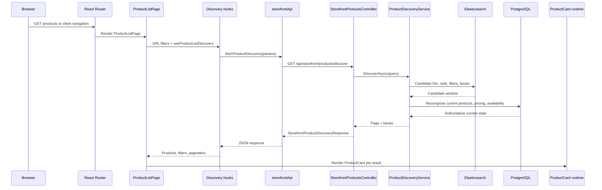
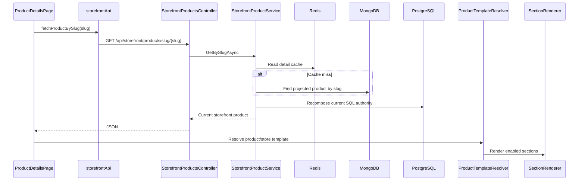
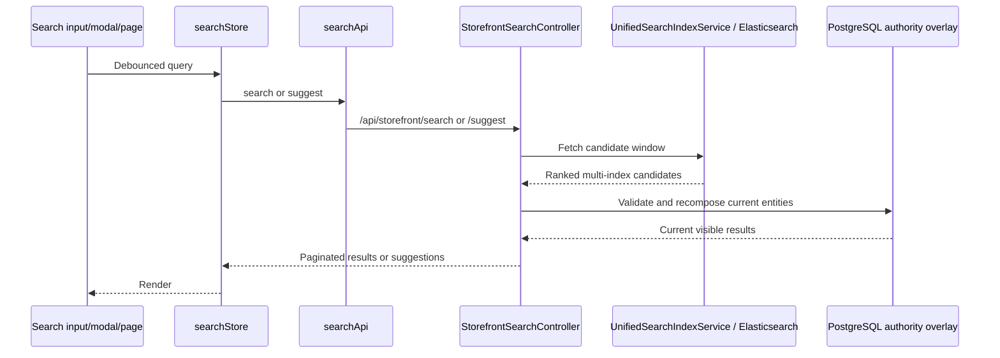
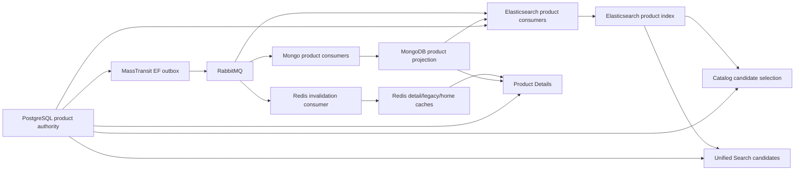
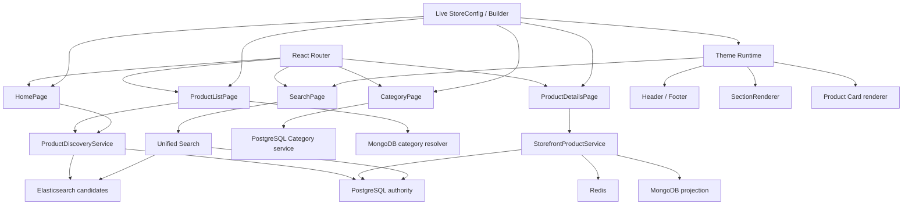
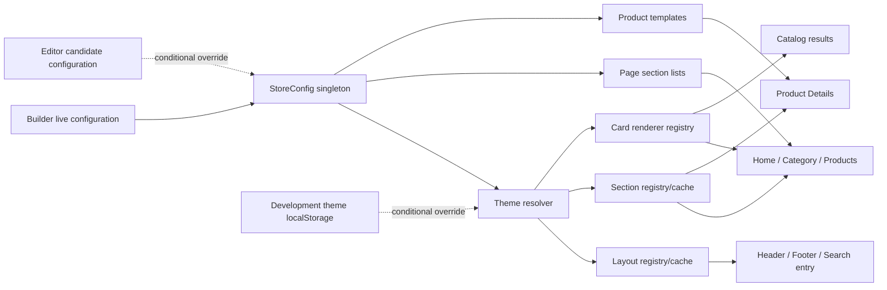

# Storefront Runtime Ownership Certification

**Audit:** Storefront Architecture Cleanup — Phase 1  
**Scope:** Runtime ownership only  
**Evidence basis:** Repository source code as present on 2026-08-02  
**Certification:** **FAIL**

## 1. Audit method and interpretation

This document records only behavior that can be traced to source. It does not infer deployment topology, data freshness, infrastructure configuration, or intended architecture from names. A runtime is called an **owner** when its code selects data, composes the response, controls an interaction, or selects the rendered implementation. A **secondary owner** participates in the same decision without owning the complete request. A **conflict** is reported only where two implemented paths control the same runtime decision or where one runtime boundary routes through different authoritative stores.

Source references use repository-relative paths and source line ranges. Where the repository does not prove an answer, the answer is explicitly **unknown**.

## 2. Executive certification

The Storefront does not have one exclusive runtime owner per audited surface.

The canonical catalog data path is identifiable: React `ProductListPage` → discovery hooks → `/api/storefront/products/discover` → `ProductDiscoveryService` → Elasticsearch candidates → PostgreSQL authority recomposition → response → product-card renderers. However, that page also executes configured Product Builder sections above and below the canonical catalog, and Theme Runtime selects product-card implementations and can change visible controls. (`PointOfSale.Storefront/src/app/router.tsx:99-105`; `PointOfSale.Storefront/src/pages/ProductListPage.tsx:73-146,340-370,576`; `PointOfSale.Storefront/src/hooks/useProductDiscovery.ts:83-185`; `PointOfSale.Storefront/src/services/api/storefrontApi.ts:128-159`; `PointOfSale.API/Controllers/StorefrontProductsController.cs:648-772`; `PointOfSale.Infrastructure/Elasticsearch/Services/ProductDiscoveryService.cs:93-176,450-605`; `PointOfSale.Storefront/src/components/products/productCardRendererResolver.ts:17-49`)

The audit establishes six material runtime ownership conflicts:

1. `/category/:slug` resolves category identity and descendants from MongoDB inside the catalog controller, while the public category runtime reads current categories from PostgreSQL. A MongoDB miss produces no category constraint before discovery. (`PointOfSale.API/Controllers/StorefrontProductsController.cs:686-745`; `PointOfSale.Infrastructure/MongoDB/Services/CategoryReadRepository.cs:102-171`; `PointOfSale.API/Services/Storefront/StorefrontCategoryService.cs:81-105,272-405`)
2. Homepage Builder Product-page sections execute on `/products` around the canonical catalog. The same `pages.product.sections` configuration can also become the fallback Product Details template. (`PointOfSale.Storefront/src/pages/ProductListPage.tsx:73-91,340-370,576`; `PointOfSale.Storefront/src/pages/productCatalogSections.ts:10-50`; `PointOfSale.Storefront/src/storefront/products/ProductTemplateResolver.ts:14-52`)
3. Theme-selected header implementations change whether and how Search Runtime is reachable: the default header honors `behavior.enableSearch`, Cosmetics always links to `/search`, and the other custom theme headers contain no search entry point. (`PointOfSale.Storefront/src/components/layout/Header.tsx:268-395`; `PointOfSale.Storefront/src/storefront/themes/cosmetics/layout/header.tsx:1-39,86-91,150`; `PointOfSale.Storefront/src/storefront/themes/pearl/layout/header.tsx:91-155`; `PointOfSale.Storefront/src/storefront/themes/phoenix/layout/header.tsx:93-157`)
4. Product Card Runtime is selected by Theme Runtime and product/store configuration; individual renderers decide whether stock, CTA, and wishlist controls are present. (`PointOfSale.Storefront/src/components/common/ProductCard.tsx:29-47`; `PointOfSale.Storefront/src/storefront/utils/resolveProductCardLayout.ts:29-50`; `PointOfSale.Storefront/src/components/products/productCardRendererResolver.ts:17-49`; `PointOfSale.Storefront/src/components/products/ProductCardRenderers.tsx:20-539`)
5. `hasVariants` exists in the URL filter state, frontend API client, backend endpoint, and Elasticsearch filter, but the live Product List adapter does not pass it into discovery. Attribute filtering has no implemented owner in the catalog request. (`PointOfSale.Storefront/src/hooks/useDiscoveryFilters.ts:120-156,246-248`; `PointOfSale.Storefront/src/hooks/useProductListDiscovery.ts:66-119,152-184`; `PointOfSale.Storefront/src/services/api/storefrontApi.ts:128-159`; `PointOfSale.API/Controllers/StorefrontProductsController.cs:648-745`; `PointOfSale.Infrastructure/Elasticsearch/Services/ProductDiscoveryService.cs:283-377`)
6. Search index refresh ownership is not uniform: product search projection is event-driven, while category and CMS index rebuilds are exposed through the administrative search-sync runtime. (`PointOfSale.API/Program.cs:1685-1717,2006-2058`; `PointOfSale.Infrastructure/Consumers/ProductSearchIndexConsumer.cs:56-216`; `PointOfSale.API/Controllers/AdminSearchSyncController.cs:15-30,178-246,301-385`)

Because these are implemented runtime overlaps and boundary splits, the final certification is **FAIL**.

## Current Runtime Owners

| Runtime | Certified current owner |
|---|---|
| Catalog | `ProductListPage` and discovery hooks on the client; `ProductDiscoveryService` on the backend; Elasticsearch for candidates and PostgreSQL for current authority (`PointOfSale.Storefront/src/pages/ProductListPage.tsx:97-146`; `PointOfSale.Infrastructure/Elasticsearch/Services/ProductDiscoveryService.cs:93-176,450-755`) |
| Product Details | `ProductDetailsPage`; `StorefrontProductService` for data; Product Template/Section Runtime for composition (`PointOfSale.Storefront/src/pages/ProductDetailsPage.tsx:13-112`; `PointOfSale.API/Services/Storefront/StorefrontProductService.cs:56-128`; `PointOfSale.Storefront/src/storefront/products/ProductTemplateResolver.ts:24-76`) |
| Category | PostgreSQL Category Service for `/category`; MongoDB category read repository for category identity on `/category/:slug` (`PointOfSale.API/Services/Storefront/StorefrontCategoryService.cs:81-105,272-405`; `PointOfSale.Infrastructure/MongoDB/Services/CategoryReadRepository.cs:102-171`) |
| Search | `searchStore`/Search components on the client; Elasticsearch unified index plus PostgreSQL authority overlays on the backend (`PointOfSale.Storefront/src/stores/searchStore.ts:116-315`; `PointOfSale.API/Controllers/StorefrontSearchController.cs:71-214,253-568`) |
| Filters | URL discovery-filter state and filter controls; Catalog Discovery for execution (`PointOfSale.Storefront/src/hooks/useDiscoveryFilters.ts:120-316`; `PointOfSale.Infrastructure/Elasticsearch/Services/ProductDiscoveryService.cs:283-377,608-675`) |
| Product Card | Backend response values plus product/StoreConfig layout and Theme-selected card renderer (`PointOfSale.Storefront/src/components/common/ProductCard.tsx:29-47`; `PointOfSale.Storefront/src/components/products/productCardRendererResolver.ts:17-49`) |
| Discover | Homepage Builder sections and `RuntimeSectionContainer`, using Catalog Discovery or curated IDs (`PointOfSale.Storefront/src/pages/HomePage.tsx:30-55`; `PointOfSale.Storefront/src/hooks/useHomepageSectionProducts.ts:81-236`; `PointOfSale.Storefront/src/storefront/runtime/containers/RuntimeSectionContainer.tsx:93-199`) |
| Navigation | Theme Layout Runtime for header/footer components; navigation/footer Zustand stores; PostgreSQL-backed endpoints for data (`PointOfSale.Storefront/src/storefront/layout/StorefrontLayout.tsx:15-64`; `PointOfSale.Storefront/src/stores/navigationStore.ts:31-92`; `PointOfSale.Storefront/src/stores/footerStore.ts:20-40`) |
| Theme | Official theme registry, resolver, context, layout/section/card registries (`PointOfSale.Storefront/src/storefront/themes/ThemeRegistry.ts:1-61`; `PointOfSale.Storefront/src/storefront/themes/ThemeResolver.ts:3-52`; `PointOfSale.Storefront/src/storefront/themes/ThemeLayoutResolver.ts:9-49`; `PointOfSale.Storefront/src/storefront/themes/ThemeSectionResolver.ts:8-78`) |
| Builder | Published live StoreConfig pages and product templates, consumed by page/template runtimes (`PointOfSale.API/Services/Storefront/StorefrontDraftConfigMapper.cs:337-470`; `PointOfSale.Storefront/src/bootstrap/bootstrap.ts:127-210`) |
| Cache | Per-layer owners listed in section 14; no single cross-layer cache owner |
| Refresh | Per-runtime frontend triggers and backend product event consumers listed in section 15; no single cross-runtime refresh owner |
| Projection | PostgreSQL transaction + MassTransit EF outbox + RabbitMQ + independent MongoDB/Elasticsearch/Redis consumers (`PointOfSale.API/Services/ProductAuthoring/ProductAuthoringOrchestrator.cs:462-499,609-735`; `PointOfSale.API/Program.cs:1685-1717,1955-1963,2006-2058`) |
| Rendering | Client React SPA route/page components, with Theme layout/section/card selection and Builder section composition (`PointOfSale.Storefront/src/main.tsx:1-24`; `PointOfSale.Storefront/src/app/router.tsx:1-47,93-153`) |

## 3. Application and rendering foundation

The Storefront is a browser-rendered React SPA. The HTML contains an empty `#root`, and `main.tsx` calls `ReactDOM.createRoot(...).render(...)`; there is no `hydrateRoot` call in the Storefront entry point. (`PointOfSale.Storefront/index.html:1-31`; `PointOfSale.Storefront/src/main.tsx:1-24`)

`App` bootstraps language, session, StoreConfig, and theme before exposing `RouterProvider`. The top-level runtime providers are `ThemeProvider`, `ErrorBoundary`, `AffiliateProvider`, and `OfferProvider`. (`PointOfSale.Storefront/src/app/App.tsx:49-82,151-163`; `PointOfSale.Storefront/src/bootstrap/bootstrap.ts:91-210`)

The router owns the page-to-component mapping. The core mappings are:

| URL | React owner | Source |
|---|---|---|
| `/` | `HomePage` | `PointOfSale.Storefront/src/app/router.tsx:93-99` |
| `/products` | `ProductListPage` | `PointOfSale.Storefront/src/app/router.tsx:99-105` |
| `/products/:slug` | `ProductDetailsPage` | `PointOfSale.Storefront/src/app/router.tsx:105-111` |
| `/category` | `CategoryPage` | `PointOfSale.Storefront/src/app/router.tsx:111-117` |
| `/category/:slug` | `ProductListPage` | `PointOfSale.Storefront/src/app/router.tsx:117-123` |
| `/search` | `ThemePageRoute`, currently resolving the default `SearchPage` | `PointOfSale.Storefront/src/app/router.tsx:135-153`; `PointOfSale.Storefront/src/storefront/pages/ThemePageRoute.tsx:10-44`; `PointOfSale.Storefront/src/storefront/themes/ThemePageResolver.ts:7-47` |

Language-prefixed route equivalents are also declared. Router creation uses browser routing outside the test path and memory routing for tests. (`PointOfSale.Storefront/src/app/router.tsx:159-289`)

## 4. Catalog Runtime

### 4.1 Canonical request sequence



Evidence for the sequence: `PointOfSale.Storefront/src/app/router.tsx:99-105,169-175`; `PointOfSale.Storefront/src/pages/ProductListPage.tsx:97-146,237-338,415-573`; `PointOfSale.Storefront/src/hooks/useDiscoveryFilters.ts:120-185`; `PointOfSale.Storefront/src/hooks/useProductListDiscovery.ts:152-184`; `PointOfSale.Storefront/src/hooks/useProductDiscovery.ts:83-185`; `PointOfSale.Storefront/src/services/api/storefrontApi.ts:128-159`; `PointOfSale.API/Controllers/StorefrontProductsController.cs:648-772`; `PointOfSale.Infrastructure/Elasticsearch/Services/ProductDiscoveryService.cs:93-176,283-446,450-755`.

### 4.2 Ownership result

The frontend request owner is `ProductListPage` with `useDiscoveryFilters`, `useProductListDiscovery`, and `useProductDiscovery`. The backend endpoint owner is `StorefrontProductsController.Discover`. The backend query/composition owner is `ProductDiscoveryService`. Elasticsearch owns candidate selection, text matching, relevance, pre-authority filters, and initial facets. PostgreSQL owns the current product overlay, online/active visibility, pricing, promotion, availability, final authority filtering, and response recomposition. (`PointOfSale.Infrastructure/Elasticsearch/Services/ProductDiscoveryService.cs:93-176,283-446,450-675,678-755`)

Price and highest-discount sorts are reapplied after SQL recomposition; relevance and newest preserve the Elasticsearch order. Final pagination is applied after SQL-authoritative filtering, within the maximum candidate window requested from Elasticsearch. (`PointOfSale.Infrastructure/Elasticsearch/Services/ProductDiscoveryService.cs:93-176,450-529,663-675`)

MongoDB is not the product-list fallback. It participates only in category slug/tree resolution before the discovery query. The legacy `/api/storefront/products` service and its Redis behavior are not the path called by the live `/products` page, which calls `/discover`. (`PointOfSale.Storefront/src/services/api/storefrontApi.ts:100-159`; `PointOfSale.API/Controllers/StorefrontProductsController.cs:686-745`)

### 4.3 Secondary ownership on the catalog page

`ProductListPage` reads enabled Product-page sections from StoreConfig, classifies them as top or bottom sections, and renders them around the canonical catalog. The section runtime suppresses `/products` self-links for those injected shelves. This is executed behavior, not a dormant configuration path. (`PointOfSale.Storefront/src/pages/ProductListPage.tsx:73-91,340-370,576`; `PointOfSale.Storefront/src/pages/productCatalogSections.ts:10-50`; `PointOfSale.Storefront/src/storefront/runtime/containers/RuntimeSectionContainer.tsx:93-199`)

Therefore:

- **Catalog data owner:** `ProductDiscoveryService`, with Elasticsearch candidate ownership and PostgreSQL authority ownership.
- **Catalog page owner:** `ProductListPage`.
- **Secondary catalog-page owner:** StoreConfig Product Builder sections.
- **Catalog item rendering owner:** Theme/product-card runtime.

## 5. Product Details Runtime



`ProductDetailsPage` loads the product and categories concurrently into local component state. It has no shared product cache and no refresh loop; a slug change/remount starts the load. (`PointOfSale.Storefront/src/pages/ProductDetailsPage.tsx:13-50`)

The client resolves `ENDPOINTS.PRODUCT_BY_SLUG(slug)` and issues the product request from `fetchProductBySlug`; the backend slug action delegates to `StorefrontProductService`. (`PointOfSale.Storefront/src/services/api/storefrontApi.ts:164-169`; `PointOfSale.Storefront/src/services/api/endpoints.ts:7-28`; `PointOfSale.API/Controllers/StorefrontProductsController.cs:65-140`)

The backend reads Redis first, uses the MongoDB product read model on a cache miss, and always overlays current PostgreSQL state before returning; cache hits are also SQL-recomposed. (`PointOfSale.API/Services/Storefront/StorefrontProductService.cs:16-31,56-128,642-690,749-767`)

Rendering composition is separately owned. `ProductTemplateResolver` first checks saved StoreConfig templates, can use `pages.product.sections` as a detail-template fallback, and otherwise uses the built-in registry. `SectionRenderer` may asynchronously replace a default section with the active theme's section component. (`PointOfSale.Storefront/src/storefront/products/ProductTemplateResolver.ts:4-76`; `PointOfSale.Storefront/src/storefront/products/ProductTemplateRegistry.ts:20-477`; `PointOfSale.Storefront/src/pages/ProductDetailsPage.tsx:59-112`; `PointOfSale.Storefront/src/components/sections/SectionRenderer.tsx:35-79,118-139`)

**Product Details data owner:** `StorefrontProductService`, with PostgreSQL as current authority and Redis/MongoDB as derivative read layers.  
**Product Details composition owner:** StoreConfig product templates and `ProductTemplateResolver`.  
**Product Details section implementation owner:** `SectionRenderer` plus the active theme section module.

## 6. Category Runtime

There are two different category runtimes.

### 6.1 Category browse page: `/category`

`CategoryPage` calls `fetchCategories` and renders the default category grid only when no configured Category-page sections exist. When configured sections exist, the Builder section list is the rendered page. (`PointOfSale.Storefront/src/pages/CategoryPage.tsx:1-12,120-146,245-333`)

The public category controller delegates to `StorefrontCategoryService`. Its tree and slug reads obtain the current categories from PostgreSQL. The tree path asynchronously populates a Redis derivative but returns the SQL result. (`PointOfSale.API/Controllers/StorefrontCategoriesController.cs:17-31,42-71,94-141`; `PointOfSale.API/Services/Storefront/StorefrontCategoryService.cs:81-105,272-405,503-548`)

**Browse data owner:** PostgreSQL through `StorefrontCategoryService`.  
**Browse rendering owner:** `CategoryPage`, unless StoreConfig Category Builder sections are configured; then those sections own the page body.

### 6.2 Filtered catalog page: `/category/:slug`

The router renders `ProductListPage`, which places the route slug into discovery filter state. It does not call the category-by-slug public endpoint. (`PointOfSale.Storefront/src/app/router.tsx:117-123`; `PointOfSale.Storefront/src/hooks/useDiscoveryFilters.ts:120-156`; `PointOfSale.Storefront/src/pages/ProductListPage.tsx:97-146`)

The discovery controller resolves the slug and category descendants through `ICategoryReadRepository`, whose implementation is the MongoDB category read repository. If no MongoDB category is resolved, the controller constructs the discovery query without a category constraint. (`PointOfSale.API/Controllers/StorefrontProductsController.cs:686-745`; `PointOfSale.Infrastructure/MongoDB/Services/CategoryReadRepository.cs:7-20,102-171`)

The repository contains administrative SQL-to-Mongo category sync and SQL-to-Elasticsearch category sync endpoints. The audited call sites do not establish an event-driven category projection path equivalent to the product projection path. (`PointOfSale.API/Controllers/AdminDataSyncController.cs:34-43,67-116`; `PointOfSale.API/Controllers/AdminSearchSyncController.cs:15-30,178-246`)

**Filtered category identity owner:** MongoDB `CategoryReadRepository`.  
**Filtered product result owner:** the Catalog Runtime.  
**Conflict:** public category browsing uses PostgreSQL, while catalog category resolution uses MongoDB.

## 7. Search Runtime

### 7.1 Input, keyboard, debounce, and state

The default header opens `SearchModal` and registers `Ctrl/Cmd+K` only when the header behavior enables search. `SearchModal` owns focus, Escape, Enter, query display, suggestions, and “View All.” (`PointOfSale.Storefront/src/components/layout/Header.tsx:268-395`; `PointOfSale.Storefront/src/components/search/SearchModal.tsx:31-107,139-164,201-285,324-339`)

`SearchInput` debounces by 200 ms and invokes its `onSearch` callback when the query length reaches one character. The search store requires one character for suggestions and two for a full search. (`PointOfSale.Storefront/src/components/search/SearchInput.tsx:14-58,80-86`; `PointOfSale.Storefront/src/services/api/searchApi.ts:192-202`; `PointOfSale.Storefront/src/stores/searchStore.ts:116-299`)

The active keyboard handlers proven in source are `Ctrl/Cmd+K` for opening default-header search, Escape for clearing/closing, and Enter for submitting. No ArrowUp/ArrowDown selection handler is implemented in the active `SearchInput` or `SearchModal` sources. (`PointOfSale.Storefront/src/components/search/SearchInput.tsx:60-88`; `PointOfSale.Storefront/src/components/search/SearchModal.tsx:31-107,324-339`; `PointOfSale.Storefront/src/components/layout/Header.tsx:268-295`)

`SearchPage` makes the URL `q`, `page`, and `type` values the page-level state. Its debounced input submission updates the URL; the page effect invokes the full search store operation. (`PointOfSale.Storefront/src/pages/SearchPage.tsx:53-137,147-180`)

The search store is a Zustand module singleton. It aborts superseded requests, caches autocomplete results for 30 seconds, and sends full-search requests with a 20-item page size. (`PointOfSale.Storefront/src/stores/searchStore.ts:116-315`; `PointOfSale.Storefront/src/services/api/searchApi.ts:109-167,192-202`)

### 7.2 Backend search



`StorefrontSearchController` uses Elasticsearch unified-search candidates and then PostgreSQL authority overlays for products, categories, and CMS results. The controller requests a candidate window, recomposes current SQL-visible entities, then paginates. Elasticsearch failure or an exhausted candidate window returns a service-unavailable response; no MongoDB regex or PostgreSQL candidate-search fallback is implemented in this path. (`PointOfSale.API/Controllers/StorefrontSearchController.cs:21-43,71-214,253-368,404-578`; `PointOfSale.Infrastructure/Elasticsearch/Services/UnifiedSearchIndexService.cs:300-468,570-720`)

**Search candidate/ranking owner:** Elasticsearch through `UnifiedSearchIndexService`.  
**Search current-visibility owner:** PostgreSQL authority overlays in `StorefrontSearchController`.  
**Search client owner:** `searchStore`, `SearchModal`, and `SearchPage`.  
**MongoDB fallback:** none in the current Search Runtime.  
**PostgreSQL fallback:** none for candidate discovery; PostgreSQL is an authority overlay only.

### 7.3 Search entry-point conflict and dormant alternatives

The active theme can replace the header. The Modern theme delegates to the default header; Cosmetics renders an unconditional `/search` link; other audited custom header modules have no search modal, `/search` link, global search shortcut, or `enableSearch` handling. (`PointOfSale.Storefront/src/storefront/themes/modern/layout/header.tsx:1-6`; `PointOfSale.Storefront/src/storefront/themes/cosmetics/layout/header.tsx:1-39,86-91,150`; `PointOfSale.Storefront/src/storefront/themes/pearl/layout/header.tsx:91-155`; `PointOfSale.Storefront/src/storefront/themes/phoenix/layout/header.tsx:93-157`)

| Active theme header path | Search entry behavior proven by the complete header module |
|---|---|
| Modern | Delegates to the default header, which honors `behavior.enableSearch` (`PointOfSale.Storefront/src/storefront/themes/modern/layout/header.tsx:1-6`; `PointOfSale.Storefront/src/components/layout/Header.tsx:268-395`) |
| Electronics | Has no custom header module; `ThemeLayoutResolver` falls back to the default header (`PointOfSale.Storefront/src/storefront/themes/ThemeLayoutResolver.ts:9-49`) |
| Cosmetics | Always renders desktop and mobile `/search` links; it does not read `enableSearch` (`PointOfSale.Storefront/src/storefront/themes/cosmetics/layout/header.tsx:1-164`) |
| Alizon | No search link/modal/shortcut/behavior read in the header module (`PointOfSale.Storefront/src/storefront/themes/alizon/layout/header.tsx:1-175`) |
| Fashion | No search link/modal/shortcut/behavior read in the header module (`PointOfSale.Storefront/src/storefront/themes/fashion/layout/header.tsx:1-139`) |
| Hype | No search link/modal/shortcut/behavior read in the header module (`PointOfSale.Storefront/src/storefront/themes/hype/layout/header.tsx:1-176`) |
| Minimal | No search link/modal/shortcut/behavior read in the header module (`PointOfSale.Storefront/src/storefront/themes/minimal/layout/header.tsx:1-115`) |
| Pearl | No search link/modal/shortcut/behavior read in the header module (`PointOfSale.Storefront/src/storefront/themes/pearl/layout/header.tsx:1-174`) |
| Phoenix | No search link/modal/shortcut/behavior read in the header module (`PointOfSale.Storefront/src/storefront/themes/phoenix/layout/header.tsx:1-177`) |
| Seven | No search link/modal/shortcut/behavior read in the header module (`PointOfSale.Storefront/src/storefront/themes/seven/layout/header.tsx:1-105`) |
| Sharp | No search link/modal/shortcut/behavior read in the header module (`PointOfSale.Storefront/src/storefront/themes/sharp/layout/header.tsx:1-174`) |

The default mobile header links to `/products?focus=search`; no `focus` parameter consumer exists in `ProductListPage` or its discovery-filter hook. (`PointOfSale.Storefront/src/components/layout/Header.tsx:135-147,238-244`; `PointOfSale.Storefront/src/pages/ProductListPage.tsx:73-146`; `PointOfSale.Storefront/src/hooks/useDiscoveryFilters.ts:120-185`)

`useProductSearch` implements a separate 400 ms debounced discovery-based search, and `SmartSearchAutocomplete`/`SearchAutocomplete` define alternative autocomplete components. The repository call sites do not place these in the active header, modal, or Search page, so they are dormant implementations rather than current owners. (`PointOfSale.Storefront/src/hooks/useProductSearch.ts:1-118`; `PointOfSale.Storefront/src/components/search/SmartSearchAutocomplete.tsx:1-240`; `PointOfSale.Storefront/src/components/search/SearchAutocomplete.tsx:1-221`)

## 8. Filters, sorting, and pagination Runtime

| Capability | Frontend owner | Backend owner | Certified behavior |
|---|---|---|---|
| Category | `useDiscoveryFilters`, category selector | Controller MongoDB slug/tree resolution; Elasticsearch candidate filter; SQL authority recheck | Active. Direct category and route slug are supported. (`PointOfSale.Storefront/src/hooks/useDiscoveryFilters.ts:120-156`; `PointOfSale.Storefront/src/components/filters/ProductFiltersSidebar.tsx:253-297,404-448`; `PointOfSale.API/Controllers/StorefrontProductsController.cs:686-745`; `PointOfSale.Infrastructure/Elasticsearch/Services/ProductDiscoveryService.cs:283-377,608-660`) |
| Brand | URL filter and brand selector | Elasticsearch candidate filter; SQL authority recheck | Active. (`PointOfSale.Storefront/src/components/filters/FilterComponents.tsx:134-177`; `PointOfSale.Storefront/src/services/api/storefrontApi.ts:128-159`; `PointOfSale.Infrastructure/Elasticsearch/Services/ProductDiscoveryService.cs:283-377,608-660`) |
| Price | URL filter and price control | Elasticsearch candidate filter; SQL-recomposed authoritative price and final check | Active. (`PointOfSale.Storefront/src/components/filters/FilterComponents.tsx:280-350`; `PointOfSale.Infrastructure/Elasticsearch/Services/ProductDiscoveryService.cs:283-377,532-675`) |
| Availability | Stock URL filter and stock control | Elasticsearch candidate filter; SQL authoritative availability and final check | Active. (`PointOfSale.Storefront/src/components/filters/FilterComponents.tsx:371-403`; `PointOfSale.Infrastructure/Elasticsearch/Services/ProductDiscoveryService.cs:283-377,532-660,678-755`) |
| Promotion | URL filter and promotion control | Elasticsearch candidate filter; SQL current promotion/final check | Active. (`PointOfSale.Storefront/src/components/filters/FilterComponents.tsx:411-440`; `PointOfSale.Infrastructure/Elasticsearch/Services/ProductDiscoveryService.cs:283-377,532-660`) |
| Has variants | URL state/action and API/backend support | Elasticsearch supports it | Not connected by `useProductListDiscovery`; therefore not active in the canonical catalog request. (`PointOfSale.Storefront/src/hooks/useDiscoveryFilters.ts:120-156,246-248`; `PointOfSale.Storefront/src/hooks/useProductListDiscovery.ts:66-119,152-184`; `PointOfSale.Storefront/src/services/api/storefrontApi.ts:128-159`; `PointOfSale.Infrastructure/Elasticsearch/Services/ProductDiscoveryService.cs:370-375`) |
| Attributes | None found | None found in discovery query/filter | Owner unknown because no implemented Catalog Runtime path exists. |
| Sorting | URL and sort selector | Elasticsearch orders relevance/newest; C# reapplies price/discount after SQL recomposition | Active. (`PointOfSale.Storefront/src/components/filters/FilterComponents.tsx:602-667`; `PointOfSale.Infrastructure/Elasticsearch/Services/ProductDiscoveryService.cs:383-404,663-675`) |
| Pagination | URL `page`/`pageSize` and page controls | C# paginates after SQL authority filtering | Active. (`PointOfSale.Storefront/src/hooks/useDiscoveryFilters.ts:120-185`; `PointOfSale.Storefront/src/pages/ProductListPage.tsx:237-338`; `PointOfSale.Infrastructure/Elasticsearch/Services/ProductDiscoveryService.cs:450-529`) |

The visible filter controls are category, brand, price, stock availability, and promotion. (`PointOfSale.Storefront/src/components/filters/ProductFiltersSidebar.tsx:253-297,404-448`; `PointOfSale.Storefront/src/components/filters/FilterComponents.tsx:134-177,205-252,280-350,371-440`)

## 9. Product Card Runtime

The card runtime has layered ownership.

1. The backend supplies current product identity, display price/pricing, availability, stock label, image fields, promotion state, and `canAddToCart`. (`PointOfSale.Infrastructure/Elasticsearch/Services/ProductDiscoveryService.cs:450-605,678-755`; `PointOfSale.API/DTOs/Storefront/StorefrontDtos.cs:156-204`)
2. `resolveProductImage` selects the frontend image fallback order. `OptimizedImage` owns native lazy image loading and visual fallback. (`PointOfSale.Storefront/src/utils/resolveProductImage.ts:71-107`; `PointOfSale.Storefront/src/components/media/OptimizedImage.tsx:26-72`)
3. `resolveProductCardLayout` allows product `storefrontLayout`/`productTemplate` fields to precede StoreConfig card layout. (`PointOfSale.Storefront/src/storefront/utils/resolveProductCardLayout.ts:29-50`)
4. `productCardRendererResolver` gives the active official theme authority over the renderer and accepts a product layout only for specified same-theme layouts. (`PointOfSale.Storefront/src/components/products/productCardRendererResolver.ts:17-49`)
5. `ProductCardRuntime` binds cart and wishlist actions, computed text, badges, price, and quick-add primitives. (`PointOfSale.Storefront/src/components/products/ProductCardRuntime.tsx:53-150,169-262`)
6. The selected renderer decides which primitives are actually visible. The theme renderers differ in stock, CTA/quick-add, and wishlist presentation. (`PointOfSale.Storefront/src/components/products/ProductCardRenderers.tsx:20-539`)

Decision ownership by requested field:

| Card decision | Current owner |
|---|---|
| Image | Backend image/media fields, then `resolveProductImage`, then renderer media placement |
| Price | Backend SQL/pricing pipeline supplies values; selected renderer decides presentation |
| Stock badge/label | Backend availability/stock label supplies state; selected renderer decides visibility |
| Variant badge | No active card badge implementation found; `hasVariants` is data/filter state, not a rendered variant badge |
| CTA | Backend `canAddToCart`, `ProductCardRuntime` cart action, selected theme renderer visibility |
| Compare | No product-comparison control found in the active card runtime; `compareClassName` is compare-at-price styling |
| Wishlist | `ProductCardRuntime`/`WishlistButton`, subject to selected renderer inclusion |
| Rating | No active rating renderer found in `ProductCardRenderers`; the theme authority contract declares rating capability but the card runtime does not consume it (`theme-authority/shopixy-theme-authority.json:552-605`) |
| Quick view | No active Product Card quick-view implementation found |

**Product Card owner:** not singular. Backend product authority owns the values; Theme Runtime plus product/StoreConfig layout owns renderer selection; the selected renderer owns visible controls.

## 10. Discover Runtime

### 10.1 Homepage Discover

`HomePage` is driven by `config.pages.home.sections`; only when no sections exist does it render the default hero. (`PointOfSale.Storefront/src/pages/HomePage.tsx:30-55`)

Homepage product sections support three data-source modes: `all`, deterministic `random`, and `curated`. Curated loads explicit IDs. All/random calls product discovery, with random fetching a larger set and performing deterministic client selection. A module-level product and in-flight cache stores these results without a TTL. (`PointOfSale.Storefront/src/components/sections/homepageCollectionUtils.ts:1-40,71-104`; `PointOfSale.Storefront/src/hooks/useHomepageSectionProducts.ts:17-18,81-236,246-249`)

`RuntimeSectionContainer` owns Product Grid/Featured section execution, default “View All” navigation to `/products`, theme section layout, and product card rendering. The Hype theme forces a carousel for Product Grid; the Electronics section selects its hard-coded renderer path. (`PointOfSale.Storefront/src/storefront/runtime/containers/RuntimeSectionContainer.tsx:93-199`)

### 10.2 Requested discovery categories

| Discovery surface | Implemented owner |
|---|---|
| Featured homepage shelves | Builder section configuration + `useHomepageSectionProducts`; “featured” is a presentation/section name, with data selected as all/random/curated |
| Popular | No dedicated active Homepage Runtime owner found |
| Newest | No dedicated active Homepage Runtime owner found; the backend endpoint exists but the active homepage hook does not call it |
| Recommendations | Related-product section uses category discovery, excludes the current product, and slices client-side; no dedicated recommendation engine is called (`PointOfSale.Storefront/src/storefront/runtime/containers/RuntimeSectionContainer.tsx:290-331`) |
| Recently viewed | No active runtime owner found |
| Search suggestions | `searchStore` → `/api/storefront/search/suggest` → Elasticsearch header suggestions → PostgreSQL recomposition (`PointOfSale.Storefront/src/stores/searchStore.ts:145-231`; `PointOfSale.API/Controllers/StorefrontSearchController.cs:253-368`) |

The Storefront API client exposes featured/by-ID helpers, and the backend Home controller/service implements featured/new/best reads with Redis and derivative stores. The current homepage hook imports by-ID and discovery functions, not the featured/new/best Home endpoints; those backend paths are not the active SPA homepage runtime. (`PointOfSale.Storefront/src/services/api/storefrontApi.ts:69-90`; `PointOfSale.Storefront/src/hooks/useHomepageSectionProducts.ts:1-11`; `PointOfSale.API/Controllers/StorefrontHomeController.cs:56-220`; `PointOfSale.API/Services/Storefront/StorefrontHomeService.cs:66-335`)

**Homepage Discover owner:** Homepage Builder page sections and `RuntimeSectionContainer`, using Catalog Discovery for non-curated product retrieval.

## 11. Navigation Runtime

`StorefrontLayout` asynchronously resolves theme-specific header and footer modules, beginning with the default implementations. (`PointOfSale.Storefront/src/storefront/layout/StorefrontLayout.tsx:15-64`; `PointOfSale.Storefront/src/storefront/themes/ThemeLayoutResolver.ts:9-49`)

The default header uses the Zustand `navigationStore`; that store loads once per browser module lifetime and maps category destinations to `/products?category={slug}`. The default footer uses the analogous load-once `footerStore`. (`PointOfSale.Storefront/src/stores/navigationStore.ts:31-92`; `PointOfSale.Storefront/src/components/layout/Header.tsx:268-284`; `PointOfSale.Storefront/src/stores/footerStore.ts:20-40`; `PointOfSale.Storefront/src/components/layout/Footer.tsx:8-108`)

The navigation controller reads the current StoreConfig customization JSON directly from PostgreSQL and SQL-validates/recomposes category and CMS targets. The footer read service reads current tenant/page/section/social data directly from PostgreSQL. (`PointOfSale.API/Controllers/StorefrontNavigationController.cs:13-74,94-201`; `PointOfSale.API/Controllers/StorefrontFooterController.cs:10-50`; `PointOfSale.API/Services/Storefront/StorefrontFooterReadService.cs:34-150`)

The repository contains `StorefrontFooterCacheService`, but `StorefrontFooterReadService` does not inject it; its active public read is SQL. (`PointOfSale.API/Services/Storefront/StorefrontFooterCacheService.cs:9-66`; `PointOfSale.API/Services/Storefront/StorefrontFooterReadService.cs:34-99`)

Breadcrumb ownership is page-local in the active SPA surfaces. Product List and checkout/cart surfaces render their own breadcrumbs. A backend `BreadcrumbsController` exists, but no active frontend service/hook/store call site connects it to these routes. (`PointOfSale.Storefront/src/pages/ProductListPage.tsx:374-414`; `PointOfSale.API/Controllers/BreadcrumbsController.cs:9-31,55-124`)

The catalog sidebar is owned by `ProductListPage` and `ProductFiltersSidebar`; Theme commerce classes determine its presentation and responsive placement. (`PointOfSale.Storefront/src/pages/ProductListPage.tsx:506-573`; `PointOfSale.Storefront/src/components/filters/ProductFiltersSidebar.tsx:253-448`; `PointOfSale.Storefront/src/storefront/commerce/CommerceBrowsingExperience.tsx:17-230`)

**Header/footer component owner:** Theme Layout Runtime.  
**Header data owner:** StoreConfig/PostgreSQL through the navigation endpoint, held in `navigationStore`.  
**Footer data owner:** PostgreSQL through the footer endpoint, held in `footerStore`.  
**Breadcrumb owner:** individual React pages; backend breadcrumb runtime is dormant for the audited routes.  
**Sidebar owner:** Product List/filter components, with Theme presentation.

## 12. Theme Runtime

The official theme registry selects and validates the active theme. Theme resolution uses a development-only local-storage override, then StoreConfig, then the default theme. Theme application writes CSS variables/body state, and `ThemeContext` exposes the active theme. (`PointOfSale.Storefront/src/storefront/themes/ThemeRegistry.ts:1-61`; `PointOfSale.Storefront/src/storefront/themes/ThemeResolver.ts:3-52`; `PointOfSale.Storefront/src/theme/applyTheme.ts:14-25`; `PointOfSale.Storefront/src/storefront/themes/ThemeContext.tsx:13-35`)

Themes currently influence:

- CSS tokens and global theme identity.
- Header and footer component selection and therefore navigation/search entry behavior.
- Catalog page, Search page, breadcrumb, grid, filter, sidebar, page-header, and merchandising classes/components.
- Product Grid section layout; at least Hype changes Product Grid to carousel behavior.
- Product Card renderer selection and therefore visible CTA, stock, and wishlist controls.
- Product Details section implementation and purchase-control presentation.
- Any section for which `ThemeSectionResolver` finds a themed section module.

Evidence: `PointOfSale.Storefront/src/storefront/themes/ThemeLayoutResolver.ts:9-49`; `PointOfSale.Storefront/src/storefront/themes/ThemeSectionResolver.ts:8-78`; `PointOfSale.Storefront/src/components/sections/SectionRenderer.tsx:35-79`; `PointOfSale.Storefront/src/storefront/commerce/CommerceBrowsingExperience.tsx:17-230`; `PointOfSale.Storefront/src/components/products/productCardRendererResolver.ts:17-49`; `PointOfSale.Storefront/src/components/products/ProductCardRenderers.tsx:20-539`; `PointOfSale.Storefront/src/storefront/runtime/containers/RuntimeSectionContainer.tsx:93-199,334-473`.

`ThemePageResolver` is capable of loading theme page modules through its `import.meta.glob` pattern, but no such themed page modules are present in the audited tree; current `ThemePageRoute` instances therefore resolve default pages. (`PointOfSale.Storefront/src/storefront/themes/ThemePageResolver.ts:7-47`; `PointOfSale.Storefront/src/storefront/pages/ThemePageRoute.tsx:10-44`)

Themes do not select the backend Catalog/Search services or change their API parameters in the traced source. Their certified runtime effect is presentation, component/renderer choice, control availability, and the noted Product Grid carousel behavior.

## 13. Builder Runtime

The public StoreConfig endpoint explicitly reads current PostgreSQL state and maps live StoreConfig content, including theme, behavior, pages, and product templates. It returns a no-store response. (`PointOfSale.API/Controllers/StorefrontStoreConfigController.cs:13-27,61-145`; `PointOfSale.API/Services/Storefront/StorefrontDraftConfigMapper.cs:50-92,337-470`; `PointOfSale.Core/Entities/StoreConfig.cs:7-15,77-103`)

Administrative StoreConfig code writes page-layout drafts under pages or product templates and publishes draft configuration to live configuration. (`PointOfSale.API/Services/Admin/AdminStoreConfigService.cs:266-420,596-643`)

Homepage Builder currently influences:

| Surface | Implemented influence |
|---|---|
| `/` | Owns the enabled/sorted page section list; replaces the default homepage content when configured |
| `/category` | Owns the enabled/sorted page section list; replaces the default category grid when configured |
| `/products` | Injects configured Product-page sections above and below the canonical catalog |
| `/products/:slug` | Saved product templates own composition; Product-page sections can be used as template fallback |
| Navigation/theme/behavior | The same StoreConfig payload supplies navigation-related customization, selected theme, and behavior flags, though these are separate runtime consumers |

Evidence: `PointOfSale.Storefront/src/pages/HomePage.tsx:30-55`; `PointOfSale.Storefront/src/pages/CategoryPage.tsx:120-146,245-333`; `PointOfSale.Storefront/src/pages/ProductListPage.tsx:73-91,340-370,576`; `PointOfSale.Storefront/src/storefront/products/ProductTemplateResolver.ts:14-76`; `PointOfSale.Storefront/src/bootstrap/bootstrap.ts:127-210`.

## 14. Cache Runtime

### 14.1 Browser and React-module caches

| Cache/state | Owner and behavior | Invalidation/refresh |
|---|---|---|
| Bootstrap singleton | Module state makes bootstrap idempotent and shares the in-flight promise (`PointOfSale.Storefront/src/bootstrap/bootstrap.ts:64-121`) | Page/module reload only |
| StoreConfig | Zustand `storeConfigStore` singleton (`PointOfSale.Storefront/src/store/storeConfigStore.ts:30-68`) | Bootstrap assignment; editor-mode candidate assignment |
| Categories | Tenant-keyed module maps for results and in-flight promises (`PointOfSale.Storefront/src/hooks/useCategories.ts:27-111`) | Explicit force refetch or `clearCategoryCache` (`PointOfSale.Storefront/src/hooks/useCategories.ts:121-127`); no TTL |
| Homepage section products | Module product/in-flight maps (`PointOfSale.Storefront/src/hooks/useHomepageSectionProducts.ts:17-18,134-236`) | Hook force refetch or explicit clear (`PointOfSale.Storefront/src/hooks/useHomepageSectionProducts.ts:246-249`); no TTL |
| Product template resolution | Module cache keyed by template/config identity (`PointOfSale.Storefront/src/storefront/products/ProductTemplateResolver.ts:4-76`) | Key change/module reload; no external invalidation |
| Theme layouts/pages/sections | Module maps populated by dynamic import (`PointOfSale.Storefront/src/storefront/themes/ThemeLayoutResolver.ts:9-49`; `PointOfSale.Storefront/src/storefront/themes/ThemePageResolver.ts:7-47`; `PointOfSale.Storefront/src/storefront/themes/ThemeSectionResolver.ts:8-78`) | Module reload; no external invalidation |
| Search suggestions | Zustand `Map`, 30-second TTL (`PointOfSale.Storefront/src/stores/searchStore.ts:145-231,309-315`) | TTL or store reset |
| Navigation/footer | Zustand load-once state (`PointOfSale.Storefront/src/stores/navigationStore.ts:31-65`; `PointOfSale.Storefront/src/stores/footerStore.ts:20-40`) | Store reset/module reload; no backend signal |
| Session | Memory map plus browser local storage (`PointOfSale.Storefront/src/bootstrap/sessionManager.ts:33-123`) | Session manager operations/browser storage |
| Language | Persisted Zustand local storage (`PointOfSale.Storefront/src/i18n/languageStore.ts:91,167`) | Language-store update |
| Theme development override | Browser local storage in development only (`PointOfSale.Storefront/src/storefront/themes/ThemeResolver.ts:3-52`) | Local-storage change/module resolution |
| HTTP client refresh gates | Axios singleton and shared auth-refresh promises (`PointOfSale.Storefront/src/services/api/httpClient.ts:65-67,141-158,175-322`) | Promise completion/module reload |

No React Cache API, React Query cache, or SWR cache owns the traced Catalog/Product/Search requests. Their hooks use component state and module stores. No service-worker registration is present in the Storefront entry point or audited Storefront source. (`PointOfSale.Storefront/src/main.tsx:1-24`; `PointOfSale.Storefront/src/hooks/useProductDiscovery.ts:116-185`; `PointOfSale.Storefront/src/pages/ProductDetailsPage.tsx:13-50`)

Browser HTTP cache behavior for Catalog, Product, and Search responses is **unknown** from source because those endpoints do not establish an audited explicit browser cache policy. StoreConfig explicitly uses no-store. CDN/reverse-proxy behavior is also **unknown** from repository source. (`PointOfSale.API/Controllers/StorefrontStoreConfigController.cs:61-145`)

### 14.2 Server-side caches and derivative stores

| Layer | Current audited ownership |
|---|---|
| Redis product detail | `ProductCacheService` keys/TTL/invalidation; used by `StorefrontProductService` before MongoDB and SQL recomposition (`PointOfSale.Infrastructure/Redis/Services/ProductCacheService.cs:79-276`; `PointOfSale.API/Services/Storefront/StorefrontProductService.cs:56-128`) |
| Redis legacy product/home | Used by legacy product/home service paths; active Homepage SPA sections use `/discover`, not Home featured/new/best endpoints (`PointOfSale.API/Services/Storefront/StorefrontHomeService.cs:66-335`; `PointOfSale.Storefront/src/services/api/storefrontApi.ts:69-90,128-159`) |
| Redis category | `StorefrontCategoryService` populates/invalidates derivative entries, but current tree/slug responses are SQL reads (`PointOfSale.API/Services/Storefront/StorefrontCategoryService.cs:81-105,272-405,503-548`) |
| Redis footer | Cache service exists; current `StorefrontFooterReadService` reads SQL directly (`PointOfSale.API/Services/Storefront/StorefrontFooterCacheService.cs:9-66`; `PointOfSale.API/Services/Storefront/StorefrontFooterReadService.cs:34-99`) |
| Distributed memory fallback | Redis DI registers distributed-memory cache when Redis is disabled; no audited Storefront request path proves that this fallback owns Catalog/Product/Search data (`PointOfSale.Infrastructure/Redis/RedisServiceCollectionExtensions.cs:16-93`) |
| MongoDB | Product/category read models. It is a projection store, not certified as a cache. Product Details reads it; Category-filter resolution reads it. |
| Elasticsearch | Catalog/search projection and candidate index. It is a search projection, not a browser/application cache. Elasticsearch services are DI singletons (`PointOfSale.Infrastructure/Elasticsearch/ElasticsearchServiceCollectionExtensions.cs:17-81`). |

## 15. Refresh Runtime

| Runtime | Frontend refresh owner | Backend invalidation/index refresh owner |
|---|---|---|
| Catalog | `useProductDiscovery` reruns when memoized request parameters/language change and exposes manual `refetch` (`PointOfSale.Storefront/src/hooks/useProductDiscovery.ts:83-185`) | Elasticsearch projection consumers update product documents; SQL is read per request |
| Product Details | Component load on initial mount/slug change (`PointOfSale.Storefront/src/pages/ProductDetailsPage.tsx:13-50`) | Product event consumers invalidate Redis; request always SQL-recomposes current state |
| Categories | `useCategories` cache/refetch where used; `CategoryPage` and Product Details directly fetch on mount | Category Redis invalidation/TTL exists; current public reads are SQL. Mongo/ES administrative sync endpoints own audited projection rebuilds |
| Search results | Search page URL/effect and search store operations | Product event consumers update product search index; category/CMS rebuilds are administrative sync operations |
| Search suggestions | Query/debounce and 30-second client cache | Same Elasticsearch unified indexes plus SQL recomposition |
| Filters | URL changes cause catalog request refresh | No separate filter cache; Elasticsearch candidates and SQL current data execute per request |
| Navigation/footer | Zustand load-once stores | Backend data is SQL current per endpoint call; the browser stores receive no event-driven invalidation |
| Homepage sections | Hook module cache and explicit refetch | Catalog discovery per uncached hook request; no frontend subscription to backend invalidation |

Product event-driven cache invalidation is implemented by `ProductCacheInvalidationConsumer`, and other Redis invalidations are implemented by `RedisInvalidationConsumer`. (`PointOfSale.Infrastructure/Consumers/ProductCacheInvalidationConsumer.cs:36-160,244-313`; `PointOfSale.API/Consumers/RedisInvalidationConsumer.cs:19-153,306-330`)

The frontend module caches are not connected in source to MassTransit/Redis invalidation. Elasticsearch product index calls do not request an explicit refresh in the indexed/deleted operations, and repository code does not establish the cluster refresh interval; exact post-event search visibility timing is therefore **unknown**. (`PointOfSale.Infrastructure/Elasticsearch/Services/ProductSearchIndexService.cs:45-115,162-210`)

## 16. Projection Runtime

### 16.1 Product projection sequence

```mermaid
sequenceDiagram
    participant W as Product write/API
    participant O as ProductAuthoringOrchestrator
    participant P as PostgreSQL + EF outbox
    participant M as MassTransit
    participant Q as RabbitMQ
    participant MC as Mongo consumer
    participant MG as MongoDB product read model
    participant EC as Elasticsearch consumer
    participant ES as Elasticsearch product index
    participant RC as Redis invalidation consumer
    W->>O: Product mutation
    O->>P: SQL mutation + staged event in one transaction
    P->>M: EF bus outbox delivery
    M->>Q: Publish product event
    Q-->>MC: Product event
    MC->>P: Re-read SQL authority
    MC->>MG: Upsert/tombstone projection
    Q-->>EC: Product event
    EC->>MG: Require projected product seed
    alt Mongo projection not ready
        EC-->>Q: Throw; retry policy applies
    else Ready
        EC->>P: Overlay current SQL authority
        EC->>ES: Index/delete document
    end
    Q-->>RC: Product event
    RC->>RC: Invalidate detail/list/home Redis keys
```

`ProductAuthoringOrchestrator` writes the SQL state and stages business events inside its transaction. The configured MassTransit Entity Framework outbox and scoped `IPublishEndpoint` publish those events. (`PointOfSale.API/Services/ProductAuthoring/ProductAuthoringOrchestrator.cs:212-241,462-499,609-735`; `PointOfSale.Infrastructure/EventBus/MassTransitEventPublisher.cs:93-163`; `PointOfSale.API/Program.cs:1955-1963`)

MassTransit registers the Mongo projection, Elasticsearch projection, and Redis invalidation consumers and connects to RabbitMQ with retry/endpoints. (`PointOfSale.API/Program.cs:1685-1717,2006-2058`)

The product Mongo consumer delegates to `ProductSqlAuthorityProjectionWriter`, which recomposes from PostgreSQL and performs MongoDB upsert/tombstone mutation. (`PointOfSale.Infrastructure/Consumers/ProductCreatedEventConsumer.cs:11-30,43-108`; `PointOfSale.Infrastructure/MongoDB/Services/ProductSqlAuthorityProjectionWriter.cs:68-170`; `PointOfSale.Infrastructure/Consumers/ProductUpdatedEventConsumer.cs:14-128`)

The Elasticsearch consumer is a separate consumer of the same event, not a broker-serialized stage after the Mongo consumer. It reads the Mongo projection, throws `ProjectionNotReady` when the projection is absent, overlays current SQL authority, and indexes Elasticsearch; configured retries provide the implemented dependency behavior. (`PointOfSale.Infrastructure/Consumers/ProductSearchIndexConsumer.cs:1-35,56-216`; `PointOfSale.Infrastructure/Consumers/ProductUpdatedSearchIndexConsumer.cs:115-215`; `PointOfSale.API/Program.cs:2006-2056`)

The custom `OutboxPublisherJob` class has no production registration/call site in the audited solution; current product publication ownership is the MassTransit EF bus outbox. (`PointOfSale.Infrastructure/Jobs/OutboxPublisherJob.cs:1-220`; `PointOfSale.API/Program.cs:1955-1963`)

### 16.2 Projection-to-Storefront read paths



Catalog does not consume MongoDB product documents; it consumes Elasticsearch candidates and PostgreSQL authority. Product Details consumes Redis, then MongoDB, then PostgreSQL authority. Unified Search consumes Elasticsearch candidates and PostgreSQL authority. (`PointOfSale.Infrastructure/Elasticsearch/Services/ProductDiscoveryService.cs:93-176,450-605`; `PointOfSale.API/Services/Storefront/StorefrontProductService.cs:56-128`; `PointOfSale.API/Controllers/StorefrontSearchController.cs:71-214,404-568`)

Category projection ownership is different: current public category browse reads PostgreSQL, catalog category resolution reads MongoDB, and audited MongoDB/Elasticsearch rebuilds are administrative sync endpoints. (`PointOfSale.API/Services/Storefront/StorefrontCategoryService.cs:81-105,272-405`; `PointOfSale.Infrastructure/MongoDB/Services/CategoryReadRepository.cs:102-171`; `PointOfSale.API/Controllers/AdminDataSyncController.cs:67-116`; `PointOfSale.API/Controllers/AdminSearchSyncController.cs:178-246`)

## 17. Rendering Runtime certification

| Page/runtime | Server rendered | Client rendered | Hydrated | Suspense | Lazy/dynamic | Virtualized | Rendering owner |
|---|---:|---:|---:|---:|---|---:|---|
| Home | No source evidence | Yes | No | No page boundary | Theme sections use async module imports | No source evidence | `HomePage` + Builder sections + `SectionRenderer` |
| Products | No source evidence | Yes | No | No page boundary | Theme sections/card renderer resolution; native lazy images | No source evidence | `ProductListPage` + Builder sections + Product Card/Theme runtime |
| Product Details | No source evidence | Yes | No | No page boundary | Theme sections async; native lazy images | No source evidence | `ProductDetailsPage` + template resolver + section/theme runtime |
| Category browse | No source evidence | Yes | No | No page boundary | Builder/theme sections async | No source evidence | `CategoryPage` or Builder section list |
| Category filtered catalog | No source evidence | Yes | No | No page boundary | Same as Products | No source evidence | `ProductListPage` + Catalog/Product Card runtimes |
| Search | No source evidence | Yes | No | No page boundary | `ThemePageRoute` resolves page module asynchronously; current default page | No source evidence | `SearchPage` + search store; Theme classes/header entry |
| Header/footer/layout | No source evidence | Yes | No | No layout boundary | Theme layout modules dynamically imported | No source evidence | `StorefrontLayout` + Theme Layout Runtime |

The route components are eagerly imported by the router. `ThemePageResolver`, `ThemeLayoutResolver`, and `ThemeSectionResolver` perform dynamic `import.meta.glob` imports from effects/module resolvers, not React page-level `Suspense` boundaries. (`PointOfSale.Storefront/src/app/router.tsx:1-47,93-153`; `PointOfSale.Storefront/src/storefront/themes/ThemePageResolver.ts:7-47`; `PointOfSale.Storefront/src/storefront/themes/ThemeLayoutResolver.ts:9-49`; `PointOfSale.Storefront/src/storefront/themes/ThemeSectionResolver.ts:8-78`)

The only identified React `lazy`/`Suspense` boundary is the global `OfferPopup` overlay in `OfferProvider`, not the audited pages. (`PointOfSale.Storefront/src/storefront/providers/OfferProvider.tsx:1-16,201-213`)

## 18. Hidden runtime owners

| Hidden mechanism | Runtime effect | Source |
|---|---|---|
| StoreConfig Zustand singleton | Supplies theme, behavior, pages, product templates, and customization to all StoreConfig consumers | `PointOfSale.Storefront/src/store/storeConfigStore.ts:30-68` |
| Bootstrap module singleton | Serializes startup and writes session/config/theme state | `PointOfSale.Storefront/src/bootstrap/bootstrap.ts:64-210` |
| Editor mode configuration injection | With `editorMode=1` and an allowed editor host origin, accepts a candidate full StoreConfig, writes the store, and reapplies theme | `PointOfSale.Storefront/src/editor-mode/editorMode.ts:22-76,101-143`; `PointOfSale.Storefront/src/editor-bridge/ChildRuntimeBridge.ts:135-162,217-297` |
| Theme registry/resolvers | Select theme identity and replace layouts/sections/card renderers | `PointOfSale.Storefront/src/storefront/themes/ThemeRegistry.ts:1-61`; `PointOfSale.Storefront/src/storefront/themes/ThemeLayoutResolver.ts:9-49`; `PointOfSale.Storefront/src/storefront/themes/ThemeSectionResolver.ts:8-78`; `PointOfSale.Storefront/src/components/products/productCardRendererResolver.ts:17-49` |
| Product template registry/cache | Selects saved/built-in Product Details composition | `PointOfSale.Storefront/src/storefront/products/ProductTemplateResolver.ts:4-76`; `PointOfSale.Storefront/src/storefront/products/ProductTemplateRegistry.ts:20-477` |
| Module caches | Categories, homepage products, templates, theme modules, bootstrap promises | Cache inventory in section 14 |
| Global stores | Search, navigation, footer, language, StoreConfig | `PointOfSale.Storefront/src/stores/searchStore.ts:116-315`; `PointOfSale.Storefront/src/stores/navigationStore.ts:31-92`; `PointOfSale.Storefront/src/stores/footerStore.ts:20-40`; `PointOfSale.Storefront/src/i18n/languageStore.ts:91-167`; `PointOfSale.Storefront/src/store/storeConfigStore.ts:30-68` |
| Axios singleton/interceptors | Inject tenant/session/customer/affiliate/language/preview headers and serialize auth refresh | `PointOfSale.Storefront/src/services/api/httpClient.ts:65-67,141-158,175-322` |
| Product/card registry pattern | Theme/product configuration selects the active card implementation | `PointOfSale.Storefront/src/storefront/utils/resolveProductCardLayout.ts:29-50`; `PointOfSale.Storefront/src/components/products/productCardRendererResolver.ts:17-49`; `PointOfSale.Storefront/src/components/products/ProductCardRenderers.tsx:20-539` |

No general service-locator or plugin runtime capable of replacing the audited backend Catalog/Search services was proven in the traced request paths.

Editor injection is conditional, not active for an ordinary Storefront URL. It is nevertheless an implemented override capable of changing every StoreConfig-driven runtime when the explicit editor query contract is active. (`PointOfSale.Storefront/src/editor-mode/editorMode.ts:22-76`)

## 19. Runtime override detection

The following implemented override points can alter audited runtime decisions:

| Override | Decision altered | Scope/evidence |
|---|---|---|
| Route slug over URL category | Category filter identity | `/category/:slug` replaces the category query-state value (`PointOfSale.Storefront/src/hooks/useDiscoveryFilters.ts:137-141`) |
| Product Builder top/bottom sections | `/products` page body | `PointOfSale.Storefront/src/pages/ProductListPage.tsx:340-370,576` |
| Builder Category sections | `/category` page body | `PointOfSale.Storefront/src/pages/CategoryPage.tsx:245-333` |
| Saved Product template | Product Details composition | `PointOfSale.Storefront/src/storefront/products/ProductTemplateResolver.ts:24-76` |
| Product-page fallback template | Product Details composition | `PointOfSale.Storefront/src/storefront/products/ProductTemplateResolver.ts:14-52` |
| Product-level layout/template | Product Card layout candidate | `PointOfSale.Storefront/src/storefront/utils/resolveProductCardLayout.ts:29-50` |
| Active official theme | Product Card renderer; header/footer; sections; commerce presentation | `PointOfSale.Storefront/src/components/products/productCardRendererResolver.ts:17-49`; `PointOfSale.Storefront/src/storefront/themes/ThemeLayoutResolver.ts:9-49`; `PointOfSale.Storefront/src/storefront/themes/ThemeSectionResolver.ts:8-78` |
| Theme-specific section | Default section implementation | `PointOfSale.Storefront/src/components/sections/SectionRenderer.tsx:35-79` |
| Hype theme | Product Grid becomes carousel | `PointOfSale.Storefront/src/storefront/runtime/containers/RuntimeSectionContainer.tsx:114-119` |
| Development local-storage theme | Active theme | `PointOfSale.Storefront/src/storefront/themes/ThemeResolver.ts:3-52` |
| Editor candidate StoreConfig | Theme, pages, templates, behavior, other config-driven runtime | `PointOfSale.Storefront/src/editor-mode/editorMode.ts:22-76`; `PointOfSale.Storefront/src/editor-bridge/ChildRuntimeBridge.ts:217-297` |
| Language-prefixed routing/state | Request language, text, API language context | `PointOfSale.Storefront/src/app/router.tsx:159-289`; `PointOfSale.Storefront/src/services/api/httpClient.ts:175-250` |

No code was found that overrides PostgreSQL authority recomposition in the live Catalog, Product Details, or Search response paths. Elasticsearch candidate selection is mandatory for Catalog/Search paths; failure behavior is returned rather than replaced by a MongoDB/PostgreSQL candidate fallback. (`PointOfSale.Infrastructure/Elasticsearch/Services/ProductDiscoveryService.cs:93-176`; `PointOfSale.API/Controllers/StorefrontSearchController.cs:143-214,573-578`)

## 20. Runtime ownership matrix

| Runtime | Current owner | Secondary owner(s) | Source-backed conflict |
|---|---|---|---|
| Catalog page | `ProductListPage` | Builder Product-page sections; Theme/card runtime | Builder shelves execute around canonical catalog |
| Catalog data | `ProductDiscoveryService`: ES candidates + SQL authority | Mongo category resolver for category-constrained requests | Category identity comes from a different projection than public Category Runtime |
| Product Details data | `StorefrontProductService`, SQL current authority | Redis detail cache; Mongo product read model | No conflicting final data authority; derivative layers precede SQL overlay |
| Product Details rendering | Product template resolver + section renderer | StoreConfig Product-page fallback; Theme section modules | Product-page Builder configuration also controls detail composition fallback |
| Category browse | `CategoryPage` + PostgreSQL category service | Builder Category-page sections | Builder sections can replace default category grid |
| Category filtered catalog | Catalog Runtime; Mongo category identity | PostgreSQL product authority | Mongo category miss removes category constraint |
| Search interaction | `searchStore`, `SearchModal`, `SearchPage` | Theme header implementation | Theme changes entry-point availability and behavior |
| Search data | ES unified index + PostgreSQL overlays | None proven | Product/category/CMS refresh ownership differs |
| Filters | URL filter hook + Catalog Runtime | Theme filter/sidebar presentation | `hasVariants` is disconnected; attributes have no owner |
| Sorting | ES for relevance/newest; C#/SQL-recomposed list for price/discount | URL state/UI | Split is implemented and explicit; no additional conflict proven |
| Pagination | Backend after SQL authority filtering | URL/page controls | No duplicate final pagination owner proven |
| Product Card | Backend values + theme renderer resolver | Product/StoreConfig layout; cart/wishlist stores | Theme changes visible stock/CTA/wishlist behavior |
| Homepage Discover | Builder sections + section runtime + Catalog Discovery | Theme section implementation | Dedicated featured/new/best backend paths are not the active SPA owner |
| Recommendations | Related section using Catalog Discovery | Client category/exclusion/slice | No dedicated recommendation runtime owner |
| Recently viewed | Unknown | None found | Runtime not implemented in audited source |
| Navigation header/footer | Theme layout + nav/footer stores; SQL endpoints | StoreConfig behavior/customization | Theme header changes Search Runtime availability |
| Breadcrumbs | Individual pages | Dormant backend Breadcrumbs endpoint | Duplicate code paths exist, but backend path is not an active owner |
| Theme | Registry/context/resolvers | StoreConfig; dev/editor override | Affects runtime controls/behavior in addition to styling |
| Builder | Live StoreConfig page/template configuration | Editor candidate config in editor mode | Controls Home, Category, Product List injections, and Product Details composition |
| Cache | Per-layer owners in section 14 | MassTransit Redis invalidation; manual frontend clears | Browser module caches do not receive backend invalidations |
| Projection | SQL + MassTransit EF outbox + RabbitMQ consumers | Mongo/ES/Redis independent consumers | Category/CMS projections do not share the proven product event pipeline |
| Rendering | React SPA + route/page component | Theme layout/page/section resolvers; Builder sections | Multiple component-selection owners on audited pages |

## 21. Duplicate ownership, conflicts, and violations

### 21.1 Duplicate ownership

- Product-page StoreConfig sections own content on `/products` and can also own Product Details fallback composition.
- Theme selection and product/StoreConfig layout both participate in Product Card renderer choice.
- Category state is owned by PostgreSQL in public category browse and by MongoDB for catalog slug/tree resolution.
- Search availability is owned by both StoreConfig behavior in the default header and the selected theme header implementation.
- Product Details is composed through StoreConfig templates/registry while individual sections may be replaced by Theme Runtime.

### 21.2 Hidden ownership

- Full StoreConfig is a global runtime input held in a Zustand singleton.
- Explicit editor mode can replace that global input at runtime.
- Development local storage can override active theme resolution.
- Theme and template module registries/caches select implementations outside the route components.
- Navigation/footer/search stores retain browser-module state beyond individual page mounts.

### 21.3 Runtime conflicts

- `/products` executes both the canonical catalog and Product Builder shelves.
- `/category` reads category state from PostgreSQL, while `/category/:slug` resolves category identity from MongoDB.
- Default, Cosmetics, and the remaining custom theme headers expose different Search Runtime behavior.
- Product Card visibility of stock, CTA, and wishlist controls varies by the Theme-selected renderer.
- Product Details composition can come from saved Product templates, Product-page section fallback, built-in registry, and theme-specific section replacement.

These conflicts are evidenced in sections 4–13 and summarized in the ownership matrix.

### 21.4 Ownership violations

1. **Canonical catalog page boundary violation:** Builder sections execute inside `/products`, giving Builder Runtime ownership of catalog-page content in addition to `ProductListPage`.
2. **Category authority violation:** `/category` and `/category/:slug` depend on different category stores. A missing MongoDB category removes the catalog constraint rather than transferring identity authority to the public SQL category service.
3. **Theme/search boundary violation:** Theme header selection alters the existence and mechanics of Search Runtime entry points.
4. **Theme/card boundary violation:** Theme card selection changes functional controls, not only styling.
5. **Filter ownership gap:** `hasVariants` has partial ownership across URL/API/backend but is omitted by the live adapter. Attributes have no implemented owner.
6. **Projection refresh split:** products have event-driven Elasticsearch projection; category and CMS search rebuild ownership is administrative in the audited source.
7. **Cache invalidation split:** backend event invalidation does not reach frontend module/Zustand caches.
8. **Category-page duplicate ownership:** Category Builder sections replace the page's default category runtime when configured.

Each item above is a restatement of executed control flow cited in sections 4–20; it is not an architectural proposal.

## 22. Ownership graph and dependency graph

### Ownership graph



### Dependency graph



### Runtime sequence diagrams

The source-backed runtime sequences are recorded at their owning surfaces:

- Catalog request/response sequence: section 4.1.
- Product Details request/response sequence: section 5.
- Search and suggestion sequence: section 7.2.
- SQL/outbox/MassTransit/RabbitMQ/MongoDB/Elasticsearch/Redis projection sequence: section 16.1.

## 23. Explicit unknowns

The following cannot be certified from repository source:

- Production CDN, reverse-proxy, or browser cache policy outside explicit controller headers.
- Elasticsearch cluster refresh interval and exact search-visibility latency after an index call.
- External RabbitMQ topology/health and live consumer deployment beyond application registration.
- Runtime data consistency at any specific deployed instant.
- Recently viewed ownership, because no active implementation was found.
- Attribute-filter ownership, because no Catalog Runtime parameter or filter implementation was found.
- Server-side rendering outside this Storefront entry point; the audited Storefront source proves a client `createRoot` entry, not an external renderer.

## 24. Final certification

### Result: FAIL

The canonical data services are traceable, but runtime ownership is not exclusive or consistently bounded:

- Catalog page content is jointly controlled by Catalog Runtime, Builder Runtime, and Theme/Product Card Runtime.
- Product Details composition is jointly controlled by saved templates, Product-page fallback configuration, registry defaults, and theme section replacement.
- Category identity authority is split between PostgreSQL and MongoDB according to route path.
- Search entry behavior changes with the selected theme header.
- Product Card functional controls change with the selected theme renderer.
- Filter ownership is incomplete for `hasVariants` and absent for attributes.
- Search projection refresh ownership differs between products and category/CMS documents.
- Frontend caches and backend invalidation runtimes are independent.

This certification records the implemented baseline only. It contains no cleanup design, refactor proposal, or speculative fix.
