# Storefront Canonical UX Blueprint

- **Project:** PointOfSale
- **Product surface:** Shopixy tenant Storefront Administration
- **Date:** 2026-08-04
- **Document class:** Constitutional UX architecture
- **Mode:** Blueprint only; no implementation or application-source change
- **Blueprint certification:** **PASS WITH OBSERVATIONS**
- **Current-implementation conformance:** **FAIL pending the migration defined here**

---

## 0. Constitutional Status

This document is the canonical decision framework for every future Shopixy Storefront Administration screen, editor, dialog, route, menu item, API-facing workflow, draft, preview, publication, rollback, and history surface.

It does not redesign the customer Storefront and does not transfer any certified runtime responsibility. It defines how the administration UX must reveal and respect the already-certified architecture.

### 0.1 Scope

This constitution governs the tenant POS Admin Storefront surface rooted at `/storefront`, including its related editor routes and the existing operational Storefront status editor. Marketplace and global Super Admin authoring are adjacent authorities, not children of the tenant Storefront menu. Their recovered concurrency, dirty-state, validation, and response-adoption rules are binding patterns where the same authoring boundary exists, but their data must never be exposed as tenant-owned state.

### 0.2 Source precedence

When sources appear to conflict, decisions use this precedence:

1. Later certified post-recovery alignments.
2. Certified recovery implementation records.
3. Final Storefront Architecture Certification.
4. The source-backed UX Architecture Audit for current screen and workflow conformance.
5. Earlier failed certifications as historical defect baselines, not as permission to restore defects.
6. Current production source for facts not superseded by a certified recovery.

An API or DTO retained for compatibility does not outrank a recovered ownership boundary. In particular, dormant `pages.product` or `pages.category` fields do not create a Builder screen or runtime owner (`RECOVERY-3_BUILDER_RUNTIME_IMPLEMENTATION.md:201-205`; `STOREFRONT_UX_ARCHITECTURE_AUDIT.md:564-573`).

### 0.3 Mandatory source register

Every required reference was read in full. The duplicated mandatory reference to `FINAL_STOREFRONT_ARCHITECTURE_CERTIFICATION.md` is represented once below.

| Source | Constitutional use |
|---|---|
| `STOREFRONT_UX_ARCHITECTURE_AUDIT.md` | Current tenant-admin inventory, duplicate ownership, proposed consolidation, compatibility, and current UX `FAIL` |
| `FINAL_STOREFRONT_ARCHITECTURE_CERTIFICATION.md` | Frozen final Runtime, Theme, Builder, Projection, SQL-authority, and Cache boundaries |
| `THEME_RUNTIME_CERTIFICATION.md` | Canonical Theme contract and historical violations |
| `BUILDER_RUNTIME_CERTIFICATION.md` | Canonical Builder contract and historical violations |
| `CACHE_RUNTIME_CERTIFICATION.md` | Cache baseline and historical violations |
| `STOREFRONT_CMS_AUTHORING_CERTIFICATION.md` | CMS authoring baseline, ownership, lifecycle, concurrency, preview, and historical violations |
| `RECOVERY-1_RUNTIME_OWNERSHIP_IMPLEMENTATION.md` | Frozen route, Product Details, category, search, Product Card, and projection mutation ownership |
| `RECOVERY-2_THEME_RUNTIME_IMPLEMENTATION.md` | Frozen presentation-only Theme boundary and runtime-owned Header/Footer capability slots |
| `RECOVERY-3_BUILDER_RUNTIME_IMPLEMENTATION.md` | Frozen one-Builder boundary, mandatory Product Hero, closed contracts, and removed Category/Product modes |
| `RECOVERY-4_BROWSER_RUNTIME_CACHE_IMPLEMENTATION.md` | Frozen runtime-owned browser cache refresh, invalidation, identity, and freshness policy |
| `RECOVERY-5_CACHE_CORE_AND_CLEANUP_IMPLEMENTATION.md` | Frozen cache owners, Storefront HTTP no-store policy, and removed dormant cache families |
| `RECOVERY-0_MARKETPLACE_CMS_VERSION_CONTRACT.md` | Recovered backend-issued CMS version evidence and authoritative response adoption |
| `RECOVERY-1_HOMEPAGE_AUTHORING_IMPLEMENTATION.md` | One Homepage workspace, one complete-draft save owner, explicit revision, dirty-state protection |
| `RECOVERY-2_NAVIGATION_AUTHORING_IMPLEMENTATION.md` | One Navigation identity, admission, mapping, save, publish, target, and error contract |
| `RECOVERY-3_CMS_SEED_RUNTIME_IMPLEMENTATION.md` | One atomic, idempotent, customization-preserving seed owner |
| `RECOVERY-4_5_AUTHORING_FINAL_HARDENING.md` | Recovered Footer pipeline and common authoring dirty/save/conflict UX |
| `POST_RECOVERY_CONTRACT_ALIGNMENT.md` | Positive Navigation RowVersion and structured authoring-error alignment |
| `POST_CERTIFICATION_NAVIGATION_RUNTIME_ALIGNMENT.md` | Navigation owns both header and footer navigation; Footer content remains a distinct runtime input |
| `POST_AUTHORING_NAVIGATION_RESILIENCY_RECOVERY.md` | Load-tolerant, repairable Navigation with strict save/publish admission |
| `POST_RECOVERY_CMS_EDITOR_PUBLISH_ALIGNMENT.md` | Authoritative CMS publish-conflict adoption and publish-button state |

### 0.4 Frozen architecture in one graph

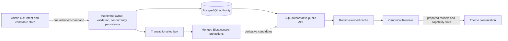

SQL is authoritative; projections and caches are derivative; Runtime executes; Theme presents; Builder declares bounded composition; CMS owns content; the UX initiates intent but never becomes runtime, persistence, projection, or cache authority (`FINAL_STOREFRONT_ARCHITECTURE_CERTIFICATION.md:33-75`; `RECOVERY-5_CACHE_CORE_AND_CLEANUP_IMPLEMENTATION.md:48-104`).

---

## 1. UX Philosophy

### 1.1 One screen equals one user responsibility

A screen may contain multiple controls only when they serve one domain responsibility and one understandable state boundary. Header and Footer Links may coexist in Navigation because both are one Navigation aggregate and currently publish together. Theme selection and color-token editing must not share a mutation surface because they have different lifecycles.

### 1.2 One domain equals one owner

Every editable datum has one canonical authoring owner, one persistence owner, one publication owner if publication exists, and one runtime consumer. References across domains do not transfer ownership. Navigation may reference a CMS page; it never edits that page. Footer may display StoreConfig branding; it never owns StoreConfig identity.

### 1.3 One source of truth

UI state is a candidate or an accepted snapshot, never business truth. PostgreSQL remains truth for StoreConfig, CMS, Navigation storage, and Footer. MongoDB, Elasticsearch, browser stores, previews, DTOs, and compatibility fields are not alternate authoring authorities.

### 1.4 One mutation path per state transition

“One Publish Flow” means one command owner for each aggregate transition—not a global Publish Storefront button. StoreConfig layout publication, Navigation publication, CMS page publication, Theme-token publication, theme activation, Footer immediate save, and status immediate save are distinct state transitions. Each has exactly one owning path and an explicit scope.

### 1.5 State is always named

Every mutation surface must visibly state one of:

- **Unsaved candidate** — browser-only changes.
- **Saved draft** — persisted but not public.
- **Published/live** — public authority.
- **Immediate live** — save changes public state without a draft.
- **Historical snapshot** — immutable evidence, not an editable draft.
- **Preview** — a read-only rendering of an explicitly named candidate or persisted version.

The UI must not use “Save” and “Publish” interchangeably.

### 1.6 Scope is always explicit

Every Save, Publish, Preview, Activate, Delete, and Rollback action must name its scope in the confirmation and result. “Publish Homepage,” “Publish Product Template ‘Default’,” “Publish Header and Footer Navigation,” and “Roll back StoreConfig live state” are acceptable. An unqualified “Publish” or “Rollback” is not.

### 1.7 Accepted responses replace assumptions

After a successful mutation, the full backend response and its backend-issued revision/version become the accepted UI baseline. Clients never fabricate RowVersion, semantic version, Footer revision, target slug, route, publication state, or successor state (`RECOVERY-1_HOMEPAGE_AUTHORING_IMPLEMENTATION.md:104-138`; `RECOVERY-2_NAVIGATION_AUTHORING_IMPLEMENTATION.md:151-174`; `RECOVERY-4_5_AUTHORING_FINAL_HARDENING.md:50-87`).

### 1.8 Dirty work is protected

Automatic refresh, route change, conflict recovery, focus change, mode change, and incoming props must not silently replace a dirty candidate. A user may explicitly discard, load latest, or retry their retained draft where the backend contract permits it.

### 1.9 Preview does not create ownership

Preview renders a named scope; it does not become a second save path, runtime provider, Theme owner, or StoreConfig owner. If a certified preview requires persisting a draft first, the UI must say so and use the canonical save owner. CMS Preview refuses unsaved content; Builder Preview persists through its canonical save owner; theme-layout preview is signed and read-only (`RECOVERY-4_5_AUTHORING_FINAL_HARDENING.md:209-221`; `RECOVERY-3_BUILDER_RUNTIME_IMPLEMENTATION.md:31-43`).

### 1.10 Presentation never owns Runtime

Theme may own markup, layout, CSS, tokens, typography, spacing, visual grouping, animation, and responsive composition. Theme must never load Storefront data, decide capability existence, replace a runtime page, mutate StoreConfig, execute Builder declarations, or own cache behavior (`RECOVERY-2_THEME_RUNTIME_IMPLEMENTATION.md:31-75`).

### 1.11 Builder never owns Runtime

Builder owns bounded supplemental declarations for Home and Product Template only. Runtime owns route execution, data, business behavior, required Product Hero, purchase, variant, availability, gallery, and product truth. Category has no Builder workspace (`RECOVERY-3_BUILDER_RUNTIME_IMPLEMENTATION.md:24-43`, `:65-104`).

### 1.12 CMS owns content only

CMS Pages own page identity, content representation, SEO, immutable page versions, page preview, publication, and page rollback. They do not own menu placement, Theme presentation, StoreConfig layout, Footer topology, or runtime data behavior.

### 1.13 Navigation owns navigation only

Navigation owns header and footer navigation targets, labels, order, enablement, and target admission. It does not own target content, footer social/contact/payment data, or Theme placement. Entity-backed targets use backend-issued GUID identities; runtime slugs and paths remain backend-owned locators (`RECOVERY-2_NAVIGATION_AUTHORING_IMPLEMENTATION.md:33-88`).

### 1.14 Footer owns footer-specific content, not navigation or presentation

The constitutional target gives Navigation exclusive ownership of footer links. Footer owns social data and may later own independently certified contact or payment-display content. Theme owns footer presentation. StoreConfig owns store identity/branding. Current Footer section/link persistence remains a recovered compatibility contract until the high-risk migration in Part 9 is separately implemented and certified.

### 1.15 Settings never hide inside unrelated screens

`/storefront` is Overview, not Settings. Operational live/maintenance/disabled state is a visible Storefront Status responsibility. No catch-all Settings page may absorb Builder, CMS, Navigation, Footer, Theme, or history responsibilities.

### 1.16 History follows persistence authority

There is no universal Storefront history or rollback. StoreConfig snapshots, CMS page versions, Footer revisions, and operational status are different authorities. History labels and warnings must name coverage precisely (`STOREFRONT_UX_ARCHITECTURE_AUDIT.md:510-518`, `:545-553`).

### 1.17 Failure is closed and recoverable

Missing authority, revision evidence, malformed responses, or load failures must disable mutation. Structured backend errors outrank transport error text. Conflicts retain the candidate and present deliberate recovery; they are never silently overwritten or automatically republished.

### 1.18 Compatibility is not discoverability

Compatibility aliases, dormant DTO branches, redirects, and storage adapters may preserve old callers but must not appear as new menu items, screens, owners, or runtime capabilities.

---

## 2. Canonical Information Architecture

### 2.1 Final sidebar

```text
Storefront                                           Icon: Store
├─ Overview                                          Icon: LayoutDashboard
├─ Storefront Status                                 Icon: Activity
├─ Homepage                                          Icon: Home
├─ Catalog                                           Icon: ShoppingBag
│  └─ Product Template                               Icon: PanelsTopLeft
├─ Content                                           Icon: FileText
│  └─ Pages                                          Icon: Files
├─ Navigation                                        Icon: Navigation
│  ├─ Header                                         Icon: PanelTop
│  └─ Footer Links                                   Icon: PanelBottom
├─ Footer Content                                    Icon: PanelBottomDashed
├─ Appearance                                        Icon: Palette
│  ├─ Themes                                         Icon: LayoutTemplate
│  └─ Colors & Typography                            Icon: Paintbrush
└─ StoreConfig Version History                       Icon: History
```

`Catalog`, `Content`, `Navigation`, and `Appearance` are organizational parents. They do not create catch-all editor or persistence ownership. Header and Footer Links are deep-linked views of one Navigation screen and one Navigation draft; they are not separate APIs or publish owners.

### 2.2 Current-screen disposition

| Current surface | Decision | Canonical destination | Architectural reason |
|---|---|---|---|
| Storefront Settings menu item at `/storefront` | **Rename** | Overview | The route is a dashboard/launcher, not an editor (`STOREFRONT_UX_ARCHITECTURE_AUDIT.md:77-103`, `:131-136`). |
| Hidden operational Storefront Settings | **Split and expose** | Storefront Status | Availability is one valid StoreConfig operational responsibility; hiding it under global Settings obscures ownership. |
| Homepage Builder | **Keep and rename** | Homepage | Users choose a task, not an implementation. It remains Home mode of the one Builder engine. |
| Product Template mode | **Keep and expose** | Catalog / Product Template | It is an active distinct workspace with Product Runtime constraints, but not a second Builder (`STOREFRONT_UX_ARCHITECTURE_AUDIT.md:617-624`). |
| Category Template | **Reject; keep absent** | None | Category Runtime is canonical and Builder-free. Dormant DTO fields do not authorize a screen. |
| Navigation | **Keep; make sole target owner** | Navigation / Header and Footer Links | Published header and footer navigation share one StoreConfig Navigation owner and one runtime navigation store (`POST_CERTIFICATION_NAVIGATION_RUNTIME_ALIGNMENT.md:33-93`). |
| Pages list | **Keep** | Content / Pages | CMS collection lifecycle and entry to content editing. Publication moves to the Page Editor as the single UX publish initiator. |
| CMS Page Editor | **Keep** | Content / Pages / `{page}` | Owns content, SEO, persisted preview, publication, and page history. |
| Footer | **Constrain after compatibility migration** | Footer Content | Final owner is footer-specific content. Existing section links remain supported until migrated once into Navigation. |
| Themes | **Keep and regroup** | Appearance / Themes | Selects and previews installed presentation identity. |
| Theme Editor / Theme & Colors | **Keep and rename** | Appearance / Colors & Typography | Owns style-token draft/live state; does not select runtime capabilities. |
| Version History | **Keep and rename** | StoreConfig Version History | Its rollback is StoreConfig-wide, not universal Storefront history. |
| Builder Rollback modal | **Remove as an action; replace with link** | StoreConfig Version History | It invokes global StoreConfig rollback from a page-scoped workspace (`STOREFRONT_UX_ARCHITECTURE_AUDIT.md:486-497`). |
| Pages-list Publish action | **Remove as an action; replace with Edit/Open** | CMS Page Editor | One visible publish flow must save visible candidate state and adopt the authoritative detail response. |
| CMS Blocks/Rich Text | **Keep as child editors** | CMS Page Editor | They are page-content representations, not another Storefront Builder. |
| CMS Page History panel | **Keep in editor** | CMS Page Editor / History | Page-scoped version authority must remain with the page. |
| Branding under proposed Footer | **Defer as an editor** | StoreConfig-owned, read-only reference/link only | Store name/identity already belongs to StoreConfig; Footer must not duplicate it. |
| Footer Payments / Contact | **Defer** | No menu item yet | No certified tenant authoring persistence/API/runtime contracts exist (`STOREFRONT_UX_ARCHITECTURE_AUDIT.md:668-681`). |

### 2.3 Hypothesis verdict

The proposed `Storefront / Homepage / Catalog / Content / Navigation / Footer / Appearance / Version History` hierarchy is compatible only with these corrections:

- Product Template remains; Category Template is removed.
- Header and Footer Links belong to Navigation.
- Footer means footer-specific content, not footer navigation or presentation.
- Branding remains StoreConfig-owned.
- Payments and Contact remain deferred until separately certified.
- Theme selection and Colors/Typography remain separate sub-screens.
- Version History is explicitly StoreConfig Version History.

With those corrections, the hierarchy is compatible with the certified runtime. Verbatim, the original hypothesis is not (`STOREFRONT_UX_ARCHITECTURE_AUDIT.md:637-681`).

---

## 3. Canonical Screen Inventory

All tenant authoring endpoints currently share the backend `Owner,Admin` authorization boundary (`PointOfSale.API/Controllers/AdminStoreConfigController.cs:35`; `PointOfSale.API/Controllers/AdminCmsPagesController.cs:14`; `PointOfSale.API/Controllers/AdminStorefrontFooterController.cs:13`). Future fine-grained permissions may narrow actions, but the backend—not menu visibility—remains authoritative.

### C01 — Overview

- **Purpose:** Orient the operator and show source-attributed Storefront status, active theme, outstanding drafts, and links to owning screens.
- **Owner:** Storefront Admin shell.
- **Responsibilities:** Read-only summary; domain-labelled navigation; open live Storefront.
- **Forbidden responsibilities:** Editing, saving, publishing, activating, rolling back, seeding, or constructing cross-domain payloads.
- **Runtime inputs:** Read models from existing StoreConfig/status and analytics sources.
- **Runtime outputs:** Navigation only; no authoring command.
- **Draft model:** None.
- **Publish model:** None.
- **Preview model:** “Open live Storefront” only; never a draft preview.
- **Version model:** Display-only domain versions when supplied; no combined version.
- **Permissions:** Any role allowed to view the Storefront admin; action links are permission-filtered but never treated as authorization.
- **Dependencies:** Existing `/storefront` dashboard and owning destination routes.
- **Future extensibility:** New summary cards may only read and deep-link. A card must name its domain owner and may not add inline mutation.

### C02 — Storefront Status

- **Purpose:** Set public availability to live, maintenance, or disabled and edit the maintenance message.
- **Owner:** StoreConfig operations through `AdminStoreConfigService`.
- **Responsibilities:** Operational status and maintenance message only.
- **Forbidden responsibilities:** Theme selection, layout composition, Navigation, Footer, CMS content, branding, cache controls, projection repair, or StoreConfig rollback.
- **Runtime inputs:** Accepted StoreConfig status DTO and backend RowVersion.
- **Runtime outputs:** One concurrency-checked status update; public runtime reads the accepted status.
- **Draft model:** Local unsaved candidate only; no persisted status draft is claimed.
- **Publish model:** **Immediate live save**. The UI must say that saving changes Storefront availability now.
- **Preview model:** None; open-live action may show current public state.
- **Version model:** StoreConfig RowVersion for concurrency; status is not covered by StoreConfig publication snapshots according to the current snapshot contract.
- **Permissions:** Owner/Admin mutation; read-only rendering for any lesser role explicitly granted later.
- **Dependencies:** Existing `StorefrontSettings` component and specialized StoreConfig status endpoint.
- **Future extensibility:** Operational switches may be added only if they are StoreConfig operational policy. Content or appearance controls require their owning screens.

### C03 — Homepage

- **Purpose:** Author the Home page’s bounded supplemental composition.
- **Owner:** The canonical Builder engine, Home workspace; persistence is owned by StoreConfig authoring.
- **Responsibilities:** Add, configure, order, enable, save, preview, and publish admitted Home sections.
- **Forbidden responsibilities:** Runtime data loading, catalog execution, Theme selection, arbitrary code/layout nesting, CMS page content, Navigation, Footer content, global rollback, cache control, or business truth.
- **Runtime inputs:** Admitted StoreConfig `pages.home.draft/live`, section contracts, backend preview DTO, Theme presentation context.
- **Runtime outputs:** Supplemental section declarations consumed by Home Runtime through canonical containers.
- **Draft model:** Persisted `pages.home.draft`; local candidate is protected until canonical save acceptance.
- **Publish model:** Save current Home draft through the one page-layout save owner, then publish Home scope with the rotated StoreConfig RowVersion.
- **Preview model:** Persist dirty candidate through the same save owner, then render the backend-admitted Home draft. The UI must disclose the save.
- **Version model:** StoreConfig RowVersion for commands; publication appends a StoreConfig-wide snapshot even though the action scope is Home.
- **Permissions:** Owner/Admin.
- **Dependencies:** `StorefrontBuilderPage`, closed section registry, `AdminStoreConfigService`, runtime section contracts, Theme presentation.
- **Future extensibility:** New Home sections require one closed contract, backend admission, one runtime container, Theme presentation support, compatibility mapping if needed, and architecture tests.

### C04 — Product Template

- **Purpose:** Author named supplemental Product Details templates using the same Builder engine.
- **Owner:** Canonical Builder engine, Product Template workspace; Product Runtime remains execution owner.
- **Responsibilities:** Select/create a template identity, configure supplemental allowed sections, save draft, preview with product context, publish, and explicitly delete through the certified publication lifecycle.
- **Forbidden responsibilities:** Omitting/replacing/duplicating Product Hero; suppressing gallery, price, purchase, variants, stock, SKU, media, or video behavior; owning reviews/ratings; changing products; Category composition; global rollback.
- **Runtime inputs:** `product_templates.{id}.draft/live`, template identity, admitted Product Details contracts, product preview context.
- **Runtime outputs:** Supplemental declarations resolved by `ProductTemplateResolver`; Runtime injects exactly one enabled leading Product Hero.
- **Draft model:** Persisted named-template draft plus protected local candidate.
- **Publish model:** Save selected template draft, publish that template scope, adopt rotated StoreConfig evidence. Delete is an explicit immediate publication of template removal and must say so.
- **Preview model:** Persist through the canonical save owner, then preview the selected template ID only.
- **Version model:** StoreConfig RowVersion; StoreConfig-wide snapshot on publish/delete.
- **Permissions:** Owner/Admin.
- **Dependencies:** Same Builder engine as Homepage, `ProductTemplateResolver`, Product Runtime, closed Product section contracts.
- **Future extensibility:** New template identities and presentation-only fields are allowed inside the existing contract; new Product Runtime capability control is forbidden.

### C05 — Pages

- **Purpose:** Manage the tenant CMS page collection and enter a page editor.
- **Owner:** CMS collection lifecycle.
- **Responsibilities:** List page state, create a draft, delete with current backend evidence, seed canonical defaults through the one seed owner, and open the Page Editor.
- **Forbidden responsibilities:** Inline content editing, list-row publication, Navigation placement, Theme assignment, StoreConfig rollback, or constructing versions.
- **Runtime inputs:** CMS list DTO with current draft/published versions.
- **Runtime outputs:** Create/delete/seed commands and navigation to C06.
- **Draft model:** Displays server draft presence only; no list-local content draft.
- **Publish model:** None on this screen. Publication belongs to C06.
- **Preview model:** Optional open of the current persisted public version only if clearly labelled; draft preview belongs to C06.
- **Version model:** Backend semantic versions shown as state; delete uses the current admitted version. Seed has its own atomic operation contract.
- **Permissions:** Owner/Admin.
- **Dependencies:** `CmsPagesList`, CMS service transport, `CmsSeedService` for first-run defaults.
- **Future extensibility:** Bulk read/filter operations are allowed. Bulk mutation requires a separately certified aggregate and cannot loop page commands client-side.

### C06 — CMS Page Editor

- **Purpose:** Author exactly one CMS page’s identity, content representation, SEO, draft, publication, preview, and history.
- **Owner:** CMS page authority (`CmsPageService`/SQL immutable version rows).
- **Responsibilities:** Edit title/slug/content/SEO; choose supported rich-text or block representation; save a new immutable draft; preview a clean persisted draft; publish; view history; load/rollback a page version.
- **Forbidden responsibilities:** Menu placement, Footer configuration, Theme layout, StoreConfig layout, runtime behavior, cross-page rollback, previewing unsaved content, or auto-retrying publish after conflict.
- **Runtime inputs:** Identity-admitted page detail, current draft/published version, block/content contracts, exact-version preview token, history.
- **Runtime outputs:** One-page commands and published CMS content consumed by the public CMS reader.
- **Draft model:** Local semantic candidate over an accepted persisted draft; save creates the next immutable draft version.
- **Publish model:** If dirty, save visible content first; publish the accepted draft version; adopt the complete response. This is the only UX publish initiator for a CMS page.
- **Preview model:** Clean persisted draft only, through a version/tenant/slug-bound backend preview. Unsaved candidates are refused.
- **Version model:** Backend semantic page version; page-scoped immutable history and rollback.
- **Permissions:** Owner/Admin.
- **Dependencies:** `CmsPageEditor`, `CmsPageService`, CMS validators/sanitizer, preview service, structured conflict mapper.
- **Future extensibility:** New content blocks remain CMS content only and require sanitizer/admission/runtime rendering. Interactive commerce capabilities require Runtime contracts, not arbitrary page blocks.

### C07 — Navigation

- **Purpose:** Author the Storefront’s header and footer navigation as one canonical Navigation aggregate.
- **Owner:** Navigation authoring (`AdminCmsService`, `NavigationAdmissionService`, and `NavigationStorageAdapter`) over StoreConfig.
- **Responsibilities:** Header and Footer Links; label/localization; target selection; order; enablement; external new-tab intent; repair of load-time broken links; save; publish.
- **Forbidden responsibilities:** Editing target page/product/category content, Footer social/contact/payment content, Theme placement, route generation, entity visibility decisions, or bypassing broken-link admission.
- **Runtime inputs:** Canonical Navigation snapshot, positive StoreConfig RowVersion, backend-issued target list, structured load warnings.
- **Runtime outputs:** `navigation.draft/live` in StoreConfig; public Navigation runtime reads live and feeds HeaderRuntime and FooterRuntime.
- **Draft model:** One persisted Navigation draft containing both `header[]` and `footer[]`; Header/Footer tabs are views, not independent drafts.
- **Publish model:** Save the complete draft first, then publish the complete admitted Header-and-Footer Navigation scope with the rotated RowVersion.
- **Preview model:** No separate preview contract. The editor may show a structural menu simulation clearly labelled non-runtime. A real Storefront preview requires a separately certified draft-navigation preview.
- **Version model:** StoreConfig RowVersion; publication contributes to StoreConfig-wide snapshot history.
- **Permissions:** Owner/Admin.
- **Dependencies:** Navigation target endpoint, canonical GUID identities, strict save/publish admission, tolerant load annotations, Storefront navigation runtime.
- **Future extensibility:** New link types require a backend identity registry, one admission path, storage adapter compatibility, public resolver, and runtime test. The frontend cannot invent target types or slugs.

### C08 — Footer Content

- **Purpose:** Author footer-specific content that is neither Navigation nor Theme presentation.
- **Owner:** `FooterAuthoringService` and Footer SQL authority.
- **Responsibilities:** Constitutional target: social links. During migration only, render the existing recovered section/link configuration as **Legacy footer links** with source and cutover status. Future contact/payment-display content may be added only after certification.
- **Forbidden responsibilities:** Header/footer navigation topology after cutover; store identity/branding duplication; markup/layout/typography; runtime data loading; Theme choice; CMS page editing; hidden fallback selection.
- **Runtime inputs:** Accepted Footer configuration and backend semantic revision. Transitional reads may include section links and published CMS target choices.
- **Runtime outputs:** Footer-specific content model loaded by FooterRuntime and presented by Theme.
- **Draft model:** Local candidate only; current Footer has no persisted draft.
- **Publish model:** **Immediate live save** of the complete Footer content graph with explicit warning. It must never be labelled Publish.
- **Preview model:** None under the certified contract.
- **Version model:** Backend SHA-256 semantic revision for compare-and-swap. No historical rollback is implied.
- **Permissions:** Owner/Admin.
- **Dependencies:** `FooterConfigScreen`, one frontend DTO mapper/transport, `FooterAuthoringService`, validator, mapper, FooterRuntime.
- **Future extensibility:** Contact and payment-display fields require source-of-truth, localized DTO, validation, public model, runtime preparation, Theme presentation, revision, permission, and test contracts before controls or menu nodes appear.

### C09 — Themes

- **Purpose:** Browse, signed-preview, and explicitly activate an installed presentation layout theme.
- **Owner:** Theme identity authoring over StoreConfig; Theme Registry defines installed identities.
- **Responsibilities:** Display installed themes and compatibility metadata; launch signed read-only preview; activate one theme with explicit immediate-live scope.
- **Forbidden responsibilities:** Color/token editing, Builder composition, runtime capability selection, page replacement, navigation/footer loading, cache control, or theme code editing.
- **Runtime inputs:** Installed Theme Registry and accepted active `storefrontTheme` identity.
- **Runtime outputs:** One selected theme identity consumed by Theme resolution; Runtime behavior remains unchanged.
- **Draft model:** None in the current certified contract.
- **Publish model:** Current contract is **immediate live activation**. The action must be named “Activate theme now,” not Publish. Phase M3 aligns this mutation with StoreConfig lifecycle/history without changing Theme runtime ownership.
- **Preview model:** Signed, read-only real-Storefront preview of the selected installed theme. Preview must not mutate runtime StoreConfig.
- **Version model:** StoreConfig concurrency evidence; current activation-time snapshot behavior is an explicit migration observation.
- **Permissions:** Owner/Admin activation; preview may be granted more broadly only through backend authorization.
- **Dependencies:** Theme Registry, theme preview service, `AdminStoreConfigService`, canonical Theme presentation contract.
- **Future extensibility:** Installed themes may add visual shells and supported presentation tokens only. A theme package cannot add an executable page, provider, cache, data query, or capability policy.

### C10 — Colors & Typography

- **Purpose:** Author the selected Storefront’s global presentation tokens.
- **Owner:** Theme-token authoring over StoreConfig.
- **Responsibilities:** Preset, colors, typography/font, radius, and other certified presentation tokens; reset candidate to published; preview; publish.
- **Forbidden responsibilities:** Installed theme identity activation, page composition, content, navigation, footer data, runtime behavior, feature flags, API/data loading, or arbitrary CSS/code unless separately certified.
- **Runtime inputs:** Accepted draft/live Theme views, Theme authority defaults/presets, StoreConfig RowVersion.
- **Runtime outputs:** Draft/live presentation-token state consumed by Theme presentation.
- **Draft model:** Persisted Theme token draft plus local candidate.
- **Publish model:** Save/admit candidate, publish Theme token scope through StoreConfig publication, adopt successor RowVersion.
- **Preview model:** Local or scoped preview of the token candidate; it must not replace Runtime ownership or leak preview context.
- **Version model:** StoreConfig RowVersion and StoreConfig publication snapshot.
- **Permissions:** Owner/Admin.
- **Dependencies:** `ThemeEditorPage`, Theme authority, strict token admission, StoreConfig Theme endpoints.
- **Future extensibility:** Add tokens only when they are presentation-only, declared in Theme authority, bounded, backward compatible, and consumed by installed themes without affecting business outcomes.

### C11 — StoreConfig Version History

- **Purpose:** Inspect and deliberately roll back StoreConfig live snapshots.
- **Owner:** StoreConfig publication/version service.
- **Responsibilities:** List snapshots, show actor/time/reason/scope coverage, compare or inspect state where supported, confirm StoreConfig-wide rollback, and report result.
- **Forbidden responsibilities:** Claiming universal Storefront history; rolling back CMS page rows, Footer SQL, status/maintenance state, caches, projections, or one Builder page unless the backend later creates a separately certified page-scoped history contract.
- **Runtime inputs:** StoreConfig snapshot list and current StoreConfig RowVersion.
- **Runtime outputs:** One explicit StoreConfig rollback command that creates a new publication transition while preserving current drafts according to the certified service contract.
- **Draft model:** None. Historical snapshots are immutable evidence.
- **Publish model:** Rollback is an immediate StoreConfig publication and must identify all affected live domains before confirmation.
- **Preview model:** Optional read-only snapshot inspection; never apply a snapshot as preview runtime state without a certified preview contract.
- **Version model:** StoreConfig-wide snapshots only. CMS Page history stays in C06; Footer revision is concurrency evidence, not history.
- **Permissions:** Owner/Admin; future separation of view and rollback requires distinct backend permissions.
- **Dependencies:** `VersionHistoryPage`, `AdminStoreConfigService`, current RowVersion, snapshot canonicalization.
- **Future extensibility:** Diff visualization is allowed. Universal rollback or cross-authority history is forbidden without a new architecture and transaction model.

---

## 4. Canonical Domain Ownership

### 4.1 Domain ownership matrix

| Domain | Exactly one canonical owner | Canonical state / output | Explicit non-owners |
|---|---|---|---|
| Storefront overview | Storefront Admin shell | Read-only links and summaries | Every domain mutation service |
| Storefront status | StoreConfig operations | Status and maintenance message | Overview, Theme, Builder, CMS, Footer, Navigation |
| Homepage composition | Canonical Builder, Home workspace | `pages.home.draft/live` declarations | Theme, CMS, Footer, Catalog Runtime |
| Product Template composition | Canonical Builder, Product Template workspace | `product_templates.{id}.draft/live` supplemental declarations | Product authoring, Theme, CMS, `pages.product` compatibility DTO |
| Product Details execution | Product Runtime via `ProductTemplateResolver` and runtime containers | Mandatory hero and commerce behavior | Builder, Theme, CMS |
| Category page | Category Runtime / SQL lineage | Category route, identity, descendants, catalog execution | Builder, Theme, dormant category DTO |
| CMS page content | CMS page authority | SQL immutable page versions | Builder, Navigation, Footer, Theme |
| Navigation | Navigation authoring and admission owner | StoreConfig `navigation.draft/live` for header and footer | Footer content, Theme, CMS Pages, Builder |
| Footer content | Footer authoring owner | Footer SQL social and certified content | Navigation links after cutover, Theme presentation, StoreConfig branding |
| Theme identity | Theme identity authoring / StoreConfig | Active installed `storefrontTheme` | Builder, Footer, Runtime components |
| Colors and typography | Theme-token authoring / StoreConfig | Draft/live presentation tokens | Builder, CMS, Runtime behavior |
| Branding identity | StoreConfig | Store name and certified identity fields | Footer, Navigation, Theme token editor unless explicitly delegated as StoreConfig UI |
| Builder engine | Canonical Builder authoring surface | Bounded declarations only | Runtime, Theme, CMS blocks |
| CMS aggregate | CMS services | Content lifecycle and page history | StoreConfig snapshots, Navigation, Footer |
| StoreConfig aggregate | `AdminStoreConfigService` / PostgreSQL | Config row, `xmin`, live/draft subtrees, snapshots | Browser state, projections, Theme, Builder UI |
| Projection | The registered projection consumer for each document family | Derivative Mongo/Elasticsearch data | Admin UX, Theme, Builder, caches |
| Runtime | Canonical route/capability owner named by final certification | Executable customer behavior | Theme and Builder |
| Browser cache | Recovery 4 runtime owner for each family | Bounded derivative snapshot | Theme, Builder, authoring screens |
| Server cache | Recovery 5 semantic owner for each live family | Derivative Redis value, except authoritative cart | Admin UX, Theme, Builder, projection consumers acting directly |
| StoreConfig history | StoreConfig publication/version service | StoreConfig live snapshots | CMS page history, Footer revision, status history |
| CMS page history | CMS page authority | One page group’s immutable versions | StoreConfig Version History |
| Footer revision | Footer authoring service | Concurrency fingerprint, not rollback history | StoreConfig history, client-generated versions |
| Appearance | **No persistence owner; grouping only** | Navigation group for C09 and C10 | It cannot become a catch-all API or aggregate |
| Category Template | **No admitted domain**; Category Runtime owns the page | None | Builder, Theme, StoreConfig compatibility fields |

The “exactly one owner” rule applies at an admitted domain boundary. `Appearance` is deliberately only an information-architecture group, and `Category Template` is deliberately not an admitted domain.

### 4.2 Layer ownership matrix

| Layer | Owns | Must not own |
|---|---|---|
| View / ViewModel | Candidate state, dirty comparison, action enablement, response adoption, navigation warnings | Backend versions, business admission, persistence, runtime truth |
| API controller | Authentication/tenant boundary, transport parsing, status/error mapping | Duplicate business validation or persistence orchestration |
| DTO | Transport shape at one boundary | Authority merely by exposing a field |
| Authoring service | Business admission, concurrency, transaction, persistence, outbox, accepted response | Runtime rendering, browser state |
| StoreConfig | Config truth for status, Home/Product declarations, Navigation, Theme identity/tokens, snapshots | CMS page rows, Footer SQL content |
| CMS | Page content and immutable versions | Navigation placement, Theme, layout Runtime |
| Projection | Recomposition of derivative read models | Source truth or alternate writes |
| Cache | Bounded acceleration under its certified owner | Authoring truth, invalidation controls in Admin UI |
| Runtime | Routes, capabilities, data loading, behavior, prepared presentation models | Authoring candidate or Theme styling decisions |
| Theme | Presentation of Runtime-prepared models and slots | Data loading, business behavior, capability suppression, route/page replacement |
| Builder | Bounded supplemental declarations and authoring preview | Runtime execution, business truth, Theme identity, Category page |

### 4.3 Screen-to-owner map

| Screen | UI owner | API owner | Persistence owner | Runtime consumer | Theme role | Builder role | CMS role | StoreConfig role |
|---|---|---|---|---|---|---|---|---|
| Overview | Admin shell | Read endpoints | None | None | None | None | None | Read summaries |
| Storefront Status | Status ViewModel | Admin StoreConfig controller/service | StoreConfig SQL | Storefront availability runtime | None | None | None | Primary |
| Homepage | Builder ViewModel | StoreConfig page-layout endpoints | StoreConfig SQL | Home Runtime | Present sections | Primary authoring | None | Draft/live storage |
| Product Template | Builder ViewModel | StoreConfig template endpoints | StoreConfig SQL | Product Runtime / resolver | Present sections | Primary authoring | None | Draft/live storage |
| Pages | CMS list ViewModel | Admin CMS controller/service | CMS SQL rows | Public CMS reader | Present page shell only | None | Primary | None |
| CMS Page Editor | CMS editor ViewModel | Admin CMS controller/service | CMS SQL versions | Public CMS reader | Present page shell only | None | Primary | None |
| Navigation | Navigation ViewModel | Admin CMS controller + Navigation owners | StoreConfig JSON | HeaderRuntime/FooterRuntime | Place prepared links | None | Target reference only | Draft/live storage |
| Footer Content | Footer ViewModel | Footer controller/service | Footer SQL | FooterRuntime | Present prepared content | None | Published target reference during transition | None |
| Themes | Theme library ViewModel | StoreConfig Theme endpoint/service | StoreConfig SQL | Theme resolver | Primary presentation identity | None | None | Identity storage |
| Colors & Typography | Theme editor ViewModel | StoreConfig Theme endpoint/service | StoreConfig SQL | Theme presentation | Primary token consumer | None | None | Draft/live storage |
| StoreConfig History | History ViewModel | StoreConfig version service | StoreConfig snapshots | Live config after rollback | Consumes restored tokens | Consumes restored live declarations | None | Primary |

---

## 5. Canonical User Journeys

The following diagrams are normative. Boxes with the same owner are not permission to add parallel APIs; they show the state transitions a user must understand.

### 5.1 Homepage journey

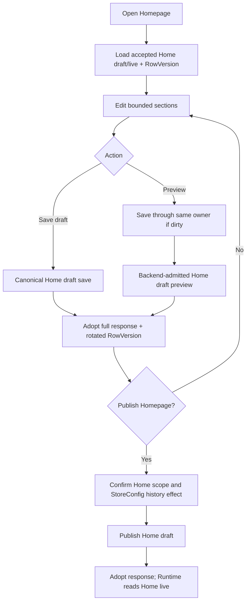

### 5.2 CMS Page journey

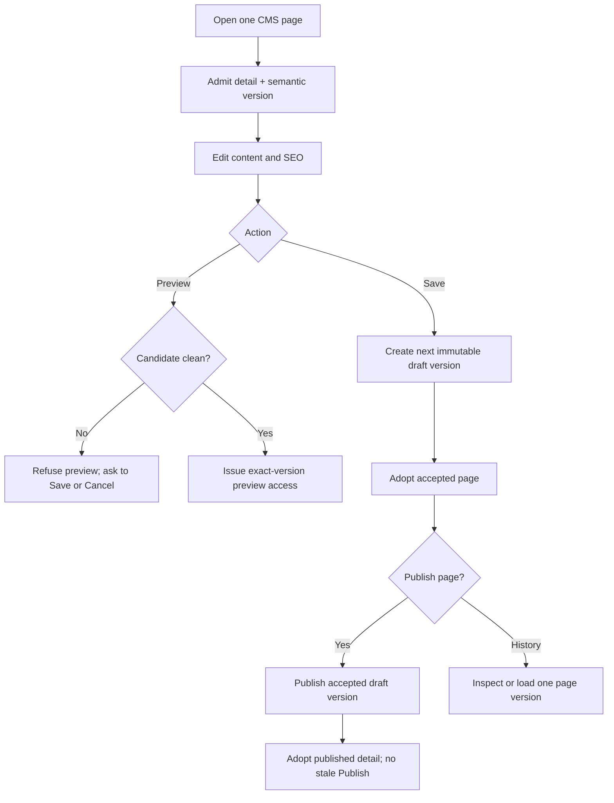

### 5.3 Navigation journey

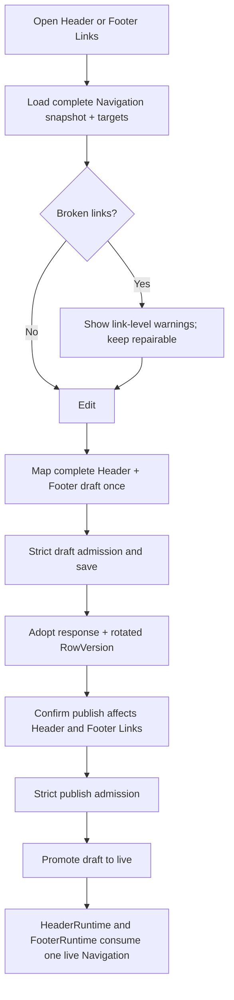

### 5.4 Footer journey

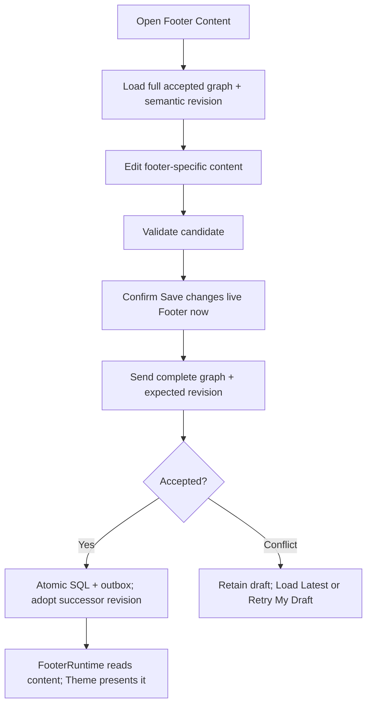

### 5.5 Theme selection journey

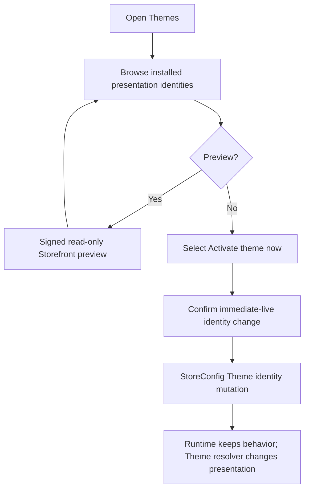

### 5.6 Appearance (Colors & Typography) journey

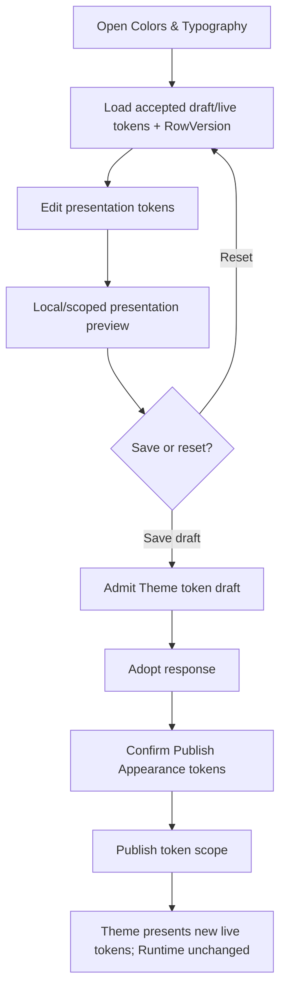

### 5.7 Publishing journey

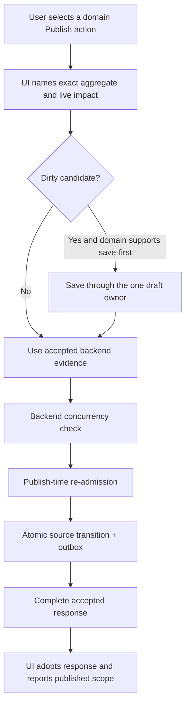

This is a pattern, not a global endpoint. Homepage, Product Template, Navigation, CMS Page, and Theme tokens each invoke their own certified owner.

### 5.8 Draft journey

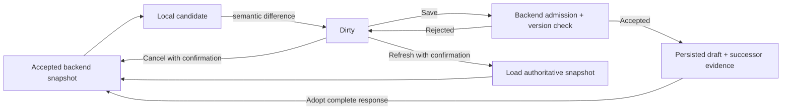

### 5.9 Preview journey

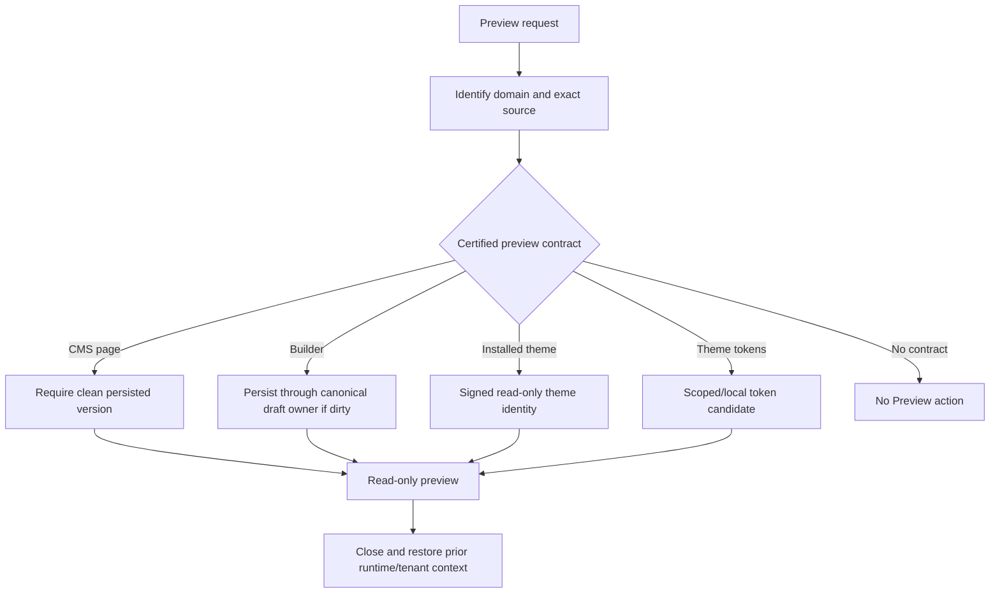

### 5.10 Rollback journey

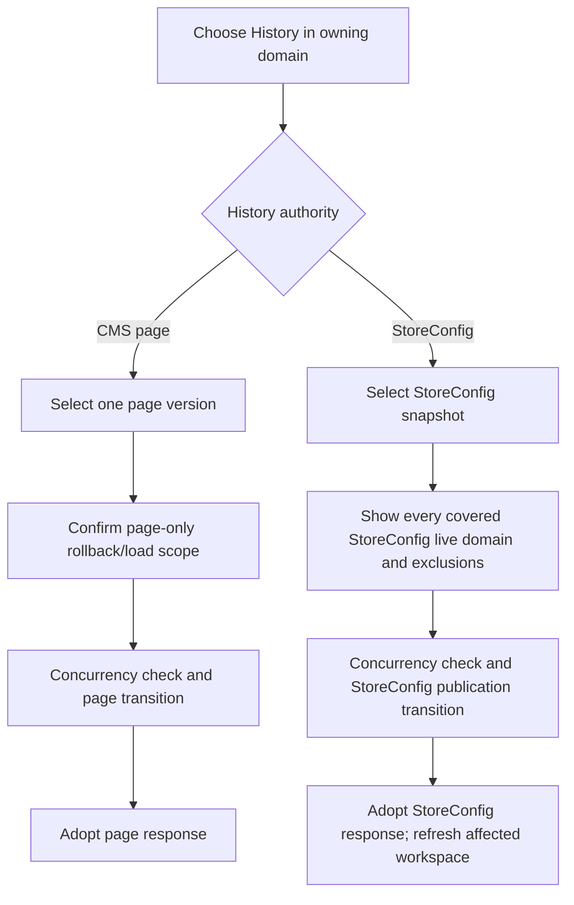

Footer revision, operational status, caches, and projections do not enter this graph because no certified rollback history exists for them.

### 5.11 History journey

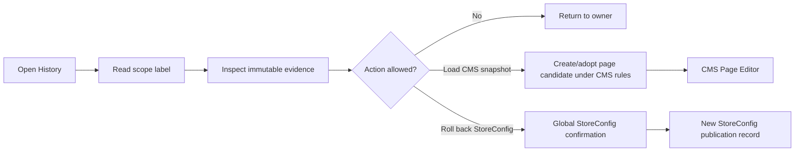

### 5.12 Cross-screen relationship graph

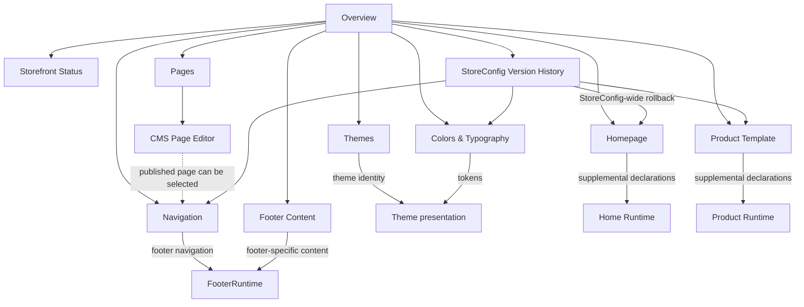

Dashed relationships are references, not ownership transfers.

---

## 6. Menu Design Contract

### 6.1 Hierarchy and ordering

The order follows user intent: understand, operate, compose, manage content/navigation, style, then recover history.

1. Overview
2. Storefront Status
3. Homepage
4. Catalog / Product Template
5. Content / Pages
6. Navigation / Header / Footer Links
7. Footer Content
8. Appearance / Themes / Colors & Typography
9. StoreConfig Version History

Category Template, generic Settings, universal History, Theme Code, cache controls, projection controls, and hidden operational tools are prohibited from this hierarchy.

### 6.2 Naming rules

- Use the user’s task: **Homepage**, not Homepage Builder.
- Use the domain and scope: **Product Template**, **Footer Links**, **Footer Content**, **StoreConfig Version History**.
- Reserve **Theme** for installed presentation identity and **Colors & Typography** for tokens.
- Reserve **Status** for Storefront availability. Do not call Overview or all Storefront administration “Settings.”
- Actions use state verbs: **Save draft**, **Publish Homepage**, **Activate theme now**, **Save live Footer**, **Roll back StoreConfig**.

### 6.3 Icon rules

The semantic icon names in §2.1 are canonical design tokens, not a dependency on a specific icon library. One concept uses one icon throughout sidebar, breadcrumb, empty states, and action handoffs. Footer Links and Footer Content must use visibly different icon variants because they are different owners.

### 6.4 Expansion rules

- `Catalog`, `Content`, `Navigation`, and `Appearance` expand when any descendant is active.
- Only one Storefront group needs to be expanded at a time unless the shell already preserves user expansion preferences.
- A group with one child may still exist when its name establishes a protected domain boundary, as with Catalog.
- Parent groups do not navigate to an unowned catch-all screen. If clickable for accessibility, they route to their first authorized child.
- Navigation Header and Footer Links preserve one shared dirty workspace. Switching between them must not discard edits or imply separate publication.

### 6.5 Breadcrumb rules

Canonical breadcrumbs are:

```text
Storefront / Overview
Storefront / Storefront Status
Storefront / Homepage
Storefront / Catalog / Product Template / {template name}
Storefront / Content / Pages
Storefront / Content / Pages / {page title}
Storefront / Content / Pages / {page title} / History
Storefront / Navigation / Header
Storefront / Navigation / Footer Links
Storefront / Footer Content
Storefront / Appearance / Themes
Storefront / Appearance / Colors & Typography
Storefront / StoreConfig Version History
```

Every breadcrumb segment before the current page links to a safe list/group destination. Breadcrumb navigation must invoke the dirty-state guard.

### 6.6 Deep-link rules

- Existing route identities remain compatible during migration: `/storefront`, `page=home`, `page=product-template`, and `templateId` (`STOREFRONT_UX_ARCHITECTURE_AUDIT.md:753-764`).
- New canonical URLs may replace query-mode discovery only with redirects preserving template identity.
- A deep link must load its own authority; it cannot require visiting Overview or another screen first.
- Missing/unauthorized targets fail closed with a route-level state, never an editable empty editor.
- `Navigation/Header` and `Navigation/Footer Links` deep links select a view of the same admitted Navigation snapshot.
- Page and template IDs remain stable. Display names are not route identities unless the backend contract defines them.
- Old `/settings?tab=storefront` links must redirect to or remain aliases of Storefront Status until callers are proven migrated.

### 6.7 Navigation logic

The sidebar answers “where does this belong?” The editor answers “what state is this in?” The top action bar answers “what exact scope will this action change?” No one of those responsibilities may substitute for another.

---

## 7. Screen Contracts

### 7.1 Inputs, outputs, and events

| Screen | Inputs | Outputs | Canonical events / transitions |
|---|---|---|---|
| Overview | Read-only domain summaries | Deep links, open live store | `navigate`, `open-live`; no mutation event |
| Storefront Status | Status DTO, RowVersion | Accepted status DTO | `status.save.immediate-live`, `status.conflict`, `status.refresh` |
| Homepage | Home draft/live, RowVersion, section contracts | Accepted Home workspace | `home.draft.save`, `home.preview.open`, `home.publish` |
| Product Template | Template list/id, selected draft/live, RowVersion, product context | Accepted selected template | `template.create`, `template.draft.save`, `template.preview.open`, `template.publish`, `template.delete.publish` |
| Pages | Page list with current versions | Created/deleted page or seed result; route to editor | `page.create`, `page.delete`, `cms.seed`, `page.open` |
| CMS Page Editor | One page detail, versions, history, preview access | Accepted one-page detail | `page.draft.save`, `page.preview.open`, `page.publish`, `page.rollback/load-version` |
| Navigation | Full snapshot, RowVersion, targets, warnings | Accepted full snapshot | `navigation.draft.save`, `navigation.publish`, `navigation.refresh`, `broken-link.edit/remove` |
| Footer Content | Full graph, semantic revision | Accepted full graph | `footer.save.immediate-live`, `footer.conflict.load-latest`, `footer.conflict.retry-draft` |
| Themes | Installed registry, active identity, preview access | Accepted active identity | `theme.preview.open`, `theme.activate.immediate-live` |
| Colors & Typography | Draft/live token views, presets, RowVersion | Accepted token views | `appearance.draft.save`, `appearance.preview`, `appearance.publish`, `appearance.reset-candidate` |
| StoreConfig History | Snapshot list, current RowVersion | Accepted rollback result | `storeconfig.snapshot.inspect`, `storeconfig.rollback.publish` |

Event names are constitutional semantics, not a required implementation naming scheme.

### 7.2 Action and scope matrix

| Screen | Allowed actions | Forbidden actions | Save scope | Publish / live scope | Rollback scope | History scope |
|---|---|---|---|---|---|---|
| Overview | Navigate, open live | Any mutation | None | None | None | None |
| Storefront Status | Edit, save, cancel, refresh | Publish, preview, global rollback | Status + maintenance message | Immediate live status only | None | None under current contract |
| Homepage | Edit sections, save, preview, publish | Global rollback, Theme/CMS/Navigation edits | `pages.home.draft` | Home live declarations; StoreConfig snapshot side effect | Link to C11 only | C11, explicitly StoreConfig-wide |
| Product Template | Select/create/edit/save/preview/publish/delete | Mandatory capability edits, Category template, global rollback | Selected named template draft | Selected template live; delete is live publication | Link to C11 only | C11, explicitly StoreConfig-wide |
| Pages | List/create/delete/seed/open | Publish content, inline edit/rollback | Create/delete command only | None | None | State summary only |
| CMS Page Editor | Edit/save/preview/publish/history/load version | Navigation placement, unsaved preview, cross-page rollback | One page’s next immutable draft | One accepted page draft | One page group/version | One page group only |
| Navigation | Edit Header/Footer Links, repair, save, publish | Footer content, target content, independent tab publish | Complete Header + Footer draft | Complete Header + Footer live | C11 only | StoreConfig-wide, not Navigation-only |
| Footer Content | Edit/cancel/refresh/save | Publish, preview, Theme layout, footer navigation after cutover | Complete candidate graph | Immediate live complete graph | None | Revision only; no history claim |
| Themes | Browse/preview/activate | Token editing, runtime behavior, code | None | Immediate live Theme identity | C11 only if/when snapshot-aligned | StoreConfig history coverage must be stated |
| Colors & Typography | Edit/save/reset/preview/publish | Theme activation, Builder/content | Theme token draft | Theme token live | C11 only | StoreConfig-wide |
| StoreConfig History | Inspect/compare/rollback | CMS/Footer/status rollback, local Builder rollback | None | StoreConfig-wide live transition | StoreConfig live scope only | StoreConfig snapshots only |

### 7.3 Save contract

1. Save is initiated from one editor and one frontend mapper/transport for the aggregate.
2. Client validation is advisory; backend admission is authoritative.
3. Missing version/revision evidence fails before mutation; stale evidence is a structured conflict.
4. The candidate remains intact on rejection.
5. Accepted complete responses replace the prior baseline and rotate evidence.
6. Save does not publish unless the screen is explicitly an immediate-live domain.
7. Autosave and manual Save may coexist only when they call the same serialized save owner, expose identical scope, and cannot race or conceal failures.

### 7.4 Publish contract

1. The action names the aggregate.
2. Dirty visible content is saved through the one canonical draft owner where the certified workflow supports save-first.
3. Publish uses only accepted backend evidence.
4. Backend re-admits current dependencies and performs the state transition atomically with the outbox.
5. No automatic publish retry follows a conflict.
6. The complete response is adopted and the action becomes disabled when no publishable draft remains.
7. List pages do not create secondary publish workflows.

### 7.5 Preview contract

Every Preview entry must declare:

- domain;
- candidate source: unsaved, persisted draft, published, or signed theme identity;
- whether Preview first saves;
- tenant/language/product context;
- expiry/access rules where tokenized;
- cleanup/restoration behavior;
- explicit statement that Preview does not publish.

If any field is unknown, the Preview action is forbidden.

### 7.6 Conflict contract

The canonical sequence is: retain candidate → show structured backend reason → obtain latest accepted evidence → offer **Load Latest** or an explicitly confirmed **Retry My Draft** only where the domain supports it. Navigation load warnings are repair data, not permission to save or publish invalid links (`POST_AUTHORING_NAVIGATION_RESILIENCY_RECOVERY.md:8-26`, `:47-76`).

---

## 8. Constitutional Anti-Patterns

The following are prohibited:

1. A screen with unrelated persistence or publication responsibilities.
2. Two screens editing the same canonical field.
3. A list view and detail editor both presenting the same Publish command.
4. A page-scoped editor presenting a global rollback as if it were local.
5. A universal “Publish Storefront” or “Version History” over unrelated authorities.
6. A generic Storefront Settings screen that hides domain ownership.
7. Editing operational status inside Overview, Theme, Builder, or global unrelated tabs.
8. Editing footer navigation in both Navigation and Footer Content.
9. Treating Footer as presentation owner; Theme owns presentation.
10. Treating Theme as runtime, route, data, cache, capability, or business-rule owner.
11. Treating Builder as route, catalog, product behavior, data, review truth, or required-capability owner.
12. Creating Product or Category Builder modes outside the certified Home/Product Template engine.
13. Allowing Product Template to remove, disable, duplicate, reorder, or replace Product Hero.
14. Calling CMS content blocks “the Storefront Builder” or merging their persistence.
15. Letting CMS edit menu placement, or letting Navigation edit page content.
16. Letting Footer duplicate StoreConfig branding.
17. Exposing Payments or Contact controls before a certified end-to-end contract exists.
18. Treating DTO presence, route aliases, or stored legacy JSON as active ownership.
19. Creating a screen for a dormant cache, projection, repair tool, or compatibility branch.
20. Exposing cache invalidation, projection mutation, or runtime refresh as ordinary authoring.
21. Client-generated RowVersion, semantic version, revision, slug, or route identity.
22. Patching local state with the submitted request instead of adopting the accepted response.
23. Silent last-writer-wins mutation or automatic overwrite after conflict.
24. Replacing dirty state on focus, refresh, tab switch, route change, or load failure.
25. Making a load failure editable with empty/default destructive state.
26. Previewing unsaved CMS content while claiming it is persisted.
27. Preview that mutates global Runtime or fails to restore prior tenant/config context.
28. Theme activation or immediate Footer/status save labelled as draft Publish.
29. Save that silently publishes, or Publish that silently changes a broader aggregate without disclosure.
30. History or rollback without exact inclusions, exclusions, and concurrency evidence.
31. Theme selection and token customization presented as the same unnamed “Theme” responsibility.
32. Separate Header and Footer Navigation save/publish owners while the backend aggregate remains atomic.
33. Frontend business admission that can disagree with backend authority.
34. Transport errors masking structured backend authoring errors.
35. Menu visibility used as the security boundary.
36. Breaking stable deep links without redirects and identity preservation.
37. New screens added for organizational preference rather than a distinct domain/lifecycle.
38. UX changes that alter frozen Runtime, Theme, Builder, Projection, Cache, CMS, or StoreConfig ownership without recertification.

---

## 9. Migration Blueprint

This roadmap is authorization guidance only. It does not authorize implementation. Each phase requires its own approved change scope and must leave later phases optional. No phase may edit frozen runtime behavior merely to make the menu look complete.

### 9.1 Migration principles

- Preserve existing routes through redirects or aliases.
- Preserve product template identities and assignments.
- Preserve backend-issued concurrency evidence and complete response adoption.
- Migrate data before removing its editor or runtime reader.
- Never dual-write without a single declared owner, a deterministic reconciliation rule, and a finite cutover.
- Do not create a universal history aggregate.
- Do not expose deferred controls as disabled promises; absent contracts mean absent menu items.
- Each phase must be independently rollbackable before destructive compatibility cleanup.

### M0 — Constitution and conformance baseline

- **Goals:** Adopt this document; freeze new Storefront screens; record current route, API, DTO, and persistence consumers; convert every known difference into a tracked migration item.
- **Files affected in a future implementation:** Documentation and architecture-test manifests only; this blueprint file is the only file created by the current mission.
- **Runtime impact:** None.
- **Risk:** Low.
- **Rollback strategy:** Revert governance adoption; no product state changes.
- **Compatibility:** Complete; no routes or contracts change.
- **Testing strategy:** Source inventory checks; current route/API/DTO snapshots; verify no application diff.
- **Success criteria:** Every active Storefront screen maps to C01–C11 or is explicitly transitional/deferred; no unclassified editor remains.

### M1 — Menu, naming, and reachability alignment

- **Goals:** Implement §2.1; rename `/storefront` to Overview; expose Storefront Status; expose Product Template under Catalog; group Appearance; rename Theme Editor and Version History; preserve canonical deep links.
- **Files affected in a future implementation:** `PointOfSale.Web/src/components/Sidebar.jsx`, `PointOfSale.Web/src/App.jsx`, `PointOfSale.Web/src/pages/StorefrontDashboard.jsx`, `PointOfSale.Web/src/pages/Settings.jsx`, `PointOfSale.Web/src/pages/StorefrontSettings.jsx`, route/sidebar tests.
- **Runtime impact:** None; route and menu presentation only.
- **Risk:** Low to medium because bookmarks and permission-filtered menus can break.
- **Rollback strategy:** Restore old labels/routes while retaining redirect aliases.
- **Compatibility:** Preserve `/storefront`, `/settings?tab=storefront`, `page=home`, `page=product-template`, and `templateId`; add redirects only after destination authority loads independently.
- **Testing strategy:** Route matching, sidebar hierarchy, role visibility, keyboard navigation, breadcrumbs, direct-load/deep-link, redirect, and dirty-guard tests.
- **Success criteria:** No menu item labelled Settings opens Overview; Status and Product Template are directly discoverable; Category Template is absent; all old links still resolve safely.

### M2 — Workflow and scope disclosure

- **Goals:** Remove the Builder’s global rollback action in favor of a link to C11; make CMS Page Editor the sole visible CMS publish initiator; add exact Save/Publish/Activate/Immediate-live labels, scope confirmations, and history exclusions.
- **Files affected in a future implementation:** `PointOfSale.Web/src/modules/storefront/pages/StorefrontBuilderPage.jsx`, Builder top bar/modals, `PointOfSale.Web/src/modules/storefront/cms/pages/CmsPagesList.jsx`, `CmsPageEditor.jsx`, `VersionHistoryPage.jsx`, `ThemeMarketplacePage.jsx`, `ThemeEditorPage.jsx`, `FooterConfigScreen.jsx`, `StorefrontSettings.jsx`, focused UI tests.
- **Runtime impact:** None. Existing backend owners and APIs remain.
- **Risk:** Medium; removing a shortcut may affect learned workflows, and incorrect labels could still hide scope.
- **Rollback strategy:** Restore navigation shortcuts without restoring duplicate mutation actions.
- **Compatibility:** Backend endpoints stay available; external API compatibility does not require duplicate UI affordances.
- **Testing strategy:** One visible publish initiator per page; save-before-publish detail flow; exact confirmation copy; no Builder rollback call; history coverage assertions; accessibility of status labels.
- **Success criteria:** Every action names its domain and state transition; no local-looking global rollback; CMS publication occurs from the editor only.

### M3 — Theme identity lifecycle alignment

- **Goals:** Preserve the separate Themes and Colors & Typography screens while aligning theme activation with explicit StoreConfig concurrency, audit, event, and snapshot expectations. Decide and certify whether activation remains named immediate-live or becomes a StoreConfig publication; never merge it with token editing.
- **Files affected in a future implementation:** `PointOfSale.Web/src/modules/storefront/pages/ThemeMarketplacePage.jsx`, Theme service/client and tests, `PointOfSale.API/Controllers/AdminStoreConfigController.cs`, `PointOfSale.API/Services/Admin/AdminStoreConfigService.cs`, StoreConfig DTOs, projection/publication tests, `VersionHistoryPage.jsx` if snapshot coverage changes.
- **Runtime impact:** No Theme Runtime behavior change is allowed. StoreConfig authoring lifecycle and history may change.
- **Risk:** Medium-high because active Theme identity is live presentation state and current activation lacks the same snapshot semantics as token publication (`STOREFRONT_UX_ARCHITECTURE_AUDIT.md:528-536`, `:727-738`).
- **Rollback strategy:** Retain the prior active theme ID and restore it through the same concurrency-checked owner; keep old activation route as a compatibility adapter during rollout.
- **Compatibility:** Preserve installed theme IDs, signed preview, Theme Registry, Theme presentation props, and existing public StoreConfig shape.
- **Testing strategy:** Two-admin stale activation, event/outbox atomicity, snapshot coverage, signed preview isolation, prior-theme restore, Theme runtime architecture suite, and full Storefront build.
- **Success criteria:** Theme activation has one documented live transition, backend-issued concurrency evidence, unambiguous history coverage, and zero Runtime/Theme ownership regression.

### M4 — Footer-link ownership cutover

- **Goals:** Make Navigation the sole authoring and runtime source of header/footer navigation; migrate current Footer section links without losing localized group titles, group/link ordering, internal/external/CMS semantics, enabled state, or new-tab intent; retain Footer Content for social and later certified content only.
- **Files affected in a future implementation:**
  - Admin UI: `NavigationEditor.jsx`, `StorefrontFooterSettings.jsx`, `FooterConfigScreen.jsx`, `navigationAuthoringContract.js`, `footerAuthoringContract.js`, `footerAuthoringService.js`.
  - API/authority: `AdminCmsDtos.cs`, `AdminStorefrontFooterDtos.cs`, `AdminCmsService.cs`, `NavigationAdmissionService.cs`, `NavigationStorageAdapter.cs`, `FooterAuthoringService.cs`, `FooterAuthoringValidator.cs`, relevant controllers.
  - Public runtime boundary: `StorefrontNavigationController.cs`, `StorefrontFooterReadService.cs`, Storefront Navigation/Footer DTOs, `LayoutRuntime.tsx`, presentation models, installed Theme footer components only as presentation consumers.
  - Persistence/migration: a reviewed data migration or resumable migration command if the canonical Navigation shape must gain footer groups; related architecture, integration, and UI tests.
- **Runtime impact:** High and explicitly gated. The public model must stop rendering migrated links from Footer SQL at the exact cutover at which Navigation becomes authoritative. Theme remains presentation-only.
- **Risk:** High/Critical. Current Navigation footer is flat while Footer links may be grouped and localized; tenant/global/derived fallback and two different concurrency models exist (`STOREFRONT_UX_ARCHITECTURE_AUDIT.md:727-749`).
- **Rollback strategy:**
  1. Take a tenant-scoped export/checksum of both authorities before migration.
  2. Keep legacy Footer link rows read-only and recoverable through the validation window.
  3. Use a feature/cutover marker owned by the migration contract—not Theme or client state—to select exactly one public link source.
  4. Roll back the marker and Navigation migration atomically if parity checks fail.
  5. Do not delete legacy rows until the compatibility window and certification complete.
- **Compatibility:** Preserve public link URLs, labels/localization, groups, ordering, enabled/new-tab behavior, CMS identity resolution, tenant isolation, global/derived fallback result, and existing API consumers through versioned adapters. Current Footer revision and StoreConfig RowVersion must never be conflated.
- **Testing strategy:** Production-shaped migration fixtures; empty/partial/duplicate sources; localized and grouped links; CMS target withdrawal; two-admin concurrency; tenant/global/derived fallback; public DTO parity; one-source rendering; no duplicate links; Theme architecture; rollback rehearsal; idempotent rerun.
- **Success criteria:** Every rendered navigation link has one Navigation authority; Footer Content cannot edit links; no data or visual grouping is lost; old clients receive a compatible response; Runtime and Theme certifications pass.

The constitutional target permits footer navigation grouping as Navigation metadata because grouping is topology. The final wire/storage shape must be designed and certified in M4; the current flat `footer[]` contract remains authoritative until that cutover.

### M5 — Compatibility and dormant-contract retirement

- **Goals:** After consumer proof, deprecate or remove UI-invisible duplicate representations and write surfaces: dormant `pages.product/category`, legacy Theme representation where safe, unused full StoreConfig writes, superseded Footer-link writes, and route aliases no longer called.
- **Files affected in a future implementation:** StoreConfig public/admin DTOs and mappers, API controllers, generated/client types, `StorefrontDraftConfigMapper.cs`, compatibility tests, API documentation; exact files require an M0 consumer inventory.
- **Runtime impact:** None if true dormancy is proven; otherwise stop and recertify.
- **Risk:** Medium-high because external clients may rely on compatibility fields even when in-repo runtime does not.
- **Rollback strategy:** Versioned contract re-enable or adapter restoration; database state remains unchanged until consumers have migrated.
- **Compatibility:** Announce deprecation, measure callers, preserve old reads for a defined window, reject new writes to retired owners before field removal.
- **Testing strategy:** Repository and telemetry consumer searches, contract snapshots, old/new client matrix, serialization tests, Storefront builds, architecture negative tests.
- **Success criteria:** No active caller, no mutation owner, no runtime branch, and no UX surface depends on the retired representation.

### M6 — Constitutional enforcement and recertification

- **Goals:** Encode this blueprint in architecture and behavior gates; complete UX conformance audit; publish migration evidence and certification.
- **Files affected in a future implementation:** Frontend route/workflow tests, backend architecture and integration tests, certification documents, CI configuration; production files only if a failed gate identifies an authorized defect.
- **Runtime impact:** None from tests; any remediation is separately scoped.
- **Risk:** Low, with high value. Brittle source-string assertions are prohibited where behavioral or structural tests are possible.
- **Rollback strategy:** Revert faulty tests, not compliant production behavior; document false-positive root cause.
- **Compatibility:** Gates must run against both compatibility and canonical paths until M5 ends.
- **Testing strategy:** The full gate catalog in §12.5 plus fresh production builds and database-backed concurrency/migration tests.
- **Success criteria:** All mandatory gates green; no open Critical/High conformance finding; current implementation earns at least `PASS WITH OBSERVATIONS` in a new UX architecture audit.

### 9.2 Complexity and compatibility summary

| Migration | Complexity | Runtime compatibility | Backward compatibility |
|---|---:|---|---|
| M0 baseline | Low | No impact | Complete |
| M1 menu/routes | Low–Medium | Compatible | Redirects required |
| M2 workflow labels/actions | Medium | Compatible | APIs retained |
| M3 Theme activation lifecycle | Medium–High | Compatible only if Theme remains presentation-only | IDs/preview/contracts retained |
| M4 Footer-link cutover | High | Requires separately certified runtime input cutover | Versioned adapters and recoverable legacy data required |
| M5 dormant retirement | Medium–High | Only after dormancy proof | Deprecation window required |
| M6 certification | Low | No production impact | Tests cover both generations during transition |

### 9.3 Migration risk matrix

| ID | Risk | Likelihood | Impact | Rating | Required control |
|---|---|---:|---:|---:|---|
| MR-01 | Footer links render twice during cutover | Medium | Critical | Critical | One server-owned cutover marker and one runtime source |
| MR-02 | Footer groups/localization are flattened or lost | High | High | Critical | Lossless target contract and pre/post checksums |
| MR-03 | Theme activation bypasses or corrupts history | Medium | High | High | StoreConfig concurrency/outbox/snapshot tests |
| MR-04 | Old deep links break | Medium | Medium | Medium | Redirect/alias matrix and direct-load tests |
| MR-05 | Product template identity/assignment changes | Low | Critical | High | Preserve IDs/query identity and resolver tests |
| MR-06 | Category Template returns through DTO interpretation | Medium | Critical | High | Negative menu/route/runtime architecture gates |
| MR-07 | CMS list publish remains a hidden second workflow | Medium | Medium | Medium | UI initiator-count test and editor lifecycle tests |
| MR-08 | StoreConfig History is mistaken for universal history | High | High | High | Coverage/exclusion labels and confirmation test |
| MR-09 | Compatibility fields removed while externally consumed | Medium | High | High | Telemetry/consumer evidence and versioned deprecation |
| MR-10 | Dirty authoring state is discarded by new navigation | Medium | High | High | Shared unload/route/tab guard tests |

### 9.4 Backward-compatibility invariants

1. Existing live Storefront behavior remains available throughout migration.
2. Existing StoreConfig, CMS, Navigation, Footer, Theme, and Product Template identifiers are preserved.
3. Old routes redirect with query and identity intact.
4. Current API aliases remain until caller evidence supports retirement.
5. Compatibility DTO retention never creates a menu item or write owner.
6. Footer migration is idempotent, tenant-scoped, observable, and reversible before cleanup.
7. StoreConfig snapshots never claim CMS/Footer/status coverage without a new certified persistence model.
8. CMS page history remains page-scoped.
9. Theme packages remain presentation-only before, during, and after migration.
10. Builder remains one engine for Home and Product Template only.

---

## 10. Immutable UX Laws

These laws are constitutional. “Immutable” means no feature team may waive them locally. A law may be amended only through the ownership-change process in §12.3 with a replacement certification.

### Law 1 — One Screen, One Responsibility

Every screen has one user-recognizable domain responsibility. Child panels and dialogs inherit that responsibility.

### Law 2 — One Domain, One Owner

Every editable field and state transition has exactly one canonical authoring owner and one persistence owner.

### Law 3 — One Mutation Path

Each save, publish, activate, delete, seed, or rollback transition has exactly one command owner. Multiple UI entry points for the same transition are forbidden unless one is a pure redirect.

### Law 4 — One Source of Truth

PostgreSQL authority defined by the certified architecture outranks projections, caches, DTOs, browser state, previews, and compatibility fields.

### Law 5 — No Global Publish Illusion

There is no universal Storefront Publish action. Each aggregate publishes only through its named owner and declared scope.

### Law 6 — Every State Is Named

Unsaved candidate, saved draft, published/live, immediate live, historical snapshot, and preview may never be visually or verbally conflated.

### Law 7 — Every Action Names Its Scope

Save, Publish, Activate, Preview, Delete, and Rollback labels and confirmations identify the exact aggregate and live impact.

### Law 8 — Accepted Responses Are Canonical UI State

The client adopts complete accepted backend responses and successor evidence. Submitted candidates are never assumed to be accepted truth.

### Law 9 — Concurrency Evidence Is Backend-Owned

Clients store and return backend-issued RowVersions, semantic versions, and revisions. They never generate, guess, coerce, or bypass them.

### Law 10 — Dirty Candidates Are Protected

No refresh, focus event, route/tab change, conflict, load failure, or incoming response may silently discard unsaved work.

### Law 11 — Save and Publish Are Different

Save persists a draft unless the domain is explicitly immediate-live. Publish promotes a named accepted draft. Neither action may conceal the other.

### Law 12 — Immediate-Live Mutation Is Explicit

Status, current Footer content, theme activation, and any future immediate-live domain must warn that Save/Activate changes the public Storefront now.

### Law 13 — Preview Has a Declared Source

Every Preview declares whether it renders unsaved candidate, persisted draft, published state, or signed theme identity.

### Law 14 — Preview Never Publishes or Owns Runtime

Preview may use the canonical save owner when certified, but cannot create a second persistence path, publish implicitly, replace Runtime, or leak context after close.

### Law 15 — History Scope Is Exact

Every history surface lists inclusions and exclusions. StoreConfig, CMS Page, and Footer revision evidence may not be presented as one history.

### Law 16 — Rollback Scope Is Exact

Rollback is owned by the same persistence/version authority that created the history and must show all affected live domains before confirmation.

### Law 17 — Overview Is Read-Only

Overview may summarize and navigate. It may not mutate any Storefront domain.

### Law 18 — Operational Status Is Visible

Storefront availability must have a clearly named, directly reachable owner and must not hide in unrelated Settings or content screens.

### Law 19 — Runtime Owns Execution

Routes, data loading, business behavior, mandatory capabilities, canonical containers, and prepared presentation models remain Runtime-owned.

### Law 20 — Theme Owns Presentation Only

Theme may style and arrange Runtime-prepared models and slots; it may not load data, mutate state, suppress capabilities, replace pages, or own cache behavior.

### Law 21 — Builder Owns Bounded Declarations Only

Builder declares admitted supplemental composition for Home and Product Template. It never owns Runtime behavior, business truth, Theme identity, or arbitrary executable layout.

### Law 22 — Product Runtime Is Mandatory

Product Template always resolves exactly one enabled leading Product Hero, and Builder cannot suppress required Product Details capabilities or author review truth.

### Law 23 — Category Has No Builder Template

Category Runtime and SQL lineage own category execution. No Category Template screen, route, preview, publish path, or menu item may be introduced under the current architecture.

### Law 24 — CMS Owns Page Content Only

CMS owns page identity/content/SEO/versions. It does not own Navigation placement, Theme presentation, StoreConfig layout, or commerce Runtime.

### Law 25 — Navigation Owns Header and Footer Navigation

All navigation links, targets, labels, order, enablement, and routing admission belong to Navigation. Referenced resources retain their own content ownership.

### Law 26 — Footer Owns Content, Theme Owns Presentation

Footer Content owns social and separately certified footer-specific data. It does not own navigation after cutover, StoreConfig branding, or footer presentation.

### Law 27 — StoreConfig Owns Only Its Certified Aggregate

Status, Home/Product declarations, Navigation, Theme identity/tokens, and StoreConfig snapshots may be StoreConfig state. CMS page rows and Footer SQL remain outside it unless a future recertification changes persistence authority.

### Law 28 — Projections Are Derivative

Admin UX never writes MongoDB or Elasticsearch directly and never treats projection state as successful publication truth.

### Law 29 — Cache Is Runtime-Owned

Authoring, Theme, and Builder screens do not expose or mutate browser/server cache ownership. Cache refresh follows its certified runtime owners.

### Law 30 — DTO Presence Does Not Grant Ownership

A field, alias, mapper, or legacy JSON branch can preserve compatibility without authorizing a screen, editor, or runtime path.

### Law 31 — Backend Permissions Are Authoritative

Menu hiding and disabled buttons are presentation. Every read and mutation is tenant-scoped and authorized by the backend.

### Law 32 — Structured Errors Govern Recovery

Backend domain codes/messages outrank transport codes. Expected validation, absence, missing precondition, and conflict outcomes never become generic destructive fallbacks.

### Law 33 — Deep Links Are Stable and Self-Sufficient

Every canonical screen loads directly, preserves identity, enforces permission, and fails closed. Route migration requires compatibility redirects.

### Law 34 — Compatibility Is Hidden from Normal Authoring

Retained aliases and legacy fields cannot create duplicate controls or ownership. They are measured, deprecated, and eventually retired.

### Law 35 — A New Screen Requires a New Responsibility

A new screen is allowed only when an existing owner cannot contain the responsibility without violating single responsibility, and when state, lifecycle, permission, API, persistence, runtime, and history boundaries are all explicit.

### Law 36 — Deferred Features Stay Absent

Uncertified Category templates, Footer contact/payment editors, Theme code editors, universal history, and operational repair tools do not appear as disabled or hidden authoring screens.

### Law 37 — Ownership Changes Require Recertification

Any transfer involving Runtime, Theme, Builder, CMS, Navigation, Footer, StoreConfig, Projection, or Cache requires an approved ownership RFC, migration/compatibility plan, and replacement certification.

### Law 38 — Evidence Is Required

No Storefront UX architecture decision is certified by intent, naming, mockup, or DTO alone. It requires source, behavioral tests, and owner-boundary evidence.

---

## 11. Shopify Parity Review

### 11.1 Method and limits

This is a conceptual comparison, not an implementation copy. It uses current official Shopify Help Center descriptions checked on 2026-08-04:

- Shopify manages store menus from **Content / Menus**, and themes choose where menus display: [Menus and links](https://help.shopify.com/en/manual/online-store/menus-and-links).
- Shopify has distinct main and footer menus: [Understanding menus](https://help.shopify.com/en/manual/online-store/menus-and-links/understanding-navigation).
- Shopify Pages own content/visibility, and a page is added to navigation separately: [Creating and editing pages](https://help.shopify.com/en/manual/online-store/add-edit-pages).
- Shopify’s Theme editor selects templates and arranges sections/blocks: [Sections and blocks](https://help.shopify.com/en/manual/online-store/themes/theme-structure/sections-and-blocks) and [Templates](https://help.shopify.com/en/manual/online-store/themes/theme-structure/templates).
- Shopify supports multiple draft themes but only one published theme: [Adding, previewing, and buying themes](https://help.shopify.com/en/manual/online-store/themes/adding-themes) and [Publishing themes](https://help.shopify.com/en/manual/online-store/themes/managing-themes/publishing-themes).
- Shopify’s general activity log is view-only and limited in retention/results: [Activity logs in the Shopify admin](https://help.shopify.com/en/manual/shopify-admin/activity-logs).

### 11.2 Conceptual parity matrix

| Concept | Shopify pattern | Canonical Shopixy choice | Reason |
|---|---|---|---|
| Pages vs menus | Page content and menu placement are separate | Match conceptually: Pages own content; Navigation owns placement | Aligns with CMS and Navigation certified owners |
| Header/footer menus | Main and footer menus are both navigation concepts | Match and strengthen: one Navigation owner with Header/Footer views | Removes current duplicate Footer link editing |
| Theme library | Multiple themes can be previewed; one is published | Match conceptually: installed Theme identity is separate from live activation | Compatible with Theme Registry and signed preview |
| Theme editor | Templates, sections, blocks, and global settings share one theme editor | Intentionally differ: Builder composition and Theme tokens remain separate owners | Shopixy Runtime/Builder/Theme separation is certified and stricter |
| Product templates | Theme templates can shape product pages | Partly match, but Product Runtime retains mandatory capabilities | Prevents Theme/Builder suppression of commerce behavior |
| Collection/category templates | Theme templates may cover collections | Intentionally differ: no Category Template under current architecture | Category Runtime and SQL lineage are frozen owners |
| Theme publishing | Theme identity and its unique settings publish together | Intentionally separate current lifecycles, then align StoreConfig history semantics | Shopixy stores installed identity and style-token state as distinct subdomains |
| Pages publication | Visibility/publication managed with page | Match conceptually, with stronger immutable page versions and explicit preview | Preserves CMS authority and source-backed version contract |
| History | General activity plus theme/version mechanisms | Shopixy keeps domain-specific rollback histories | StoreConfig snapshots and CMS immutable versions are stronger but not universal |

### 11.3 Where Shopixy is simpler

1. **One bounded Builder engine.** Home and Product Template reuse one engine; Product/Category modes and arbitrary native replacement were removed (`RECOVERY-3_BUILDER_RUNTIME_IMPLEMENTATION.md:27-43`).
2. **No theme code editor in the Storefront UX.** The constitutional surface is installed presentation plus admitted tokens, not a general code/custom-runtime environment.
3. **No template assignment matrix for every content type.** Product Template is the only catalog authoring workspace; Category remains canonical Runtime.
4. **One tenant Navigation aggregate.** Header and Footer Links share one admitted target contract, concurrency token, and publish transition.
5. **Fewer hidden extension paths.** New section/link/token types must enter closed registries and one admission owner.

### 11.4 Where Shopixy is more powerful

1. **Immutable CMS page versions, exact-version preview, and page rollback** provide stronger page-level evidence than a generic activity list (`STOREFRONT_CMS_AUTHORING_CERTIFICATION.md:111-139`; recovered UX in `RECOVERY-4_5_AUTHORING_FINAL_HARDENING.md:122-140`).
2. **Backend-issued concurrency for every recovered authoring aggregate** prevents silent stale writes: StoreConfig `xmin`, CMS semantic versions, Homepage workspace versions, and Footer semantic revisions.
3. **Publish-time Navigation admission** verifies tenant ownership and live eligibility for category, product, CMS, collection, custom, and external targets.
4. **Mandatory Product Runtime guarantees** ensure presentation changes cannot remove commerce-critical behavior.
5. **Explicit SQL authority and derivative projections/caches** keep publication truth distinct from eventual read optimizations.

### 11.5 Where Shopixy is currently more confusing

These are current-implementation defects, not target features:

1. Footer links can be authored in Navigation and Footer, then rendered together.
2. “Storefront Settings” opens Overview while operational Status is hidden elsewhere.
3. Product Template exists only as a hidden Builder mode.
4. Themes and Theme Editor use overlapping language despite different lifecycles.
5. StoreConfig Version History and Builder rollback obscure global scope and exclusions.
6. Theme activation is immediate live while token changes use draft/publish semantics.

All six are source-backed by the UX audit (`STOREFRONT_UX_ARCHITECTURE_AUDIT.md:10-22`, `:486-586`).

### 11.6 Where Shopixy should intentionally differ

1. **Do not copy a monolithic Theme editor.** Shopixy’s Theme is presentation-only and its Builder cannot own Runtime. Combining them would erase certified boundaries.
2. **Do not add Category Template for feature parity.** Parity is not authority; current Category Runtime deliberately ignores Builder configuration.
3. **Do not let theme identity determine capabilities.** All installed themes receive runtime-owned slots and prepared models.
4. **Do not use a universal Storefront history.** Keep CMS page history and StoreConfig history separate until a real cross-authority transaction model exists.
5. **Keep Navigation target identity backend-issued.** GUID identity plus backend locator resolution is safer than client-authored slugs.
6. **Keep product commerce capabilities mandatory.** Visual customization may be narrower than some theme ecosystems by design.
7. **Keep per-domain publication explicit.** A theme-centric publish model must not swallow CMS, Navigation, Footer, or operational state.

The parity conclusion is not “be more like Shopify.” It is: adopt Shopify’s clear conceptual separation of content, menus, and theme presentation where it matches Shopixy ownership; intentionally diverge where Shopixy’s certified Runtime and authoring guarantees are stronger.

---

## 12. Final Governance

### 12.1 Who may propose and add screens

Any product or engineering owner may propose a screen. No team may add one directly. Approval requires all of these functional roles:

- **Domain owner:** confirms the responsibility and canonical data owner.
- **Storefront architecture certifier:** confirms Runtime/Theme/Builder/CMS/StoreConfig/Projection/Cache compatibility.
- **UX governance reviewer:** confirms information architecture, state language, scope, and accessibility.
- **API/persistence owner:** confirms one contract, concurrency model, transaction, history, and compatibility.
- **Security owner:** confirms tenant authority and backend permissions.
- **Quality gate owner:** confirms behavioral, architecture, migration, and regression coverage.

One person may hold multiple roles, but every responsibility must be explicitly signed off.

### 12.2 New-screen evaluation gate

A proposal is rejected unless it answers all questions:

1. What one responsibility cannot safely live in an existing screen?
2. What is the exactly-one domain owner?
3. What are the explicit non-owners?
4. What is the SQL source of truth?
5. What is the API owner and one mutation path?
6. What DTO is request, accepted response, and public runtime projection?
7. What is the candidate/draft/live model?
8. Is Save draft-only or immediate live?
9. What exact scope publishes?
10. What exact source previews, and does Preview save?
11. What version/revision prevents stale writes?
12. What history exists, and what does it exclude?
13. What permissions protect reads and mutations?
14. What Runtime consumes the output?
15. What may Theme present and Builder declare?
16. What projection/cache effects are derivative and owner-controlled?
17. What existing screen/API/DTO becomes duplicate?
18. What migration and rollback preserve current data and deep links?
19. What failure states retain the candidate and fail closed?
20. Which automated gates prevent ownership drift?

“It deserves its own menu item,” “Shopify has one,” or “a DTO already exists” is never sufficient.

### 12.3 Ownership-change approval

An ownership change requires a versioned architecture decision record containing:

1. Current owner and source-backed call/data flow.
2. Proposed owner and explicit non-owners.
3. Reason the current owner cannot remain canonical.
4. Persistence, API, DTO, projection, cache, runtime, Theme, Builder, and CMS impact.
5. Dual-read/write policy with a finite end date, if unavoidable.
6. Data migration, reconciliation, observability, and rollback.
7. Backward-compatibility and route/client deprecation plan.
8. Security and tenant-isolation review.
9. Test plan and failure-injection plan.
10. New certification replacing the superseded boundary.

Until that record passes, the existing certified owner remains constitutional even if a mockup or menu groups the concept elsewhere.

### 12.4 Required architecture gates

- No installed Theme imports runtime stores, APIs, data loaders, providers, or protected containers.
- Builder valid workspaces are exactly Home and Product Template.
- Product Template resolver always injects one leading enabled Product Hero.
- Category routes execute no Builder sections.
- Navigation has one admission owner, one mapper, one save owner, and one publish owner.
- Footer has one persistence/validation/DTO pipeline and, after M4, no link mutation owner.
- CMS Page has one detail publish UX initiator and one backend publication owner.
- StoreConfig snapshots do not claim CMS/Footer/status ownership.
- Admin UX does not mutate projections or caches.
- Compatibility DTO/route presence cannot make a screen reachable.

### 12.5 Required UX and regression gates

| Gate family | Mandatory proof |
|---|---|
| Route/menu | Canonical hierarchy, labels, breadcrumbs, redirects, direct deep links, Category absence |
| State | Candidate/dirty/draft/live/immediate-live labels; unload and route guards |
| Save | One mapper/transport/owner; clean-save disabled; accepted response adoption; repeated version rotation |
| Publish | One visible initiator; save-first where required; exact scope; no automatic conflict retry |
| Preview | Declared source; persistence behavior; context cleanup; no unintended publish |
| Concurrency | Missing evidence, stale evidence, two-admin race, retained candidate, deliberate recovery |
| Validation | Client advisory checks and authoritative backend admission; dependency withdrawal at publish |
| History | Coverage/exclusion copy; one-owner rollback; post-rollback response adoption |
| Permissions | Owner/Admin backend enforcement, tenant isolation, direct URL denial |
| Migration | Idempotency, partial failure, rollback rehearsal, data parity, old/new client matrix |
| Runtime | Final Runtime, Theme, Builder, Navigation, and Cache architecture suites |
| Accessibility | Keyboard navigation, focus restoration, announcements, dialog labels, destructive confirmation |
| Build | Web, Storefront, and solution production builds; focused behavior tests; diff/format validation |

### 12.6 Certification gates

Every Storefront UX change ends with one of:

- **PASS:** All constitutional laws and required gates pass; no material observation remains.
- **PASS WITH OBSERVATIONS:** Ownership is compliant and safe, but bounded non-authoritative limitations are documented with owners and exit conditions.
- **FAIL:** Any duplicate owner, hidden mutation, ambiguous scope, frozen-boundary violation, destructive load state, missing concurrency, broken compatibility, or Critical/High unresolved risk exists.

A green build alone is not certification. A certification must include source paths, executed behavior gates, searches for duplicate owners, compatibility evidence, and an explicit statement of unchanged frozen boundaries.

### 12.7 Amendment rule

This constitution may be amended only when:

1. the affected law and owner are named;
2. mandatory sources and current production paths are re-audited;
3. an alternative preserves or deliberately replaces the certified boundary;
4. migration, compatibility, and rollback are approved;
5. all required gates pass; and
6. a new dated certification supersedes the affected sections.

Silent exceptions, feature flags without an owner, and “temporary” duplicate editors are prohibited amendments.

---

## 13. Final Compatibility and Certification

### 13.1 Architecture compatibility

| Boundary | Blueprint result | Basis |
|---|---|---|
| Runtime | **Compatible** | Screens author inputs only; canonical routes/capabilities continue to execute. |
| Theme | **Compatible** | Themes and tokens remain presentation-only; Footer presentation stays Theme-owned. |
| Builder | **Compatible** | One engine, Home and Product Template only; Product Hero and behavior stay Runtime-owned. |
| CMS | **Compatible** | Pages own content/version lifecycle; Navigation and Footer only reference admitted published content. |
| Navigation | **Compatible target with gated migration** | Header/Footer navigation have one owner; current Footer-link duplication needs M4. |
| Footer | **Compatible target with gated migration** | Recovered current Footer pipeline is preserved until link data is losslessly migrated; final domain is content-only. |
| StoreConfig | **Compatible** | Status, layouts, Navigation, Theme identity/tokens, and snapshots retain their certified owner. |
| Projection | **Compatible** | Projection remains derivative and invisible as an authoring owner. |
| Cache | **Compatible** | Runtime cache owners remain exclusive; no admin cache controls are introduced. |

### 13.2 Screen evidence index

| Screen | Primary production evidence | Certified interpretation |
|---|---|---|
| C01 Overview | `PointOfSale.Web/src/pages/StorefrontDashboard.jsx:25-74,99-218`; `PointOfSale.Web/src/App.jsx:329-342` | The current `/storefront` route is orientation, not Settings (`STOREFRONT_UX_ARCHITECTURE_AUDIT.md:75-103`). |
| C02 Storefront Status | `PointOfSale.Web/src/pages/Settings.jsx:705-739`; `PointOfSale.Web/src/pages/StorefrontSettings.jsx:109-160,308-429` | Valid StoreConfig operations surface, currently hidden in global Settings. |
| C03 Homepage | `PointOfSale.Web/src/modules/storefront/pages/StorefrontBuilderPage.jsx:109-115,310-413`; `PointOfSale.API/Services/Admin/AdminStoreConfigService.cs` | One Builder engine; Home supplemental declarations only (`RECOVERY-3_BUILDER_RUNTIME_IMPLEMENTATION.md:65-104`). |
| C04 Product Template | `PointOfSale.Web/src/modules/storefront/pages/StorefrontBuilderPage.jsx:636-695`; `PointOfSale.Storefront/src/storefront/products/ProductTemplateResolver.ts` | Separate workspace, same Builder; Runtime injects mandatory Product Hero. |
| C05 Pages | `PointOfSale.Web/src/modules/storefront/cms/pages/CmsPagesList.jsx:47-155,265-338`; `PointOfSale.API/Controllers/AdminCmsPagesController.cs` | CMS collection lifecycle; seed delegates to one atomic owner (`RECOVERY-3_CMS_SEED_RUNTIME_IMPLEMENTATION.md:38-74`). |
| C06 CMS Page Editor | `PointOfSale.Web/src/modules/storefront/cms/pages/CmsPageEditor.jsx`; `PointOfSale.API/Services/Cms/CmsPageService.cs` | One-page content/version authority; recovered dirty/preview/publish response adoption. |
| C07 Navigation | `PointOfSale.Web/src/modules/storefront/cms/pages/NavigationEditor.jsx`; `PointOfSale.API/Services/Admin/AdminCmsService.cs`; `PointOfSale.API/Services/Admin/NavigationAdmissionService.cs`; `PointOfSale.API/Services/Admin/NavigationStorageAdapter.cs` | One identity/admission/save/publish owner; header/footer live runtime aligned (`RECOVERY-2_NAVIGATION_AUTHORING_IMPLEMENTATION.md:33-102`; `POST_CERTIFICATION_NAVIGATION_RUNTIME_ALIGNMENT.md:33-93`). |
| C08 Footer Content | `PointOfSale.Web/src/modules/storefront/cms/pages/StorefrontFooterSettings.jsx`; `PointOfSale.Web/src/shared/content/FooterConfigScreen.jsx`; `PointOfSale.API/Services/Admin/FooterAuthoringService.cs`; `PointOfSale.API/Services/Admin/FooterAuthoringValidator.cs` | Recovered current immediate-live/revision pipeline; link ownership remains the audited migration target (`RECOVERY-4_5_AUTHORING_FINAL_HARDENING.md:43-120`). |
| C09 Themes | `PointOfSale.Web/src/modules/storefront/pages/ThemeMarketplacePage.jsx:125-242`; `PointOfSale.Storefront/src/storefront/themes/ThemeRegistry.ts` | Installed identity and signed preview; Theme remains presentation-only. |
| C10 Colors & Typography | `PointOfSale.Web/src/modules/storefront/pages/ThemeEditorPage.jsx:243-409,447-627`; `theme-authority/shopixy-theme-authority.json` | Draft/live presentation tokens, separate from layout-theme selection. |
| C11 StoreConfig Version History | `PointOfSale.Web/src/modules/storefront/pages/VersionHistoryPage.jsx:55-130,297-420`; `PointOfSale.API/Services/Admin/AdminStoreConfigService.cs:781-828,944-979,1732-1783` | StoreConfig-wide snapshot/rollback, explicitly excluding CMS/Footer/status. |

The detailed current screen/dialog/API/DTO evidence ledger remains in `STOREFRONT_UX_ARCHITECTURE_AUDIT.md:129-241`. This blueprint changes its failed current-state findings into target rules; it does not claim those target rules are already implemented.

### 13.3 Certification

**Result: PASS WITH OBSERVATIONS**

The blueprint passes because it defines one canonical responsibility and owner for every retained tenant Storefront Administration screen, preserves every frozen Runtime/Theme/Builder/Projection/Cache/CMS/StoreConfig boundary, makes state and action scope explicit, rejects the incompatible Category Template, keeps one Builder engine, separates CMS content from Navigation placement, and defines one governed migration from duplicate Footer link ownership to Navigation.

Observations:

1. The current application remains **FAIL** against this target until M1–M4 address the source-proven menu, workflow, Theme-lifecycle, and Footer-ownership defects from `STOREFRONT_UX_ARCHITECTURE_AUDIT.md:844-872`.
2. Footer-link consolidation is not a menu change. It is a high-risk data/API/runtime-input migration requiring separate authorization and certification.
3. Theme activation and Colors/Typography remain distinct screens; activation-time StoreConfig history semantics require M3 alignment.
4. Footer Contact and Payments remain absent because no certified tenant authoring contracts exist.
5. Branding remains StoreConfig-owned and does not gain a Footer editor through this blueprint.
6. Current StoreConfig Version History remains intentionally non-universal.

No application source code was modified for this mission. The only created artifact is `STOREFRONT_CANONICAL_UX_BLUEPRINT.md`.
