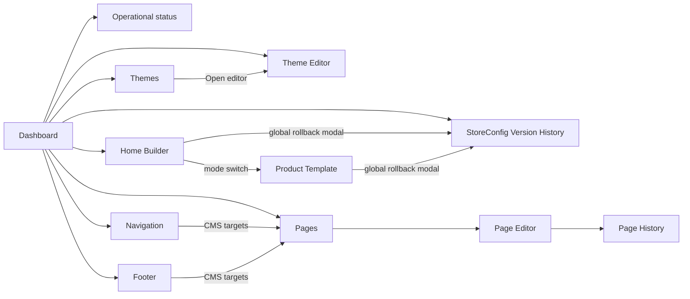
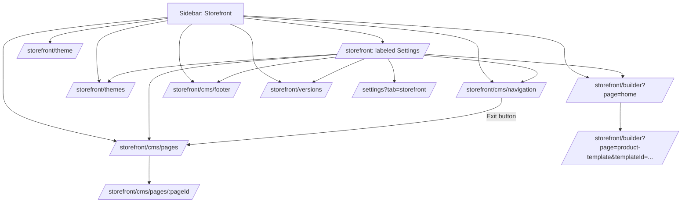
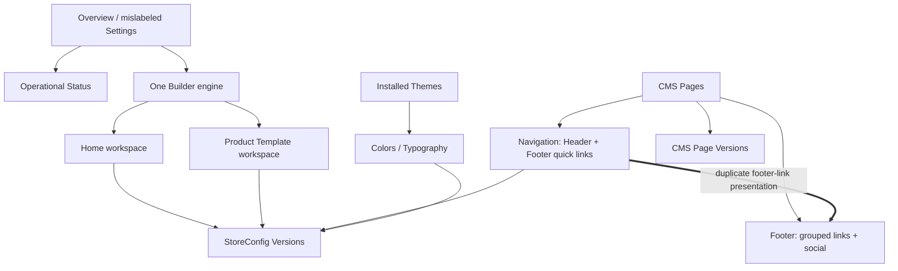
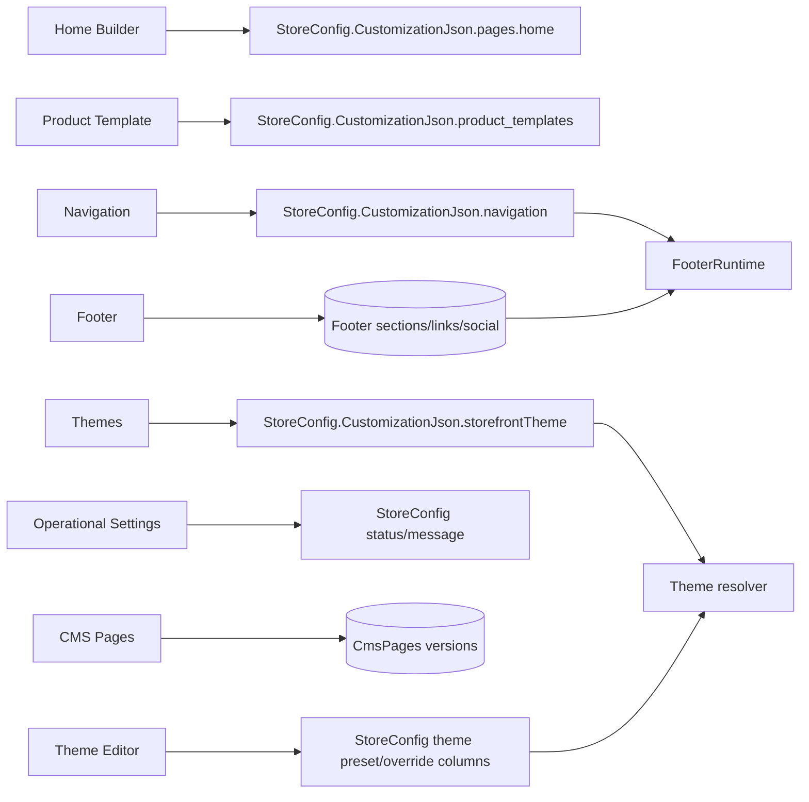
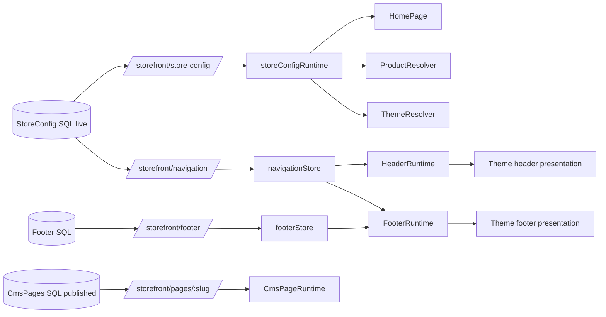
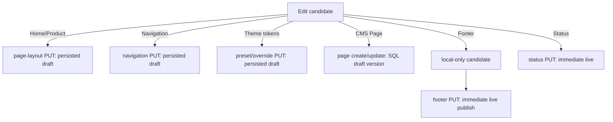
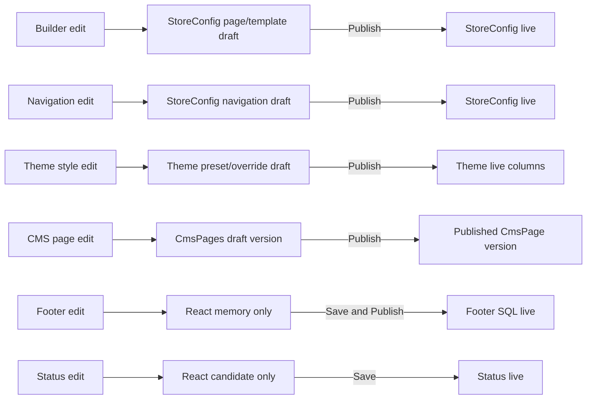
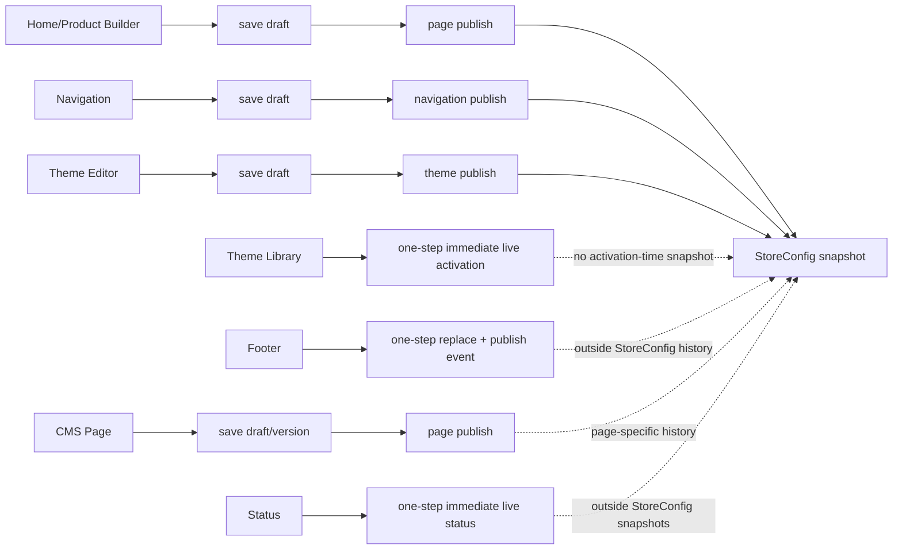

# Storefront UX Architecture Audit

**Project:** PointOfSale  
**Focus:** POS Admin Storefront CMS Authoring UX  
**Audit date:** 2026-08-03  
**Mode:** Source audit only  
**Application code changed:** No  
**Certification:** **FAIL**

## Executive Summary

The frozen customer Storefront runtime remains canonical and is not reopened by this audit. Its certified ownership chain is SQL/StoreConfig authoring, outbox-backed derivative projections, canonical runtime owners, presentation-only Themes, and Builder-authored supplemental declarations. The frozen certification records that chain and a verdict of `CERTIFIED WITH OBSERVATIONS` in `FINAL_STOREFRONT_ARCHITECTURE_CERTIFICATION.md:5-21`, with the detailed ownership boundaries at `FINAL_STOREFRONT_ARCHITECTURE_CERTIFICATION.md:58-75`.

The current POS Admin authoring UX does **not** faithfully expose those boundaries and therefore fails this UX architecture certification. The failure is not a runtime failure. It is an authoring information-architecture and ownership failure, supported by five material findings:

1. **Footer links have two active authoring owners and two active persistence models.** Navigation edits `navigation.footer.links` in `StoreConfig.CustomizationJson`, while Footer edits link-bearing SQL footer sections. `FooterRuntime` combines both sources into one presentation model (`PointOfSale.Storefront/src/storefront/runtime/layout/LayoutRuntime.tsx:171-220`). The dashboard explicitly advertises both responsibilities (`PointOfSale.Web/src/pages/StorefrontDashboard.jsx:180-205`).
2. **The menu's “Storefront Settings” destination is not the settings editor.** `/storefront` renders an overview/dashboard (`PointOfSale.Web/src/App.jsx:329-342`; `PointOfSale.Web/src/pages/StorefrontDashboard.jsx:45-74`). The actual live/maintenance/disabled editor is hidden inside `/settings?tab=storefront` (`PointOfSale.Web/src/pages/Settings.jsx:705-739`) and is reached from the dashboard status card (`PointOfSale.Web/src/components/StorefrontStatusCard.jsx:125-131`).
3. **A global rollback is presented inside a page-scoped Builder.** The Builder's rollback control reads and rolls back global StoreConfig versions (`PointOfSale.Web/src/modules/storefront/pages/StorefrontBuilderPage.jsx:592-625`), the same authority exposed by the standalone Version History screen (`PointOfSale.Web/src/modules/storefront/pages/VersionHistoryPage.jsx:55-130`). Backend rollback restores live pages, product templates, navigation, and theme state together (`PointOfSale.API/Services/Admin/AdminStoreConfigService.cs:781-828`, `1732-1783`).
4. **Theme publication semantics are split and obscured.** Theme selection activates the layout theme immediately as live (`PointOfSale.API/Services/Admin/AdminThemeActivationService.cs:40-91`), while colors/preset/typography use draft then publish (`PointOfSale.API/Services/Admin/AdminStoreConfigService.cs:620-687`). Activation does not append a version snapshot in its persistence path (`PointOfSale.API/Services/Admin/AdminThemeActivationService.cs:117-152`), whereas theme customization publish does.
5. **Category Template is not a current screen or runtime-owned Builder surface.** The Builder admits only Home and Product Template (`PointOfSale.Web/src/modules/storefront/pages/StorefrontBuilderPage.jsx:109-115`). The frozen regression contract expressly excludes Builder execution from Category and ignores `config.pages.category.sections` (`PointOfSale.Storefront/src/storefront/runtime/runtimeOwnershipRecovery.test.ts:7-17`). Category remains in backend compatibility DTO mapping (`PointOfSale.API/Services/Storefront/StorefrontDraftConfigMapper.cs:337-353`), making it a dormant contract branch, not a valid UX destination.

The proposed conceptual structure is therefore **partially compatible**. Homepage, Product Template, Pages, Header/Footer Navigation, Appearance, and a correctly scoped Version History align with current runtime boundaries. Category Template does not. Footer Branding/Payments/Contact are not current Footer authoring contracts, and Branding is partly StoreConfig-owned. The hypothesis can be a menu/ownership target only with those qualifications; it cannot be certified verbatim against the present source.

## Audit Scope and Method

This audit traced:

- all Storefront menu items and routed authoring screens;
- their child editors, modals, local state, client services, controllers, DTOs, services, persistence, events, projections, public runtime readers, and browser caches;
- save, draft, preview, publish, rollback, and delete paths;
- the frozen runtime certification and its ownership regression tests.

Storefront-adjacent operational products such as Commerce AI, Pixel Tracking, Storefront Auth Providers, customer management, and analytics are outside the CMS authoring boundary. Their routes are separate CommerceHub capability surfaces immediately adjacent to, but not inside, the Storefront route group (`PointOfSale.Web/src/App.jsx:317-347`). They are not treated as CMS screens.

All citations are repository-relative source locations. No application source was modified.

## Canonical Runtime Architecture

The canonical architecture used as the audit constraint is:

```text
POS Admin authoring
    -> SQL authority / StoreConfig authority
    -> transactional outbox
    -> derivative Mongo/index/cache consumers
    -> public Storefront SQL-backed read admission
    -> canonical Runtime owners
    -> Theme presentation components

Builder
    -> admitted Home declarations
    -> admitted Product Template supplemental declarations
    -X-> runtime route/data/business ownership
    -X-> Category ownership
    -X-> mandatory Product Hero ownership
```

| Runtime surface | Frozen canonical owner | Source-backed boundary |
|---|---|---|
| Home composition | `HomePage` plus `SectionRenderer`/`RuntimeSectionContainer` | Builder declarations are admitted input; active Home reads `config.pages.home.sections` (`PointOfSale.Storefront/src/pages/HomePage.tsx:30-55`). |
| Catalog | `ProductListPage` and Catalog Discovery | Builder cannot replace or wrap catalog runtime (`FINAL_STOREFRONT_ARCHITECTURE_CERTIFICATION.md:61`). |
| Category | `CategoryPage` and SQL category lineage | Category has no Builder section execution (`PointOfSale.Storefront/src/storefront/runtime/runtimeOwnershipRecovery.test.ts:8-17`). |
| Product Details | `ProductTemplateResolver` plus mandatory runtime Product Hero | Authored templates contribute supplemental sections; resolver injects/filter-protects Product Hero and reviews (`PointOfSale.Storefront/src/storefront/products/ProductTemplateResolver.ts:14-41`). |
| Section execution | `RuntimeSectionContainer` | Builder declares; Runtime executes; Theme presents (`FINAL_STOREFRONT_ARCHITECTURE_CERTIFICATION.md:63-64`). |
| Header/Footer composition | `HeaderRuntime` and `FooterRuntime` | Themes consume presentation models and slots (`FINAL_STOREFRONT_ARCHITECTURE_CERTIFICATION.md:67`). |
| Theme | Installed Theme components and canonical Theme authority, presentation only | Theme may own markup/tokens/layout presentation, not data or behavior (`FINAL_STOREFRONT_ARCHITECTURE_CERTIFICATION.md:81-83`). |
| Builder | StoreConfig authoring for Home and Product Template supplemental sections | It owns neither runtime route/data/business truth nor mandatory capabilities (`FINAL_STOREFRONT_ARCHITECTURE_CERTIFICATION.md:69`). |
| StoreConfig public read | `StorefrontStoreConfigController` reading SQL and mapping live only | The public endpoint reads `StoreConfigs`/`ThemePresets` from SQL and maps live state (`PointOfSale.API/Controllers/StorefrontStoreConfigController.cs:55-144`). |
| Navigation public read | `StorefrontNavigationController` reading live StoreConfig navigation and recomposing SQL targets | Mongo navigation projection is derivative; current response reads SQL (`PointOfSale.API/Controllers/StorefrontNavigationController.cs:46-74`). |
| CMS Page public read | `CmsPageReadService` reading the published SQL page version | Current published read queries `CmsPages`; its injected Mongo database is not used (`PointOfSale.API/Services/Cms/CmsPageReadService.cs:36-61`, `118-169`). |
| Footer public read | `StorefrontFooterReadService` reading SQL footer/page tables | Tenant, global, then derived fallback is resolved from SQL (`PointOfSale.API/Services/Storefront/StorefrontFooterReadService.cs:34-98`). |
| HTTP cache | `StorefrontHttpCachePolicyMiddleware` | Every `/api/storefront` response is private/no-store; application browser caches own bounded entries (`PointOfSale.API/Middleware/StorefrontHttpCachePolicyMiddleware.cs:5-14`, `23-56`). |
| Browser cache | StoreConfig runtime cache, navigation store, footer store, category/home-product caches | Shared maximum age is five minutes and identity-sensitive (`PointOfSale.Storefront/src/storefront/runtime/cache/runtimeCachePolicy.ts:5-59`). |

## Current UX Architecture

### Current menu and routes

The Storefront sidebar currently exposes eight items (`PointOfSale.Web/src/components/Sidebar.jsx:216-230`):

```text
Storefront
├─ Settings                 -> /storefront
├─ Homepage Builder         -> /storefront/builder?page=home
├─ Themes                   -> /storefront/themes
├─ Theme Editor             -> /storefront/theme
├─ Navigation               -> /storefront/cms/navigation
├─ Pages                    -> /storefront/cms/pages
├─ Footer                   -> /storefront/cms/footer
└─ Version History          -> /storefront/versions
```

`App.jsx` registers exactly those routes plus the CMS Page editor route (`PointOfSale.Web/src/App.jsx:329-342`). There is no Product Template route, no Category Template route, and no independent route for the operational Storefront settings editor.

### Actual architecture behind the labels

```text
/storefront "Settings"
    = overview + status read card + analytics card + links

/settings?tab=storefront
    = actual operational status editor

/storefront/builder?page=home
    = canonical Builder engine, Home mode

/storefront/builder?page=product-template&templateId=...
    = same Builder engine, Product Template mode

/storefront/themes
    = installed layout-theme selection, signed preview, immediate activation

/storefront/theme
    = style preset/colors/font/radius draft and publish

/storefront/cms/navigation
    = header links + footer quick links in StoreConfig

/storefront/cms/footer
    = second footer-link system + social links in dedicated SQL tables

/storefront/cms/pages[/id]
    = CMS page content, SEO, blocks/rich text, page versions

/storefront/versions
    = StoreConfig-wide version snapshots and rollback
```

## Current Screen Inventory

### Screen certification ledger

| ID | Screen / related surface | Purpose | UX owner | Primary responsibility | Secondary responsibility | Reachability / status | Evidence |
|---|---|---|---|---|---|---|---|
| S01 | Storefront Dashboard, labeled “Storefront Settings” | Overview and links | Storefront Admin shell | Orient author | Read status and wishlist analytics | Active route/menu; mislabeled | `PointOfSale.Web/src/pages/StorefrontDashboard.jsx:25-74`, `99-218` |
| S02 | Operational Storefront Settings | Set live/maintenance/disabled and maintenance message | StoreConfig operations | Storefront availability | Read store name/theme/update time; open live store | Active but hidden in global Settings tab | `PointOfSale.Web/src/pages/Settings.jsx:705-739`; `PointOfSale.Web/src/pages/StorefrontSettings.jsx:109-160`, `308-429` |
| S03 | Homepage Builder | Compose Home supplemental sections | Builder | Home declarations | Draft autosave, preview, publish, rollback entry | Active route/menu | `PointOfSale.Web/src/modules/storefront/pages/StorefrontBuilderPage.jsx:109-115`, `310-413` |
| S04 | Product Template Builder mode | Compose named Product Template supplemental sections | Builder constrained by Product Runtime | Product template declarations | Create/select/delete templates | Active query mode; no direct menu item | `PointOfSale.Web/src/modules/storefront/components/builder/BuilderTopBar.jsx:19-22`, `62-180` |
| S05 | Category Template | No valid current purpose | None; Category Runtime is canonical | None | Dormant compatibility DTO only | No screen/route; deliberately absent | `PointOfSale.Storefront/src/storefront/runtime/runtimeOwnershipRecovery.test.ts:8-17`; `PointOfSale.API/DTOs/Storefront/StorefrontStoreConfigDtos.cs:118-122` |
| S06 | Themes | Browse, preview, activate installed presentation layout themes | Theme authority | Select `storefrontTheme` | Link to Theme Editor | Active route/menu | `PointOfSale.Web/src/modules/storefront/pages/ThemeMarketplacePage.jsx:125-209`, `223-242` |
| S07 | Theme Editor | Edit style preset, colors, font, radius | Theme authoring over StoreConfig | Appearance tokens | Local preview, reset to published, publish | Active route/menu | `PointOfSale.Web/src/modules/storefront/pages/ThemeEditorPage.jsx:243-313`, `322-409`, `447-627` |
| S08 | Navigation Editor | Edit header and footer navigation links | Navigation authoring over StoreConfig | Header/footer navigation targets and order | Target admission, conflict handling | Active route/menu | `PointOfSale.Web/src/modules/storefront/cms/pages/NavigationEditor.jsx:8-13`, `134-329`, `625-651` |
| S09 | CMS Pages list | List/create/seed/preview/publish/delete CMS pages | CMS | Page collection lifecycle | Entry point to edit/publish/preview | Active route/menu | `PointOfSale.Web/src/modules/storefront/cms/pages/CmsPagesList.jsx:47-155`, `265-338` |
| S10 | CMS Page Editor | Edit title, slug, content, content type, SEO | CMS | Page content | Page preview, publish, version history/rollback | Active child route | `PointOfSale.Web/src/modules/storefront/cms/pages/CmsPageEditor.jsx:31-106`, `161-388`, `622-751` |
| S11 | Footer Editor | Edit grouped footer sections/links and social links | Footer authoring | Footer-specific SQL configuration | CMS link targeting/localization | Active route/menu; overlaps S08 | `PointOfSale.Web/src/modules/storefront/cms/pages/StorefrontFooterSettings.jsx:4-16`; `PointOfSale.Web/src/shared/content/FooterConfigScreen.jsx:252-326`, `509` |
| S12 | Version History | View/rollback StoreConfig snapshots | StoreConfig publication | Global StoreConfig live history | Reason/confirmation | Active route/menu; scope is not stated in label | `PointOfSale.Web/src/modules/storefront/pages/VersionHistoryPage.jsx:55-130`, `297-420` |
| R01 | Dashboard status card | Read status/theme/store identity and navigate to operational settings | StoreConfig read presentation | Status visibility | Open live store | Active child of S01 | `PointOfSale.Web/src/components/StorefrontStatusCard.jsx:41-78`, `125-131`, `167-213` |
| R02 | Builder Preview modal | Render backend-admitted draft config in editor context | Builder preview | Draft preview | ThemeProvider/product sample context | Active child of S03/S04 | `PointOfSale.Web/src/modules/storefront/pages/StorefrontBuilderPage.jsx:492-547`, `858-869` |
| R03 | Builder Publish modal | Confirm page/template publication | Builder | Confirm target publish | Surface publish errors | Active child of S03/S04 | `PointOfSale.Web/src/modules/storefront/pages/StorefrontBuilderPage.jsx:549-590`, `858-864` |
| R04 | Builder Rollback modal | Select a StoreConfig version and trigger rollback | StoreConfig publication, not page Builder | Global rollback | Reload current Builder mode afterward | Active child; misleading local placement | `PointOfSale.Web/src/modules/storefront/pages/StorefrontBuilderPage.jsx:592-633`, `866-870` |
| R05 | Product Template create/delete controls | Manage named template identities | Builder/StoreConfig | Template identity lifecycle | Navigate among templates | Active child of S04; delete is immediately live/versioned | `PointOfSale.Web/src/modules/storefront/pages/StorefrontBuilderPage.jsx:636-695`; `PointOfSale.API/Services/Admin/AdminStoreConfigService.cs:465-526` |
| R06 | Navigation link editor/add dialog and conflict banner | Edit link type/target/labels and recover concurrency | Navigation | One admitted link | Validation/conflict retry | Active child of S08 | `PointOfSale.Web/src/modules/storefront/cms/pages/NavigationEditor.jsx:342-363`, `449-651` |
| R07 | CMS Blocks/Rich Text editors | Author one CMS page's content representation | CMS | Page content | Text/image/FAQ block ordering | Active child of S10 | `PointOfSale.Web/src/modules/storefront/cms/pages/CmsPageEditor.jsx:390-438`, `647-742`, `1054` |
| R08 | CMS Page Version History/rollback panel | Inspect and restore one page's versions | CMS version authority | Page-scoped history | Preview/version evidence | Active child of S10 | `PointOfSale.Web/src/modules/storefront/cms/pages/CmsPageEditor.jsx:260-359`, `754-852` |
| R09 | Footer conflict recovery | Reload authoritative revision or explicitly retry draft | Footer authoring | Revision recovery | Preserve local candidate | Active child of S11 | `PointOfSale.Web/src/shared/content/FooterConfigScreen.jsx:154-206`, `268-279` |
| R10 | Version rollback dialog | Confirm StoreConfig-wide live rollback | StoreConfig publication | Global rollback | Reason and warning | Active child of S12 | `PointOfSale.Web/src/modules/storefront/pages/VersionHistoryPage.jsx:313-420` |
| R11 | Theme preview surfaces | Preview theme layout or style candidate | Split: Theme preview service / Theme Editor local state | Layout preview in real Storefront; style preview locally | None | Two different preview semantics share similar language | `PointOfSale.Web/src/modules/storefront/pages/ThemeMarketplacePage.jsx:166-174`; `PointOfSale.Web/src/modules/storefront/pages/ThemeEditorPage.jsx:624-627` |

## Current Ownership Matrix

### Architectural ownership

`—` means the screen is not allowed to own that layer. Projection consumers are derivative and do not supersede the named SQL/runtime owners.

| ID | Runtime owner | Theme owner | Builder owner | Projection owner | Cache owner | CMS owner | StoreConfig owner |
|---|---|---|---|---|---|---|---|
| S01/R01 | Read-only StoreConfig status presentation; no runtime composition | — | — | `StorefrontConfigProjectionConsumer`, derivative | Admin GET uses no-store headers | — | `AdminStoreConfigService` read |
| S02 | Storefront status admission/gates | — | — | `StorefrontConfigProjectionConsumer`, derivative | Admin GET no-store; public StoreConfig browser cache after mutation/TTL | — | `AdminStoreConfigService.UpdateStorefrontStatusAsync` |
| S03/R02/R03 | `HomePage`, `SectionRenderer`, `RuntimeSectionContainer` | Active theme section presentation | `StorefrontBuilderPage` + `builderStore` | `StorefrontConfigProjectionConsumer`, derivative | `storeConfigRuntime`; homepage section product cache | — | `pages.home` draft/live |
| S04/R05 | `ProductDetailsPage`, `ProductTemplateResolver`, mandatory runtime Product Hero | Active theme product/section presentation | Same canonical Builder engine, Product Template mode | `StorefrontConfigProjectionConsumer`, derivative | `storeConfigRuntime`; resolver memo/cache | — | `product_templates.{id}` draft/live |
| S05 | `CategoryPage` + category services | Category presentation only | **None** | Category projections remain derivative | Category runtime cache owner only | — | Dormant `pages.category` compatibility field is not runtime ownership |
| S06 | Theme resolver/layout runtime consumes selected ID | Canonical installed Theme registry | — | `StorefrontConfigProjectionConsumer`, derivative | `storeConfigRuntime` includes theme-preview identity | — | `CustomizationJson.storefrontTheme` |
| S07/R11-style | Runtime consumes live preset/overrides | Theme token/typography presentation | — | `StorefrontConfigProjectionConsumer`, derivative | `storeConfigRuntime` | — | live/draft theme preset and override columns |
| S08/R06 | `HeaderRuntime` and Footer navigation slot | Theme places/render navigation model only | — | `NavigationProjectionConsumer`, derivative | `navigationStore` | CMS provides target catalog, but does not own links | `CustomizationJson.navigation` draft/live |
| S09/S10/R07/R08 | CMS runtime page route/read service | Theme/page shell presentation only | —; Blocks editor is CMS content, not Storefront Builder | `CmsPageProjectionConsumer`, currently derivative to SQL public read | HTTP no-store; no certified CMS page browser store | `CmsPageService` | — |
| S11/R09 | `FooterRuntime` footer-section/social slot | Theme renders footer model only | — | `StorefrontFooterProjectionConsumer`, derivative | `footerStore` | CMS only validates link targets | — |
| S12/R04/R10 | No independent runtime; rollback republishes StoreConfig live domains | Affected live theme fields | Affected Home/Product declarations | `StorefrontConfigProjectionConsumer`, derivative | StoreConfig/navigation caches observe later refresh/TTL | — | `VersionsJson`/`LiveVersion` and rollback service |

Projection evidence: `PointOfSale.Infrastructure/Consumers/StorefrontConfigProjectionConsumer.cs:20-31`, `PointOfSale.Infrastructure/Consumers/NavigationProjectionConsumer.cs:15-47`, `PointOfSale.Infrastructure/Consumers/CmsPageProjectionConsumer.cs:20-56`, and `PointOfSale.Infrastructure/Consumers/StorefrontFooterProjectionConsumer.cs:14-42`. Frozen ownership makes these consumers derivative, and current StoreConfig, navigation, CMS page, and footer public reads all query SQL.

### Technical ownership

| ID | Persistence owner | API owner | ViewModel owner | DTO owner |
|---|---|---|---|---|
| S01/R01 | `StoreConfigs` SQL (read only) | `AdminStoreConfigController` GET | Component-local React state | `AdminStoreConfigResponse` |
| S02 | `StoreConfig.StorefrontStatus`, `MaintenanceMessage`, `RowVersion` | `PUT /api/admin/store-config/status` | `StorefrontSettings` local baseline/candidate state | `AdminStorefrontStatusRequest`, `AdminStoreConfigResponse` |
| S03/R02/R03 | `StoreConfig.CustomizationJson.pages.home` | `PUT .../pages/home`, `POST .../pages/home/publish`, preview endpoint | Zustand `builderStore` plus page request state | `AdminStoreConfigResponse`; `StorefrontStoreConfigDto`/page/section DTOs |
| S04/R05 | `StoreConfig.CustomizationJson.product_templates.{id}` | page endpoints using `product-template:{id}`; product-template DELETE | Same `builderStore`; URL `templateId` is workspace identity | `AdminStoreConfigResponse.ProductTemplates`; `StorefrontProductTemplateDto` |
| S05 | Dormant `CustomizationJson.pages.category` compatibility shape; active Category SQL is outside UX | No Category authoring endpoint/screen | None | `StorefrontPagesDto.Category` remains exposed |
| S06 | `CustomizationJson.storefrontTheme` | theme preview-link and activation endpoints | Component-local React state | `AdminThemeActivationRequest`, `AdminStoreConfigResponse` |
| S07 | `ThemePresetKey`, `ThemeLivePresetKey`, draft/live overrides JSON | theme presets, preset selection, overrides, publish | Component-local draft/published React state | `ThemePresetDto`, `AdminThemeViewDto`, `AdminStoreConfigResponse` |
| S08/R06 | `StoreConfig.CustomizationJson.navigation.{draft,live}` plus `VersionsJson` on publish | `AdminCmsPagesController` navigation GET/PUT/publish | Navigation branch of Zustand `cmsStore` | `AdminNavigationRequest/Response/TargetsResponse` |
| S09/S10/R07/R08 | Versioned rows in SQL `CmsPages` | `AdminCmsPagesController` page CRUD/publish/rollback/preview | Component-local React state; active editor does not use page branch of `cmsStore` | Admin CMS page request/list/response/version/history DTOs |
| S11/R09 | `StorefrontFooterSections`, child links, `StorefrontSocialLinks` SQL | `AdminStorefrontFooterController` GET/PUT | `FooterConfigScreen` local accepted/draft/conflict state | `AdminStorefrontFooter*Request/Response`; public `StorefrontFooterDto` |
| S12/R04/R10 | `StoreConfig.VersionsJson`, `LiveVersion`, live customization/theme fields | StoreConfig versions GET and rollback POST | Component-local modal state | StoreConfig version history/rollback DTOs returned by controller/service |

Persistence evidence for StoreConfig's single-tenant authority and columns is in `PointOfSale.Core/Entities/StoreConfig.cs:6-16`, `77-123`. Footer persistence and immediate replacement are in `PointOfSale.API/Services/Admin/FooterAuthoringService.cs:65-121`, `221-276`. The CMS page service is reached through dual route aliases on one controller (`PointOfSale.API/Controllers/AdminCmsPagesController.cs:37-100`, `173-220`, `287-350`).

## Responsibility Matrix

Legend: **P** primary, **S** secondary/read-only support, **X** responsibility currently present but architecturally conflicting, `—` none.

| Screen | Operational status | Home composition | Product composition | Category composition | Theme selection | Appearance tokens | Page content | Header nav | Footer nav | Footer-specific content | Version/rollback |
|---|---:|---:|---:|---:|---:|---:|---:|---:|---:|---:|---:|
| S01 Dashboard | S | S | — | — | S | S | S | S | S | S | S |
| S02 Operational Settings | P | — | — | — | S | — | — | — | — | — | — |
| S03 Homepage Builder | — | P | — | — | — | — | — | — | — | — | X: global rollback entry |
| S04 Product Template | — | — | P, supplemental only | — | — | — | — | — | — | — | X: global rollback entry |
| S05 Category Template | — | — | — | **Forbidden/absent** | — | — | — | — | — | — | — |
| S06 Themes | — | — | — | — | P | — | — | — | — | — | S: not versioned at activation time |
| S07 Theme Editor | — | — | — | — | — | P | — | — | — | — | P for theme-customization snapshots |
| S08 Navigation | — | — | — | — | — | — | — | P | P | X: footer links overlap S11 | S through StoreConfig snapshot |
| S09 Pages list | — | — | — | — | — | — | P lifecycle | — | — | — | S publish entry |
| S10 Page Editor | — | — | — | — | — | — | P | — | — | — | P page-scoped |
| S11 Footer | — | — | — | — | — | — | — | — | X: second footer-link owner | P social; current grouped links | — |
| S12 Version History | — | S | S | — | S | S | — | S | S | — | P StoreConfig-wide |

The current dashboard itself reveals the duplicate: Navigation is described as editing “header and footer links,” and Footer immediately below is described as managing footer sections and CMS links (`PointOfSale.Web/src/pages/StorefrontDashboard.jsx:173-205`).

## Workflow Inventory

### Per-screen flow certification

| Screen | Save flow | Draft flow | Preview flow | Publish flow | Runtime flow |
|---|---|---|---|---|---|
| S01 Dashboard | None | None | “View Store” opens live Storefront | None | Reads admin StoreConfig status only |
| S02 Operational Settings | Specialized status PUT; accepted response becomes baseline | Candidate exists only in component memory | Button opens live Storefront, despite “preview” naming in code | Save is an immediate live operational mutation; no separate publish | Public runtime admission observes StoreConfig status |
| S03 Homepage Builder | Manual Save Draft and 1.5-second autosave both call the same page-layout PUT | Persisted `pages.home.draft` | Saves first, then GETs backend draft preview; no live fallback | Saves first, then promotes Home draft to live and snapshots StoreConfig | `HomePage` renders live Home sections |
| S04 Product Template | Same Builder save path using `product-template:{id}` key | Persisted template draft | Same backend draft preview with product context | Saves then promotes selected template; delete is a separate immediate live/versioned path | Product resolves named/builtin template, then Runtime injects mandatory behavior |
| S05 Category Template | None | Dormant DTO/config branch only | None | None | `CategoryPage` ignores Builder category sections |
| S06 Themes | No draft save | No theme-layout draft | Signed preview token opens real Storefront with theme override | “Activate” immediately changes live `storefrontTheme` | StoreConfig runtime selects installed theme layout |
| S07 Theme Editor | Preset/override PUTs save draft | Dedicated draft preset/overrides | Local synthetic style preview panel | Save draft first, then promote live preset/overrides and append StoreConfig snapshot | StoreConfig runtime supplies live theme tokens |
| S08 Navigation | Manual Save Draft and two-second autosave call same navigation PUT | Persisted header/footer draft | No preview | Save first, then promote both header/footer navigation together and append StoreConfig snapshot | Navigation SQL live -> navigation store -> HeaderRuntime/FooterRuntime |
| S09 Pages list | No content save | Existing page drafts are listed | Signed preview link | Can publish a page directly from list | Published SQL page becomes public page target |
| S10 Page Editor | Create/update writes a new/current draft version | SQL version row | Only saved/non-dirty page gets signed preview link | Saves if needed, then publishes one page version | Public CMS route reads latest published SQL version |
| S11 Footer | Local candidate only until PUT | No persisted draft | None | `Save and Publish` atomically replaces SQL configuration and emits update event | Footer SQL -> footer store -> FooterRuntime sections/social |
| S12 Version History | None | Current drafts are preserved by rollback merge | None | Rollback is a new immediate StoreConfig publication | Multiple StoreConfig live domains change together; Footer/CMS/status are outside snapshot |

Save/draft evidence: the Builder service explicitly distinguishes draft PUT from publish POST (`PointOfSale.Web/src/modules/storefront/services/storeConfigService.js:23-24`, `74-90`), and the Builder schedules autosave then exposes manual save through the same function (`PointOfSale.Web/src/modules/storefront/pages/StorefrontBuilderPage.jsx:398-420`). Navigation follows the same save-then-publish pattern (`PointOfSale.Web/src/modules/storefront/cms/pages/NavigationEditor.jsx:192-329`). Footer explicitly states that save publishes immediately (`PointOfSale.Web/src/modules/storefront/cms/pages/StorefrontFooterSettings.jsx:8-14`) and labels its action “Save and Publish” (`PointOfSale.Web/src/shared/content/FooterConfigScreen.jsx:252-254`).

### Workflow Graph



### Navigation Graph



The Navigation editor's exit action routes to Pages rather than the Storefront overview (`PointOfSale.Web/src/modules/storefront/cms/pages/NavigationEditor.jsx:331-340`), creating an unexplained cross-workflow edge.

### Dependency Graph

```mermaid
flowchart LR
    subgraph Admin_UI
        UI[Screen/editor]
        VM[Local React state / builderStore / cmsStore]
        CL[storeConfigService / cmsService / footerAuthoringService]
    end

    subgraph Backend_Authority
        API[Admin controllers]
        SVC[Admin services + admission]
        SQL[(PostgreSQL authority)]
        OB[(Transactional outbox)]
    end

    subgraph Derivative
        PC[Projection consumers]
        MG[(Mongo read models)]
    end

    subgraph Public_Runtime
        READ[SQL-backed Storefront readers]
        BC[Bounded browser runtime caches]
        RT[Canonical Runtime owners]
        TM[Theme presentation]
    end

    UI --> VM --> CL --> API --> SVC --> SQL
    SVC --> OB --> PC --> MG
    SQL --> READ --> BC --> RT --> TM
    MG -. derivative; not current authority on audited reads .-> READ
```



### Screen Relationship Graph



### Data Flow



The two incoming link-bearing edges to `FooterRuntime` are the active multiple-source-of-truth defect, even though each source is internally authoritative for its own storage model.

### Runtime Flow



### Save Flow



The Builder and Navigation expose autosave and manual Save Draft, but both triggers converge on one API each. That is duplicate interaction affordance, not duplicate persistence authority. The dormant whole-config `PUT /api/admin/store-config` is a separate overlapping API surface; its client helper has no production call site outside tests (`PointOfSale.Web/src/modules/storefront/services/storeConfigService.js:44-57`).

### Draft Flow



### Preview Flow

```mermaid
flowchart TD
    B[Builder Preview] --> BS[Persist draft first]
    BS --> BP[Backend draft config endpoint]
    BP --> BM[Editor modal; no live fallback]

    TL[Theme Library Preview] --> TT[Signed theme preview token]
    TT --> TS[Actual Storefront runtime override]

    TE[Theme Editor Preview] --> LP[Local synthetic preview panel]

    CP[CMS Page Preview] --> CT[Signed page/version token]
    CT --> CS[Actual Storefront CMS preview route]

    OS[Operational Settings "preview"] --> LIVE[Ordinary live Storefront URL]
    FT[Footer] --> NONE[No preview]
    NV[Navigation] --> NONE2[No preview]
```

These are four different meanings of “preview.” Only Builder preview and signed Theme/CMS preview have explicit candidate admission. Operational Settings opens the ordinary live URL (`PointOfSale.Web/src/pages/StorefrontSettings.jsx:155-160`); Theme Editor renders a local panel; Footer and Navigation have no preview.

### Publish Flow



Backend page publish promotes admitted draft to live and appends a snapshot (`PointOfSale.API/Services/Admin/AdminStoreConfigService.cs:336-424`). Navigation publish promotes both navigation branches and appends a snapshot (`PointOfSale.API/Services/Admin/AdminCmsService.cs:627-694`). Theme publish promotes live preset/overrides and appends a snapshot (`PointOfSale.API/Services/Admin/AdminStoreConfigService.cs:646-693`).

## Duplicate Ownership

### Active duplicate responsibilities

| Duplicate | Source A | Source B | Runtime consequence | Severity |
|---|---|---|---|---|
| Footer links | Navigation `footer.links` in StoreConfig | Footer section child links in dedicated SQL tables | Both are rendered by `FooterRuntime`; authors can edit two link sets that look like one footer | Critical |
| Theme concept | Installed layout theme (`storefrontTheme`) | Style preset/colors/font/radius (`Theme*PresetKey`, override JSON) | Distinct legitimate subdomains, but current naming presents both as undifferentiated “Theme” | High UX ambiguity, not duplicate persistence truth |
| Rollback entry | Builder Rollback modal | Standalone Version History | Both call the same global rollback endpoint, so a local-looking action can affect unrelated StoreConfig live domains | High |
| CMS Page publish entry | Pages list | Page Editor | Both call the same page publish endpoint; authority is not duplicated, but workflow entry is duplicated | Observation |
| Save Draft affordance | Builder/Navigation autosave | Builder/Navigation manual save | Same API authority; duplicated interaction rather than duplicated data | Observation |

### Duplicate and overlapping API contracts

| Surface | Evidence | Classification |
|---|---|---|
| Full StoreConfig PUT vs specialized status/page/theme endpoints | Controller exposes full PUT and specialized endpoints (`PointOfSale.API/Controllers/AdminStoreConfigController.cs:122-209`, `283-619`); production UI uses specialized paths | Dormant overlapping write API; potential future duplicate save path |
| Admin CMS page route aliases | Every major page endpoint is exposed at both `/api/admin/cms/pages...` and `/api/admin/pages...` on the same controller (`PointOfSale.API/Controllers/AdminCmsPagesController.cs:37-100`, `173-220`, `287-350`) | Compatibility alias, not duplicate service/persistence authority |
| StoreConfig preview aliases | Admin controller exposes both admin preview and `/api/storefront/config/preview` (`PointOfSale.API/Controllers/AdminStoreConfigController.cs:724-729`) | Alias with security/ownership naming ambiguity |
| Legacy `Theme` DTO plus `DraftTheme`/`LiveTheme` views | `AdminStoreConfigResponse` returns legacy `Theme` as well as draft/live views (`PointOfSale.API/DTOs/Admin/AdminStoreConfigDtos.cs:101-136`) | Duplicate representation; live/draft views are current Theme Editor contract |
| `Pages.Product` and `Pages.Category` plus `ProductTemplates` | Storefront DTO exposes all three (`PointOfSale.API/DTOs/Storefront/StorefrontStoreConfigDtos.cs:118-130`) while runtime resolver rejects `pages.product` ownership | Dormant compatibility DTO duplication |

Request and response DTOs for Footer have similar shapes, but they are not independently authoritative: requests carry expected revision and candidate data, while responses carry accepted scope/revision and server-normalized data (`PointOfSale.API/DTOs/Admin/AdminStorefrontFooterDtos.cs:6-10`, `43-49`). Public Footer DTOs are runtime projections. That is boundary duplication, not a second truth owner.

## Hidden Ownership

1. **Operational status ownership is hidden outside the Storefront route group.** The visible Storefront Settings item is a dashboard, while the editor lives in global Settings.
2. **Product Template ownership is hidden inside a query mode.** The top bar exposes Product Template (`PointOfSale.Web/src/modules/storefront/components/builder/BuilderTopBar.jsx:19-22`), but the menu exposes only Homepage Builder.
3. **StoreConfig-wide rollback scope is hidden inside Builder.** Backend snapshots canonicalize Home/Product Template containers and navigation together (`PointOfSale.API/Services/Admin/AdminStoreConfigService.cs:1732-1783`).
4. **Version History coverage is hidden.** A snapshot contains live theme preset/overrides and all customization JSON, but not Storefront status, maintenance message, CMS page rows, or Footer tables (`PointOfSale.API/Services/Admin/AdminStoreConfigService.cs:944-979`, `2271-2282`).
5. **Theme layout activation is an immediate live mutation.** The library says “activate,” while colors use a publish workflow; the difference is architectural but not explained in navigation.
6. **Footer fallback ownership is hidden.** Runtime may use Tenant, Global, or Derived-from-published-pages footer sections (`PointOfSale.API/Services/Storefront/StorefrontFooterReadService.cs:56-95`), while the tenant editor describes isolation and fallback only in prose.
7. **Current public reads are SQL-owned despite active Mongo projections.** Navigation, CMS Pages, Footer, and StoreConfig all have projection consumers, but audited public endpoints read SQL. This is compatible with frozen derivative projection ownership, yet easily misread from the existence of Mongo document code.

## Conflicting Responsibilities

### Footer versus Navigation

`NavigationEditor` explicitly has Header and Footer tabs. Its draft DTO stores both (`PointOfSale.API/Services/Admin/AdminCmsService.cs:584-603`). Separately, `FooterConfigScreen` authors titled sections containing links and social links. Runtime then maps navigation footer links to `model.navigation`, SQL footer section links to `model.sections`, and social links to `model.socialLinks` (`PointOfSale.Storefront/src/storefront/runtime/layout/LayoutRuntime.tsx:187-220`). Installed footer presentations render both navigation links and section links, for example `PointOfSale.Storefront/src/storefront/themes/minimal/layout/footer.tsx:18-46` and `PointOfSale.Storefront/src/storefront/themes/alizon/layout/footer.tsx:39-70`.

This is an active Single Responsibility violation at the authoring UX level. The runtime slots are technically distinct, but users see both as footer links.

### Theme selection versus Theme customization

The two screens can remain distinct because their responsibilities are distinct:

- Themes selects an installed presentation layout and supports signed real-store preview.
- Theme Editor edits preset/colors/font/radius with draft/live separation.

The conflict is workflow semantics, not the existence of two screens. Immediate activation bypasses activation-time version snapshot creation, while Theme Editor publishes through versioned StoreConfig publication. The dashboard worsens the ambiguity by labeling a card “Theme & Colors” but linking it to the Themes library (`PointOfSale.Web/src/pages/StorefrontDashboard.jsx:99-119`).

### Pages versus Builder

CMS Page Blocks are content representation, not Storefront Builder runtime declarations. `CmsPageEditor` owns rich text or text/image/FAQ blocks and SEO (`PointOfSale.Web/src/modules/storefront/cms/pages/CmsPageEditor.jsx:647-742`, `1054`); the canonical Builder owns admitted Home/Product supplemental sections. They should not be consolidated into one persistence or runtime owner merely because both use the word “blocks.”

### Storefront Settings versus Dashboard

The current dashboard owns overview/navigation only, while the independent operational editor owns live state. The problem is that both are presented as settings. A catch-all Settings screen would also risk absorbing Theme, Builder, CMS, Navigation, and Footer ownership that the frozen architecture keeps separate.

## Multiple Sources of Truth

| Domain | Current truths | Certification |
|---|---|---|
| Footer links | `StoreConfig.CustomizationJson.navigation.live.footer.links`; `StorefrontFooterSections/Links`; derived CMS-page fallback | **Violation:** multiple active authoring sources rendered together |
| Theme | Layout theme ID; live/draft style preset/overrides; legacy `Theme` DTO | Canonical subdomains exist, but representation and workflow are ambiguous |
| Product template | Active `product_templates` map; dormant `pages.product` DTO branch; product-level template identity | Active runtime is canonical; compatibility branch is dormant duplication |
| Category template | Active `CategoryPage`/SQL category runtime; dormant `pages.category` DTO branch | No active authoring truth; creating a screen would violate frozen ownership |
| Version history | StoreConfig snapshots; per-CMS-page versions; no Footer/status history in those snapshots | Multiple legitimate version authorities with insufficient scope labels |

## Redundant, Dormant, Unused, and Dead-End Surfaces

### Redundant or misleading screens/workflows

- `/storefront` is useful as an overview but redundant/misleading as an independently named “Settings” screen.
- Builder rollback duplicates the global Version History rollback workflow and places it in the wrong scope.
- Theme Editor and Themes are not redundant, but their labels and publish semantics make them appear overlapping.
- CMS Page publish from both list and editor is a redundant entry point, but both use one authority and is therefore not a source-of-truth defect.

### Dormant screens/editors/contracts

| Dormant surface | Evidence | Impact |
|---|---|---|
| Category Template screen | No route/menu; Builder valid pages are Home/Product Template only | Do not add under frozen runtime |
| `pages.category` and `pages.product` config DTOs | Mapper still emits them (`PointOfSale.API/Services/Storefront/StorefrontDraftConfigMapper.cs:337-353`) | Compatibility debt can be mistaken for supported authoring |
| CMS page branch of `cmsStore` | Store defines `currentPage`, `editingPage`, and section mutations (`PointOfSale.Web/src/modules/storefront/cms/store/cmsStore.js:24-28`, `57-206`), but only `NavigationEditor` imports `useCmsStore` | Dormant alternate editor ViewModel; active Page Editor uses local state |
| `storeConfigService.updateStoreConfig` | Only production service declaration plus tests; no production call site | Dormant whole-config write path overlapping specialized writes |
| `cmsService.previewPage` and `getPageBySlug` helpers | Helpers exist at `PointOfSale.Web/src/modules/storefront/cms/services/cmsService.js:63-65`, `95-102`; active UI uses preview-link and ID load | Dormant client API helpers |
| CMS Mongo mapping branch | `CmsPageReadService` accepts `IMongoDatabase` but current reads query SQL; document mapper remains in class | Derivative/dormant read implementation, not current runtime owner |

### UI dead ends and confusing edges

- Navigation's Exit action routes to Pages rather than the Storefront overview.
- Product Template is discoverable only after entering Homepage Builder and using the top-bar mode switch.
- Category Template is named in backend DTOs but has no reachable UI; this is correct runtime behavior but confusing to source readers unless documented as compatibility-only.
- Footer has no preview, no persisted draft, and no history even though its button performs immediate publication.
- Theme Editor's “Live Preview” is local, while Theme library preview opens the actual Storefront. The same term denotes different guarantees.
- Operational Settings' preview/open action displays live content, not the unsaved candidate.

No active Storefront menu route was found to be an unreachable dead route. The dead/dormant items are code/contract branches and hidden workflows rather than broken router destinations.

## Violations by Canonical Boundary

| Boundary | Result | Source-backed assessment |
|---|---|---|
| Single Responsibility | **Fail** | Footer link editing is split; dashboard is mislabeled as Settings; Builder contains global rollback |
| Canonical Runtime Ownership | Pass with observations | Active UI writes feed the certified owners; no active Category Builder; UX labels obscure scope rather than replacing runtime |
| Theme Ownership | **Fail UX alignment** | Theme remains presentation-only, but selection and token publication have inconsistent live/version semantics |
| Builder Ownership | Pass with observations | One Builder engine owns only Home/Product Template declarations; global rollback placement and dormant DTOs are observations |
| CMS Ownership | Pass with observations | Pages own content/versioning; Footer target validation and dormant `cmsStore` page branch create confusion but do not transfer page truth |
| StoreConfig Ownership | **Fail UX alignment** | StoreConfig is canonical for status/Home/Product/nav/theme, but overview/settings and global history scope do not expose that boundary clearly |
| Projection Ownership | Pass | Mongo consumers remain derivative; public audited reads use SQL authority |
| Cache Ownership | Pass | Admin reads request no-store where defined; public HTTP is no-store; certified browser stores retain bounded runtime ownership |

## Explicit Architectural Answers

### Should Navigation own footer links?

**Yes.** The current Navigation contract already owns `footer.links`, and `FooterRuntime` has a distinct `navigation.links` slot populated from `navigationStore` (`PointOfSale.Storefront/src/storefront/runtime/layout/LayoutRuntime.tsx:179-203`). Under the proposed architecture, Header and Footer link topology belongs under Navigation.

### Should Footer own footer links?

**No.** The current Footer SQL screen is a second active link authoring source. Its section/group capability is richer than Navigation's current flat footer link DTO, so consolidation would require a compatibility-aware schema/data migration rather than merely hiding the screen.

### Should Footer own only presentation?

**No.** Theme owns footer presentation. A Footer authoring domain should own footer-specific **content data** such as social, payment, and contact information, while Theme owns markup, placement, typography, tokens, and responsive presentation. The current Footer contract owns links/social, not branding/payment/contact; payment/contact labels are currently runtime/theme presentation placeholders (`PointOfSale.Storefront/src/storefront/runtime/layout/LayoutRuntime.tsx:223-230`; `PointOfSale.Storefront/src/storefront/themes/alizon/layout/footer.tsx:73-104`).

### Should Pages own content only?

**Yes.** Pages should own title, slug, rich/block content, SEO, preview, publish, and page-scoped versions. Navigation should own where pages are linked. The current CMS Page Editor already follows that division.

### Should Homepage Builder be the only Builder?

**There should be one canonical Builder engine, but it must not be Home-only.** The current single engine correctly serves Home and Product Template modes. “Homepage Builder” is therefore an incomplete menu label, not a justification for a second Product Builder. CMS Page Blocks remain a CMS content editor, not the Storefront Builder.

### Should Product Template remain separate?

**Yes as a separate workspace/domain mode; no as a separate Builder implementation.** Product Details has a distinct canonical runtime owner and mandatory Product Hero constraints. Product Template must remain visible as Catalog/Product Template while reusing the one Builder engine.

### Should Category Template remain separate?

**No.** There is no current Category Template screen to preserve. Adding or surfacing one would conflict with the frozen Category runtime unless a future separately certified architecture grants a presentation-only authoring contract. The dormant DTO branch is not authority.

### Should Theme and Theme Colors remain separate?

**Yes, with clearer names and aligned lifecycle semantics.** “Themes” owns installed layout-theme selection; “Colors & Typography” owns preset/token customization. Both belong under Appearance and must continue to respect presentation-only Theme ownership. Current activation versus publish/history behavior needs explicit scope, not forced screen merger.

### Should Storefront Settings exist as an independent screen?

**Not as the current catch-all/mislabeled screen.** `/storefront` should be understood as Overview. Operational live/maintenance/disabled state is a valid distinct StoreConfig responsibility and may remain a clearly named “Storefront Status” or “Operations” surface, either on the overview or as an independent operational screen. It should not be called a general Storefront Settings owner.

## Conceptual Architecture Compatibility

Hypothesis under audit:

```text
Storefront
    Homepage
    Catalog
        Product Template
        Category Template
    Content
        Pages
    Navigation
        Header
        Footer
    Footer
        Branding
        Social
        Payments
        Contact Information
    Appearance
        Theme
        Colors
        Typography
    Version History
```

| Proposed node | Compatibility | Existing runtime/source result |
|---|---|---|
| Storefront | Compatible | Natural root for overview and authoring domains |
| Homepage | Compatible | Active Builder Home mode and Home runtime |
| Catalog / Product Template | Compatible with constraint | Separate workspace using the one Builder engine; Runtime retains mandatory product behavior |
| Catalog / Category Template | **Incompatible** | Category is runtime/SQL-owned and Builder-free |
| Content / Pages | Compatible | CMS Page content/SEO/version authority is already separate |
| Navigation / Header | Compatible | Existing `navigation.header.links` |
| Navigation / Footer | Compatible target; migration required | Existing `navigation.footer.links`, but grouped Footer SQL links must be reconciled |
| Footer / Branding | Partially compatible | Store name is StoreConfig-owned (`PointOfSale.Core/Entities/StoreConfig.cs:26-34`); do not duplicate it in Footer persistence |
| Footer / Social | Compatible | Existing Footer SQL social links |
| Footer / Payments | Not currently implemented as authoring data | Current themes may render placeholders/labels; no audited admin Footer field/API |
| Footer / Contact Information | Not currently implemented as Footer authoring data | CMS Contact page and translated labels exist, but Footer contract lacks contact fields |
| Appearance / Theme | Compatible | Installed Theme selection |
| Appearance / Colors / Typography | Compatible | Theme Editor draft/live token contract |
| Version History | Compatible only when scope is named | Current screen is StoreConfig history, not universal Storefront history |

**Hypothesis verdict:** **PARTIALLY COMPATIBLE WITH THE FROZEN RUNTIME.** Remove Category Template, preserve StoreConfig ownership of branding identity, treat unimplemented Footer fields as future separately scoped work, and label Version History as StoreConfig-scoped unless a later architecture unifies histories.

## Recommended Screen Consolidation

These are audit recommendations only; no implementation is authorized or included.

| Recommendation | Architectural purpose | Runtime impact |
|---|---|---|
| Relabel `/storefront` from Settings to Overview | Eliminate false ownership claim | None |
| Place or link operational status as “Storefront Status/Operations” | Expose actual StoreConfig operational owner | None if route/component reuse only |
| Rename Homepage Builder menu to Homepage while keeping one Builder engine | Expose task, not implementation | None |
| Add Product Template as a visible Catalog workspace link to existing query mode | Reveal active ownership without another engine | None |
| Do not expose Category Template | Preserve frozen Category ownership | None |
| Group Themes and Colors & Typography under Appearance | Clarify distinct Theme subdomains | None for menu-only change |
| Make Navigation the sole authoring owner for footer links | Remove duplicate responsibility | Requires data/contract/runtime-compatible migration; not a menu-only change |
| Reduce Footer to footer-specific content, not presentation and not links | Preserve Theme presentation and Navigation topology | Requires migration; current screen would retain social only until other fields exist |
| Remove global rollback entry from page-scoped Builder or label it explicitly “StoreConfig Rollback” | Prevent cross-domain surprise | None if navigation/label-only; page-scoped rollback would be a new architecture and is not recommended here |
| Rename Version History to StoreConfig Version History and state coverage | Expose snapshot boundary | None |
| Keep CMS Page history inside Page Editor | Preserve page-specific persistence/version owner | None |

## Recommended Menu Structure

The nearest source-compatible menu is:

```text
Storefront
├─ Overview
├─ Storefront Status / Operations
├─ Homepage
├─ Catalog
│  └─ Product Template
├─ Content
│  └─ Pages
├─ Navigation
│  ├─ Header
│  └─ Footer Links
├─ Footer
│  └─ Social
├─ Appearance
│  ├─ Themes
│  └─ Colors & Typography
└─ StoreConfig Version History
```

Branding should be displayed or linked where useful but remain StoreConfig-owned. Payments and Contact Information should not appear as editable menu nodes until their persistence/API/runtime contracts exist and are separately certified. Footer can remain one screen rather than a submenu while Social is its only non-link authoring responsibility.

## Migration Complexity

| Change | Complexity | Why |
|---|---:|---|
| Menu relabel/grouping and existing-route links | Low | Existing routes/components already exist |
| Expose Product Template link to existing Builder query mode | Low | Existing mode and template ID workflow are active |
| Move operational status from global Settings navigation | Low-Medium | Component is reusable, but role/capability and legacy deep links must remain valid |
| Clarify Version History labels/warnings | Low | No persistence change |
| Align Theme activation with lifecycle/history expectations | Medium-High | Activation and token publication are different backend paths and event/version behaviors |
| Consolidate Footer links into Navigation | High | Navigation footer is flat; Footer supports titled groups, localized labels, CMS target types, tenant/global/derived fallbacks, and separate revision concurrency |
| Retire dormant `pages.product/category` response branches | Medium-High | Requires client/consumer inventory and compatibility period |
| Unify StoreConfig, CMS Page, Footer, and status history | Very High and **not recommended by this audit** | They are different persistence/version authorities; a universal rollback would cross frozen boundaries |

## Migration Risk

The largest risk is footer-link consolidation. A safe migration would have to preserve:

- tenant isolation and global/derived fallback behavior;
- group titles and order currently represented only by Footer sections;
- link order, localized labels, open-in-new-tab behavior, and CMS/internal/external target semantics;
- revision concurrency versus StoreConfig row-version concurrency;
- a single cutover point so `FooterRuntime` does not render migrated links twice;
- public Footer and Navigation DTO backward compatibility during rollout.

This audit does not prescribe an implementation sequence because runtime boundaries are frozen and the phase is audit-only.

## Backward Compatibility

| Compatibility surface | Required constraint |
|---|---|
| Existing admin routes | Preserve deep links or redirect them; `/settings?tab=storefront` is actively used by status cards |
| Builder query identity | Preserve `page=home`, `page=product-template`, and `templateId` identities |
| Product template IDs | Preserve named template keys and product assignments |
| CMS admin aliases | Treat `/admin/pages` and `/admin/cms/pages` as aliases until callers are proven migrated |
| Dormant page DTO fields | Do not interpret retention as runtime ownership; deprecate only with consumer evidence |
| Footer public response | Preserve the runtime presentation model during any authoring consolidation |
| StoreConfig snapshots | Do not claim they cover CMS/Footer/status; changing coverage is a new architecture |
| Theme ID/preset distinction | Preserve installed theme identity separately from styling preset identity |

## Runtime Compatibility

The recommended information-architecture changes are compatible with the frozen runtime when they only relabel, regroup, or link existing screens. Product Template remains constrained by `ProductTemplateResolver`; Category remains untouched; Theme remains presentation-only; CMS Pages remain SQL content; and Navigation/Footer continue through their current runtime owners until a separately approved consolidation migration.

The conceptual Category Template node and an immediate removal of Footer section reads are not runtime-compatible. They would alter active ownership or data availability and therefore require a new implementation/certification phase.

## Theme Compatibility

- Keeping Themes and Colors & Typography separate is compatible.
- Moving either Theme screen into Builder is incompatible with the frozen presentation/authoring boundary.
- Footer presentation must remain Theme-owned; a Footer admin screen must not choose runtime behavior or load data.
- Theme layout activation and style publication should be explained as separate dimensions until their lifecycle semantics are aligned.

## Builder Compatibility

- One Builder engine for Home and Product Template is compatible and already implemented.
- Product Template must remain supplemental; mandatory Product Hero and reviews stay runtime-owned.
- Category Template is incompatible.
- CMS Page Blocks are not a second Storefront Builder; they are CMS content editing.
- StoreConfig-global rollback does not belong contextually inside a page/template Builder without explicit scope disclosure.

## CMS Compatibility

- Pages owning content, SEO, preview, publish, and page versions is compatible.
- Navigation may reference published CMS pages but does not own their content.
- Footer may reference published CMS pages during transition but should not remain a second navigation owner.
- The Footer wrapper loads all admin pages and strips status (`PointOfSale.Web/src/modules/storefront/cms/pages/StorefrontFooterSettings.jsx:12-14`), while the backend validates only published non-draft pages (`PointOfSale.API/Services/Admin/FooterAuthoringService.cs:185-218`). A draft page can therefore appear valid in the client target list and be rejected by the backend. This is a workflow inconsistency, not a transfer of CMS authority.

## StoreConfig Compatibility

StoreConfig remains the correct owner for:

- operational status and maintenance message;
- Home and Product Template declarations;
- Navigation draft/live state;
- installed theme identity and style preset/override live/draft state;
- StoreConfig-wide publication snapshots.

It does not own CMS Page version rows or Footer SQL tables. The report's consolidation recommendations must not be read as permission to move those domains into StoreConfig without a later architecture decision.

## Risk Matrix

| ID | Risk | Likelihood | Impact | Rating | Source-backed reason |
|---|---|---:|---:|---:|---|
| UX-01 | Authors create duplicate/inconsistent footer links | High | High | Critical | Both active sources render together |
| UX-02 | Author expects Storefront Settings but lands on overview | High | Medium | High | Menu/route label mismatch |
| UX-03 | Builder rollback changes unrelated navigation/theme/page live state | Medium | Critical | Critical | Builder invokes global StoreConfig rollback |
| UX-04 | Theme activation is assumed to be draft/versioned like Theme Editor | High | High | High | Immediate live activation without activation-time snapshot |
| UX-05 | Version History is assumed to cover CMS/Footer/status | High | High | High | Snapshot shape excludes those authorities |
| UX-06 | Category Template is inferred from DTOs and reintroduced | Medium | Critical | High | Frozen Category runtime forbids Builder ownership |
| UX-07 | Draft CMS page is offered as Footer CMS target then backend rejects it | Medium | Medium | Medium | Client loads all pages; backend allows only published pages |
| UX-08 | Footer change is published unintentionally | Medium | High | High | No persisted draft/preview/history; one-step Save and Publish |
| UX-09 | Theme preview expectations differ between screens | High | Medium | Medium | Signed real preview versus local synthetic preview |
| UX-10 | Dormant full StoreConfig PUT becomes a second active write path | Low-Medium | High | Medium | Overlaps specialized endpoint responsibilities |
| UX-11 | Mongo projections are mistaken for current public authority | Medium | Medium | Medium | Projection consumers exist while audited readers use SQL |
| UX-12 | Navigation exit sends author into unrelated Pages workflow | Medium | Low | Low | Hard-coded exit route |

## Findings

| Finding | Severity | Certification effect | Disposition |
|---|---:|---|---|
| F-01 Two active footer-link authoring owners | Critical | Fails Single Responsibility and source-of-truth criteria | Consolidation required in future phase |
| F-02 Mislabeled Storefront Settings and hidden operational editor | High | Fails clear ownership/navigation criteria | Relabel Overview; expose Status/Operations |
| F-03 Global StoreConfig rollback embedded in Builder | Critical | Fails workflow scope/safety criteria | Remove entry or disclose/route to global history |
| F-04 Theme activation and Theme customization have different live/version lifecycles | High | Fails clear Theme workflow criteria | Keep screens separate; make lifecycle explicit/aligned later |
| F-05 Category Template is dormant compatibility data, not a screen | High | Rejects proposed menu node | Keep absent |
| F-06 Version History label hides incomplete/cross-domain coverage | High | Fails history ownership clarity | Rename/scope; do not claim universal history |
| F-07 Footer immediate publish has no draft, preview, or history | High | Fails workflow consistency; not by itself a runtime violation | Record for future authoring lifecycle decision |
| F-08 Footer client target list can include draft CMS pages rejected by backend | Medium | Confusing validation workflow | Filter by published status in future implementation phase |
| F-09 Product Template is an active hidden Builder mode | Medium | Navigation discoverability failure | Expose Catalog/Product Template link to existing mode |
| F-10 Theme preview terminology covers real signed preview and local synthetic preview | Medium | Preview workflow ambiguity | Label guarantees explicitly |
| F-11 Builder/Navigation autosave plus manual save are duplicate affordances, not duplicate truth | Observation | No certification failure alone | Retain only if status is clear |
| F-12 CMS page list/editor publish are duplicate entry points over one API | Observation | No ownership failure | Acceptable if confirmations/status remain consistent |
| F-13 Dormant CMS ViewModel/client helpers and full StoreConfig PUT remain | Medium | Dormant editor/API debt | Do not activate without ownership review |
| F-14 Admin CMS route aliases and legacy DTO representations remain | Observation | Compatibility debt, not second authority | Document/deprecate separately |
| F-15 Public Storefront readers are SQL-owned; Mongo projections are derivative | Pass evidence | Confirms frozen projection ownership | Preserve |
| F-16 Cache ownership remains canonical | Pass evidence | No UX-induced cache ownership violation found | Preserve |

## Final Certification

### Result: **FAIL**

The current Storefront CMS Authoring UX cannot be certified as a faithful representation of the frozen Storefront architecture.

The decisive failures are active duplicate footer-link ownership, hidden/mislabeled Storefront operational ownership, global rollback presented as a local Builder workflow, and inconsistent Theme live/version semantics. These are current source-backed behaviors, not speculative redesign preferences.

The failure does **not** revoke or modify the existing runtime certification. The active customer runtime remains governed by the frozen owners documented in `FINAL_STOREFRONT_ARCHITECTURE_CERTIFICATION.md`. Home and Product Template authoring feed canonical Runtime owners; Category remains Builder-free; Themes remain presentation-only; SQL remains current authority for the audited public reads; projections remain derivative; and cache ownership remains certified.

### Certification conditions for a future re-audit

A future UX certification could reach `PASS` or `PASS WITH OBSERVATIONS` when source proves that:

1. one authoring owner controls footer link topology;
2. Overview and operational Storefront Status are accurately named and reachable;
3. Builder actions cannot imply page-local scope while executing StoreConfig-wide rollback;
4. Theme selection versus style publication and their history coverage are explicit;
5. Category Template remains absent unless a new runtime architecture is separately approved;
6. Version History states exactly which persistence domains it covers;
7. Footer/CMS target admission and preview/publish guarantees are consistent.

Until then, the canonical certification is:

```text
Frozen Storefront runtime architecture: CERTIFIED WITH OBSERVATIONS
Current Storefront authoring UX architecture: FAIL
Conceptual menu hypothesis: PARTIALLY COMPATIBLE, WITH REQUIRED EXCLUSIONS
```
