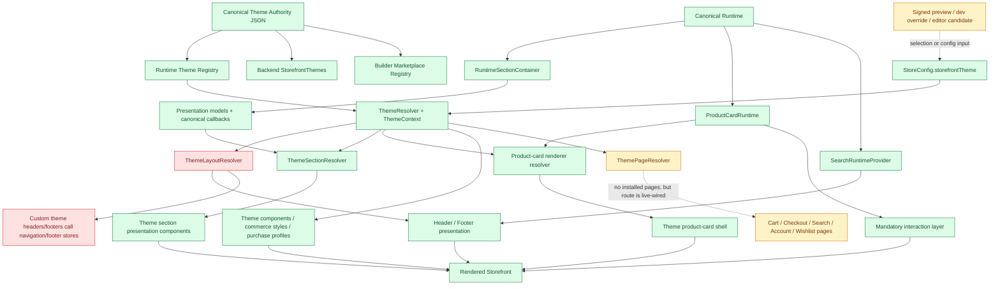

# Theme Runtime Certification

**Repository:** PointOfSale  
**Audit date:** 2026-08-02  
**Scope:** Storefront Theme Runtime, Theme Registry, Theme overrides, Builder-facing theme registration, theme preview/editor injection, and all installed theme modules  
**Mode:** Certification only; no application code was changed  
**Certification:** **FAIL**

---

## 1. Executive Summary

The source contains **11 installed theme directories**. Ten are official, active, backend-enabled, marketplace-visible, and runtime-enabled: `modern`, `minimal`, `fashion`, `pearl`, `phoenix`, `hype`, `alizon`, `sharp`, `cosmetics`, and `seven`. `electronics` is installed but is explicitly experimental, disabled, backend-disabled, marketplace-hidden, and runtime-disabled.

The canonical authority declares only five theme capabilities:

- `layout.header`
- `layout.footer`
- `section.hero-banner`
- `section.product-grid`
- `section.category-grid`

This is strong source evidence that a Theme is a **presentation owner**, not a runtime owner (`theme-authority/shopixy-theme-authority.json:3-9`).

The audit found that the recovered Phase 1 runtime boundaries are respected in the most important commerce paths:

- all 11 themed product-grid implementations consume `ProductGridPresentationModel` and the runtime-injected `renderProductCard` callback;
- all 11 themed category-grid implementations consume `CategoryGridPresentationModel`;
- all themed product-card renderers receive a `ProductCardRuntime`, while `ProductCardInteractionLayer` unconditionally owns wishlist, stock, and quick-add behavior;
- Product Details executable sections cannot be replaced by themes;
- Search behavior remains inside `SearchRuntimeProvider`, `SearchPage`, and `searchStore`;
- Catalog query, route, filters, sorting, pagination, and result state remain inside `ProductListPage` and `useProductListDiscovery`;
- no theme module contains direct API, Axios, query/mutation, catalog, product-loading, cart-store, Mongo, or Elasticsearch execution.

The Theme Runtime nevertheless **fails certification** for three source-proven reasons:

1. Nine active themes—`minimal`, `fashion`, `pearl`, `phoenix`, `hype`, `alizon`, `sharp`, `cosmetics`, and `seven`—replace the header and footer with executable components that call `loadNavigation()` and `loadFooter()` directly. A Theme therefore owns data loading and navigation/footer transformation in live runtime paths.
2. Theme-selected layouts can alter runtime capability availability. The `cosmetics` header truncates desktop navigation to five links, exposes authentication only in the mobile drawer, and removes wishlist access on mobile. The `seven` header exposes authentication only in the mobile drawer. The shared `centered` and `minimal` header variants omit desktop authentication/language controls, while `minimal` also omits desktop navigation; the hamburger that contains those capabilities is `md:hidden`.
3. `ThemePageResolver` is a dormant but live-wired whole-page replacement mechanism for Cart, Checkout, Search, Account, and Wishlist. No installed theme currently supplies a page module, so it does not execute today, but the seam is outside the declared theme capabilities and would permit a theme to replace canonical runtime pages merely by adding a conventionally named file.

Two additional theme-conditioned runtime branches require observation: `hype` forces a product-grid carousel fallback inside `RuntimeSectionContainer`, and the disabled `electronics` id changes category-grid column and data-count limits. The first is presentation behavior coupled into Runtime; the second is dormant theme-dependent data selection.

The result is therefore:

> **FAIL — The canonical Theme Contract is unambiguous, but the current layout and dormant page-override surfaces do not fully conform to it.**

This document certifies the boundary and records violations only. It does not begin recovery or prescribe a redesign.

---

## 2. Canonical Baseline and Audit Method

The following canonical references were read completely before source inspection:

1. `docs/STOREFRONT_RUNTIME_DISCOVERY_AUDIT.md`
2. `docs/STOREFRONT_RUNTIME_RECOVERY_MASTER_PLAN.md`
3. `docs/RECOVERY-0_CATALOG_OWNERSHIP.md`
4. `RUNTIME_OWNERSHIP_CERTIFICATION.md`
5. `RECOVERY-1_RUNTIME_OWNERSHIP_IMPLEMENTATION.md`

Phase 1 Runtime Ownership Recovery is treated as complete and canonical. This certification does not re-audit that phase and does not propose Runtime Ownership changes. Its only question is whether installed Themes conform to Presentation ownership.

Every finding below is based on repository source. “Current” means reachable through the active registry and existing installed files. “Structural” means a compiled resolver or injection seam exists even when no installed theme currently supplies a matching module. “Dormant” means source exists but the authoritative registry prevents normal activation.

### Classification

| Classification | Meaning |
|---|---|
| **SAFE** | Presentation-only and unable to take runtime authority. |
| **WARNING** | Not currently taking runtime authority, but coupled, dormant, inconsistent, or capable of crossing the boundary after a file/config change. |
| **VIOLATION** | A live or reachable theme path loads data, decides behavior/capability availability, replaces a runtime implementation, or otherwise owns a forbidden responsibility. |

---

## 3. Installed Theme Inventory

### 3.1 Authoritative registration

`theme-authority/shopixy-theme-authority.json` is the single registration document consumed by all three registries:

- Storefront Runtime filters `officialStatus === 'official'`, `activationStatus === 'active'`, and `runtimeAvailability` (`PointOfSale.Storefront/src/storefront/themes/ThemeRegistry.ts:13-20`).
- Backend filters official, active, and `backendAvailability` (`PointOfSale.Core/Constants/StorefrontThemes.cs:76-89`).
- Builder marketplace filters official and `marketplaceVisibility === 'visible'` (`PointOfSale.Web/src/modules/storefront/themes/themeMarketplaceRegistry.js:1-11`).

All three therefore expose the same ten active themes. `modern` is the one authoritative default. `electronics` is deliberately excluded from all three active surfaces (`theme-authority/shopixy-theme-authority.json:429-447`).

There is no per-theme `index` or executable registration entry point. Theme code is discovered by convention through `import.meta.glob`:

- layout: `./*/layout/*.tsx`;
- sections: `./*/sections/*.tsx`;
- pages: `./*/pages/*.tsx`.

The active provider is the global `ThemeProvider` in `PointOfSale.Storefront/src/storefront/themes/ThemeContext.tsx`; `App` wraps the rendered Storefront with it (`PointOfSale.Storefront/src/app/App.tsx:38,163`). The provider resolves one active registry definition from `StoreConfig.storefrontTheme`. There is no provider per individual theme.

### 3.2 Registration and configuration inventory

| Theme id | Canonical name | Registration | Runtime / Backend / Marketplace | Default | Provider | Runtime configuration | Local `themeConfig.ts` |
|---|---|---|---|---:|---|---|---|
| `modern` | Modern | authority id `modern`, v1.0.0 | active / enabled / visible | Yes | shared `ThemeProvider` | authority default, preset/legacy/draft-or-live StoreConfig overlay | None |
| `minimal` | Minimal | authority id `minimal`, v1.0.0 | active / enabled / visible | No | shared `ThemeProvider` | same chain | None |
| `fashion` | Fashion | authority id `fashion`, v1.0.0 | active / enabled / visible | No | shared `ThemeProvider` | same chain | None |
| `pearl` | Pearl | authority id `pearl`, v1.0.0 | active / enabled / visible | No | shared `ThemeProvider` | same chain | Present; not imported by production runtime |
| `phoenix` | Phoenix Sports | authority id `phoenix`, v1.0.0 | active / enabled / visible | No | shared `ThemeProvider` | same chain | Present; not imported by production runtime |
| `hype` | Hype Electronics | authority id `hype`, v1.0.0 | active / enabled / visible | No | shared `ThemeProvider` | same chain | Present; not imported by production runtime |
| `alizon` | Alizon | authority id `alizon`, v1.0.0 | active / enabled / visible | No | shared `ThemeProvider` | same chain | Present; not imported by production runtime |
| `sharp` | Sharp Jewelry | authority id `sharp`, v1.0.0 | active / enabled / visible | No | shared `ThemeProvider` | same chain | Present; not imported by production runtime |
| `cosmetics` | Cosmetics | authority id `cosmetics`, v1.0.0 | active / enabled / visible | No | shared `ThemeProvider` | same chain | Present; not imported by production runtime |
| `seven` | Seven Womenwear | authority id `seven`, v1.0.0 | active / enabled / visible | No | shared `ThemeProvider` | same chain | Present; not imported by production runtime |
| `electronics` | Electronics | authority id `electronics`, v1.0.0 | **disabled / disabled / hidden** | No | cannot be selected by active provider | authority document only; excluded from mapped supported set | None |

The production configuration chain starts with the authoritative theme default, then applies a selected theme preset, legacy tenant visual overrides, and draft/live JSON visual overrides (`PointOfSale.API/Services/Storefront/StorefrontDraftConfigMapper.cs:124-145`). The mapped theme fields are colors, font, UI radius/button style, product-card variant, and header variant (`StorefrontDraftConfigMapper.cs:148-190`). The seven local config modules are parallel artifacts, not production registration/configuration owners; repository references are limited to their own exports and selected theme tests.

### 3.3 Component inventory by theme

Common facts for every row:

- **Product Card:** no per-theme card file exists under a theme directory. The central `ProductCardRenderers.tsx` registry contains a renderer keyed by the authority’s `supportedProductCards` value.
- **Product Details:** no theme directory owns a Product Details component. Central built-in templates and purchase profiles carry theme-named presentation variants; `ProductTemplateResolver` owns resolution and `SectionRenderer` blocks theme replacement of executable PDP sections.
- **Homepage:** no theme owns a homepage page. Homepage differentiation is the three section shells listed below, rendered under `RuntimeSectionContainer`.
- **Shared components:** `ThemeComponents.tsx`, `CommerceBrowsingExperience.tsx`, shared link/icon/auth/search components, and canonical section presentation models.
- **Theme registry:** the shared authority/registry/resolver/context chain; no theme can register itself imperatively.

| Theme | Layout / Header / Footer | Homepage and Category | Product Card / Product Details | Custom components, tokens, assets | Theme pages |
|---|---|---|---|---|---|
| `modern` | `layout/header.tsx` and `footer.tsx` delegate to canonical defaults | themed `hero-banner`, `product-grid`, `category-grid` | `modern` card renderer; `modern` template/profile | no local tokens/assets/config | None |
| `minimal` | custom header and footer | same three themed sections | `minimal` renderer/template/profile | no separate token/custom module | None |
| `fashion` | custom header and footer | same three themed sections | `fashion` renderer/template/profile | no separate token/custom module | None |
| `pearl` | custom header and footer | same three themed sections | `pearl` renderer/template/profile | `AnnouncementMarquee`, `pearlTokens`, placeholder image/icon asset dirs | None |
| `phoenix` | custom header and footer | same three themed sections | `phoenix` renderer/template/profile | `AnnouncementMarquee`, `phoenixTokens`, placeholder image/icon asset dirs | None |
| `hype` | custom header and footer | same three themed sections | `hype` renderer/template/profile | `AnnouncementMarquee`, `hypeTokens`, placeholder image/icon asset dirs | None |
| `alizon` | custom header and footer | same three themed sections | `alizon` renderer/template/profile | `AnnouncementMarquee`, `alizonTokens`, placeholder image/icon asset dirs | None |
| `sharp` | custom header and footer | same three themed sections | `sharp` renderer/template/profile | `AnnouncementMarquee`, `sharpTokens`, placeholder image/icon asset dirs | None |
| `cosmetics` | custom header and footer | same three themed sections | `cosmetics` renderer/template/profile | `cosmeticsTokens`; no asset dir | None |
| `seven` | custom header and footer | same three themed sections | `seven` renderer and template id; template explicitly uses `fashion` layout profile | no separate token/custom module | None |
| `electronics` | no theme layout files; resolver would fall back to defaults if invoked | same three themed section files, but theme is inactive | dormant `electronics` renderer/template/profile | no local tokens/assets/config | None |

### 3.4 Theme tokens and visual application

The effective tokens are `StoreConfig.theme.colors`, `.font`, `.ui`, and `.layout`. Bootstrap calls `applyTheme(config.theme)` before committing StoreConfig, and editor-mode candidate application calls it again after replacing the candidate StoreConfig. `applyTheme` and `cssVariables` write CSS custom properties and document/body visual styles. This is **SAFE** presentation ownership.

Theme-specific token modules (`alizonTokens`, `cosmeticsTokens`, `hypeTokens`, `pearlTokens`, `phoenixTokens`, and `sharpTokens`) contain classes/constants used by their corresponding layouts. Announcement marquees contain local presentation/animation behavior only. Placeholder asset directories exist for `alizon`, `hype`, `pearl`, `phoenix`, and `sharp`; other themes use source URLs, inline SVG, or shared assets.

---

## 4. Theme Architecture

### 4.1 Resolution flow

1. Backend maps the public `StoreConfig`, normalizes `storefrontTheme`, seeds its visual config from the authoritative default, and applies permitted configuration overlays.
2. Storefront bootstrap loads StoreConfig, applies theme tokens, and stores the config in the global Zustand store.
3. `ThemeProvider` resolves the active, official, active, runtime-enabled theme definition.
4. `StorefrontLayout` resolves a themed header/footer, but keeps `SearchRuntimeProvider` outside and above both components (`PointOfSale.Storefront/src/storefront/layout/StorefrontLayout.tsx:16-67`).
5. `SectionRenderer` resolves a theme section shell, then always wraps it in `RuntimeSectionContainer` (`PointOfSale.Storefront/src/components/sections/SectionRenderer.tsx:136-157`).
6. `ProductCard` selects a theme renderer, creates a canonical `ProductCardRuntime`, renders the theme shell, then unconditionally renders `ProductCardInteractionLayer` (`PointOfSale.Storefront/src/components/common/ProductCard.tsx:33-48`).
7. Commerce and search pages select theme class/style maps while retaining their own canonical state and callbacks.

### 4.2 Canonical presentation injection

`RuntimeSectionContainer` owns product/category loading and constructs immutable presentation models. For product grids it calls `useHomepageSectionProducts`, constructs `ProductGridPresentationModel`, and injects a canonical `renderProductCard`. For category grids it calls `useCategories` and constructs `CategoryGridPresentationModel` (`RuntimeSectionContainer.tsx:87-186,191-240`). All installed theme section modules consume those injected objects; source search found no direct API/query/store execution in those section files.

This produces the canonical direction of control:

> **Runtime prepares data and behavior → Theme renders presentation.**

A Theme must never invert that direction.

---

## 5. Canonical Theme Contract

### 5.1 Definition

A **Theme** is a registered presentation package selected by a normalized Theme id. It may choose visual tokens, style maps, presentation shells, visual slots, assets, and responsive composition. It receives resolved data, hrefs, labels, state, and callbacks from the canonical Runtime or Builder contract. It does not acquire authority over those inputs merely because it renders them.

Theme identity is a **presentation selector**, not a runtime capability flag, data source, route policy, feature flag, cache key, or business-rule discriminator.

### 5.2 Allowed responsibilities

A Theme **MAY** own:

| Allowed responsibility | Source basis |
|---|---|
| Colors, backgrounds, text/muted palettes | authority default theme config and `applyTheme` CSS-variable application |
| Typography, font family, font size, direction-aware visual typography | authority config, theme token modules, CSS variables |
| Spacing, density, border radius, button appearance | authority UI/layout config and class maps |
| Responsive layout and breakpoints | themed section/layout markup and commerce grid class maps |
| CSS, classes, visual variants, shadows, borders, surfaces | theme components and renderers |
| Icons, images, theme assets, decorative SVG | installed theme layouts/sections/assets |
| Animations and presentation-local state | announcement marquees, mobile drawer visibility, hover/transition behavior |
| Theme branding and presentation copy | hero/announcement presentation and injected section content fallbacks |
| Presentation-only wrappers and visual slots | SectionRenderer component injection and Theme component primitives |
| Hero-banner shell | declared canonical capability and current props-only implementations |
| Product-grid shell, loading/error/empty presentation, grid/carousel markup | declared capability; supplied `ProductGridPresentationModel` and canonical card renderer callback |
| Category-grid shell, visual card shape, columns/breakpoints | declared capability; supplied `CategoryGridPresentationModel` and resolved hrefs |
| Product-card visual shell | central renderer receives `ProductCardRuntime`; mandatory interaction layer remains outside the shell |
| Product Details visual profile/classes/labels | purchase-experience profile table; executable PDP sections remain canonical |
| Header/footer **visual shell** | declared layout capabilities, only when canonical navigation/footer/search/auth/cart/wishlist models and controls are injected and remain available |
| Commerce/search page style maps and merchandising presentation | source selects classes and visual spans from already-resolved products/state |
| Builder-authored visual composition | Builder supplies section order/data; runtime executes the resulting canonical contracts |

An allowed visual override remains allowed only while it satisfies all of these conditions:

1. all business data and state are supplied by Runtime or Builder;
2. all business callbacks are supplied by Runtime;
3. required capabilities cannot be removed by the Theme;
4. the Theme does not fetch, cache, mutate, filter, sort, paginate, route, authorize, or project data;
5. the Runtime can replace the Theme shell with another shell without changing business results.

### 5.3 Forbidden responsibilities

A Theme **MUST NOT** own or execute:

| Forbidden responsibility | Contract consequence |
|---|---|
| Search query execution, autocomplete, search state, result pagination, search routing | owned by Search Runtime/Search page/search store |
| Catalog query, category identity, filters, variant/attribute filters, sorting, pagination, facets | owned by Catalog Runtime |
| Product or category loading, source selection, item limits, random/curated selection | owned by Runtime section containers/catalog |
| Wishlist state or mutations | owned by `ProductCardRuntime`/Wishlist Runtime |
| Quick Add, add-to-cart eligibility, stock state/badge semantics | owned by `ProductCardRuntime` and Product Details Runtime |
| Reviews loading, review business rules, rating authority | owned by Product Details/Review Runtime |
| Product Details data loading, variant selection, purchase action, analytics, related-product loading | owned by Product Details Runtime |
| Authentication state, authorization, sign-in/out decisions, account capability availability | owned by Authentication Runtime |
| Cart or Checkout execution | owned by Cart/Checkout Runtime |
| Routing decisions, route guards, redirects, or whole-page runtime replacement | owned by Router and page runtimes |
| API, Axios, HTTP, React Query, Mongo, Elasticsearch, projection, repository or service execution | owned by Runtime/backend authority |
| Product visibility, stock/business visibility, tenant isolation, price authority | owned by canonical backend/runtime owners |
| Runtime caches or cache invalidation | owned by Runtime |
| Feature-flag evaluation or capability suppression | owned by Runtime/config authority |
| StoreConfig mutation or replacement | owned by bootstrap/editor/preview runtime paths, never by an installed theme module |
| Builder execution, draft persistence, document application, section identity | owned by Builder/editor bridge |
| Runtime provider/container replacement (`SearchRuntimeProvider`, `RuntimeSectionContainer`, `ProductCardRuntime`) | canonical runtime must remain above/in control of presentation |
| Product template resolution or executable section resolution | owned by `ProductTemplateResolver` and `SectionRenderer` |
| Registry mutation, module/service replacement, plugins that inject runtime behavior | not a Theme capability |
| Any data authority | a Theme is never a source of truth |

### 5.4 Allowed override contract

The only certified override forms are:

- a registered visual configuration from the canonical authority;
- CSS variables, classes, design-token maps, assets, and responsive markup;
- a section presentation component that consumes the canonical presentation model/callbacks;
- a product-card shell wrapped by the mandatory canonical interaction layer;
- a Product Details presentation profile applied by canonical sections;
- a header/footer presentation shell that consumes canonical injected navigation/footer/control slots and cannot remove mandatory capabilities.

Whole-page overrides, provider replacement, container replacement, direct store loaders, data-count decisions, and feature/control suppression are not allowed Theme overrides.

---

## 6. Theme Execution Audit

### 6.1 Capability-level result for all themes

| Runtime area | Does an installed Theme execute or replace it now? | Evidence / classification |
|---|---|---|
| Search | No behavior replacement | Theme headers place `SearchRuntimeTrigger`; `SearchRuntimeProvider` owns modal/open behavior and `SearchPage`/`searchStore` own query execution. **SAFE** except dormant whole-page seam. |
| Catalog | No | `ProductListPage` owns `useProductListDiscovery`, filters, sort, pagination, and canonical cards. Theme id selects style maps/classes only. **SAFE**. |
| Filters | No | callbacks/state remain in `ProductListPage`; Theme affects classes/layout only. **SAFE**. |
| Pagination | No | catalog/search pages own page state and callbacks. **SAFE**. |
| Sorting | No | `ProductListPage` supplies `sort` and `setSort`. **SAFE**. |
| Wishlist | No mutation replacement | `ProductCardRuntime` owns behavior. `cosmetics` removes the control from mobile layout, which is capability suppression. **VIOLATION** for availability. |
| Quick Add | No | mandatory `ProductCardInteractionLayer`. **SAFE**. |
| Stock badge | No semantics/authority replacement | runtime supplies availability and label; Theme supplies classes. **SAFE**. |
| Reviews | No | no theme review loader/logic and PDP executable section replacement is blocked. **SAFE**. |
| Product Details | No executable replacement | resolver and canonical sections own execution. Theme profiles/templates are presentation/composition inputs. **SAFE**, with `seven` profile drift observation. |
| Category page | No | no theme Category page exists; category-grid sections receive resolved models. **SAFE**. Disabled `electronics` has a dormant theme-dependent count branch. |
| Routing | No current theme module | no theme pages exist. `ThemePageResolver` can structurally replace five runtime pages. **WARNING**. |
| Navigation | **Yes** in nine active themes | custom headers load/transform navigation and decide visible links/controls. **VIOLATION**. |
| Authentication | No auth business logic, but Theme can suppress its UI capability | `cosmetics` and `seven` omit desktop auth; centered/minimal shared variants omit desktop auth. **VIOLATION**. |
| Cart | No cart mutation replacement | shared `CartIconButton`/canonical store. **SAFE**; dormant Cart page seam is a warning. |
| Checkout | No current replacement | canonical page today; dormant Checkout page seam is a warning. |
| Projection | No | no theme projection or backend query code. **SAFE**. |
| API calls | No in themed sections/cards; **yes indirectly in custom layout loaders** | theme headers/footers invoke stores whose load actions perform runtime loading. **VIOLATION** for ownership, even though HTTP is encapsulated in the stores. |
| Data loading | **Yes** for navigation/footer in nine themes; otherwise no | violation is limited to the layout boundary. |
| Caching | No theme-owned runtime cache | resolver `Map` caches are shared Runtime infrastructure. **SAFE/observation**. |
| Feature flags | No evaluation found | theme id and header variant nonetheless act as capability selectors in specific layout paths. **VIOLATION** where controls disappear. |
| StoreConfig | Theme modules read store name/config; do not mutate it | bootstrap/editor/Builder provider own mutation. **SAFE**, with broad editor injection recorded as hidden authority. |
| Builder | No Theme executes Builder | Builder selects theme and authors composition/config. **SAFE**. |

### 6.2 Per-theme execution summary

| Theme | Theme-side executable behavior | Theme-conditioned Runtime behavior | Current result |
|---|---|---|---|
| `modern` | header/footer modules delegate to canonical default implementations; sections/cards are presentation-only | shared `headerVariant` can select centered/minimal implementations that remove desktop capabilities | **WARNING / shared VIOLATION surface** |
| `minimal` | header loads/transforms navigation; footer loads footer data | none specific | **VIOLATION** |
| `fashion` | header loads/transforms navigation; footer loads footer data | none specific | **VIOLATION** |
| `pearl` | header loads/transforms navigation; footer loads footer data | none specific | **VIOLATION** |
| `phoenix` | header loads/transforms navigation; footer loads footer data | none specific | **VIOLATION** |
| `hype` | header loads/transforms navigation; footer loads footer data | product-grid fallback is forced to carousel when `themeId === 'hype'` (`RuntimeSectionContainer.tsx:112`) | **VIOLATION**, plus **WARNING** coupling |
| `alizon` | header loads/transforms navigation; footer loads footer data | none specific | **VIOLATION** |
| `sharp` | header loads/transforms navigation; footer loads footer data | none specific | **VIOLATION** |
| `cosmetics` | header/footer load data; header truncates desktop nav to five, hides desktop auth, and hides mobile wishlist | none specific | **VIOLATION** |
| `seven` | header/footer load data; header hides desktop auth | built-in `seven` template uses explicit `fashion` layout variants | **VIOLATION**, plus **WARNING** presentation drift |
| `electronics` | no active layout; installed section shells are presentation-only | disabled id changes category columns/max/fallback item count (`RuntimeSectionContainer.tsx:200-202`) | **WARNING — dormant forbidden data branch** |

---

## 7. Override Detection and Classification

### 7.1 Registry, resolver, provider, and configuration overrides

| Override | Active scope | Classification | Source conclusion |
|---|---|---|---|
| Canonical theme authority | Runtime, Backend, Builder | **SAFE** | one declarative source; one default; capability list is presentation-only |
| Runtime `ThemeRegistry` | ten active themes | **SAFE** | filters official + active + runtime-enabled; registry is immutable after module load |
| Backend `StorefrontThemes` | ten supported themes | **SAFE** | filters official + active + backend-enabled; unsupported ids normalize to default |
| Builder marketplace registry | ten visible themes | **SAFE** | presentation selection/catalog only |
| `ThemeResolver` StoreConfig selection | active Storefront | **SAFE** | resolves only a theme already admitted to active runtime registry |
| development localStorage key `storefront_theme` | development only, and only when `VITE_ENABLE_STOREFRONT_THEME_DEV_OVERRIDE=true` | **SAFE WITH OBSERVATION** | cannot resolve disabled/unregistered ids; not a production override (`ThemeResolver.ts:3-32`) |
| signed theme preview | ten backend-supported themes | **SAFE WITH OBSERVATION** | token creation/validation calls `StorefrontThemes.IsSupported`; middleware permits read-only preview routes; mapped config overrides only selected id |
| Builder `BuilderThemeProvider` | legacy Builder preview surface | **SAFE WITH OBSERVATION** | normalizes and injects candidate StoreConfig into the Builder-side global store; does not grant an installed theme code execution |
| editor-mode candidate StoreConfig | explicit `editorMode=1` plus absolute allowed host origin | **WARNING** | the bridge can replace the full runtime StoreConfig and reapply tokens (`editorMode.ts:64-74`); this is Builder/editor authority, not Theme authority, but it is a hidden selection/config owner |
| Seven local `themeConfig.ts` modules | source/test artifacts | **SAFE WITH OBSERVATION** | not imported by production runtime; effective configuration comes from authority/backend mapping |
| inactive duplicate `components/theme/ThemeProvider.tsx` | no callers found | **WARNING** | a second provider/context implementation exists but is dormant; active `App` imports the Storefront ThemeContext provider |

### 7.2 Layout overrides

The following table documents every installed theme layout override.

| Theme | Header override | Footer override | Classification |
|---|---|---|---|
| `modern` | delegates to default `Header` | delegates to default `Footer` | **SAFE**, subject to shared `headerVariant` violation below |
| `minimal` | custom; calls `loadNavigation`, maps URLs/labels, places runtime controls | custom; calls `loadFooter`, selects/organizes sections/socials | **VIOLATION** |
| `fashion` | same executable ownership pattern | same executable ownership pattern | **VIOLATION** |
| `pearl` | same executable ownership pattern plus visual marquee/tokens | same executable ownership pattern | **VIOLATION** |
| `phoenix` | same executable ownership pattern plus visual marquee/tokens | same executable ownership pattern | **VIOLATION** |
| `hype` | same executable ownership pattern plus visual marquee/tokens | same executable ownership pattern | **VIOLATION** |
| `alizon` | same executable ownership pattern plus visual marquee/tokens | same executable ownership pattern | **VIOLATION** |
| `sharp` | same executable ownership pattern plus visual marquee/tokens | same executable ownership pattern | **VIOLATION** |
| `cosmetics` | calls loader; maps active routes; slices desktop nav to five; auth is mobile-only; wishlist is desktop-only | calls loader; uses only first three footer sections in the main grids | **VIOLATION** |
| `seven` | calls loader; maps navigation; auth is mobile-only | calls loader; transforms/organizes footer sections | **VIOLATION** |
| `electronics` | no installed override; resolver fallback only | no installed override; resolver fallback only | **SAFE / inactive** |

The repeated direct loader evidence is at each custom layout file, including:

- `minimal/layout/header.tsx:17-23` and `footer.tsx:11-18`;
- `fashion/layout/header.tsx:17-23` and `footer.tsx:11-18`;
- `pearl/layout/header.tsx:46-53` and `footer.tsx:29-36`;
- `phoenix/layout/header.tsx:48-55` and `footer.tsx:29-36`;
- `hype/layout/header.tsx:48-55` and `footer.tsx:29-36`;
- `alizon/layout/header.tsx:47-54` and `footer.tsx:29-36`;
- `sharp/layout/header.tsx:46-53` and `footer.tsx:29-36`;
- `cosmetics/layout/header.tsx:19-35` and `footer.tsx:12-20`;
- `seven/layout/header.tsx:15-30` and `footer.tsx:11-18`.

All paths above are under `PointOfSale.Storefront/src/storefront/themes/`.

Capability suppression is separately source-proven:

- `cosmetics` desktop navigation uses `links.slice(0, 5)` (`cosmetics/layout/header.tsx:94-108`), desktop actions omit `AuthNavItems`, wishlist is wrapped in `hidden md:block`, and mobile navigation contains auth but no wishlist (`:115-157`).
- `seven` desktop actions have search, language, wishlist, and cart but no auth; auth occurs only inside the `md:hidden` mobile menu (`seven/layout/header.tsx:45-101`).
- the canonical shared `Header` maps StoreConfig `headerVariant` to standard/centered/minimal (`components/layout/Header.tsx:522-536`). `centered` has desktop navigation but no desktop auth/language (`:369-459`); `minimal` has neither desktop navigation nor desktop auth/language (`:468-513`). Its hamburger is `md:hidden` (`:208-218`), so the mobile drawer does not preserve those capabilities at desktop breakpoints.

Theme-owned mobile-open state, scroll-based transparency, animation, and responsive CSS are **SAFE** by themselves. The violation is loading/transforming runtime data and deciding whether canonical capabilities exist.

### 7.3 Section overrides

Every installed theme directory contains exactly these three section overrides:

| Theme | `hero-banner.tsx` | `product-grid.tsx` | `category-grid.tsx` | Classification |
|---|---|---|---|---|
| `modern` | presentation props/CTA | injected model/card callback | injected category model | **SAFE** |
| `minimal` | presentation props/CTA | injected model/card callback | injected category model | **SAFE** |
| `fashion` | presentation props/CTA | injected model/card callback | injected category model | **SAFE** |
| `pearl` | presentation props/CTA | injected model/card callback | injected category model | **SAFE** |
| `phoenix` | presentation props/CTA | injected model/card callback | injected category model | **SAFE** |
| `hype` | presentation props/CTA | injected model/card callback | injected category model | **SAFE** section code; **WARNING** runtime carousel coupling |
| `alizon` | presentation props/CTA | injected model/card callback | injected category model | **SAFE** |
| `sharp` | presentation props/CTA | injected model/card callback | injected category model | **SAFE** |
| `cosmetics` | presentation props/CTA | injected model/card callback | injected category model | **SAFE** |
| `seven` | presentation props/CTA | injected model/card callback | injected category model | **SAFE** |
| `electronics` | presentation props/CTA | injected model/card callback | injected category model | **SAFE** section code; inactive, with **WARNING** runtime data-count coupling |

The theme section modules do not call APIs or runtime stores. Hero CTA links and images come from props/fallback presentation content. Product and category links are already resolved by Runtime. Loading/error/empty branches only choose markup for state supplied in the presentation model.

The active `SectionRenderer` protects Product Details runtime sections by refusing theme resolution for `product-hero`, `product-gallery`, `product-specs`, `product-video`, and `related-products` (`PointOfSale.Storefront/src/components/sections/SectionRenderer.tsx:24-30,56-66`). All other section components, themed or default, are still wrapped by `RuntimeSectionContainer` (`:150-156`). This override boundary is **SAFE**.

### 7.4 Product-card and commerce component overrides

| Override | Themes | Classification | Boundary |
|---|---|---|---|
| Product-card renderer registry | all 11 ids | **SAFE** | authority selects visual renderer; `ProductCardRuntime` owns data/actions |
| Product-card layout variant (`default`, `compact`, `detailed`) | StoreConfig visual layout | **SAFE** | presentation attribute/layout only; renderer selection remains authority-based |
| Product-card interaction classes | theme-keyed class maps | **SAFE** | only placement/style changes; mandatory owner remains `ProductCardRuntime` |
| Theme component primitives | all component themes | **SAFE** | surface/title/meta/price/button classes and injected callbacks |
| Commerce browsing style maps | all component themes | **SAFE WITH OBSERVATION** | class maps and grid spans can change visual prominence but not result membership/order/state |
| Search page style maps | all component themes | **SAFE** | `searchStore` and URL state retain behavior |
| Filter component theme classes | all component themes | **SAFE** | callbacks/state are injected from Catalog Runtime |

`ProductCardRuntime` imports the cart store and owns quick-add eligibility/action, toast, price/image/availability translation, wishlist control behavior, and stock label. Its source explicitly states that Theme renderers own appearance while Runtime alone owns wishlist, stock, and quick-add presence/behavior (`PointOfSale.Storefront/src/components/products/ProductCardRuntime.tsx:284-306`). The theme renderer cannot omit that layer because `ProductCard` renders it after the selected shell.

### 7.5 Product Details and template overrides

| Override | Classification | Source conclusion |
|---|---|---|
| built-in theme-named product templates | **SAFE** | composition/presentation input selected by product/config, not executable replacement by active Theme |
| saved Product Templates | **SAFE** Builder input | `ProductTemplateResolver` resolves saved → built-in → default and ensures canonical `product-hero` exists |
| purchase-experience profile by active Theme | **SAFE** | labels/classes only; no callbacks, stores, APIs, or business rules |
| explicit `layoutVariant` in a template | **SAFE WITH OBSERVATION** | explicit presentation variant takes precedence over active Theme profile |
| `seven` template uses `fashion` layout variants | **WARNING** | authority advertises `seven`, but all built-in Seven template sections explicitly request `fashion` (`ProductTemplateRegistry.ts:403-427`) |
| theme executable PDP section replacement | **SAFE — blocked** | `SectionRenderer` uses defaults only for executable PDP section set |

`ProductDetailsPage` fetches product and categories, resolves the product-selected template, and passes its sections to `SectionRenderer` (`PointOfSale.Storefront/src/pages/ProductDetailsPage.tsx:5-10,34-60,104`). Active Theme id does not choose or execute `ProductTemplateResolver`.

### 7.6 Page, route, plugin, and module overrides

| Override | Installed implementation | Classification |
|---|---|---|
| Theme page override | no `themes/*/pages/*.tsx` files exist | **WARNING — dormant structural violation** |
| Routes wired to page resolver | Cart, Checkout, Search, Account, Wishlist | **WARNING — high impact** |
| Product Details page override | not wired through `ThemePageRoute` | **SAFE** |
| Catalog/Category page override | not wired through `ThemePageRoute` | **SAFE** |
| Runtime provider replacement | no mechanism found | **SAFE** |
| Runtime container replacement | no direct mechanism found | **SAFE**, aside from theme-id branches documented above |
| Registry replacement/mutation | no mechanism found | **SAFE** |
| Theme plugin system/service locator | none found in Storefront theme path | **SAFE** |
| Context replacement | no installed theme replacement; one inactive duplicate ThemeProvider exists outside theme directories | **WARNING** for duplicate artifact only |

`ThemePageResolver` dynamically discovers `./*/pages/*.tsx`, selects `./${themeId}/pages/${pageName}.tsx`, and caches the result (`PointOfSale.Storefront/src/storefront/themes/ThemePageResolver.ts:7-38`). `ThemePageRoute` is wired by the router to Cart, Checkout, Search, Account, and Wishlist (`PointOfSale.Storefront/src/app/router.tsx:116-121,148-151,244-250`). That structural capability is not declared by the canonical authority and is forbidden by this contract even though no installed theme currently exercises it.

---

## 8. Theme Boundary Analysis

Legend:

- **No** — no current installed theme path can replace that owner.
- **Partial (V)** — Theme currently replaces part of runtime behavior; violation.
- **Indirect (W)** — Theme id/config changes a runtime branch without replacing the component; warning.
- **Dormant (W)** — compiled mechanism or code exists but normal authoritative activation/current files prevent execution.

| Theme | Replace runtime? | Product Card behavior | Product Details behavior | Search | Navigation | Catalog | Category | Builder | `RuntimeSectionContainer` | `SearchRuntimeProvider` | `ProductCardRuntime` | `ProductTemplateResolver` | Bypass canonical runtime now? |
|---|---|---|---|---|---|---|---|---|---|---|---|---|---|
| `modern` | No theme executable; shared config seam | No | No | No | canonical default; indirect header-variant capability seam | No | No | No | No | No | No | No | No direct bypass |
| `minimal` | **Partial (V)** layout | No | No | No | **Yes (V)** | No | No | No | No | No | No | No | **Yes**, navigation/footer boundary |
| `fashion` | **Partial (V)** layout | No | No | No | **Yes (V)** | No | No | No | No | No | No | No | **Yes**, navigation/footer boundary |
| `pearl` | **Partial (V)** layout | No | No | No | **Yes (V)** | No | No | No | No | No | No | No | **Yes**, navigation/footer boundary |
| `phoenix` | **Partial (V)** layout | No | No | No | **Yes (V)** | No | No | No | No | No | No | No | **Yes**, navigation/footer boundary |
| `hype` | **Partial (V)** layout | No | No | No | **Yes (V)** | No | No | No | **Indirect (W)** carousel fallback | No | No | No | **Yes**, navigation/footer boundary |
| `alizon` | **Partial (V)** layout | No | No | No | **Yes (V)** | No | No | No | No | No | No | No | **Yes**, navigation/footer boundary |
| `sharp` | **Partial (V)** layout | No | No | No | **Yes (V)** | No | No | No | No | No | No | No | **Yes**, navigation/footer boundary |
| `cosmetics` | **Partial (V)** layout/capabilities | No | No | No | **Yes (V)** | No | No | No | No | No | No | No | **Yes**, nav/footer loading and capability suppression |
| `seven` | **Partial (V)** layout/capabilities | No | No | No | **Yes (V)** | No | No | No | No | No | No | No | **Yes**, nav/footer loading and auth suppression |
| `electronics` | inactive | No | No | No | inactive/default fallback | No | **Dormant (W)** data count | No | **Indirect (W)** if id were passed manually | No | No | No | No active bypass |

For every installed theme, the dormant `ThemePageResolver` would become a bypass if a conventionally named Cart/Checkout/Search/Account/Wishlist page file were added. The table answers the **current installed state**; the mechanism itself remains forbidden.

---

## 9. Theme Dependency Graph

The respected boundary is Runtime → presentation model/callback → Theme shell. The active violation is Theme layout → runtime stores. The dormant structural warning is Theme page module → whole canonical page.

---

## 10. Theme Ownership Matrix

`✓` identifies the one canonical owner. `input` means the column may supply declarative input without ownership. `⚠ executes today` identifies a conflict while leaving the canonical owner singular.

| Responsibility | Theme | Runtime | Builder | Owner |
|---|---|---|---|---|
| Theme manifest metadata and visual capability declaration | ✓ | input | input | Theme Authority |
| Active Theme validation and resolution | input | ✓ | — | Theme Registry/Resolver |
| Theme selection persistence in public StoreConfig | input | ✓ | input | StoreConfig Runtime |
| Colors, typography, spacing, radius, branding | ✓ | applies | authors input | Theme |
| CSS variables/classes/icons/assets/animations | ✓ | applies | previews | Theme |
| Responsive presentation breakpoints | ✓ | — | previews | Theme |
| Header/footer visual shell | ✓ | injects capabilities | previews | Theme |
| Navigation data loading and canonical link model | **⚠ executes today** | ✓ | authors content | Navigation Runtime |
| Navigation routing and active-route semantics | **⚠ computes today** | ✓ | — | Router/Navigation Runtime |
| Footer data loading and canonical footer model | **⚠ executes today** | ✓ | authors content | Footer Runtime |
| Search trigger visual placement | ✓ | supplies trigger | previews | Theme |
| Search open/modal/query/autocomplete state | — | ✓ | — | Search Runtime |
| Search result execution and pagination | — | ✓ | — | Search Runtime |
| Authentication state/actions/capability availability | **⚠ suppresses in layouts** | ✓ | — | Authentication Runtime |
| Wishlist state/actions/capability availability | **⚠ suppresses on cosmetics mobile** | ✓ | — | Wishlist Runtime |
| Cart state/actions | — | ✓ | — | Cart Runtime |
| Checkout execution | — | ✓ | — | Checkout Runtime |
| Catalog route/query | — | ✓ | — | Catalog Runtime |
| Catalog filters/facets/sort/pagination | — | ✓ | — | Catalog Runtime |
| Category identity and Category page data | — | ✓ | — | Category/Catalog Runtime |
| Homepage section order/composition authoring | input | executes | ✓ | Builder |
| Homepage product/category loading and source selection | — | ✓ | supplies declarative settings | Runtime Section Container |
| Hero/product/category section presentation shell | ✓ | injects model | authors props | Theme |
| Product Card visual shell | ✓ | injects runtime | previews | Theme |
| Product Card price/image/availability model | — | ✓ | — | ProductCard Runtime |
| Wishlist/stock/quick-add Product Card controls | classes only | ✓ | — | ProductCard Runtime |
| Product Details product/category loading | — | ✓ | — | Product Details Runtime |
| Product Details variant/cart/analytics/reviews/related behavior | — | ✓ | — | Product Details Runtime |
| Product Details presentation profile | ✓ | applies | authors layout input | Theme |
| Saved Product Template composition | input | resolves/executes | ✓ | Builder |
| Product Template resolution/fallback/canonical hero | — | ✓ | input | ProductTemplateResolver |
| RuntimeSectionContainer dispatch | — | ✓ | — | Runtime |
| SearchRuntimeProvider | — | ✓ | — | Runtime |
| StoreConfig loading/mutation | — | ✓ | sends editor candidate | Bootstrap/Editor Runtime |
| Theme preview authorization | input | ✓ | requests token | Preview Authority Runtime |
| Runtime caches/invalidation | — | ✓ | — | Runtime |
| Feature flags/business rules | — | ✓ | authors permitted config | Runtime |
| API/data/projection/Mongo/Elasticsearch authority | — | ✓ | — | Canonical Runtime/Backend |
| Builder canvas, selection, drag/drop, draft persistence | — | input | ✓ | Builder |
| Route table/guards/redirects | — | ✓ | — | Router Runtime |

Conflicts are limited but certification-blocking: navigation/footer loading and transformation run in Theme layout modules, and some Theme-selected layouts decide whether authentication, wishlist, language, or navigation capability is reachable. No ownership conflict was found in Catalog, Search execution, Product Card behavior, Product Details execution, projection, or API/data authority.

---

## 11. Hidden Theme and Runtime Owners

| Hidden owner / influence path | What it can influence | Classification |
|---|---|---|
| `shopixy-theme-authority.json` | ids, status, availability, capabilities, visual defaults, card/template/profile aliases | **SAFE canonical authority** |
| Backend embedded authority loader | supported theme ids and public ThemeConfig seed | **SAFE canonical authority** |
| global StoreConfig Zustand store | active Theme id, effective tokens/layout, product templates, behavior config | **SAFE Runtime owner** |
| development localStorage override | active Theme selection in explicitly enabled DEV builds | **SAFE WITH OBSERVATION** |
| signed preview token + middleware | read-only tenant-scoped Theme selection/config | **SAFE WITH OBSERVATION** |
| editor-mode bridge | full candidate StoreConfig replacement after origin-gated activation | **WARNING broad config authority; Builder-owned** |
| `ThemeContext` | global active Theme id/definition | **SAFE Runtime selector** |
| `ThemeLayoutResolver` + module cache | replacement header/footer implementation | **VIOLATION surface** because current modules execute data loading |
| `ThemeSectionResolver` + module cache | non-PDP section presentation implementation | **SAFE** for installed modules |
| `ThemePageResolver` + module cache | whole Cart/Checkout/Search/Account/Wishlist component | **WARNING dormant structural violation** |
| product-card renderer resolver | visual card shell | **SAFE** |
| theme component/commerce style registries | visual primitives and browsing class maps | **SAFE** |
| purchase-experience theme alias map | Product Details labels/classes when no explicit layout variant wins | **SAFE** |
| built-in Product Template registry | theme-named presentation compositions | **SAFE WITH OBSERVATION** (`seven` drift) |
| shared `Header` variant registry | ThemeConfig can select control/navigation composition | **VIOLATION** where capability becomes unavailable |
| `RuntimeSectionContainer` Theme-id branches | Hype layout fallback; disabled Electronics category cardinality | **WARNING**, with dormant forbidden data influence for Electronics |
| nine custom theme headers | navigation load, URL/label mapping, active-state and capability placement | **VIOLATION** |
| nine custom theme footers | footer load, grouping and section selection | **VIOLATION** |
| inactive `components/theme/ThemeProvider.tsx` | alternate context/config/token application if reintroduced | **WARNING dormant duplicate** |

No theme plugin manager, imperative registry mutation, service locator, theme-owned global store, theme-owned API client, theme-owned cache, theme-owned Builder executor, or context/provider replacement by an installed theme was found.

---

## 12. Violations

### V-1 — Theme layouts execute Navigation data loading

**Affected active themes:** `minimal`, `fashion`, `pearl`, `phoenix`, `hype`, `alizon`, `sharp`, `cosmetics`, `seven`  
**Classification:** **VIOLATION**  
**Boundary crossed:** Theme → Navigation Runtime

Each custom header imports `useNavigationStore`, obtains `loadNavigation`, invokes it in `useEffect`, reads the runtime navigation document, resolves URLs, localizes labels, and chooses visible structure. This is executable data/runtime ownership, not a presentation-only model.

### V-2 — Theme layouts execute Footer data loading

**Affected active themes:** the same nine themes  
**Classification:** **VIOLATION**  
**Boundary crossed:** Theme → Footer Runtime

Each custom footer imports `useFooterStore`, calls `loadFooter`, reads sections/social links, and decides grouping or section inclusion. The visual grouping is allowed; direct loading and data selection are not.

### V-3 — Theme/layout selection changes runtime capability availability

**Affected:** `cosmetics`, `seven`, and the shared StoreConfig `centered`/`minimal` Header variants reachable by the default header path  
**Classification:** **VIOLATION**  
**Boundary crossed:** Theme presentation → Navigation/Authentication/Wishlist capability policy

`cosmetics` truncates desktop links and removes desktop auth/mobile wishlist. `seven` removes desktop auth. The shared centered/minimal variants omit desktop auth/language, and minimal omits desktop navigation; their drawer trigger is unavailable at desktop width.

### V-4 — Whole-page theme replacement is wired outside declared capabilities

**Affected themes now:** none execute it because every installed theme has zero page files  
**Affected structural surface:** every active theme id  
**Classification:** **WARNING (dormant structural violation; high impact)**

The resolver will load any matching theme page module without checking declared capabilities. Router wiring makes Cart, Checkout, Search, Account, and Wishlist replaceable. This is forbidden by the canonical contract even though the current installed set does not exercise it.

### V-5 — Theme identity influences RuntimeSectionContainer branches

**Affected:** `hype`, disabled `electronics`  
**Classification:** **WARNING**

The Hype branch changes only a visual grid/carousel fallback, so no data or business behavior changes. The Electronics branch changes columns, maximum count, and fallback count, which is forbidden data-selection influence, but authoritative registration makes that theme inactive and unreachable through normal resolution.

---

## 13. Risk Assessment

| Risk | Likelihood | Impact | Rating | Basis |
|---|---|---|---|---|
| Theme header/footer code diverges in loading, link resolution, error/loading policy, or runtime control composition | High; nine active implementations | High | **High** | active executable duplication across themes |
| Authentication/wishlist/navigation capability becomes unavailable at particular breakpoints/theme selections | Current and source-proven | High | **High** | `cosmetics`, `seven`, centered/minimal shared header paths |
| A future theme adds a conventionally named page and silently replaces Cart/Checkout/Search/Account/Wishlist runtime | Medium | Critical | **High** | resolver and routes already compiled/wired; no capability gate |
| Theme id changes runtime data cardinality | Low currently; Electronics disabled | High if activated/passed manually | **Medium** | `RuntimeSectionContainer` Electronics branch |
| Theme-specific visual behavior becomes hard-coded in canonical runtime | Current but presentation-only | Medium | **Medium** | Hype carousel branch |
| Duplicate/local configuration artifacts drift from canonical authority | Medium | Medium | **Medium** | seven local configs are not production owners; duplicate provider exists |
| Product Details visual identity differs from registered Seven identity | Current when built-in Seven template is selected | Low | **Low** | explicit `fashion` layout variants |
| Theme sections/cards acquire catalog/search/API authority | Low in current source | High | **Low current risk** | presentation models and mandatory runtime wrappers are strong boundaries |

There is no evidence that a current installed theme can alter tenant isolation, pricing authority, catalog visibility, search indexing, Mongo/Elasticsearch projection, checkout rules, runtime cache invalidation, or Product Details purchase execution.

---

## 14. Certification

### 14.1 Certified Theme Contract

The canonical Theme Contract is:

> A Theme owns visual identity and presentation only. Runtime and Builder may inject declarative data, state, callbacks, and composition into Theme shells. The Theme may render and style those inputs but may not load them, select their business meaning, mutate them, suppress required runtime capabilities, replace canonical pages/providers/containers, or become a data authority.

This contract applies uniformly to every installed and future Theme. Theme registration does not grant runtime privileges beyond the five authoritative presentation capabilities.

### 14.2 Current implementation verdict

# FAIL

The Storefront cannot receive PASS or PASS WITH OBSERVATIONS because nine active Theme layout packages execute Navigation and Footer data loading, and multiple Theme/layout paths determine capability availability. These are active violations of Presentation ownership, not documentation gaps.

The failure is bounded:

- Catalog ownership remains canonical.
- Search behavior ownership remains canonical.
- Product Card behavior ownership remains canonical.
- Product Details execution ownership remains canonical.
- Theme sections remain presentation-only.
- No theme-owned projection, API authority, cache, Builder execution, or StoreConfig mutation was found.

The Theme Contract itself is now certified as the canonical boundary for Phase 2 Recovery. This certification stops here and does not begin recovery.

---

## 15. Principal Source Evidence Index

| Subject | Source |
|---|---|
| Canonical theme identities/capabilities/defaults | `theme-authority/shopixy-theme-authority.json` |
| Runtime registry | `PointOfSale.Storefront/src/storefront/themes/ThemeRegistry.ts` |
| Active theme resolution/dev override | `PointOfSale.Storefront/src/storefront/themes/ThemeResolver.ts` |
| Active provider | `PointOfSale.Storefront/src/storefront/themes/ThemeContext.tsx`; `PointOfSale.Storefront/src/app/App.tsx` |
| Layout dynamic import/replacement | `PointOfSale.Storefront/src/storefront/themes/ThemeLayoutResolver.ts`; `PointOfSale.Storefront/src/storefront/layout/StorefrontLayout.tsx` |
| Section dynamic import/wrapping | `PointOfSale.Storefront/src/storefront/themes/ThemeSectionResolver.ts`; `PointOfSale.Storefront/src/components/sections/SectionRenderer.tsx` |
| Page dynamic import/replacement | `PointOfSale.Storefront/src/storefront/themes/ThemePageResolver.ts`; `PointOfSale.Storefront/src/storefront/pages/ThemePageRoute.tsx`; `PointOfSale.Storefront/src/app/router.tsx` |
| Section runtime/data ownership | `PointOfSale.Storefront/src/storefront/runtime/containers/RuntimeSectionContainer.tsx`; `PointOfSale.Storefront/src/storefront/presentation/models.ts` |
| Product Card ownership | `PointOfSale.Storefront/src/components/common/ProductCard.tsx`; `PointOfSale.Storefront/src/components/products/ProductCardRuntime.tsx`; `ProductCardRenderers.tsx`; `productCardRendererResolver.ts` |
| Product Details templates/profiles | `PointOfSale.Storefront/src/storefront/products/ProductTemplateResolver.ts`; `ProductTemplateRegistry.ts`; `purchaseExperience.ts`; `PointOfSale.Storefront/src/pages/ProductDetailsPage.tsx` |
| Search ownership | `PointOfSale.Storefront/src/components/search/SearchRuntime.tsx`; `SearchModal.tsx`; `PointOfSale.Storefront/src/pages/SearchPage.tsx`; `stores/searchStore.ts` |
| Catalog ownership | `PointOfSale.Storefront/src/pages/ProductListPage.tsx`; `hooks/useProductListDiscovery.ts` |
| Header variants and controls | `PointOfSale.Storefront/src/components/layout/Header.tsx` |
| Custom layout violations | `PointOfSale.Storefront/src/storefront/themes/{minimal,fashion,pearl,phoenix,hype,alizon,sharp,cosmetics,seven}/layout/{header,footer}.tsx` |
| Backend registry/config mapping | `PointOfSale.Core/Constants/StorefrontThemes.cs`; `PointOfSale.API/Services/Storefront/StorefrontDraftConfigMapper.cs` |
| Preview authority | `PointOfSale.API/Services/Storefront/StorefrontThemePreviewTokenService.cs`; `StorefrontThemePreviewService.cs`; `PointOfSale.API/Middleware/ThemePreviewAuthorityMiddleware.cs` |
| Builder registration/injection | `PointOfSale.Web/src/modules/storefront/themes/themeMarketplaceRegistry.js`; `PointOfSale.Web/src/modules/storefront/components/builder/BuilderThemeProvider.jsx`; `ThemeNativeCanvas.jsx` |
| Bootstrap/editor hidden owners | `PointOfSale.Storefront/src/bootstrap/bootstrap.ts`; `PointOfSale.Storefront/src/editor-mode/editorMode.ts`; `PointOfSale.Storefront/src/store/storeConfigStore.ts` |
