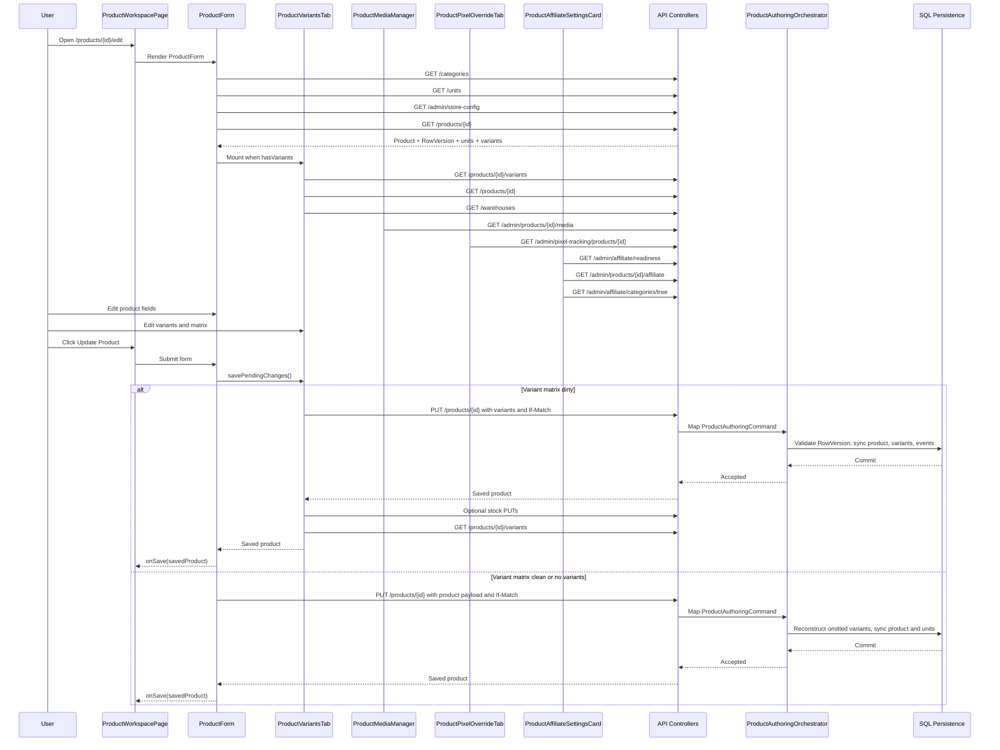

# Variant Product Runtime Architecture Audit

Final certification: **RUNTIME ARCHITECTURE REQUIRES RECOVERY**

## 1. Canonical Runtime

This section defines the target runtime from the stated business workflow, before implementation details.

| Stage | Owner | Responsibility | Input | Output |
| --- | --- | --- | --- | --- |
| Open Edit Product | Product Workspace Page | Resolve product identity, render workspace shell, route global Update Product submit to the form | Route product id | Mounted product authoring workspace |
| Product Load | ProductForm | Load the authoritative product snapshot and its current concurrency token | Product id | Product form state, product row version, product units, variant summary snapshot |
| Reference Load | ProductForm | Load categories, tenant units, product templates | Tenant session | Form dropdown data |
| Variant Workspace Initialize | ProductVariantsTab | Load variants, warehouses, and media references needed to author the matrix | Product id | Variant matrix state with option groups, rows, selected warehouse, default variant |
| Product Field Editing | ProductForm | Own product content, product type, units, publication, SEO, marketing fields | User edits | Product draft state |
| Variant Editing | ProductVariantsTab | Own option groups, generated rows, variant identity, price, image, default row, and matrix validation | User edits | Variant draft state |
| Product Media Editing | ProductMediaManager | Own product media gallery mutations outside product authoring | Product id, files, URLs, order | Persisted media gallery |
| Pixel Override Editing | ProductPixelOverrideTab | Own pixel override mutations outside product authoring | Product id, override settings | Persisted pixel override |
| Affiliate Editing | ProductAffiliateSettingsCard | Own affiliate policy mutations outside product authoring | Product id, category, rate | Persisted affiliate policy |
| Update Product Click | ProductForm | Start exactly one product authoring save pipeline for product plus variant authoring state | Product draft, variant draft, accepted RowVersion, idempotency key | One `POST /api/products` or `PUT /api/products/{id}` call for product authoring |
| Backend Product Authoring | ProductsController and ProductAuthoringOrchestrator | Validate idempotency, expected version, category, product type, publication readiness, unit references, variants | Product authoring command | Accepted or rejected authoring result |
| Persistence | ProductAuthoringOrchestrator | Apply product, units, variants, default variant alignment, pricing mirrors, events, audit in one transaction | Accepted command | Committed SQL state and events |
| Success | ProductForm | Accept returned product, update RowVersion, clear pending save identity, notify parent | Saved product response | Workspace success state |
| Failure | ProductForm | Surface validation, concurrency, authentication, and server errors without partial product resubmit | API error | Error message, preserved draft |

Canonical constraints:

- Existing variant product updates should persist product fields and variant matrix through a single Product Authoring mutation: `PUT /api/products/{id}` with `variants` included and `If-Match` set.
- Existing simple product updates should persist product fields and product units through `PUT /api/products/{id}` with `productUnits` included and current variants reconstructed by the backend when omitted.
- Product media, affiliate policy, and pixel override are separate resources and may save independently because they use separate controllers and services.
- Legacy direct variant mutations must not be invoked by the canonical authoring UI because the backend returns `410 Gone` for create, update, delete, and set-default variant mutations.

Source grounding for canonical backend behavior:

- Product create and update enter Product Authoring through `ProductsController.CreateProduct()` and `ProductsController.UpdateProduct()` at `PointOfSale.API/Controllers/ProductsController.cs:286` and `PointOfSale.API/Controllers/ProductsController.cs:316`.
- Product update requires `If-Match` or `Expected-Version` before authoring at `PointOfSale.API/Controllers/ProductsController.cs:327` and `PointOfSale.API/Controllers/ProductsController.cs:1158`.
- Product Authoring maps `If-Match` or `Expected-Version` to `ProductAuthoringMetadata.ExpectedVersion` at `PointOfSale.API/Services/ProductAuthoring/ProductAuthoringCommandMapper.cs:442`.
- Product Authoring rejects stale versions before mutation and applies the expected RowVersion to EF before save at `PointOfSale.API/Services/ProductAuthoring/ProductAuthoringOrchestrator.cs:270`, `PointOfSale.API/Services/ProductAuthoring/ProductAuthoringOrchestrator.cs:1521`, and `PointOfSale.API/Services/ProductAuthoring/ProductAuthoringOrchestrator.cs:1568`.
- Product Authoring syncs submitted variants only when `variantsSubmitted` is true at `PointOfSale.API/Services/ProductAuthoring/ProductAuthoringOrchestrator.cs:349`.
- Backend reconstruction fills omitted units or variants for update commands at `PointOfSale.API/Services/ProductAuthoring/ProductAuthoringReconstructionService.cs:47` and `PointOfSale.API/Services/ProductAuthoring/ProductAuthoringReconstructionService.cs:60`.
- Legacy direct variant mutation endpoints return deprecation responses at `PointOfSale.API/Controllers/ProductVariantsController.cs:118`, `PointOfSale.API/Controllers/ProductVariantsController.cs:463`, `PointOfSale.API/Controllers/ProductVariantsController.cs:1056`, `PointOfSale.API/Controllers/ProductVariantsController.cs:1224`, and `PointOfSale.API/Controllers/ProductVariantsController.cs:1582`.

## 2. Actual Runtime

Actual edit page mount:

- `ProductWorkspacePage` reads `productId` from the route, creates a `ProductForm` ref, renders the top-bar submit button with `form="product-workspace-form"`, and passes `onSave`, `onMetaChange`, and `focusSection` to `ProductForm`. Source: `PointOfSale.Web/src/pages/ProductWorkspacePage.jsx:33`, `PointOfSale.Web/src/pages/ProductWorkspacePage.jsx:38`, `PointOfSale.Web/src/pages/ProductWorkspacePage.jsx:158`, `PointOfSale.Web/src/pages/ProductWorkspacePage.jsx:179`.
- `ProductForm` owns loading state, form state, product type, product units, accepted RowVersion, simple SKU/barcode, default variant, variant snapshot, and the `ProductVariantsTab` ref. Source: `PointOfSale.Web/src/components/ProductForm.jsx:302`, `PointOfSale.Web/src/components/ProductForm.jsx:303`, `PointOfSale.Web/src/components/ProductForm.jsx:312`, `PointOfSale.Web/src/components/ProductForm.jsx:314`, `PointOfSale.Web/src/components/ProductForm.jsx:315`, `PointOfSale.Web/src/components/ProductForm.jsx:317`.
- On mount or `productId` change, `ProductForm` starts `fetchCategories()`, `fetchUnits()`, `fetchProductTemplates()`, and, in edit mode, `fetchProduct()`. Source: `PointOfSale.Web/src/components/ProductForm.jsx:366`.
- `fetchProduct()` calls `GET /products/{productId}`, derives `hasVariants`, stores `rowVersion`, product units, and product variants snapshot, then calls `fetchDefaultVariant()` only when the product is not derived as a variant product. Source: `PointOfSale.Web/src/components/ProductForm.jsx:521`, `PointOfSale.Web/src/components/ProductForm.jsx:524`, `PointOfSale.Web/src/components/ProductForm.jsx:526`, `PointOfSale.Web/src/components/ProductForm.jsx:529`, `PointOfSale.Web/src/components/ProductForm.jsx:531`, `PointOfSale.Web/src/components/ProductForm.jsx:532`, `PointOfSale.Web/src/components/ProductForm.jsx:570`.
- `fetchDefaultVariant()` calls `GET /products/{productId}/variants`, can flip `hasVariants` to true when more than one variant exists, and captures default variant SKU/barcode for simple product identity. Source: `PointOfSale.Web/src/components/ProductForm.jsx:580`, `PointOfSale.Web/src/components/ProductForm.jsx:582`, `PointOfSale.Web/src/components/ProductForm.jsx:585`, `PointOfSale.Web/src/components/ProductForm.jsx:591`.
- After loading, `ProductForm` renders Product Type, Basic Information, Simple Identity when applicable, Product Units, Media, Product Variants when applicable, Inventory notice, Publication, Marketing, SEO, Pixel Override, and Affiliate sections. Source: `PointOfSale.Web/src/components/ProductForm.jsx:1712`.

Actual variant workspace:

- `ProductForm` renders `ProductVariantsTab` for existing variant products and passes `getProductAuthoringSnapshot={buildProductAuthoringPayload}`. Source: `PointOfSale.Web/src/components/ProductForm.jsx:1364`, `PointOfSale.Web/src/components/ProductForm.jsx:1375`, `PointOfSale.Web/src/components/ProductForm.jsx:1379`.
- `ProductVariantsTab` loads variants, product, and warehouses with `Promise.all([GET /products/{id}/variants, GET /products/{id}, GET /warehouses])`. Source: `PointOfSale.Web/src/components/ProductVariantsTab.jsx:693`, `PointOfSale.Web/src/components/ProductVariantsTab.jsx:699`, `PointOfSale.Web/src/components/ProductVariantsTab.jsx:702`.
- `ProductVariantsTab` reconstructs option groups from variants, sets default key, clears drafts/deletions/selections, and derives matrix mode from forced mode, option groups, or multiple variants. Source: `PointOfSale.Web/src/components/ProductVariantsTab.jsx:707`, `PointOfSale.Web/src/components/ProductVariantsTab.jsx:723`, `PointOfSale.Web/src/components/ProductVariantsTab.jsx:727`, `PointOfSale.Web/src/components/ProductVariantsTab.jsx:730`, `PointOfSale.Web/src/components/ProductVariantsTab.jsx:758`.
- Matrix rows are built from generated combinations plus unmatched existing variants. Unmatched variants are marked `isLegacy` when generated combinations exist. Source: `PointOfSale.Web/src/components/ProductVariantsTab.jsx:775`, `PointOfSale.Web/src/components/ProductVariantsTab.jsx:781`, `PointOfSale.Web/src/components/ProductVariantsTab.jsx:811`, `PointOfSale.Web/src/components/ProductVariantsTab.jsx:827`.
- Legacy rows are hidden by default and shown by a dedicated legacy banner. Source: `PointOfSale.Web/src/components/ProductVariantsTab.jsx:855`, `PointOfSale.Web/src/components/ProductVariantsTab.jsx:859`, `PointOfSale.Web/src/components/ProductVariantsTab.jsx:1927`.
- `ProductVariantsTab` exposes `hasPendingChanges()`, `getLastError()`, `getLastSavedProduct()`, and `savePendingChanges()` through a ref. Source: `PointOfSale.Web/src/components/ProductVariantsTab.jsx:1632`.

Actual save behavior:

- The workspace top bar submits the `ProductForm` HTML form. Source: `PointOfSale.Web/src/pages/ProductWorkspacePage.jsx:158` and `PointOfSale.Web/src/components/ProductForm.jsx:1772`.
- `ProductForm.handleSubmit()` sets loading, requires category, then calls `variantsTabRef.current.savePendingChanges()` before building or sending the parent product payload. Source: `PointOfSale.Web/src/components/ProductForm.jsx:824`, `PointOfSale.Web/src/components/ProductForm.jsx:829`, `PointOfSale.Web/src/components/ProductForm.jsx:837`.
- If `savePendingChanges()` returns a saved product object, `ProductForm` updates `acceptedRowVersion`, updates `productVariantsSnapshot`, skips the parent product PUT, invalidates POS runtime cache, and calls `onSave()`. Source: `PointOfSale.Web/src/components/ProductForm.jsx:848`, `PointOfSale.Web/src/components/ProductForm.jsx:850`, `PointOfSale.Web/src/components/ProductForm.jsx:852`, `PointOfSale.Web/src/components/ProductForm.jsx:873`, `PointOfSale.Web/src/components/ProductForm.jsx:883`.
- If the variant workspace has no pending changes, `ProductForm` builds its own product authoring payload and sends `PUT /products/{id}` or `POST /products` with `Idempotency-Key` and `If-Match` when updating. Source: `PointOfSale.Web/src/components/ProductForm.jsx:751`, `PointOfSale.Web/src/components/ProductForm.jsx:892`, `PointOfSale.Web/src/components/ProductForm.jsx:916`, `PointOfSale.Web/src/components/ProductForm.jsx:918`, `PointOfSale.Web/src/components/ProductForm.jsx:931`.
- `ProductForm.buildProductAuthoringPayload()` sends `variants: null` for existing variant products and only includes a variant snapshot for create mode or when no `productId` exists. Source: `PointOfSale.Web/src/components/ProductForm.jsx:766`, `PointOfSale.Web/src/components/ProductForm.jsx:767`.
- `ProductVariantsTab.saveMatrixChanges()` validates matrix rows, deletes omitted existing variants by omission from the authored variant list, merges `parentProduct` with `getProductAuthoringSnapshot()`, builds a separate full Product Authoring payload, sends `PUT /products/{productId}`, optionally performs stock PUTs per changed inventory row, refetches variants, and returns the saved product. Source: `PointOfSale.Web/src/components/ProductVariantsTab.jsx:1488`, `PointOfSale.Web/src/components/ProductVariantsTab.jsx:1492`, `PointOfSale.Web/src/components/ProductVariantsTab.jsx:1499`, `PointOfSale.Web/src/components/ProductVariantsTab.jsx:1517`, `PointOfSale.Web/src/components/ProductVariantsTab.jsx:1518`, `PointOfSale.Web/src/components/ProductVariantsTab.jsx:1531`, `PointOfSale.Web/src/components/ProductVariantsTab.jsx:1562`, `PointOfSale.Web/src/components/ProductVariantsTab.jsx:1575`, `PointOfSale.Web/src/components/ProductVariantsTab.jsx:1598`, `PointOfSale.Web/src/components/ProductVariantsTab.jsx:1611`.

Actual independent resource behavior:

- `ProductMediaManager` loads media with `GET /admin/products/{productId}/media`, uploads files through `POST /upload`, registers media with `POST /admin/products/{productId}/media`, deletes with `DELETE /admin/products/{productId}/media/{mediaId}`, and reorders with `PUT /admin/products/{productId}/media/reorder`. Source: `PointOfSale.Web/src/components/ProductMediaManager.jsx:173`, `PointOfSale.Web/src/components/ProductMediaManager.jsx:185`, `PointOfSale.Web/src/components/ProductMediaManager.jsx:234`, `PointOfSale.Web/src/components/ProductMediaManager.jsx:241`, `PointOfSale.Web/src/components/ProductMediaManager.jsx:282`, `PointOfSale.Web/src/components/ProductMediaManager.jsx:303`.
- `VariantMatrixTable` separately loads product media with `GET /admin/products/{productId}/media` for thumbnails, and `VariantMediaPicker` loads the same endpoint when opened. Source: `PointOfSale.Web/src/components/VariantMatrixTable.jsx:57`, `PointOfSale.Web/src/components/VariantMatrixTable.jsx:67`, `PointOfSale.Web/src/components/VariantMediaPicker.jsx:25`, `PointOfSale.Web/src/components/VariantMediaPicker.jsx:35`.
- `ProductPixelOverrideTab` loads, previews, and saves pixel overrides through `/admin/pixel-tracking/products/{productId}` and `/preview`; it uses local alert notifications. Source: `PointOfSale.Web/src/components/ProductPixelOverrideTab.jsx:84`, `PointOfSale.Web/src/components/ProductPixelOverrideTab.jsx:103`, `PointOfSale.Web/src/components/ProductPixelOverrideTab.jsx:157`, `PointOfSale.Web/src/components/ProductPixelOverrideTab.jsx:195`, `PointOfSale.Web/src/components/ProductPixelOverrideTab.jsx:166`.
- `ProductAffiliateSettingsCard` loads affiliate settings, category tree, and readiness, then saves enable/update through `enableWithCategory()` and disables through `disable()`. Source: `PointOfSale.Web/src/components/ProductAffiliateSettingsCard.jsx:167`, `PointOfSale.Web/src/components/ProductAffiliateSettingsCard.jsx:171`, `PointOfSale.Web/src/components/ProductAffiliateSettingsCard.jsx:185`, `PointOfSale.Web/src/components/ProductAffiliateSettingsCard.jsx:217`, `PointOfSale.Web/src/components/ProductAffiliateSettingsCard.jsx:340`, `PointOfSale.Web/src/components/ProductAffiliateSettingsCard.jsx:393`, `PointOfSale.Web/src/components/ProductAffiliateSettingsCard.jsx:422`.

## 3. Runtime Call Graph

Edit page and product form:

```text
ProductWorkspacePage()
-> ProductWorkspaceLayout(topBar)
-> ProductForm(ref, productId, formId, hideActions, onSave, onMetaChange, focusSection)
-> ProductForm.useEffect(productId)
-> fetchCategories() -> GET /categories
-> fetchUnits() -> GET /units
-> fetchProductTemplates() -> GET /admin/store-config
-> fetchProduct() -> GET /products/{productId}
-> if simple product -> fetchDefaultVariant() -> GET /products/{productId}/variants
```

Update Product button:

```text
Top bar submit button
-> ProductForm form onSubmit
-> handleSubmit(event)
-> category validation
-> if productId && hasVariants && variantsTabRef.savePendingChanges
-> ProductVariantsTab.savePendingChanges()
-> if matrix has unsaved changes -> saveMatrixChanges()
-> if saveMatrixChanges returns saved product -> ProductForm skips parent PUT
-> else ProductForm.buildProductAuthoringPayload()
-> buildProductAuthoringRequestOptions(productId, rowVersion, idempotencyKey)
-> productId ? PUT /products/{productId} : POST /products
-> ProductsController.UpdateProduct/CreateProduct
-> ProductAuthoringCommandMapper
-> ProductAuthoringOrchestrator.AuthorAsync
-> ReconstructForAdmissionAsync
-> AdmitAsync
-> ExecuteUpdateAsync/ExecuteCreateAsync
-> CommitProductAuthoringTransactionAsync
-> SaveChangesAsync + CommitAsync
-> LoadProductForResponseAsync
-> ProductForm accepts saved product and calls onSave
-> ProductWorkspacePage.handleSave()
```

Variant workspace load and matrix generation:

```text
ProductForm variantsSection
-> ProductVariantsTab(productId, forceMatrixMode, getProductAuthoringSnapshot)
-> useEffect(productId) -> fetchVariants()
-> Promise.all(GET /products/{id}/variants, GET /products/{id}, GET /warehouses)
-> normalizeVariantForMatrix()
-> reconstructOptionGroupsFromVariants()
-> matrixRows useMemo()
-> generatedCombinations from optionGroups and excludedRules
-> buildMatrixRow() for generated combinations
-> buildMatrixRow(isLegacy=true) for unmatched existing variants
```

Variant option builder:

```text
VariantOptionsBuilder
-> addGroup() -> onChange(nextOptionGroups)
-> updateGroup() -> onChange(mappedOptionGroups)
-> addValue() -> updateGroup(groupId, values)
-> removeValue() -> onChange(mappedOptionGroups)
-> removeGroup() -> onChange(filteredOptionGroups)
-> ProductVariantsTab recomputes combinationCount, generationSignature, matrixRows, validation
```

Generate Variants:

```text
Generate Variants button
-> handleGenerateVariants()
-> optionGroupValidation check
-> if combinationCount > WARNING_COMBINATION_LIMIT -> confirm()
-> setConfirmedGenerationSignature(generationSignature)
-> generatedCombinations useMemo becomes active
-> matrixRows useMemo emits generated rows
```

Variant matrix table:

```text
VariantMatrixTable
-> useEffect(productId) -> GET /admin/products/{productId}/media
-> checkbox -> onToggleSelect(row.key, checked)
-> select all -> onToggleSelectAll(checked)
-> row inputs -> onRowChange(row.key, patch)
-> default radio -> onSetDefault(row.key)
-> image button -> setPickerRowKey(row.key)
-> VariantMediaPicker(open) -> GET /admin/products/{productId}/media
-> onSelect(media) -> onRowChange(row.key, { mediaId, imageUrl })
-> legacy advanced edit -> onEditFallback(row)
-> legacy delete -> onDeleteFallback(row)
```

Bulk actions:

```text
VariantBulkActions
-> set-price/set-cost-price/set-inventory/set-weight -> handleApplyBulkAction() -> setRowDrafts()
-> increase-percent -> setRowDrafts(price, onlinePrice)
-> set-active -> setRowDrafts(isActive)
-> set-image -> VariantMediaPicker -> handleApplyBulkAction({ type: 'set-image' }) -> setRowDrafts(mediaId)
-> generate-sku -> buildSkuForRow() -> setRowDrafts(sku)
-> generate-barcode -> repeated POST /products/generate-barcode?type=EAN13 -> setRowDrafts(barcode)
-> delete-selected -> setDeletedKeys()
-> set-stock branch -> PUT /products/{productId}/variants/{variantId}/stock/{warehouseId}
```

Save Matrix:

```text
Save Matrix button or ProductForm.savePendingChanges()
-> saveMatrixChanges()
-> validateMatrixRows(matrixRows)
-> confirm delete rows with stock
-> parentProduct or GET /products/{productId}
-> getProductAuthoringSnapshot() from ProductForm
-> ProductVariantsTab.buildProductAuthoringPayload(product, authoringVariants)
-> PUT /products/{productId} with Idempotency-Key and If-Match
-> optional GET /products/{productId}/variants after product PUT
-> optional per-row PUT /products/{productId}/variants/{variantId}/stock/{selectedWarehouseId}
-> fetchVariants()
```

Legacy manual variant modal:

```text
Non-matrix ProductVariantsTab branch
-> Add Variant -> handleAddVariant() -> showModal
-> Edit -> handleEditVariant(variant) -> showModal
-> modal Save -> handleSaveVariant()
-> editing ? PUT /products/{productId}/variants/{variantId} : POST /products/{productId}/variants
-> backend returns 410 Gone for these mutation endpoints
-> error is displayed in ProductVariantsTab
-> Delete -> confirmDeleteVariant() -> DELETE /products/{productId}/variants/{variantId}
-> backend returns 410 Gone
```

Media:

```text
ProductMediaManager
-> loadMedia() -> GET /admin/products/{productId}/media
-> MediaUploadButton.onFilesSelected(files)
-> ProductMediaManager.handleFilesSelected(files)
-> POST /upload
-> POST /admin/products/{productId}/media
-> MediaGalleryGrid.onDragEnd() -> ProductMediaManager.handleReorder()
-> PUT /admin/products/{productId}/media/reorder
-> MediaCard.Set Primary -> handleSetPrimary() -> handleReorder()
-> MediaCard.Delete -> handleDelete() -> DELETE /admin/products/{productId}/media/{mediaId}
-> YouTubeUrlPanel.Add -> handleAddYouTubeVideo() -> POST /admin/products/{productId}/media
```

Publication, SEO, marketing, product units, inventory notice:

```text
Publication fields -> ProductForm.handleChange() -> formData -> ProductForm product authoring payload
SEO fields -> ProductForm.handleChange() -> formData -> ProductForm or ProductVariantsTab product authoring payload
Marketing fields -> ProductForm.handleChange() -> formData -> ProductForm or ProductVariantsTab product authoring payload
Product units -> ProductForm handlers -> productUnits -> ProductForm product authoring payload for simple products
Inventory notice -> display only; no request
```

Pixel override:

```text
ProductPixelOverrideTab
-> useEffect(productId) -> GET /admin/pixel-tracking/products/{productId}
-> local edits -> updateOverride()
-> preview useEffect -> GET /admin/pixel-tracking/products/{productId}/preview
-> Save Config -> PUT /admin/pixel-tracking/products/{productId}
```

Affiliate:

```text
ProductAffiliateSettingsCard
-> useAffiliateReadiness() -> GET /admin/affiliate/readiness
-> useEffect(productId, isAdmin) -> Promise.all(fetchSettings(), fetchCategoryTree())
-> fetchSettings() -> GET /admin/products/{productId}/affiliate
-> fetchCategoryTree() -> GET /admin/affiliate/categories/tree
-> focus/online/visibility -> refetch settings, tree, readiness
-> Enable -> POST /admin/products/{productId}/affiliate/enable-with-category
-> Save -> POST /admin/products/{productId}/affiliate/enable-with-category
-> Disable -> POST /admin/products/{productId}/affiliate/disable
```

## 4. Sequence Diagram



## 5. Ownership Matrix

| Responsibility | Current owner(s) | Canonical owner | Status | Evidence |
| --- | --- | --- | --- | --- |
| Workspace shell and global submit | ProductWorkspacePage | ProductWorkspacePage | OK | `PointOfSale.Web/src/pages/ProductWorkspacePage.jsx:158` |
| Product load | ProductForm and ProductVariantsTab | ProductForm | Violation | ProductForm `GET /products/{id}` at `ProductForm.jsx:524`; ProductVariantsTab `GET /products/{id}` at `ProductVariantsTab.jsx:704` |
| Variant load | ProductForm and ProductVariantsTab | ProductVariantsTab | Violation | ProductForm stores `productVariantsSnapshot` from product response at `ProductForm.jsx:532`; ProductVariantsTab loads variants at `ProductVariantsTab.jsx:703` |
| Product state | ProductForm and ProductVariantsTab parentProduct | ProductForm | Violation | ProductForm `formData` at `ProductForm.jsx:321`; ProductVariantsTab `parentProduct` at `ProductVariantsTab.jsx:663` |
| Variant state | ProductForm snapshot and ProductVariantsTab matrix | ProductVariantsTab | Violation | ProductForm `productVariantsSnapshot` at `ProductForm.jsx:315`; ProductVariantsTab `variants`, `rowDrafts`, `deletedKeys` at `ProductVariantsTab.jsx:662` and `ProductVariantsTab.jsx:667` |
| Product payload | ProductForm and ProductVariantsTab | ProductForm or a shared authoring adapter | Violation | ProductForm `buildProductAuthoringPayload()` at `ProductForm.jsx:751`; ProductVariantsTab `buildProductAuthoringPayload()` at `ProductVariantsTab.jsx:535` |
| Variant payload | ProductForm and ProductVariantsTab | ProductVariantsTab | Violation | ProductForm `buildVariantAuthoringSnapshot()` at `ProductForm.jsx:660`; ProductVariantsTab `toAuthoringVariant()` at `ProductVariantsTab.jsx:484` |
| Validation | ProductForm, ProductVariantsTab, ProductAuthoringPolicy | ProductAuthoringPolicy backend; frontend advisory | Violation | ProductForm validation at `ProductForm.jsx:770`; ProductVariantsTab validation at `ProductVariantsTab.jsx:1272`; backend policy at `ProductAuthoringInfrastructurePolicies.cs:73` |
| Product save | ProductForm and ProductVariantsTab | ProductForm orchestration with one authoring call | Violation | ProductForm PUT at `ProductForm.jsx:919`; ProductVariantsTab PUT at `ProductVariantsTab.jsx:1562` |
| Matrix save | ProductVariantsTab | ProductVariantsTab | OK for draft state, violates global save when it sends full product payload | `ProductVariantsTab.jsx:1488` |
| Media save | ProductMediaManager | ProductMediaManager | OK | `ProductMediaManager.jsx:234`, `ProductMediaManager.jsx:241`, `ProductMediaManager.jsx:303` |
| Variant media selection | VariantMatrixTable and VariantMediaPicker | ProductVariantsTab with media picker as child | Acceptable with duplicate reads | `VariantMatrixTable.jsx:67`, `VariantMediaPicker.jsx:35` |
| Product units | ProductForm and backend unit endpoints | ProductForm for workspace; backend Product Authoring | Violation in available old endpoints | ProductForm unit payload at `ProductForm.jsx:647`; old unit endpoints at `ProductsController.cs:1393`, `ProductsController.cs:1512`, `ProductsController.cs:1625` |
| Notifications | ProductWorkspacePage, ProductForm, ProductVariantsTab, ProductMediaManager, Pixel tab, Affiliate card | Section owner for section saves; ProductForm for global save | Violation | Workspace toast at `ProductWorkspacePage.jsx:69`; ProductVariantsTab success at `ProductVariantsTab.jsx:1609`; Pixel alerts at `ProductPixelOverrideTab.jsx:166`; Affiliate local success at `ProductAffiliateSettingsCard.jsx:347` |
| Success | ProductWorkspacePage, ProductForm, ProductVariantsTab | ProductForm for product authoring | Violation | ProductForm calls `onSave` at `ProductForm.jsx:944`; ProductVariantsTab internal success at `ProductVariantsTab.jsx:1609` |
| Failure | ProductForm, ProductVariantsTab, Media, Pixel, Affiliate | Owner of each mutation | Mixed | ProductForm error at `ProductForm.jsx:949`; ProductVariantsTab error at `ProductVariantsTab.jsx:1614`; Media error at `ProductMediaManager.jsx:252`; Pixel alert at `ProductPixelOverrideTab.jsx:167` |
| Concurrency | ProductForm, ProductVariantsTab, ProductsController, ProductAuthoringOrchestrator | ProductsController/ProductAuthoringOrchestrator, with frontend carrying accepted RowVersion | Violation | ProductForm accepted RowVersion at `ProductForm.jsx:529`; ProductVariantsTab rowVersion source at `ProductVariantsTab.jsx:1532`; backend required version at `ProductsController.cs:1158` |

## 6. Legacy Runtime Inventory

| Item | Why it existed | Still needed? | Replacement | Evidence |
| --- | --- | --- | --- | --- |
| Direct variant create modal | Early variant CRUD allowed adding variants one at a time | No for canonical variant products | Matrix Product Authoring save | Frontend calls `POST /products/{productId}/variants` at `ProductVariantsTab.jsx:972`; backend returns 410 at `ProductVariantsController.cs:118` and `ProductVariantsController.cs:1582` |
| Direct variant update modal | Early variant CRUD allowed editing a variant independently | No for canonical variant products | Matrix Product Authoring save | Frontend calls `PUT /products/{productId}/variants/{id}` at `ProductVariantsTab.jsx:969`; backend returns 410 at `ProductVariantsController.cs:463` |
| Direct variant delete | Early variant CRUD deleted variants independently | No for canonical variant matrix rows | Omit variants from Product Authoring payload | Frontend calls `DELETE /products/{productId}/variants/{id}` at `ProductVariantsTab.jsx:1005`; backend returns 410 at `ProductVariantsController.cs:1056` |
| Direct set-default variant endpoint | Early variant CRUD reassigned default variant independently | No from current UI | `isDefault` in Product Authoring variants payload | Backend returns 410 at `ProductVariantsController.cs:1224`; matrix default is sent via `toAuthoringVariant()` at `ProductVariantsTab.jsx:496` |
| Manual non-matrix variant workflow | Supports legacy single-variant UI branch | No for ProductForm variant products because `forceMatrixMode={hasVariants}` forces matrix mode | Matrix branch | Manual branch rendered only when `!isMatrixMode` at `ProductVariantsTab.jsx:2016`; ProductForm passes `forceMatrixMode` at `ProductForm.jsx:1378` |
| Legacy row visibility controls | Allows cleanup of variants that do not match current option groups | Transitional yes | Matrix cleanup via Product Authoring omission | Legacy rows built at `ProductVariantsTab.jsx:827`; banner at `ProductVariantsTab.jsx:1927` |
| `canReuseLegacyDefaultVariant()` | Reuses an old default variant with no attributes for first generated combination | Transitional yes | Product Authoring matrix should preserve or replace via authored variant ids | `ProductVariantsTab.jsx:423` and `ProductVariantsTab.jsx:790` |
| `imageUrl` legacy variant image path | Supports existing variant image URL not tied to product media | Transitional yes if persisted data exists | `mediaId` from product media gallery | `VariantMatrixTable.jsx:169`; `ProductVariantsTab.jsx:494`; backend stores `ImageUrl` only when no `MediaId` at `ProductAuthoringOrchestrator.cs:1267` |
| Old product unit mutation endpoints | Pre-authoring unit CRUD updated units separately | Not used by ProductForm; likely legacy API surface | Product Authoring `productUnits` payload | ProductForm inline units at `ProductForm.jsx:1195`; old endpoints at `ProductsController.cs:1393`, `ProductsController.cs:1512`, `ProductsController.cs:1625` |
| Deprecated affiliate `enable()` service method | Pre AF-30A enable without category | No in current component | `enableWithCategory()` | Deprecated comment and method at `adminProductAffiliateApi.js:68`; component uses `enableWithCategory()` at `ProductAffiliateSettingsCard.jsx:340` and `ProductAffiliateSettingsCard.jsx:393` |
| Modal ProductForm actions | Previous modal product editor used local Cancel/Save buttons | Still needed only if `ProductForm` is used in modal mode | Workspace top bar submit | Legacy actions hidden in workspace at `ProductForm.jsx:1664`; workspace sets `hideActions` at `ProductWorkspacePage.jsx:184` |
| Product legacy pricing compatibility fields | Product fields kept as mirrors while units own simple pricing | Needed as compatibility mirrors, not as authoring source for variants | ProductUnits for simple products, Variants for variant products | DTO comments at `ProductsController.cs:2234` and `ProductsController.cs:2288`; mirror method at `ProductAuthoringOrchestrator.cs:1189` |
| Backend legacy variant mutation code behind 410 | Historical implementation remains unreachable after early return | Not needed for canonical runtime, but retained source code is dead after `return LegacyVariantMutationDeprecatedResult()` | Product Authoring | Early returns at `ProductVariantsController.cs:122`, `ProductVariantsController.cs:468`, `ProductVariantsController.cs:1060`, `ProductVariantsController.cs:1228` |

## 7. Architectural Violations

| Violation | Impact | Source |
| --- | --- | --- |
| Two components build full Product Authoring payloads | ProductForm and ProductVariantsTab can diverge on defaults, omitted fields, RowVersion, and validation | `ProductForm.jsx:751`; `ProductVariantsTab.jsx:535` |
| Variant workspace performs the parent product PUT | Child component owns a global product save side effect and then parent skips its own PUT | `ProductVariantsTab.jsx:1562`; `ProductForm.jsx:873` |
| ProductForm validates publication using `productVariantsSnapshot` unless matrix save returned variants | If matrix is clean but ProductForm snapshot is stale, frontend validation can disagree with backend reconstruction | `ProductForm.jsx:315`; `ProductForm.jsx:792`; `ProductAuthoringReconstructionService.cs:60` |
| Product load duplicated | ProductForm and ProductVariantsTab both call `GET /products/{id}` | `ProductForm.jsx:524`; `ProductVariantsTab.jsx:704` |
| Variant load duplicated | ProductForm reads variants from product response and ProductVariantsTab separately calls variants endpoint | `ProductForm.jsx:532`; `ProductVariantsTab.jsx:703` |
| Media load duplicated three ways | ProductMediaManager, VariantMatrixTable, and VariantMediaPicker each call the same media endpoint | `ProductMediaManager.jsx:185`; `VariantMatrixTable.jsx:67`; `VariantMediaPicker.jsx:35` |
| Legacy variant buttons still call deprecated endpoints | Users in non-matrix branch or legacy fallback actions can hit endpoints that return 410 | `ProductVariantsTab.jsx:962`; `ProductVariantsController.cs:1582` |
| Save Matrix and Update Product are separate user-visible save actions for same Product Authoring aggregate | Users can save variants independently or as part of global submit, splitting the mental model | `ProductVariantsTab.jsx:2003`; `ProductWorkspacePage.jsx:158` |
| Frontend owns advisory validation that duplicates backend policy | Frontend may block or allow differently than Product Authoring policy | `ProductForm.jsx:770`; `ProductVariantsTab.jsx:1272`; `ProductAuthoringInfrastructurePolicies.cs:205` |
| Notifications are fragmented | Global save, matrix save, media save, affiliate save, and pixel save use different notification mechanisms | `ProductWorkspacePage.jsx:69`; `ProductVariantsTab.jsx:1609`; `ProductPixelOverrideTab.jsx:166`; `ProductAffiliateSettingsCard.jsx:347` |

## 8. Dead Runtime Inventory

| Dead runtime | Why dead | Evidence |
| --- | --- | --- |
| ProductVariantsController create implementation below line 125 | Unreachable because method returns `LegacyVariantMutationDeprecatedResult()` first | `ProductVariantsController.cs:118` and `ProductVariantsController.cs:122` |
| ProductVariantsController update implementation below line 471 | Unreachable because method returns `LegacyVariantMutationDeprecatedResult()` first | `ProductVariantsController.cs:463` and `ProductVariantsController.cs:468` |
| ProductVariantsController delete implementation below line 1063 | Unreachable because method returns `LegacyVariantMutationDeprecatedResult()` first | `ProductVariantsController.cs:1056` and `ProductVariantsController.cs:1060` |
| ProductVariantsController set-default implementation below line 1231 | Unreachable because method returns `LegacyVariantMutationDeprecatedResult()` first | `ProductVariantsController.cs:1224` and `ProductVariantsController.cs:1228` |
| Frontend manual variant save success path for canonical backend | Backend always returns 410 for direct create/update/delete/default mutations | Frontend calls at `ProductVariantsTab.jsx:969`, `ProductVariantsTab.jsx:972`, `ProductVariantsTab.jsx:1005`; backend 410 at `ProductVariantsController.cs:1582` |
| `set-stock` bulk action branch from VariantBulkActions | `VariantBulkActions` never emits `type: 'set-stock'`; it emits `set-inventory` | `VariantBulkActions.jsx:153`; handler branch at `ProductVariantsTab.jsx:1449` |

## 9. Duplicate Runtime Inventory

| Duplicate | Instances | Result |
| --- | --- | --- |
| Product Authoring payload builder | `ProductForm.buildProductAuthoringPayload()` and `ProductVariantsTab.buildProductAuthoringPayload()` | Two canonical payload shapes in frontend |
| Variant authoring conversion | `ProductForm.buildVariantAuthoringSnapshot()` / `getCurrentVariantAuthoringSnapshot()` and `ProductVariantsTab.toAuthoringVariant()` | Duplicate mapping of variant rows to authoring DTO |
| RowVersion extraction | `ProductForm.getProductRowVersion()` and `ProductVariantsTab.getProductRowVersion()` | Duplicate concurrency parsing |
| API error extraction | `ProductForm.extractApiErrorMessage()` and `ProductVariantsTab.extractApiErrorMessage()` | Duplicate error normalization |
| Publish status normalization | `ProductForm.normalizePublishStatus()` and `ProductVariantsTab.normalizePublishStatus()` | Duplicate status coercion |
| Product loading | ProductForm and ProductVariantsTab | Extra request and separate snapshots |
| Variant loading | ProductForm product response and ProductVariantsTab variants endpoint | Potential stale snapshot in ProductForm |
| Product media loading | ProductMediaManager, VariantMatrixTable, VariantMediaPicker | Repeated media requests |
| Validation | ProductForm publication validation, ProductVariantsTab matrix validation, backend ProductAuthoringPolicy | Multiple validators for one aggregate |
| Save | ProductForm submit PUT and ProductVariantsTab matrix PUT | Two frontend owners of product aggregate mutation |
| Idempotency key generation | ProductForm product authoring and ProductVariantsTab variant authoring | Different scopes for same canonical endpoint |

## 10. Cleanup Roadmap

Step 1. Declare `PUT /api/products/{id}` and `POST /api/products` as the only variant product authoring mutation from the UI.

Reason: The backend already declares direct variant mutations deprecated with `410 Gone`, and Product Authoring already syncs variants when `variantsSubmitted` is true.

Step 2. Move full Product Authoring save orchestration to `ProductForm` only.

Reason: `ProductForm` owns the global Update Product button, accepted RowVersion, product fields, and `onSave()`. `ProductVariantsTab` should expose a variant draft snapshot, not call `PUT /products/{id}` itself.

Step 3. Replace `ProductVariantsTab.savePendingChanges()` with a read-only draft API such as `getAuthoringVariants()` and `validateDraft()`.

Reason: This preserves FEATURE-V3 matrix authoring while removing the child-owned parent product save.

Step 4. Remove the user-visible `Save Matrix` product save action after ProductForm owns the single save pipeline.

Reason: One aggregate should have one visible save action. Matrix draft state can still show unsaved changes, but persistence should occur through Update Product.

Step 5. Remove or permanently hide manual direct variant CRUD UI from the ProductForm variant product runtime.

Reason: The backend endpoints are gone for mutation and the UI calls return 410. Legacy rows can remain as cleanup rows if they only feed Product Authoring omission/update.

Step 6. Keep legacy row detection temporarily but make cleanup happen only through the canonical authored variants payload.

Reason: Existing data may include no-attribute or unmatched variants, and Product Authoring can delete omitted variants through `SyncAuthoredVariantsAsync()`.

Step 7. Consolidate frontend authoring mappers.

Reason: ProductForm and ProductVariantsTab currently duplicate product and variant payload builders. A single mapper prevents drift without changing API contracts.

Step 8. Make ProductForm the only owner of product and RowVersion loading; pass loaded product basics into ProductVariantsTab or let ProductVariantsTab load only variants and warehouses.

Reason: Duplicate product loads create competing snapshots and RowVersion source ambiguity.

Step 9. Make ProductVariantsTab the only owner of variant state; remove ProductForm's `productVariantsSnapshot` except for returned saved product refresh or a derived read-only summary supplied by ProductVariantsTab.

Reason: Publication readiness and pixel price should use the current variant owner, not a stale snapshot loaded before matrix edits.

Step 10. Leave media, pixel override, and affiliate as separate section-owned save flows.

Reason: These are separate backend resources and not part of the forbidden Product Authoring domain redesign.

## 11. Risk Assessment

| Risk | Severity | Evidence | Mitigation |
| --- | --- | --- | --- |
| Users hit 410 from legacy variant UI | High | Direct calls at `ProductVariantsTab.jsx:969`, `ProductVariantsTab.jsx:972`, `ProductVariantsTab.jsx:1005`; backend 410 at `ProductVariantsController.cs:1582` | Remove or hide direct mutation UI paths |
| Lost product edits if child matrix save uses stale or incomplete merged product data | High | ProductVariantsTab merges `parentProduct` with `getProductAuthoringSnapshot()` at `ProductVariantsTab.jsx:1517`; it owns PUT at `ProductVariantsTab.jsx:1562` | Parent should build and submit single product payload |
| Concurrency conflict from stale RowVersion in child save | High | ProductForm accepted RowVersion at `ProductForm.jsx:529`; ProductVariantsTab rowVersion selected from merged product at `ProductVariantsTab.jsx:1532`; backend strict check at `ProductAuthoringOrchestrator.cs:1521` | One RowVersion owner in ProductForm |
| Duplicate validation blocks valid backend states or permits invalid backend states | Medium | Frontend validation at `ProductForm.jsx:770` and `ProductVariantsTab.jsx:1272`; backend policy at `ProductAuthoringInfrastructurePolicies.cs:205` | Treat frontend validation as advisory mirror of backend policy, not authority |
| Duplicate media fetches create stale variant image choices | Medium | Three media loaders at `ProductMediaManager.jsx:185`, `VariantMatrixTable.jsx:67`, `VariantMediaPicker.jsx:35` | Share media cache or refetch picker on open only |
| Removing legacy rows too aggressively may strand old variants | Medium | Legacy row support at `ProductVariantsTab.jsx:1927` | Keep legacy row cleanup through Product Authoring until data is normalized |
| Independent section saves confuse global save expectations | Low | Pixel save alert at `ProductPixelOverrideTab.jsx:166`; affiliate local save at `ProductAffiliateSettingsCard.jsx:347`; media local toasts at `ProductMediaManager.jsx:251` | Label sections as independently saved or standardize notifications |

## 12. Recommended Implementation Order

1. Add characterization tests around current ProductForm submit, ProductVariantsTab matrix draft, and backend 410 direct variant endpoints.

2. Introduce a single frontend Product Authoring mapper used by ProductForm for both simple and variant products.

3. Change ProductVariantsTab imperative ref from `savePendingChanges()` to validation plus draft extraction, leaving matrix state unchanged.

4. Change ProductForm submit to collect the variant draft and send exactly one `PUT /products/{id}` for existing variant products.

5. Remove the sticky `Save Matrix` persistence button or convert it to a non-persisting "Apply to pending update" affordance if needed.

6. Remove direct variant create/update/delete/default UI paths that call deprecated endpoints.

7. Keep legacy row display only as canonical cleanup input to the authored variants payload.

8. Collapse duplicated ProductForm variant snapshot usage after ProductVariantsTab becomes the variant state owner.

9. Standardize success/failure notifications after the save ownership is corrected.

10. Optionally consolidate media loading after the product authoring runtime is stable.

## Certification Basis

The runtime requires recovery because the backend has already canonicalized variant mutations into Product Authoring, but the frontend still contains overlapping generations:

- FEATURE-V1 style direct variant CRUD remains in the UI and in unreachable backend code.
- FEATURE-V2 style product/unit compatibility and simple default variant mirrors remain and are still needed for simple products.
- FEATURE-V3 style variant matrix Product Authoring exists, but it is implemented as a child-owned full product save competing with the parent ProductForm save.

No code was modified as part of this audit except this document.
