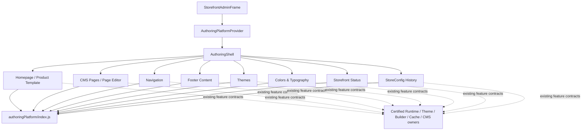

# Wave 3 - Storefront Authoring Platform Extraction

## Executive Summary

Wave 3 separates reusable Storefront authoring infrastructure from Storefront authoring features.

The canonical platform is now `PointOfSale.Web/src/modules/storefront/authoringPlatform`. It owns the Storefront authoring shell, public interaction contracts, action ordering, buttons, status presentation, loading/empty/permission states, feedback, structured error presentation, validation summaries, dialogs, conflict and unsaved-change dialogs, focus containment/restoration, keyboard shortcuts, dirty navigation guards, breadcrumb guard registration, and history launching.

Homepage/Product Template, CMS Pages, Navigation, Footer Content, Themes, Colors & Typography, Storefront Status, and StoreConfig History consume only the platform public entry point. They retain only their business-specific candidate state, API calls, domain validation, accepted-response adoption, concurrency evidence, preview rules, publication rules, rollback rules, and feature UI.

No customer Runtime, Projection, Theme Runtime, Builder Runtime, CMS ownership, Cache, backend, API, DTO, persistence, concurrency, authorization, publication, preview, rollback, StoreConfig ownership, or business rule changed.

## Platform Inventory

| Platform area | Canonical implementation | Owned capability |
|---|---|---|
| Shell | `authoringPlatform/shell/AuthoringShell.jsx` | Marks and composes the Storefront authoring surface. |
| Providers | `authoringPlatform/providers/AuthoringPlatformProvider.jsx` | One navigation-guard registry shared by breadcrumbs and the active editor. |
| Components | `authoringPlatform/components/AuthoringActionBar.jsx`, `AuthoringButton.jsx`, `AuthoringStates.jsx` | Constitutional toolbar, button/busy contract, loading, empty, and permission states. |
| Dialogs | `authoringPlatform/dialogs/AuthoringDialogs.jsx` | Base dialog, confirmation, prompt, conflict, and unsaved-exit mechanics. |
| Hooks | `authoringPlatform/navigation/useAuthoringGuard.js`, `authoringPlatform/keyboard/useAuthoringShortcuts.js` | Dirty navigation, unload protection, same-origin link interception, Save/Preview shortcuts, and feature shortcut composition. |
| Contracts | `authoringPlatform/contracts/authoringContracts.js` | Stable action order, status labels, and button tones. |
| Accessibility | `authoringPlatform/accessibility/focus.js` and dialog/live-region components | Focusable-element contract, focus containment/restoration, dialog semantics, live regions, and busy semantics. |
| Feedback | `authoringPlatform/feedback/AuthoringFeedback.jsx` | Announced success/warning/error feedback and structured backend error mapping. |
| Validation | `authoringPlatform/validation/AuthoringValidationSummary.jsx` | Shared assertive validation-summary presentation. Domain validation remains feature-owned. |
| History | `authoringPlatform/history/AuthoringHistoryLauncher.jsx` | Canonical history action placement and button contract. History data and rollback remain domain-owned. |
| Status | `authoringPlatform/status/AuthoringStatusBadge.jsx` | Candidate, draft, live, published, busy, error, and disabled state presentation. |
| Testing | `authoringPlatform/testing/authoringPlatform.test.tsx` | Public contract, action ordering, guards, keyboard, dialog focus, focus restoration, and conflict behavior. |

The former `modules/storefront/authoringExperience` source files were removed. Structured authoring error feedback no longer lives under Footer content.

## Platform Public Contracts

`authoringPlatform/index.js` is the only supported feature import boundary. It exports:

- Shell/provider: `AuthoringShell`, `AuthoringPlatformProvider`, `useAuthoringPlatform`.
- Actions: `AuthoringActionBar`, `AuthoringButton`, `AuthoringHistoryLauncher`.
- State: `AuthoringStatusBadge`, `AuthoringLoadingState`, `AuthoringEmptyState`, `AuthoringPermissionState`.
- Feedback/validation: `AuthoringFeedback`, `getAuthoringErrorFeedback`, `AuthoringValidationSummary`.
- Dialogs: `AuthoringDialog`, `AuthoringConfirmDialog`, `AuthoringPromptDialog`, `AuthoringConflictDialog`, `UnsavedChangesDialog`.
- Hooks: `useAuthoringGuard`, `useAuthoringShortcuts`.
- Constants: `AUTHORING_ACTION_ORDER`, `AUTHORING_BUTTON_TONES`, `AUTHORING_STATUS_LABELS`.

Features may pass domain-specific labels, messages, state, handlers, and children into these contracts. Features may not reimplement the platform mechanics or deep-import platform internals.

## Feature Contracts

| Feature | Platform dependency | Business-specific contract retained by feature |
|---|---|---|
| Homepage | Shell, action bar, dialogs, guard, shortcuts, feedback | Builder sections, StoreConfig draft save, save-before-preview, Homepage publication, accepted RowVersion adoption. |
| Product Template | Same Builder platform contracts | Template identity, supplemental section declarations, mandatory Runtime-owned Product Hero boundary, template publication/deletion lifecycle. |
| Pages | Action bar, status, loading/empty/feedback, confirmation | CMS collection list, create/delete/seed commands, navigation to the Page editor; no list publication. |
| CMS Page | Action bar, dialogs, validation/feedback, loading, guard | Page form, immutable version evidence, saved-draft preview, Page History data, Page-scoped rollback, save-before-publish. |
| Navigation | Action bar, dialogs, loading/empty/feedback, guard | Header/Footer aggregate, target identities, repair warnings, one DTO mapper, strict save/publish admission, RowVersion adoption. |
| Footer Content | Action bar, dialogs, validation/feedback, loading, guard | Complete Footer graph, frontend advisory rules, semantic revision, immediate-live save, accepted response adoption. |
| Themes | Action bar, status/loading/empty/feedback, dialogs | Installed Theme registry, signed read-only preview, explicit immediate-live activation and StoreConfig evidence. |
| Colors & Typography | Action bar, status, dialogs, validation/feedback, guard | Presentation-token candidate, StoreConfig draft/live lifecycle, candidate preview, token publication. |
| Storefront Status | Action bar, status/loading/permission/feedback, dialogs, guard | Availability candidate, maintenance message, immediate-live mutation, accepted StoreConfig response. |
| StoreConfig History | Action bar, status/loading/empty/feedback, dialog | Snapshot loading, exact StoreConfig rollback scope, RowVersion acquisition, acknowledgement, rollback response. |

Domain validators, DTO mappers, API transports, response-adoption functions, and concurrency extractors remain with their certified feature owners. Moving those into the platform would be a business/ownership refactor and is explicitly outside Wave 3.

## Dependency Graph

The dotted dependencies are unchanged certified business/runtime boundaries. The platform does not import feature services, stores, DTO mappers, or backend clients.

## Before

- Wave 2 infrastructure was bundled in one `authoringExperience/AuthoringExperience.jsx` file adjacent to Storefront features.
- Breadcrumb guard registration and shared navigation interception were coordinated by the IA frame rather than a platform provider.
- Structured authoring error feedback lived under `shared/content`, making Footer content the apparent home of shared infrastructure.
- Builder registered a second global keyboard handler in addition to the shared Save shortcut.
- Navigation Add Link, CMS Page History, StoreConfig rollback, and Builder Preview owned modal semantics or focus mechanics locally.
- Dormant Builder Publish and Rollback modal components remained even though the canonical feature no longer used them.
- CMS list status badges and Navigation empty/error states retained local shared-state presentation.

## After

- One named Authoring Platform owns all reusable interaction infrastructure.
- The Storefront admin frame composes one platform provider and one authoring shell.
- All feature imports use `authoringPlatform/index.js`; deep platform imports are prohibited.
- Dialog role, modal semantics, Escape handling, focus containment, and focus restoration exist only in the platform.
- Dirty unload/route/link protection and authoring keyboard listeners exist only in the platform.
- Builder contributes only its Undo/Redo commands to the platform shortcut hook; Save/Preview remain in the canonical guard.
- Structured backend authoring error mapping is platform-owned and shared by tenant and Marketplace CMS callers.
- Feature-local dialog content remains business-specific, but dialog infrastructure is supplied by `AuthoringDialog`.
- Unused Builder Publish/Rollback modal implementations were removed; canonical publication confirmation and StoreConfig History remain unchanged.

## Files Changed

### Canonical Platform

- `PointOfSale.Web/src/modules/storefront/authoringPlatform/index.js`
- `PointOfSale.Web/src/modules/storefront/authoringPlatform/accessibility/focus.js`
- `PointOfSale.Web/src/modules/storefront/authoringPlatform/components/AuthoringActionBar.jsx`
- `PointOfSale.Web/src/modules/storefront/authoringPlatform/components/AuthoringButton.jsx`
- `PointOfSale.Web/src/modules/storefront/authoringPlatform/components/AuthoringStates.jsx`
- `PointOfSale.Web/src/modules/storefront/authoringPlatform/contracts/authoringContracts.js`
- `PointOfSale.Web/src/modules/storefront/authoringPlatform/dialogs/AuthoringDialogs.jsx`
- `PointOfSale.Web/src/modules/storefront/authoringPlatform/feedback/AuthoringFeedback.jsx`
- `PointOfSale.Web/src/modules/storefront/authoringPlatform/history/AuthoringHistoryLauncher.jsx`
- `PointOfSale.Web/src/modules/storefront/authoringPlatform/keyboard/useAuthoringShortcuts.js`
- `PointOfSale.Web/src/modules/storefront/authoringPlatform/navigation/useAuthoringGuard.js`
- `PointOfSale.Web/src/modules/storefront/authoringPlatform/providers/AuthoringPlatformProvider.jsx`
- `PointOfSale.Web/src/modules/storefront/authoringPlatform/shell/AuthoringShell.jsx`
- `PointOfSale.Web/src/modules/storefront/authoringPlatform/status/AuthoringStatusBadge.jsx`
- `PointOfSale.Web/src/modules/storefront/authoringPlatform/validation/AuthoringValidationSummary.jsx`

### Shell And Features

- `PointOfSale.Web/src/modules/storefront/informationArchitecture/StorefrontAdminFrame.jsx`
- `PointOfSale.Web/src/modules/storefront/pages/StorefrontBuilderPage.jsx`
- `PointOfSale.Web/src/modules/storefront/components/builder/BuilderTopBar.jsx`
- `PointOfSale.Web/src/modules/storefront/components/builder/PreviewModal.jsx`
- `PointOfSale.Web/src/modules/storefront/components/builder/index.js`
- `PointOfSale.Web/src/modules/storefront/cms/pages/CmsPagesList.jsx`
- `PointOfSale.Web/src/modules/storefront/cms/pages/CmsPageEditor.jsx`
- `PointOfSale.Web/src/modules/storefront/cms/pages/NavigationEditor.jsx`
- `PointOfSale.Web/src/modules/storefront/cms/pages/StorefrontFooterSettings.jsx`
- `PointOfSale.Web/src/shared/content/FooterConfigScreen.jsx`
- `PointOfSale.Web/src/shared/content/footerAuthoringContract.js`
- `PointOfSale.Web/src/modules/storefront/pages/ThemeMarketplacePage.jsx`
- `PointOfSale.Web/src/modules/storefront/pages/ThemeEditorPage.jsx`
- `PointOfSale.Web/src/pages/StorefrontSettings.jsx`
- `PointOfSale.Web/src/modules/storefront/pages/VersionHistoryPage.jsx`
- `PointOfSale.Web/src/super-admin/marketplace-cms/MarketplaceCmsPageEditor.jsx`

### Removed Infrastructure

- `PointOfSale.Web/src/modules/storefront/authoringExperience/*`
- `PointOfSale.Web/src/shared/content/authoringErrorFeedback.js`
- `PointOfSale.Web/src/modules/storefront/components/builder/PublishModal.jsx`
- `PointOfSale.Web/src/modules/storefront/components/builder/RollbackModal.jsx`

### Tests And Certification

- `PointOfSale.Web/src/modules/storefront/authoringPlatform/testing/authoringPlatform.test.tsx`
- `PointOfSale.Web/src/architecture-tests/storefrontAuthoringPlatform.spec.ts`
- `WAVE3_AUTHORING_PLATFORM_EXTRACTION.md`

## Architecture Tests

`storefrontAuthoringPlatform.spec.ts` prevents:

- a second or legacy Storefront authoring framework;
- missing platform areas or public entry point;
- feature authoring without a platform dependency;
- deep imports that bypass the stable public contract;
- feature-owned dialog semantics and modal accessibility;
- feature-owned `beforeunload` or global keyboard infrastructure;
- native `confirm`, `alert`, or `prompt` on aligned Storefront features;
- feature declarations of platform action bars, buttons, dialogs, feedback, loading, empty, permission, status, validation, guards, or shortcuts;
- shared authoring error infrastructure under Footer content;
- platform imports of StoreConfig/CMS/Footer services, Builder stores, `fetch`, or Axios;
- loss of exact publication/live/history ownership labels.

Architecture gate: `npm run test:arch -- --maxWorkers=1 --reporter=dot` - **PASS, 3 files and 38 tests**.

## Regression Coverage

| Surface | Evidence |
|---|---|
| Homepage / Product Template | Builder runtime-loop and ownership tests passed in the serialized Storefront run; production build passed. |
| Pages | CMS list tests passed; platform status/loading/empty/confirmation contracts remain in use. |
| CMS Page | Dedicated editor suite **4/4 passed**, including dirty state, saved-draft preview, save-before-publish, conflict adoption, and Page History behavior. |
| Navigation | Existing contract/service tests passed in the Storefront run; architecture gates verify canonical dialogs, feedback, empty state, guard, labels, and one platform dependency. |
| Footer | Dedicated Footer editor suite **4/4 passed**, including dirty guard, confirmations, validation blocking, response adoption, repeated revisions, and conflict retry. |
| Appearance / Themes | Static lifecycle/ownership gates passed; the production bundle compiled both screens and their platform contracts. |
| Storefront Status | Dedicated candidate-authority suite **7/7 passed**, including accepted-response baseline and unauthorized state. |
| StoreConfig History | Architecture ownership/exclusion checks passed; production bundle compiled platform-owned rollback dialog mechanics. |
| Shell / Dialogs / Keyboard / Focus | Platform suite **3/3 passed**; architecture platform suite total **9/9 passed**. |
| Information architecture | Dedicated IA suite **30/30 passed**, including keyboard expansion, breadcrumbs, dirty guard registration, and route identity. |
| Production build | `npm run build` - **PASS, 5,084 modules transformed**. |

The aggregate serialized Storefront diagnostic completed **122 passing assertions across 17 passing files**. One IA keyboard test exceeded Vitest's five-second per-test limit only in that aggregate run; the complete IA file then passed **30/30** independently. This is recorded as runner contention, not converted into a product-code workaround.

## Accessibility

- One platform dialog supplies `role="dialog"`, `aria-modal`, generated labels/descriptions, Escape handling, backdrop dismissal where allowed, focus containment, initial focus, and focus restoration.
- Feature source no longer declares modal semantics or focus traps.
- Error and validation feedback use assertive live regions; success, warning, information, and loading use polite live regions.
- Busy buttons expose `aria-busy`, remain disabled, and use a hidden decorative spinner.
- Action bars expose a named toolbar and preserve constitutional DOM/focus order.
- Empty and loading states use semantic sections/status regions.
- Storefront IA keyboard order, breadcrumbs, and active route semantics remain covered by the 30-test IA suite.

Manual NVDA/JAWS and browser-specific assistive-technology smoke testing remains a release-QA observation; automated semantics and focus behavior pass.

## Compatibility

- Canonical and legacy admin routes are unchanged.
- Query/path identities including `templateId`, Page ID, and Navigation `view` are unchanged.
- Feature action labels and scope confirmations remain exact.
- API URLs, methods, headers, requests, responses, DTOs, and error payloads are unchanged.
- Backend-issued StoreConfig RowVersion, CMS semantic version, Homepage workspace version, and Footer revision evidence are unchanged.
- Accepted-response adoption remains in each certified feature owner.
- Save, publish, activation, preview, delete, seed, conflict, and rollback semantics are unchanged.
- Runtime, Theme, Builder, CMS, Projection, and Cache projects were not edited by Wave 3.
- The platform error mapper preserves backend-code precedence established by `POST_RECOVERY_CONTRACT_ALIGNMENT.md`.

## Risk

| Risk | Control | Residual risk |
|---|---|---|
| Platform becomes a business owner | Architecture test rejects feature services, stores, HTTP clients, and domain transports in platform source. | Low |
| Feature bypasses the public contract | Architecture test rejects deep platform imports and requires every aligned feature dependency. | Low |
| Dialog extraction regresses focus | Platform behavior test covers initial focus, Escape, and restoration; feature modal semantics are prohibited. | Low |
| Dirty navigation no longer reaches breadcrumbs | Provider owns one guard registry; IA suite covers breadcrumb behavior and passes 30/30. | Low |
| Keyboard Save fires twice | Builder's duplicate global Save listener was removed; platform owns Save/Preview and composes Builder Undo/Redo. | Low |
| Domain validation is accidentally generalized | Feature validators remain in their certified owners; platform owns presentation only. | Low |
| Assistive technology differs from JSDOM | Manual NVDA/JAWS and browser smoke test remains advisable. | Observation |
| Aggregate test timeout masks failure | Timed-out IA file was rerun completely and passed 30/30; architecture and production build gates pass. | Observation |

## Rollback

Wave 3 is frontend-only and data-neutral.

1. Restore feature imports to the former Wave 2 module.
2. Restore the prior IA-frame navigation-guard registry.
3. Restore feature-local modal wrappers and Builder keyboard listener only with their prior Wave 2 tests.
4. Restore shared error feedback under its former path.
5. Remove `authoringPlatform`, the Wave 3 architecture test, and this certification document.

Rollback requires no database migration, cache invalidation, projection repair, content republish, StoreConfig repair, API deployment, DTO rollback, or backend coordination. Certified Runtime, Theme, Builder, CMS, Cache, Projection, persistence, and ownership recoveries must not be reverted as part of this rollback.

## Certification

**PASS WITH OBSERVATIONS**

The Storefront now has exactly one reusable Authoring Platform, every aligned Storefront authoring feature depends on its stable public contract, and feature implementations retain only domain-specific UI and certified business contracts. Architecture gates prevent feature-owned framework, dialogs, validation presentation, navigation guards, dirty-state infrastructure, keyboard infrastructure, accessibility mechanics, and shared feedback from returning.

Blueprint compliance is demonstrated by one screen/one owner preservation, exact action scope, named candidate/draft/live states, accepted-response authority, protected dirty work, exact preview/history/rollback boundaries, backend permission authority, and unchanged Runtime/Theme/Builder/CMS/Projection/Cache ownership.

Observations are limited to manual assistive-technology release smoke testing and the documented aggregate-run timeout that passed in the dedicated IA rerun. No material ownership, compatibility, or behavior defect remains open.
