# CHF-0.0 CommerceHub Finance Discovery

Status: Discovery only

Scope: CommerceHub marketplace financial domain as implemented. Provider SDK internals, HTTP API surfaces, controllers, DTOs, UI, and provider authentication are intentionally out of scope.

Source of truth: implementation. Architecture/certification documents were used only as navigation aids.

## Evidence Index

| Area | Implementation source |
|---|---|
| CommerceHub finance tables | `PointOfSale.Infrastructure/Data/ApplicationDbContext.cs:173`, `:179`, `:180`, `:182`, `:190`, `:193`, `:195`, `:423` |
| Payment asset | `PointOfSale.Core/Entities/CommerceHubPayment.cs:5-30` |
| Vendor earning asset | `PointOfSale.Core/Entities/CommerceHubVendorEarning.cs:5-25` |
| Payout asset | `PointOfSale.Core/Entities/CommerceHubPayout.cs:5-28` |
| Refund assets | `PointOfSale.Core/Entities/CommerceHubRefund.cs:5-30`, `PointOfSale.Core/Entities/CommerceHubRefundRequest.cs:5-41`, `PointOfSale.Core/Entities/CommerceHubRefundExecution.cs:5-19` |
| Settlement and operational ledger assets | `PointOfSale.Core/Entities/CommerceHubFinance/CommerceHubVendorSettlement.cs:6-130`, `PointOfSale.Core/Entities/CommerceHubFinance/CommerceHubFinancialTransaction.cs:6-190` |
| Accounting outbox | `PointOfSale.Core/Entities/Accounting/AccountingOutboxMessage.cs:6-262` |
| Financial workflow | `PointOfSale.API/Services/CommerceHub/CommerceHubFinancialWorkflowService.cs:81`, `:103`, `:127`, `:194`, `:235`, `:482`, `:531` |
| Operational ledger writer | `PointOfSale.API/Services/CommerceHub/FinancialLedger/CommerceHubFinancialLedgerService.cs:161`, `:270`, `:465`, `:673`, `:747`, `:755` |
| Payout lifecycle | `PointOfSale.API/Services/CommerceHub/CommerceHubPayoutService.cs:109`, `:298`, `:313`, `:442`, `:539`, `:561`, `:803`, `:1048` |
| Refund lifecycle | `PointOfSale.API/Services/CommerceHub/CommerceHubRefundService.cs:154`, `:303`, `:634`, `:1047`, `:1316`, `:1359`; `PointOfSale.API/Services/CommerceHub/RefundExecutionService.cs:405`, `:514`, `:1235`, `:1292`, `:1656` |
| Vendor debt and settlement controls | `PointOfSale.API/Services/CommerceHub/Finance/CommerceHubVendorDebtService.cs:77`, `:245`, `:290`, `:455`, `:469`; `PointOfSale.API/Services/CommerceHub/Finance/CommerceHubVendorFinancialControlService.cs:151`, `:209`, `:333`, `:361`, `:382`, `:736`, `:763` |
| Accounting bridge | `PointOfSale.Infrastructure/Accounting/AccountingOutboxProcessor.cs:66-72`, `:732-740`, `:921`, `:2413`, `:2532`, `:2573`; `PointOfSale.Infrastructure/Accounting/CommerceAccountingService.cs:1225`, `:1325`, `:1381` |

## Domain Summary

CommerceHub finance is implemented as SQL-backed marketplace financial state plus an append-oriented operational ledger named `CommerceHubFinancialTransactions`. Core financial state exists in CommerceHub payment, earning, payout, refund, settlement, and vendor payment-request rows. The general ledger is not CommerceHub-owned; CommerceHub stages accounting messages through `AccountingOutboxMessages`, which are later consumed by `AccountingOutboxProcessor`.

The implementation distinguishes COD from online money movement:

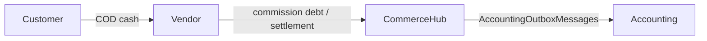

```mermaid
flowchart LR
  Customer -->|"online payment"| Provider["Payment Provider"]
  Provider -->|"captured payment evidence"| CommerceHub
  CommerceHub -->|"operational ledger"| Ledger["CommerceHubFinancialTransactions"]
  Ledger -->|"vendor payable"| Earnings["Vendor Earnings"]
  Earnings -->|"reserved/completed"| Payout
  Payout -->|"AccountingOutboxMessages"| Accounting
```

## 1. Financial Actors

| Actor | Responsibilities proven in implementation | Owns | Never owns / UNKNOWN |
|---|---|---|---|
| Customer | Creates marketplace order/refund request and pays by COD or online payment. Refund request stores `CustomerId` and payout snapshots. | Customer identity on orders/refund requests. | Does not own ledger, settlement, payout execution, commission rules, accounting posting. |
| Vendor | Owns sub-orders by `StoreId`; receives COD cash directly; receives vendor earnings/payouts; can owe COD commission debt. | Vendor-scoped earnings, payout methods/payment methods, vendor debt presentation. | Does not own platform commission truth, Accounting outbox processing, GL posting. |
| CommerceHub | Owns marketplace payment records, vendor earnings, payouts, refunds, settlements, operational ledger entries, and accounting outbox creation for these entries. | `CommerceHubPayments`, `CommerceHubVendorEarnings`, `CommerceHubPayouts`, `CommerceHubRefunds`, `CommerceHubVendorSettlements`, `CommerceHubFinancialTransactions`. | Does not own provider SDK internals or final general ledger posting execution. |
| Super Admin | Approves/rejects refund requests, executes manual refund payout evidence, records settlement/debt clearance/admin adjustments, and completes payout execution in inspected services. | Business authority over Super Admin financial review/execution actions. | Does not directly own Accounting journal entry internals. |
| Payment Runtime | Creates/reuses payment sessions and mutates CommerceHub payment records from provider evidence. | Technical runtime authority for payment initiation/webhook processing. | Provider adapters and SDK behavior are out of scope; provider-side settlement timing is UNKNOWN. |
| Payment Provider | Supplies external payment/refund evidence consumed by CommerceHub payment services. | Provider reference/intent/transaction facts as external evidence. | Does not own CommerceHub payment rows, earnings, payout, settlement, operational ledger. |
| Operational Ledger | Stores CommerceHub financial transaction facts by entity, reference, direction, bucket, idempotency, and correlation. | Marketplace operational finance facts. | Does not own GL journal balancing rules beyond outbox staging. |
| Accounting | Consumes outbox messages and posts accounting journals. | General ledger/journal entries and accounting reports. | Does not own CommerceHub operational business state. |

## 2. Financial Assets

| Asset | Implementation shape | Lifecycle/state evidence |
|---|---|---|
| Marketplace payment | `CommerceHubPayment` stores order, amount, currency, status, provider, provider references, checkout URL/token, refund totals, processing flags, items/logs/attempts/refunds. | Status enum: `Pending`, `Paid`, `Failed`, `Ignored`, `RefundRequired`, `Refunded`, `RefundFailed` (`PointOfSale.Core/Enums/CommerceHubPaymentRecordStatus.cs:3-11`). |
| Vendor earning | `CommerceHubVendorEarning` links sub-order, optional payment, payout, refund, original earning, tenant/vendor, amount, paid/reserved amounts, status, timestamps. | Status enum: `Pending`, `Available`, `PaidOut`, `InPayout`, `Reversed` (`PointOfSale.Core/Enums/CommerceHubVendorEarningStatus.cs:3-9`). |
| Payout | `CommerceHubPayout` stores vendor (`TenantId`), amount/currency, status, method, evidence/reference fields, external transfer idempotency/handoff fields, timestamps, and payout items. | Status enum: `Pending`, `Processing`, `Completed`, `Failed`, `ReconciliationRequired` (`PointOfSale.Core/Enums/CommerceHubPayoutStatus.cs:3-9`). |
| Refund | `CommerceHubRefund` stores vendor, sub-order, optional request/item/payment, amount, commission/promo/vendor earning reversals, status, reason, gateway/failure evidence, full/post-payout flags. | Status enum: `Pending`, `Processing`, `Completed`, `Failed`, `ReconciliationRequired` (`PointOfSale.Core/Enums/CommerceHubRefundStatus.cs:3-9`). |
| Refund request | `CommerceHubRefundRequest` stores order, item, customer, vendor, quantity, amount, reason, payout snapshot, return request id, review/execution timestamps, attempts, and status. | Status enum includes `Requested`, `UnderReview`, `Approved`, `Rejected`, `Cancelled`, `Processing`, `Completed`, `Failed`, `WaitingForReturn`, `AwaitingPayout`, `Paid` (`PointOfSale.Core/Enums/CommerceHubRefundRequestStatus.cs:3-17`). |
| Vendor settlement | `CommerceHubVendorSettlement` stores vendor, settlement type, direction, amount, currency, idempotency key, external reference, notes, recorder, timestamp. | Types: `SettlementPayment`, `AdminAdjustment`, `DebtClearance` (`PointOfSale.Core/Enums/CommerceHubVendorSettlementType.cs:3-7`). |
| Operational ledger transaction | `CommerceHubFinancialTransaction` stores entity type/id, transaction type, direction, bucket, amount, currency, reference type/id, description, reason, idempotency, correlation, creator. | Types: `OrderPayment`, `Commission`, `Refund`, `Payout`, `Adjustment`, `Settlement`, `Promotion`; directions are `Credit`/`Debit`; buckets are `Cash`, `Receivable`, `Payable`. |
| Accounting outbox message | `AccountingOutboxMessage` stores tenant, event type, source type, business entity, payload, idempotency, aggregate version, processing state, journal id, lease/retry state. | Creates bridge from business operation to `CommerceAccountingService` processing. |

## 3. Financial Flows

### COD Flow

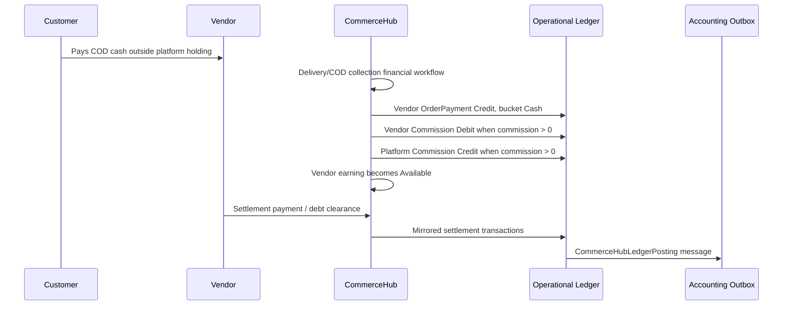

Implementation proof:

- COD is detected by `subOrder.PaymentMethod == CommerceHubPaymentMethod.CashOnDelivery` in `RecordOrderAsync`.
- Vendor receives a vendor `OrderPayment` credit for COD total with `Cash` bucket.
- COD commission creates a vendor `Commission` debit and a platform `Commission` credit when commission amount is positive.
- Delivered COD financials mark COD collected and make earnings available in `CommerceHubFinancialWorkflowService`.

Trigger: delivered/COD collection financial workflow.

Entry point: `CommerceHubFinancialWorkflowService.ApplyDeliveredFinancialsAsync`.

Exit point: operational ledger rows and available vendor earning; settlement/debt clearance later records `CommerceHubVendorSettlement` and mirrored ledger transactions.

Runtime owner: CommerceHub financial workflow and financial ledger services.

Financial owner: CommerceHub owns commission/debt recognition; vendor owns COD cash possession; Accounting owns later GL posting.

### Online Payment Flow

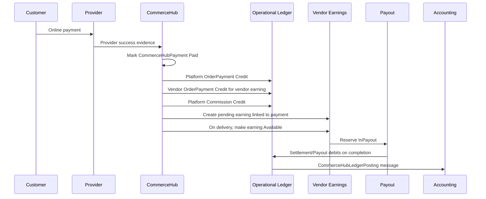

Implementation proof:

- Payment initiation creates/reuses pending `CommerceHubPayment` and attempt records.
- Successful payment status mutation sets payment and attempt to `Paid`.
- Online payment financial workflow records order ledger entries, records payment collected and commission deducted, and creates vendor earnings linked to payment.
- Payout creation requires selected earnings to be `Available`, not delayed, single-currency, and ledger-confirmed before reserving them `InPayout`.

Trigger: provider-recognized payment success and later delivery/payout actions.

Entry point: `CommerceHubPaymentService.InitiateAsync` and successful webhook handling.

Exit point: completed payout and accounting outbox posting.

Runtime owner: CommerceHub payment service, financial workflow, payout service.

Financial owner: CommerceHub owns platform-held payment and vendor payable; provider owns external evidence; Accounting owns GL.

## 4. Runtime Authority Matrix

| Component | Creation authority | Mutation authority | Deletion authority | Read authority | Financial authority |
|---|---|---|---|---|---|
| `CommerceHubPayment` | `CommerceHubPaymentService` creates pending payments (`CreatePendingPayment`, `CreatePaymentAttempt`). | Payment service/webhook/compensation worker mutate statuses. | Soft delete behavior exists via `BaseEntity`; direct deletion authority not proven for normal finance flow. UNKNOWN. | CommerceHub payment/admin/read services. | Payment service owns payment state; provider evidence is external input. |
| `CommerceHubVendorEarning` | `CommerceHubFinancialWorkflowService.EnsureEarningRecord`; refund services create adjustment earnings. | Financial workflow, payout service, refund service. | Normal deletion flow UNKNOWN. | Earnings/read/payout services. | Financial workflow owns earning creation; payout/refund own later financial mutations. |
| `CommerceHubPayout` | `CommerceHubPayoutService.CreatePayoutAsync`. | Payout service marks processing/completed/failed; reconciliation worker can move processing to reconciliation-required. | Normal deletion flow UNKNOWN. | Payout/read/dashboard services. | Payout service owns outward release recognition. |
| `CommerceHubRefund` | `CommerceHubRefundService` and `RefundExecutionService`. | Refund services mutate processing/completed/failed/reconciliation-required and reversal amounts. | Normal deletion flow UNKNOWN. | Refund/customer/admin/read services. | Refund execution services own financial reversal. |
| `CommerceHubVendorSettlement` | `CommerceHubVendorFinancialControlService.RecordSettlementAsync`. | Settlements are created as records; no update state machine found. Mutation after create UNKNOWN. | Normal deletion flow UNKNOWN. | Debt/financial control/read services. | Financial control service owns settlement/debt-clearance/admin adjustment facts. |
| `CommerceHubFinancialTransaction` | `CommerceHubFinancialLedgerService.AppendTransactionIfMissingAsync`. | Append-if-missing only; updates not proven as normal path. | Deletion not part of normal path; duplicate conflict cleanup exists only for failed replay tracking. | Finance dashboard/reconciliation/debt/readiness services. | CommerceHub owns operational ledger truth. |
| `AccountingOutboxMessage` | Created with operational ledger transaction in same unit by `CommerceHubFinancialLedgerService`. | `AccountingOutboxProcessor` claims/processes/retries/marks processed or failure. | Cleanup jobs may exist; deletion authority not discovered in this pass. UNKNOWN. | Accounting processors/monitoring. | Accounting bridge, not business financial authority. |
| General ledger `JournalEntry`/`LedgerEntry` | Accounting services/posting service. | Accounting services. | Accounting deletion authority UNKNOWN. | Accounting reports. | Accounting owns GL. |

Business authority is the service deciding the financial fact; technical authority is the code path that persists it. Example: Super Admin business authority records debt clearance, while `CommerceHubVendorFinancialControlService` technically creates `CommerceHubVendorSettlement` and mirrored ledger rows.

## 5. Financial State Machines

### Marketplace Payment

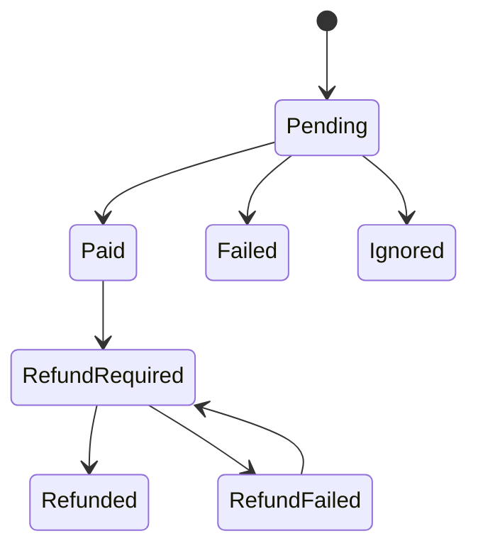

Implementation-backed transitions:

- New payments and attempts are created as `Pending`.
- Successful processing sets payment/attempt `Paid`.
- Failure handling sets payment/attempt `Failed`.
- Duplicate or rejected recognition paths can mark `Ignored`.
- Compensation paths set `RefundRequired`, then `Refunded` or remain/return to `RefundRequired`.

Forbidden/blocked:

- Initiation rejects an order that already has a paid CommerceHub payment.
- Exact full transition graph is UNKNOWN because not all transition guards are centralized.

Terminal states:

- `Paid`, `Failed`, `Ignored`, `Refunded` behave terminal or quasi-terminal in inspected paths; `RefundRequired`/`RefundFailed` are compensation workflow states.

### Vendor Earnings

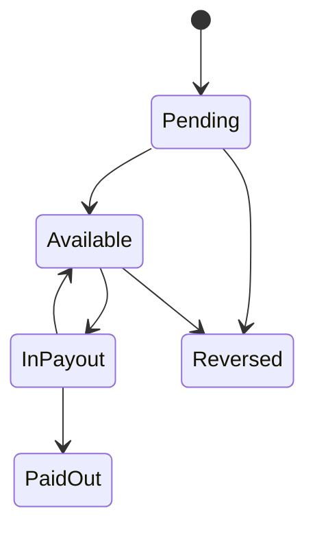

Implementation-backed transitions:

- Created as `Pending`.
- Delivery/availability workflow moves `Pending` to `Available`.
- Payout creation moves `Available` to `InPayout`.
- Completed payout moves `InPayout` to `PaidOut` or back to `Available` if partially paid.
- Failed payout releases `InPayout` back to `Available`.
- Refund services reverse unpaid earnings or create negative adjustment earnings.

Forbidden/blocked:

- Payout creation requires all selected earnings to be `Available`.
- Payout creation requires payout delay elapsed, single EGP currency, and ledger confirmation.
- Refunded/cancelled orders or refunded payment states cannot create/unlock earnings.

Terminal states:

- `PaidOut` and `Reversed` are terminal in inspected paths.

### Payout

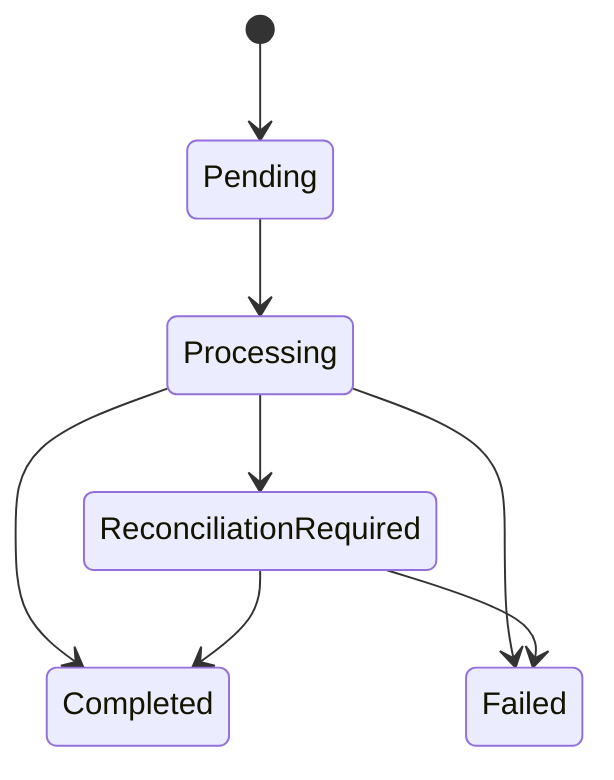

Implementation-backed transitions:

- Payout creation creates `Pending`.
- Mark processing sets `Processing`.
- Mark completed requires processing or reconciliation-required, then sets `Completed` and records payout ledger.
- Mark failed sets `Failed`, releasing earnings, unless external transfer evidence requires reconciliation/completion.
- Reconciliation worker can set stale processing payout to `ReconciliationRequired`.

Forbidden/blocked:

- Completed payout cannot be failed or rolled back.
- Failed payout cannot be completed.
- Processing/reconciliation-required payout cannot be failed unless external transfer is confirmed not executed.
- New payout creation is blocked while another vendor payout is processing/reconciliation-required.

Terminal states:

- `Completed`, `Failed`.

### Vendor Debt / Settlement

Vendor debt is not a standalone mutable entity. It is computed from ledger events:

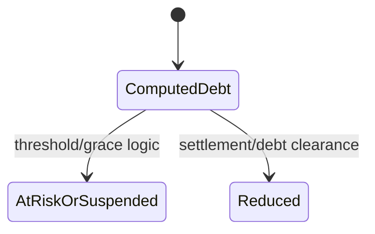

Implementation-backed behavior:

- Debt service reads `CommerceHubFinancialTransactions` for commission, settlement/control, and post-payout refund debt rows.
- Debt delta is positive for debit rows and negative for credit rows.
- Running debt is clamped to non-negative for the exposed amount owed.
- Settlement payment and debt clearance cannot exceed outstanding vendor debt.

Forbidden/blocked:

- Clearing vendor debt with amount over outstanding debt is rejected.
- Settlement payment over outstanding debt is rejected.

Terminal states:

- No terminal debt state exists; debt is computed from ledger history.

### Refund

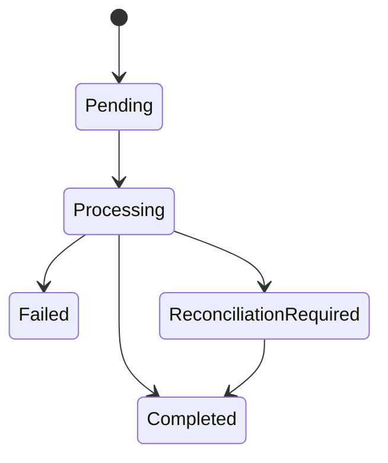

Implementation-backed transitions:

- Refund creation creates `Pending`.
- Execution/confirmation sets `Processing`.
- Completion sets `Completed` and records refund ledger.
- Failure sets `Failed`.
- Manual/external uncertainty can create or move refund to `ReconciliationRequired`.

Refund request state is separate:

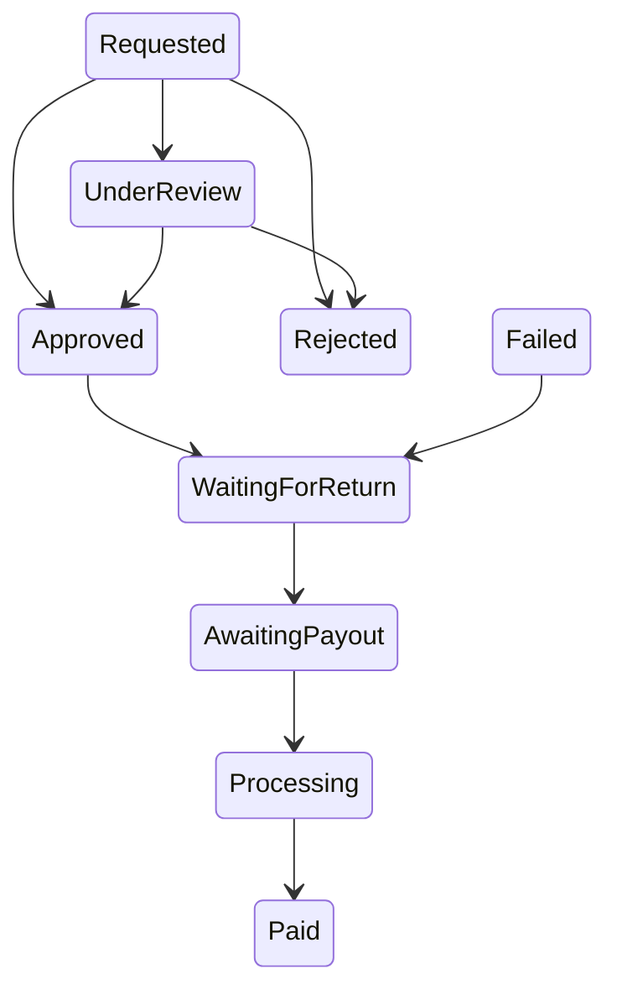

Some refund request states are present in enum but exact transitions were not all found in this phase. UNKNOWN for `Cancelled` and `Completed` request paths.

Terminal states:

- Refund: `Completed`, `Failed` in inspected paths; `ReconciliationRequired` requires recovery/reconciliation.
- Refund request: `Rejected`, `Paid`/`Executed`; `Cancelled` is defined but transition path UNKNOWN.

## 6. Operational Ledger

Why it exists:

- It stores CommerceHub-specific operational financial facts before/alongside accounting.
- It represents platform/vendor entity effects, reference lineage, transaction type, direction, bucket, idempotency, and correlation.
- It powers debt, payout eligibility confirmation, dashboards, reconciliation, and Accounting outbox coverage.

What it stores:

| Field group | Evidence |
|---|---|
| Entity | `EntityType` is `Platform` or `Vendor`; vendor transactions require `EntityId`, platform transactions cannot have it. |
| Transaction | Type, direction, bucket, amount, EGP currency. |
| Reference | Reference type/id for order/refund/payout/settlement/adjustment. |
| Trace | Description, reason, idempotency key, correlation id, created timestamp/user. |

What creates entries:

- `RecordOrderAsync` creates order payment, commission, and promotion entries.
- `RecordRefundAsync` creates refund, commission reversal, promotion reversal, vendor debt/payable entries according to refund scenario.
- `RecordPayoutAsync` creates settlement and payout entries.
- Settlement/debt control uses mirrored transaction recording.

What consumes entries:

- Vendor debt service.
- Payout service ledger confirmation.
- Finance reconciliation/read/dashboard services.
- Accounting outbox processor via `CommerceHubLedgerPosting`.

Relationship with accounting:

- Every appended `CommerceHubFinancialTransaction` stages an `AccountingOutboxMessage` with event type `CommerceHubLedgerPosting` and source type `CommerceHubFinancialTransaction`.
- Accounting outbox processor routes `CommerceHubLedgerPosting` to accounting posting logic.

Relationship with settlement/refunds/earnings:

- Settlement and debt clearance produce ledger deltas and settlement records.
- Refund completion requires refund ledger entries; post-payout refund can create vendor receivable/debt.
- Payout creation requires earnings to have matching vendor order/refund ledger confirmation.

## 7. Accounting Bridge

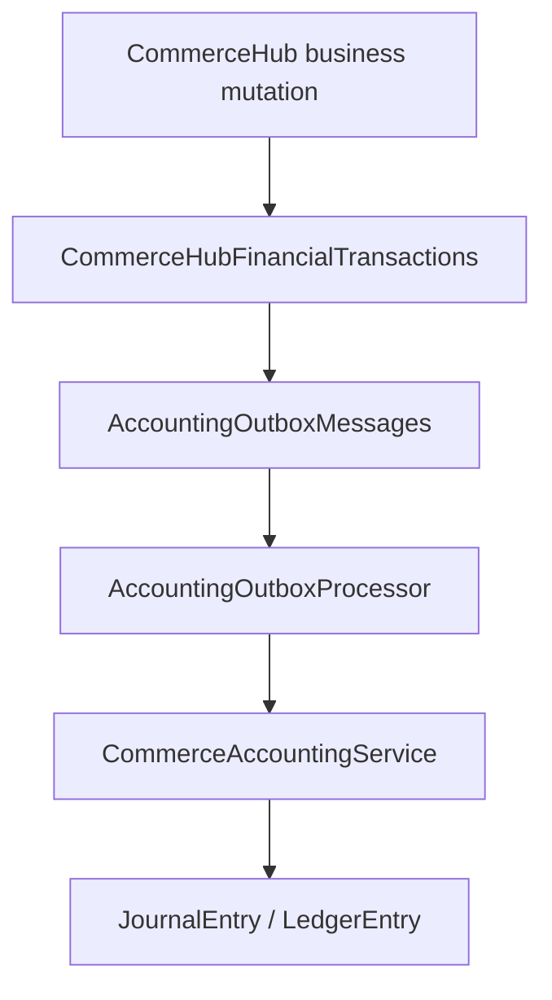

CommerceHub owns the operational ledger because `CommerceHubFinancialLedgerService` creates `CommerceHubFinancialTransaction` rows from CommerceHub payment, refund, payout, order, and settlement facts.

CommerceHub does not own Accounting because outbox messages are processed by `AccountingOutboxProcessor`, which routes events to `CommerceAccountingService`; GL journal/ledger creation is handled by accounting services, not CommerceHub finance services.

Known accounting event bridge:

| Outbox event | Processor target |
|---|---|
| `CommerceHubLedgerPosting` | `ProcessCommerceHubLedgerPostingAsync` |
| `EcommerceRefund` | `ProcessEcommerceRefundAsync` / `PostEcommerceRefundAsync` |
| `GatewaySettlement` | `ProcessGatewaySettlementAsync` / `PostGatewaySettlementAsync` |
| `CodSettlement` | `ProcessCodSettlementAsync` / `PostCodSettlementAsync` |

## 8. Strict Financial Boundaries

| Owner | Owns | Never owns / out of scope |
|---|---|---|
| CommerceHub | Marketplace payment records, sub-order financial snapshots, vendor earnings, operational ledger, refunds, payouts, settlements, vendor payment requests, accounting outbox staging. | Provider SDK internals, provider authentication, GL journal posting authority. |
| Payment Runtime | Payment initiation/session recovery/webhook interpretation into CommerceHub payment state. | Vendor earnings after financial workflow, payout execution, settlement/debt control, Accounting GL. |
| Payment Provider | External payment/refund evidence identifiers and reported amounts/status. | CommerceHub SQL truth, ledger entries, earnings, payouts, settlements. |
| Accounting | Journal entries, ledger entries, accounting reports, outbox processing. | CommerceHub order/payment/earning/refund/payout/settlement business state. |
| Vendor | COD cash possession, vendor-scoped payout/payment methods, payable/debt participation. | Platform commission ownership, operational ledger mutation, GL posting. |
| Customer | Payment/refund request participation and customer identity on orders/refunds. | Vendor settlement, payout execution, commission/debt accounting. |
| Super Admin | Review/execution authority for refunds, payout completion, settlement/debt adjustments. | Provider SDK internals, direct GL internals. |

## 9. Business Rules Extracted

| Rule | Implementation evidence |
|---|---|
| CommerceHub marketplace finance is EGP-only in inspected assets. | Currency guard sets platform base to `EGP`; DB constraints enforce EGP on payments, refunds, payouts, financial transactions, settlements, vendor payment requests. |
| Financial transaction amount must be positive. | `CommerceHubFinancialTransaction.Create` rejects `amount <= 0`. |
| Platform ledger transactions cannot have `EntityId`; vendor transactions must have non-empty `EntityId`. | `CommerceHubFinancialTransaction.Create`. |
| Commission applies to product subtotal; shipping remains pass-through in fallback calculation. | `CommerceHubFinancialWorkflowService` comment and calculation. |
| Gross commission cannot exceed commission base. | `EnsureFinancialSnapshotIntegrity`. |
| Promo discount cannot exceed gross platform commission. | `EnsureFinancialSnapshotIntegrity`. |
| Final commission must equal gross commission minus promo discount. | `EnsureFinancialSnapshotIntegrity`. |
| Vendor earning must equal sub-order total minus gross platform commission. | `EnsureFinancialSnapshotIntegrity`. |
| COD order ledger records vendor cash and commission debt/receivable. | `RecordOrderAsync` COD branch. |
| Online order ledger records platform cash, vendor payable/earning, platform commission, and promotion debit. | `RecordOrderAsync` non-COD branch. |
| Vendor earnings cannot be paid unless Available. | `CommerceHubPayoutService.CreatePayoutAsync`. |
| Payout requires settlement delay elapsed. | `PAYOUT_DELAY_NOT_ELAPSED`. |
| Payout requires single EGP currency. | `PAYOUT_CURRENCY_MISMATCH` plus EGP guard. |
| Payout requires ledger confirmation for selected earnings. | `PAYOUT_LEDGER_CONFIRMATION_REQUIRED`. |
| One externally locked payout per tenant/vendor. | `UX_CommerceHubPayouts_OneProcessingPerTenant` and service checks. |
| Completed payout cannot be failed; failed payout cannot be completed. | `MarkFailedAsync`/`MarkCompletedAsync` guards. |
| Payout completion requires processing or reconciliation-required state. | `PAYOUT_MUST_BE_PROCESSING_BEFORE_COMPLETION`. |
| Settlement payment/debt clearance cannot exceed outstanding vendor debt. | `CommerceHubVendorFinancialControlService`. |
| Vendor debt is ledger-computed and clamped non-negative for amount owed. | `CommerceHubVendorDebtService` running debt calculation. |
| Refund amount must be positive and cannot exceed sub-order total before ledger recording. | `ValidateRefundFinancialIntegrity`. |
| Refund reversal amounts cannot be negative; vendor earning reversal cannot exceed refund amount. | `ValidateRefundFinancialIntegrity`. |
| Refund commission reversal plus promo reversal must equal gross commission reversal. | `ValidateRefundFinancialIntegrity`. |
| COD refunds reverse vendor commission debt; online post-payout refunds can create vendor debt/receivable. | `RecordRefundAsync` scenario branches. |
| Accounting outbox uses tenant/idempotency uniqueness and processing/retry state. | `AccountingOutboxMessageConfiguration`, `AccountingOutboxMessage`. |

## 10. Discovery Conclusions

### Major Discoveries

- CommerceHub finance is not only payment records. It includes operational ledger transactions, vendor earnings, payouts, refunds, settlements, vendor debt computation, and accounting outbox staging.
- Vendor debt is not a persisted debt aggregate; it is computed from operational ledger rows plus settlement/control events.
- COD and online flows use different ledger semantics: COD records vendor cash and commission debt; online records platform cash and vendor payable.
- Operational ledger rows are immediately paired with Accounting outbox messages, but GL posting remains Accounting-owned.

### Major Architectural Observations

- `CommerceHubFinancialTransactions` is the core operational finance ledger and is separate from Accounting `JournalEntry`/`LedgerEntry`.
- Financial state machines are spread across services, not centralized in a single state machine class.
- EGP-only constraints are enforced in entity factories, DbContext guard, and database constraints for inspected CommerceHub finance assets.
- Payout completion is the point where operational payout ledger rows are recorded.

### Major Financial Observations

- Platform commission is recorded even for COD, but COD cash is vendor-held.
- Online vendor earnings are linked to a paid payment id; COD earnings are unlocked on delivery/COD collection.
- Post-payout refunds do not rewrite completed payouts; they create debt/adjustment effects.
- Settlement/debt control records both a settlement row and mirrored operational ledger transactions.

### Business Risks

Discovery-only risks:

- Exact forbidden transition graph is only partially centralized; some transitions are inferred from service guards and assignments.
- Provider-side settlement/cash timing is UNKNOWN because provider adapters/SDKs are out of scope.
- Deletion authority for finance rows is UNKNOWN beyond soft-delete infrastructure and query filters.
- Refund request `Cancelled` and some enum-defined states have UNKNOWN runtime paths in this pass.

### Implementation Observations

- There are strong idempotency and uniqueness constraints for payments, payout evidence, vendor settlements, financial transactions, and accounting outbox messages.
- Accounting outbox failure handling includes retry/lease state and a non-terminal financial failure path.
- Operational read services use ledger rows for dashboards, debt, reconciliation, and payout eligibility.

### Unknown Areas

- Provider settlement timing and provider reserve/fee behavior.
- Exact external bank/payout rail execution contract outside stored evidence fields.
- Normal deletion/void lifecycle for `CommerceHubPayment`, `CommerceHubVendorEarning`, `CommerceHubPayout`, `CommerceHubRefund`, `CommerceHubVendorSettlement`, and `CommerceHubFinancialTransaction`.
- Full transition graph for every refund request enum value.
- Whether there are historical data rows violating `NOT VALID` EGP constraints before validation is UNKNOWN from source-only review.

### Open Questions For CHF-0.5

- Whether CHF-0.5 will name `CommerceHubFinancialTransactions` as the canonical operational ledger.
- Whether CHF-0.5 will document vendor debt as computed state rather than an asset table.
- Whether CHF-0.5 will document refund request and financial refund state machines as two separate official machines.
- Which Accounting outbox event families are CommerceHub-owned versus legacy ecommerce/POS-owned.
