# CHF-0.5 CommerceHub Finance Canonical Architecture

Status: Canonical Architecture

Scope: CommerceHub Finance Domain as implemented.

Source of truth: implementation. CHF-0.0 Discovery is the authoritative discovery input. CommerceHub platform architecture is the constitutional platform input. If a statement cannot be proven from implementation or the authoritative discovery input, it is marked UNKNOWN.

Non-goals: implementation, refactoring, migration, optimization, redesign, future behavior, and new business rules.

## Evidence Register

| Evidence | Source |
|---|---|
| E1 | `docs/architecture/CHF-0.0_COMMERCEHUB_FINANCE_DISCOVERY.md` |
| E2 | `.ai-context/ARCHITECTURE_TRUTH.md` |
| E3 | `docs/architecture/commercehub-final-production-architecture-certification-findings.md` |
| E4 | `docs/architecture/commercehub-payment-authority-certification-findings.md` |
| E5 | `docs/architecture/payment-final-authority-certification-findings.md` |
| E6 | `docs/architecture/commercehub-settlement-merchant-balance-certification-findings.md` |
| E7 | `docs/architecture/commercehub-payout-reconciliation-certification-findings.md` |
| E8 | `docs/architecture/commercehub-refund-financial-reversal-certification-findings.md` |
| E9 | `docs/architecture/treasury-accounting-authority-certification-findings.md` |
| E10 | `PointOfSale.Infrastructure/Data/ApplicationDbContext.cs:173-193`, `:423`, `:2353-2661` |
| E11 | `PointOfSale.Core/Entities/CommerceHubFinance/CommerceHubFinancialTransaction.cs`, `PointOfSale.Infrastructure/Data/Configurations/CommerceHubFinancialTransactionConfiguration.cs` |
| E12 | `PointOfSale.API/Services/CommerceHub/FinancialLedger/CommerceHubFinancialLedgerService.cs` |
| E13 | `PointOfSale.API/Services/CommerceHub/CommerceHubFinancialWorkflowService.cs` |
| E14 | `PointOfSale.API/Services/CommerceHub/CommerceHubPaymentService.cs` |
| E15 | `PointOfSale.API/Services/CommerceHub/CommerceHubPayoutService.cs` |
| E16 | `PointOfSale.API/Services/CommerceHub/CommerceHubRefundService.cs`, `PointOfSale.API/Services/CommerceHub/RefundExecutionService.cs` |
| E17 | `PointOfSale.API/Services/CommerceHub/Finance/CommerceHubVendorDebtService.cs`, `PointOfSale.API/Services/CommerceHub/Finance/CommerceHubVendorFinancialControlService.cs` |
| E18 | `PointOfSale.Core/Entities/Accounting/AccountingOutboxMessage.cs`, `PointOfSale.Infrastructure/Accounting/AccountingOutboxProcessor.cs`, `PointOfSale.Infrastructure/Accounting/CommerceAccountingService.cs`, `PointOfSale.Infrastructure/Accounting/FinancialPostingService.cs` |

## 1. Executive Summary

CommerceHub Finance is the SQL-backed marketplace financial authority for CommerceHub operational money state. It owns CommerceHub payment records, vendor earnings, refunds, payouts, vendor settlements, vendor payment requests, operational financial transactions, and accounting-outbox staging for CommerceHub financial facts. [E1][E10]

CommerceHub Finance intentionally does not own provider SDK internals, provider-side settlement timing, external bank or wallet execution, POS product/catalog truth, customer identity truth, vendor identity truth, or general-ledger posting truth. Provider systems supply external evidence. Accounting owns journal and ledger-line truth. CommerceHub marketplace and order domains own marketplace order and split-order state. [E1][E2][E3][E9]

CommerceHub Finance fits inside CommerceHub after checkout and split-order creation. Checkout persists marketplace order evidence and financial snapshots. Finance consumes those SQL snapshots, payment evidence, delivery evidence, refund evidence, payout evidence, and settlement evidence to create and mutate operational financial state. [E1][E3][E4][E6]

Relationships:

| Neighbor | Relationship |
|---|---|
| Payment Runtime | Payment Runtime owns payment initiation, provider handoff, webhook interpretation, lifecycle execution, unknown-outcome handling, and payment-status mutation. CommerceHub Finance consumes accepted payment state and provider evidence as financial input. [E4][E5][E14] |
| Accounting | CommerceHub Finance stages accounting intent through `AccountingOutboxMessages`; Accounting consumes outbox messages and posts journals/ledger lines. CommerceHub Finance does not own GL truth. [E1][E9][E12][E18] |
| Providers | Providers own external payment/refund/transfer evidence only. Provider evidence is admitted by backend runtime before internal SQL recognition. [E4][E5][E7][E8] |
| Marketplace | Marketplace owns checkout, marketplace order, split-order, vendor, customer, product, shipping, and lifecycle evidence. Finance consumes that evidence but does not redefine it. [E3][E4][E6] |
| Super Admin | Super Admin owns platform-authorized review and execution actions for refunds, payout recognition, settlement payment, debt clearance, and admin adjustment, routed through backend finance services. Super Admin presentation is not financial truth. [E1][E6][E7][E8] |

## 2. Financial Vision

CommerceHub owns internal financial state. Payment Runtime owns payment lifecycle execution. Accounting owns accounting truth. Providers own external payment and transfer evidence. Marketplace owns order business truth. Super Admin owns platform review and execution authority where the implementation routes those operations through finance services. [E1][E2][E3][E4][E9]

This Finance Architecture is ledger-first at the CommerceHub operational level. The operational ledger records CommerceHub-specific money facts before or alongside accounting, while Accounting separately posts double-entry journals from source-authorized rows. [E1][E6][E9][E11][E12][E18]

Finance does not create customer-visible prices, catalog visibility, shipping costs, provider outcomes, or GL journals by itself. It consumes accepted SQL evidence from the owning domains and records CommerceHub financial state under the existing service boundaries. [E2][E3][E4][E9]

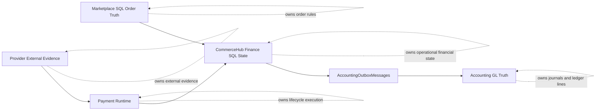

## 3. Financial Runtime

Canonical runtime:

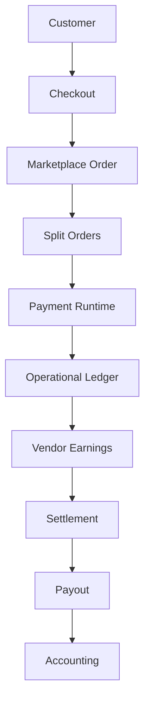

| Stage | Owner | Invoked by | Consumed by | Canonical meaning |
|---|---|---|---|---|
| Customer | Customer identity and authenticated/signed customer access authority. | CommerceHub customer/storefront surfaces. | Checkout, refund request, order visibility. | Customer supplies cart, payment, and refund intent; customer never owns accepted financial mutation authority. [E2][E3][E8] |
| Checkout | Marketplace checkout service and SQL checkout/order boundary. | Customer checkout submission. | Marketplace order, split orders, payment initiation, finance workflow. | Converts validated cart intent into immutable marketplace order and split-order financial snapshots. [E2][E3] |
| Marketplace Order | CommerceHub order SQL and lifecycle boundary. | Checkout. | Payment Runtime, fulfillment, refunds, finance, projections. | Parent marketplace order state and customer aggregate evidence. [E3][E4] |
| Split Orders | CommerceHub sub-order SQL and lifecycle boundary. | Checkout/order lifecycle. | Vendor fulfillment, financial workflow, ledger, refunds, earnings. | Vendor-scoped operational order evidence and financial snapshots. [E3][E4][E6] |
| Payment Runtime | Backend payment services, lifecycle services, SQL payment rows, provider verification. | Checkout payment handoff, customer retry, provider webhooks, recovery. | Finance workflow, order lifecycle, refunds, reconciliation. | Creates/reuses sessions, admits provider evidence, mutates payment lifecycle, routes unknown outcomes to suspense/reconciliation. [E4][E5][E14] |
| Operational Ledger | CommerceHub financial ledger service and `CommerceHubFinancialTransactions`. | Financial workflow, refund execution, payout completion, settlement/debt control. | Debt service, payout service, dashboards, reconciliation, accounting outbox. | Records CommerceHub operational money facts by entity, type, direction, bucket, reference, idempotency, and correlation. [E1][E11][E12] |
| Vendor Earnings | Financial workflow, payout service, refund service over `CommerceHubVendorEarnings`. | Payment success for online orders, COD delivery/collection, refund adjustments. | Payout eligibility, vendor dashboards, reconciliation. | Vendor payable/earning state derived from split-order financial snapshots and ledger/payment/refund evidence. [E1][E4][E13][E15][E16] |
| Settlement | Finance/debt-control services and settlement rows/ledger deltas. | Super Admin settlement/debt clearance/admin adjustment, vendor payment approval where implemented. | Vendor debt, payout readiness, dashboards, accounting outbox. | Marketplace business settlement and debt-control evidence, especially COD commission receivable reduction. [E6][E17] |
| Payout | Payout service and Super Admin execution workflow over payout rows/items. | Vendor payout request/queue creation and Super Admin execution recognition. | Ledger, accounting outbox, reconciliation, vendor dashboard. | Outward release of ledger-confirmed eligible vendor payable, backed by external transfer evidence or reconciliation state. [E7][E15] |
| Accounting | Accounting outbox processor, accounting services, posting service, journal/ledger SQL. | Accounting outbox processing. | Reports, statements, financial accounting views. | Posts double-entry accounting truth from source-authorized financial evidence; does not own CommerceHub operational state. [E9][E18] |

## 4. Runtime Authority Matrix

| Component | Business Owner | Technical Owner | Runtime Owner | Read Authority | Mutation Authority | Financial Authority |
|---|---|---|---|---|---|---|
| Marketplace Payment | Marketplace payment business state under CommerceHub payment authority. | `CommerceHubPaymentService`, payment lifecycle boundaries, SQL `CommerceHubPayments`. | Payment Runtime. | Payment/admin/read services, customer/order status surfaces. | Payment service, webhook/recovery/compensation paths under locks and provider evidence. | Payment Runtime owns payment lifecycle state; CommerceHub Finance consumes recognized payment facts. [E4][E14] |
| Operational Ledger | CommerceHub Finance. | `CommerceHubFinancialLedgerService`, `CommerceHubFinancialTransactions`. | CommerceHub Finance. | Debt, payout, dashboards, reconciliation, accounting outbox. | Ledger service append-if-missing only through financial workflows. | Canonical CommerceHub operational financial source of truth. [E1][E11][E12] |
| Vendor Earnings | CommerceHub Finance. | `CommerceHubFinancialWorkflowService`, `CommerceHubPayoutService`, refund services, SQL `CommerceHubVendorEarnings`. | CommerceHub Finance. | Vendor dashboards, payout queue, reconciliation. | Financial workflow, payout reservation/completion/failure, refund reversal/adjustment. | Vendor earning/payable authority before payout. [E1][E4][E13][E15][E16] |
| Settlement | Marketplace business settlement authority under Finance/Super Admin operation. | `CommerceHubVendorFinancialControlService`, SQL `CommerceHubVendorSettlements`, ledger rows. | CommerceHub Finance. | Debt dashboards, settlement history, reconciliation. | Super Admin-authorized settlement/payment/clearance/adjustment through finance service. | Settlement/debt-control financial authority. [E6][E17] |
| Refund | Super Admin review/execution plus refund services. | `CommerceHubRefundService`, `RefundExecutionService`, SQL refund/request/execution rows, ledger service. | CommerceHub Finance refund runtime. | Customer/Super Admin/POS Admin refund and return views, reconciliation. | Refund services under locks/idempotency; Super Admin/POS Admin where certified. | Refund financial reversal authority. [E8][E16] |
| Payout | Super Admin platform payout execution and vendor payout participation. | `CommerceHubPayoutService`, payout rows/items, vendor payout methods, ledger service. | CommerceHub payout runtime. | Vendor and Super Admin payout dashboards/queues. | Payout service creation/reservation, processing, completion, failure, reconciliation. | Outward vendor payable release authority. [E7][E15] |
| Accounting | Accounting domain. | `AccountingOutboxProcessor`, `CommerceAccountingService`, `FinancialPostingService`, SQL journals/ledger lines. | Accounting runtime. | Accounting reports, financial statements. | Accounting posting service under posting authority. | GL/accounting truth only, not CommerceHub business state. [E9][E18] |
| Payment Runtime | Backend payment runtime. | Payment services, lifecycle service, provider handlers/adapters, SQL payment/lifecycle rows. | Payment Runtime. | Payment status/read/recovery surfaces. | Payment initiation, webhook admission, lifecycle mutation, unresolved evidence. | Payment lifecycle authority; no payout/settlement authority. [E4][E5][E14] |
| Provider | External provider. | Provider system/SDK. | External provider runtime. | Backend provider-evidence admission and reconciliation. | External payment/refund/transfer side effects. | External evidence authority only; no internal SQL authority. [E4][E5][E7][E8] |

## 5. Financial Source Of Truth

| Concept | Source Of Truth | Projection | Consumer | Owner |
|---|---|---|---|---|
| Payment | SQL `CommerceHubPayments`, payment attempts/items/logs, admitted provider evidence, payment lifecycle boundaries. | Payment DTOs, dashboards, frontend payment status, recovery views. | Finance workflow, orders, refunds, reconciliation, customer/Super Admin views. | Payment Runtime for lifecycle; CommerceHub Finance for financial consumption. [E4][E14] |
| Ledger | SQL `CommerceHubFinancialTransactions`. | Dashboards, reconciliation reports, accounting outbox payloads. | Vendor debt, payout readiness, finance dashboard, accounting. | CommerceHub Finance. [E1][E11][E12] |
| Settlement | SQL `CommerceHubVendorSettlements` plus mirrored financial transactions. | Settlement history, debt dashboards. | Vendor debt service, reconciliation, accounting outbox. | CommerceHub Finance/Super Admin financial control. [E6][E17] |
| Vendor Debt | Derived from SQL financial transactions and settlement/control rows. No standalone debt aggregate is the canonical debt truth. | Vendor debt snapshots, suspension messages, dashboards. | Checkout suppression, vendor visibility, Super Admin debt controls. | CommerceHub Finance debt service. [E1][E6][E17] |
| Vendor Earnings | SQL `CommerceHubVendorEarnings` plus order/payment/refund/payout lineage. | Vendor earnings pages, payout queue, dashboards. | Payout service, refund service, reconciliation. | CommerceHub Finance. [E1][E4][E7][E13][E15][E16] |
| Refund | SQL refund request, refund, return, execution, evidence, and ledger rows. | Customer refund view, Super Admin refund queue, reconciliation. | Payment service, finance ledger, payout service, accounting outbox. | CommerceHub refund runtime and Super Admin review/execution where implemented. [E8][E16] |
| Payout | SQL payout rows/items, earning allocations, external evidence fields, ledger rows. | Vendor payout history, Super Admin payout queue, reconciliation. | Accounting, dashboards, vendor statements. | CommerceHub payout runtime. [E7][E15] |
| Accounting | SQL `JournalEntry` and `LedgerEntry` through `FinancialPostingService`. | Financial reports, statements, trial balance, GL views. | Reporting and accounting consumers. | Accounting domain. [E9][E18] |
| Provider Evidence | Provider payload/reference/intent/transaction evidence after backend admission; unresolved evidence rows where provider evidence cannot be matched. | Webhook logs, unresolved/suspense views, reconciliation. | Payment Runtime, refund runtime, payout execution/reconciliation. | Provider owns external fact; backend owns internal admission and recognition. [E4][E5][E7][E8][E14] |

## 6. Domain Boundaries

### CommerceHub Finance Owns

- CommerceHub operational financial state for payments, earnings, payouts, refunds, settlements, vendor debt computation, payment requests, operational ledger rows, financial audits, reconciliation reads, and accounting-outbox staging. [E1][E6][E7][E8][E10]
- Financial state mutation through backend services and SQL transaction boundaries, not through frontend state, DTO totals, projections, cache, or events alone. [E2][E3][E4]
- COD commission receivable/debt recognition and settlement/debt-clearance facts. [E6][E17]
- Online-payment vendor payable/earning state after payment recognition and delivery/availability rules. [E4][E6][E13]

### CommerceHub Finance Never Owns

- Provider-side settlement timing, provider fee/reserve behavior, provider SDK internals, or external bank/wallet completion truth. Those are UNKNOWN except as admitted external evidence. [E1][E4][E7]
- General ledger journal/ledger-line posting truth. [E9][E18]
- Product/catalog/publication/search authority. [E2][E3]
- Customer identity, vendor identity, POS tenant identity, or Super Admin identity. [E2][E3]
- Shipping method/cost authority, carrier tracking authority, and order fulfillment authority. [E3]

### Payment Runtime Owns

- Payment initiation, session creation/reuse, provider handoff, webhook verification/admission, payment lifecycle mutation, provider suspense, compensation, retry, and reconciliation-required payment outcomes. [E4][E5][E14]

### Accounting Owns

- Accounting journals, ledger lines, posting authority, double-entry validation, accounting reports, and accounting replay/idempotency. [E9][E18]

### Provider Owns

- External payment, refund, and transfer side effects and their evidence. Provider evidence is not internal truth until admitted by backend SQL authority. [E4][E5][E7][E8]

### Marketplace Owns

- Checkout, marketplace order, split order, product/publication input evidence, shipping assignment, immutable order financial snapshots, and order lifecycle. [E3][E4][E6]

### Super Admin Owns

- Platform-authorized review and execution operations: refund approval/rejection/manual execution, payout completion recognition, settlement payment, debt clearance, admin adjustment, and finance monitoring. Super Admin UI and selected rows are not business truth. [E1][E6][E7][E8]

### Vendor Owns

- Vendor participation, tenant-scoped payout method submission, COD cash possession, payout request participation, and vendor-facing finance reads. Vendor does not own platform commission truth, operational ledger mutation, payout execution recognition, or GL posting. [E1][E6][E7]

### Customer Owns

- Customer order/payment/refund request intent and customer identity on orders/refund requests. Customer does not own ledger, settlement, payout, commission, provider, or accounting mutation authority. [E1][E8]

### Explicit Boundary Violations

The following are architectural violations under this canonical architecture:

- Frontend, route state, browser storage, DTO totals, dashboards, cache, projections, events, or search documents creating or mutating financial truth. [E2][E3][E4][E5]
- Accounting creating CommerceHub payment, earning, settlement, refund, payout, or vendor debt business state. [E9]
- Payment Runtime releasing vendor money, settling vendor debt, or owning marketplace commission rules. [E4][E5][E7]
- Provider callbacks or browser provider outcomes becoming internal truth without backend admission, SQL amount/currency matching, and lifecycle authority. [E4][E5]
- Settlement, refund, payout, or debt logic bypassing `CommerceHubFinancialTransactions` where the implemented flow requires ledger-backed state. [E1][E6][E7][E8][E12]

## 7. Financial Timeline

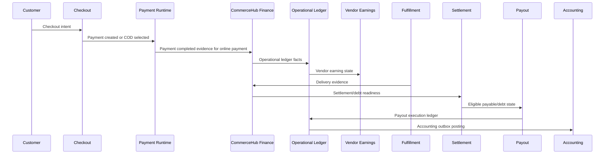

| Step | Business Owner | Financial Owner | Runtime Owner | Explanation |
|---|---|---|---|---|
| Customer Checkout | Marketplace checkout. | None yet beyond accepted SQL order snapshots after commit. | `CommerceHubCheckoutService`. | Checkout recomposes SQL authority and persists marketplace/split-order evidence. [E3] |
| Payment Created | Payment Runtime. | Payment Runtime for payment lifecycle state. | `CommerceHubPaymentService`. | Creates or reuses pending SQL payment rows; provider session is not payment success. [E4][E14] |
| Payment Completed | Payment Runtime with provider evidence. | Payment Runtime owns payment recognition; CommerceHub Finance consumes result. | Payment webhook/recovery processing. | Provider success must match SQL payment/order amount/currency and identity before recognition. [E4][E14] |
| Operational Ledger | CommerceHub Finance. | CommerceHub Finance. | `CommerceHubFinancialLedgerService`. | Records order, commission, refund, payout, settlement, promotion, and adjustment operational facts. [E1][E11][E12] |
| Vendor Earnings | CommerceHub Finance. | CommerceHub Finance. | `CommerceHubFinancialWorkflowService`, payout/refund services. | Creates earnings from sub-order snapshots after online payment success or COD delivery/collection. [E4][E13] |
| Delivery | Order/Fulfillment lifecycle. | Finance consumes delivery to unlock applicable earnings. | Order/fulfillment services plus finance workflow. | Delivery evidence causes COD collection financials and/or earning availability in inspected flows. [E1][E3][E13] |
| Settlement | CommerceHub Finance/Super Admin operation. | CommerceHub Finance. | Vendor debt and financial control services. | Records settlement payment, admin adjustment, or debt clearance with mirrored ledger deltas. [E6][E17] |
| Payout | CommerceHub payout runtime/Super Admin execution. | CommerceHub Finance until Accounting posting. | `CommerceHubPayoutService`. | Reserves available ledger-confirmed earnings and records outward release after evidence/recognition. [E7][E15] |
| Accounting | Accounting domain. | Accounting. | Accounting outbox processor and posting service. | Consumes outbox and posts double-entry journal/ledger-line truth. [E9][E18] |

## 8. Ownership Timeline

### Online Payment

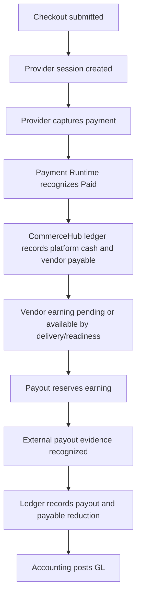

| Point | Money Ownership | Liability Ownership | Financial State Ownership |
|---|---|---|---|
| Before provider capture | Customer/provider handoff in progress; internal held money not recognized. | UNKNOWN for provider-side authorization/hold semantics. | Payment Runtime pending SQL state. [E4][E14] |
| Provider capture recognized | Platform holds captured online funds internally. | Platform owes vendor payable according to SQL snapshots and later readiness. | Payment Runtime for payment state; Finance for ledger/earnings. [E4][E6] |
| Ledger and earning recorded | Platform cash and vendor payable are CommerceHub operational ledger facts. | Vendor payable exists as SQL earning/ledger state. | CommerceHub Finance. [E1][E11][E12][E13] |
| Payout reserved | Platform still holds money; earning is reserved in payout. | Liability is reserved for payout execution. | CommerceHub payout runtime. [E7][E15] |
| Payout completed | External payout rail evidence supplies transfer proof; platform payable reduced internally. | Vendor payable reduced by payout ledger. | CommerceHub Finance records payout; Accounting posts GL separately. [E7][E9][E12][E18] |

### COD

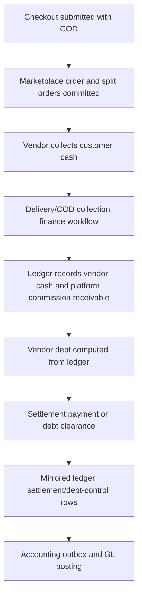

| Point | Money Ownership | Liability Ownership | Financial State Ownership |
|---|---|---|---|
| Before delivery/COD collection | Customer payment not platform-held. | COD collection state follows order/fulfillment lifecycle. | Marketplace/order lifecycle. [E3][E6] |
| Vendor collects cash | Vendor physically holds customer cash. | Vendor owes platform commission receivable when ledger recognizes commission debt. | CommerceHub Finance ledger/debt service. [E6][E12][E17] |
| Debt threshold | Vendor debt is computed; `amountOwed >= threshold` suspends new CommerceHub orders. | Vendor owes platform until settlement/clearance/adjustment reduces debt. | CommerceHub vendor debt service. [E6][E17] |
| Settlement/debt clearance | Vendor/platform settlement evidence reduces debt. | Liability decreases by ledger-backed settlement/control rows. | Finance control service and operational ledger. [E6][E17] |
| Accounting | Accounting posts journals from outbox. | GL reflects source-authorized state. | Accounting. [E9][E18] |

## 9. State Ownership

| State Machine | Owner | Mutator | Consumer | Reader |
|---|---|---|---|---|
| Payment | Payment Runtime over SQL `CommerceHubPayments`. | `CommerceHubPaymentService`, webhook/recovery/compensation paths. | Finance workflow, order status, refunds, reconciliation. | Customer, admin, recovery, dashboard surfaces. [E4][E14] |
| Vendor Earnings | CommerceHub Finance over SQL `CommerceHubVendorEarnings`. | Financial workflow, payout service, refund service. | Payout, debt/refund handling, reconciliation. | Vendor dashboard, payout queue, finance reads. [E1][E13][E15][E16] |
| Refund | CommerceHub refund runtime over SQL refund/request/execution rows. | Refund services, Super Admin review/execution, POS Admin return receipt where certified. | Payment, payout, ledger, accounting outbox, customer/Super Admin status. | Refund pages, dashboards, reconciliation. [E8][E16] |
| Settlement | CommerceHub Finance control over settlement rows and ledger deltas. | `CommerceHubVendorFinancialControlService`. | Debt, dashboards, accounting outbox, reconciliation. | Super Admin/vendor finance surfaces. [E6][E17] |
| Payout | CommerceHub payout runtime over payout rows/items and earning reservations. | `CommerceHubPayoutService`, Super Admin execution recognition, reconciliation worker. | Ledger, accounting, vendor statements, dashboards. | Vendor and Super Admin payout views. [E7][E15] |
| Debt | Derived state, not a persisted standalone debt state machine. | Ledger entries and settlement/control rows indirectly change debt. | Checkout suppression, vendor visibility, Super Admin collection. | Debt snapshots and dashboards. [E1][E6][E17] |

### Canonical State Diagrams

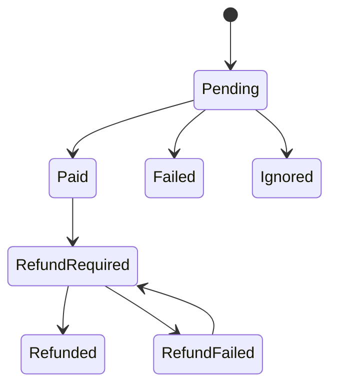

Payment transition guards are distributed across payment services, provider handlers, compensation, and recovery paths. The full forbidden transition graph is UNKNOWN because not every assignment is centralized. [E1][E4][E14]

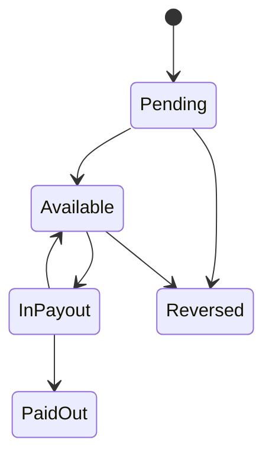

Vendor earnings are created from financial workflow and later reserved, paid out, released, or reversed by payout/refund workflows. [E1][E13][E15][E16]

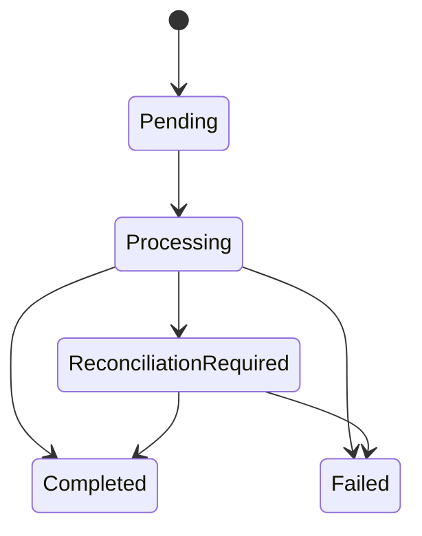

Payouts use `Pending`, `Processing`, `Completed`, `Failed`, and `ReconciliationRequired`; failed/completed terminal behavior is enforced in inspected paths. [E7][E15]

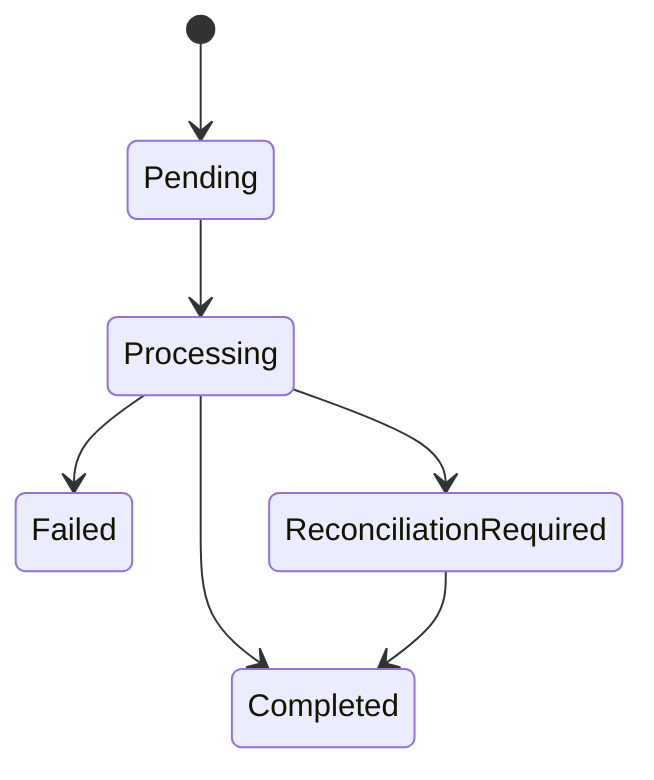

Refund financial state uses `Pending`, `Processing`, `Completed`, `Failed`, and `ReconciliationRequired`; refund request state is separate and includes request/review/return/payout states. Some refund request enum paths remain UNKNOWN. [E1][E8][E16]

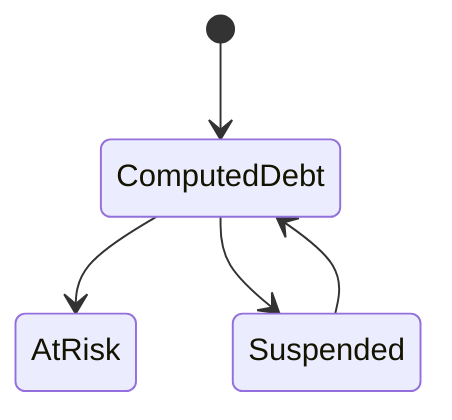

Debt is recomputed from ledger/control rows and exposed as snapshots; it is not a standalone mutable aggregate. [E1][E6][E17]

## 10. Runtime Relationships

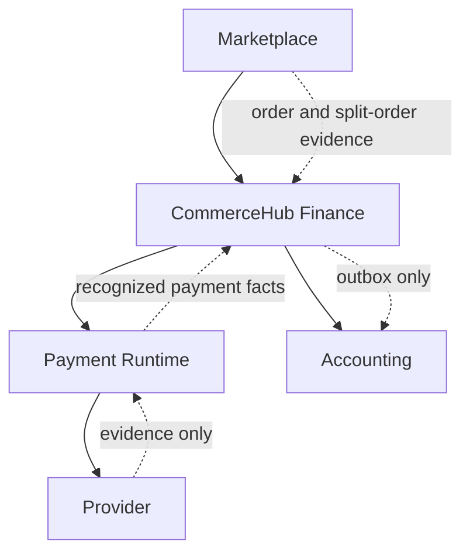

Allowed dependency directions:

| From | To | Allowed dependency |
|---|---|---|
| Marketplace | CommerceHub Finance | Marketplace order and split-order SQL snapshots feed finance workflows. [E3][E6] |
| CommerceHub Finance | Payment Runtime | Finance can consume recognized payment state and request payment/refund execution through backend runtime boundaries where implemented. [E4][E8][E14][E16] |
| Payment Runtime | Provider | Payment Runtime calls provider/session/webhook/refund APIs or handlers and admits provider evidence. [E4][E5][E14] |
| CommerceHub Finance | Accounting | Finance stages `AccountingOutboxMessages`; Accounting posts journals. [E1][E9][E12][E18] |
| Reconciliation | Owning domains | Reconciliation may re-enter owning SQL/service boundaries or report anomalies. It cannot mutate money by itself. [E3][E4][E7][E8] |

Forbidden dependency directions:

| Forbidden direction | Reason |
|---|---|
| Provider to Finance direct authority | Provider evidence must be admitted by backend payment/refund/payout runtime before internal SQL truth changes. [E4][E5][E7][E8] |
| Accounting to CommerceHub business state | Accounting posts GL truth only; it does not own payment, earning, refund, settlement, payout, or debt state. [E9] |
| Payment Runtime to marketplace rules | Payment collection does not own checkout price, commission, vendor earning, settlement, or payout rules. [E4][E5] |
| Frontend/projection/cache/search to Finance mutation | These surfaces are derivative or intent only. [E2][E3][E5] |
| Reconciliation to money creation | Reconciliation records/report/routes anomalies and re-enters owner boundaries; it cannot create value from stale evidence. [E3][E4][E7][E8] |

## 11. Architectural Principles

| Principle | Canonical statement | Implementation backing |
|---|---|---|
| SQL Is Financial Authority | Internal CommerceHub financial truth is PostgreSQL-backed SQL state. | SQL DbSets and constraints for payment, earning, payout, refund, settlement, financial transaction, and accounting outbox assets. [E2][E10] |
| Operational Ledger First | CommerceHub operational financial state is recorded in `CommerceHubFinancialTransactions` before/alongside Accounting posting. | Ledger entity/configuration and ledger service append/order/refund/payout/settlement behavior. [E1][E11][E12] |
| Accounting Never Owns Business State | Accounting owns journals and ledger lines, not CommerceHub payment/earning/refund/payout/settlement state. | Accounting authority certification and outbox processor routing. [E9][E18] |
| Payment Runtime Never Owns Marketplace Rules | Payment Runtime recognizes payment lifecycle state and provider evidence; it does not create settlement or release vendor money. | CommerceHub payment authority and payment final authority findings. [E4][E5] |
| Settlement Is Marketplace Business | Settlement/debt clearance/admin adjustment are CommerceHub Finance/Super Admin operations recorded as settlement rows plus ledger deltas. | Settlement certification and vendor financial control service. [E6][E17] |
| Provider Supplies Evidence Only | Providers own external payment/refund/transfer facts; internal recognition is backend SQL authority. | Payment, payout, and refund certifications. [E4][E5][E7][E8] |
| Vendor Debt Is Derived | Vendor debt is computed from ledger/control rows and clamped for amount owed; no standalone debt table is canonical. | Discovery and vendor debt service. [E1][E17] |
| Business Authority Before Technical Authority | Super Admin may own business approval/execution while backend finance services own persisted technical mutation. | Refund, payout, settlement findings and services. [E6][E7][E8][E15][E16][E17] |
| Reconciliation Does Not Create Value | Reconciliation can detect, persist, classify, route, and re-enter owners; it cannot mint money. | CommerceHub final, payment, payout, refund certifications. [E3][E4][E7][E8] |
| Unknown External Outcomes Stay Explicit | Ambiguous provider/bank results remain processing, suspense, unresolved, or reconciliation-required instead of guessed. | Payment provider suspense, payout reconciliation-required, refund reconciliation-required. [E4][E7][E8][E14][E15][E16] |
| Currency Is EGP In CommerceHub Finance | Inspected CommerceHub finance assets enforce EGP. | Discovery, DB constraints, financial transaction currency guard. [E1][E10][E11] |

## 12. Financial Authority Graph

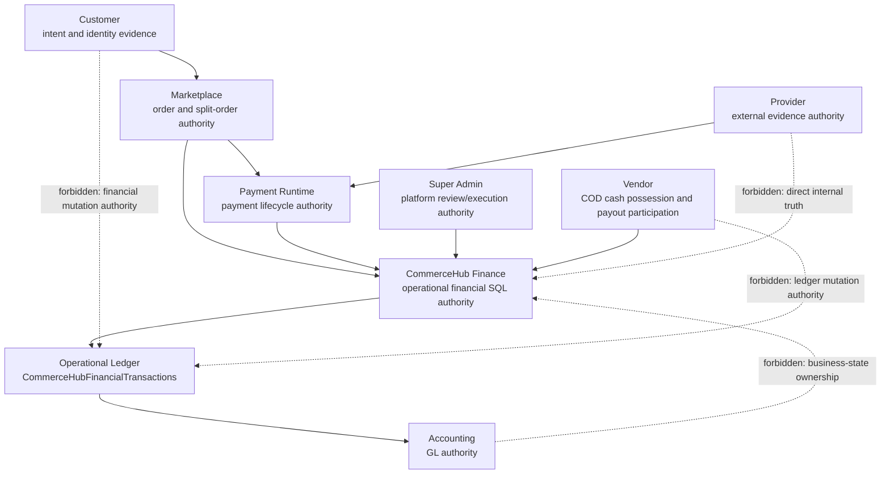

| Node | Owns | Authority | Allowed communication | Forbidden communication |
|---|---|---|---|---|
| Customer | Customer intent and customer identity evidence on orders/refunds. | Request intent only. | Checkout, payment attempt, refund request. | Direct ledger, settlement, payout, accounting mutation. [E1][E8] |
| Vendor | COD cash possession, payout method submission, vendor finance participation. | Vendor-scoped participation and reads. | Vendor payout/debt/payment request workflows. | Platform commission truth, ledger mutation, GL posting. [E6][E7] |
| Marketplace | Checkout/order/split-order lifecycle and snapshots. | Business order authority. | Feeds Finance and Payment Runtime. | Rewriting payment/provider/accounting truth. [E3][E4] |
| CommerceHub Finance | Operational financial SQL state. | Financial runtime authority. | Consumes marketplace/payment/provider-admitted evidence; stages accounting outbox. | Provider SDK internals, GL posting internals. [E1][E9] |
| Payment Runtime | Payment lifecycle. | Payment initiation/webhook/recovery authority. | Provider handoff, accepted payment facts to Finance. | Settlement/payout/business commission ownership. [E4][E5] |
| Provider | External side effects and evidence. | External evidence authority. | Evidence to Payment Runtime or payout/refund execution admission. | Internal SQL mutation authority. [E4][E7][E8] |
| Accounting | Journal and ledger-line truth. | GL/accounting authority. | Consumes outbox/source-authorized postings. | CommerceHub business-state ownership. [E9][E18] |
| Super Admin | Platform financial review/execution operations. | Business action authority for certified operations. | Calls backend finance services. | Direct provider SDK internals, direct GL mutation, frontend-only truth. [E6][E7][E8] |
| Operational Ledger | CommerceHub operational money facts. | Finance source of truth for operational facts. | Feeds debt, payout, dashboards, reconciliation, accounting outbox. | Direct mutation from UI/projection/provider/accounting. [E1][E11][E12] |

## 13. Financial Layering

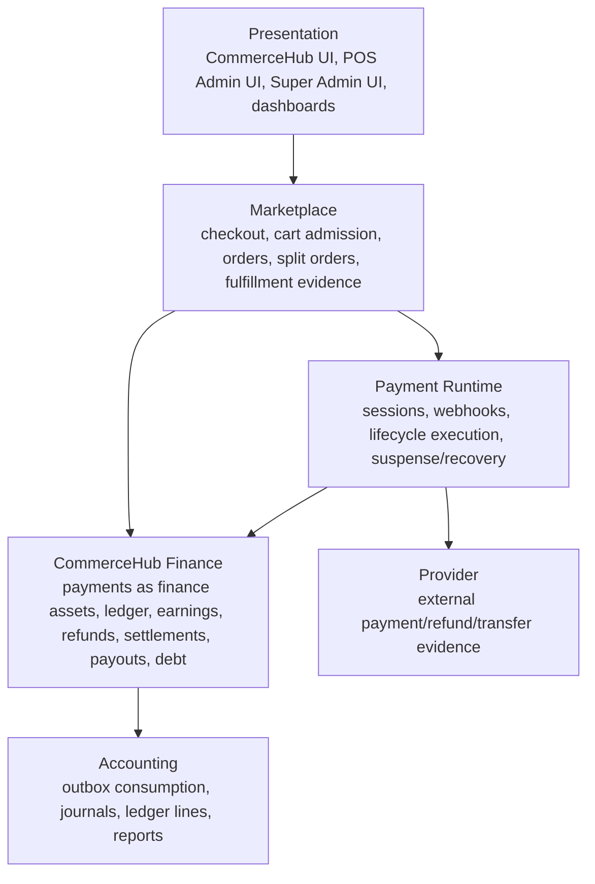

| Layer | Responsibility |
|---|---|
| Presentation | Presents backend DTO evidence and submits intent. It never owns financial authority. [E2][E3][E5] |
| Marketplace | Owns checkout-to-order conversion, marketplace order and split-order snapshots, and lifecycle evidence consumed by Finance. [E3] |
| CommerceHub Finance | Owns operational financial SQL state: ledger, earnings, settlement, debt, refund financial reversal, payout, and accounting-outbox staging. [E1][E6][E7][E8] |
| Payment Runtime | Owns payment lifecycle execution and provider evidence admission; emits recognized payment state for Finance. [E4][E5] |
| Provider | Owns external evidence and side effects only. [E4][E7][E8] |
| Accounting | Owns GL posting, journal/ledger-line integrity, accounting reports, and source-authorized replay. [E9][E18] |

## 14. Architecture Decisions

### Why Operational Ledger Exists

The operational ledger exists because CommerceHub needs marketplace-specific financial facts before or alongside accounting. `CommerceHubFinancialTransactions` records entity type/id, transaction type, direction, bucket, amount, currency, reference, idempotency, and correlation. It powers debt, payout eligibility, dashboards, reconciliation, and accounting-outbox coverage. [E1][E11][E12]

### Why Accounting Is Separate

Accounting owns double-entry journals and ledger lines through posting authority. CommerceHub Finance stages outbox messages but does not directly own GL truth. This separation preserves business-state ownership and accounting reporting authority. [E1][E9][E18]

### Why Payment Runtime Is Separate

Payment Runtime owns provider handoff, webhook admission, lifecycle mutation, replay collapse, and unknown-outcome handling. Payment collection does not release vendor money or own marketplace rules; Finance consumes recognized payment facts after backend admission. [E4][E5][E14]

### Why Vendor Debt Is Derived

Vendor debt is computed from ledger commission, settlement/control, repayment, and refund-impact rows rather than stored as a standalone debt aggregate. This makes current debt a recomposition of operational financial facts. [E1][E6][E17]

### Why Settlement Exists

Settlement exists to record marketplace business evidence that reduces or adjusts vendor obligations, especially COD commission debt. Settlement/debt clearance/admin adjustment rows require idempotency, external reference, actor/reason evidence, mirrored ledger posting, and validation against outstanding debt in inspected paths. [E6][E17]

### Why Refund Runtime Exists

Refund Runtime exists because refund financial reversal has separate authority from payment collection and payout completion. It must validate request/review/return evidence, payment/order lineage, cumulative refund bounds, payout overlap, commission/promo/vendor earning effects, provider/manual execution evidence, and reconciliation states. [E8][E16]

### Why Earnings Exist

Vendor earnings exist to represent vendor payable/earning state derived from split-order financial snapshots, online payment recognition or COD collection, delivery/readiness, payout reservation, payout completion, and refund adjustment. Earnings are the bridge between order financial evidence and payout eligibility. [E1][E4][E7][E13][E15][E16]

### Why Provider Never Owns Business State

Provider evidence can prove external side effects, but internal state changes require backend admission, SQL matching, locks, idempotency, and lifecycle boundaries. Provider payloads, browser outcomes, or external references cannot directly own CommerceHub SQL payment, refund, payout, ledger, settlement, or accounting truth. [E4][E5][E7][E8]

## 15. Canonical Architecture Conclusions

### Financial Architecture

CommerceHub Finance is the operational marketplace finance domain. Its canonical assets are SQL payment records, vendor earnings, refunds, refund requests/executions, payouts, payout items, vendor settlements, vendor payment requests/proofs, operational financial transactions, financial audit/reconciliation records, and accounting-outbox messages. [E1][E6][E7][E8][E10]

### Authority Model

Authority is single-owner and SQL-led. Marketplace owns orders and split-order snapshots. Payment Runtime owns payment lifecycle. CommerceHub Finance owns operational financial state. Provider owns external evidence. Accounting owns GL truth. Super Admin owns platform review/execution actions through backend services. [E2][E3][E4][E6][E7][E8][E9]

### Ownership Model

Online payment money becomes platform-held only after provider evidence is admitted and payment state is recognized. Vendor payable is represented through ledger/earning state and released through payout runtime. COD cash is vendor-held; platform commission becomes ledger-derived vendor debt/receivable until settlement/debt control reduces it. [E4][E6][E7][E13][E17]

### Layering Model

Presentation submits intent and renders evidence. Marketplace creates authoritative order snapshots. Finance records operational money state. Payment Runtime executes payment lifecycle. Providers supply external evidence. Accounting posts source-authorized GL. [E2][E3][E4][E9]

### Source Of Truth Model

PostgreSQL is the internal business authority. MongoDB, Redis, Elasticsearch, queues, outboxes, DTOs, frontend state, dashboards, and analytics are derivative, transport, staging, presentation, or evidence layers unless a backend SQL owner re-admits them. [E2][E3]

### Boundary Model

CommerceHub Finance must not absorb Payment Runtime, Accounting, Provider, Marketplace, Super Admin identity, Vendor identity, Customer identity, catalog, shipping, fulfillment, projection, cache, or frontend authority. Those domains communicate through admitted evidence and backend service boundaries. [E2][E3][E4][E9]

### Runtime Model

The canonical runtime is:

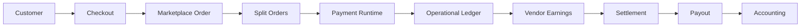

### Unknowns

The following remain UNKNOWN because implementation/discovery does not prove them as canonical business rules:

- Provider-side settlement timing and provider reserve/fee behavior. [E1]
- Exact external bank, wallet, or payout rail execution contracts beyond stored evidence fields. [E1][E7]
- Normal deletion/void lifecycle for CommerceHub finance rows beyond soft-delete infrastructure and discovered cleanup/recovery behavior. [E1]
- Full centralized forbidden-transition graph for every payment, refund request, refund, payout, earning, and settlement state. [E1]
- Full refund request transition paths for every enum value, including some `Cancelled` and `Completed` request paths. [E1]

This document is the canonical Finance Architecture for CHF-1 through CHF-8. It supersedes future Finance architecture discussion unless implementation changes and a new implementation-backed canonical document supersedes it.
