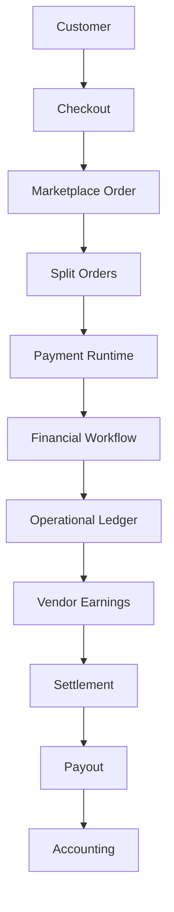
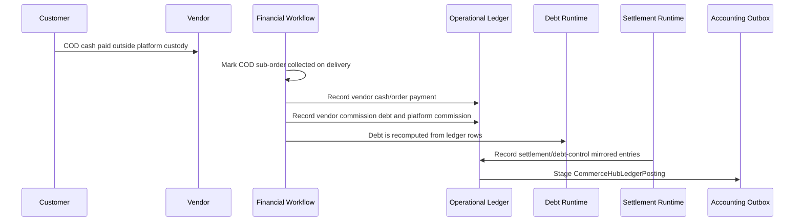
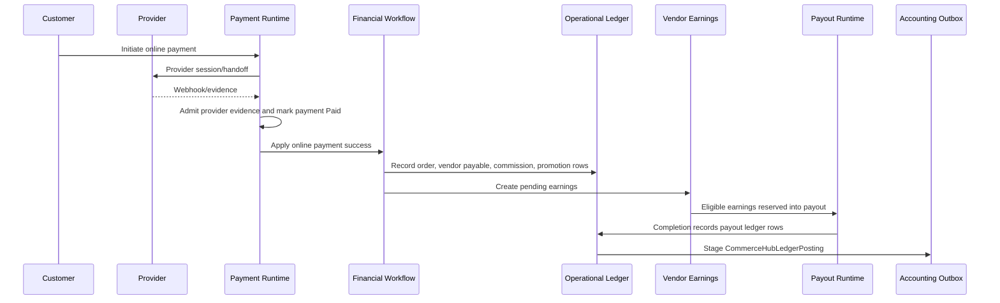
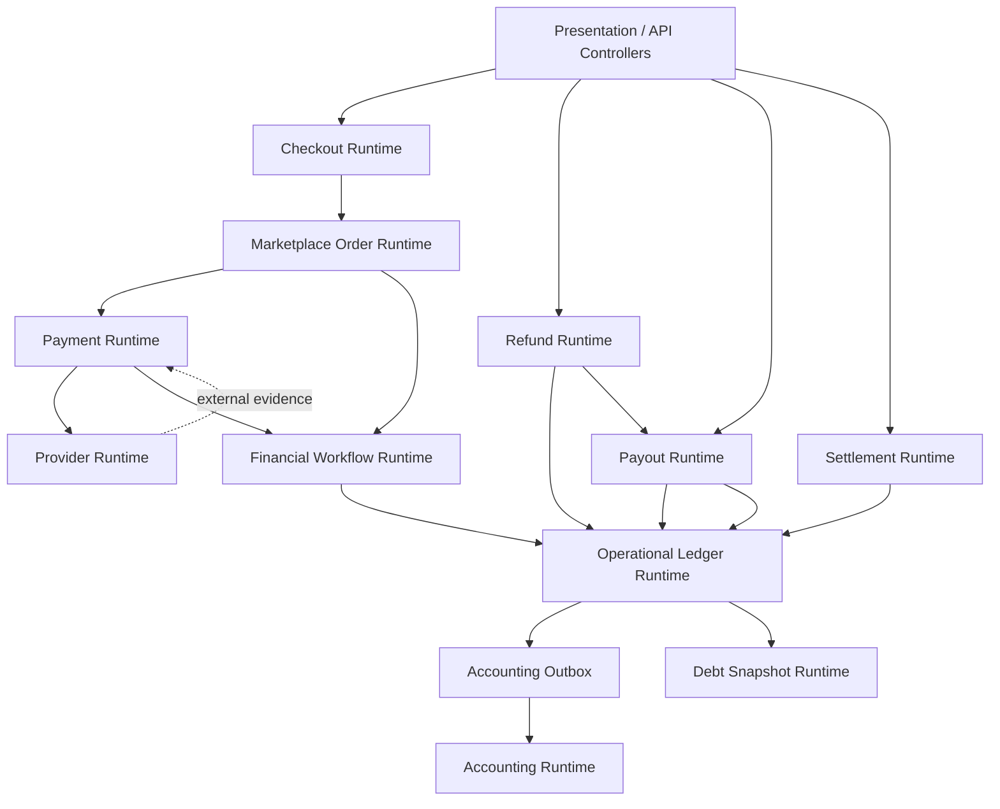
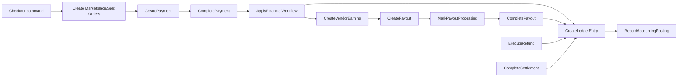
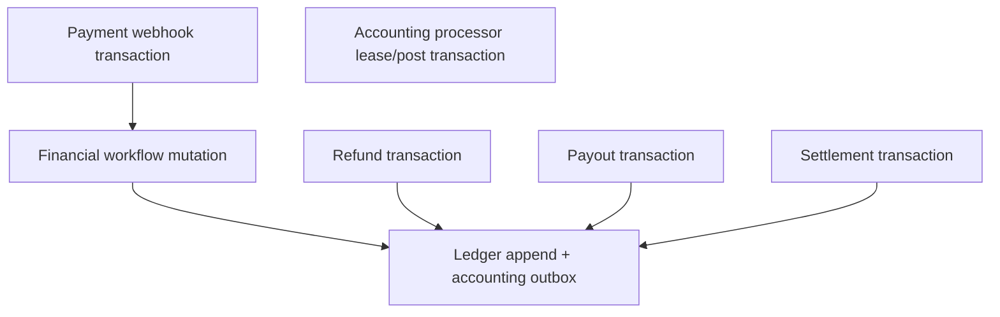
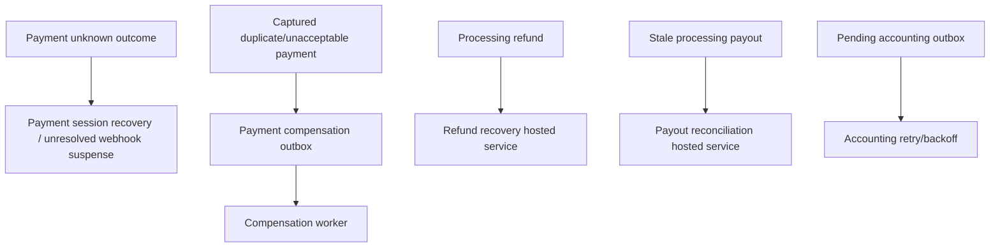
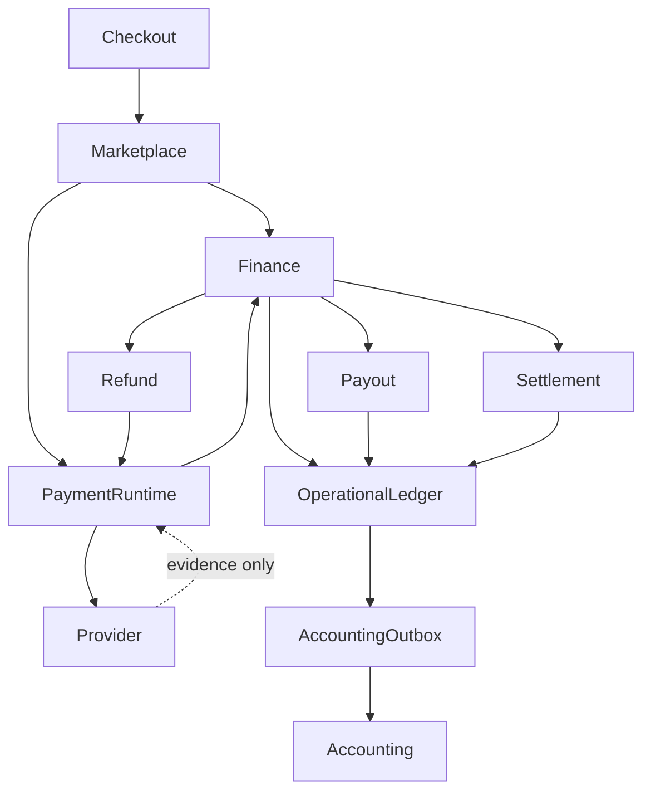
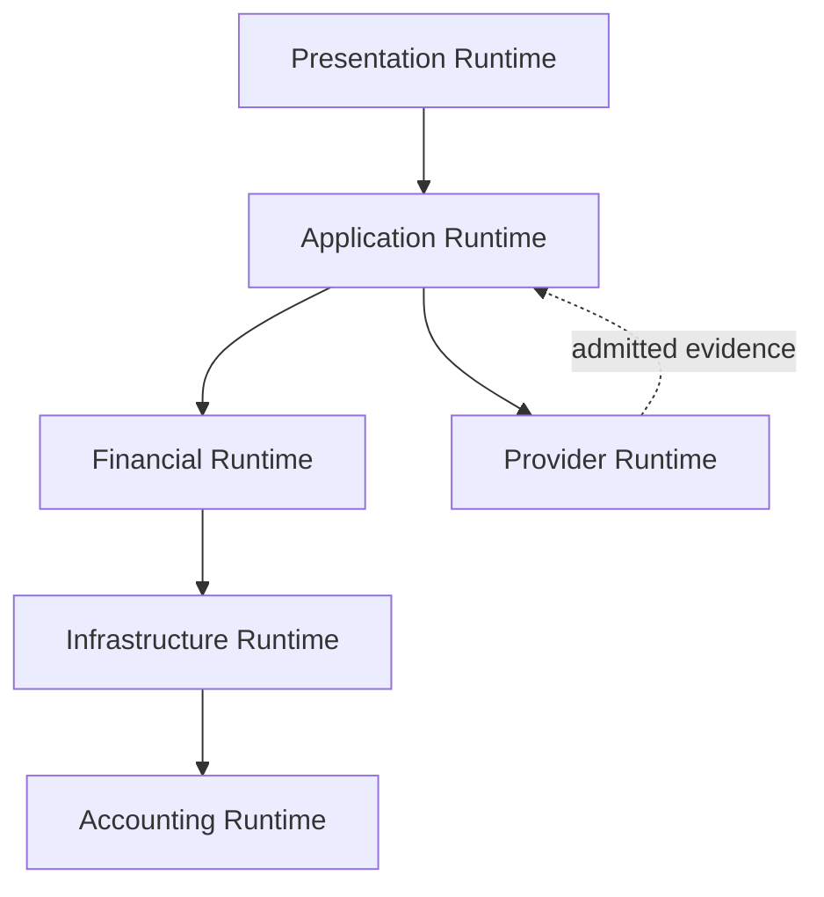

# CHF-0.7 CommerceHub Finance Canonical Runtime Blueprint

Status: Canonical Runtime Blueprint

Scope: CommerceHub Finance runtime execution as implemented.

Source of truth: implementation. CHF-0.0 Discovery, CHF-0.5 Canonical Architecture, and CommerceHub Final Production Architecture are authoritative navigation inputs only where they are implementation-backed.

Non-goals: implementation, redesign, refactor, migration, optimization, recommendations, or future behavior.

UNKNOWN rule: if runtime behavior is not proven by implementation or the authoritative CHF inputs, this document marks it UNKNOWN.

## Evidence Register

| Id | Evidence |
|---|---|
| E1 | `docs/architecture/CHF-0.0_COMMERCEHUB_FINANCE_DISCOVERY.md` |
| E2 | `docs/architecture/CHF-0.5_COMMERCEHUB_FINANCE_CANONICAL_ARCHITECTURE.md` |
| E3 | `docs/architecture/commercehub-final-production-architecture-certification-findings.md` |
| E4 | `docs/architecture/PAYMENT_RUNTIME_8_SETTLEMENT_RUNTIME.md` |
| E5 | `PointOfSale.API/Services/CommerceHub/CommerceHubPaymentService.cs` |
| E6 | `PointOfSale.API/Services/CommerceHub/CommerceHubFinancialWorkflowService.cs` |
| E7 | `PointOfSale.API/Services/CommerceHub/FinancialLedger/CommerceHubFinancialLedgerService.cs` |
| E8 | `PointOfSale.API/Services/CommerceHub/CommerceHubPayoutService.cs` |
| E9 | `PointOfSale.API/Services/CommerceHub/CommerceHubPayoutReconciliationHostedService.cs` |
| E10 | `PointOfSale.API/Services/CommerceHub/CommerceHubRefundService.cs` |
| E11 | `PointOfSale.API/Services/CommerceHub/RefundExecutionService.cs` |
| E12 | `PointOfSale.API/Services/CommerceHub/Finance/CommerceHubVendorFinancialControlService.cs` |
| E13 | `PointOfSale.API/Services/CommerceHub/Finance/CommerceHubVendorDebtService.cs` |
| E14 | `PointOfSale.Core/Entities/CommerceHubFinance/CommerceHubFinancialTransaction.cs` |
| E15 | `PointOfSale.Infrastructure/Data/Configurations/CommerceHubFinancialTransactionConfiguration.cs` |
| E16 | `PointOfSale.Core/Entities/Accounting/AccountingOutboxMessage.cs` |
| E17 | `PointOfSale.Infrastructure/Data/Configurations/AccountingOutboxMessageConfiguration.cs` |
| E18 | `PointOfSale.Infrastructure/Accounting/AccountingOutboxProcessor.cs` |
| E19 | `PointOfSale.API/Services/CommerceHub/CommerceHubPaymentCompensationOutboxWorker.cs` |
| E20 | `PointOfSale.Core/Entities/CommerceHubPaymentCompensationOutboxMessage.cs` |
| E21 | `PointOfSale.Infrastructure/Data/Configurations/CommerceHubPaymentCompensationOutboxMessageConfiguration.cs` |
| E22 | `PointOfSale.API/Services/CommerceHub/CommerceHubFinancialAuditService.cs` |
| E23 | `PointOfSale.Core/Events/CommerceHubEvents.cs` |
| E24 | `PointOfSale.Core/Events/PaymentLifecycleEvents.cs` |

## 1. Runtime Philosophy

The CommerceHub Finance runtime exists to execute CommerceHub marketplace money movement recognition after upstream business truth has been established. It turns admitted checkout, order, payment, refund, settlement, and payout evidence into SQL-backed operational financial state, ledger rows, accounting outbox rows, audit rows, and recovery states. [E1][E2][E5][E6][E7][E8][E10][E12]

Architecture defines ownership. CHF-0.5 establishes that Marketplace owns checkout/order truth, Payment Runtime owns payment lifecycle execution, CommerceHub Finance owns operational financial state, Provider owns external evidence, and Accounting owns general-ledger truth. [E2][E3]

Runtime defines execution. It describes which backend services are invoked, in which order, under which transaction/lock/idempotency boundary, and which persisted facts are produced. Runtime is orchestration across already-owned boundaries; it does not move ownership from Marketplace, Payment Runtime, Provider, CommerceHub Finance, or Accounting. [E2][E3][E5][E6][E7][E8][E10][E12][E18]

Implementation is the executable source of truth. This document names service boundaries, state transitions, outbox rows, audit rows, locks, retries, recovery workers, and compensation workers only where current implementation proves them. [E5-E24]

Runtime is orchestration instead of ownership because each transition re-enters the owning backend service and SQL boundary. Payment Runtime admits provider evidence, Financial Workflow creates earnings from accepted order/payment evidence, Operational Ledger appends finance facts, Accounting consumes outbox, and recovery workers re-enter owner boundaries instead of becoming owners. [E2][E3][E5][E6][E7][E18][E19]

## 2. Runtime Lifecycle

| Transition | Runtime meaning |
|---|---|
| Customer to Checkout | Customer submits cart/payment/refund intent. Customer intent is not financial mutation authority. [E2][E3] |
| Checkout to Marketplace Order | Checkout persists marketplace order evidence and immutable financial snapshots. [E2][E3] |
| Marketplace Order to Split Orders | Marketplace order owns parent order state; split orders own vendor-scoped order/payment/financial snapshots. [E2][E3] |
| Split Orders to Payment Runtime | Online split orders require payment initiation/provider handoff; COD split orders wait for delivered/COD collection financials. [E5][E6] |
| Payment Runtime to Financial Workflow | Provider success admitted by `CommerceHubPaymentService` marks payment `Paid`, marks order/sub-orders collected, then invokes `ApplyOnlinePaymentSuccessAsync`. COD delivery invokes `ApplyDeliveredFinancialsAsync`. [E5][E6] |
| Financial Workflow to Operational Ledger | Financial workflow validates/backfills commission snapshots, creates or progresses earnings, records audit rows, and calls `RecordOrderAsync` for online success or COD delivery. [E6][E7][E22] |
| Operational Ledger to Vendor Earnings | Ledger rows confirm vendor order/refund facts; earnings are created as `Pending`, become `Available` after delivery/availability rules, then drive payout eligibility. [E6][E7][E8] |
| Vendor Earnings to Settlement | Settlement/debt is ledger-derived. Settlement payment, debt clearance, and admin adjustment create settlement/control rows and mirrored ledger entries. [E12][E13] |
| Settlement to Payout | Payout creation selects ledger-confirmed `Available` earnings, reserves them as `InPayout`, and creates a `Pending` payout. Processing and completion require external handoff/execution evidence. [E8] |
| Payout to Accounting | Payout completion records payout ledger rows; every appended ledger transaction stages `AccountingOutboxMessage` with event type `CommerceHubLedgerPosting`. Accounting posts GL from outbox. [E7][E16][E18] |

COD branch:

Online branch:

## 3. Runtime Components

| Runtime | Purpose | Owner | Inputs | Outputs | Dependencies | Consumers |
|---|---|---|---|---|---|---|
| Checkout Runtime | Converts customer checkout intent into marketplace order and split-order evidence. | Marketplace checkout/order boundary. | Customer cart/payment/shipping intent. | Marketplace order, split orders, order-created event. | Product, publication, cart, shipping, idempotency. | Payment Runtime, Financial Workflow, order projections. [E2][E3][E23] |
| Marketplace Order Runtime | Maintains parent and split-order lifecycle/payment state. | Marketplace/order services. | Checkout, payment/refund/fulfillment transitions. | Order/sub-order state and projection mutation versions. | SQL order graph, event publisher. | Payment, refund, finance, projections. [E3][E5][E10][E23] |
| Payment Runtime | Creates/reuses payment sessions, admits provider webhook evidence, mutates `CommerceHubPayment` and attempts, handles unresolved/duplicate/compensation paths. | Payment Runtime through `CommerceHubPaymentService`. | Marketplace order, provider session result, provider webhook payload, payment locks. | Payment rows/attempts/logs, order payment state, financial workflow call, unresolved webhook rows, compensation outbox rows, order status events. | Provider adapters, distributed locks, inventory consistency, Financial Workflow, event publisher. | Financial Workflow, refunds, reconciliation, customer/admin reads. [E5][E19][E20] |
| Financial Workflow Runtime | Converts accepted payment/COD delivery evidence into earnings, audits, and order ledger recording. | CommerceHub Finance through `CommerceHubFinancialWorkflowService`. | Marketplace order, sub-order, paid payment, delivery/COD evidence. | Vendor earnings, audit logs, order financial ledger rows. | Operational Ledger, audit service, payout settings. | Payout, debt, dashboards, accounting outbox. [E6][E7][E22] |
| Operational Ledger Runtime | Appends CommerceHub financial transactions and stages accounting outbox rows atomically. | CommerceHub Finance through `CommerceHubFinancialLedgerService`. | Order, refund, payout, settlement/control commands. | `CommerceHubFinancialTransactions`, `AccountingOutboxMessages`. | SQL serializable transactions, idempotency/fingerprint constraints, accounting tenant resolution. | Debt, payout eligibility, dashboards, accounting outbox processor. [E7][E14][E15][E16] |
| Vendor Earnings Runtime | Represents vendor payable/earning state before payout. | CommerceHub Finance. | Financial workflow, refund reversal/adjustment, payout reservation/completion/failure. | `Pending`, `Available`, `InPayout`, `PaidOut`, `Reversed` earning state. | Order/payment/refund/payout lineage, ledger confirmation. | Payout runtime, refund runtime, vendor dashboards. [E6][E8][E10][E11] |
| Settlement Runtime | Records vendor settlement payment, debt clearance, and admin adjustment; recomputes debt from ledger. | CommerceHub Finance/Super Admin financial control through `CommerceHubVendorFinancialControlService` and `CommerceHubVendorDebtService`. | Vendor id, amount/currency, idempotency key, external reference, actor, notes, ledger state. | `CommerceHubVendorSettlements`, mirrored financial transactions, operation audits, debt snapshots. | Operational ledger, safety guard, wallet/debt services. | Debt controls, vendor ordering suspension, dashboards, accounting. [E12][E13] |
| Refund Runtime | Creates, executes, confirms, fails, recovers, and financially completes refunds. | CommerceHub refund runtime through `CommerceHubRefundService` and `RefundExecutionService`. | Refund request/command, payment/order lineage, gateway/manual evidence, refund locks, payout state. | Refund rows, refund request/execution rows, refund ledger rows, earning reversals/adjustments, order status events, audit logs. | Payment, payout, ledger, financial safety guard, event publisher, refund gateway. | Customer/Super Admin/POS views, payout, debt, accounting. [E10][E11][E22] |
| Payout Runtime | Creates payout reservations, records processing handoff, completes or fails payouts, quarantines stale processing payouts. | CommerceHub payout runtime through `CommerceHubPayoutService` and reconciliation hosted service. | Vendor earnings, payout idempotency key, transfer handoff/execution/non-execution evidence, ledger state. | Payout rows/items, earning reservations/releases/paid state, payout ledger rows, audit rows, reconciliation-required state. | Financial readiness/safety guards, ledger, governance, row locks. | Accounting, vendor/Super Admin dashboards, refund blocking/release logic. [E8][E9] |
| Accounting Runtime | Processes accounting outbox into journals/ledger lines. | Accounting domain. | `AccountingOutboxMessages`. | Journal entries, ledger entries, accounting audit, processed/retry/failed outbox state. | Accounting services, outbox leases, aggregate ordering. | Accounting reports, readiness gates, reconciliation. [E16][E17][E18] |
| Compensation Runtime | Refunds captured payments that cannot be recognized internally, or reconciles provider refund evidence. | Payment compensation worker. | `CommerceHubPaymentCompensationOutboxMessages`, payment rows, gateway outcome. | Payment `Refunded`/`RefundFailed` states, refund ledger/accounting rows, order status events, failure/reconciliation markers. | Refund gateway, ledger, audit, locks/claim ordering. | Payment recovery, accounting, finance reconciliation. [E19][E20][E21] |

## 4. Runtime Orchestration

### Allowed Call Directions

### Synchronous Interactions

| Interaction | Synchronous behavior |
|---|---|
| Payment webhook to financial workflow | Provider webhook handling updates payment/order state and invokes financial workflow inside the payment service transaction path before commit. [E5][E6] |
| Financial workflow to ledger | `ApplyOnlinePaymentSuccessAsync` and COD delivered financials call `RecordOrderAsync`. [E6][E7] |
| Ledger to accounting outbox | `AppendTransactionIfMissingAsync` adds `AccountingOutboxMessage` in the same transaction scope as the ledger row. [E7][E16] |
| Payout create/processing/completion/failure | Payout service uses serializable transaction and row locks for payout/earning state transitions. [E8] |
| Refund create/confirm/fail | Refund services use serializable transaction boundaries and safety guards for refund transitions. [E10][E11] |
| Settlement/debt control | Financial control service records settlement and mirrored ledger rows in a serializable transaction when it owns the transaction. [E12] |

### Asynchronous Interactions

| Interaction | Asynchronous behavior |
|---|---|
| Accounting posting | Accounting outbox worker leases eligible messages, enforces aggregate ordering, posts accounting, and marks processed or retry/failure. [E16][E17][E18] |
| Payment compensation | Compensation worker claims pending compensation messages, executes/refreshes refund outcomes, updates payment/refund/ledger/accounting state, and records retries or uncertain outcomes. [E19][E20][E21] |
| Refund recovery | Refund recovery hosted service periodically reconciles processing/reconciliation-required refunds. [E10][E11] |
| Payout reconciliation | Payout reconciliation hosted service quarantines stale `Processing` payouts into `ReconciliationRequired`. [E9] |
| Order projection events | Payment/refund paths publish marketplace/sub-order status events through the event publisher; consumers are derivative. [E5][E10][E11][E23] |

### Forbidden Calls

| Forbidden direction | Runtime rule |
|---|---|
| Provider directly mutates Finance SQL | Provider evidence must be admitted by backend payment/refund/payout runtime first. [E2][E3][E5][E10][E19] |
| Accounting mutates CommerceHub business state | Accounting consumes outbox and posts GL; it does not own payment/earning/refund/payout/settlement state. [E2][E16][E18] |
| Presentation mutates ledger/payment/payout/refund truth directly | Presentation submits intent to backend services only. [E2][E3] |
| Reconciliation creates money | Recovery/reconciliation re-enters owners, marks reconciliation-required, retries, no-ops, or records anomalies. It does not mint business value. [E3][E9][E10][E11][E18][E19] |
| Payment Runtime releases vendor money | Payout service owns payout execution recognition; payment success only feeds financial workflow/earnings. [E5][E6][E8] |

## 5. Command Flow

Command names below are canonical runtime command labels mapped to implemented service operations. Where the example command name is not implemented as a literal command type, the owning method is listed.

| Command | Implemented producer | Implemented consumer | Transaction owner | Idempotency owner |
|---|---|---|---|---|
| CreateMarketplaceOrder / CreateSplitOrders | Checkout service. | Marketplace order SQL. | Checkout service. | Checkout idempotency runtime. [E2][E3] |
| CreatePayment / InitiatePayment | Customer/API checkout payment intent. | `CommerceHubPaymentService.InitiateAsync`. | Payment service. | Payment service via existing payment reuse, attempt limit, provider identity guards, provider-session recovery fences. [E5] |
| CompletePayment / ApplyWebhookOutcome | Provider webhook. | `CommerceHubPaymentService.ProcessWebhookAsync` / webhook outcome methods. | Payment service with payment lock and serializable transaction. | Payment service via processed guard, provider identity checks, payment logs, compensation outbox idempotency. [E5] |
| RecordUnresolvedPaymentWebhook | Provider webhook that cannot be linked to payment. | Payment service unresolved webhook path. | Payment service. | Unresolved webhook deterministic id plus accounting outbox idempotency per affected tenant. [E5][E16] |
| ApplyOnlineFinancialWorkflow | Payment service after paid recognition. | `CommerceHubFinancialWorkflowService.ApplyOnlinePaymentSuccessAsync`. | Caller/payment transaction plus workflow service. | Earning existence/sub-order lock and ledger idempotency. [E5][E6][E7] |
| ApplyDeliveredFinancials | Order/delivery runtime. | `CommerceHubFinancialWorkflowService.ApplyDeliveredFinancialsAsync`. | Caller/order lifecycle transaction. | Earning existence/sub-order lock and ledger idempotency. [E6][E7] |
| CreateLedgerEntry | Financial workflow/refund/payout/settlement services. | `CommerceHubFinancialLedgerService.AppendTransactionIfMissingAsync`. | Ledger service if no active transaction; otherwise caller transaction. | Ledger idempotency key plus financial fingerprint uniqueness. [E7][E14][E15] |
| CreateVendorEarning | Financial workflow. | `EnsureEarningRecord`. | Financial workflow/caller transaction. | Existing earning lookup by sub-order and original earning, sub-order `IsEarningCreated` lock. [E6] |
| MakeVendorEarningAvailable | Financial workflow. | `ApplyDeliveredFinancialsAsync`. | Financial workflow/caller transaction. | Existing earning state guard. [E6] |
| CreateSettlementPayment | Super Admin/API control. | `RecordSettlementPaymentAsync`. | `CommerceHubVendorFinancialControlService`. | Vendor settlement idempotency key and external reference uniqueness. [E12] |
| ClearVendorDebt | Super Admin/API control. | `ClearVendorDebtAsync`. | `CommerceHubVendorFinancialControlService`. | Vendor settlement idempotency key and external reference uniqueness. [E12] |
| RecordAdminAdjustment | Super Admin/API control. | `AdjustVendorBalanceAsync`. | `CommerceHubVendorFinancialControlService`. | Vendor settlement idempotency key and external reference uniqueness. [E12] |
| CreatePayout | Vendor/Super Admin payout request surface. | `CommerceHubPayoutService.CreatePayoutAsync`. | Payout service serializable transaction. | Payout idempotency key, earning row locks, one externally locked payout guard. [E8] |
| MarkPayoutProcessing | Super Admin/operator execution surface. | `MarkProcessingAsync`. | Payout service serializable transaction. | Payout state short-circuit, handoff token/idempotency key, evidence uniqueness. [E8] |
| CompletePayout | Super Admin/operator execution surface. | `MarkCompletedAsync`. | Payout service serializable transaction. | Completed-state replay, evidence fingerprint, external evidence uniqueness, ledger idempotency. [E8][E7] |
| FailPayout | Super Admin/operator execution surface or refund release. | `MarkFailedAsync` / refund release path. | Payout service or refund transaction. | Failed-state replay; external non-execution proof required when processing/reconciliation-required. [E8][E10][E11] |
| CreateRefund | Customer/Admin refund intent. | `CommerceHubRefundService.CreateRefundAsync`. | Refund service serializable transaction. | Refund idempotency key and replay through persisted refund resume. [E10] |
| ExecuteRefund | Super Admin execution command. | `RefundExecutionService.ExecuteAsync`. | Refund execution service serializable transaction. | Execution idempotency key based on refund request. [E11] |
| ConfirmRefund | Provider/manual confirmation. | `CommerceHubRefundService.ConfirmRefundAsync`. | Refund service serializable transaction. | Completed-state replay; refund overrun guards. [E10] |
| FailRefund | Provider/manual failure. | `CommerceHubRefundService.FailRefundAsync`. | Refund service serializable transaction. | Failed-state replay; reconciliation-required non-execution proof guard. [E10] |
| RecordAccountingPosting | Ledger append / accounting outbox worker. | `AccountingOutboxMessage.Create` and `AccountingOutboxProcessor`. | Ledger service for staging; accounting processor for posting. | Accounting outbox tenant/idempotency unique index; journal idempotency shortcut where supported. [E7][E16][E17][E18] |
| ExecutePaymentCompensation | Payment compensation worker. | `CommerceHubPaymentCompensationOutboxWorker`. | Compensation worker transaction/claim boundary. | Compensation outbox idempotency key, payment ordering checks, durable gateway outcome markers. [E19][E20][E21] |

## 6. Event Flow

Implementation-backed runtime events are persisted/published in four forms:

1. Integration events: CommerceHub marketplace/sub-order status events and generic payment lifecycle events. [E23][E24]
2. Accounting outbox messages: `CommerceHubLedgerPosting` and other accounting event types. [E7][E16][E18]
3. Finance audit rows: audit `Type` values written by `CommerceHubFinancialAuditService`. [E22]
4. Compensation/recovery rows: payment compensation outbox and reconciliation-required statuses. [E19][E20][E21]

The example event names in the prompt are not all implemented as named integration event classes. The table below maps conceptual events to implementation-backed artifacts.

| Conceptual event | Implemented publisher | Implemented subscribers/consumers | Guaranteed ordering | Replay behavior |
|---|---|---|---|---|
| PaymentCreated | Payment service creates `CommerceHubPayment`/attempt rows. No named `PaymentCreated` integration event found. | Payment reads/webhooks/recovery. | UNKNOWN beyond SQL transaction order. | Existing pending payment/session recovery prevents duplicate provider sessions where proven. [E5] |
| PaymentSucceeded | Payment service marks payment/attempt `Paid`; publishes order/sub-order status events when order state changes; invokes financial workflow. | Financial workflow, order projections. | Order/sub-order event versions are built from aggregate mutation version; exact cross-event bus ordering UNKNOWN. [E5][E23] | Processed guard makes duplicate webhook idempotent. [E5] |
| PaymentFailed | Payment service marks payment/attempt `Failed`, moves order/sub-orders to retry hold, releases reservations, publishes status events when changed. | Order projections, customer/admin reads. | Same as payment success. [E5][E23] | Processed guard ignores duplicate failure; retry requires new checkout/payment path as implemented. [E5] |
| LedgerRecorded | Ledger service appends `CommerceHubFinancialTransaction` and accounting outbox message. No named integration event found. | Debt, payout eligibility, dashboards, accounting outbox processor. | SQL transaction order; accounting outbox has aggregate-order indexes and processing deferral for aggregate versions. [E7][E17][E18] | Idempotency key/fingerprint duplicate checks skip safe replays and reject divergent key collisions. [E7][E15] |
| VendorEarningCreated | Finance audit row type `EarningCreated`; earning SQL row. No named integration event found. | Payout/read services. | Same transaction/caller order; no event-stream ordering proven. | Existing earning/sub-order lock avoids duplicate creation. [E6][E22] |
| VendorEarningAvailable | Finance audit row type `EarningAvailable`; earning status `Available`. No named integration event found. | Payout/read services. | Same transaction/caller order; no event-stream ordering proven. | Reapplying on non-pending earning is no-op/guarded in inspected workflow. [E6][E22] |
| SettlementRecorded | Settlement SQL row plus mirrored ledger rows. No named integration event found. | Debt service, dashboards, accounting outbox. | Settlement and ledger rows are in same transaction when financial control owns transaction. [E12] | Idempotency replay returns original if matching; divergent replay rejected. [E12] |
| PayoutCreated | Payout SQL row/items and earnings `InPayout`. No named integration event found. | Payout read, execution, refund blocking. | Serializable transaction and earning row locks. [E8] | Idempotency key replay returns existing payout; unique violation replay handling reloads winner. [E8] |
| PayoutCompleted | Finance audit row type `Payout`; payout state `Completed`; payout ledger rows. No named integration event found. | Ledger/accounting/dashboards. | Completion and ledger rows are in payout transaction path. [E8][E7] | Completed replay validates/stores matching evidence and returns current payout. [E8] |
| RefundCompleted | Finance audit row type `Refund`; refund state `Completed`; refund ledger rows; order/sub-order status events. | Order projections, ledger/accounting, refund reads. | Status events use aggregate id/idempotency/version metadata; exact bus delivery ordering UNKNOWN. [E10][E11][E23] | Completed replay returns existing; duplicate/provider refund webhooks use payment logs and compensation idempotency. [E5][E10][E11] |
| AccountingPosted | Accounting processor marks outbox processed and creates accounting audit; also publishes `OrderCollectionAccountingPostedEvent` for order collection paths. CommerceHub ledger posting does not prove a named `AccountingPosted` integration event. | Accounting reads, readiness gates. | Processor defers later aggregate versions until earlier versions process. [E17][E18] | Tenant/idempotency unique key and journal idempotency shortcut support replay. [E16][E18] |
| RefundFailed | Finance audit row type `RefundFailed`; refund state `Failed` or `ReconciliationRequired`. | Refund reads/recovery. | SQL transaction order. [E10][E11][E22] | Failed replay returns existing or blocks invalid confirm/fail depending state. [E10][E11] |
| PayoutReconciliationRequired | Payout reconciliation hosted service writes audit log and sets payout `ReconciliationRequired`. | Payout completion/failure paths, dashboards. | Worker serializable transaction per payout. [E9] | Repeated sweep skips non-processing rows. [E9] |
| PaymentCompensationRequired | Payment service creates `CommerceHubPaymentCompensationOutboxMessage`. | Compensation outbox worker. | Worker checks unprocessed earlier compensation for same payment. [E19] | Idempotency key unique index and deterministic outbox id prevent duplicate messages. [E19][E20][E21] |

## 7. Transaction Boundaries

| Stage | Transaction starts | Transaction ends | Rollback owner | Retry owner | Compensation owner |
|---|---|---|---|---|---|
| Checkout | Checkout service transaction. | Marketplace order/split-order persistence and outbox staging. | Checkout service. | Checkout idempotency. | UNKNOWN for finance-specific compensation. [E2][E3] |
| Payment initiation | Payment service creates/reuses payment/attempt and persists provider session evidence; serializable/direct durable update paths exist for provider-session persistence recovery. | Payment/session response or persisted failure/unknown outcome. | Payment service. | Payment session recovery authority and initiation retry paths. | Payment compensation outbox when provider success cannot be accepted later. [E5] |
| Payment webhook success/failure | Payment service acquires distributed payment lock, begins serializable transaction, loads payment/order graph. | SaveChanges, event publishing in transaction, commit, lock release. | Payment service. | Provider webhook retry on lock/infrastructure failure; processed guard for duplicate replay. | Payment service creates compensation outbox on captured duplicate/unacceptable payment. [E5] |
| Financial workflow | Begins mutation scopes; uses caller transaction if present. | Earnings/audits/ledger calls completed before caller commit. | Caller/payment/order transaction. | Re-entry is guarded by existing earning rows and ledger idempotency. | UNKNOWN except payment/refund-specific compensation paths. [E6][E7] |
| Ledger append | If no current transaction and relational DB, ledger service starts serializable transaction. | Ledger rows and accounting outbox rows saved/committed. | Ledger service or caller transaction. | Ledger duplicate race handler verifies safe duplicate and detaches pending entries. | No compensation; ledger is append-if-missing. [E7][E14][E15] |
| Refund creation | Refund service starts serializable transaction. | Refund row saved/committed, then persisted refund resumes execution. | Refund service. | Idempotency replay resumes existing refund. | Refund execution/confirmation/failure paths. [E10] |
| Refund completion | Refund service/execution service starts serializable transaction and locks/loads refund/order graph. | Refund status, payment refund totals, earnings, ledger, events saved/committed. | Refund service/execution service. | Refund recovery hosted service and recovery lock. | Failed/reconciliation-required refund state; payout release for pending payout. [E10][E11] |
| Settlement/debt control | Financial control starts serializable transaction when no active transaction exists. | Settlement row, mirrored ledger rows, safety verification, operation audit saved/committed. | Financial control service. | Idempotency replay by settlement idempotency key. | No reverse settlement workflow found; admin adjustment may record corrective entries. [E12] |
| Payout creation | Payout service starts serializable transaction. | Payout/items created, earnings reserved, commit. | Payout service. | Payout idempotency replay and unique-violation winner reload. | Failure releases earnings if no external execution. [E8] |
| Payout processing | Payout service starts serializable transaction and locks payout row. | Payout processing/handoff evidence committed. | Payout service. | Processing idempotent short-circuit with evidence validation. | Reconciliation-required if stale/ambiguous; failure only with non-execution proof. [E8][E9] |
| Payout completion | Payout service starts serializable transaction and locks payout row. | Earnings marked paid/released, payout completed, payout ledger, safety verification, commit. | Payout service. | Completed replay validates evidence and returns payout. | Completed payout cannot be failed/rolled back. [E8] |
| Accounting posting | Accounting processor claims message, posts accounting, marks processed or failure/retry. | Message processed/failure state saved. | Accounting processor. | Accounting outbox retry/backoff and reset failed message. | Accounting reversal behavior exists for some event processors; exact CommerceHub ledger posting compensation is UNKNOWN. [E16][E18] |

## 8. Runtime State Synchronization

| Synchronization | Mechanism | Consistency |
|---|---|---|
| Payment to financial workflow | Payment webhook success marks payment/order state and invokes financial workflow before commit. | Immediate within the payment transaction path. [E5][E6] |
| Financial workflow to ledger | Workflow calls ledger service after earning/order financial mutation. | Immediate if same transaction; ledger service creates its own serializable transaction only when no current transaction exists. [E6][E7] |
| Ledger to accounting | Ledger append stages accounting outbox in same transaction; accounting worker posts later. | Ledger/outbox immediate; GL eventual. [E7][E16][E18] |
| Ledger to vendor debt | Debt service reads ledger and settlement/control rows to recompute debt snapshots. | Query-time consistency over committed SQL rows. [E13] |
| Earnings to payout | Payout creation locks selected earnings, requires `Available`, delay elapsed, single EGP currency, and ledger confirmation. | Immediate reservation in payout transaction. [E8] |
| Refund to earnings | Refund completion reverses unpaid earnings or creates adjustment earnings; pending payouts can be released; processing/reconciliation payout blocks refund. | Immediate in refund transaction. [E10][E11] |
| Refund to ledger | Refund completion calls `RecordRefundAsync`. | Immediate ledger/outbox staging; GL eventual. [E10][E11][E7] |
| Payout to ledger | Payout completion calls `RecordPayoutAsync` and verifies expected state delta. | Immediate ledger/outbox staging; GL eventual. [E8][E7] |
| Settlement to ledger/debt | Settlement control records settlement plus mirrored transactions, then safety-verifies state delta. | Immediate ledger/outbox staging; debt recomputes from committed rows. [E12][E13] |
| Payment compensation to refund/accounting | Compensation worker claims compensation messages, executes/refreshes gateway outcome, then records refund accounting/ledger and payment status. | Eventual; uncertain gateway outcome is explicitly marked for reconciliation. [E19][E20] |

Eventual consistency exists between operational ledger and general ledger because Accounting processes `AccountingOutboxMessages` asynchronously. [E16][E18]

Immediate consistency exists inside serializable SQL transactions for payment webhook financial recognition, refund completion, payout state transitions, payout completion ledger recording, and settlement/control recording. [E5][E8][E10][E11][E12]

UNKNOWN: a single global total order across all runtime events is not proven. Accounting outbox proves aggregate-version deferral where aggregate versions exist and chronological/indexed processing otherwise. [E17][E18]

## 9. Idempotency Model

| Runtime | Idempotency keys / duplicate detection | Concurrency protection | Recovery behavior |
|---|---|---|---|
| Checkout | Checkout idempotency exists in architecture/discovery; exact CHF-0.7 implementation detail not re-inspected here. | Checkout locks/serializable persistence per final architecture. | UNKNOWN in this document beyond CHF-0.5. [E2][E3] |
| Payment initiation | Existing paid payment blocks initiation; pending reusable provider session can be recovered; provider-session reinit fence prevents duplicate session creation after uncertain provider acceptance. | Payment locks and serializable/direct durable update paths. | `TryRecoverIncompletePendingPaymentAsync` recovers reusable sessions. [E5] |
| Payment webhook | Processed guard, provider identity matching, provider identity not linked to another payment, payment logs, and compensation outbox duplicate check. | Distributed payment lock plus serializable transaction. | Webhook returns retry when lock/infrastructure unavailable; unresolved evidence can be persisted. [E5] |
| Operational ledger | Explicit idempotency key or default key; financial fingerprint uniqueness for vendor/platform rows; divergent idempotency collision throws. | Serializable transaction and DB unique constraints. | Duplicate race handler verifies duplicate safety and detaches pending duplicate rows. [E7][E14][E15] |
| Accounting outbox | Unique `(TenantId, IdempotencyKey)`; source/entity indexes; aggregate ordering indexes. | Lease/claim with optimistic concurrency token. | Retry/backoff, non-terminal financial failure, failed/dead-letter-equivalent state for terminal failures. [E16][E17][E18] |
| Vendor earnings | Existing earning lookup by sub-order and original earning plus sub-order `IsEarningCreated` lock. | Caller transaction. | Re-entry updates pending earning amount/payment linkage; duplicate creation skipped. [E6] |
| Settlement/control | Required idempotency key and required external reference; replay must match original settlement type/direction/amount/currency/reference; external reference cannot be reused. | Serializable transaction when owned. | Idempotency constraint violation reloads matching settlement and returns it. [E12] |
| Payout | Required payout idempotency key; external transfer idempotency key; completion evidence fingerprint; external reference/bank transaction uniqueness. | Serializable transaction, payout row locks, earning row locks, single externally locked payout guard. | Create replay returns existing; processing/completed replay validates stored evidence. [E8] |
| Refund | Required refund idempotency key; persisted refund resume; provider refund duplicate detection through logs and compensation outbox key. | Serializable transaction, recovery lock, payout blocking checks. | Processing recovery resumes stale processing refunds; reconciliation-required manual refunds recover when evidence permits. [E10][E11] |
| Payment compensation | Compensation outbox idempotency key and deterministic message id; unique idempotency index. | Claim/processing order checks; durable gateway start/outcome markers. | Worker retries, records failures, marks gateway outcome uncertain when provider call state is ambiguous. [E19][E20][E21] |

## 10. Recovery Model

| Recovery case | Implemented behavior |
|---|---|
| Payment retry | Failed payment webhook moves order/sub-orders to payment retry hold and releases reservations; customer must restart checkout before retrying payment. [E5] |
| Provider session persistence gap | Payment service records provider-session persistence gap markers and has direct durable update recovery paths; reinit fence blocks duplicate provider session recreation. [E5] |
| Webhook replay | Processed payment guard returns already applied/ignored; provider refund webhook duplicate detection uses payment logs and compensation outbox idempotency. [E5] |
| Unresolved webhook | Unlinked successful/refund provider webhooks are persisted as unresolved payment webhook evidence; provider-success suspense accounting outbox rows can be staged when tenant allocations are proven. [E5][E16] |
| Refund replay | Refund create with same idempotency key resumes persisted refund; completed/failed/reconciliation-required states short-circuit or require explicit proof. [E10][E11] |
| Refund processing recovery | `ReconcileProcessingRefundsAsync` and refund recovery hosted service process stale processing/reconciliation-required refunds under recovery locks. [E10][E11] |
| Payout reconciliation | Hosted service quarantines payouts stuck in `Processing` for more than the configured hardcoded lag into `ReconciliationRequired`. [E9] |
| Payout replay | Create/processing/completion/failure commands short-circuit by current state and validate evidence on replay. [E8] |
| Accounting replay | Accounting processor retries pending messages, enforces aggregate ordering where proven, uses journal idempotency shortcuts for supported events, and can reset failed messages. [E18] |
| Unknown external transfer outcome | Payout remains `Processing` until reconciled, then can become `ReconciliationRequired`; completion requires executed proof, failure requires non-execution proof. [E8][E9] |
| Dead-letter behavior | Accounting outbox has `IsFailed` dead-letter-equivalent behavior after max retries for normal failures; financial truth events use non-terminal failure retry. [E16][E18] |
| Suspended operations | Vendor debt snapshots can mark vendors suspended from new CommerceHub orders when debt threshold is reached; payout creation is blocked by governance/readiness/processing locks. [E12][E13][E8] |

UNKNOWN: external provider/bank reconciliation contracts beyond stored gateway/transfer evidence are not proven. [E1][E2]

## 11. Compensation Model

| Compensation workflow | Trigger | Owner | Recovery path | Terminal state |
|---|---|---|---|---|
| Payment compensation refund | Provider reports captured success but marketplace order is already paid, cannot accept payment, or inventory authority is missing before recognition. | Payment service creates compensation outbox; compensation worker executes/refreshed refund. | Compensation worker claims message, executes or refreshes refund gateway status, records refund accounting/ledger, updates payment. | `CommerceHubPayment` becomes `Refunded`; if failure, `RefundFailed` or reconciliation marker depending outcome. [E5][E19][E20] |
| Provider refund accounting compensation | Provider refund webhook is confirmed outside local refund flow and must be reconciled. | Payment service creates provider-refund compensation outbox. | Compensation worker uses persisted gateway outcome and allocation snapshots to record refund accounting/ledger. | Payment refund totals merge; payment exits compensation when processed. [E5][E19] |
| Refund compensation / reversal | Refund completion reverses unpaid earnings or creates negative adjustment if earnings were already paid out/post-payout. | Refund runtime. | Refund completion applies earning reversal/adjustment and ledger rows; processing/reconciliation states recover through refund recovery. | Refund `Completed` or `Failed`; post-payout adjustment creates vendor debt exposure rather than rolling back paid payout. [E10][E11][E7] |
| Settlement compensation | No explicit reversal workflow found. Admin adjustment can record corrective ledger/control entries. | Financial control service. | Idempotent settlement replay or separate admin adjustment. | Settlement rows are records; mutation/reversal state machine UNKNOWN. [E12] |
| Payout compensation | If pending payout must be released due refund, refund runtime fails pending payout and releases earnings. If payout is processing/reconciliation-required, refund is blocked until payout is completed/reconciled. | Payout service for normal failure; refund runtime for pending payout release. | Failed payout releases earnings; processing payout requires completion or non-execution proof. | `Failed` releases earnings; `Completed` cannot be failed/rolled back. [E8][E10][E11] |
| Accounting compensation | Accounting processor includes reversal logic for some event families; exact CommerceHub ledger posting reversal command is UNKNOWN. | Accounting runtime. | Retry/backoff/non-terminal financial failure and accounting reversal where implemented. | Processed outbox with journal id or failed/retrying outbox state. [E18] |

Runtime rule: compensation does not rewrite prior business truth. It records a new compensating fact or moves to explicit recovery/reconciliation state. [E3][E5][E8][E10][E19]

## 12. Runtime Dependency Graph

Allowed directions:

| From | To | Allowed reason |
|---|---|---|
| Checkout | Marketplace | Checkout creates order/split-order truth. [E2][E3] |
| Marketplace | Payment Runtime | Order/payment method evidence feeds payment initiation and webhook application. [E5] |
| Payment Runtime | Provider | Payment/refund gateway handoff/admission. [E5][E19] |
| Payment Runtime | Finance | Recognized payment facts invoke financial workflow. [E5][E6] |
| Finance | Operational Ledger | Finance records order/refund/payout/settlement facts. [E7] |
| Operational Ledger | Accounting Outbox | Ledger append stages accounting message. [E7][E16] |
| Accounting Outbox | Accounting | Accounting processor posts GL. [E18] |
| Refund/Payout/Settlement | Operational Ledger | Each runtime records its own finance facts through ledger service. [E8][E10][E11][E12] |

Forbidden dependencies:

| Forbidden | Reason |
|---|---|
| Provider to Finance direct write | Backend runtime must admit provider evidence. [E2][E5] |
| Accounting to Finance business-state write | Accounting owns GL, not CommerceHub state. [E2][E18] |
| Presentation to Operational Ledger | Backend service commands own mutation. [E2][E3] |
| Payout before ledger-confirmed earnings | Payout requires ledger confirmation. [E8] |
| Refund through processing payout | Refund execution is blocked by processing/reconciliation-required payout. [E10][E11] |
| Failed payout to completed payout | Payout service rejects completion of failed payout. [E8] |
| Completed payout to failed payout | Payout service rejects failure/rollback of completed payout. [E8] |

## 13. Runtime Layering

| Layer | Responsibility |
|---|---|
| Presentation Runtime | Submits intent and renders backend DTOs. It is not financial authority. [E2][E3] |
| Application Runtime | Checkout/order/payment/refund/payout/settlement services coordinate commands, locks, transactions, and domain state transitions. [E5][E6][E8][E10][E11][E12] |
| Financial Runtime | Operational ledger, earnings, debt, settlement, payout, refund financial reversal, audits, readiness/safety verification. [E6][E7][E8][E10][E12][E13][E22] |
| Infrastructure Runtime | SQL transactions, constraints, outbox rows, background workers, distributed locks, retry/lease mechanics. It supports authority but does not own business truth. [E7][E15][E16][E17][E18][E19][E21] |
| Provider Runtime | External payment/refund/transfer side effects and evidence. Internal recognition requires backend admission. [E5][E19] |
| Accounting Runtime | Consumes accounting outbox and posts journals/ledger lines. It owns GL truth only. [E16][E18] |

## 14. Runtime Principles

| Principle | Implementation-backed statement |
|---|---|
| Runtime never owns business truth | Runtime re-enters owning services and SQL boundaries; it does not transfer ownership to workers, events, providers, or projections. [E2][E3][E5][E18] |
| SQL before derivative state | Finance truth is persisted in SQL rows; projections/events/outbox are transport, recovery, accounting, or read mechanisms. [E2][E3][E7][E16] |
| Ledger before accounting | `CommerceHubFinancialTransaction` is appended and `AccountingOutboxMessage` is staged before Accounting posts GL. [E7][E16][E18] |
| Idempotency before mutation | Payment, ledger, payout, refund, settlement, compensation, and accounting outbox inspect idempotency or processed state before committing duplicate mutation. [E5][E7][E8][E10][E12][E16][E19] |
| Recovery before failure | Payment, refund, payout, compensation, and accounting paths prefer retry/recovery/reconciliation-required where external outcome is ambiguous. [E5][E9][E10][E11][E18][E19] |
| Compensation before rollback | Captured duplicate/unacceptable provider payment queues refund compensation; completed payout cannot be rolled back; post-payout refund creates debt/adjustment. [E5][E8][E10][E19] |
| Payment before earnings | Online earnings are created after payment success is admitted and financial workflow runs. [E5][E6] |
| Delivery/COD collection before COD earnings availability | COD delivered financials mark COD collected and make earnings available. [E6] |
| Ledger confirmation before payout | Payout creation and completion verify selected earnings have matching ledger rows. [E8] |
| Settlement/debt control before debt reduction | Debt is recomputed from ledger/control rows; settlement/debt-clearance cannot exceed outstanding debt. [E12][E13] |
| Provider evidence before recognition | Payment/refund success requires provider evidence admission, amount/currency checks, identity checks, and locks. [E5][E10][E19] |
| External transfer evidence before payout completion | Payout completion requires external transfer execution confirmation and terminal evidence. [E8] |
| Non-execution proof before payout failure after handoff | Processing/reconciliation-required payout cannot be failed/released without proof no external transfer executed. [E8] |
| EGP-only Finance runtime | CommerceHub financial transaction and payout/refund/settlement paths enforce EGP in inspected runtime. [E2][E8][E12][E14][E15] |
| Accounting failures do not erase financial truth | Financial truth messages can record non-terminal failures and retry rather than disappear into terminal failure when business state is committed. [E16][E18] |

## 15. Runtime Conclusions

CommerceHub Finance runtime is an orchestration model over existing owners. Checkout and Marketplace create order truth. Payment Runtime admits provider evidence and mutates payment/order payment state. Financial Workflow converts accepted payment or COD delivery evidence into earnings and order ledger entries. Operational Ledger records CommerceHub financial facts and stages accounting outbox. Refund, Settlement, and Payout runtimes mutate only their own finance state and record ledger facts through the ledger service. Accounting consumes outbox and owns GL posting. [E2][E3][E5][E6][E7][E8][E10][E11][E12][E18]

Execution model: command handlers/services own serializable transaction boundaries, distributed locks or row locks where implemented, idempotency checks, state guards, safety verification, and outbox staging. [E5][E7][E8][E10][E11][E12][E18][E19]

Orchestration model: allowed flow is Customer -> Checkout -> Marketplace Order -> Split Orders -> Payment Runtime -> Financial Workflow -> Operational Ledger -> Vendor Earnings -> Settlement -> Payout -> Accounting, with COD and refund/compensation branches re-entering the same owners. [E2][E3][E5][E6][E7][E8][E10][E12]

Command model: implemented runtime commands are service operations, not a separate command bus for CommerceHub Finance. Canonical command labels in this document map to public service methods and persisted artifacts. [E5-E12]

Event model: most finance facts are SQL rows, accounting outbox rows, audit rows, or status integration events. The prompt's event examples are not all implemented as named integration events; unsupported names are explicitly mapped to UNKNOWN or to their actual persisted artifact. [E16][E18][E22][E23][E24]

Recovery model: payment/session/webhook recovery, refund recovery, payout reconciliation, compensation outbox processing, and accounting outbox retry all re-enter owner boundaries and preserve ambiguity as retry, suspense, unresolved, failed, or reconciliation-required state. [E5][E9][E10][E11][E18][E19]

Compensation model: compensation is additive and evidence-backed. It records refund compensation, provider refund reconciliation, earning reversals/adjustments, payout failure/release, or accounting retry/reversal where implemented. It does not redesign or rewrite previous truth. [E5][E8][E10][E11][E19]

Synchronization model: SQL transaction boundaries provide immediate consistency for local financial mutations and ledger/outbox staging. Accounting and provider/recovery outcomes are eventually consistent through outbox, workers, retries, and reconciliation-required states. [E7][E16][E18][E19]

This document is the official Runtime Blueprint for CHF-1 through CHF-8 unless implementation changes and a newer implementation-backed CHF runtime document supersedes it.
