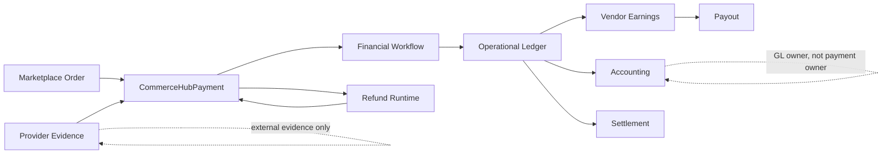
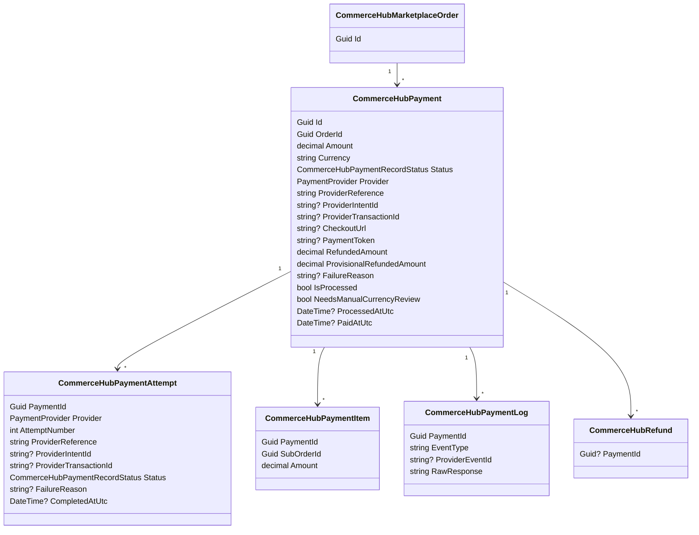
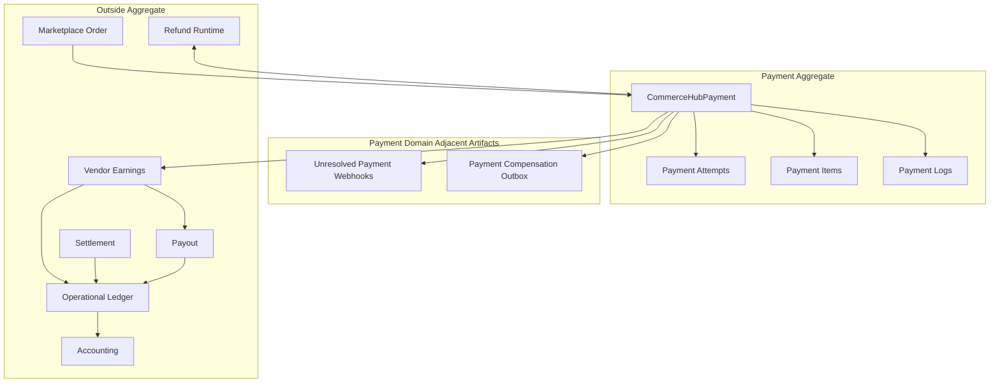
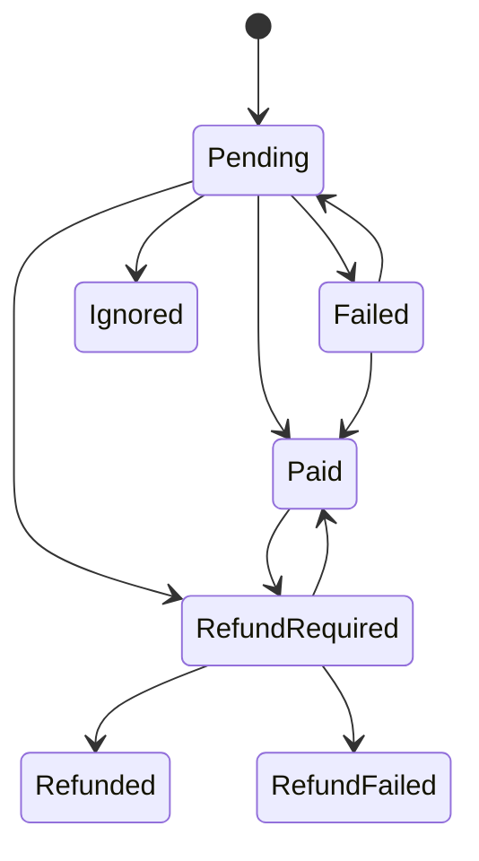
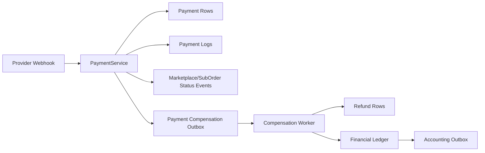
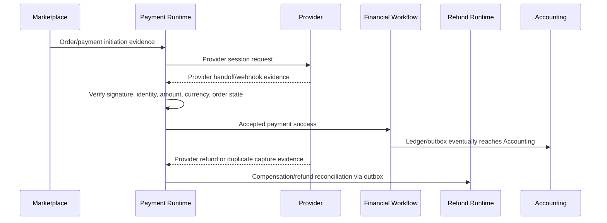
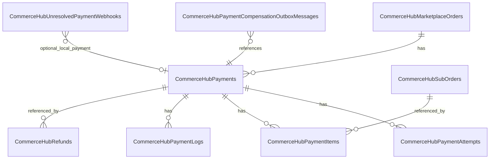

# CHF-1 CommerceHub Marketplace Payment Domain Specification

Status: Domain Specification

Scope: CommerceHub Marketplace Payment Domain as implemented.

Source of truth: current implementation. CHF-0.0 Discovery, CHF-0.5 Canonical Architecture, CHF-0.7 Runtime Blueprint, and CommerceHub Final Production Architecture are constitutional inputs only where implementation backs them.

Non-goals: implementation, refactoring, redesign, migration, optimization, recommendations, future behavior, provider SDK internals, UI redesign, or new business rules.

UNKNOWN rule: if current implementation does not prove a behavior, state, transition, command, event, or persistence contract, this document marks it `UNKNOWN`.

## Evidence Register

| Id | Evidence |
|---|---|
| E1 | `docs/architecture/CHF-0.0_COMMERCEHUB_FINANCE_DISCOVERY.md` |
| E2 | `docs/architecture/CHF-0.5_COMMERCEHUB_FINANCE_CANONICAL_ARCHITECTURE.md` |
| E3 | `docs/architecture/CHF-0.7_COMMERCEHUB_FINANCE_RUNTIME_BLUEPRINT.md` |
| E4 | `docs/architecture/commercehub-final-production-architecture-certification-findings.md` |
| E5 | `docs/architecture/commercehub-payment-authority-certification-findings.md` |
| E6 | `docs/architecture/payment-final-authority-certification-findings.md` |
| E7 | `docs/architecture/payment-lifecycle-authority-certification-findings.md` |
| E8 | `PointOfSale.Core/Entities/CommerceHubPayment.cs` |
| E9 | `PointOfSale.Core/Entities/CommerceHubPaymentAttempt.cs` |
| E10 | `PointOfSale.Core/Entities/CommerceHubPaymentItem.cs` |
| E11 | `PointOfSale.Core/Entities/CommerceHubPaymentLog.cs` |
| E12 | `PointOfSale.Core/Entities/CommerceHubUnresolvedPaymentWebhook.cs` |
| E13 | `PointOfSale.Core/Entities/CommerceHubPaymentCompensationOutboxMessage.cs` |
| E14 | `PointOfSale.Core/Enums/CommerceHubPaymentRecordStatus.cs` |
| E15 | `PointOfSale.API/Services/CommerceHub/CommerceHubPaymentService.cs` |
| E16 | `PointOfSale.API/Services/CommerceHub/CommerceHubPaymentLifecycleAuthority.cs` |
| E17 | `PointOfSale.API/Services/CommerceHub/CommerceHubPaymentSessionRecoveryAuthority.cs` |
| E18 | `PointOfSale.API/Services/CommerceHub/CommerceHubPaymentRecoveryAuthorityService.cs` |
| E19 | `PointOfSale.API/Services/CommerceHub/CommerceHubPaymentCompensationOutboxWorker.cs` |
| E20 | `PointOfSale.API/Services/CommerceHub/CommerceHubFinancialWorkflowService.cs` |
| E21 | `PointOfSale.API/Services/CommerceHub/FinancialLedger/CommerceHubFinancialLedgerService.cs` |
| E22 | `PointOfSale.API/Services/CommerceHub/CommerceHubRefundService.cs`, `PointOfSale.API/Services/CommerceHub/RefundExecutionService.cs` |
| E23 | `PointOfSale.API/Services/CommerceHub/CommerceHubPayoutService.cs` |
| E24 | `PointOfSale.Infrastructure/Data/ApplicationDbContext.cs` |
| E25 | `PointOfSale.Infrastructure/Migrations/Sql/20260322_AddCommerceHubPaymentsCommissionAndEarnings.sql` |
| E26 | `PointOfSale.Infrastructure/Migrations/20260427183000_S43_CommerceHubPaymentProviderIdentityUniqueness.sql` |
| E27 | `PointOfSale.Infrastructure/Migrations/20260501190000_S66_CommerceHubUnresolvedPaymentWebhookRecovery.sql` |
| E28 | `PointOfSale.Infrastructure/Migrations/20260501200756_S66_CommerceHubUnresolvedPaymentWebhooksUnfilteredUniqueness.sql` |
| E29 | `PointOfSale.Infrastructure/Migrations/20260504100000_S67_CommerceHubPaymentProvisionalRefundTracking.sql` |
| E30 | `PointOfSale.Infrastructure/Migrations/20260428143000_S46_CommerceHubPaymentCompensationOutbox.sql` |
| E31 | `PointOfSale.Infrastructure/Migrations/20260623130000_CommerceHubPaymentCurrencyAuthorityHardening.cs` |
| E32 | `PointOfSale.Infrastructure/Data/Configurations/CommerceHubPaymentCompensationOutboxMessageConfiguration.cs` |
| E33 | `PointOfSale.Tests/Architecture/CommerceHubPaymentAuthorityCertificationTests.cs` |

## 1. Domain Purpose

Marketplace Payment exists to represent and control CommerceHub marketplace payment identity, provider handoff evidence, provider callback admission, payment lifecycle mutation, duplicate-payment handling, unresolved external-money evidence, payment refund accounting handoff, and payment compensation. [E2][E3][E4][E5][E8][E15]

The business problem it solves is: a CommerceHub marketplace order may require online provider collection, and the platform must decide whether external provider evidence can be recognized as internal payment truth exactly once, linked to the correct marketplace order, amount, currency, provider identity, attempts, logs, and downstream finance workflow. [E5][E15][E24][E25]

Payment owns:

| Owned concern | Implementation-backed statement |
|---|---|
| Payment aggregate identity | `CommerceHubPayment` is the SQL root linked to one `CommerceHubMarketplaceOrder`. [E8][E24][E25] |
| Payment attempts | Attempts are direct children and are numbered per payment. [E9][E24][E25] |
| Payment items | Items bind payment amount portions to online sub-orders. [E10][E15][E24][E25] |
| Provider logs | Logs record provider/initiation/webhook evidence against a payment. [E11][E15][E24][E25] |
| Provider references | Provider reference, provider intent id, provider transaction id, checkout URL, and payment token belong to payment identity/session handling. [E8][E15][E24][E25][E26] |
| Unresolved webhooks | Unlinked provider success/refund evidence is persisted for suspense/reconciliation. [E12][E15][E27][E28] |
| Compensation commands | Captured money that cannot be accepted is persisted in the payment compensation outbox. [E13][E15][E19][E30][E32] |
| Payment refund totals | `RefundedAmount` and `ProvisionalRefundedAmount` are payment-owned refund-tracking fields mutated under refund/payment boundaries. [E8][E15][E19][E24][E29] |
| Payment lifecycle authority bridge | Payment service uses `CommerceHubPaymentLifecycleAuthority` to mutate marketplace order/sub-order payment status. [E15][E16] |

Payment never owns:

| Outside concern | Owner |
|---|---|
| Marketplace order creation, split-order truth, product/shipping/checkout truth | Marketplace/Checkout. [E2][E3][E4] |
| Vendor earnings | CommerceHub Financial Workflow and CommerceHub Finance. Payment supplies evidence only. [E2][E3][E5][E20] |
| Operational ledger | CommerceHub Financial Ledger. [E2][E3][E21] |
| Settlement and vendor debt | CommerceHub Finance/Super Admin financial control; debt is ledger-derived. [E1][E2][E3] |
| Payout eligibility, reservation, execution, release | CommerceHub Payout runtime. [E2][E3][E23] |
| Refund business lifecycle and financial reversal | Refund runtime. Payment has refund totals and provider-refund handoff evidence, not refund authority. [E5][E15][E19][E22] |
| Accounting journal/ledger-line truth | Accounting runtime. Payment/finance stages evidence through ledger/outbox; Accounting posts GL. [E1][E2][E3] |
| Provider SDK internals and provider-side settlement timing | Provider/external systems. Internal recognition requires backend admission. [E1][E5] |

Relationship model:

## 2. Aggregate Definition

`CommerceHubPayment` is the Marketplace Payment Aggregate Root. [E8][E24][E25]

Aggregate members:

| Member | Classification | Identity | Lifetime | Consistency rule |
|---|---|---|---|---|
| `CommerceHubPayment` | Aggregate root | `Id`; also provider reference fields under unique constraints. | Created during payment initiation or legacy provider webhook path; lives with marketplace order unless soft-deleted/deleted by infrastructure path. Normal deletion lifecycle is `UNKNOWN`. [E8][E15][E24][E25] | Amount positive, EGP currency, one live paid payment per order, paid state requires processed flag, paid timestamp, provider transaction id. [E24][E25][E31] |
| `CommerceHubPaymentAttempt` | Child entity | `Id`; unique `(PaymentId, AttemptNumber)`. | Created on initiation and when webhook needs an attempt. [E9][E15][E24][E25] | Attempt provider/reference derives from payment; mutable lifecycle fields are payment-boundary owned. [E15][E24] |
| `CommerceHubPaymentItem` | Child entity | `Id`; unique `(PaymentId, SubOrderId)`. | Created from online sub-orders for the payment. [E10][E15][E24][E25] | Sub-order FK is restrict delete; item amount is payment snapshot evidence. [E10][E24][E25] |
| `CommerceHubPaymentLog` | Child entity | `Id`; indexed by `(PaymentId, ProviderEventId)`. | Appended during initiation, provider callback, pending callback, unknown/failure, refund webhook, and compensation paths. [E11][E15][E24][E25] | Logs are payment-boundary owned and immutable outside boundary guards. [E24] |
| `CommerceHubRefund` | Linked financial child/reference | `Id`; optional `PaymentId`. | Created by refund runtime or provider-refund reconciliation. [E19][E22] | Refund owns refund lifecycle; payment owns aggregate-level refund counters. [E5][E15][E19][E22] |

Owned objects and references:

| Field or reference | Meaning |
|---|---|
| `OrderId` / `Order` | One payment belongs to one CommerceHub marketplace order. [E8][E24][E25] |
| `Amount` | Payment amount copied from marketplace order total on payment creation. [E15] |
| `Currency` | CommerceHub payment currency; implementation enforces EGP for new/changed payment rows. [E15][E24][E31] |
| `Provider` | Provider selected for this payment; currently implementation normalizes Paymob/Stripe for CommerceHub online payment initiation/webhooks. [E15][E18] |
| `ProviderReference` | Internal provider reference; unique. [E8][E24][E25] |
| `ProviderIntentId` | Provider session/intent identity; unique with provider when non-null. [E8][E24][E26] |
| `ProviderTransactionId` | Provider terminal transaction identity; unique when non-null. [E8][E24][E25] |
| `CheckoutUrl` / `PaymentToken` | Reusable provider session handoff artifacts. [E8][E15][E17] |
| `RefundedAmount` | Confirmed refund amount folded into the payment record. [E8][E15][E19][E24] |
| `ProvisionalRefundedAmount` | Provider-confirmed refund amount awaiting accounting/reconciliation merge. [E8][E15][E29] |

Aggregate consistency rules:

| Rule | Implementation backing |
|---|---|
| Creation/mutation of payment initiation fields is allowed only under the CommerceHub payment boundary. | EF boundary guards in `ApplicationDbContext`. [E24] |
| Refund counters are mutable only under the refund boundary. | EF boundary guards in `ApplicationDbContext`. [E24] |
| Lifecycle fields are immutable outside the payment/refund boundary scopes. | `GuardImmutableCommerceHubEntity` for payment, attempts, items, logs. [E24] |
| A `Paid` payment must be processed, have `PaidAtUtc`, and have `ProviderTransactionId`. | `CK_CommerceHubPayments_Paid_State_Complete`. [E24] |
| Only one live paid payment may exist per marketplace order. | `IX_CommerceHubPayments_OrderId_SinglePaid`. [E24][E25] |
| Provider intent and transaction identity cannot be reused across payments where constrained. | Provider intent/transaction unique indexes. [E24][E25][E26] |
| Payment items cannot duplicate a sub-order within one payment. | `IX_CommerceHubPaymentItems_PaymentId_SubOrderId`. [E24][E25] |

## 3. Aggregate Boundary

Inside Payment:

| Belongs inside Payment | Why |
|---|---|
| Payment root | Root state and provider identity live in `CommerceHubPayments`. [E8][E24] |
| Payment attempts | Attempts are direct children of payment and share payment status vocabulary. [E9][E15][E24] |
| Payment items | Items are direct children that bind payment to online sub-orders. [E10][E15][E24] |
| Payment logs | Provider/initiation/webhook evidence is logged against payment. [E11][E15][E24] |
| Provider references | Stored on payment/attempts and protected by uniqueness. [E8][E9][E24][E26] |
| Provider sessions | No separate provider-session table is proven. Session evidence is represented by `CheckoutUrl`, `PaymentToken`, `ProviderIntentId`, attempts, and logs. [E8][E9][E11][E15][E17] |
| Refund totals | `RefundedAmount` and `ProvisionalRefundedAmount` are fields on payment, with refund-boundary guards. [E8][E15][E24][E29] |
| Compensation state | Payment compensation outbox rows are payment-domain operational artifacts for captured money that cannot be internally accepted or provider refunds requiring accounting. [E13][E15][E19][E30][E32] |
| Unresolved provider webhooks | Stored unresolved evidence belongs to payment recovery/suspense, even if not a child row of the aggregate. [E12][E15][E27][E28] |

Outside Payment:

| Does not belong inside Payment | Owner and reason |
|---|---|
| Vendor earnings | Created/mutated by Financial Workflow, Payout, and Refund runtimes; payment id is evidence only. [E2][E3][E5][E20][E23] |
| Ledger | `CommerceHubFinancialTransactions` is CommerceHub Finance operational ledger, not payment aggregate state. [E1][E2][E3][E21] |
| Settlement | Settlement/debt control is CommerceHub Finance/Super Admin. [E1][E2][E3] |
| Accounting | Accounting owns GL journal/ledger-line truth and consumes outbox. [E1][E2][E3] |
| Payout | Payout owns outward vendor payable release. [E2][E3][E23] |
| Refund lifecycle | Refund runtime owns refund rows, execution, reversals, and reconciliation-required state. Payment only tracks refund totals and provider-refund evidence. [E5][E15][E19][E22] |
| Product, stock, shipping, checkout, cart | Upstream Marketplace/Checkout/Product/Shipping owners. Payment consumes current SQL/reservation authority. [E2][E3][E4][E15] |

Boundary diagram:

## 4. Payment Authority

Authority matrix:

| Authority type | Owner | Implementation-backed contract |
|---|---|---|
| Business Authority | CommerceHub Payment Authority over SQL payment rows and marketplace payment-state bridge. | Payment identity and collection truth are backend/SQL/provider-evidence owned. [E4][E5][E6] |
| Runtime Authority | `CommerceHubPaymentService`, `CommerceHubPaymentLifecycleAuthority`, payment recovery/compensation workers where they re-enter payment/refund boundaries. | Initiation, provider handoff, webhook admission, duplicate handling, recovery, compensation, and order payment-state mutation. [E15][E16][E17][E18][E19] |
| Mutation Authority | CommerceHub payment boundary for payment fields; refund boundary for refund counters; payment lifecycle boundary for order/sub-order `PaymentStatus`. | EF guards and lifecycle authority enforce boundary-owned mutations. [E16][E24] |
| Read Authority | Backend payment/order/admin/customer/read services and derivative frontend status surfaces. | Reads do not own truth; frontend/cache/DTOs cannot fabricate authority. [E5][E6][E7] |
| Financial Authority | Payment owns collection recognition; Financial Workflow/Ledger own earnings and operational financial facts; Accounting owns GL. | Payment success invokes finance workflow but does not own payout/settlement/accounting. [E2][E3][E5][E20][E21] |
| Persistence Authority | PostgreSQL `CommerceHubPayments`, child tables, unresolved webhooks, compensation outbox, constraints, and EF guards. | SQL is internal durable truth. [E2][E4][E24][E25][E27][E30] |

Forbidden authorities:

| Candidate | Forbidden authority |
|---|---|
| Frontend/browser/route/cache/provider redirect | Cannot create payment identity, session, lifecycle, action, visibility, financial truth, tenant scope, or actor scope. [E6][E7] |
| Provider payload alone | Cannot mutate internal SQL without backend signature verification, identity matching, amount/currency checks, locks, and transaction guards. [E5][E15] |
| Accounting | Cannot mutate payment aggregate state. [E1][E2][E3] |
| Reconciliation worker | Cannot create value by itself; must re-enter owner boundary or persist unresolved/reconciliation-required state. [E3][E4][E5] |

## 5. Payment Lifecycle

Implementation lifecycle vocabulary for `CommerceHubPayment.Status` is:

Important correction: `Processing` is not a value of `CommerceHubPaymentRecordStatus`. [E14] Processing exists as runtime activity: lock-held initiation/webhook handling, provider pending callback, compensation outbox processing, and external refund/payout processing. A persisted `Processing` payment state is `UNKNOWN` and not implementation-backed for `CommerceHubPayment`. [E14][E15][E19]

Lifecycle transitions:

| Transition | Trigger | Owner | Consumers | Implementation-backed explanation |
|---|---|---|---|---|
| `[*] -> Pending` | Initiate payment or create legacy provider payment. | `CommerceHubPaymentService`. | Provider handoff, customer payment page, webhook handling. | `CreatePendingPayment` creates root with order total, EGP currency, selected provider, and generated provider reference. [E15] |
| `Pending -> Pending` | Provider session created/reused; unknown provider-session outcome; retry resets pending payment fields. | `CommerceHubPaymentService`. | Customer retry/recovery, provider webhook. | Initiation reuses pending sessions, writes session fields, or writes provider-session reinit/unknown fences while keeping status pending. [E15][E17] |
| `Pending -> Paid` | Verified provider success for an eligible order with matching amount/currency/provider identity and active reservation authority. | `CommerceHubPaymentService` plus `CommerceHubPaymentLifecycleAuthority`. | Financial Workflow, order status events, earnings, refunds, dashboards. | Webhook success sets payment and attempt `Paid`, `IsProcessed`, timestamps, provider transaction, marks order/sub-orders collected, and invokes online financial workflow. [E15][E16][E20] |
| `Pending -> Failed` | Provider reports failed/voided transaction or initiation failure. | `CommerceHubPaymentService`. | Customer retry/recovery, reservation release, order status events. | Failed webhook marks payment/attempt failed, resets order payment to pending for retry, puts order on hold when applicable, and releases reservations. Initiation failure can mark payment failed without `IsProcessed`. [E15][E16] |
| `Failed -> Pending` | Retry initiation reuses a failed payment row. | `CommerceHubPaymentService`. | Provider handoff. | Reinit path resets failed payment/attempt to pending before creating a new provider session. [E15] |
| `Failed -> Paid` | Later provider success reconciles an earlier failed provider event. | `CommerceHubPaymentService`. | Financial Workflow and order status events. | `CanReconcileProcessedFailureToSuccess` path creates/preserves attempt history and applies paid outcome. [E15] |
| `Pending/Paid -> Ignored` | Failed or inapplicable webhook for an order already paid or no longer accepting payment. | `CommerceHubPaymentService`. | Audit/reconciliation/read surfaces. | `MarkPaymentIgnored` sets status ignored, failure reason, processed fields, and attempt ignored. [E15] |
| `Pending/Paid -> RefundRequired` | Provider success cannot be accepted; provider refund webhook requires accounting/reconciliation. | `CommerceHubPaymentService`. | Compensation worker, refund runtime, accounting/ledger. | Duplicate captured payment, invalid order state, or lost inventory authority queues compensation; provider refund webhook increments provisional refund and queues provider-refund compensation. [E15][E19] |
| `RefundRequired -> Refunded` | Compensation worker confirms refund of captured-but-unaccepted payment. | `CommerceHubPaymentCompensationOutboxWorker`. | Ledger/accounting, reconciliation/read surfaces. | Worker sets payment refunded and increments `RefundedAmount` when gateway refund is confirmed for captured compensation. [E19] |
| `RefundRequired -> Paid` | Provider-refund compensation reconciles a provider refund against already accepted payment. | `CommerceHubPaymentCompensationOutboxWorker`. | Refund runtime, ledger/accounting, order refund status. | Worker creates/completes `CommerceHubRefund` rows, records refund ledger, merges provisional amount into `RefundedAmount`, then returns payment status to `Paid`. [E19] |
| `RefundRequired -> RefundRequired` | Compensation accepted but not confirmed, retry scheduled, or ambiguous external outcome. | Compensation worker. | Recovery/reconciliation. | Worker retains `RefundRequired`, increments attempts, sets retry or reconciliation fields. [E19] |
| `RefundRequired -> RefundFailed` | Explicit assignment path to `RefundFailed` not found in inspected worker excerpt; enum exists. | UNKNOWN. | UNKNOWN. | The enum contains `RefundFailed`, but current inspected implementation showed retry/reconciliation fields and failure handling, not a fully mapped central transition. [E14][E19] |

Conceptual prompt lifecycle:

| Prompt state | Implementation-backed mapping |
|---|---|
| Pending | `CommerceHubPaymentRecordStatus.Pending`. [E14][E15] |
| Processing | No persisted payment status. Runtime lock/provider/outbox processing only. `UNKNOWN` as aggregate state. [E14][E15][E19] |
| Paid | `CommerceHubPaymentRecordStatus.Paid`. [E14][E15] |
| RefundRequired | `CommerceHubPaymentRecordStatus.RefundRequired`. [E14][E15] |
| Refunded | `CommerceHubPaymentRecordStatus.Refunded`. [E14][E19] |
| Failed | `CommerceHubPaymentRecordStatus.Failed`. [E14][E15] |
| Ignored | `CommerceHubPaymentRecordStatus.Ignored`. [E14][E15] |

## 6. State Machine

State machine table:

| From | To | Allowed | Owner | Recovery | Replay | Notes |
|---|---|---:|---|---|---|---|
| None | Pending | Yes | Payment service | N/A | Existing pending session may be reused. | Creation by initiation. [E15] |
| Pending | Pending | Yes | Payment service/recovery authority | Provider-session recovery or reconciliation block. | Reuses session; unknown outcome blocks duplicate external session. | [E15][E17][E18] |
| Pending | Paid | Yes | Payment service/lifecycle authority | If lock fails, provider retries webhook. | Duplicate success collapses if already applied; duplicate captured order queues compensation. | [E15][E16] |
| Pending | Failed | Yes | Payment service | Retry permitted only through backend retry authority and reservation authority. | Failed replay collapses when matching processed failure. | [E15][E18] |
| Pending | Ignored | Yes | Payment service | None proven beyond read/reconciliation. | Ignored rows excluded from retry budget. | [E15] |
| Pending | RefundRequired | Yes | Payment service | Compensation worker. | Compensation outbox idempotency key prevents duplicate compensation. | [E15][E19] |
| Paid | Pending | Forbidden in inspected CommerceHub payment root paths. | N/A | UNKNOWN. | UNKNOWN. | "Paid payment never becomes pending" is supported by absence of paid-to-pending path and single-paid guards, but no centralized forbidden graph exists. [E1][E5][E15] |
| Paid | Failed | Forbidden in inspected paths after processed guard unless not already processed; direct path not proven. | N/A | UNKNOWN. | Duplicate failed webhook for already paid order ignored. | [E15] |
| Paid | Ignored | Forbidden for same root in inspected paths; duplicate failed callbacks on paid order may mark the incoming payment/attempt ignored when not already processed. | Payment service | N/A | No retry. | Exact paid-root-to-ignored graph is `UNKNOWN`; duplicate payment rows can be ignored. [E15] |
| Paid | RefundRequired | Yes | Payment service | Compensation worker/provider-refund reconciliation. | Provider refund duplicate checks through logs/outbox. | [E15][E19] |
| RefundRequired | Refunded | Yes for captured-payment compensation. | Compensation worker | Gateway refresh/retry; uncertain outcome routes operator reconciliation. | Compensation idempotency key. | [E19] |
| RefundRequired | Paid | Yes for provider-refund accounting reconciliation. | Compensation worker/refund runtime | Refund recovery if refund subflow uncertain. | Provider refund compensation idempotency key. | [E19] |
| RefundRequired | RefundFailed | UNKNOWN | UNKNOWN | UNKNOWN | UNKNOWN | Enum exists; full transition not proven. [E14] |
| RefundFailed | RefundRequired | UNKNOWN | UNKNOWN | UNKNOWN | UNKNOWN | CHF-0.0 names this as possible, but inspected code does not prove a central rule. [E1][E14] |
| Failed | Pending | Yes | Payment service | Retry authority checks unresolved captured payment and reservation authority. | New attempt number is created. | [E15][E18] |
| Failed | Paid | Yes for reconciling earlier failure to success. | Payment service | Provider success evidence. | Creates a new paid attempt to preserve failure history. | [E15] |
| Ignored | Any | UNKNOWN/forbidden in inspected paths. | UNKNOWN | UNKNOWN | UNKNOWN | No inspected normal transition out of ignored. [E15] |
| Refunded | Any | UNKNOWN/forbidden in inspected paths. | UNKNOWN | UNKNOWN | UNKNOWN | No inspected normal transition out of refunded. [E19] |

Forbidden transition rule: the implementation does not expose one centralized `CommerceHubPaymentRecordStatus` transition table. Forbidden transitions are therefore documented only where service guards, processed guards, unique constraints, lifecycle authority, or absence of mutation path prove them. Full forbidden graph is `UNKNOWN`. [E1][E2][E3][E15]

## 7. Domain Policies

| Policy | Implementation-backed rule | Enforcement |
|---|---|---|
| One successful payment | Only one live `Paid` CommerceHub payment per order. Initiation rejects already paid order. | Unique filtered index and service guard. [E15][E24][E25] |
| Amount validation | Payment amount is copied from marketplace order total; webhook provider amount must match payment amount; payment amount must be positive. | `CreatePendingPayment`, `EnsureAmountMatches`, check constraint. [E15][E24] |
| Currency validation | CommerceHub payment currency is EGP in inspected runtime; provider callbacks must match SQL payment currency; unresolved webhook currency also EGP. | `RequireCommerceHubPaymentCurrency`, EF/DB check constraints. [E15][E24][E31] |
| Provider validation | Provider is normalized and currently Paymob/Stripe are supported by CommerceHub online payment paths; unsupported provider fails. | `NormalizeProvider` and provider switch. [E15][E18] |
| Provider identity uniqueness | Provider intent cannot link to multiple payments; provider transaction id unique when non-null; provider reference unique. | EF indexes/migration S43. [E24][E25][E26] |
| Duplicate prevention | Processed guard, provider identity guard, unique indexes, payment lock, payment log/outbox duplicate checks. | Payment service, DB constraints. [E15][E24][E26] |
| Unknown payment handling | Captured/refund webhook without local payment is persisted as unresolved evidence where applicable; retry signalled if evidence cannot be durably stored. | `PersistUnresolvedPaymentWebhookAsync`, unresolved table/indexes. [E12][E15][E27][E28] |
| Session recovery | Pending payment with reusable session returns existing session; persistence gaps/unknown outcomes block new external sessions until recovery/reconciliation. | `CommerceHubPaymentSessionRecoveryAuthority`, initiation recovery path. [E15][E17] |
| Retry policy | Retry requires backend authority, pending order payment status, order pending/on-hold, no unresolved captured payment, no provider-session recovery block, active reservation authority, and attempt budget. | `EnsureInitiationAllowedAsync`, `EnsureRetryBudget`, recovery authority service. [E15][E18] |
| Timeout/unknown outcome policy | Provider request timeout or untrustworthy outcome leaves payment pending with outcome-unknown marker and blocks duplicate provider session creation. | `RecordInitiationUnknownOutcomeAsync`. [E15][E17] |
| Webhook policy | Webhooks require provider configuration, signature verification, provider identity/amount/currency checks, lock, serializable transaction, and current order state guards. Misconfigured provider webhooks return retry. | Payment service webhook paths. [E15] |
| Compensation policy | Captured provider success that cannot be accepted becomes `RefundRequired` plus compensation outbox, not recognized as a second payment. | `MarkPaymentRequiresCompensation`, compensation worker. [E15][E19] |
| Provider refund policy | Provider refund webhooks cannot over-refund, duplicate events collapse, provisional amount prevents cumulative over-refund, and reconciliation is outbox-backed. | `ApplyProviderRefundWebhookAsync`, S67. [E15][E19][E29] |
| Payment before finance | Online financial workflow runs after payment success is admitted. | Payment service invokes `ApplyOnlinePaymentSuccessAsync` after marking collected. [E15][E20] |
| Payment does not release payout | Payment collection creates collected value truth but payout service owns outward release. | CHF architecture and payment authority findings. [E2][E3][E5][E23] |

Policies with `UNKNOWN`:

| Policy | Status |
|---|---|
| Generic `CancelPendingPayment` for `CommerceHubPayment` | `UNKNOWN`; no canonical CommerceHub payment command was proven in inspected payment service. |
| Global payment timeout expiration from `Pending` to terminal status | `UNKNOWN`; provider-session unknown outcome/recovery blocks are proven, but a universal timeout-to-expired payment state is not. |
| Provider fee/reserve policy | `UNKNOWN`; provider-side settlement timing and fees are out of scope. [E1] |

## 8. Domain Invariants

| Invariant | Status | Implementation backing |
|---|---:|---|
| Payment belongs to exactly one Marketplace Order. | Proven | `OrderId` required FK to marketplace order. [E8][E24][E25] |
| Payment amount is positive. | Proven | `CK_CommerceHubPayments_Amount_Positive`. [E24] |
| Payment currency is EGP for current/new changed CommerceHub payment rows. | Proven | `RequireCommerceHubPaymentCurrency`, `CK_CommerceHubPayments_Currency_EGP`. [E15][E24][E31] |
| A paid payment is complete only with processed flag, paid timestamp, and provider transaction id. | Proven | `CK_CommerceHubPayments_Paid_State_Complete`. [E24] |
| Only one non-deleted paid payment per order. | Proven | `IX_CommerceHubPayments_OrderId_SinglePaid`. [E24][E25] |
| Provider reference is unique. | Proven | Unique index. [E24][E25] |
| Provider transaction id is unique when present. | Proven | Unique filtered index. [E24][E25] |
| Provider intent id is unique per provider when present. | Proven | `UX_CommerceHubPayments_Provider_ProviderIntentId`. [E24][E26] |
| Payment item cannot duplicate `(PaymentId, SubOrderId)`. | Proven | Unique index. [E24][E25] |
| Attempt number cannot duplicate within a payment. | Proven | Unique index. [E24][E25] |
| Refunded amount cannot be negative or exceed payment amount. | Proven | `CK_CommerceHubPayments_RefundedAmount_Range`. [E24] |
| Refunded plus provisional refunded cannot exceed amount. | Proven | `CK_CommerceHubPayments_ProvisionalRefundedAmount_Range`. [E24][E29] |
| Paid payment does not become pending in inspected normal paths. | Proven for inspected paths; full graph UNKNOWN | No paid-to-pending path found; processed guard and lifecycle guards prevent retry from collected/refunded states. [E15][E16][E18] |
| Amount cannot change after payment creation. | Proven by boundary/immutability guard for inspected paths | Amount is creation state guarded; not listed among allowed mutation fields. [E24] |
| Currency is immutable after creation except boundary-created state and DB EGP guard. | Proven for inspected paths | Currency is creation-state guarded and EGP constrained. [E24][E31] |
| Provider is immutable after creation in inspected paths. | Proven by creation-state guard and no mutation path found | Provider is creation-state guarded; provider identity mutation is limited to intent/transaction fields. [E24] |
| Order is immutable after creation in inspected paths. | Proven by creation-state guard and no mutation path found | `OrderId` is creation-state guarded. [E24] |
| Payment has one authority. | Proven | Payment service/SQL/payment boundary owns mutation. [E5][E15][E24] |
| Frontend cannot fabricate payment authority. | Proven for inspected paths | Final payment certification. [E6][E7] |
| Provider evidence must be admitted before recognition. | Proven | Signature verification, identity, amount/currency checks, locks. [E5][E15] |
| Reconciliation cannot create value. | Proven as architecture/certification principle | Reconciliation re-enters payment/refund authority. [E3][E4][E5] |
| Normal hard-delete lifecycle for payment rows. | UNKNOWN | Soft-delete infrastructure exists; normal deletion authority not proven. [E1] |
| Complete centralized transition prohibition for every status pair. | UNKNOWN | Transitions are distributed. [E1][E15] |

## 9. Commands

Command names are canonical labels for implemented service operations. They are not necessarily implemented as command classes.

| Command | Implemented artifact | Producer | Consumer | Transaction owner | Idempotency owner |
|---|---|---|---|---|---|
| `CreatePayment` | `CreatePendingPayment` inside `InitiateAsync`. | Customer/storefront/backend checkout payment intent. | `CommerceHubPaymentService`. | Payment service; lock-held path; SaveChanges/transaction use varies by sub-path. [E15] | Payment service via existing paid guard, pending reuse, attempt budget, unique indexes. [E15][E24] |
| `InitiatePayment` | `InitiateAsync`. | Customer with authenticated customer id or order access token. | Payment service/provider adapter calls. | Payment service under payment boundary and per-order/provider lock. [E15] | Existing reusable session, provider-session recovery fences, provider identity uniqueness, retry budget. [E15][E17] |
| `CompletePayment` | `ApplyWebhookOutcomeAsync` success branch. | Provider webhook. | Payment service and lifecycle authority. | Payment service under per-payment lock and serializable SQL transaction. [E15] | Processed guard, provider identity guard, unique indexes, logs, event idempotency keys. [E15][E24] |
| `FailPayment` | `ApplyWebhookOutcomeAsync` failure branch; `RecordInitiationFailureAsync`. | Provider webhook or initiation failure. | Payment service. | Payment service. [E15] | Processed guard for webhook; new attempt for retries; attempt budget. [E15] |
| `IgnorePayment` | `MarkPaymentIgnored`. | Payment service when webhook cannot/should not mutate paid/ineligible order. | Payment service. | Payment service transaction. [E15] | Processed guard and current order-state guard. [E15] |
| `RequireRefund` | `MarkPaymentRequiresCompensation`; `MarkPaymentProviderRefundConfirmedAsync`. | Payment service after duplicate/unacceptable capture or provider-refund webhook. | Compensation outbox worker/refund runtime. | Payment service transaction. [E15] | Compensation outbox idempotency key. [E13][E15][E30][E32] |
| `RefundPayment` | Compensation worker confirmed captured-payment refund path. | Compensation outbox worker. | Refund gateway/financial ledger. | Compensation worker transaction around payment/refund mutation. [E19] | Outbox idempotency key and gateway reference/status persistence. [E13][E19][E32] |
| `RecoverPayment` | `TryRecoverIncompletePendingPaymentAsync`; `CommerceHubPaymentRecoveryAuthorityService.EvaluateAsync`; unresolved webhook reconciliation worker. | Customer retry/status surfaces, backend recovery, hosted recovery. | Payment recovery service/payment service. | Payment service/recovery service depending path. [E15][E18] | Provider-session gap detection, unresolved webhook uniqueness. [E17][E18][E28] |
| `RetryPayment` | `InitiateAsync` after failure/pending retry guards. | Customer/storefront retry intent. | Payment service. | Payment service under lock. [E15][E18] | Attempt budget, unresolved captured payment block, reservation authority check. [E15][E18] |
| `CancelPendingPayment` | `UNKNOWN` for CommerceHub marketplace payment aggregate. | UNKNOWN | UNKNOWN | UNKNOWN | UNKNOWN |
| `RecordUnresolvedPaymentWebhook` | `PersistUnresolvedPaymentWebhookAsync`. | Provider webhook that cannot link to local payment. | Payment service/unresolved table. | Payment service. [E15] | Unique `(Provider, ProviderEventId)` across unresolved rows. [E12][E27][E28] |
| `ReconcileProviderRefund` | Provider-refund compensation outbox path. | Provider refund webhook. | Compensation worker/refund runtime. | Payment service queues; worker reconciles. [E15][E19] | Provider refund compensation idempotency key; payment logs scoped to refund events. [E15][E19] |

## 10. Events

Implementation uses a mix of integration events, payment logs, SQL row mutations, compensation outbox messages, accounting outbox messages, and audit records. Not every conceptual event exists as a named event class.

| Conceptual event | Actual implementation artifact | Producer | Consumer | Status |
|---|---|---|---|---|
| `PaymentCreated` | `CommerceHubPayment` row, `CommerceHubPaymentAttempt` row, `CommerceHubPaymentLog` with `initiate.{provider}` after provider session. | Payment service. | Payment reads/webhook/recovery. | Implemented as rows/logs, not proven as event class. [E8][E9][E11][E15] |
| `PaymentInitiated` | Payment session fields (`CheckoutUrl`, `PaymentToken`, `ProviderIntentId`) and initiation log. | Payment service. | Storefront/customer handoff. | Implemented as rows/logs. [E15] |
| `PaymentSucceeded` | Payment status `Paid`, attempt `Paid`, order/sub-order status events, financial workflow invocation. | Provider webhook via payment service. | Financial Workflow, order projections, dashboards. | Implemented as SQL mutation plus order status events, not proven as `PaymentSucceeded` class. [E15][E16][E20] |
| `PaymentFailed` | Payment/attempt `Failed`, payment log, order retry hold, reservation release, order status events. | Payment service. | Customer retry/recovery, inventory/order projections. | Implemented as SQL mutation/events. [E15] |
| `PaymentIgnored` | Payment/attempt `Ignored` plus failure reason. | Payment service. | Reads/reconciliation. | Implemented as SQL mutation, not proven as event class. [E15] |
| `PaymentRefundRequired` | Payment/attempt `RefundRequired` plus `CommerceHubPaymentCompensationOutboxMessage`. | Payment service. | Compensation worker. | Implemented as SQL/outbox. [E13][E15][E19] |
| `PaymentRefunded` | Payment `Refunded`, refund amount increment, compensation accounting/ledger. | Compensation worker. | Finance/accounting/read surfaces. | Implemented as SQL/ledger/outbox. [E19][E21] |
| `PaymentRecovered` | Existing session reused or incomplete session recovered; exact named event not found. | Payment service/recovery authority. | Customer handoff/retry decision. | Artifact-backed by response/logs; event class `UNKNOWN`. [E15][E17][E18] |
| `PaymentCompensationRequired` | `CommerceHubPaymentCompensationOutboxMessage` row. | Payment service. | Compensation worker. | Implemented as durable command row. [E13][E15][E30][E32] |
| `ProviderRefundReconciliationRequired` | Provider-refund compensation outbox row, `ProvisionalRefundedAmount`, payment `RefundRequired`. | Payment service. | Compensation worker/refund runtime. | Implemented as SQL/outbox. [E15][E19][E29] |
| `UnresolvedPaymentWebhookRecorded` | `CommerceHubUnresolvedPaymentWebhook` row. | Payment service. | Reconciliation/readiness. | Implemented as SQL row, not proven as event class. [E12][E15][E27] |
| Marketplace order/sub-order status changed | `CommerceHubMarketplaceOrderStatusUpdatedEvent`, `CommerceHubSubOrderStatusUpdatedEvent`. | Payment/refund paths. | Event/projection consumers. | Implemented. [E15][E19] |

Event boundary:

## 11. Runtime Contracts

Runtime contract table:

| Contract | Inputs | Outputs | Guarantees | Assumptions | Failure contract |
|---|---|---|---|---|---|
| Marketplace to Payment Runtime | Marketplace order id, customer/order-access evidence, provider code, SQL order/sub-order/payment state, active reservations. | Payment row, attempt row, payment items, provider session handoff. | Access checked; order must be retryable/pending; EGP enforced; active reservations required; lock serializes per order/provider. [E15][E18] | Marketplace order snapshots are authoritative. [E2][E3] | 403/404/409/503 fail closed; unknown provider session blocks duplicate session. [E15] |
| Payment Runtime to Provider | Provider-specific session request from SQL payment/order state. | Provider intent/session URL/token or unknown/failure. | Provider identity persisted or recovery fence recorded before another session can be created. [E15][E17] | Provider can be unavailable/ambiguous. [E1][E3] | Failure marks initiation failed or pending outcome-unknown; retry/reconciliation required. [E15] |
| Provider to Payment Runtime | Signed webhook payload, provider identifiers, amount, currency, success/refund/failure state. | Payment status mutation, logs, unresolved row, or compensation outbox. | Signature checked; amount/currency/provider identity checked; lock and transaction protect mutation. [E5][E15] | Provider payload is external evidence only. [E5] | Misconfiguration signals retry; unlinkable success/refund persists unresolved evidence when possible. [E15][E27] |
| Payment Runtime to Financial Workflow | Paid payment and marketplace order/sub-order evidence. | Vendor earnings, audit, order financial ledger rows. | Runs after payment success recognition only. [E15][E20] | Financial snapshots on sub-orders are authoritative. [E2][E5] | Workflow failure rolls back payment transaction path where in same transaction. [E3][E15] |
| Payment Runtime to Refund Runtime | Provider refund evidence, payment id, allocation snapshots, compensation outbox. | Refund rows, refund status, payment refund counters, ledger rows. | Over-refund blocked; duplicates collapse; provisional amount prevents cumulative over-refund. [E15][E19][E22] | Refund runtime owns financial reversal. [E5][E22] | Ambiguous/corrupt evidence routes retry or operator reconciliation. [E19] |
| Payment Runtime to Accounting | No direct GL posting authority; only through Financial Workflow/Ledger/Accounting outbox. | Accounting outbox/ledger effects from finance/refund/compensation. | Payment never owns GL. [E1][E2][E3] | Accounting owns journal posting. [E2] | Accounting failures retry or remain non-terminal; payment truth is not erased. [E3] |
| Payment Runtime to Marketplace | Marketplace order/sub-order payment statuses, payment reference, paid timestamp, order status events. | Collected/pending retry/refund status projections. | Mutations use `CommerceHubPaymentLifecycleAuthority` and order lifecycle boundaries. [E15][E16] | Marketplace order remains owner of order lifecycle. [E2][E4] | Invalid lifecycle transition throws and rolls back. [E16] |

## 12. Persistence Model

Payment persistence diagram:

Tables:

| Table | Purpose | Key columns |
|---|---|---|
| `CommerceHubPayments` | Payment aggregate root. | `Id`, `OrderId`, `Amount`, `Currency`, `Status`, `Provider`, `ProviderReference`, `ProviderIntentId`, `ProviderTransactionId`, `CheckoutUrl`, `PaymentToken`, `RefundedAmount`, `ProvisionalRefundedAmount`, `FailureReason`, `IsProcessed`, `NeedsManualCurrencyReview`, `ProcessedAtUtc`, `PaidAtUtc`, soft-delete/audit columns. [E8][E24][E25] |
| `CommerceHubPaymentAttempts` | Attempts per payment. | `PaymentId`, `Provider`, `AttemptNumber`, provider ids, status, failure reason, completion timestamp. [E9][E24][E25] |
| `CommerceHubPaymentItems` | Payment-to-sub-order amount rows. | `PaymentId`, `SubOrderId`, `Amount`. [E10][E24][E25] |
| `CommerceHubPaymentLogs` | Provider/initiation/webhook raw evidence. | `PaymentId`, `EventType`, `ProviderEventId`, `RawResponse`. [E11][E24][E25] |
| `CommerceHubUnresolvedPaymentWebhooks` | Unmatched provider payment/refund evidence. | `Provider`, `ProviderEventId`, provider ids, `LocalPaymentId`, `TenantId`, `OrderId`, affected/suspense store JSON, `Amount`, `Currency`, `EventType`, `PayloadHash`, redacted `RawPayload`, status/retry/correlation fields. [E12][E24][E27][E28] |
| `CommerceHubPaymentCompensationOutboxMessages` | Durable compensation/refund-reconciliation commands. | `PaymentId`, `OrderId`, tenant/store allocation snapshots, provider ids, `Amount`, `Currency`, `Reason`, `IdempotencyKey`, retry/lease/failure/gateway/reconciliation fields. [E13][E30][E32] |

Indexes and constraints:

| Table | Constraint/index | Meaning |
|---|---|---|
| `CommerceHubPayments` | `CK_CommerceHubPayments_Amount_Positive` | Amount must be greater than zero. [E24] |
| `CommerceHubPayments` | `CK_CommerceHubPayments_RefundedAmount_Range` | Confirmed refunded amount between zero and amount. [E24] |
| `CommerceHubPayments` | `CK_CommerceHubPayments_ProvisionalRefundedAmount_Range` | Confirmed plus provisional refunded amount cannot exceed amount. [E24][E29] |
| `CommerceHubPayments` | `CK_CommerceHubPayments_Paid_State_Complete` | Paid rows require `IsProcessed`, `PaidAtUtc`, `ProviderTransactionId`. [E24] |
| `CommerceHubPayments` | `CK_CommerceHubPayments_Currency_EGP` | Currency must be EGP. [E24][E31] |
| `CommerceHubPayments` | `IX_CommerceHubPayments_OrderId_SinglePaid` | One live paid payment per order. [E24][E25] |
| `CommerceHubPayments` | `UX_CommerceHubPayments_Provider_ProviderIntentId` | One provider intent per provider across payment rows. [E24][E26] |
| `CommerceHubPayments` | unique `ProviderReference` | Internal provider reference uniqueness. [E24][E25] |
| `CommerceHubPayments` | unique filtered `ProviderTransactionId` | One provider transaction id when present. [E24][E25] |
| `CommerceHubPaymentAttempts` | unique `(PaymentId, AttemptNumber)` | Attempt sequence uniqueness. [E24][E25] |
| `CommerceHubPaymentItems` | unique `(PaymentId, SubOrderId)` | No duplicate sub-order in one payment. [E24][E25] |
| `CommerceHubUnresolvedPaymentWebhooks` | unique `(Provider, ProviderEventId)` | One unresolved record per provider event, including soft-deleted rows per S66 correction. [E24][E28] |
| `CommerceHubUnresolvedPaymentWebhooks` | `CK_...Amount_NonNegative`, `CK_...Currency_EGP` | Non-negative unresolved amount and EGP currency. [E24][E31] |
| `CommerceHubPaymentCompensationOutboxMessages` | unique `IdempotencyKey` | One compensation message per deterministic compensation command. [E30][E32] |
| `CommerceHubPaymentCompensationOutboxMessages` | processing/lease/payment/reconciliation indexes | Worker processing, per-payment ordering, operator reconciliation lookup. [E30][E32] |

Foreign keys:

| Relationship | Delete behavior |
|---|---|
| `CommerceHubPayments.OrderId -> CommerceHubMarketplaceOrders.Id` | Cascade. [E24][E25] |
| `CommerceHubPaymentAttempts.PaymentId -> CommerceHubPayments.Id` | Cascade. [E24][E25] |
| `CommerceHubPaymentItems.PaymentId -> CommerceHubPayments.Id` | Cascade. [E24][E25] |
| `CommerceHubPaymentItems.SubOrderId -> CommerceHubSubOrders.Id` | Restrict. [E24][E25] |
| `CommerceHubPaymentLogs.PaymentId -> CommerceHubPayments.Id` | Cascade. [E24][E25] |
| `CommerceHubVendorEarnings.PaymentId -> CommerceHubPayments.Id` | Set null in migration. [E25] |
| `CommerceHubRefunds.PaymentId -> CommerceHubPayments.Id` | FK exists in finance/refund migration; delete behavior not restated here beyond implementation reference. [E1] |

Concurrency and idempotency:

| Concern | Implementation |
|---|---|
| Initiation concurrency | Per-order/provider distributed lock. [E15] |
| Webhook concurrency | Per-payment distributed lock plus serializable transaction. [E15] |
| Provider identity races | SQL unique indexes and `DbUpdateException` conflict handling. [E15][E24][E26] |
| Session persistence gap | Reinit fence and unknown-outcome markers block duplicate provider sessions. [E15][E17] |
| Unresolved webhook replay | Unique provider/event index and `IgnoreQueryFilters` lookup alignment. [E12][E28] |
| Compensation replay | Unique outbox idempotency key and worker claim lease. [E13][E19][E32] |
| Audit/history | BaseEntity audit fields; payment logs; outbox rows. Complete external retention lifecycle is `UNKNOWN` except unresolved webhook comments describe review/archive expectations. [E11][E12][E13] |
| Soft delete | Payment-related entities inherit `BaseEntity` with `IsDeleted`; query filters exist for unresolved webhooks. Normal domain deletion policy is `UNKNOWN`. [E8][E12][E24] |

## 13. Domain Principles

| Principle | Implementation-backed statement |
|---|---|
| Payment owns payment lifecycle | `CommerceHubPaymentService` owns payment initiation/webhook status; `CommerceHubPaymentLifecycleAuthority` owns order payment-state mutation. [E15][E16] |
| Provider supplies evidence | Provider callbacks are admitted only after signature, identity, amount, and currency checks. [E5][E15] |
| Payment never owns vendor earnings | Earnings are created by Financial Workflow from accepted payment/order evidence. [E2][E3][E5][E20] |
| Payment never posts accounting | Accounting is reached through finance ledger/outbox; Accounting owns GL. [E1][E2][E3][E21] |
| Payment before Finance | Online financial workflow follows paid recognition. [E15][E20] |
| SQL before cache | SQL payment/order rows are internal truth; frontend/cache/projections are derivative. [E2][E4][E6] |
| Provider evidence before recognition | Provider success is not recognized without backend admission. [E5][E15] |
| Recovery before failure | Unknown provider-session outcomes stay pending/reconciliation-required instead of creating another session. [E15][E17] |
| Idempotency before mutation | Existing paid/pending/session checks, unique indexes, logs, and outbox keys prevent duplicate value. [E15][E24][E26][E32] |
| Compensation before rollback | Duplicate/unacceptable captured provider money queues refund compensation; it does not rewrite prior business truth. [E3][E15][E19] |
| Unknown external money remains explicit | Unmatched successful/refund webhooks persist unresolved evidence or signal retry if persistence fails. [E12][E15][E27] |
| EGP payment sovereignty | CommerceHub payment/refund/unresolved currency paths enforce EGP in inspected runtime. [E15][E24][E31] |

## 14. Domain Decisions

| Decision | Why, implementation-backed |
|---|---|
| Why Payment Aggregate exists | CommerceHub needs a SQL root to bind marketplace order, amount, currency, provider, session, attempts, logs, processed state, paid timestamp, provider transaction, and refund counters under one payment authority. [E8][E15][E24][E25] |
| Why attempts exist | Initiation and webhook processing can involve retries, failures, pending sessions, reconciliation of earlier failure to success, and attempt-number uniqueness. Attempts preserve per-try provider/status/failure evidence. [E9][E15][E24][E25] |
| Why logs exist | Provider/session/webhook evidence must be durably attached to payment for duplicate detection, recovery, and audit/history. [E11][E15][E24][E25] |
| Why payment items exist | Payment must preserve immutable sub-order allocation evidence for online sub-orders; provider refund reconciliation refuses to synthesize missing payment-item authority from live order state. [E10][E15][E24][E25] |
| Why provider sessions exist | Payment initiation must hand the customer to an external provider and later recover/reuse that handoff without creating duplicate provider sessions. Session artifacts are stored as payment fields/logs. [E8][E15][E17] |
| Why unresolved webhooks exist | Provider can report captured/refund evidence before it can be linked to a local payment row. The implementation preserves this evidence for suspense/reconciliation instead of discarding or recognizing it blindly. [E12][E15][E27][E28] |
| Why compensation exists | Provider may capture money that CommerceHub cannot accept because the order is already paid, no longer valid, or lacks inventory authority. The domain queues refund compensation instead of recognizing duplicate value. [E13][E15][E19][E30] |
| Why Payment Runtime is separated from Finance | Payment recognizes provider collection and then calls Financial Workflow; Finance owns earnings, ledger, settlement, payout, and accounting outbox. [E2][E3][E5][E15][E20][E21] |
| Why Payment does not own Ledger | Operational ledger has separate entity/type/direction/bucket/idempotency model and is written by `CommerceHubFinancialLedgerService`; payment is only one source of accepted evidence. [E1][E2][E3][E21] |
| Why Payment does not own Payout | Payout requires available earnings, ledger confirmation, delay/readiness, reservation, external transfer evidence, and reconciliation-required handling. Payment collection does not release vendor money. [E2][E3][E5][E23] |
| Why Payment does not own Refund lifecycle | Payment tracks refund totals and provider-refund evidence, but refund services own refund rows, execution, reversals, payout overlap, and financial reversal. [E5][E15][E19][E22] |
| Why provider evidence is admitted, not trusted directly | Provider payloads are external; internal payment truth requires signature verification, SQL identity matching, amount/currency validation, locks, and transaction boundaries. [E5][E15] |

## 15. Domain Conclusions

| Model | Conclusion |
|---|---|
| Aggregate Model | `CommerceHubPayment` is the aggregate root. Attempts, items, and logs are direct child entities; refunds are linked financial children; unresolved webhooks and compensation outbox rows are payment-domain operational artifacts. [E8-E15] |
| Lifecycle Model | The implemented aggregate states are `Pending`, `Paid`, `Failed`, `Ignored`, `RefundRequired`, `Refunded`, and `RefundFailed`. `Processing` is runtime activity, not a persisted payment status. Full forbidden graph is `UNKNOWN` because transitions are distributed. [E14][E15][E19] |
| Authority Model | Payment authority is backend SQL and payment service owned. Provider, frontend, cache, events, reconciliation, Accounting, Finance, Refund, Settlement, and Payout do not own payment truth. [E2-E7][E15][E24] |
| Runtime Model | Marketplace/order evidence enters Payment Runtime; provider evidence is admitted; success invokes Financial Workflow; duplicate/unacceptable captured money enters compensation; provider refunds enter refund/accounting reconciliation. [E3][E15][E19][E20] |
| Persistence Model | Payment truth is persisted in `CommerceHubPayments`, `CommerceHubPaymentAttempts`, `CommerceHubPaymentItems`, `CommerceHubPaymentLogs`, unresolved webhook rows, and compensation outbox rows with SQL constraints, unique indexes, boundary guards, locks, and idempotency keys. [E24-E32] |
| Policy Model | Policies enforce one successful payment, amount/currency/provider validation, duplicate prevention, unresolved evidence preservation, session recovery, retry guards, webhook admission, compensation, and provider-refund bounds. [E5][E15][E17][E18][E19][E24] |
| Invariant Model | The strongest invariants are SQL-backed: one order per payment, positive amount, EGP currency, complete paid state, single paid payment per order, provider identity uniqueness, bounded refund totals, and boundary-owned mutations. [E24-E31] |
| Boundary Model | Payment owns collection recognition and payment evidence; Finance owns earnings/ledger/settlement/payout financial state; Refund owns refund lifecycle; Accounting owns GL; Provider owns external evidence; Marketplace owns order truth. [E1-E6] |
| Contract Model | Payment accepts marketplace/order intent and provider evidence only through backend contracts, emits SQL truth and downstream finance/refund/compensation artifacts, and fails closed, retries, persists suspense, or routes reconciliation when evidence is ambiguous. [E3][E5][E15][E18][E19] |

This document is the constitutional Marketplace Payment Domain Specification for future CommerceHub payment implementation work. Future changes must remain implementation-backed; behavior not proven by current implementation remains `UNKNOWN`.
