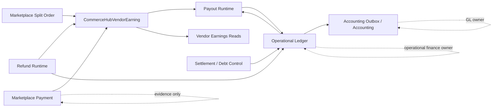
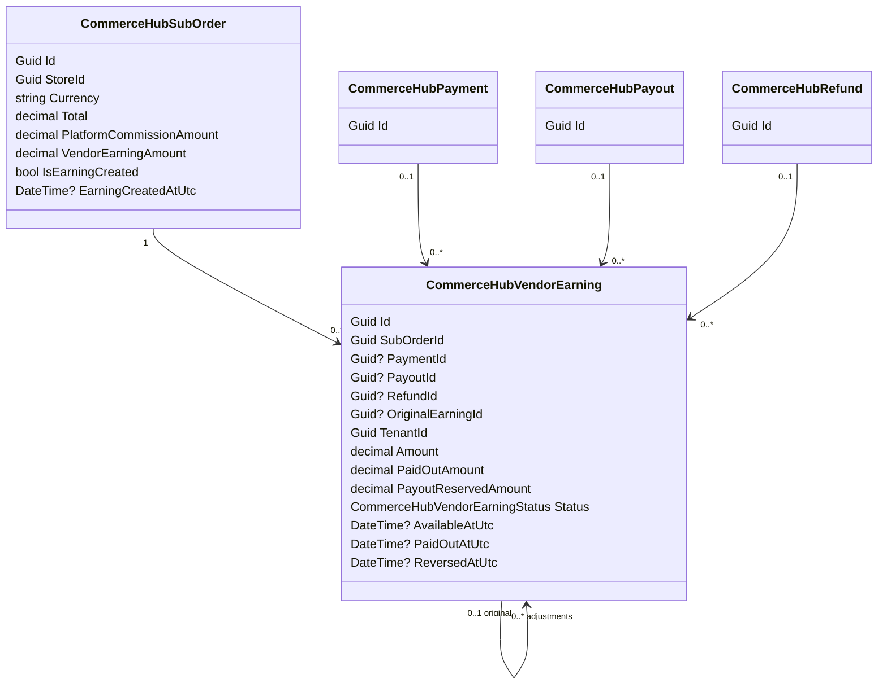
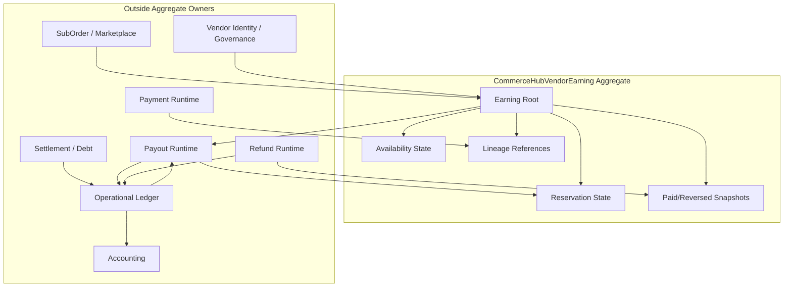
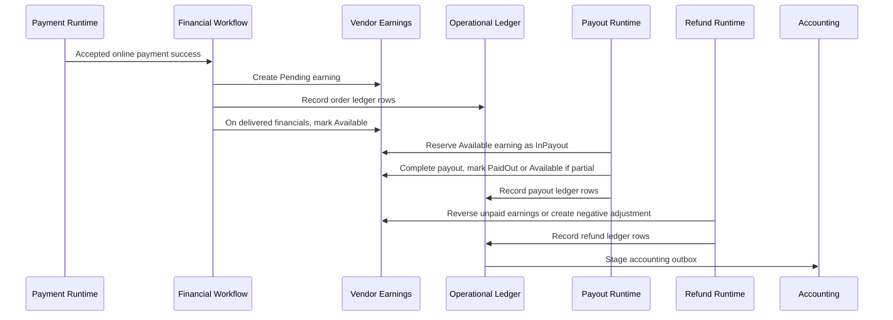
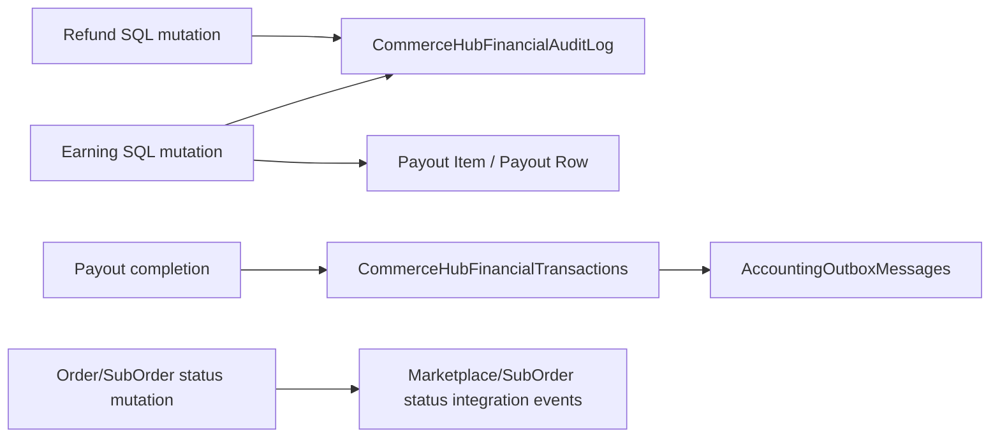
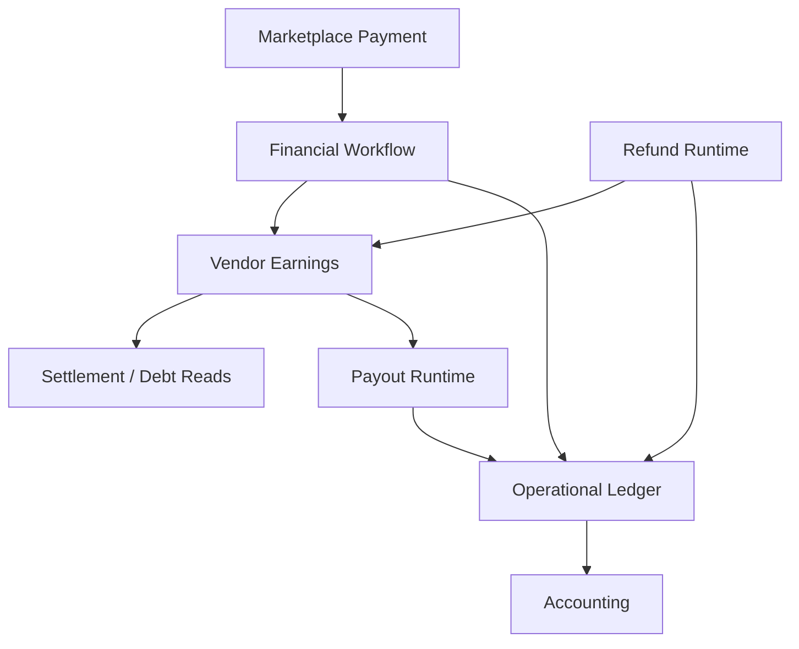
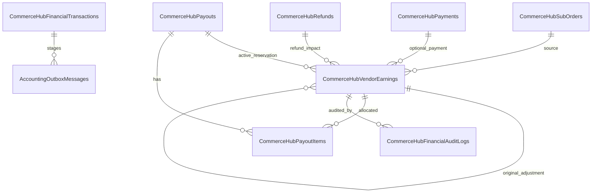

# CHF-2 CommerceHub Vendor Earnings Domain Specification

Status: Domain Specification

Scope: CommerceHub Vendor Earnings Domain as implemented.

Source of truth: current implementation. CHF-0.0 Discovery, CHF-0.5 Canonical Architecture, CHF-0.7 Runtime Blueprint, CHF-1 Marketplace Payment Domain Specification, CommerceHub Final Architecture, and the authority certification findings are constitutional inputs only where current implementation backs them.

Non-goals: implementation, coding, refactoring, redesign, migration, optimization, recommendations, future behavior, UI redesign, or new business rules.

UNKNOWN rule: if current implementation does not prove a behavior, state, transition, command, event, or persistence contract, this document marks it `UNKNOWN`.

## Evidence Register

| Id | Evidence |
|---|---|
| E1 | `docs/architecture/CHF-0.0_COMMERCEHUB_FINANCE_DISCOVERY.md` |
| E2 | `docs/architecture/CHF-0.5_COMMERCEHUB_FINANCE_CANONICAL_ARCHITECTURE.md` |
| E3 | `docs/architecture/CHF-0.7_COMMERCEHUB_FINANCE_RUNTIME_BLUEPRINT.md` |
| E4 | `docs/architecture/CHF-1_COMMERCEHUB_MARKETPLACE_PAYMENT_DOMAIN_SPECIFICATION.md` |
| E5 | `docs/architecture/commercehub-final-production-architecture-certification-findings.md` |
| E6 | `docs/architecture/vendor-earnings-identity-authority-certification-findings.md` |
| E7 | `docs/architecture/vendor-earnings-ownership-authority-certification-findings.md` |
| E8 | `docs/architecture/vendor-earnings-lifecycle-authority-certification-findings.md` |
| E9 | `docs/architecture/vendor-earnings-financial-authority-certification-findings.md` |
| E10 | `docs/architecture/vendor-earnings-currency-authority-certification-findings.md` |
| E11 | `docs/architecture/vendor-earnings-final-authority-certification-findings.md` |
| E12 | `PointOfSale.Core/Entities/CommerceHubVendorEarning.cs` |
| E13 | `PointOfSale.Core/Enums/CommerceHubVendorEarningStatus.cs` |
| E14 | `PointOfSale.Core/Entities/CommerceHubSubOrder.cs` |
| E15 | `PointOfSale.API/Services/CommerceHub/CommerceHubFinancialWorkflowService.cs` |
| E16 | `PointOfSale.API/Services/CommerceHub/CommerceHubPayoutService.cs` |
| E17 | `PointOfSale.API/Services/CommerceHub/CommerceHubRefundService.cs` |
| E18 | `PointOfSale.API/Services/CommerceHub/RefundExecutionService.cs` |
| E19 | `PointOfSale.API/Services/CommerceHub/CommerceHubPaymentCompensationOutboxWorker.cs` |
| E20 | `PointOfSale.API/Services/CommerceHub/FinancialLedger/CommerceHubFinancialLedgerService.cs` |
| E21 | `PointOfSale.API/Services/CommerceHub/CommerceHubEarningsService.cs` |
| E22 | `PointOfSale.API/Services/CommerceHub/Finance/CommerceHubVendorPayoutReadService.cs` |
| E23 | `PointOfSale.API/Services/CommerceHub/CommerceHubFinancialAuditService.cs` |
| E24 | `PointOfSale.Core/Entities/CommerceHubFinancialAuditLog.cs` |
| E25 | `PointOfSale.Infrastructure/Data/ApplicationDbContext.cs` |
| E26 | `PointOfSale.Infrastructure/Migrations/Sql/20260322_AddCommerceHubPaymentsCommissionAndEarnings.sql` |
| E27 | `PointOfSale.Infrastructure/Migrations/Sql/20260322_AddCommerceHubPayoutsRefundsAndFinance.sql` |
| E28 | `PointOfSale.Infrastructure/Migrations/20260428173000_S48_ComHubEarningPayoutAllocation.sql` |
| E29 | `PointOfSale.Infrastructure/Migrations/20260623150000_CommerceHubVendorEarningsCurrencyAuthorityHardening.cs` |
| E30 | `PointOfSale.API/Controllers/CommerceHubOrdersController.cs` |
| E31 | `PointOfSale.API/DTOs/CommerceHub/CommerceHubOrderDtos.cs` |

## 1. Domain Purpose

Vendor Earnings exists to represent vendor payable or adjustment state derived from CommerceHub split-order financial snapshots, payment or COD collection evidence, delivery availability, payout reservation, payout completion, payout release, and refund reversal. It is the CommerceHub Finance bridge between marketplace order economics and payout eligibility. [E1][E2][E3][E12][E15][E16][E17][E18]

The business problem it solves is: after CommerceHub knows a vendor-scoped sub-order has economic value, the platform needs durable SQL state that can answer whether the vendor earning is pending, available, reserved for payout, paid out, or reversed, without letting payment, payout, refund, accounting, frontend, cache, or provider evidence become the earning authority. [E2][E6-E11][E12-E18]

Vendor Earnings owns:

| Owned concern | Implementation-backed statement |
|---|---|
| Earning identity | `CommerceHubVendorEarning.Id` is the backend SQL identity. [E12][E25][E26] |
| Vendor binding | `TenantId` stores the earning vendor/store id. Read services filter by `TenantId`. [E12][E21][E25] |
| Sub-order lineage | `SubOrderId` links every earning row to one CommerceHub sub-order. [E12][E14][E25][E26] |
| Payment lineage | `PaymentId` optionally links online earnings or refund adjustments to a payment. COD earnings can have `PaymentId = null`. [E12][E15][E25] |
| Payout reservation lineage | `PayoutId` and `PayoutReservedAmount` represent active reservation state. [E12][E16][E25][E28] |
| Payout completion snapshot | `PaidOutAmount` and `PaidOutAtUtc` represent payout completion progress on the earning row. [E12][E16][E25][E28] |
| Refund/reversal lineage | `RefundId`, `OriginalEarningId`, negative adjustment rows, `ReversedAtUtc`, and `Reversed` status record refund effects. [E12][E17][E18][E19][E25][E27] |
| Availability | `AvailableAtUtc` and `Available` status represent backend-created availability and payout delay evidence. [E12][E15][E16][E22] |
| Audit evidence | `CommerceHubFinancialAuditLog` rows record earning creation, availability, reversal, adjustment, and refund reversal audit types. [E23][E24] |

Vendor Earnings never owns:

| Outside concern | Owner |
|---|---|
| Marketplace Payment | Payment Runtime owns payment lifecycle, provider admission, and payment rows; earnings consume accepted payment evidence. [E2][E3][E4][E15] |
| Operational Ledger | `CommerceHubFinancialLedgerService` and `CommerceHubFinancialTransactions` own operational financial facts. [E1][E2][E20] |
| Settlement and Vendor Debt | Settlement/debt control services and ledger-derived debt own settlement and debt state. [E1][E2][E22] |
| Payout execution | Payout runtime owns payout creation, processing, completion, failure, external evidence, and ledger recording. [E2][E3][E16] |
| Vendor Debt | Debt is ledger-derived, not an earning-owned field or table. [E1][E2][E22] |
| Accounting | Accounting owns GL journal and ledger-line truth; Finance stages outbox through ledger. [E1][E2][E3][E20] |
| Refund execution | Refund runtime owns refund rows, refund execution, gateway/manual evidence, and refund financial completion. Earnings only record refund impact. [E17][E18][E19] |
| Vendor identity | Vendor/tenant identity comes from CommerceHub tenant/store authority and authenticated tenant context. [E6][E7][E21][E30] |

Relationship model:



## 2. Aggregate Definition

`CommerceHubVendorEarning` is the Vendor Earnings Aggregate Root. [E12][E13][E25]



Aggregate members:

| Member | Classification | Identity | Lifetime | Consistency rule |
|---|---|---|---|---|
| `CommerceHubVendorEarning` | Aggregate root | `Id`; primary root row. | Created by financial workflow or refund adjustment paths. Normal deletion lifecycle is `UNKNOWN` beyond soft-delete infrastructure. [E12][E15][E17][E18][E25] | Status must be one of `Pending`, `Available`, `PaidOut`, `InPayout`, `Reversed`. [E13] |
| `OriginalEarning` reference | Self-reference | `OriginalEarningId`. | Used for refund adjustment rows. [E12][E17][E18][E27] | FK delete behavior is restrict. [E25][E27] |
| `CommerceHubSubOrder` reference | External authoritative snapshot | `SubOrderId`. | Required for every earning row. [E12][E14][E25][E26] | Primary, non-adjustment earning uniqueness is enforced by filtered unique index on `SubOrderId` where `OriginalEarningId IS NULL` and not deleted. [E25][E27] |
| `CommerceHubPayment` reference | External payment evidence | `PaymentId`. | Optional; required by service for online earning creation when not COD. [E12][E15] | FK delete behavior is set null. [E25][E26][E27] |
| `CommerceHubPayout` reference | External payout reservation evidence | `PayoutId`. | Present while `InPayout`; may be cleared after payout completion/release. [E12][E16] | `InPayout` requires `PayoutId` by check constraint. [E25] |
| `CommerceHubRefund` reference | External refund impact evidence | `RefundId`. | Present on reversed rows or adjustment rows. [E12][E17][E18] | FK delete behavior is set null. [E25][E27] |

Owned value objects:

| Value | Implementation shape |
|---|---|
| Financial snapshot | Earning stores `Amount`; full pricing/commission snapshot remains on `CommerceHubSubOrder` fields and `CommissionSnapshotJson`. [E12][E14][E15] |
| Reservation snapshot | `PayoutReservedAmount`, `PayoutId`, and `InPayout` status. [E12][E16][E28] |
| Payout completion snapshot | `PaidOutAmount`, `PaidOutAtUtc`, and `PaidOut` status. [E12][E16][E28] |
| Reversal snapshot | `RefundId`, `OriginalEarningId`, negative `Amount` adjustment rows, `ReversedAtUtc`, and `Reversed` status. [E12][E17][E18][E19] |
| Availability snapshot | `AvailableAtUtc` plus `Available` status. [E12][E15][E22] |

References:

| Reference | Meaning |
|---|---|
| `TenantId` | Vendor/store owner of the earning. [E12][E21][E30] |
| `SubOrderId` | Source split-order authority and currency carrier. [E12][E14][E21] |
| `PaymentId` | Accepted payment lineage where applicable. [E12][E15] |
| `PayoutId` | Active payout reservation lineage, not completed payout history. [E12][E16] |
| `RefundId` | Refund lineage for reversals/adjustments. [E12][E17][E18] |
| `OriginalEarningId` | Original earning lineage for adjustment rows. [E12][E17][E18] |

Aggregate consistency rules:

| Rule | Implementation backing |
|---|---|
| Earning status vocabulary is fixed to five enum values. | `CommerceHubVendorEarningStatus`. [E13] |
| Primary live earning uniqueness is one original earning per sub-order. | Filtered unique index on `SubOrderId`, `OriginalEarningId IS NULL`, `IsDeleted = false`. [E25][E27] |
| Online earning creation requires a traceable paid payment id unless the sub-order is COD. | `EnsureEarningRecord` skips online creation without payment id. [E15] |
| Cancelled or refunded sub-orders cannot create or unlock earnings. | `CanCreateOrProgressEarning`. [E15] |
| Refunded or partially refunded payment status cannot create or unlock earnings. | `CanCreateOrProgressEarning`. [E15] |
| Existing non-pending earning amount cannot be repriced. | `EnsureExistingEarningMatchesFinancialSnapshot`. [E15] |
| Existing earning with a payment id cannot be reassigned to another payment id. | `EnsureExistingEarningMatchesFinancialSnapshot`. [E15] |
| Paid/reserved amounts must be non-negative. | EF check constraint and S48 migration. [E25][E28] |
| Positive earning paid plus reserved allocation cannot exceed earning amount. | EF check constraint and S48 migration. [E25][E28] |
| `InPayout` requires a payout id. | EF check constraint. [E25] |
| `PaidOut` requires paid-out amount or a negative earning amount. | EF check constraint. [E25] |

## 3. Aggregate Boundary

Inside Aggregate:

| Inside | Examples | Boundary reason |
|---|---|---|
| Vendor earning | `Id`, `TenantId`, `SubOrderId`, `Amount`, `Status`. | Root SQL state. [E12][E25] |
| Reservation state | `Status = InPayout`, `PayoutId`, `PayoutReservedAmount`. | Payout service mutates these under payout boundary. [E12][E16][E25] |
| Availability state | `Status = Available`, `AvailableAtUtc`. | Financial workflow and refund adjustment availability write these fields. [E15][E17][E18] |
| Payment reference | `PaymentId`. | Evidence link to accepted payment; it does not transfer payment authority. [E12][E15] |
| Financial snapshots | `Amount`, `PaidOutAmount`, `PayoutReservedAmount`, timestamps. | The aggregate carries earning/payable snapshot state, not full order pricing truth. [E12][E14][E15][E16] |
| Release tracking | `PayoutId = null`, reserved amount reduction, `Available` after release or partial completion. | Payout and refund release paths write these fields. [E16][E17] |
| Recovery metadata | `PayoutId`, payout status, refund linkage, audit rows, and ledger confirmation references are used by recovery/reconciliation paths. | No dedicated earning recovery table is proven. [E16][E17][E18][E19][E23] |

Outside Aggregate:

| Outside | Owner and reason |
|---|---|
| Payment | `CommerceHubPayment` owns collection recognition, provider evidence, attempts, logs, compensation, and payment status. [E4] |
| Ledger | `CommerceHubFinancialTransactions` owns operational financial facts and accounting outbox staging. [E1][E2][E20] |
| Settlement | Settlement/debt-control rows and ledger deltas are separate finance control artifacts. [E1][E2] |
| Accounting | Accounting outbox and GL posting are outside earning truth. [E1][E2][E3] |
| Vendor | Vendor identity and governance are tenant/user authority, not owned by earning rows. [E6][E7][E21][E22] |
| Payout execution | Payout rows/items and external transfer evidence own execution lifecycle. [E16] |
| Refund execution | Refund rows, refund requests, gateway/manual execution, and financial completion own refund lifecycle. [E17][E18] |

Boundary diagram:



## 4. Earnings Authority

Authority matrix:

| Authority type | Owner | Implementation-backed contract |
|---|---|---|
| Business Authority | CommerceHub Finance over vendor payable state. | Earnings represent vendor payable/adjustment state derived from split-order snapshots, payment/COD evidence, refund effects, and payout lifecycle. [E1][E2][E3][E15-E18] |
| Runtime Authority | Financial Workflow, Payout Runtime, Refund Runtime, and compensation/recovery paths that re-enter those boundaries. | Creation/progression, reservation/completion/release, reversal/adjustment. [E15][E16][E17][E18][E19] |
| Mutation Authority | EF boundary scopes for financial workflow, payout, and refund. | Vendor earnings cannot be created outside financial workflow, payout, or refund boundaries; lifecycle fields are boundary-owned; reservation amount is payout-boundary-owned. [E25] |
| Read Authority | Backend-scoped earnings service, payout-read service, finance/dashboard/read services, and Super Admin reads. | Vendor endpoint derives store id from trusted tenant context; read DTOs carry tenant and lineage evidence. [E21][E22][E30][E31] |
| Financial Authority | Backend SQL, operational ledger checks, payout-read service, refund service, and payout service. | Frontend only formats or validates DTO coherence; ledger confirmation is required before payout. [E9][E16][E20][E21][E22] |
| Persistence Authority | PostgreSQL `CommerceHubVendorEarnings`, `CommerceHubSubOrders` earning lock fields, payout items, refund rows, financial transactions, audit logs, and constraints. | SQL state and constraints are durable authority. [E12][E14][E25-E28] |

Forbidden authority:

| Candidate | Forbidden authority |
|---|---|
| Frontend, route state, browser storage, React Query cache, DTO tampering | Cannot create, mutate, replay, or widen earning identity, ownership, lifecycle, money, payout, settlement, or currency authority. [E6-E11] |
| Payment Runtime alone | Payment success creates accepted input for financial workflow; payment does not release vendor money or own earning lifecycle after workflow. [E3][E4][E15] |
| Payout alone as identity owner | Payout binds reserved earnings, but payout ownership does not become earning identity or vendor ownership. [E7][E8][E16] |
| Settlement alone | Settlement rows/debt controls do not become earning rows or earning lifecycle states. [E8][E9] |
| Accounting | Accounting posts GL truth and cannot mutate CommerceHub earning state. [E1][E2][E3] |
| Provider | Provider supplies external payment/refund/transfer evidence only after backend admission. [E2][E3][E4] |

## 5. Earnings Lifecycle

Implemented status vocabulary:

```mermaid
stateDiagram-v2
  [*] --> Pending
  Pending --> Available
  Available --> InPayout
  InPayout --> PaidOut
  InPayout --> Available
  Pending --> Reversed
  Available --> Reversed
  Pending --> PendingAdjustment
  Available --> AvailableAdjustment
  PaidOut --> AvailableAdjustment

  state PendingAdjustment as "Pending negative adjustment row"
  state AvailableAdjustment as "Available negative adjustment row"
```

Important correction: `Adjusted` and `Closed` are not values of `CommerceHubVendorEarningStatus`. Adjustments are implemented as separate negative `CommerceHubVendorEarning` rows linked by `OriginalEarningId` and `RefundId`. `Closed` is `UNKNOWN` as an earning state. [E12][E13][E17][E18]

Lifecycle transition table:

| Transition | Owner | Trigger | Consumer | Implementation-backed behavior |
|---|---|---|---|---|
| `[*] -> Pending` | Financial Workflow. | Online payment success invokes `ApplyOnlinePaymentSuccessAsync`; delivery/COD financials can also call `EnsureEarningRecord`. | Payout/read/refund services. | New earning uses sub-order id, payment id if applicable, tenant id from sub-order store, amount from `VendorEarningAmount`, status `Pending`, then sets sub-order earning lock. [E15] |
| `Pending -> Available` | Financial Workflow. | `ApplyDeliveredFinancialsAsync` after delivery/financial readiness. | Payout-read service, payout service, vendor reads. | Pending earning gets `Available` and `AvailableAtUtc` with payout delay applied; audit `EarningAvailable` is recorded. [E15][E22][E23] |
| `Available -> InPayout` | Payout Runtime. | `CreatePayoutAsync` selects available earning ids and negative adjustments. | Payout processing/completion/failure, reads. | Payout service verifies vendor, availability, delay, currency, ledger confirmation, and idempotency, then sets `PayoutId`, `InPayout`, and reservation amount for positive earnings. [E16] |
| `InPayout -> PaidOut` | Payout Runtime. | `MarkCompletedAsync` with external transfer execution evidence. | Ledger/accounting, reads, refund runtime. | Completion requires reserved earning binding to payout; allocation moves positive earnings to `PaidOut` when paid amount reaches amount; negative earnings become `PaidOut`; payout ledger is recorded. [E16][E20] |
| `InPayout -> Available` | Payout Runtime or Refund Runtime. | Permitted payout failure/release, partial completion, or refund requiring pending payout release. | Reads and future payout. | Reservation is reduced; `PayoutId` cleared; earning returns to `Available`. [E16][E17] |
| `Pending -> Reversed` | Refund Runtime. | Full refund before payout where unpaid earning is still pending. | Reads, audit, ledger/refund. | Non-paid earnings in sub-order set `Reversed`, `RefundId`, `PayoutId = null`, and `ReversedAtUtc`. [E17][E18] |
| `Available -> Reversed` | Refund Runtime. | Full refund before payout. | Reads, audit, ledger/refund. | Non-paid earnings in sub-order set `Reversed`, `RefundId`, `PayoutId = null`, and `ReversedAtUtc`. [E17][E18] |
| `PaidOut -> Available negative adjustment row` | Refund Runtime. | Post-payout refund reversal. | Payout/debt/read/ledger. | Original paid earning is not rewritten; a new negative earning row is created with `Status = Available`, `OriginalEarningId`, `RefundId`, and `AvailableAtUtc`. [E17][E18][E20] |
| `Pending/Available -> adjustment row` | Refund Runtime. | Partial refund before payout. | Financial workflow/read/payout. | A new negative adjustment row is created. It is `Pending` if original is pending; otherwise `Available`. [E17][E18] |
| Any status -> `Closed` | UNKNOWN. | UNKNOWN. | UNKNOWN. | No `Closed` status or closure method is implemented for earnings. [E13] |

Lifecycle sequence:



## 6. State Machine

Allowed transitions:

| From | To | Allowed | Owner | Recovery | Replay |
|---|---|---|---|---|---|
| none | `Pending` | Yes | Financial Workflow, Refund Runtime for adjustment rows. | Duplicate original creation is prevented by sub-order lock and filtered unique index. | Re-entry finds existing earning and syncs lock. [E15][E25][E27] |
| `Pending` | `Available` | Yes | Financial Workflow. | Pending adjustment rows can become available during delivered financials. | Re-entry only progresses pending rows. [E15] |
| `Available` | `InPayout` | Yes | Payout Runtime. | Serializable transaction and row locks protect reservation. | Idempotent payout key returns existing payout. [E16] |
| `InPayout` | `PaidOut` | Yes | Payout Runtime. | Completion requires external execution evidence and earning still reserved for payout. | Completed replay validates stored evidence and returns current payout. [E16] |
| `InPayout` | `Available` | Yes | Payout Runtime, Refund Runtime for pending payout release. | Failure/release reduces reservation and clears payout id. | Failed/released payout paths short-circuit or revalidate state. [E16][E17] |
| `Pending` | `Reversed` | Yes | Refund Runtime. | Full refund before payout reverses unpaid earnings. | Refund idempotency controls refund replay; exact earning-only replay command is `UNKNOWN`. [E17][E18] |
| `Available` | `Reversed` | Yes | Refund Runtime. | Full refund before payout reverses unpaid earnings. | Refund idempotency controls refund replay; exact earning-only replay command is `UNKNOWN`. [E17][E18] |
| `PaidOut` | adjustment row | Yes, as new row | Refund Runtime. | Post-payout refund creates negative available adjustment, not original mutation. | Refund idempotency controls adjustment creation. [E17][E18] |
| `Pending` | adjustment row | Yes, as new row | Refund Runtime. | Partial refund creates pending negative adjustment. | Refund idempotency controls adjustment creation. [E17][E18] |
| `Available` | adjustment row | Yes, as new row | Refund Runtime. | Partial refund creates available negative adjustment. | Refund idempotency controls adjustment creation. [E17][E18] |

Forbidden transitions:

| Transition | Status |
|---|---|
| `Available -> PaidOut` without `InPayout` | Forbidden by payout completion requiring earning status `InPayout` and matching payout id. [E16] |
| `Pending -> InPayout` | Forbidden by payout creation requiring all selected earnings to be `Available`. [E16] |
| `Reversed -> Available` | UNKNOWN as implemented command; no normal path found. |
| `PaidOut -> Failed/Reversed` by rollback | Forbidden in inspected behavior; post-payout refund creates adjustment/debt exposure instead of rewriting paid earning. [E16][E17][E18] |
| `InPayout` without `PayoutId` | Forbidden by SQL check constraint. [E25] |
| Positive over-allocation | Forbidden by SQL check constraint. [E25][E28] |
| `Closed` transitions | UNKNOWN; no `Closed` state exists. [E13] |

State ownership:

| State | Owner | Meaning |
|---|---|---|
| `Pending` | Financial Workflow or Refund Runtime for pending adjustment rows. | Earning exists but is not available for payout. [E15][E17] |
| `Available` | Financial Workflow, Refund Runtime, Payout Runtime release. | Earning or adjustment is payout-candidate state, subject to payout-readiness gates. [E15][E16][E17][E22] |
| `InPayout` | Payout Runtime. | Reserved for a payout; not yet completed. [E16] |
| `PaidOut` | Payout Runtime. | Payout allocation has been completed. [E16] |
| `Reversed` | Refund Runtime. | Unpaid earning reversed by refund. [E17][E18] |

## 7. Domain Policies

| Policy | Implementation-backed statement |
|---|---|
| One earning belongs to one vendor | `TenantId` is set from `subOrder.StoreId`; reads filter by `TenantId`; endpoint uses trusted tenant context. [E12][E15][E21][E30] |
| One primary earning per sub-order | Filtered unique index allows one live original earning per `SubOrderId`; adjustment rows use `OriginalEarningId`. [E25][E27] |
| Payment required for online earning creation | `EnsureEarningRecord` skips online earning creation when `paymentId` is null and payment method is not COD. [E15] |
| Payment not required for COD earning creation | COD path passes null payment id and marks COD collected during delivered financials. [E15] |
| Ledger required before payout | Payout creation requires positive earnings to have vendor order-payment ledger confirmation and negative refund adjustments to have vendor refund ledger confirmation. [E16][E20] |
| Availability policy | Pending earnings become `Available` only through delivered financial workflow; `AvailableAtUtc` is now plus payout delay, clamped 0-30 days. [E15][E22] |
| Reservation policy | Payout service can reserve only `Available` earnings after delay, single EGP currency, positive net payout amount, and ledger confirmation. [E16] |
| Payout eligibility | Payout-read service additionally considers delivered items, refund window, active refund requests, settlement delay, payout rows, ledger payable, governance, and risk flags. [E22] |
| Negative earning policy | Refund adjustment rows can have negative `Amount`; payout netting includes available negative adjustments and positive payout total must remain positive. [E16][E17][E18] |
| Adjustment policy | Adjustments are separate negative earning rows, not an `Adjusted` status. [E13][E17][E18] |
| Reversal policy | Full refund before payout reverses unpaid earnings; paid earnings are not reversed and instead produce negative adjustment/debt exposure. [E17][E18][E20] |
| Refund policy | Refund amount and reversal amounts are bounded and must match sub-order/payment/currency; active processing payout can block refund execution. [E17][E18][E20] |
| Manual correction policy | A manual earning correction command is not proven. Admin adjustment exists in settlement/financial control domain, not as direct earning mutation. `UNKNOWN` for direct manual earning correction. [E1][E2] |
| Currency policy | Earning item currency is read from sub-order currency and must pass EGP guard in read/payout/ledger paths; there is no earning-owned `Currency` column. [E10][E12][E14][E16][E21][E22][E29] |

## 8. Domain Invariants

| Invariant | Implementation-backed status |
|---|---|
| Earning has one SQL identity. | `Id` primary key. [E12][E26] |
| Earning belongs to one vendor. | `TenantId` is required and read-scoped. [E12][E21] |
| Earning belongs to one sub-order. | `SubOrderId` is required. [E12][E25][E26] |
| One original live earning belongs to one sub-order. | Filtered unique index for primary earning. [E25][E27] |
| Adjustment rows reference original earning when implemented. | Refund adjustment rows set `OriginalEarningId`. [E17][E18] |
| Online earning requires payment lineage at creation. | Online creation skipped without payment id. [E15] |
| COD earning may have no payment lineage. | COD path sets payment id null. [E15] |
| Amount equals sub-order vendor earning amount at original creation. | New earning amount comes from `subOrder.VendorEarningAmount`. [E15] |
| Non-pending earning cannot be repriced by financial workflow. | Amount equality enforced for non-pending existing earning. [E15] |
| Payment assignment cannot change when already locked to a different payment. | Existing earning payment mismatch throws. [E15] |
| Sub-order vendor earning must equal total minus gross platform commission. | Financial workflow and ledger integrity enforce equality. [E15][E20] |
| Financial amounts cannot be negative before order ledger recording. | Ledger validation rejects negative sub-order financial amounts. [E20] |
| Positive earning paid plus reserved cannot exceed earning amount. | Check constraint. [E25][E28] |
| Paid and reserved amounts cannot be negative. | Check constraint. [E25][E28] |
| PaidOut positive earning must have paid amount. | Check constraint requires paid amount or negative earning amount. [E25] |
| InPayout earning must have payout id. | Check constraint. [E25] |
| Payout completion requires current reservation binding. | Completion checks earning status and payout id. [E16] |
| Refund vendor earning reversal cannot be negative or exceed refund amount. | Ledger validation. [E20] |
| Refund currency must match sub-order currency and be EGP. | Ledger validation. [E20] |
| Available cannot exceed earned. | Enforced for positive earnings as paid plus reserved not exceeding amount; read-side payable also clamps to non-negative. [E22][E25][E28] |
| Paid cannot exceed available. | Implemented as paid plus reserved not exceeding positive earning amount. [E16][E25][E28] |
| Ledger consistency before payout. | Payout creation checks ledger confirmation for every earning. [E16] |
| Soft delete exists through `BaseEntity`. | Normal domain deletion lifecycle is `UNKNOWN`. [E12][E25] |

## 9. Commands

Command names are canonical labels mapped to actual implemented service operations. They are not proven as separate command classes unless stated.

| Command | Producer | Consumer | Transaction owner | Idempotency owner |
|---|---|---|---|---|
| `CreateVendorEarning` | Payment success path or delivered financial workflow. | `CommerceHubFinancialWorkflowService.EnsureEarningRecord`. | Caller service transaction/payment or delivery flow. | Sub-order `IsEarningCreated`, existing earning lookup, filtered unique index. [E15][E25][E27] |
| `MakeAvailable` | Delivered financial workflow. | `ApplyDeliveredFinancialsAsync`. | Financial workflow caller. | Re-entry updates only pending rows and uses existing earning lookup. [E15] |
| `ReserveEarning` | Payout creation request. | `CommerceHubPayoutService.CreatePayoutAsync`. | Payout service serializable transaction and row locks. | Payout idempotency key plus earning locks and uniqueness constraints. [E16][E27] |
| `ReleaseReservation` | Payout failure, refund release of pending payout, or partial completion. | `ReleasePayoutAllocation`, `ReleasePendingPayoutAsync`, `ApplyCompletedPayoutAllocation`. | Payout/refund service. | Payout status/current earning binding checks. [E16][E17] |
| `CompletePayout` | Super Admin or payout execution workflow with external execution evidence. | `CommerceHubPayoutService.MarkCompletedAsync`. | Payout service. | Stored payout evidence, completion fingerprint, external reference/bank transaction uniqueness. [E16] |
| `AdjustEarning` | Refund completion. | `ApplyEarningReversal` creates negative adjustment rows. | Refund service. | Refund idempotency key; adjustment-specific separate command idempotency is `UNKNOWN`. [E17][E18] |
| `ReverseEarning` | Full refund before payout. | `ApplyEarningReversal`. | Refund service. | Refund idempotency key; earning-only reversal command is `UNKNOWN`. [E17][E18] |
| `CloseEarning` | UNKNOWN. | UNKNOWN. | UNKNOWN. | UNKNOWN. No `Closed` status exists. [E13] |
| `RecoverReservation` | Payout failure/reconciliation or refund pending-payout release. | Payout/refund services. | Payout/refund service. | Current payout status and earning reservation binding. [E16][E17] |
| `RetryRelease` | UNKNOWN as named command. | Payout failure/release paths can be retried through state checks, but a named retry-release command is not proven. | UNKNOWN. | UNKNOWN. |
| `ReadVendorEarnings` | Vendor `Owner,Admin` endpoint. | `CommerceHubEarningsService.GetVendorEarningsAsync`. | Read-only query. | Backend tenant context and DTO validation in clients. [E21][E30][E31] |

## 10. Events

The prompt's conceptual events are mapped to actual implementation artifacts. Named domain/integration event classes for vendor earning lifecycle were not found in `PointOfSale.Core.Events`. Where no class exists, the implementation-backed artifact is SQL mutation and/or financial audit log. [E23][E24]

| Conceptual event | Actual implementation artifact | Event class exists? | Owner |
|---|---|---|---|
| `VendorEarningCreated` | New `CommerceHubVendorEarning` row plus `CommerceHubFinancialAuditLog.Type = "EarningCreated"`. | UNKNOWN/no named class found. | Financial Workflow. [E15][E23] |
| `VendorEarningAvailable` | Earning status set `Available`, `AvailableAtUtc` set, audit type `EarningAvailable`. | UNKNOWN/no named class found. | Financial Workflow. [E15][E23] |
| `VendorEarningReserved` | Earning status set `InPayout`, `PayoutId` set, `PayoutReservedAmount` changed, payout item created. | UNKNOWN/no named class found. | Payout Runtime. [E16] |
| `VendorEarningReleased` | Earning status set `Available`, `PayoutId` cleared, reservation reduced. | UNKNOWN/no named class found. | Payout/Refund Runtime. [E16][E17] |
| `VendorEarningPaid` | Earning status set `PaidOut`, `PaidOutAmount`/`PaidOutAtUtc` set, payout audit and payout ledger rows created. | UNKNOWN/no named class found. | Payout Runtime. [E16][E20][E23] |
| `VendorEarningAdjusted` | New negative earning row with `OriginalEarningId` and `RefundId`; audit type `EarningAdjustment` or `RefundReversal`. | UNKNOWN/no named class found. | Refund Runtime. [E17][E18][E23] |
| `VendorEarningReversed` | Existing unpaid earning status set `Reversed`; `RefundId` and `ReversedAtUtc` set; audit type `EarningReversed`. | UNKNOWN/no named class found. | Refund Runtime. [E17][E18][E23] |
| `VendorEarningClosed` | UNKNOWN. | UNKNOWN. | UNKNOWN. No `Closed` status or event artifact proven. [E13] |
| Marketplace order/sub-order status events | `CommerceHubMarketplaceOrderStatusUpdatedEvent`, `CommerceHubSubOrderStatusUpdatedEvent`. | Yes, but these are order status events, not earning events. | Marketplace/payment/refund paths. [E3] |
| Accounting event | `AccountingOutboxMessage` with event type `CommerceHubLedgerPosting` created by ledger append. | Outbox row, not earning event class. | Operational Ledger/Accounting bridge. [E1][E2][E20] |

Event boundary diagram:



## 11. Runtime Contracts

Canonical runtime:



Contracts:

| Contract | Inputs | Outputs | Guarantees | Assumptions | Failure contract |
|---|---|---|---|---|---|
| Marketplace Payment to Financial Workflow | Paid payment, marketplace order, sub-orders, payment method evidence. | Pending online earnings, order/sub-order payment state progression, order ledger rows, audit rows. | Online COD sub-orders are skipped in online payment workflow; payment success is admitted before workflow. [E15] | Marketplace order and payment state are authoritative inputs. [E2][E4] | Missing traceable online payment prevents earning creation. [E15] |
| COD Delivered Financials to Earnings | Marketplace order, COD sub-order, delivery/COD evidence. | COD collection state, earning creation/progression, availability, COD ledger rows, audit rows. | COD earning may have no payment id; COD collection can make earning available. [E15][E20] | Delivery/COD collection invocation is authoritative outside earning aggregate. | Cancelled/refunded/payment-refunded sub-orders are blocked. [E15] |
| Financial Workflow to Operational Ledger | Marketplace order and sub-order financial snapshots. | `CommerceHubFinancialTransactions` and accounting outbox rows. | Ledger validates non-negative amounts, EGP currency, commission arithmetic, and vendor earning equals total minus gross commission. [E20] | Sub-order financial snapshots are source evidence. [E14][E15] | Integrity mismatch throws and blocks ledger recording. [E20] |
| Earnings to Payout | Vendor id, selected earning ids, idempotency key, current earning rows, sub-order currency, ledger rows. | Payout row, payout items, earning reservations. | Only available, delay-elapsed, single EGP currency, ledger-confirmed earnings can be reserved; net payout must be positive. [E16] | Payout execution is separated from reservation. [E2][E3] | 404/409 style business exceptions for missing, unavailable, delay, currency, locked payout, ledger, or amount failures. [E16] |
| Payout to Earnings | Payout row/items, external transfer evidence for completion or non-execution evidence for failure. | PaidOut, partial Available, or released Available earnings. | Completion requires current reservation binding and external evidence; failure releases only permitted payout states. [E16] | External transfer proof is admitted by payout runtime. | Completed payout cannot be failed; failed payout cannot be completed. [E16] |
| Refund to Earnings | Refund row, sub-order earnings, payment/sub-order lineage, reversal amount, payout overlap. | Existing unpaid earnings reversed or negative adjustment rows created. | Post-payout refunds do not rewrite paid earnings; they create negative adjustments and ledger/debt effects. [E17][E18][E20] | Refund runtime owns refund financial completion. | Processing/reconciliation-required payouts block refund until reconciled/completed/confirmed non-executed. [E17] |
| Earnings Read API | Trusted tenant context. | `CommerceHubVendorEarningsResponseDto` totals, item rows, payout history, governance, risk flags. | Tenant-scoped SQL read; EGP guard; deleted/foreign rows withheld. [E21][E30][E31] | Frontend validation is presentation only. [E6-E11] | Missing tenant context returns `TENANT_REQUIRED`; malformed/foreign DTO evidence fails closed in frontend. [E30][E6-E11] |
| Earnings to Accounting | No direct contract. | Ledger-created accounting outbox rows eventually become accounting journal/ledger truth. | Earnings do not post GL directly. [E1][E2][E20] | Accounting owns GL. | Accounting retry/failure does not erase earning SQL truth. [E3] |

## 12. Persistence Model

Persistence diagram:



Tables:

| Table | Purpose | Key columns |
|---|---|---|
| `CommerceHubVendorEarnings` | Earning aggregate root and adjustment rows. | `Id`, `SubOrderId`, `PaymentId`, `PayoutId`, `RefundId`, `OriginalEarningId`, `TenantId`, `Amount`, `PaidOutAmount`, `PayoutReservedAmount`, `Status`, `AvailableAtUtc`, `PaidOutAtUtc`, `ReversedAtUtc`, audit/soft-delete columns. [E12][E25-E28] |
| `CommerceHubSubOrders` | Source financial snapshot and earning lock. | `StoreId`, `Currency`, `Total`, `PlatformCommissionAmount`, `FinalPlatformCommissionAmount`, `PromoDiscountAmount`, `VendorEarningAmount`, `CommissionSnapshotJson`, `IsEarningCreated`, `EarningCreatedAtUtc`. [E14][E15][E26][E27] |
| `CommerceHubPayoutItems` | Payout allocation lineage. | `PayoutId`, `EarningId`, `Amount`. [E16][E27] |
| `CommerceHubRefunds` | Refund financial reversal source. | `SubOrderId`, `PaymentId`, `VendorEarningReversalAmount`, `Status`, `IdempotencyKey`, `IsPostPayoutAdjustment`. [E17][E18][E20][E27] |
| `CommerceHubFinancialAuditLogs` | Earning/refund/payout/payment audit evidence. | `TenantId`, `MarketplaceOrderId`, `SubOrderId`, `PaymentId`, `EarningId`, `PayoutId`, `RefundId`, `Type`, `Debit`, `Credit`, `Currency`, `CorrelationId`. [E23][E24][E27] |
| `CommerceHubFinancialTransactions` | Operational financial ledger. | Entity/type/direction/bucket/reference/currency/idempotency/correlation fields. [E1][E2][E20] |
| `AccountingOutboxMessages` | Accounting bridge. | Ledger/outbox event rows for accounting processing. [E1][E2][E20] |

Indexes and constraints:

| Table | Index/constraint | Meaning |
|---|---|---|
| `CommerceHubVendorEarnings` | Primary key on `Id`. | Root identity. [E26] |
| `CommerceHubVendorEarnings` | Filtered unique index on `SubOrderId` where `OriginalEarningId IS NULL` and `IsDeleted = false`. | One live primary earning per sub-order. [E25][E27] |
| `CommerceHubVendorEarnings` | Indexes on `PaymentId`, `PayoutId`, `RefundId`, `OriginalEarningId`. | Lineage lookup. [E25][E27] |
| `CommerceHubVendorEarnings` | Index on `(TenantId, Status, CreatedAt)`. | Tenant/status reads. [E25][E26] |
| `CommerceHubVendorEarnings` | Filtered available-payout index on `(TenantId, Status, AvailableAtUtc, CreatedAt)` where not deleted and amount positive. | Payout candidate lookup. [E28] |
| `CommerceHubVendorEarnings` | `CK_CommerceHubVendorEarnings_PayoutAmounts_NonNegative`. | Paid/reserved non-negative. [E25] |
| `CommerceHubVendorEarnings` | `CK_CommerceHubVendorEarnings_PayoutAmounts_Within_Positive_Earning`. | Positive earning allocation cannot exceed amount. [E25] |
| `CommerceHubVendorEarnings` | `CK_CommerceHubVendorEarnings_InPayout_HasPayout`. | `InPayout` requires `PayoutId`. [E25] |
| `CommerceHubVendorEarnings` | `CK_CommerceHubVendorEarnings_PaidOut_HasPaidAmount`. | Positive paid-out row requires paid amount. [E25] |
| `CommerceHubPayoutItems` | Unique `(PayoutId, EarningId)`. | No duplicate earning allocation in one payout. [E27] |

Foreign keys:

| Relationship | Delete behavior |
|---|---|
| `CommerceHubVendorEarnings.SubOrderId -> CommerceHubSubOrders.Id` | Cascade. [E25][E26] |
| `CommerceHubVendorEarnings.PaymentId -> CommerceHubPayments.Id` | Set null. [E25][E26][E27] |
| `CommerceHubVendorEarnings.PayoutId -> CommerceHubPayouts.Id` | Set null. [E25][E27] |
| `CommerceHubVendorEarnings.RefundId -> CommerceHubRefunds.Id` | Set null. [E25][E27] |
| `CommerceHubVendorEarnings.OriginalEarningId -> CommerceHubVendorEarnings.Id` | Restrict. [E25][E27] |
| `CommerceHubPayoutItems.EarningId -> CommerceHubVendorEarnings.Id` | Restrict. [E27] |

Concurrency:

| Concern | Implementation |
|---|---|
| Original earning duplication | Existing lookup, sub-order earning lock, and filtered unique index. [E15][E25][E27] |
| Payout reservation race | Serializable transaction, idempotency re-check, row locks against vendor earnings where provider supports it. [E16] |
| Payout completion race | Current reservation binding check, external evidence uniqueness, completion fingerprint. [E16] |
| Refund/payout overlap | Refund blocks processing/reconciliation-required payouts and can release pending payout reservations. [E17] |

Idempotency:

| Concern | Implementation |
|---|---|
| Earning creation | Sub-order lock plus unique primary earning index. [E15][E25][E27] |
| Payout reservation | Required payout idempotency key and existing payout replay. [E16][E27] |
| Refund adjustment/reversal | Refund idempotency belongs to refund runtime; earning-only adjustment idempotency key is not a separate field. [E17][E18] |
| Ledger confirmation | Ledger idempotency and fingerprint uniqueness are owned by operational ledger. [E20] |

Soft delete, audit, history, snapshots, recovery metadata:

| Concern | Implementation-backed statement |
|---|---|
| Soft delete | `CommerceHubVendorEarning` inherits `BaseEntity`; indexes filter `IsDeleted`. Normal earning deletion command is `UNKNOWN`. [E12][E25][E27] |
| Audit | Financial audit logs record earning lifecycle and refund/payout related audit types. [E23][E24] |
| History | Adjustment rows and audit logs preserve refund impact history; completed payout history is in payout/payout-item rows. [E16][E17][E23] |
| Snapshots | Earning amount is copied from sub-order financial snapshot; sub-order owns full commission snapshot. [E14][E15] |
| Recovery metadata | Active `PayoutId`, payout status, refund id, original earning id, audit logs, ledger rows, and payout reconciliation states serve recovery; no separate earning recovery table is proven. [E16][E17][E22][E23] |

## 13. Domain Principles

| Principle | Implementation-backed statement |
|---|---|
| SQL owns earnings | `CommerceHubVendorEarnings` is the durable authority; frontend/cache/projections are derivative. [E6-E11][E12][E21] |
| Payment creates online earnings through workflow | Online paid payment invokes financial workflow, which creates pending earnings for non-COD sub-orders. [E15] |
| COD delivery creates/unlocks COD earnings | COD delivered financials mark COD collected and can create/make earnings available with no payment id. [E15] |
| Ledger validates earnings before payout | Payout cannot proceed until ledger confirms selected earnings. [E16][E20] |
| Earnings precede payout | Payout service selects existing available earnings and creates payout items from them. [E16] |
| Reservation before payout | Available earnings become `InPayout` before external transfer completion can mark them paid. [E16] |
| Accounting follows ledger | Earnings do not post GL; ledger rows stage accounting outbox. [E1][E2][E20] |
| Adjustments never rewrite paid history | Post-payout refund creates a negative adjustment row instead of rewriting paid earning. [E17][E18] |
| Recovery before mutation | Payout/reconciliation/refund paths check current payout/earning state before completion, failure, or refund release. [E16][E17] |
| Idempotency before reservation | Payout creation checks idempotency before and after transaction lock. [E16] |
| Currency is EGP in accepted vendor earnings presentation and payout runtime | Earning currency is derived from sub-order/payout/read authority and must pass EGP guards. [E10][E16][E21][E22][E29] |

## 14. Domain Decisions

| Decision | Why, implementation-backed |
|---|---|
| Why Vendor Earnings exists | CommerceHub needs a SQL state bridge from split-order financial snapshots and accepted payment/COD evidence to payout eligibility and refund adjustment. [E1][E2][E3][E15-E18] |
| Why reservations exist | Payout creation must hold selected available earnings before external transfer execution, with `InPayout`, `PayoutId`, payout items, and reserved amounts protecting against duplicate payout. [E16][E25][E28] |
| Why availability exists | Earnings are created pending and become payout candidates only after delivery/financial workflow and payout delay calculation. [E15][E22] |
| Why payout is separated | Payout owns external transfer evidence, processing/completion/failure, ledger payout rows, and release mechanics; earning only records reservation and paid snapshot. [E2][E3][E16][E20] |
| Why settlement is separated | Settlement/debt controls are ledger and financial-control evidence, especially for debt/COD behavior; they do not mutate earning lifecycle directly. [E1][E2][E22] |
| Why accounting is separated | Accounting owns GL; earnings and ledger only stage operational facts/outbox. [E1][E2][E3][E20] |
| Why payment does not own earnings | Payment service admits collection and invokes financial workflow; `CommerceHubVendorEarning` creation and lifecycle are finance workflow/payout/refund boundary-owned. [E4][E15][E25] |
| Why earnings do not own ledger | Ledger has its own operational transaction model, idempotency, direction, bucket, reference, and accounting outbox contract. Payout requires ledger confirmation rather than trusting earning rows alone. [E1][E2][E16][E20] |
| Why refunds create adjustments | Implementation preserves paid payout history and represents post-payout or partial refund impact as negative earning rows or reversal state. [E17][E18][E20] |
| Why currency is not an earning column | `CommerceHubVendorEarning` has no `Currency`; read/payout/ledger paths derive currency from sub-order/payout/ledger authority and enforce EGP. [E10][E12][E14][E16][E21][E22] |

## 15. Domain Conclusions

| Model | Conclusion |
|---|---|
| Aggregate Model | `CommerceHubVendorEarning` is the aggregate root. It contains earning identity, vendor/sub-order/payment/payout/refund/original lineage, amount, reservation amount, paid amount, status, and lifecycle timestamps. [E12][E13] |
| Authority Model | Backend SQL plus financial workflow, payout runtime, refund runtime, ledger checks, idempotency, locks, tenant context, and endpoint authorization own earnings authority. Frontend, provider, payment alone, settlement alone, and accounting do not. [E6-E11][E15-E25] |
| Lifecycle Model | Implemented states are `Pending`, `Available`, `InPayout`, `PaidOut`, and `Reversed`. `Adjusted` is implemented as negative adjustment rows; `Closed` is `UNKNOWN`. [E13][E17][E18] |
| Policy Model | Creation, availability, reservation, payout eligibility, ledger confirmation, refund reversal, adjustment, and EGP currency policies are backend-owned and service/SQL-backed. [E15-E22][E25-E29] |
| Invariant Model | Core invariants are one vendor, one sub-order, one live primary earning per sub-order, online payment lineage, immutable non-pending amount, no over-allocation, payout id for `InPayout`, and ledger confirmation before payout. [E15][E16][E20][E25-E28] |
| Runtime Model | Marketplace/payment/COD evidence enters Financial Workflow; earnings feed Payout; refunds mutate or add earning impact rows; ledger and accounting remain separate. [E2][E3][E15-E20] |
| Persistence Model | Durable state is in `CommerceHubVendorEarnings`, sub-order earning lock/snapshot fields, payout items, refund rows, audit logs, operational ledger rows, and accounting outbox rows. [E12][E14][E20][E23-E28] |
| Boundary Model | Earnings own payable/reservation/reversal snapshot state only. Payment, ledger, settlement, payout execution, refund execution, vendor identity, and accounting stay outside. [E1-E4][E12-E22] |
| Contract Model | Runtime contracts are backend-to-backend, SQL-backed, idempotent where implemented, and fail closed or explicit `UNKNOWN` where implementation does not prove behavior. [E15-E22][E25-E31] |

This document is the constitutional Vendor Earnings Domain Specification for future CommerceHub Finance implementation work. Future changes must remain implementation-backed; behavior not proven by current implementation remains `UNKNOWN`.
