# CHF-3 CommerceHub Operational Ledger Domain Specification

Status: Domain Specification

Scope: CommerceHub Operational Ledger Domain as implemented.

Source of truth: current implementation. CHF-0.0 Discovery, CHF-0.5 Canonical Architecture, CHF-0.7 Runtime Blueprint, CHF-1 Marketplace Payment Domain Specification, CHF-2 Vendor Earnings Domain Specification, CommerceHub Final Architecture, and current implementation are constitutional inputs only where implementation backs them.

Non-goals: implementation, coding, refactoring, redesign, migration, optimization, recommendations, future behavior, UI redesign, provider SDK internals, accounting redesign, or new business rules.

UNKNOWN rule: if current implementation does not prove a behavior, state, transition, command, event, persistence rule, or recovery contract, this document marks it `UNKNOWN`.

## Evidence Register

| Id | Evidence |
|---|---|
| E1 | `docs/architecture/CHF-0.0_COMMERCEHUB_FINANCE_DISCOVERY.md` |
| E2 | `docs/architecture/CHF-0.5_COMMERCEHUB_FINANCE_CANONICAL_ARCHITECTURE.md` |
| E3 | `docs/architecture/CHF-0.7_COMMERCEHUB_FINANCE_RUNTIME_BLUEPRINT.md` |
| E4 | `docs/architecture/CHF-1_COMMERCEHUB_MARKETPLACE_PAYMENT_DOMAIN_SPECIFICATION.md` |
| E5 | `docs/architecture/CHF-2_COMMERCEHUB_VENDOR_EARNINGS_DOMAIN_SPECIFICATION.md` |
| E6 | `docs/architecture/commercehub-final-production-architecture-certification-findings.md` |
| E7 | `PointOfSale.Core/Entities/CommerceHubFinance/CommerceHubFinancialTransaction.cs` |
| E8 | `PointOfSale.Core/Entities/CommerceHubFinance/CommerceHubFinancialClassification.cs` |
| E9 | `PointOfSale.Core/Enums/CommerceHubFinancialEntityType.cs`, `CommerceHubFinancialTransactionType.cs`, `CommerceHubFinancialTransactionDirection.cs`, `CommerceHubFinancialReferenceType.cs`, `CommerceHubFinancialBucket.cs` |
| E10 | `PointOfSale.Infrastructure/Data/Configurations/CommerceHubFinancialTransactionConfiguration.cs` |
| E11 | `PointOfSale.API/Services/CommerceHub/FinancialLedger/CommerceHubFinancialLedgerService.cs` |
| E12 | `PointOfSale.Infrastructure/Data/ApplicationDbContext.cs` |
| E13 | `PointOfSale.Infrastructure/Migrations/Sql/20260324_ZZL_AddCommerceHubFinancialLedger.sql` |
| E14 | `PointOfSale.Infrastructure/Migrations/Sql/20260324_ZZO_HardenCommerceHubFinancialLedgerTraceability.sql` |
| E15 | `PointOfSale.Infrastructure/Migrations/Sql/20260325_ZZM_AddCommerceHubLedgerImmutabilityAndReturnSLA.sql` |
| E16 | `PointOfSale.Infrastructure/Migrations/Sql/20260325_ZZN_AddCommerceHubSettlementLedgerType.sql` |
| E17 | `PointOfSale.Infrastructure/Migrations/Sql/20260325_ZZR_AddCommerceHubFinancialBuckets.sql` |
| E18 | `PointOfSale.Infrastructure/Migrations/Sql/20260325_ZZP_HardenCommerceHubLedgerAuditSafety.sql` |
| E19 | `PointOfSale.Infrastructure/Migrations/20260427170000_S42_CommerceHubLedgerFingerprintIdempotency.cs` |
| E20 | `PointOfSale.Infrastructure/Migrations/20260428123000_S45_CommerceHubLedgerPostingOutboxBackfill.sql` |
| E21 | `PointOfSale.Infrastructure/Migrations/20260623150000_CommerceHubVendorEarningsCurrencyAuthorityHardening.cs` |
| E22 | `PointOfSale.Core/Entities/Accounting/AccountingOutboxMessage.cs` |
| E23 | `PointOfSale.Infrastructure/Data/Configurations/AccountingOutboxMessageConfiguration.cs` |
| E24 | `PointOfSale.Infrastructure/Accounting/AccountingOutboxProcessor.cs` |
| E25 | `PointOfSale.API/Services/CommerceHub/CommerceHubFinancialWorkflowService.cs` |
| E26 | `PointOfSale.API/Services/CommerceHub/CommerceHubPayoutService.cs` |
| E27 | `PointOfSale.API/SuperAdmin/Services/SuperAdminPayoutsService.cs` |
| E28 | `PointOfSale.API/Services/CommerceHub/CommerceHubRefundService.cs`, `PointOfSale.API/Services/CommerceHub/RefundExecutionService.cs`, `CommerceHubPaymentCompensationOutboxWorker.cs` |
| E29 | `PointOfSale.API/Services/CommerceHub/Finance/CommerceHubVendorFinancialControlService.cs` |
| E30 | `PointOfSale.API/Services/CommerceHub/Finance/CommerceHubVendorDebtService.cs` |
| E31 | `PointOfSale.API/Services/CommerceHub/Finance/CommerceHubVendorPaymentsService.cs` |
| E32 | `PointOfSale.API/Services/CommerceHub/Finance/CommerceHubFinancialSafetyGuardService.cs` |
| E33 | `PointOfSale.API/Services/CommerceHub/Finance/CommerceHubFinancialDashboardService.cs`, `CommerceHubVendorPayoutReadService.cs`, `CommerceHubFinancialReadinessGate.cs`, `FinancialReconciliationService.cs` |
| E34 | `PointOfSale.Core/Entities/CommerceHubFinance/CommerceHubVendorSettlement.cs`, `CommerceHubVendorSettlementConfiguration.cs` |
| E35 | `PointOfSale.Core/Entities/CommerceHubFinance/CommerceHubFinancialOperationAudit.cs`, `PointOfSale.Infrastructure/Migrations/Sql/20260326_ZZT_AddCommerceHubFinancialSafetyGuards.sql` |
| E36 | `PointOfSale.Tests/CommerceHub/CommerceHubFinancialLedgerServiceTests.cs` |

## 1. Domain Purpose

Operational Ledger exists to record CommerceHub operational money facts in `CommerceHubFinancialTransactions` before or alongside Accounting general-ledger posting. It solves the business problem of preserving marketplace-specific financial truth for platform and vendor effects, including amount, EGP currency, entity scope, transaction type, debit/credit direction, financial bucket, reference identity, idempotency, correlation, creator, reason, and accounting-outbox coverage. [E1][E2][E3][E7][E10][E11]

Operational Ledger owns:

| Owned concern | Implementation-backed statement |
|---|---|
| Operational transaction identity | `CommerceHubFinancialTransaction.Id` is the durable transaction row identity. [E7][E10] |
| Entity scope | Rows are scoped to `Platform` or `Vendor`; platform rows must not have `EntityId`; vendor rows must have one. [E7][E9][E10] |
| Posting classification | Rows store transaction type, direction, financial bucket, amount, and EGP currency. [E7-E10] |
| Reference identity | Rows store `ReferenceType` and `ReferenceId` for `Order`, `Refund`, `Payout`, `Settlement`, or `Adjustment`. [E7][E9][E10] |
| Idempotency and replay collapse | Rows store `IdempotencyKey`; service and unique indexes reject divergent collisions and collapse exact replay. [E7][E10][E11][E19][E36] |
| Correlation | Rows store `CorrelationId`; service defaults it from reference or refund id and safety guard verifies correlated row counts for guarded operations. [E7][E10][E11][E32] |
| Accounting bridge | Each new ledger transaction stages an `AccountingOutboxMessage` event type `CommerceHubLedgerPosting` in the same ledger append path. [E11][E20][E22][E23] |
| Read source for finance | Debt, payout readiness, dashboards, reconciliation, and readiness gates read ledger rows. [E30][E33] |
| Append-only history | Application guards and database triggers forbid normal updates/deletes. [E12][E13][E15][E36] |

Operational Ledger never owns:

| Outside concern | Owner |
|---|---|
| Marketplace Payment lifecycle | Marketplace Payment Domain and payment runtime own payment identity, provider handoff, webhook admission, and payment status. Operational Ledger consumes accepted payment facts through financial workflow. [E3][E4][E25] |
| Vendor Earnings lifecycle | Vendor Earnings Domain owns earning state, reservation, paid-out snapshots, and refund adjustment rows. Ledger confirms operational money facts and feeds payout checks. [E5][E25][E26] |
| Settlement request/review identity | Settlement/control rows and vendor payment-request rows are owned by settlement/control services; ledger records the resulting financial postings. [E29][E31][E34] |
| Payout lifecycle | Payout runtime owns payout creation, reservation, processing, completion, failure, external evidence, and reconciliation-required state. Ledger records completed payout effects. [E26][E27] |
| Refund lifecycle | Refund runtime owns refund/request/execution statuses, gateway/manual evidence, and financial completion. Ledger records completed refund effects. [E28] |
| Accounting GL truth | Accounting owns `JournalEntry` and accounting `LedgerEntry`; Operational Ledger stages outbox only. [E2][E3][E22-E24] |
| Provider or bank truth | Providers and external payout rails supply evidence only after backend admission. External settlement timing and rail internals are `UNKNOWN`. [E1][E3][E4] |

Relationship model:

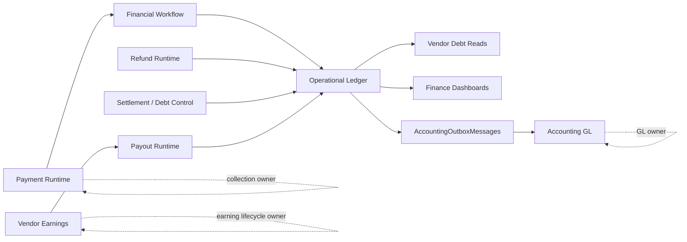

## 2. Aggregate Definition

`CommerceHubFinancialTransaction` is the implementation-backed Operational Ledger aggregate root. The implementation does not expose a parent `Ledger` aggregate containing multiple transaction children; each financial transaction row is the persisted root for one operational ledger posting fact. [E7][E10][E11]

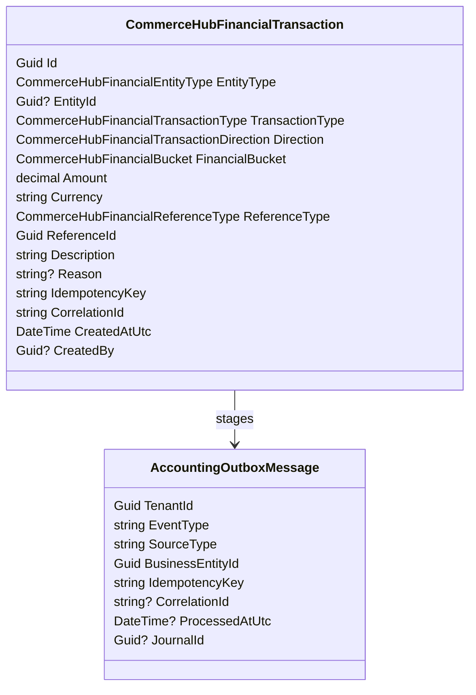

Aggregate members:

| Member | Classification | Identity | Lifetime | Consistency rule |
|---|---|---|---|---|
| `CommerceHubFinancialTransaction` | Aggregate root and ledger row. | `Id`; uniqueness also protected by `IdempotencyKey` and financial fingerprint indexes. | Created by ledger service append paths; normal mutation/deletion is forbidden. [E7][E10-E15][E19] | Positive amount, EGP currency, valid enum values, entity scope, non-empty reference, description, idempotency, and correlation. [E7][E10] |
| Accounting outbox row | Adjacent child-like persistence artifact, not owned as a navigation child in the aggregate class. | `AccountingOutboxMessage.Id`; `BusinessEntityId` equals transaction id; idempotency key is `COMMERCEHUB_TX:{tenant}:{transaction}`. | Created in same append path as the transaction; processed later by Accounting. [E11][E22-E24] | `EventType = CommerceHubLedgerPosting`, `SourceType = CommerceHubFinancialTransaction`. [E11][E22] |

Owned value objects are implemented as scalar columns, not separate value-object classes: `Amount` plus `Currency`, `Direction`, `FinancialBucket`, `ReferenceType` plus `ReferenceId`, `IdempotencyKey`, and `CorrelationId`. Currency validation is delegated to `FinancialCurrencyGuard.RequireEgpCurrency`. [E7-E11]

Identity:

| Identity | Implementation-backed rule |
|---|---|
| Row identity | `Id` is generated by the factory. [E7] |
| Business reference identity | `ReferenceType` and `ReferenceId` identify the source business fact. [E7][E9][E10] |
| Entity identity | Platform postings have no `EntityId`; vendor postings use vendor/store `EntityId`. [E7][E10] |
| Idempotency identity | Explicit idempotency key or default key prevents duplicate mutation and rejects divergent replay. [E7][E10][E11][E36] |
| Financial fingerprint identity | Unique fingerprint includes reference, transaction type, entity id, direction, bucket, amount, and currency; platform fingerprint omits entity id because it is null. [E10][E19] |

Financial Transaction Model:

| Model field | Domain meaning | Implementation-backed rule |
|---|---|---|
| `EntityType` / `EntityId` | Who the posting affects operationally: platform or vendor. | Platform has no entity id; vendor requires vendor id. [E7][E10] |
| `TransactionType` | Business category of the posting. | Only `OrderPayment`, `Commission`, `Refund`, `Payout`, `Adjustment`, `Settlement`, and `Promotion` are valid. [E9][E10] |
| `Direction` | Operational debit/credit direction. | Only `Credit` and `Debit` are valid. [E9][E10] |
| `FinancialBucket` | Operational bucket affected by the posting. | Only `Cash`, `Receivable`, and `Payable` are valid; default classification is implemented by `CommerceHubFinancialClassification`. [E8-E10] |
| `Amount` / `Currency` | Monetary value of the posting. | Amount is positive, rounded to two decimals, and EGP-only. [E7][E10][E21] |
| `ReferenceType` / `ReferenceId` | Source business fact. | Reference id is required; valid reference types are fixed by enum and DB constraint. [E7][E9][E10] |
| `IdempotencyKey` | Duplicate-prevention identity. | Required after normalization; unique and collision-checked. [E7][E10][E11] |
| `CorrelationId` | Multi-row trace identity. | Required after normalization and passed to accounting outbox. [E7][E10][E11][E22] |

Reference Model:

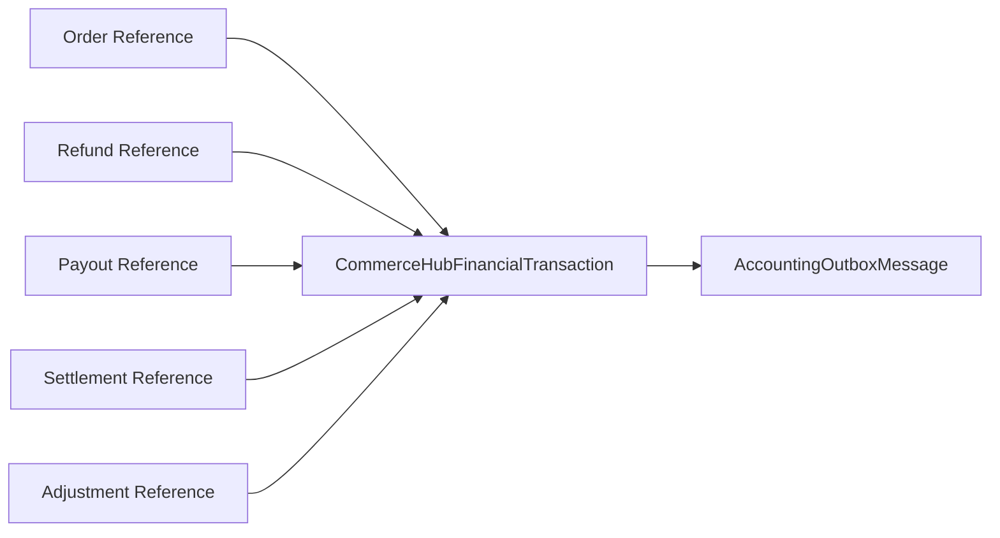

`ReferenceId` is a generic business reference and no universal database foreign key is proven. The ledger therefore preserves lineage by typed reference fields, idempotency, fingerprint, and correlation rather than by a single FK relationship. [E7][E9][E10][E11]

Correlation Model:

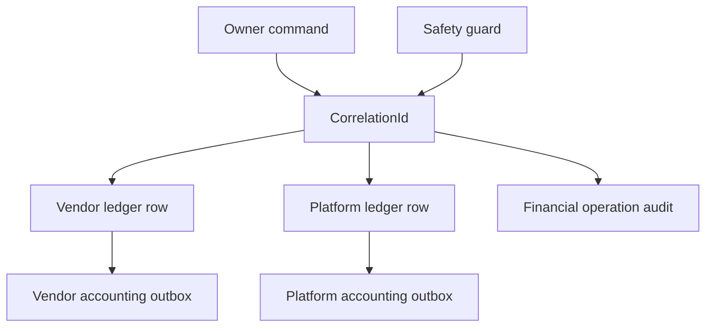

Correlation is not a parent aggregate id. It is a trace key used to connect related ledger rows, accounting outbox rows, and guarded operation audits. Safety guard verification can require that a correlation contains the expected number of rows for one reference/currency. [E7][E11][E22][E32][E35]

## 3. Aggregate Boundary

Inside Aggregate:

| Inside | Examples | Boundary reason |
|---|---|---|
| Ledger transaction row | Entity, type, direction, bucket, amount, currency, reference, trace fields. | Persisted root row. [E7][E10] |
| Debit/credit direction | `Credit = 0`, `Debit = 1`. | Stored enum and DB check constraint. [E9][E10] |
| Financial bucket | `Cash`, `Receivable`, `Payable`, either classified or explicitly overridden. | Stored enum and DB check constraint. [E8-E10] |
| Reference identity | `Order`, `Refund`, `Payout`, `Settlement`, `Adjustment` plus non-empty `ReferenceId`. | Generic source identity for finance workflows. [E7][E9][E10][E11] |
| Correlation | Default `ReferenceType:ReferenceId` or refund id string; settlement/payment flows pass explicit correlation ids. | Trace and safety verification. [E7][E11][E29][E31][E32] |
| Idempotency | Required normalized key from caller or default. | Replay/collision authority. [E7][E10][E11][E19] |
| Posting evidence | Description, optional reason, created timestamp, optional created-by. | Audit trace fields on row. [E7][E14][E18] |
| Accounting outbox staging | `CommerceHubLedgerPosting` outbox message. | Atomic bridge from ledger fact to Accounting. [E11][E20][E22][E23] |

Outside Aggregate:

| Outside | Owner and reason |
|---|---|
| Payment | Payment aggregate owns collection lifecycle and provider evidence. [E4] |
| Vendor Earnings | Earnings aggregate owns pending/available/in-payout/paid/reversed earning state. [E5] |
| Settlement | Settlement/control services own settlement row, idempotency/external reference, notes, and actor evidence. Ledger records mirrored postings. [E29][E34] |
| Payout | Payout service owns payout status and external transfer evidence. Ledger records only completed payout effects. [E26][E27] |
| Refund | Refund services own refund state and execution evidence. Ledger records only completed refund financial effects. [E28] |
| Accounting | Accounting outbox processing and GL journal/ledger-line posting are Accounting-owned. [E22-E24] |
| Provider | External systems provide evidence only. Provider-side settlement timing remains `UNKNOWN`. [E1][E4] |

Boundary diagram:

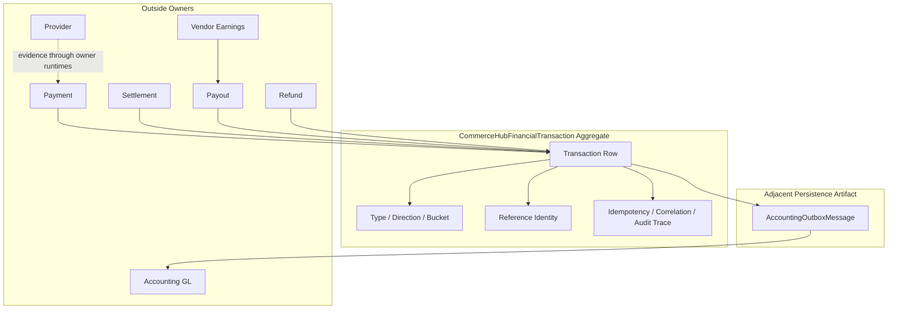

## 4. Ledger Authority

| Authority type | Owner | Implementation-backed contract |
|---|---|---|
| Business Authority | CommerceHub Finance. | Operational ledger is CommerceHub marketplace finance truth for platform/vendor money facts, separate from Payment, Earnings, Settlement, Payout, Refund, and Accounting ownership. [E1-E6] |
| Financial Authority | `CommerceHubFinancialTransactions` plus safety/debt/read services. | Ledger rows are used to compute platform cash, vendor payable, vendor debt, payout confirmation, dashboards, reconciliation, and readiness. [E30][E32][E33] |
| Mutation Authority | `CommerceHubFinancialLedgerService` through `RecordTransactionAsync`, `RecordOrderAsync`, `RecordRefundAsync`, `RecordCommissionAsync`, `RecordPayoutAsync`, `RecordMirroredTransactionsAsync`, and `RecordAdjustmentEntriesAsync`. | Append-if-missing is the implemented mutation path; normal update/delete is forbidden. [E11][E12][E36] |
| Read Authority | Debt, payout-read, dashboard, readiness, reconciliation, and accounting outbox services. | Reads consume ledger rows but do not mutate them. [E30][E33] |
| Persistence Authority | PostgreSQL/EF `CommerceHubFinancialTransactions`, constraints, indexes, immutability guards, and outbox rows. | SQL is durable internal authority. [E10-E23] |
| Audit Authority | Ledger row trace fields plus `CommerceHubFinancialOperationAudits` for guarded operations and financial audit logs in adjacent workflows. | Guarded operations append committed audit rows with before/after snapshots, correlation, idempotency, reference, actor, and notes. [E32][E35] |

Forbidden authorities:

| Candidate | Forbidden authority |
|---|---|
| Frontend, DTO, cache, projection, dashboard, or export | Cannot create, mutate, replay, or rewrite ledger truth. [E2][E6] |
| Payment Runtime alone | Payment success is input; ledger posting belongs to financial workflow/ledger service. [E3-E4][E25] |
| Vendor Earnings alone | Earnings are payout candidates and lifecycle rows; payout requires ledger confirmation. [E5][E26] |
| Provider payload alone | Provider evidence must be admitted by backend owner runtime before ledger recording. [E3-E4] |
| Accounting | Accounting posts GL from outbox; it does not own CommerceHub ledger mutation. [E2][E22-E24] |
| Reconciliation | Reconciliation detects/report/re-enters owners; it cannot mint or rewrite ledger rows. [E3][E6][E33] |

## 5. Posting Lifecycle

`CommerceHubFinancialTransaction` has no persisted posting-status field. The implementation-backed lifecycle is therefore an execution lifecycle, not a row state machine. [E7][E10][E11]

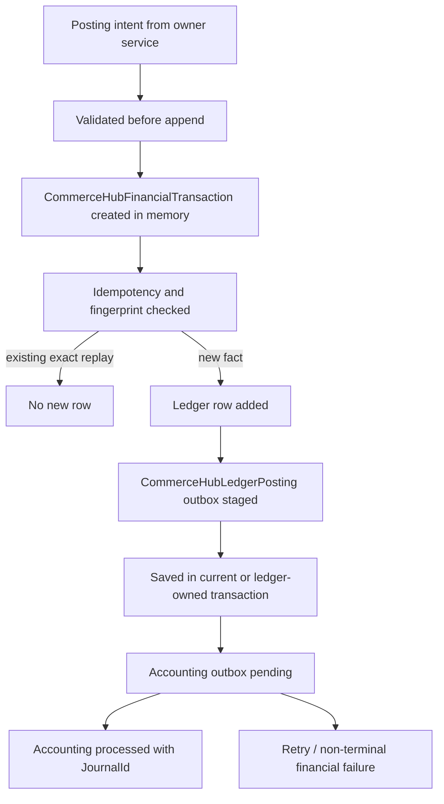

Lifecycle table:

| Stage | Implementation-backed meaning | Persisted on ledger row? |
|---|---|---|
| Intent | Owner runtime calls a ledger service method. [E11][E25-E31] | No. |
| Validated | Factory and command-specific validation check amount, currency, reference, entity scope, completed refund/payout state, sub-order integrity, and arithmetic. [E7][E11] | No separate state. |
| Created | `CommerceHubFinancialTransaction.Create` returns an in-memory row. [E7][E11] | Row exists only after save. |
| Duplicate checked | Existing idempotency key or same financial fingerprint collapses replay; divergent idempotency collision throws. [E11][E19][E36] | No separate state. |
| Recorded | Row is added to `CommerceHubFinancialTransactions`. [E11] | Yes, as the row itself. |
| Outbox staged | Accounting outbox row is created with event `CommerceHubLedgerPosting`. [E11][E22] | Separate outbox row. |
| Persisted | Save occurs in current transaction or ledger-owned serializable transaction. [E11] | Yes. |
| Accounting processed | Accounting processor routes `CommerceHubLedgerPosting` and can mark outbox processed with journal id. [E22-E24] | Separate outbox/journal state. |
| Exported | No implemented ledger export state was found. CSV/dashboard reads exist, but export lifecycle state is `UNKNOWN`. [E33] |
| Archived | No normal ledger archive state or command was found. `UNKNOWN`. |

## 6. State Machine

Because the ledger row has no mutable state column, the aggregate state machine is append-only:

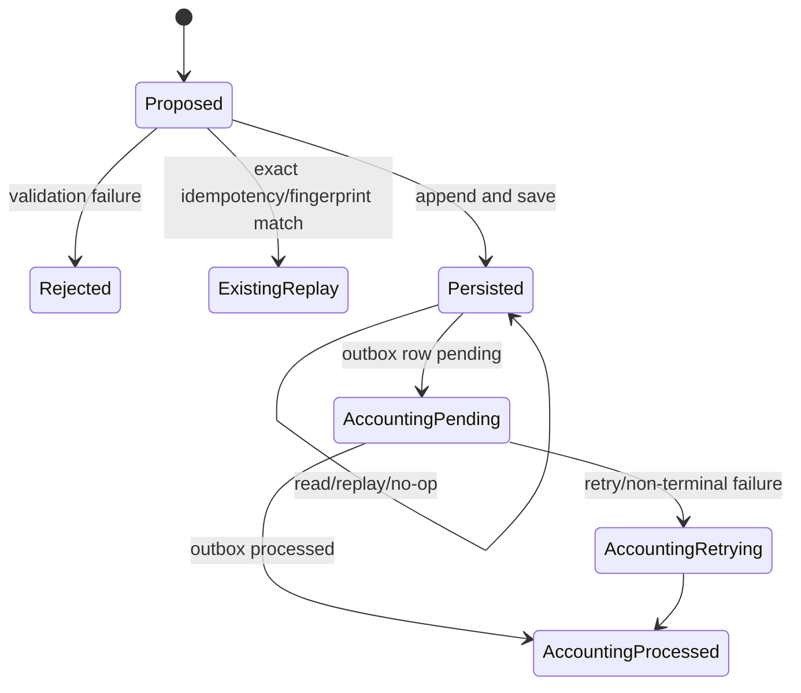

| Transition | Allowed | Forbidden | Owner | Recovery / Replay |
|---|---|---|---|---|
| `Proposed -> Rejected` | Invalid amount, currency, enum, entity scope, reference, description, payout/refund status, or arithmetic fails. [E7][E11][E36] | Persisting invalid row is forbidden by factory and DB constraints. [E7][E10] | Ledger service/entity factory. | Caller handles exception; no ledger row is created. |
| `Proposed -> ExistingReplay` | Existing idempotency key or exact financial fingerprint is found. [E11][E36] | Divergent key collision is forbidden. [E11][E36] | Ledger service. | Replay is a no-op for ledger row creation. |
| `Proposed -> Persisted` | Valid new row plus outbox staged. [E11] | Missing accounting tenant id for platform postings where no vendor can be resolved is forbidden. [E11] | Ledger service in current transaction or serializable transaction. | Duplicate DB race is checked and detached only if exact replay is proven. [E11] |
| `Persisted -> Persisted` | Reads, dashboards, debt computation, payout checks, reconciliation. [E30][E33] | Update/delete is forbidden in application guard and DB trigger during normal operation. [E12][E13][E15] | Persistence authority. | Maintenance-mode migration backfill exists for schema correction, not normal domain mutation. [E15][E17][E35] |
| `Persisted -> AccountingPending` | Outbox row created in append path or backfilled for existing uncovered rows. [E11][E20] | Ledger fact without eventual outbox/journal coverage is treated as readiness/reconciliation risk. [E20][E33] | Ledger service / migration backfill. | S45 backfills missing `CommerceHubLedgerPosting` outbox rows. [E20] |
| `AccountingPending -> AccountingProcessed` | Accounting outbox processor posts and marks processed with journal id. [E22-E24] | Accounting cannot mutate CommerceHub ledger row. [E2][E24] | Accounting runtime. | Idempotent accounting processing and processor retries apply. [E22-E24] |
| `AccountingPending -> AccountingRetrying` | Failure records retry or non-terminal financial failure. [E22][E24] | Financial truth events must not disappear into terminal failure while business state remains committed. [E22][E24] | Accounting runtime. | Retry/backoff and reset/recovery are Accounting-owned. [E22-E24] |
| `Persisted -> Archived` | `UNKNOWN`. | Normal archive/delete lifecycle not proven. | `UNKNOWN`. | `UNKNOWN`. |

## 7. Posting Policies

| Policy | Implementation-backed rule |
|---|---|
| Append-only policy | Ledger rows are appended only; normal update/delete is blocked by application guard and database triggers. [E12][E13][E15][E36] |
| Amount policy | Amount must be greater than zero; zero/negative direct append returns no row in `AppendTransactionIfMissingAsync`, and factory/DB reject invalid persisted rows. [E7][E10][E11] |
| Currency policy | Currency is required, normalized through `FinancialCurrencyGuard`, and constrained to EGP. [E7][E10][E11][E21][E36] |
| Entity scope policy | Platform rows must have `EntityId = null`; vendor rows must have a non-empty vendor id. [E7][E10] |
| Direction policy | Only `Credit` and `Debit` are valid. [E9][E10] |
| Bucket policy | Default bucket comes from `CommerceHubFinancialClassification`, with explicit overrides in COD, refund, payout, settlement/control flows. [E8][E11] |
| Reference policy | Reference type must be one of `Order`, `Refund`, `Payout`, `Settlement`, or `Adjustment`; `ReferenceId` is required. [E7][E9][E10] |
| Description/reason policy | Description is required and trimmed; reason is optional and trimmed. [E7] |
| Idempotency policy | Explicit or default idempotency key is normalized; unique index enforces uniqueness; collision with different financial fingerprint throws. [E7][E10][E11][E19] |
| Replay policy | Exact idempotency replay or exact fingerprint replay is safe no-op; partial ledger references append missing entries. [E11][E36] |
| Correlation policy | Correlation id defaults from reference; refund correlation uses refund id string; safety guard can require exact correlated row count and matching reference/currency. [E7][E11][E32][E36] |
| Outbox policy | A new ledger row stages a `CommerceHubLedgerPosting` outbox row in the same append path. [E11][E22] |
| Accounting tenant policy | Ledger posting must resolve to a tenant-owned chart of accounts; platform postings require supplied or paired vendor/accounting tenant id. [E11][E20] |
| Balance/safety policy | Safety guard verifies non-negative platform cash, vendor payable, vendor debt, expected deltas, and correlation row counts for guarded operations. [E32] |
| Double-entry policy | Operational ledger writes paired or grouped rows for order, refund, payout, settlement, and adjustment flows, but universal double-entry balancing is Accounting-owned and not a generic ledger aggregate invariant. [E2][E11][E24][E36] |
| Audit policy | Guarded operations append `CommerceHubFinancialOperationAudit`; ledger rows retain created-by, reason, timestamp, idempotency, and correlation. [E7][E18][E32][E35] |

## 8. Domain Invariants

| Invariant | Enforcement |
|---|---|
| Ledger rows are immutable after normal persistence. | EF guard and DB triggers reject update/delete. [E12][E13][E15][E36] |
| Posting identity is immutable. | Private setters, factory creation, append-only guards, primary key. [E7][E10][E12] |
| Reference identity is immutable in normal operation. | Private setters plus append-only guards; migration maintenance-mode backfill is not normal domain mutation. [E7][E12][E15][E17] |
| Currency is immutable and EGP-only. | Factory guard, DB check constraint, append-only guard. [E7][E10][E21] |
| Amount is positive and rounded to two decimals. | Factory and DB amount constraint; factory rounds with `MidpointRounding.AwayFromZero`. [E7][E10] |
| Entity scope cannot drift. | Factory and DB check enforce platform/no entity and vendor/required entity. [E7][E10] |
| Idempotency key cannot be reused for a different financial fingerprint. | Service collision check and tests. [E11][E36] |
| Duplicate financial facts are prevented. | Unique idempotency and fingerprint indexes plus service duplicate checks. [E10][E11][E19] |
| Correlation is preserved on rows and outbox messages. | Factory/service sets correlation; outbox receives transaction correlation. [E7][E11][E22] |
| Ledger append requires accounting outbox staging for new rows. | Append path adds transaction and outbox together. [E11][E22] |
| Refund ledger recording requires completed refund. | `ValidateRefundFinancialIntegrity` rejects non-completed refund. [E11][E36] |
| Payout ledger recording requires completed payout. | `ValidatePayoutFinancialIntegrity` rejects non-completed payout. [E11][E36] |
| Order ledger recording requires order/sub-order lineage and EGP matching currency. | `ValidateOrderFinancialIntegrity`. [E11] |
| Commission/promo/vendor earning arithmetic must match sub-order snapshots before order ledger recording. | `ValidateOrderFinancialIntegrity`. [E11] |
| Refund reversal arithmetic must match refund/sub-order evidence before refund ledger recording. | `ValidateRefundFinancialIntegrity`. [E11] |
| Platform cash, vendor payable, and vendor debt cannot be negative after guarded operations. | Safety guard verification. [E32] |
| Universal balanced transaction as a ledger aggregate invariant is `UNKNOWN`. | No parent transaction group or balancing status exists in `CommerceHubFinancialTransaction`; Accounting owns GL balancing. [E2][E7][E24] |

## 9. Commands

Command names below are canonical labels mapped to implemented methods. They are not separate command-bus classes unless stated.

| Command | Producer | Consumer | Transaction owner | Idempotency owner |
|---|---|---|---|---|
| `AppendTransaction` / `CreateLedgerEntry` | Finance, refund, payout, settlement, vendor payment, Super Admin finance paths. | `ICommerceHubFinancialLedgerService.RecordTransactionAsync` and private `AppendTransactionIfMissingAsync`. | Existing caller transaction or ledger service serializable transaction. [E11] | Ledger idempotency key and fingerprint. [E10][E11][E19] |
| `RecordOrderPosting` | `CommerceHubFinancialWorkflowService` after online payment success or COD delivered financials. [E25] | `RecordOrderAsync`. | Caller/current transaction or ledger service. [E11][E25] | Default ledger keys per posting and fingerprint replay. [E7][E11] |
| `RecordRefundPosting` | `CommerceHubRefundService`, `RefundExecutionService`, compensation worker after completed refund. [E28] | `RecordRefundAsync`. | Refund runtime/caller transaction or ledger service. [E11][E28] | Refund-scoped keys `commercehub:refund:{refund}:{scope}` and fingerprint. [E11] |
| `RecordCommissionPosting` | Commission-specific callers. | `RecordCommissionAsync`, delegating to `RecordTransactionAsync`. [E11] | Ledger service. | Supplied or default idempotency key. [E7][E11] |
| `RecordPayoutPosting` | Payout completion paths, including Super Admin payout service. [E26][E27] | `RecordPayoutAsync`. | Payout service/caller with ledger append; ledger may own serializable transaction. [E11][E26][E27] | Default payout-reference keys and fingerprint. [E7][E11] |
| `RecordMirroredSettlementPosting` | Vendor financial control service settlement payment, debt clearance, admin adjustment. [E29] | `RecordMirroredTransactionsAsync`. | Financial control service uses serializable transaction when it owns it. [E29] | Settlement idempotency key on settlement row plus ledger idempotency/fingerprint. [E29][E34] |
| `RecordAdjustmentPostingPair` | Super Admin/vendor finance adjustment paths. [E27][E29] | `RecordAdjustmentEntriesAsync` or two `RecordTransactionAsync` calls. | Caller transaction or ledger service. [E11][E27][E29] | Supplied/default scoped ledger keys. [E11] |
| `ApproveVendorRepaymentPosting` | Vendor payment approval service. [E31] | Two `RecordTransactionAsync` calls for vendor/platform settlement credits. | Vendor payments service. [E31] | Payment request ledger idempotency key scoped to vendor/platform. [E31] |
| `ValidatePosting` | Ledger service/entity factory and command-specific validators. | Factory/validation methods. | Caller before persistence. [E7][E11] | Not separate; validation precedes idempotency mutation. |
| `RecordAccountingPosting` | Ledger append path. | `AccountingOutboxMessage.Create` with `CommerceHubLedgerPosting`. | Same append path as ledger row. [E11][E22] | Outbox idempotency key `COMMERCEHUB_TX:{tenant}:{transaction}` plus unique tenant/idempotency index. [E11][E23] |
| `ExportAccounting` | Accounting outbox processor. | `ProcessCommerceHubLedgerPostingAsync`. | Accounting runtime. [E24] | Accounting outbox idempotency and posting idempotency. [E22-E24] |
| `RecoverPosting` | Ledger duplicate race handler, partial-ledger rerun, S45 backfill, Accounting retry. | Ledger service, migration, Accounting processor. | Owning recovery path. [E11][E20][E24][E36] | Replay/fingerprint/outbox idempotency. [E11][E20][E23] |
| `ReplayPosting` | Repeated owner command or retry. | Ledger service duplicate/fingerprint logic. | Caller or ledger service. [E11][E36] | Exact replay no-op; divergent replay rejected. [E11][E36] |
| `ArchivePosting` | `UNKNOWN`. | No normal ledger archive command found. | `UNKNOWN`. | `UNKNOWN`. |

## 10. Events

The Operational Ledger implementation primarily persists SQL rows and accounting outbox rows. Named domain event classes for the conceptual ledger events below were not found during this review; where not proven, the event class is `UNKNOWN`.

| Conceptual event | Actual implementation artifact | Event class exists? | Owner |
|---|---|---|---|
| `LedgerEntryCreated` | New `CommerceHubFinancialTransaction` row. | `UNKNOWN` as named event class. | Operational Ledger. [E7][E11] |
| `PostingValidated` | Successful factory and command validation before append. | `UNKNOWN`; validation is not emitted as an event. | Ledger service/entity factory. [E7][E11] |
| `PostingRecorded` | Persisted transaction row plus outbox row. | `UNKNOWN` as named event class. | Operational Ledger. [E11] |
| `CommerceHubLedgerPosting` | `AccountingOutboxMessage.EventType = "CommerceHubLedgerPosting"`. | Implemented as outbox event row, not domain event class. | Operational Ledger/Accounting bridge. [E11][E22][E24] |
| `AccountingExported` | Accounting outbox processed with `JournalId`; processor routes `CommerceHubLedgerPosting`. | `UNKNOWN` as named event class. | Accounting. [E22-E24] |
| `PostingRecovered` | Duplicate race safe-detach, partial-ledger append, or outbox backfill. | `UNKNOWN` as named event class. | Ledger service/migration/Accounting recovery. [E11][E20][E36] |
| `PostingReplayCompleted` | Exact replay no-op or returned existing settlement/payment result in caller services. | `UNKNOWN` as named event class. | Owning service. [E11][E29][E31][E36] |
| `PostingArchived` | `UNKNOWN`. | `UNKNOWN`. | `UNKNOWN`. |

Event relationship:

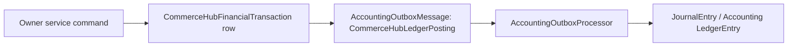

## 11. Runtime Contracts

Canonical runtime:

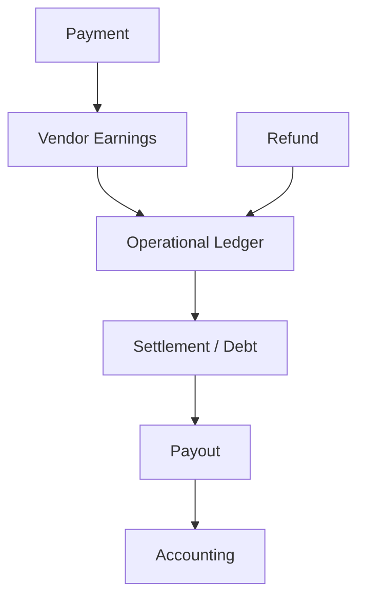

The constitutional flow is Payment -> Vendor Earnings -> Operational Ledger -> Settlement -> Payout -> Accounting, with refund and compensation branches re-entering ledger through refund/payment owner runtimes. [E2-E6]

Sequence model:

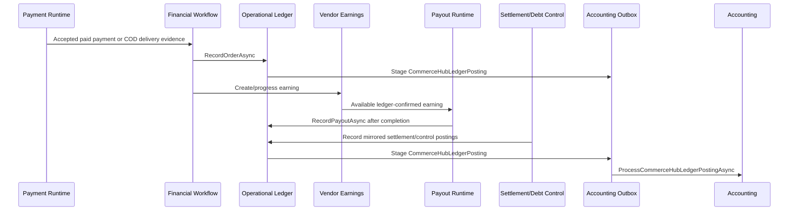

| Contract | Inputs | Outputs | Guarantees | Failure contract | Recovery contract |
|---|---|---|---|---|---|
| Payment to Financial Workflow to Ledger | Paid online payment or COD delivery evidence, marketplace order, sub-order financial snapshots. | Order payment, commission, promotion ledger rows and outbox rows. [E11][E25][E36] | Online records platform cash/order payment and vendor payable/order payment; COD records vendor cash and commission debt/receivable. [E11][E36] | Invalid currency, lineage, negative amounts, or arithmetic throws before ledger write. [E11] | Re-running appends missing rows or no-ops exact duplicates. [E11][E36] |
| Vendor Earnings to Payout to Ledger | Ledger-confirmed available earnings, completed payout row, payout amount/currency/vendor. | Platform settlement debit, platform payout debit, vendor payout debit, outbox rows. [E11][E26][E36] | Payout ledger recording only occurs for completed payouts; payout service requires ledger confirmation before payout. [E11][E26] | Non-completed payout is rejected before ledger write. [E11][E36] | Partial ledger rerun appends missing payout rows. [E36] |
| Refund to Ledger | Completed refund, sub-order, marketplace order, reversal amounts, post-payout flag. | Refund/adjustment/commission/promotion/vendor debt rows according to scenario. [E11][E28][E36] | Completed refund required; refund currency matches sub-order and EGP; reversal arithmetic must balance internally. [E11] | Pending/processing refund, tenant mismatch, amount overflow, or arithmetic mismatch rejects before ledger write. [E11][E36] | Refund recovery can complete/reconcile refund, then ledger posting is idempotent. [E28][E36] |
| Settlement/Debt Control to Ledger | Vendor id, amount, EGP currency, idempotency key, external reference, notes, actor. | Settlement/control row plus mirrored vendor/platform ledger rows, operation audit. [E29][E32][E34][E35] | Settlement payment/debt clearance cannot exceed outstanding debt; replay must match original operation. [E29] | Missing notes/idempotency/external reference, reused external reference, invalid currency, or over-debt amount rejects. [E29][E34] | Idempotency conflict reloads matching settlement only when replay matches original. [E29] |
| Vendor Payment Approval to Ledger | Approved vendor repayment request, transfer reference/proof, actor, amount/currency. | Vendor and platform settlement credit ledger rows. [E31] | Approval requires external transfer reference and unused evidence; integrity check requires exactly one vendor and one platform settlement row. [E31] | Missing/reused evidence or pre-existing pending request ledger entries reject. [E31] | Ledger idempotency is scoped vendor/platform; approval integrity verifies rows. [E31] |
| Ledger to Debt/Read Models | Persisted transaction rows. | Debt snapshots, dashboards, payout-read totals, reconciliation reports, readiness checks. [E30][E33] | Reads compute from current SQL ledger rows. [E30][E33] | Read cannot fabricate ledger truth; missing coverage is readiness/reconciliation concern. [E20][E33] | Reconciliation/readiness surfaces detect missing accounting coverage and ledger mismatches. [E20][E33] |
| Ledger to Accounting | Ledger row and staged outbox message. | Accounting journal/ledger-line posting. [E11][E22-E24] | Outbox event type and source type identify CommerceHub ledger posting. [E11][E22] | Accounting failure does not mutate/delete ledger row. [E22-E24] | Accounting retry/backoff and non-terminal financial failure handling. [E22-E24] |

## 12. Persistence Model

Persistence diagram:

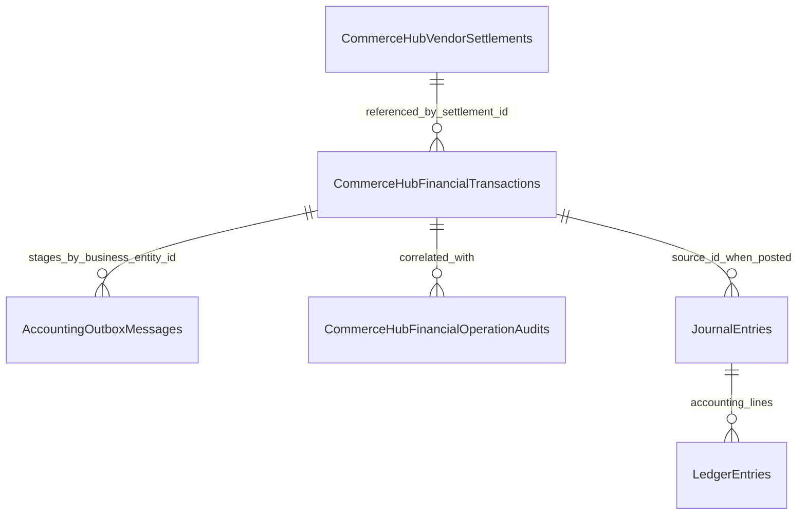

Tables:

| Table | Purpose | Key columns |
|---|---|---|
| `CommerceHubFinancialTransactions` | Operational ledger aggregate row. | `Id`, `EntityType`, `EntityId`, `TransactionType`, `Direction`, `FinancialBucket`, `Amount`, `Currency`, `ReferenceType`, `ReferenceId`, `Description`, `Reason`, `IdempotencyKey`, `CorrelationId`, `CreatedAtUtc`, `CreatedBy`. [E7][E10][E13-E18] |
| `AccountingOutboxMessages` | Accounting bridge from ledger row to Accounting. | `TenantId`, `EventType`, `SourceType`, `BusinessEntityId`, `PayloadJson`, `IdempotencyKey`, `CorrelationId`, processing/retry/journal fields. [E22][E23] |
| `CommerceHubVendorSettlements` | Settlement/control evidence referenced by settlement/adjustment postings. | `VendorId`, `SettlementType`, `Direction`, `Amount`, `Currency`, `IdempotencyKey`, `ExternalReference`, `Notes`, actor fields. [E29][E34] |
| `CommerceHubFinancialOperationAudits` | Guarded operation audit snapshots. | Vendor, actor, operation, amount/currency, before/after platform cash/vendor payable/vendor debt, correlation, idempotency, reference, outcome, notes. [E32][E35] |
| `JournalEntries` / accounting `LedgerEntry` | Accounting truth after outbox processing. | Source type/id and accounting lines are Accounting-owned. [E2][E22-E24] |

Indexes and constraints:

| Table | Index/constraint | Meaning |
|---|---|---|
| `CommerceHubFinancialTransactions` | Primary key on `Id`. | Ledger row identity. [E10] |
| `CommerceHubFinancialTransactions` | `UX_CommerceHubFinancialTransactions_IdempotencyKey`. | One row per ledger idempotency key. [E10][E14] |
| `CommerceHubFinancialTransactions` | `UX_CHFinancialTx_Fingerprint_Vendor`. | Vendor financial fingerprint uniqueness. [E10][E19] |
| `CommerceHubFinancialTransactions` | `UX_CHFinancialTx_Fingerprint_Platform`. | Platform financial fingerprint uniqueness. [E10][E19] |
| `CommerceHubFinancialTransactions` | Reference, entity/time, transaction type, bucket/time, correlation, created-by indexes. | Read, trace, dashboard, debt, and reconciliation lookup. [E10][E14][E16-E18] |
| `CommerceHubFinancialTransactions` | Amount, EGP currency, entity scope, transaction type, direction, bucket, reference type checks. | Core ledger validity. [E10][E13][E16-E17][E21] |
| `AccountingOutboxMessages` | Unique `(TenantId, IdempotencyKey)`. | Accounting outbox idempotency. [E23] |
| `AccountingOutboxMessages` | Processing, failed, aggregate ordering, source/entity indexes. | Worker claiming, monitoring, ordering, and recovery. [E23] |
| `CommerceHubVendorSettlements` | Unique `(VendorId, IdempotencyKey)` and unique external reference. | Settlement/control replay and evidence uniqueness. [E34] |
| `CommerceHubFinancialOperationAudits` | Vendor, correlation, operation type, reference indexes; amount/reference checks. | Guarded operation audit lookup and validity. [E35] |

Foreign keys and generic references:

| Relationship | Implementation-backed statement |
|---|---|
| `CommerceHubFinancialTransactions.ReferenceId` | Generic reference id; no universal FK is proven because it can point to orders, refunds, payouts, settlements, or adjustments. [E7][E9][E10] |
| `CommerceHubFinancialTransactions.EntityId` | Vendor id for vendor rows; no FK is proven in `CommerceHubFinancialTransactionConfiguration`. [E10] |
| Ledger to accounting outbox | Implemented by `AccountingOutboxMessage.BusinessEntityId = transaction.Id`, not proven as FK. [E11][E22][E23] |
| Accounting journal coverage | Readiness/backfill look for `JournalEntry.SourceType = CommerceHubFinancialTransaction` and `SourceId = transaction.Id`; FK not proven here. [E20][E33] |

Audit, history, snapshots, recovery metadata:

| Concern | Implementation-backed statement |
|---|---|
| Audit | Ledger row trace fields and operation audit rows persist correlation/idempotency/actor/reason snapshots. [E7][E18][E32][E35] |
| History | Append-only ledger rows preserve history; reversals/adjustments create additional rows instead of normal updates. [E11-E15][E36] |
| Snapshots | Safety guard captures before/after platform cash, vendor payable, and vendor debt for guarded operations. [E32][E35] |
| Recovery metadata | Idempotency key, correlation id, fingerprint, accounting outbox processing fields, and operation audits support replay/recovery. [E10][E11][E22][E23][E32] |
| Archive | Normal archive table/state for ledger rows is `UNKNOWN`. |

## 13. Domain Principles

| Principle | Implementation-backed statement |
|---|---|
| Ledger owns operational financial truth | `CommerceHubFinancialTransactions` is the CommerceHub operational finance source for platform/vendor postings. [E1-E3][E7][E11] |
| Ledger never rewrites history | Normal update/delete is forbidden; corrections are new facts or guarded maintenance migrations. [E12-E15][E17][E36] |
| Posting before accounting | Ledger row and outbox are staged before Accounting posts GL. [E11][E22-E24] |
| Evidence before posting | Owner services validate order, payment, refund, payout, settlement, external reference, and actor evidence before ledger recording. [E11][E25-E31] |
| Idempotency before mutation | Ledger checks idempotency/fingerprint before adding a row. [E11][E19][E36] |
| Recovery before replay mutation | Exact replay no-ops; duplicate races are detached only when proven safe; partial ledgers append missing rows. [E11][E36] |
| References never change in normal operation | Reference fields are immutable after append; migrations using maintenance mode are schema/data correction, not domain mutation. [E7][E12][E15][E17] |
| Accounting is separate | Accounting owns GL journals and ledger lines; Operational Ledger owns CommerceHub operational rows and outbox staging. [E2][E22-E24] |
| Debt is derived from ledger | Vendor debt snapshots recompute from ledger rows and settlement/control effects. [E30] |
| Payout follows ledger confirmation | Payout creation/completion checks ledger confirmation before releasing vendor payable. [E26][E27] |
| EGP is the ledger currency | Ledger currency is EGP-only in entity factory and DB constraints. [E7][E10][E21] |

## 14. Domain Decisions

| Decision | Why, implementation-backed |
|---|---|
| Why Ledger exists | CommerceHub needs an operational, marketplace-specific financial record separate from payment, earnings, payout, settlement, refund, and accounting GL, with entity/type/direction/bucket/reference/idempotency/correlation fields. [E1-E3][E7][E11] |
| Why references exist | Ledger postings must preserve source business lineage across orders, refunds, payouts, settlements, and adjustments without a single source table. [E7][E9][E11] |
| Why correlation exists | Correlation ties multi-row postings and outbox messages together; safety guard verifies correlated count/reference/currency for guarded operations. [E7][E11][E32] |
| Why idempotency exists | Owner commands can replay or race; ledger must collapse exact duplicate financial facts and reject divergent reused keys. [E10][E11][E19][E36] |
| Why fingerprint uniqueness exists | Financial fingerprint allows safe replay when a caller omitted or regenerated an idempotency key, while still allowing legitimate opposite-direction rows for the same reference. [E11][E19][E36] |
| Why accounting is separated | Accounting posts double-entry GL through outbox processing; ledger records CommerceHub operational truth and stages Accounting work. [E2][E11][E22-E24] |
| Why Payment does not own Ledger | Payment owns provider collection recognition; financial workflow and ledger service record operational platform/vendor effects after accepted payment/COD evidence. [E3-E4][E11][E25] |
| Why Earnings do not own Ledger | Earnings own payable lifecycle and payout reservation; ledger has its own posting model and payout requires ledger confirmation rather than trusting earning rows alone. [E5][E11][E26] |
| Why Ledger precedes Accounting | New ledger append creates `CommerceHubLedgerPosting` outbox for later Accounting processing; existing rows were backfilled to outbox when not posted. [E11][E20][E22-E24] |
| Why settlement/debt control uses mirrored postings | Settlement payment, debt clearance, and admin adjustment affect vendor and platform state and safety guard verifies expected deltas and row counts. [E29][E32] |
| Why universal balancing remains outside ledger | Operational ledger stores individual postings without a persisted parent transaction group or balancing status; Accounting owns GL balancing. [E2][E7][E22-E24] |

## 15. Domain Conclusions

| Model | Conclusion |
|---|---|
| Aggregate Model | `CommerceHubFinancialTransaction` is the Operational Ledger aggregate root. It stores entity, posting, bucket, amount, currency, reference, description, reason, idempotency, correlation, timestamp, and creator fields. [E7-E11] |
| Authority Model | CommerceHub Finance owns operational ledger business/financial/mutation/persistence authority; Accounting owns GL; Payment, Earnings, Settlement, Payout, Refund, Provider, frontend, and reconciliation do not own ledger mutation. [E1-E6][E11][E22-E24] |
| Posting Model | Postings are append-if-missing rows, optionally grouped by correlation, with `Credit`/`Debit`, `Cash`/`Receivable`/`Payable`, EGP currency, source references, and accounting outbox staging. [E7-E11] |
| Lifecycle Model | Ledger rows have no mutable status. The implemented lifecycle is validate -> create -> duplicate check -> append -> outbox staged -> persisted -> accounting pending/processed/retry. Export/archive lifecycle is `UNKNOWN`. [E7][E11][E22-E24] |
| Policy Model | Policies enforce append-only history, positive EGP amounts, entity scope, reference integrity, idempotency, replay collapse, correlation, accounting tenant resolution, outbox staging, safety deltas, and audit evidence. [E7-E24][E32][E35] |
| Invariant Model | Core invariants are immutable rows, immutable identity/reference/currency in normal operation, positive rounded amounts, entity scope, finite enums, duplicate prevention, correlation preservation, completed refund/payout preconditions, and safety guard non-negative balances. [E7-E12][E32][E36] |
| Runtime Model | Financial workflow records order postings; refund runtime records completed refund postings; payout runtime records completed payout postings; settlement/control and vendor payment approval record mirrored/paired settlement or adjustment postings; Accounting consumes outbox. [E11][E25-E31] |
| Persistence Model | Durable state is `CommerceHubFinancialTransactions` plus accounting outbox rows, settlement/control rows where applicable, operation audits, and Accounting journal/ledger rows after processing. [E10-E24][E34][E35] |
| Boundary Model | Ledger owns operational posting facts only. It does not own payment lifecycle, earning lifecycle, settlement request identity, payout execution, refund execution, provider evidence, or accounting GL. [E1-E6] |
| Contract Model | Contracts are backend-to-backend, SQL-backed, idempotent where implemented, and fail closed or `UNKNOWN` where implementation does not prove behavior. [E11][E25-E33] |

This document is the constitutional Operational Ledger Domain Specification for future CommerceHub Finance implementation work. Future changes must remain implementation-backed; behavior not proven by current implementation remains `UNKNOWN`.
