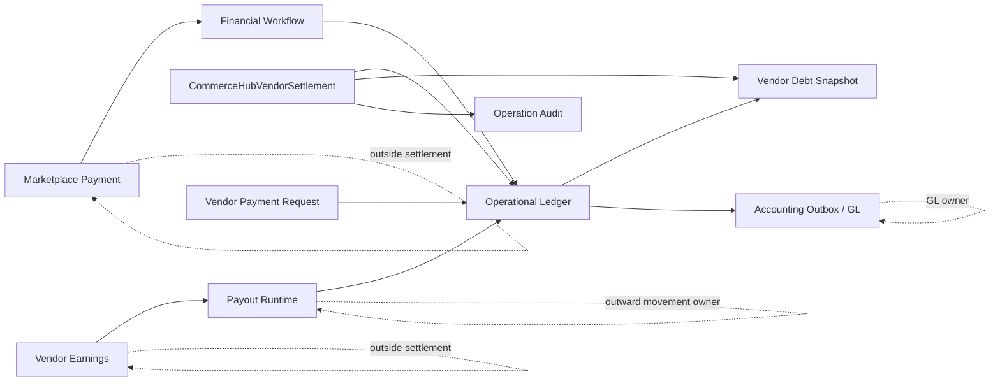
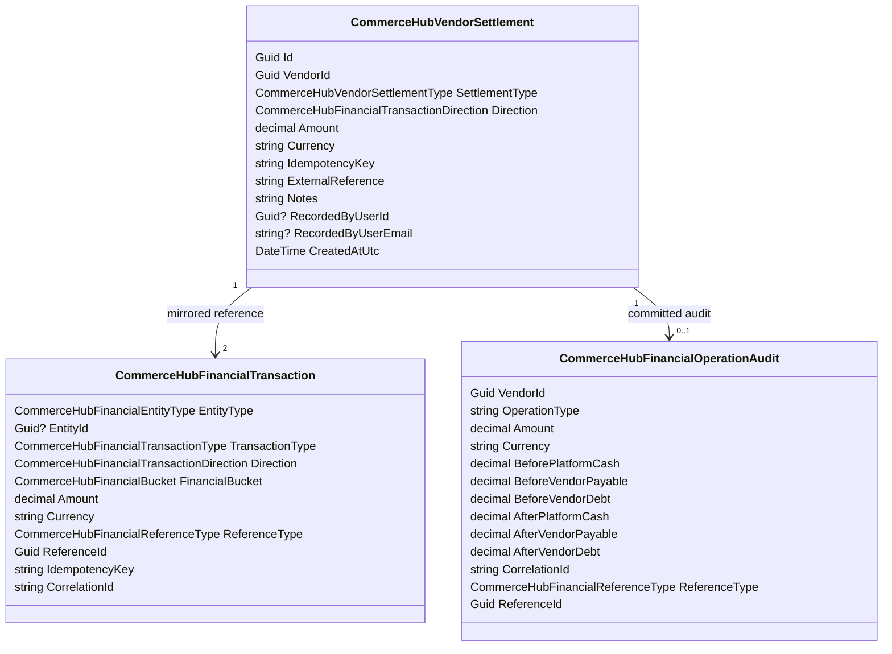
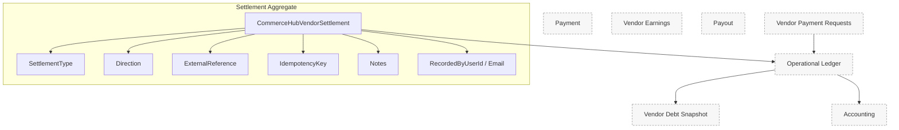
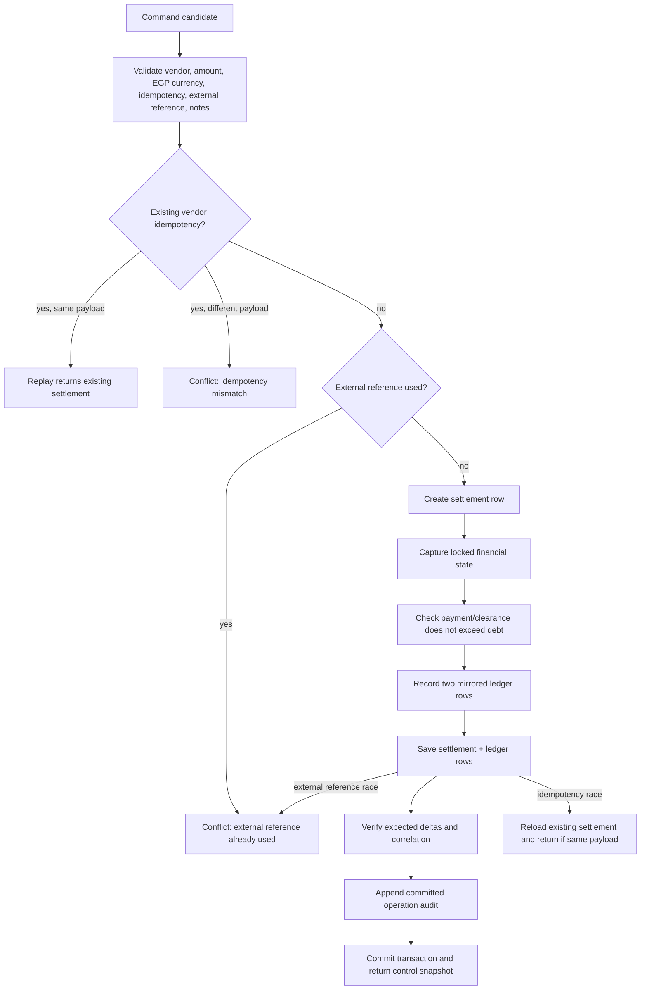
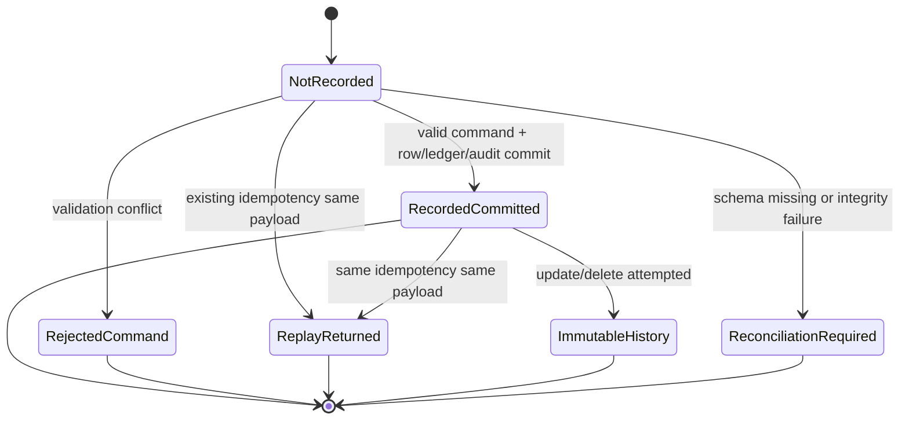
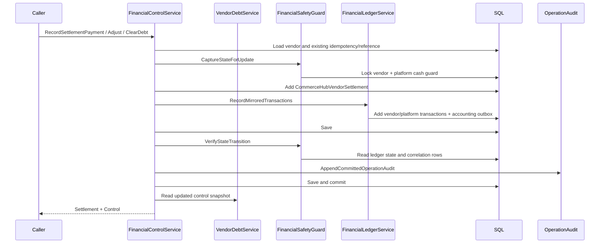
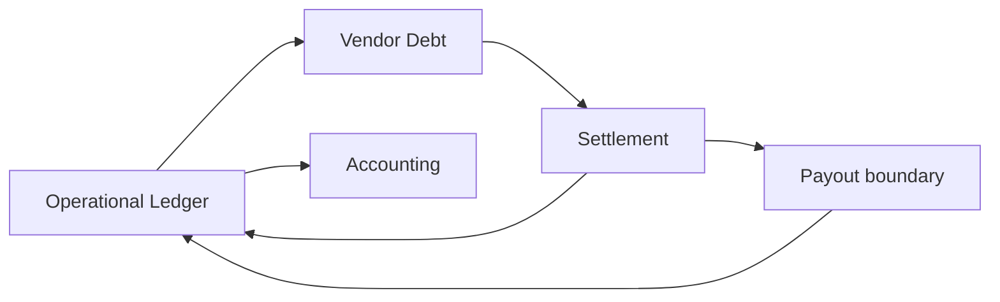
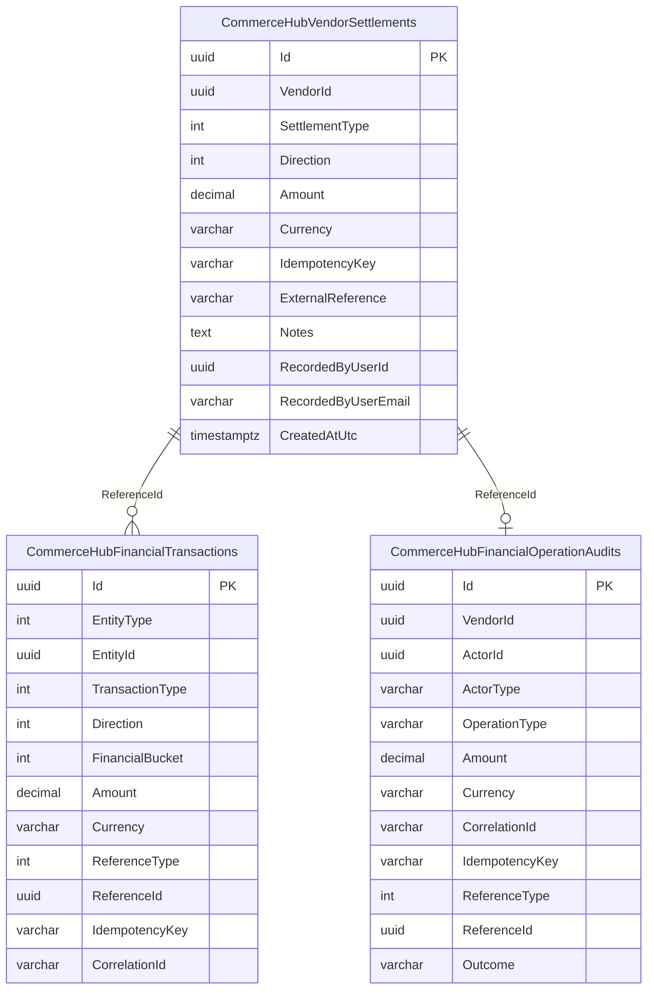
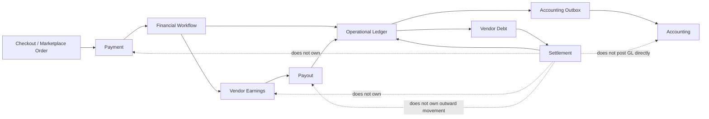

# CHF-4 CommerceHub Settlement Domain Specification

Status: Domain Specification

Scope: CommerceHub Settlement Domain as implemented.

Source of truth: current implementation. CHF-0.0 Discovery, CHF-0.5 Canonical Architecture, CHF-0.7 Runtime Blueprint, CHF-1 Marketplace Payment Domain Specification, CHF-2 Vendor Earnings Domain Specification, CHF-3 Operational Ledger Domain Specification, CommerceHub Final Architecture, and current implementation are constitutional inputs only where implementation backs them.

Non-goals: implementation, coding, refactoring, redesign, migration, optimization, recommendations, future behavior, UI redesign, provider SDK internals, payout redesign, accounting redesign, or new business rules.

UNKNOWN rule: if current implementation does not prove a behavior, state, transition, command, event, persistence rule, approval rule, or recovery contract, this document marks it `UNKNOWN`.

## Evidence Register

| Id | Evidence |
|---|---|
| E1 | `docs/architecture/CHF-0.0_COMMERCEHUB_FINANCE_DISCOVERY.md` |
| E2 | `docs/architecture/CHF-0.5_COMMERCEHUB_FINANCE_CANONICAL_ARCHITECTURE.md` |
| E3 | `docs/architecture/CHF-0.7_COMMERCEHUB_FINANCE_RUNTIME_BLUEPRINT.md` |
| E4 | `docs/architecture/CHF-1_COMMERCEHUB_MARKETPLACE_PAYMENT_DOMAIN_SPECIFICATION.md` |
| E5 | `docs/architecture/CHF-2_COMMERCEHUB_VENDOR_EARNINGS_DOMAIN_SPECIFICATION.md` |
| E6 | `docs/architecture/CHF-3_COMMERCEHUB_OPERATIONAL_LEDGER_DOMAIN_SPECIFICATION.md` |
| E7 | `docs/architecture/commercehub-final-production-architecture-certification-findings.md` |
| E8 | `.ai/hermes/platform/commercehub-final-architecture.md` |
| E9 | `docs/architecture/commercehub-settlement-merchant-balance-certification-findings.md` |
| E10 | `docs/architecture/commercehub-settlement-payout-authority-certification-findings.md` |
| E11 | `docs/architecture/treasury-settlement-authority-certification-findings.md` |
| E12 | `docs/architecture/settlement-identity-currency-authority-certification-findings.md` |
| E13 | `PointOfSale.Core/Entities/CommerceHubFinance/CommerceHubVendorSettlement.cs` |
| E14 | `PointOfSale.Core/Enums/CommerceHubVendorSettlementType.cs` |
| E15 | `PointOfSale.Infrastructure/Data/Configurations/CommerceHubVendorSettlementConfiguration.cs` |
| E16 | `PointOfSale.Infrastructure/Data/ApplicationDbContext.cs` |
| E17 | `PointOfSale.API/Services/CommerceHub/Finance/CommerceHubVendorFinancialControlService.cs` |
| E18 | `PointOfSale.API/Services/CommerceHub/Finance/CommerceHubVendorDebtService.cs` |
| E19 | `PointOfSale.API/Services/CommerceHub/Finance/CommerceHubFinancialSafetyGuardService.cs` |
| E20 | `PointOfSale.API/Services/CommerceHub/Finance/CommerceHubVendorSettlementStoreCompatibility.cs` |
| E21 | `PointOfSale.API/Services/CommerceHub/FinancialLedger/CommerceHubFinancialLedgerService.cs` |
| E22 | `PointOfSale.Core/Entities/CommerceHubFinance/CommerceHubFinancialTransaction.cs` |
| E23 | `PointOfSale.Core/Enums/CommerceHubFinancialReferenceType.cs`, `CommerceHubFinancialTransactionType.cs`, `CommerceHubFinancialTransactionDirection.cs`, `CommerceHubFinancialBucket.cs` |
| E24 | `PointOfSale.Core/Entities/CommerceHubFinance/CommerceHubFinancialOperationAudit.cs` |
| E25 | `PointOfSale.Infrastructure/Migrations/Sql/20260324_ZZN_AddCommerceHubVendorFinancialControl.sql` |
| E26 | `PointOfSale.Infrastructure/Migrations/Sql/20260326_ZZT_AddCommerceHubFinancialSafetyGuards.sql` |
| E27 | `PointOfSale.Infrastructure/Migrations/20260623150000_CommerceHubVendorEarningsCurrencyAuthorityHardening.cs` |
| E28 | `PointOfSale.API/DTOs/CommerceHub/CommerceHubVendorFinancialControlDtos.cs` |
| E29 | `PointOfSale.API/SuperAdmin/Services/SuperAdminVendorFinanceService.cs` |
| E30 | `PointOfSale.API/SuperAdmin/Controllers/SuperAdminVendorFinanceController.cs` |
| E31 | `PointOfSale.API/SuperAdmin/DTOs/SuperAdminVendorFinanceDtos.cs` |
| E32 | `PointOfSale.API/Services/CommerceHub/CommerceHubPayoutService.cs` |
| E33 | `PointOfSale.API/SuperAdmin/Services/SuperAdminPayoutsService.cs` |
| E34 | `PointOfSale.API/Services/CommerceHub/Finance/CommerceHubVendorPayoutReadService.cs` |
| E35 | `PointOfSale.API/Services/CommerceHub/Finance/CommerceHubFinancialReadinessGate.cs` |
| E36 | `PointOfSale.API/Services/CommerceHub/Finance/CommerceHubVendorPaymentsService.cs` |
| E37 | `PointOfSale.Core/Entities/PaymentSettlementBatch.cs`, `PointOfSale.Core/Entities/PaymentSettlementOrder.cs` |
| E38 | `PointOfSale.Infrastructure/Payments/PaymentLifecycleService.cs` |
| E39 | `PointOfSale.Tests/Architecture/CommerceHubSettlementCertificationTests.cs` |
| E40 | `PointOfSale.Tests/Architecture/CommerceHubSettlementIdentityCurrencyAuthorityCertificationTests.cs` |
| E41 | `PointOfSale.Tests/Architecture/CommerceHubSettlementPayoutFinalCurrencyCertificationTests.cs` |
| E42 | `PointOfSale.Tests/Architecture/TreasurySettlementAuthorityCertificationTests.cs` |
| E43 | `PointOfSale.Tests/Architecture/CommerceHubVendorDebtCertificationTests.cs` |
| E44 | `PointOfSale.Tests/CommerceHub/CommerceHubVendorFinancialControlServiceTests.cs` |
| E45 | `PointOfSale.Tests/CommerceHub/CommerceHubVendorFinancialControlServiceRelationalTests.cs` |
| E46 | `PointOfSale.Tests/CommerceHub/SuperAdminVendorFinanceServiceTests.cs` |

## 1. Domain Purpose

Settlement exists to record CommerceHub vendor-to-platform financial control evidence and the matching operational ledger effects that reduce vendor debt or record manual balance control. [E9][E10][E13][E17][E18][E21]

The business responsibility of Settlement is to preserve vendor scope, settlement type, debit/credit direction, positive EGP amount, idempotency key, external reference, notes, actor evidence, timestamp, mirrored ledger postings, state-delta verification, and committed operation audit for the implemented settlement/control operations. [E13][E15][E17][E19][E24][E28][E39]

Settlement owns:

| Owned concern | Implementation-backed statement |
|---|---|
| Settlement evidence identity | `CommerceHubVendorSettlement.Id` is the settlement row identity for implemented vendor financial control settlement rows. [E13][E15] |
| Vendor scope | `VendorId` is required by factory validation and indexed for vendor settlement reads. [E13][E15][E18] |
| Settlement type | Implemented types are `SettlementPayment`, `AdminAdjustment`, and `DebtClearance`. [E14][E17] |
| Direction | Settlement rows store `CommerceHubFinancialTransactionDirection` and database constraints allow only credit/debit enum values. [E13][E15] |
| Amount and currency | Amount must be positive, rounded to two decimals, and currency is EGP-only through `FinancialCurrencyGuard` plus database check constraint. [E13][E15][E27][E40] |
| Evidence reference | `ExternalReference` is required, normalized, length-limited, globally unique for non-legacy values, and rejects new `legacy:` prefixes. [E13][E15][E17][E39][E45] |
| Idempotency | `IdempotencyKey` is required, vendor-scoped unique, and same-key replay must match the original settlement payload. [E13][E15][E17][E44][E45] |
| Notes and actor evidence | Notes are required; recorded user id and email are stored when provided. [E13][E17][E28] |
| Ledger synchronization | Creation writes mirrored vendor/platform `CommerceHubFinancialTransaction` rows through the ledger service. [E17][E21][E39][E44] |
| Audit evidence | Committed settlement/control operations append `CommerceHubFinancialOperationAudit` with before/after state, correlation, idempotency, reference, actor, and notes. [E17][E19][E24][E26][E39] |

Settlement never owns:

| Outside concern | Owner |
|---|---|
| Marketplace payment lifecycle, provider evidence, and payment state | Marketplace Payment Domain and payment runtime. [E3][E4] |
| Vendor earnings lifecycle, availability, payout reservation, and paid-out state | Vendor Earnings Domain and payout/refund services. [E5][E32] |
| Operational ledger transaction authority | Operational Ledger Domain through `CommerceHubFinancialLedgerService`; Settlement calls it but does not replace it. [E6][E17][E21] |
| Payout execution and platform-to-vendor outward movement | CommerceHub payout runtime and Super Admin payout execution workflow. Generic settlement route is blocked for platform-to-vendor settlement. [E10][E11][E29][E32][E33][E42] |
| Vendor debt balance as a stored aggregate | Vendor debt is derived from ledger/control/refund rows and clamped at zero, not owned as a settlement balance field. [E18][E43] |
| Payment settlement batches for gateway/COD settlement | Payment lifecycle owns `PaymentSettlementBatch` and `PaymentSettlementOrder`; those are outside the vendor settlement aggregate. [E37][E38][E42] |
| Accounting general-ledger truth | Accounting owns journal/ledger-line truth; operational ledger stages accounting outbox rows. [E3][E6][E21] |
| External bank/provider truth | External references and transfer evidence are evidence only; external systems own their own side effects. [E9][E10][E11] |

Relationship model:

## 2. Aggregate Definition

`CommerceHubVendorSettlement` is the implementation-backed Settlement Aggregate Root for persisted vendor settlement/control rows. [E13][E15][E39]

The implementation also contains Super Admin ledger-only settlement actions that write `CommerceHubFinancialTransactions` with `ReferenceType = Settlement`; those actions do not create `CommerceHubVendorSettlement` rows and are therefore Settlement Domain commands but not children of the `CommerceHubVendorSettlement` aggregate. [E29][E31][E46]

Aggregate members:

| Member | Classification | Identity | Lifetime | Consistency rule |
|---|---|---|---|---|
| `CommerceHubVendorSettlement` | Aggregate root | `Id`; uniqueness also constrained by `(VendorId, IdempotencyKey)` and `ExternalReference`. | Created by `CommerceHubVendorFinancialControlService`; normal update/delete is forbidden. [E13][E15][E16][E17] | Vendor id required, amount positive, EGP currency, type/direction enum bounds, idempotency/external reference nonblank, notes required. [E13][E15][E17] |
| Mirrored vendor ledger row | Outside aggregate but required runtime companion | Ledger row `Id`; `ReferenceId` equals settlement id; correlation is `ReferenceType:ReferenceId`. | Appended during settlement command. [E17][E21] | One vendor row is expected for settlement/control commands. [E17][E19][E39] |
| Mirrored platform ledger row | Outside aggregate but required runtime companion | Ledger row `Id`; `ReferenceId` equals settlement id; correlation is shared. | Appended during settlement command. [E17][E21] | One platform row is expected for settlement/control commands. [E17][E19][E39] |
| Operation audit row | Outside aggregate but committed audit evidence | Audit row `Id`; `ReferenceId` equals settlement id; correlation is shared. | Appended after ledger state-delta verification. [E17][E19][E24] | Records before/after platform cash, vendor payable, vendor debt, actor, idempotency, reference, and outcome. [E19][E24][E26] |

Value objects are implemented as scalar columns: settlement type, direction, amount/currency, idempotency key, external reference, notes, actor identity, and created timestamp. No separate value-object class is proven for settlement identity, approval metadata, notes, or correlation. [E13][E15][E17]

Identity:

| Identity | Implementation-backed rule |
|---|---|
| Settlement identity | `Id` is generated at creation. [E13] |
| Vendor-scoped idempotency identity | `(VendorId, IdempotencyKey)` is unique. [E15][E45] |
| Evidence identity | `ExternalReference` is globally unique for nonblank, non-legacy references. [E15][E17][E45] |
| Ledger correlation identity | Control service builds `ReferenceType:ReferenceId` correlation for settlement row commands. [E17][E19] |
| Super Admin ledger-only identity | Super Admin service derives a deterministic settlement reference id from reference type, vendor id, and base idempotency key. [E29][E46] |

Consistency rules:

| Rule | Implementation backing |
|---|---|
| A settlement row cannot exist without vendor id. | Factory rejects empty vendor id. [E13] |
| A settlement amount must be greater than zero. | Factory and DB constraint enforce positive amount. [E13][E15] |
| Settlement currency is EGP-only. | Factory uses `FinancialCurrencyGuard.RequireEgpCurrency`; DB has `CK_CommerceHubVendorSettlements_Currency_EGP`. [E13][E15][E27][E40] |
| Settlement notes are required. | Factory and service reject blank notes. [E13][E17] |
| External reference is required and cannot use `legacy:` for new settlement creation. | Factory normalization rejects blank values and legacy prefix. [E13][E39] |
| Settlement records are append-only. | EF guard blocks modified/deleted entries; PostgreSQL trigger blocks update/delete. [E16][E25][E40] |
| Settlement payment and debt clearance cannot exceed current vendor debt. | Control service captures state and rejects amounts greater than debt. [E17][E39][E44] |
| Ledger synchronization expects exactly two correlated ledger rows for settlement/control commands. | Safety guard verifies row count, reference, currency, and expected state deltas. [E17][E19][E39] |

## 3. Aggregate Boundary

Inside Aggregate:

| Inside | Examples | Boundary reason |
|---|---|---|
| Settlement record | `CommerceHubVendorSettlement.Id`, `VendorId`, `SettlementType`, `Direction`, `Amount`, `Currency`, `CreatedAtUtc`. | Root SQL state. [E13][E15] |
| Settlement direction | `Credit` or `Debit`. | Stored enum and DB constraint. [E13][E15] |
| External reference | Bank transfer, approval, or adjustment evidence reference carried as `ExternalReference`. | Required evidence identity with uniqueness. [E13][E15][E17] |
| Notes | Required notes/reason text. | Required by factory and command normalization. [E13][E17] |
| Idempotency | Required `IdempotencyKey`. | Vendor-scoped replay identity. [E13][E15][E17] |
| Audit identity snapshot | `RecordedByUserId`, `RecordedByUserEmail`. | Actor evidence is stored on the settlement row when provided. [E13][E28] |

Outside Aggregate:

| Outside | Owner and reason |
|---|---|
| Operational ledger rows | Owned by Operational Ledger; settlement/control commands record mirrored ledger facts through the ledger service. [E6][E17][E21] |
| Correlation integrity | Implemented in ledger/safety guard rows and operation audit, not as a settlement aggregate child. [E17][E19][E24] |
| Vendor debt balance | Derived by `CommerceHubVendorDebtService` from financial transactions, control rows, post-payout refunds, and legacy-safe rows. [E18][E43] |
| Payment | Payment domain owns `CommerceHubPayment`, attempts, provider evidence, and payment lifecycle. [E4] |
| Earnings | Vendor Earnings domain owns `CommerceHubVendorEarning` availability, payout reservation, and refund adjustment state. [E5] |
| Payout | Payout runtime owns outward money movement, completion evidence, payout rows, payout items, and reconciliation-required state. [E10][E32][E33] |
| Refund | Refund runtime owns refund requests/execution and refund financial completion. [E5][E6] |
| Accounting | Accounting owns GL posting; operational ledger creates accounting outbox messages. [E3][E6][E21] |
| Vendor payment request/proof approval | `CommerceHubVendorPaymentsService` owns vendor-submitted payment request approval workflow, not `CommerceHubVendorSettlement`. [E36][E43] |
| Payment settlement batches | `PaymentSettlementBatch` and `PaymentSettlementOrder` are payment-lifecycle settlement artifacts, not children of `CommerceHubVendorSettlement`. [E37][E38][E42] |

Boundary diagram:

## 4. Settlement Authority

| Authority | Owner | Implementation-backed contract |
|---|---|---|
| Business authority | CommerceHub Finance financial control service and Super Admin vendor finance service for reviewed routes. | Control service records settlement payment, admin adjustment, and debt clearance; Super Admin vendor finance records vendor-to-platform settlement and blocks platform-to-vendor settlement bypass. [E17][E29][E30][E42] |
| Financial authority | Operational Ledger plus safety guard state verification. | Settlement/control commands write mirrored ledger rows and verify expected platform cash, vendor payable, and vendor debt deltas. [E17][E19][E21] |
| Mutation authority | Backend services only. | `CommerceHubVendorSettlement.Create` is called by financial control service; EF and DB guards forbid later mutation/deletion. [E13][E16][E17][E25] |
| Approval authority | Explicit settlement approval state is `UNKNOWN`; implemented evidence is required external reference, notes, actor identity, and Super Admin audit. | Settlement row has no approval status field; controller/service audit successful actions. Vendor payment request approval is a separate workflow outside this aggregate. [E13][E17][E28][E30][E36] |
| Read authority | SQL settlement rows plus ledger-derived debt/dashboard reads. | Debt service reads settlement table rows and merges ledger settlement/control rows for recent settlement presentation. [E18][E28] |
| Persistence authority | PostgreSQL/EF model for `CommerceHubVendorSettlements`, `CommerceHubFinancialTransactions`, `CommerceHubFinancialOperationAudits`, and accounting outbox rows. | Constraints, indexes, triggers, and EF guards protect settlement and operation audit persistence. [E15][E16][E21][E25][E26] |
| Audit authority | Financial operation audit plus Super Admin audit. | Financial control service appends committed operation audit; Super Admin controller logs action success/failure through audit service. [E17][E19][E24][E30] |

Authority matrix:

| Actor or component | May create settlement row | May create settlement ledger rows | May approve payout | May post GL | May read settlement/debt |
|---|---:|---:|---:|---:|---:|
| `CommerceHubVendorFinancialControlService` | Yes | Yes, through ledger service | No | No | Yes, via debt/control read |
| `SuperAdminVendorFinanceService` | No proven settlement row creation | Yes, vendor-to-platform only | No | No | Yes |
| `SuperAdminPayoutsService` | No | Yes, payout references through payout flow | Yes, for payout execution evidence | No | Yes |
| `CommerceHubFinancialLedgerService` | No | Yes | No | Stages accounting outbox only | No direct domain read ownership |
| `CommerceHubVendorDebtService` | No | No | No | No | Yes |
| Accounting outbox processor/accounting | No | No | No | Yes | Accounting reads outbox/ledger evidence |
| Frontend/DTO/cache/projection | No | No | No | No | Presentation candidates only |

## 5. Settlement Lifecycle

The implementation does not prove a stored status lifecycle such as `Requested`, `Approved`, `Posted`, `Completed`, `Rejected`, `Cancelled`, or `Recovered` on `CommerceHubVendorSettlement`. The aggregate has no status column or status enum. [E13][E14][E15]

Implementation-backed lifecycle phases are command phases, not persisted settlement states:

| Lifecycle label | Implementation-backed meaning |
|---|---|
| Candidate | A backend request contains vendor id, amount/currency, idempotency, external reference, notes/reason, and actor evidence. [E17][E28][E31] |
| Validated | Service rejects empty vendor, missing references, non-positive amount, non-EGP currency, missing notes/reason, missing Super Admin actor for Super Admin ledger-only action, and invalid flow. [E17][E29][E31] |
| Recorded | A `CommerceHubVendorSettlement` row is added for financial-control settlement commands, or a deterministic settlement reference is used for Super Admin ledger-only settlement. [E13][E17][E29] |
| Posted | Mirrored vendor/platform ledger rows are recorded with a shared reference and correlation. [E17][E21] |
| Verified | Safety guard verifies non-negative state, expected deltas, row count, reference, and currency. [E19] |
| Audited | Financial operation audit is appended with before/after state and trace fields. [E17][E19][E24] |
| Replayed | Same idempotency and same settlement payload returns existing settlement/control state without duplicate rows. [E17][E44][E45] |
| Rejected | Rejection exists as failed command admission, not as a persisted settlement state. [E17][E29][E44][E45] |
| Cancelled | UNKNOWN. No cancellation state or command is proven for `CommerceHubVendorSettlement`. [E13][E15] |
| Approved | UNKNOWN as a settlement state. Approval evidence is represented by external reference, notes, actor, and audit, but no settlement approval status is proven. [E13][E17][E28] |
| Completed | UNKNOWN as a settlement state. Completion is represented by committed settlement/ledger/audit persistence, not a stored `Completed` state. [E13][E17][E19] |
| Recovered | Race recovery is proven for idempotency/external-reference collisions; no persisted `Recovered` state exists. [E17][E45] |

## 6. State Machine

Because no settlement status field is implemented, the state machine below is a runtime transition machine over persistence facts, not a stored aggregate state machine. [E13][E15][E17]

| Transition | Allowed | Forbidden | Owner | Recovery | Replay |
|---|---|---|---|---|---|
| `NotRecorded -> RecordedCommitted` | Allowed when validation passes, debt limits pass, mirrored ledger rows persist, state deltas verify, and audit is appended. [E17][E19][E21] | Forbidden if vendor missing, amount invalid, currency invalid, references/notes missing, external reference reused, or debt limit exceeded. [E17] | Financial control service. | Transaction rollback on exception. [E17] | Same command later returns existing settlement if idempotency matches. [E17][E44][E45] |
| `NotRecorded -> RejectedCommand` | Allowed as command failure only. [E17][E29] | Persisting a rejected settlement state is UNKNOWN. [E13][E15] | Financial control service or Super Admin service. | Caller receives domain exception code/status. [E17][E29] | Rejected command replay remains validation dependent; no persisted rejection replay state is proven. |
| `RecordedCommitted -> ReplayReturned` | Allowed for same vendor idempotency and same payload. [E17][E44][E45] | Different payload with same idempotency is forbidden. [E17][E46] | Financial control service; Super Admin ledger-only service for ledger-only settlement actions. [E17][E29] | Race path reloads persisted settlement and detaches pending duplicate entries. [E17][E45] | Replay collapses to existing SQL truth. [E17][E45] |
| `RecordedCommitted -> ImmutableHistory` | Update/delete attempt is blocked. [E16][E25] | Mutation/deletion after commit is forbidden. [E16][E25] | EF guard and database trigger. | Use new compensating settlement/control operation if implementation provides one; direct mutation is forbidden. [E16][E25] | Not applicable. |
| `RecordedCommitted -> Cancelled` | UNKNOWN. | No cancellation state/command is proven. [E13][E15] | UNKNOWN. | UNKNOWN. | UNKNOWN. |
| `RecordedCommitted -> Approved` | UNKNOWN. | No approval state/command is proven on `CommerceHubVendorSettlement`. [E13][E15] | UNKNOWN. | UNKNOWN. | UNKNOWN. |
| `RecordedCommitted -> Completed` | UNKNOWN as a stored transition. | No completed status exists. [E13][E15] | UNKNOWN. | UNKNOWN. | Existing committed facts are replay-readable. [E17][E18] |
| `RecordedCommitted -> Recovered` | UNKNOWN as a stored transition. | No recovered status exists. [E13][E15] | UNKNOWN. | Race recovery returns existing committed fact. [E17][E45] | Same-payload replay is idempotent. [E17][E45] |

## 7. Domain Policies

| Policy | Implementation-backed rule |
|---|---|
| Approval Policy | Explicit settlement approval lifecycle is `UNKNOWN`; implemented admission requires external reference, notes, and actor evidence. Super Admin controller writes audit for recorded settlement actions. [E13][E17][E28][E30] |
| Debt Clearance Policy | `ClearVendorDebtAsync` first reads current vendor control; if debt is zero it rejects, then records debt clearance for the current owed amount and rejects amount over current debt. [E17][E18][E44] |
| Settlement Amount Policy | Amount must be greater than zero, rounded to two decimals, and settlement payment/debt clearance cannot exceed current vendor debt. [E13][E17][E19] |
| Currency Policy | Settlement is EGP-only and does not inherit tenant/vendor/payout currency. [E12][E13][E15][E27][E40][E41] |
| External Reference Policy | External reference is required, trimmed, length-limited, globally unique for non-legacy values, and `legacy:` is reserved for backfilled rows. [E13][E15][E17] |
| Duplicate Prevention Policy | Vendor-scoped idempotency and external-reference uniqueness prevent duplicate settlement creation; database race handling returns or rejects based on persisted truth. [E15][E17][E45] |
| Replay Policy | Replay must match settlement type, direction, rounded amount, currency, and external reference; divergent same-key replay fails closed. [E17][E44][E45] |
| Ledger Synchronization Policy | Settlement/control commands create exactly two mirrored ledger rows and verify correlation, reference, currency, non-negative state, and expected deltas. [E17][E19][E21][E39] |
| Audit Policy | Committed settlement/control operations append financial operation audit with before/after state, actor, operation type, reference, idempotency, correlation, outcome, and notes. [E17][E19][E24] |
| Manual Adjustment Policy | Admin adjustment requires notes and records either vendor debt increase for debit direction or vendor payable increase for credit direction through mirrored adjustment postings. [E17][E44] |
| Platform-to-Vendor Settlement Policy | Generic Super Admin vendor finance settlement blocks `PlatformPaysVendor` and requires the certified payout execution workflow. [E11][E29][E42][E46] |
| Schema Availability Policy | Missing `CommerceHubVendorSettlements` storage returns service-unavailable schema-missing error for write path; read path can return empty settlement rows when table is missing. [E18][E20] |
| Financial Non-Negativity Policy | Safety guard rejects state transition when platform cash, vendor payable, or vendor debt would become negative. [E19] |

## 8. Domain Invariants

| Invariant | Implementation-backed statement |
|---|---|
| One settlement identity | Each settlement row has one generated `Id`; duplicate idempotency returns the existing row only when payload matches. [E13][E17][E44][E45] |
| Vendor required | `VendorId` cannot be empty at creation, and write paths load a non-deleted vendor. [E13][E17][E29] |
| Amount positive | Amount must be `> 0` by factory, service, DTO range, and DB constraint. [E13][E15][E17][E31] |
| Currency immutable and EGP-only | Currency is normalized to EGP and settlement rows are append-only, so accepted settlement currency cannot later change. [E13][E15][E16][E40] |
| External reference immutable | External reference is set at creation, unique, and row mutation is forbidden. [E13][E15][E16] |
| Idempotency immutable | Idempotency key is set at creation, unique per vendor, and row mutation is forbidden. [E13][E15][E16] |
| Notes required | Notes are required and stored on the row; blank notes are rejected. [E13][E17] |
| Approval integrity | Explicit approval status is UNKNOWN; implemented integrity requires external reference, notes, actor evidence, and audit. [E13][E17][E24][E28] |
| Ledger synchronization | A committed settlement/control operation must align to exactly two correlated ledger rows and expected financial deltas. [E17][E19][E39] |
| Replay safety | Same-key same-payload replay is safe; same-key different payload is rejected. [E17][E44][E45][E46] |
| Audit consistency | Committed operation audit must include before/after state, operation type, reference, correlation, idempotency, actor, outcome, and notes. [E19][E24][E26] |
| Vendor debt non-negative | Debt snapshots clamp amount owed at zero; safety guard rejects negative debt state after guarded transitions. [E18][E19][E43] |
| Outward movement boundary | Settlement cannot be used to pay vendors from platform funds through the generic route; payout workflow owns that movement. [E10][E11][E29][E32][E42] |

## 9. Commands

| Command | Producer | Consumer | Transaction Owner | Idempotency Owner |
|---|---|---|---|---|
| `RecordSettlementPayment` | Backend financial control caller; request DTO contains amount, currency, idempotency key, external reference, notes. [E17][E28] | `CommerceHubVendorFinancialControlService.RecordSettlementPaymentAsync`. [E17] | Financial control service opens serializable transaction when relational and no current transaction exists. [E17] | `(VendorId, IdempotencyKey)` on `CommerceHubVendorSettlements`; replay matcher in service. [E15][E17] |
| `AdjustVendorBalance` | Backend financial control caller. [E17][E28] | `CommerceHubVendorFinancialControlService.AdjustVendorBalanceAsync`. [E17] | Financial control service. [E17] | Settlement row idempotency and external reference uniqueness. [E15][E17] |
| `ClearVendorDebt` | Backend financial control caller. [E17][E28] | `CommerceHubVendorFinancialControlService.ClearVendorDebtAsync`. [E17] | Financial control service. [E17] | Settlement row idempotency and external reference uniqueness. [E15][E17] |
| `RecordSuperAdminVendorSettlement` | `POST api/super-admin/vendors/{vendorId}/settlement` or `api/super-admin/finance/vendors/{vendorId}/settlement`. [E30][E31] | `SuperAdminVendorFinanceService.RecordSettlementAsync`. [E29] | Super Admin service opens a relational read-committed transaction when no current transaction exists. [E29] | Base idempotency key is scoped into vendor/platform ledger idempotency keys; deterministic reference id is derived from vendor and idempotency. [E29][E46] |
| `RecordSettlementLedger` | Financial control service or Super Admin service. [E17][E29] | `CommerceHubFinancialLedgerService.RecordMirroredTransactionsAsync` or `RecordTransactionAsync`. [E21][E29] | Ledger service owns atomic append when not inside an existing transaction; caller can own broader transaction. [E17][E21][E29] | Ledger idempotency key and financial fingerprint checks. [E21] |
| `ApproveSettlement` | UNKNOWN for `CommerceHubVendorSettlement`. | UNKNOWN. | UNKNOWN. | UNKNOWN. |
| `RejectSettlement` | UNKNOWN as persisted state. | Command validation throws domain exceptions but no rejected row/status is proven. [E17][E29] | Service validation. [E17][E29] | UNKNOWN. |
| `CompleteSettlement` | UNKNOWN as persisted state. | Persistence commit plus ledger/audit verification is implemented, but no completion command/status exists. [E13][E17][E19] | Financial control service. [E17] | Replay/idempotency keys. [E17] |
| `CancelSettlement` | UNKNOWN. | UNKNOWN. | UNKNOWN. | UNKNOWN. |
| `RecoverSettlement` | Race recovery is internal to settlement write path. [E17][E45] | Financial control service reloads existing settlement after idempotency conflict and detaches pending duplicate entries. [E17] | Financial control service. [E17] | Vendor-scoped idempotency and external-reference uniqueness. [E15][E17] |
| `ReplaySettlement` | Any retry using same idempotency/evidence. [E17][E44][E45] | Financial control service or Super Admin service. [E17][E29] | Existing SQL truth. [E17][E29] | Settlement row idempotency or scoped ledger idempotency. [E15][E17][E21][E29] |

Command sequence:

## 10. Events

No `SettlementCreated`, `SettlementApproved`, `SettlementRejected`, `SettlementCompleted`, `SettlementRecovered`, or `SettlementLedgerRecorded` event classes are proven for `CommerceHubVendorSettlement`. Conceptual events below map to implementation artifacts only. [E13][E17][E21][E24][E30]

| Conceptual event | Event class exists? | Implementation artifact |
|---|---|---|
| `SettlementRecorded` | UNKNOWN; no event class proven. | `CommerceHubVendorSettlement` row persisted. [E13][E17] |
| `SettlementLedgerRecorded` | UNKNOWN; no event class proven. | Two `CommerceHubFinancialTransaction` rows with shared reference/correlation; accounting outbox messages created by ledger service. [E17][E21] |
| `SettlementAudited` | UNKNOWN; no event class proven. | `CommerceHubFinancialOperationAudit` row and Super Admin audit log for route action. [E19][E24][E30] |
| `SettlementRejected` | UNKNOWN; no event class proven. | `CommerceHubVendorFinancialControlException` or Super Admin exception code returned; no persisted rejected state is proven. [E17][E29] |
| `SettlementReplayed` | UNKNOWN; no event class proven. | Existing settlement/ledger rows returned after idempotent replay. [E17][E44][E45] |
| `SettlementRecovered` | UNKNOWN; no event class proven. | Race recovery reloads existing SQL row after constraint collision. [E17][E45] |
| `SettlementApproved` | UNKNOWN. | No settlement approval status/event class is proven. [E13][E15] |
| `SettlementCompleted` | UNKNOWN. | Commit of settlement/ledger/audit is proven; no completed event class is proven. [E17][E19] |

Accounting outbox event mapping:

| Artifact | Contract |
|---|---|
| `AccountingOutboxMessage.EventType = CommerceHubLedgerPosting` | Created by ledger service for every new `CommerceHubFinancialTransaction`, including settlement/control ledger rows. [E21] |
| `SourceType = CommerceHubFinancialTransaction` | Accounting consumes operational ledger transaction facts, not settlement rows directly. [E6][E21] |

## 11. Runtime Contracts

Runtime relationship:

| Contract | Inputs | Outputs | Guarantees | Failure Contracts | Recovery Contracts |
|---|---|---|---|---|---|
| Operational Ledger -> Settlement | Current commission, settlement, adjustment, refund, and legacy-safe ledger facts. [E18] | Current vendor debt/control snapshot and recent settlement history. [E18][E28] | Debt derives from SQL ledger/control rows and clamps owed amount at zero. [E18][E43] | Missing settlement table read returns empty settlement table rows; ledger truth still feeds control rows. [E18][E20] | Re-read from SQL recomputes debt; no snapshot repair command is proven. [E18] |
| Settlement -> Operational Ledger | Validated settlement/control command with vendor, amount, EGP currency, reference, idempotency, notes, actor. [E17] | Mirrored vendor/platform `CommerceHubFinancialTransaction` rows and accounting outbox rows. [E17][E21] | Exactly two correlated ledger rows are expected for settlement/control commands. [E17][E19] | Idempotency conflict, external reference conflict, debt overrun, invalid currency, invalid amount, missing notes/reference, or integrity violation fails closed. [E17][E19] | Same-payload replay returns existing settlement; race path reloads existing row. [E17][E45] |
| Settlement -> Vendor Debt | Settlement payment and debt clearance credit vendor receivable/debt; debit admin adjustment increases vendor debt; credit admin adjustment increases vendor payable. [E17][E18][E44] | Updated debt status, amount owed, required action, recent settlements. [E18][E28] | Payment/clearance cannot reduce more than current vendor debt. [E17][E44] | Overpayment/over-clearance rejects with conflict. [E17] | Recompute debt from ledger rows. [E18] |
| Settlement -> Payout | Settlement cannot be used as generic platform-to-vendor payout. [E10][E11][E29][E42] | Platform-to-vendor settlement request is blocked with payout-workflow-required error on Super Admin generic settlement route. [E29][E46] | Outward money movement must use payout execution workflow with payout/earning/ledger/evidence checks. [E10][E32][E33] | Generic route rejects `PlatformPaysVendor`. [E29][E42] | Payout recovery/reconciliation belongs to payout runtime, not settlement aggregate. [E10][E32][E33] |
| Settlement -> Accounting | Settlement ledger rows produce accounting outbox messages through ledger service. [E21] | `CommerceHubLedgerPosting` outbox messages for new operational ledger rows. [E21] | Accounting receives ledger transaction ids, not settlement row authority. [E6][E21] | Accounting posting health can block outward movement through readiness gates; settlement write path itself stages outbox with ledger rows. [E10][E21][E35] | Accounting outbox processor recovery belongs to Accounting/Operational Ledger. [E6] |
| Vendor Debt Payment Request -> Settlement/Debt | Vendor-submitted proof/payment requests are separate from `CommerceHubVendorSettlement`. [E36] | Approval records ledger correlation/idempotency and audit evidence outside settlement aggregate. [E36][E43] | Vendor-submitted proof cannot reduce debt until approved by the implemented payment request workflow. [E9][E36][E43] | Approval amount/reference validation failures reject. [E36][E43] | UNKNOWN for settlement aggregate; payment request recovery belongs to vendor payments service. [E36] |

## 12. Persistence Model

Settlement persistence:

Tables:

| Table | Settlement role |
|---|---|
| `CommerceHubVendorSettlements` | Settlement aggregate root table. [E15][E25] |
| `CommerceHubFinancialTransactions` | Mirrored operational ledger rows for settlement/control effects. [E17][E21][E22] |
| `AccountingOutboxMessages` | Accounting outbox rows created for each new operational ledger transaction. [E21] |
| `CommerceHubFinancialOperationAudits` | Append-only committed operation audit. [E19][E24][E26] |
| `Tenants` | Vendor existence lookup for settlement/control commands. [E17][E29] |
| `CommerceHubFinancialGuardLocks` | Platform cash guard lock row used during financial state capture. [E19][E26] |

Indexes and constraints:

| Persistence rule | Implementation-backed source |
|---|---|
| Primary key on `CommerceHubVendorSettlements.Id`. | EF configuration and migration. [E15][E25] |
| Index `(VendorId, CreatedAtUtc)`. | EF configuration and migration. [E15][E25] |
| Index `(SettlementType, CreatedAtUtc)`. | EF configuration and migration. [E15][E25] |
| Index `CreatedAtUtc`. | EF configuration and migration. [E15][E25] |
| Unique `(VendorId, IdempotencyKey)`. | EF configuration and relational tests. [E15][E45] |
| Unique `ExternalReference` for nonblank, non-legacy references. | EF configuration and relational tests. [E15][E45] |
| Amount check `Amount > 0`. | EF configuration and migration. [E15][E25] |
| Currency check `Currency = 'EGP'`. | EF configuration and hardening migration. [E15][E27][E40] |
| Settlement type check `SettlementType IN (0, 1, 2)`. | EF configuration and migration. [E15][E25] |
| Direction check `Direction IN (0, 1)`. | EF configuration and migration. [E15][E25] |
| Nonblank idempotency key and external reference. | EF configuration. [E15] |
| Append-only trigger for settlement rows. | Migration trigger blocks update/delete. [E25] |
| EF append-only guard for settlement rows. | `GuardCommerceHubVendorSettlementImmutability`. [E16] |

Foreign keys:

| Relationship | FK proven? |
|---|---|
| `CommerceHubVendorSettlement.VendorId -> Tenants.Id` | No explicit FK is proven in settlement configuration; service loads vendor from `Tenants` before creation. [E15][E17] |
| `RecordedByUserId -> User/SuperAdmin` | UNKNOWN. No FK is proven in settlement configuration. [E15] |
| `CommerceHubFinancialTransaction.ReferenceId -> CommerceHubVendorSettlement.Id` | No universal FK is proven; ledger uses typed reference fields. [E6][E21][E22] |
| `CommerceHubFinancialOperationAudit.ReferenceId -> CommerceHubVendorSettlement.Id` | No FK is proven in inspected evidence; audit stores typed reference fields. [E24][E26] |

Idempotency:

| Layer | Persistence model |
|---|---|
| Settlement row | `(VendorId, IdempotencyKey)` unique; service replay matcher validates settlement type, direction, rounded amount, currency, and external reference. [E15][E17] |
| External evidence | `ExternalReference` unique for non-legacy values. [E15][E17] |
| Ledger | Ledger idempotency key and financial fingerprint reject divergent collisions and collapse exact replay. [E21] |
| Super Admin ledger-only settlement | Base idempotency is scoped into vendor/platform keys; deterministic reference id and pair integrity validate replay. [E29][E46] |

Correlation:

| Correlation field | Rule |
|---|---|
| Settlement control correlation | `ReferenceType:ReferenceId` for `CommerceHubVendorSettlement` commands. [E17] |
| Ledger correlation | Stored on both mirrored ledger rows and accounting outbox rows. [E21] |
| Audit correlation | Stored in `CommerceHubFinancialOperationAudit`. [E19][E24] |
| Integrity check | Safety guard expects exact row count, reference, and currency for correlation. [E19] |

Audit/history/recovery metadata:

| Metadata | Implementation-backed status |
|---|---|
| Settlement history | Append-only settlement row plus ledger rows and audit rows. [E13][E16][E19][E24][E25] |
| Before/after snapshots | Stored in `CommerceHubFinancialOperationAudit`. [E19][E24] |
| Recovery metadata | No dedicated settlement recovery table is proven; idempotency/external reference and ledger correlation are recovery primitives. [E17][E45] |
| Snapshots | No settlement snapshot table is proven. Financial state snapshots are runtime records and audit columns, not aggregate snapshots. [E19][E24] |
| Legacy compatibility | Debt service can map ledger settlement/control rows into recent settlement DTOs and treats missing settlement table as empty for read compatibility. [E18][E20] |

## 13. Domain Principles

| Principle | Implementation-backed statement |
|---|---|
| Settlement records evidence, not external truth | External references are required and unique evidence, but external bank/provider systems remain outside authority. [E9][E10][E11][E13][E17] |
| Settlement is append-only | Settlement rows cannot be updated or deleted through EF or database trigger. [E16][E25] |
| Settlement is EGP-only | Currency is guarded at entity/service/persistence/presentation boundaries. [E12][E13][E15][E40][E41] |
| Ledger synchronization is mandatory | Financial-control settlement commands write mirrored ledger rows and verify state deltas. [E17][E19][E21] |
| Replay is idempotent | Same evidence and same idempotency converge on existing SQL truth. [E17][E44][E45] |
| Debt reduction follows ledger truth | Vendor debt derives from operational ledger events and settlement/control rows. [E18][E43] |
| Settlement does not pay vendors | Platform-to-vendor outward money movement belongs to payout workflow, not generic settlement. [E10][E11][E29][E42] |
| Accounting remains separate | Settlement reaches accounting through operational ledger outbox, not direct GL mutation. [E6][E21] |
| Approval is evidence-bound, not state-backed | Implemented settlement rows store external reference, notes, actor evidence, and audit; no approval status is proven. [E13][E17][E24][E28] |
| Reads are derivative | Dashboards/control DTOs derive from SQL ledger/debt/settlement rows; DTOs/cache/projections are not authority. [E9][E18][E28] |

## 14. Domain Decisions

| Decision | Implementation-backed explanation |
|---|---|
| Why Settlement exists | CommerceHub needs durable vendor financial control evidence for settlement payments, admin adjustments, and debt clearances, with idempotency, external reference, actor evidence, ledger synchronization, and audit. [E9][E13][E17][E39] |
| Why Approval exists | Explicit settlement approval state is `UNKNOWN`; the implementation-backed approval/evidence need is that financial control operations require external reference, notes/reason, actor evidence, and committed audit, and separate vendor payment requests require approval before debt/payment proof can affect ledger. [E17][E24][E30][E36][E43] |
| Why External References exist | External references prevent the same payment/approval/adjustment evidence from being reused for another settlement, clearance, or adjustment. [E13][E15][E17][E44][E45] |
| Why Idempotency exists | Idempotency allows retries and race recovery to return existing SQL truth while rejecting divergent same-key payloads. [E15][E17][E21][E44][E45] |
| Why Settlement is separated from Payout | Settlement records vendor-to-platform debt/control evidence; platform-to-vendor outward movement is blocked on generic settlement and must use payout execution workflow with external transfer evidence and payout/earning checks. [E10][E11][E29][E32][E33][E42] |
| Why Settlement is separated from Ledger | Settlement stores business evidence and command trace; Operational Ledger stores operational money facts, accounting outbox linkage, financial buckets, and idempotent posting fingerprints. [E6][E13][E17][E21][E22] |
| Why Settlement is separated from Vendor Debt | Vendor debt has no standalone settlement-owned balance field; debt is recomputed from ledger/control/refund facts. [E18][E43] |
| Why Settlement is separated from Accounting | Accounting consumes ledger outbox and owns GL journal/ledger-line truth; settlement does not directly post GL. [E3][E6][E21] |
| Why immutable history exists | Settlement and financial operation audit rows are append-only to preserve reconstructable financial evidence. [E16][E24][E25][E26] |

## 15. Domain Conclusions

| Model | Constitutional conclusion |
|---|---|
| Aggregate Model | `CommerceHubVendorSettlement` is the implementation-backed settlement aggregate root for vendor financial control settlement rows; Super Admin ledger-only settlement actions are domain commands but not aggregate children. [E13][E15][E17][E29] |
| Authority Model | Settlement authority is backend SQL/service-owned; financial authority is enforced through mirrored ledger rows, safety guard verification, and audit. [E17][E19][E21][E24] |
| Lifecycle Model | No stored settlement status lifecycle is proven. The implementation-backed lifecycle is command validation, settlement row creation, mirrored ledger posting, state verification, audit append, commit, and idempotent replay. [E13][E17][E19] |
| Policy Model | Policies cover EGP-only currency, positive amount, required evidence/notes, vendor-scoped idempotency, unique external reference, debt-overrun rejection, ledger synchronization, and payout boundary separation. [E13][E15][E17][E19][E29] |
| Invariant Model | Settlement identity, vendor scope, positive EGP amount, immutable idempotency/external reference, append-only history, ledger correlation, replay safety, audit consistency, and outward payout separation are enforced on inspected paths. [E13][E15][E16][E17][E19][E42] |
| Runtime Model | Settlement runtime re-enters vendor, debt, ledger, safety guard, audit, and accounting-outbox boundaries rather than owning them. [E17][E18][E19][E21] |
| Persistence Model | Settlement persistence uses `CommerceHubVendorSettlements` plus operational ledger rows, accounting outbox rows, operation audit rows, indexes, constraints, EF guards, and DB triggers. [E15][E16][E21][E24][E25][E26] |
| Boundary Model | Payment, earnings, payout, refund, vendor debt, payment settlement batches, vendor payment requests, and accounting remain outside the settlement aggregate. [E4][E5][E6][E18][E32][E36][E37][E38] |
| Contract Model | Settlement inputs are validated backend command evidence; outputs are settlement/control DTOs, mirrored ledger facts, accounting outbox rows, debt snapshot changes, and audit evidence; failures are fail-closed domain exceptions or reconciliation/integrity failures. [E17][E18][E19][E21][E28] |

Final relationship:

This document is the official CHF-4 Settlement Domain Specification unless implementation changes and a newer implementation-backed CHF settlement specification supersedes it.
