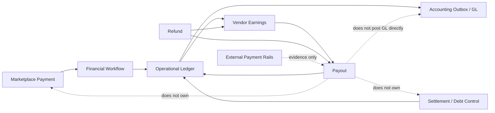
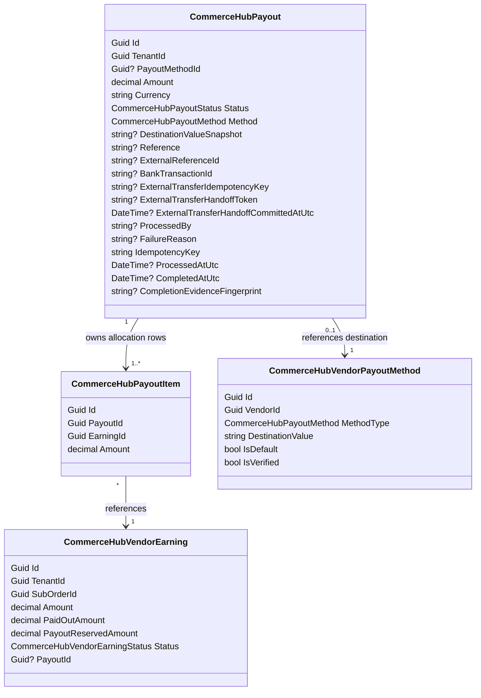
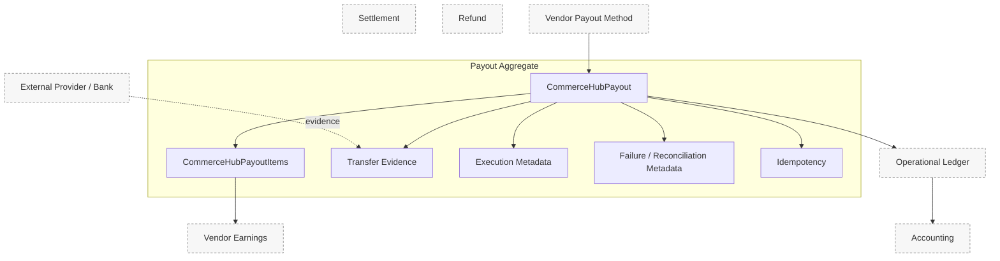
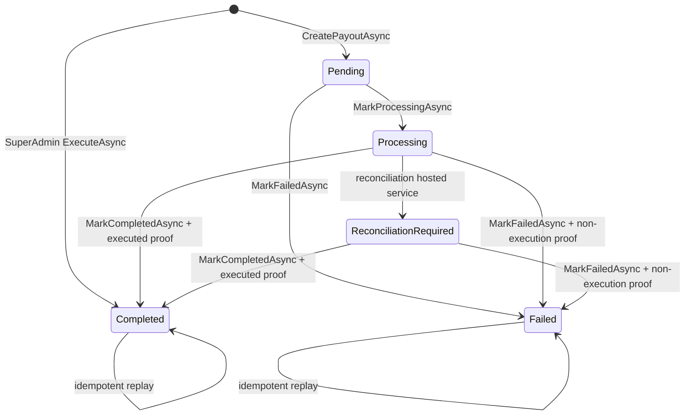
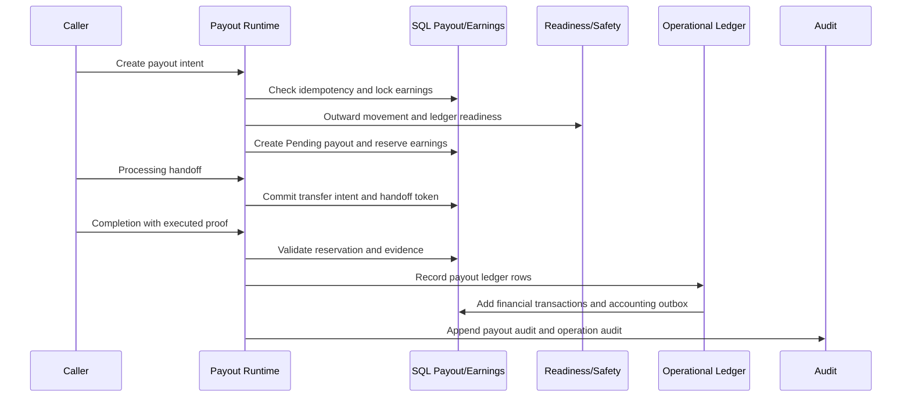
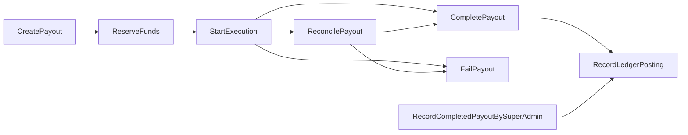
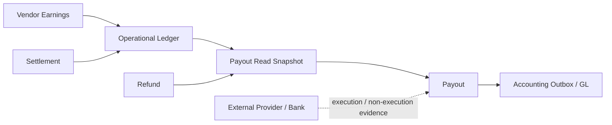
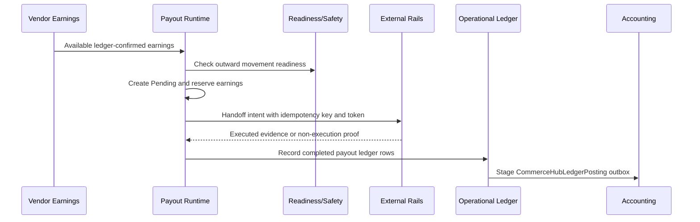
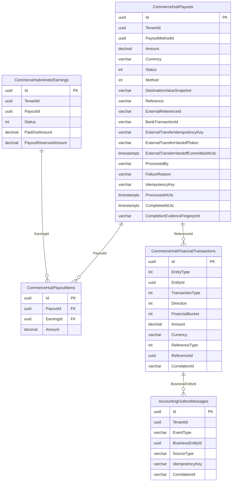
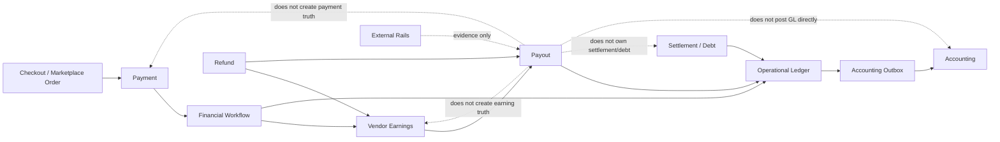

# CHF-5 CommerceHub Payout Domain Specification

Status: Domain Specification

Scope: CommerceHub Payout Domain as implemented.

Source of truth: current implementation. CHF-0.0 Discovery, CHF-0.5 Canonical Architecture, CHF-0.7 Runtime Blueprint, CHF-1 Marketplace Payment Domain Specification, CHF-2 Vendor Earnings Domain Specification, CHF-3 Operational Ledger Domain Specification, CHF-4 Settlement Domain Specification, CommerceHub Final Architecture, and current implementation are constitutional inputs only where implementation backs them.

Non-goals: implementation, coding, refactoring, redesign, migration, optimization, recommendations, future behavior, UI redesign, provider SDK internals, payout redesign, settlement redesign, accounting redesign, or new business rules.

UNKNOWN rule: if current implementation does not prove a behavior, state, transition, command, event, persistence rule, approval rule, external provider contract, or recovery contract, this document marks it `UNKNOWN`.

## Evidence Register

| Id | Evidence |
|---|---|
| E1 | `docs/architecture/CHF-0.0_COMMERCEHUB_FINANCE_DISCOVERY.md` |
| E2 | `docs/architecture/CHF-0.5_COMMERCEHUB_FINANCE_CANONICAL_ARCHITECTURE.md` |
| E3 | `docs/architecture/CHF-0.7_COMMERCEHUB_FINANCE_RUNTIME_BLUEPRINT.md` |
| E4 | `docs/architecture/CHF-1_COMMERCEHUB_MARKETPLACE_PAYMENT_DOMAIN_SPECIFICATION.md` |
| E5 | `docs/architecture/CHF-2_COMMERCEHUB_VENDOR_EARNINGS_DOMAIN_SPECIFICATION.md` |
| E6 | `docs/architecture/CHF-3_COMMERCEHUB_OPERATIONAL_LEDGER_DOMAIN_SPECIFICATION.md` |
| E7 | `docs/architecture/CHF-4_COMMERCEHUB_SETTLEMENT_DOMAIN_SPECIFICATION.md` |
| E8 | `docs/architecture/commercehub-final-production-architecture-certification-findings.md` |
| E9 | `.ai/hermes/platform/commercehub-final-architecture.md` |
| E10 | `docs/architecture/commercehub-payout-reconciliation-certification-findings.md` |
| E11 | `docs/architecture/commercehub-settlement-payout-authority-certification-findings.md` |
| E12 | `PointOfSale.Core/Entities/CommerceHubPayout.cs` |
| E13 | `PointOfSale.Core/Entities/CommerceHubPayoutItem.cs` |
| E14 | `PointOfSale.Core/Enums/CommerceHubPayoutStatus.cs` |
| E15 | `PointOfSale.Core/Enums/CommerceHubPayoutMethod.cs` |
| E16 | `PointOfSale.API/DTOs/CommerceHub/CommerceHubFinanceDtos.cs` |
| E17 | `PointOfSale.API/Services/CommerceHub/CommerceHubPayoutService.cs` |
| E18 | `PointOfSale.API/Services/CommerceHub/CommerceHubPayoutReconciliationHostedService.cs` |
| E19 | `PointOfSale.API/SuperAdmin/Services/SuperAdminPayoutsService.cs` |
| E20 | `PointOfSale.API/Controllers/CommerceHubPayoutsController.cs` |
| E21 | `PointOfSale.API/SuperAdmin/Controllers/SuperAdminPayoutsController.cs` |
| E22 | `PointOfSale.API/Services/CommerceHub/Finance/CommerceHubVendorPayoutReadService.cs` |
| E23 | `PointOfSale.Core/Entities/CommerceHubFinance/CommerceHubVendorPayoutMethod.cs` |
| E24 | `PointOfSale.Infrastructure/Data/Configurations/CommerceHubVendorPayoutMethodConfiguration.cs` |
| E25 | `PointOfSale.Infrastructure/Data/ApplicationDbContext.cs` |
| E26 | `PointOfSale.API/Services/CommerceHub/FinancialLedger/CommerceHubFinancialLedgerService.cs` |
| E27 | `PointOfSale.API/Services/CommerceHub/Finance/CommerceHubFinancialReadinessGate.cs` |
| E28 | `PointOfSale.API/Services/CommerceHub/Finance/CommerceHubFinancialSafetyGuardService.cs` |
| E29 | `PointOfSale.API/Services/CommerceHub/CommerceHubFinancialAuditService.cs` |
| E30 | `PointOfSale.Core/Entities/CommerceHubFinancialAuditLog.cs` |
| E31 | `PointOfSale.Core/Entities/CommerceHubFinance/CommerceHubFinancialOperationAudit.cs` |
| E32 | `PointOfSale.Core/Entities/CommerceHubFinance/CommerceHubFinancialReconciliationReport.cs` |
| E33 | `PointOfSale.Core/Constants/PayoutRiskFlags.cs` |
| E34 | `PointOfSale.Tests/Architecture/CommerceHubPayoutCertificationTests.cs` |
| E35 | `PointOfSale.Tests/Architecture/CommerceHubPayoutEligibilityCurrencyAuthorityCertificationTests.cs` |
| E36 | `PointOfSale.Tests/Architecture/CommerceHubPayoutExecutionCurrencyAuthorityCertificationTests.cs` |
| E37 | `PointOfSale.Tests/CommerceHub/CommerceHubFinanceServiceTests.cs` |
| E38 | `PointOfSale.Tests/CommerceHub/SuperAdminPayoutsServiceTests.cs` |

## 1. Domain Purpose

Payout exists to recognize outward platform-to-vendor release of ledger-backed vendor payable and to preserve the SQL evidence required to prove that release. [E1][E2][E3][E10][E11][E12][E17][E19][E26]

Payout business responsibilities:

| Responsibility | Implementation-backed statement |
|---|---|
| Vendor payable release | Payout completion records operational ledger rows that reduce platform cash and vendor payable for a completed payout. [E17][E19][E26][E28] |
| Earning allocation | Payout rows allocate one or more vendor earnings through `CommerceHubPayoutItems`; vendor earnings are reserved, paid out, or released by payout workflows. [E12][E13][E17][E19] |
| Eligibility enforcement | Payout creation requires available earnings, elapsed payout delay, single EGP currency, positive net amount, no externally locked payout, governance/readiness, and ledger confirmation. [E17][E25][E34] |
| Execution evidence | Completed payouts require external reference or bank transaction evidence; processing handoff requires external transfer idempotency and a committed handoff token. [E12][E16][E17][E19][E25] |
| Reconciliation containment | Stale `Processing` payouts are quarantined into `ReconciliationRequired`; they are not guessed completed or failed. [E18][E27] |
| Replay safety | Payout idempotency, external transfer idempotency, handoff tokens, unique external evidence, completion fingerprint, row locks, and ledger fingerprints collapse exact replay or fail closed on conflict. [E17][E19][E25][E26][E34] |
| Audit and financial trace | Payout completion/failure creates financial audit rows; completed payout ledger rows create accounting outbox rows; Super Admin execution appends operation audit and Super Admin audit. [E19][E21][E26][E29][E30][E31] |

Payout owns:

| Owned concern | Implementation-backed statement |
|---|---|
| Payout identity | `CommerceHubPayout.Id` is the payout row identity. [E12][E25] |
| Vendor scope | `TenantId` identifies the vendor whose payable is released. [E12][E17][E19][E22] |
| Payout items | `CommerceHubPayoutItem` links payout rows to vendor earnings and allocation amounts. [E13][E17][E19][E25] |
| Payout amount/currency | `Amount` is positive; `Currency` is EGP-only on inspected persistence and runtime paths. [E12][E17][E19][E25][E35][E36] |
| Payout method snapshot | Payout stores `PayoutMethodId`, `Method`, and `DestinationValueSnapshot` where Super Admin execution constructs a completed payout from a configured vendor payout method. Current DB completion-handoff constraints require completed rows to carry handoff token/time, while the Super Admin constructor does not populate those fields; successful PostgreSQL persistence of that direct-completed path is therefore `UNKNOWN`. [E12][E19][E23][E24][E25] |
| Execution and transfer evidence | `Reference`, `ExternalReferenceId`, `BankTransactionId`, `ExternalTransferIdempotencyKey`, `ExternalTransferHandoffToken`, `ExternalTransferHandoffCommittedAtUtc`, and `CompletionEvidenceFingerprint` are payout-owned evidence fields. [E12][E16][E17][E19][E25] |
| Status and failure metadata | `Status`, `ProcessedBy`, `ProcessedAtUtc`, `CompletedAtUtc`, and `FailureReason` are payout-owned state metadata. [E12][E14][E17][E18][E19] |
| Payout idempotency | `IdempotencyKey` is payout-owned replay identity and is unique with vendor scope. [E12][E17][E19][E25] |

Payout never owns:

| Outside concern | Owner |
|---|---|
| Marketplace order, split-order, delivery, and refund-window facts | Marketplace/order and refund domains. Payout consumes those facts for eligibility. [E2][E3][E5][E22] |
| Vendor earning creation and availability before payout | Vendor Earnings domain and financial workflow; Payout reserves and completes eligible earnings but does not create order truth. [E5][E17][E19] |
| Operational ledger authority | Operational Ledger domain through `CommerceHubFinancialLedgerService`; Payout invokes ledger recording but does not replace ledger truth. [E6][E26] |
| Settlement and vendor debt control | Settlement records vendor-to-platform control/debt evidence; Payout records platform-to-vendor outward release. [E7][E11] |
| Refund financial reversal | Refund runtime owns refund creation/execution and blocks or adjusts payout overlap. [E3][E10][E17] |
| Accounting general-ledger truth | Accounting owns journals/ledger lines; payout ledger rows stage accounting outbox. [E2][E3][E6][E26] |
| External bank/provider truth | External systems own transfer side effects; Payout stores admitted evidence only. [E10][E11][E17][E19] |

Relationship model:

## 2. Aggregate Definition

`CommerceHubPayout` is the implementation-backed Payout Aggregate Root. [E12][E17][E25][E34]

Aggregate members:

| Member | Classification | Identity | Lifetime | Consistency rule |
|---|---|---|---|---|
| `CommerceHubPayout` | Aggregate root | `Id`; vendor-scoped replay identity is `(TenantId, IdempotencyKey)`. [E12][E25] | Created by `CommerceHubPayoutService.CreatePayoutAsync` as `Pending`; `SuperAdminPayoutsService.ExecuteAsync` constructs a `Completed` payout, but successful PostgreSQL persistence under the current completed-handoff constraint is `UNKNOWN` because the service does not populate handoff token/time. [E17][E19][E25] | Amount positive, EGP currency, status/evidence constraints, one externally locked payout per vendor, evidence uniqueness. [E17][E19][E25] |
| `CommerceHubPayoutItem` | Aggregate child | `Id`; unique `(PayoutId, EarningId)`. [E13][E25] | Created with payout allocation; normal update/delete lifecycle is `UNKNOWN`. | References one payout and one earning; amount has 18,2 precision. [E13][E25] |
| `CommerceHubVendorEarning` | Referenced outside aggregate | `EarningId` stored on payout item. [E13] | Reserved, paid out, or released by payout workflows. [E17][E19] | Must be `Available` for payout creation; must be `InPayout` and `PayoutId == payout.Id` for completion on service lifecycle path. [E17] |
| `CommerceHubVendorPayoutMethod` | Referenced outside aggregate | `PayoutMethodId` on payout. [E12][E23] | Destination identity exists independently of payout; Super Admin execution snapshots destination. [E19][E23][E24] | Method must belong to the vendor during Super Admin execution. [E19] |

Value objects are implemented as scalar columns, enums, and deterministic hashes rather than separate value-object classes:

| Value object concept | Implementation shape |
|---|---|
| Payout identity | `CommerceHubPayout.Id`; idempotency key is separate. [E12] |
| Vendor identity | `TenantId`. [E12] |
| Amount/currency | `Amount`, `Currency`; EGP-only guards and DB constraint. [E12][E17][E19][E25] |
| Method/destination | `PayoutMethodId`, `Method`, `DestinationValueSnapshot`. [E12][E15][E19] |
| External transfer intent | `ExternalTransferIdempotencyKey`. [E12][E17][E19] |
| Handoff token | `ExternalTransferHandoffToken` plus committed timestamp. [E12][E16][E17] |
| Terminal evidence | `ExternalReferenceId` or `BankTransactionId`; `CompletionEvidenceFingerprint` hashes completed evidence. [E12][E17][E19] |
| Failure evidence | `FailureReason`, optional `Reference`, and non-execution confirmation in command DTO. [E16][E17] |
| Correlation | No payout-row `CorrelationId` column is proven; ledger/audit use `Payout:{payout.Id}` or caller correlation. [E17][E19][E26][E29] |

Identity:

| Identity | Implementation-backed rule |
|---|---|
| Payout row identity | `Id` is generated before persistence. [E17][E19] |
| Vendor-scoped idempotency identity | `(TenantId, IdempotencyKey)` is unique. [E25] |
| External transfer idempotency identity | `(TenantId, ExternalTransferIdempotencyKey)` is unique for active rows when present. [E25] |
| External handoff token identity | `(TenantId, ExternalTransferHandoffToken)` is unique for active rows when present. [E25] |
| External evidence identity | Live external reference and bank transaction ids are unique for non-failed, non-deleted payouts. [E17][E19][E25] |
| Completion fingerprint | Deterministic SHA-256 hash from vendor, payout, method, amount, currency, external reference, and bank transaction. [E17][E19] |

Consistency rules:

| Rule | Implementation backing |
|---|---|
| Payout amount must be positive. | Service checks and `CK_CommerceHubPayouts_Amount_Positive`. [E17][E19][E25] |
| Payout currency is EGP-only. | Runtime guards and `CK_CommerceHubPayouts_Currency_EGP`. [E17][E19][E25][E35][E36] |
| Completed payout must have processed and completed timestamps. | `CK_CommerceHubPayouts_Completed_State_Complete`. [E25] |
| Completed payout must have external reference or bank transaction evidence. | `EnsureTerminalPayoutEvidence`, `EnsurePayoutCompletionEvidencePresent`, and DB check. [E17][E19][E25] |
| Processing/reconciliation-required payout must have transfer intent and committed handoff token/time. | Runtime handoff checks and DB checks. [E16][E17][E18][E25] |
| One externally locked payout per vendor is allowed. | `UX_CommerceHubPayouts_OneProcessingPerTenant` plus service checks. [E17][E25] |
| Service lifecycle completion requires earnings still reserved to that payout. | `PAYOUT_EARNING_STATE_INVALID` guard. [E17] |
| Ledger posting requires payout to be completed. | `ValidatePayoutFinancialIntegrity` in ledger service. [E26] |

## 3. Aggregate Boundary

Inside Aggregate:

| Inside | Examples | Boundary reason |
|---|---|---|
| Payout record | `Id`, `TenantId`, `Amount`, `Currency`, `Status`, `Method`, timestamps. | Root SQL state. [E12][E25] |
| Payout items | `CommerceHubPayoutItem.PayoutId`, `EarningId`, `Amount`. | Child allocation rows owned by payout persistence. [E13][E17][E25] |
| Destination snapshot | `PayoutMethodId`, `Method`, `DestinationValueSnapshot`. | Payout preserves method reference and snapshot for execution evidence. [E12][E19] |
| Transfer evidence | `Reference`, `ExternalReferenceId`, `BankTransactionId`. | Payout stores admitted transfer evidence. [E12][E17][E19] |
| Execution metadata | `ProcessedBy`, `ProcessedAtUtc`, `CompletedAtUtc`. | Payout stores processing/completion actor/time evidence. [E12][E17][E19] |
| Failure metadata | `FailureReason`, failed status. | Payout stores failure reason and status. [E12][E17] |
| Reconciliation metadata | `ReconciliationRequired` status, failure reason text from reconciliation sweep, handoff/idempotency fields. | Quarantine is represented on payout row plus audit log; no dedicated payout reconciliation child is proven. [E14][E18] |
| Idempotency | `IdempotencyKey`, `ExternalTransferIdempotencyKey`. | Replay and external handoff identities are payout-owned fields. [E12][E17][E19][E25] |
| Correlation evidence | Payout id plus service-supplied or generated ledger/audit correlation. | No payout-row correlation column is proven; correlation exists in companion rows. [E17][E19][E26][E29] |

Outside Aggregate:

| Outside | Owner and reason |
|---|---|
| Earnings before payout | Vendor Earnings owns earning creation and availability. Payout references and mutates reservation/paid-out fields through payout commands. [E5][E17][E19] |
| Operational ledger | Ledger owns `CommerceHubFinancialTransactions` and accounting outbox staging. [E6][E26] |
| Settlement/debt control | Settlement owns vendor-to-platform control/debt evidence. [E7][E11] |
| Refund | Refund runtime owns refund requests, execution, earning reversal/adjustment, and payout overlap blocking. [E3][E10][E17] |
| Accounting | Accounting owns GL journal/ledger-line posting. [E2][E6][E26] |
| External provider/bank | External transfer execution and non-execution are external truth; payout stores only admitted evidence. [E10][E11][E17][E19] |
| Vendor payout method lifecycle | `CommerceHubVendorPayoutMethodsService` owns create/list/default payout identity behavior; update/delete/reverification are not proven. [E10][E23][E24] |
| Reconciliation report | `CommerceHubFinancialReconciliationReport` stores finance reconciliation report rows outside payout aggregate. [E32] |

Boundary diagram:

## 4. Payout Authority

| Authority | Owner | Implementation-backed contract |
|---|---|---|
| Business Authority | CommerceHub Finance and Super Admin execution workflow. | Vendors can create payout requests from their tenant scope; Super Admin owns reviewed execution recognition through `SuperAdminPayoutsService.ExecuteAsync`. Direct vendor HTTP processing/completion/failure mutation is disabled. [E17][E19][E20][E21][E34] |
| Execution Authority | Super Admin payout execution workflow for HTTP execution; implemented payout service methods remain internal/runtime transition contracts. | `api/super-admin/payouts/{vendorId}/execute` records completed external payout evidence. `api/commercehub/payouts/{id}/processing`, `/complete`, and `/fail` return `PAYOUT_EXECUTION_WORKFLOW_REQUIRED`. [E19][E20][E21][E34] |
| Financial Authority | Operational Ledger plus financial safety/readiness gates. | Payout completion records three ledger rows and verifies platform cash and vendor payable deltas. [E19][E26][E28] |
| Mutation Authority | Backend services under `CommerceHubBoundaryMutationScope.BeginPayout()` and serializable transactions. | `CommerceHubPayoutService`, `CommerceHubPayoutReconciliationHostedService`, and `SuperAdminPayoutsService` mutate payout rows in inspected paths. [E17][E18][E19] |
| Approval Authority | Explicit payout approval state is `UNKNOWN`; implemented approval/execution recognition is Super Admin actor authority and evidence-bound execution. | No `Approved` payout status exists; Super Admin actor, payout method binding, external evidence, ledger state, and operation audit are proven. [E14][E19][E21] |
| Read Authority | Vendor-scoped payout reads and Super Admin payout queue. | Vendor route reads `TenantId == tenantId`; Super Admin queue reads cross-vendor snapshots as platform execution visibility. [E17][E20][E21][E22] |
| Persistence Authority | PostgreSQL/EF model for payout, payout item, earning, ledger, audit, and operation audit rows. | Constraints/indexes on payout rows, payout item FKs, and ledger/outbox persistence are implementation-backed. [E25][E26] |
| Audit Authority | Financial audit, operation audit, Super Admin audit, and reconciliation audit rows. | Payout completion/failure appends `CommerceHubFinancialAuditLog`; Super Admin execution appends `CommerceHubFinancialOperationAudit` and Super Admin audit; reconciliation sweep appends `AuditLog`. [E18][E19][E21][E29][E30][E31] |

Authority matrix:

| Surface/component | May create payout? | May process/execute external transfer? | May complete payout? | May fail payout? | May read payout? |
|---|---:|---:|---:|---:|---:|
| Vendor CommerceHub payout route | Yes, `CreatePayoutAsync`. [E17][E20] | No, direct execution mutation disabled. [E20] | No, direct execution mutation disabled. [E20] | No, direct execution mutation disabled. [E20] | Yes, tenant-scoped. [E17][E20] |
| Super Admin payout workflow | Yes, creates completed evidence record during execute. [E19][E21] | Recognizes completed external payout evidence. [E19][E21] | Yes, as evidence recognition. [E19][E21] | Service direct failure route not exposed through Super Admin controller; `UNKNOWN`. [E21] | Yes, queue. [E21][E22] |
| Payout service internal methods | Yes. [E17] | `MarkProcessingAsync` exists but public vendor HTTP does not call it. [E17][E20] | `MarkCompletedAsync` exists but public vendor HTTP does not call it. [E17][E20] | `MarkFailedAsync` exists but public vendor HTTP does not call it. [E17][E20] | Yes. [E17] |
| Reconciliation hosted service | No. [E18] | No. [E18] | No. [E18] | No. [E18] | Reads and quarantines stale processing rows. [E18] |
| Operational Ledger | No. [E26] | No. [E26] | Records ledger only after completed payout. [E26] | No. [E26] | Ledger reads only. |
| Accounting | No. | No. | No. | No. | Consumes outbox/GL facts only. [E6][E26] |
| External provider/bank | No internal mutation authority. | Owns external side effect. [E10][E11] | Supplies external evidence only. [E17][E19] | Supplies non-execution evidence only. [E17] | External read contract is `UNKNOWN`. |

## 5. Payout Lifecycle

The implementation proves two lifecycle entry paths:

1. Vendor/finance lifecycle: `Pending` payout is created from selected eligible earnings, then may move to `Processing`, `Completed`, `Failed`, or `ReconciliationRequired` through service/runtime paths. [E14][E17][E18]
2. Super Admin evidence-recording lifecycle: `SuperAdminPayoutsService.ExecuteAsync` constructs a completed external payout after Super Admin actor, payout method, payable/eligible/platform-cash, external evidence, ledger, and audit checks. Current persistence constraints require completed payouts to have handoff token/time; the Super Admin constructor does not populate them, so successful PostgreSQL persistence of this direct-completed path is `UNKNOWN`. [E19][E21][E25]

Canonical lifecycle diagram:

Lifecycle states:

| State | Implementation-backed meaning |
|---|---|
| `Pending` | Payout row exists, selected earnings are reserved as `InPayout`, and no external handoff is yet proven on the row. [E17] |
| `Processing` | Payout has an external transfer idempotency key and a committed handoff token/time; one processing/reconciliation payout per vendor is enforced. [E17][E25] |
| `Completed` | Payout has terminal external evidence, processed/completed timestamps, completion fingerprint, earning paid-out allocation, payout ledger rows, financial audit, and operation audit where Super Admin execution/completion path is used. [E17][E19][E25][E26][E29] |
| `Failed` | Payout is failed; eligible reserved earnings are released when they still belong to the payout. Processing/reconciliation failure requires confirmed non-execution proof. [E17] |
| `ReconciliationRequired` | External transfer outcome is unknown after processing handoff exceeded the safe window or another readiness path detected the condition. It blocks new outward money movement until resolved. [E18][E27] |

Example labels not proven:

| Prompt example | Payout implementation status |
|---|---|
| `Requested` | No separate payout status. Payout creation request exists as API/DTO intent only. [E14][E16][E17] |
| `Eligible` | Eligibility is a read/policy state from earnings/queue snapshots, not a payout row status. [E22] |
| `Reserved` | Reservation is represented by earnings `InPayout`, `PayoutReservedAmount`, `PayoutId`, and payout items; no payout status named `Reserved`. [E17][E25] |
| `Executing` | `Processing` is the implemented executing/handoff state. [E14][E17] |
| `Cancelled` | No `Cancelled` payout status or command is proven. `UNKNOWN`. [E14] |
| `Recovered` | No `Recovered` payout status is proven. Recovery is represented by replay, `ReconciliationRequired`, `Completed`, or `Failed`. [E17][E18] |

## 6. State Machine

| Transition | Allowed | Forbidden | Owner | Recovery | Replay |
|---|---|---|---|---|---|
| None -> `Pending` | Allowed through `CreatePayoutAsync` when earnings are available, EGP, delay elapsed, net amount positive, ledger-confirmed, and no externally locked payout exists. [E17] | Empty earning set, missing earning, unavailable earning, delay not elapsed, mixed/non-EGP currency, non-positive net amount, missing ledger confirmation, readiness/governance/refund locks. [E17] | `CommerceHubPayoutService`. | Idempotency race reloads existing payout or reports concurrency conflict. [E17] | Same `(TenantId, IdempotencyKey)` returns existing payout. [E17][E25] |
| None -> `Completed` | Allowed through `SuperAdminPayoutsService.ExecuteAsync` with actor, method/vendor binding, payable/eligible/platform cash, external evidence, allocation, ledger, state verification, and audit. [E19] | Missing actor, missing method, no external evidence, amount exceeds payable/eligible/platform cash, blocking risk, missing ledger confirmation. [E19] | Super Admin payout workflow. | Unique idempotency/evidence conflicts reload and compare matching payload. [E19] | Same idempotency and same payload returns existing payout; different payload fails. [E19] |
| `Pending` -> `Processing` | Allowed by `MarkProcessingAsync` with readiness, no refund lock, financial readiness, no other externally locked payout, transfer idempotency echo, handoff reference, and handoff token commit. [E17] | Claiming executed transfer in processing request; missing transfer intent; mismatched intent; missing handoff reference; conflicting external evidence. [E17] | Payout service internal/runtime transition; public vendor HTTP mutation disabled. [E17][E20] | Row lock/concurrency conflict fails closed. [E17] | Already `Processing`/`ReconciliationRequired` path validates matching evidence and returns row. [E17] |
| `Pending` -> `Completed` | Not allowed through `MarkCompletedAsync`; Super Admin service constructs completed payout from no prior payout row, but PostgreSQL persistence is `UNKNOWN` under current completed-handoff constraint unless handoff fields are present. [E17][E19][E25] | `MarkCompletedAsync` requires `Processing` or `ReconciliationRequired`; DB requires completed handoff token/time. [E17][E25] | Super Admin direct-completed construction, not service transition from existing pending. | `UNKNOWN` outside direct Super Admin execute. | Super Admin idempotency replay if row exists. [E19] |
| `Pending` -> `Failed` | Allowed by `MarkFailedAsync`; releases earnings if still reserved. [E17] | Completed payout cannot fail. [E17] | Payout service internal/runtime transition. | Released earnings return `Available`. [E17] | Already failed returns existing row. [E17] |
| `Processing` -> `Completed` | Allowed with explicit executed transfer confirmation, handoff token match, terminal evidence, evidence uniqueness, earning reservation check, ledger posting, state delta verification, audit, fingerprint. [E17] | Missing executed confirmation, missing/mismatched handoff token, missing terminal evidence, external evidence conflict, earnings no longer reserved. [E17] | Payout service internal/runtime transition. | External evidence conflict fails closed; accounting outbox follows ledger. [E17][E26] | Already completed validates evidence/fingerprint and returns row. [E17] |
| `Processing` -> `Failed` | Allowed only with confirmed non-execution proof, handoff token match, failure reason and non-execution reference, and no external transfer evidence. [E17] | Failure without non-execution proof; failure carrying external evidence; completed payout failure. [E17] | Payout service internal/runtime transition. | Earnings released to `Available`; failed payout stops being externally locked. [E17] | Already failed returns existing row. [E17] |
| `Processing` -> `ReconciliationRequired` | Allowed by hosted service for stale processing payouts older than max lag. [E18] | Hosted service does not complete/fail money movement. [E18] | `CommerceHubPayoutReconciliationHostedService`. | Quarantine blocks new outward movement until explicit completion/failure. [E18][E27] | Sweep rechecks row/status/staleness under transaction. [E18] |
| `ReconciliationRequired` -> `Completed` | Allowed by completion path with executed proof and matching handoff token. [E17] | Completion without executed proof/evidence. [E17] | Payout service internal/runtime transition. | Resolves quarantine by recording completed evidence and ledger. [E17] | Completed replay validates evidence/fingerprint. [E17] |
| `ReconciliationRequired` -> `Failed` | Allowed by failure path with confirmed non-execution proof and handoff match. [E17] | Failure with external execution evidence or without non-execution proof. [E17] | Payout service internal/runtime transition. | Releases earnings; resolves externally locked slot. [E17] | Failed replay returns existing row. [E17] |
| `Completed` -> `Failed` | Forbidden. [E17] | Throws `PAYOUT_ALREADY_COMPLETED`. [E17] | Payout service. | `UNKNOWN`; compensating future payout/refund behavior belongs to other domains. | Completed replay only. [E17] |
| `Failed` -> `Completed` | Forbidden. [E17] | Throws `PAYOUT_ALREADY_FAILED`. [E17] | Payout service. | Create new payout after review if earnings are available. [E17] | Failed replay only. [E17] |
| Any -> `Cancelled` | `UNKNOWN`. | No `Cancelled` status or command is proven. [E14] | `UNKNOWN`. | `UNKNOWN`. | `UNKNOWN`. |

State execution diagram:

## 7. Domain Policies

| Policy | Implementation-backed rule |
|---|---|
| Eligibility Policy | Payout can include only selected `Available` earnings for the vendor, with elapsed `AvailableAtUtc` delay, single EGP currency, and ledger confirmation. [E17] |
| Negative Adjustment Policy | Available negative earnings in the same currency are automatically netted into payout creation; payout must remain positive after netting. [E17] |
| Reservation Policy | Payout creation sets selected/negative adjustment earnings to `InPayout`, assigns `PayoutId`, and records payout items. Positive earnings increment `PayoutReservedAmount`. [E17] |
| Execution Policy | Processing requires outward readiness, no blocking refund lock, financial readiness, no other externally locked payout, transfer idempotency echo, and handoff reference/token. [E17][E27] |
| External Transfer Policy | Processing authorizes handoff only; it cannot claim executed transfer. Completion requires executed confirmation; failure after handoff requires non-execution confirmation. [E16][E17] |
| Terminal Evidence Policy | Completed payouts require `ExternalReferenceId` or `BankTransactionId`; completion fingerprint must match recorded evidence. [E17][E19][E25] |
| Evidence Uniqueness Policy | External reference and bank transaction ids cannot be reused by another active/non-failed payout. [E17][E19][E25] |
| Retry Policy | Exact idempotency/evidence replay returns existing SQL truth; divergent replay fails closed. [E17][E19] |
| Failure Policy | Completed payouts cannot fail; failed payouts cannot complete; processing/reconciliation failures require non-execution proof and cannot carry external execution evidence. [E17] |
| Reconciliation Policy | Stale processing payouts become `ReconciliationRequired`; outward movement is blocked while reconciliation-required or stale processing payouts exist. [E18][E27] |
| Ledger Synchronization Policy | Payout ledger rows are recorded only for completed payouts; expected state delta is platform cash `-amount`, vendor payable `-amount`, vendor debt `0`. [E17][E19][E26][E28] |
| Audit Policy | Completion/failure writes `CommerceHubFinancialAuditLog`; completion writes operation audit; Super Admin controller writes operational audit. [E19][E21][E29][E31] |
| Currency Policy | Payout eligibility/execution/read DTOs are EGP-only and cannot inherit vendor, tenant, DTO, cache, or provider currency. [E17][E19][E22][E25][E35][E36] |
| Readiness Policy | Outward money movement is blocked by readiness gates for unresolved finance, stale/reconciliation payouts, accounting/outbox coverage, and other implemented blockers. [E19][E27] |
| Refund Interaction Policy | Active refund requests, refund windows, refund locks, and payout/refund overlap block payout eligibility/execution or release pending payout reservations; completed payouts are not rewritten by refunds. [E10][E17][E19][E22] |
| Governance Policy | Vendor payout creation and processing invoke vendor payout governance where implemented; Super Admin evidence recognition is actor-bound and evidence-bound. [E17][E19] |

## 8. Domain Invariants

| Invariant | Implementation-backed statement |
|---|---|
| One Payout Identity | Every payout row has a generated `Id`; payout item rows reference it. [E12][E13][E17][E19] |
| One Vendor Scope | Payout `TenantId` is the vendor whose earnings/payable are affected. [E12][E17][E19] |
| One Idempotency Identity Per Vendor | `(TenantId, IdempotencyKey)` is unique. [E25] |
| One External Transfer Intent Per Vendor | `(TenantId, ExternalTransferIdempotencyKey)` is unique when present. [E25] |
| One Handoff Token Per Vendor | `(TenantId, ExternalTransferHandoffToken)` is unique when present. [E25] |
| One Externally Locked Payout | At most one `Processing` or `ReconciliationRequired` payout exists per vendor. [E17][E25] |
| Amount Positive | Payout amount must be greater than zero. [E17][E19][E25] |
| Currency Immutable/EGP-only | Payout currency is stored as EGP and guarded in create, execution, completion, DTO, ledger, queue, and persistence paths. [E17][E19][E22][E25][E35][E36] |
| Ledger Synchronization | Completed payout records operational ledger entries and verifies state deltas. [E17][E19][E26][E28] |
| Earnings Consistency | Service lifecycle completion requires payout items' earnings to still be `InPayout` for that payout; completion applies paid-out allocation; failure releases allocation. [E17] |
| Replay Safety | Idempotency, evidence uniqueness, evidence matching, fingerprints, and ledger fingerprints collapse duplicate replay or reject divergent replay. [E17][E19][E26] |
| Audit Consistency | Payout completion/failure and Super Admin execution emit audit evidence on inspected paths. [E19][E21][E29][E31] |
| Transfer Evidence Integrity | Completed evidence is required, unique, and fingerprinted; mismatched evidence on replay is rejected. [E17][E19][E25] |
| No Completion Without External Execution Confirmation | `MarkCompletedAsync` requires `ExternalTransferConfirmedExecuted == true`. [E16][E17] |
| No Failure After Handoff Without Non-Execution Proof | Processing/reconciliation failure requires `ExternalTransferConfirmedNotExecuted == true`, matching handoff token, reference, and failure reason. [E16][E17] |
| No Completed Payout Rollback | Completed payout cannot be failed or rolled back. [E17] |
| No Failed Payout Completion | Failed payout cannot be completed. [E17] |
| Accounting Separation | Payout does not post GL directly; ledger rows stage `AccountingOutboxMessages`. [E6][E26] |
| External Authority Separation | Provider/bank truth is not internal SQL truth until backend recognition records evidence. [E10][E11][E17][E19] |

## 9. Commands

Command names are conceptual labels mapped to implemented service methods and persisted artifacts. They are not proof of separate command classes unless explicitly stated.

| Command | Producer | Consumer | Transaction Owner | Idempotency Owner |
|---|---|---|---|---|
| `CreatePayout` | Vendor-scoped CommerceHub payout API request. [E20] | `CommerceHubPayoutService.CreatePayoutAsync`. [E17] | Payout service with serializable transaction and earning row locks. [E17] | Payout service and `(TenantId, IdempotencyKey)` unique index. [E17][E25] |
| `ReserveFunds` | `CreatePayout` after eligibility checks. [E17] | Payout service mutates earnings and creates payout items. [E17] | Same `CreatePayout` transaction. [E17] | Payout idempotency plus earning locks. [E17][E25] |
| `StartExecution` | Internal/runtime processing request. [E16][E17] | `CommerceHubPayoutService.MarkProcessingAsync`. [E17] | Payout service with serializable transaction and payout row lock. [E17] | `ExternalTransferIdempotencyKey`, handoff token, evidence matching. [E17][E25] |
| `RecordCompletedPayoutBySuperAdmin` | Super Admin execute route with actor and external evidence. [E21] | `SuperAdminPayoutsService.ExecuteAsync`; successful PostgreSQL persistence is `UNKNOWN` under current completed-handoff constraint because the service does not populate handoff token/time. [E19][E25] | Super Admin payout service with serializable transaction. [E19] | Super Admin idempotency key, external evidence uniqueness, completion fingerprint. [E19][E25] |
| `CompletePayout` | Internal/runtime completion request with executed proof. [E16][E17] | `CommerceHubPayoutService.MarkCompletedAsync`. [E17] | Payout service with serializable transaction, payout lock, ledger call, state verification. [E17][E26][E28] | Existing payout evidence, handoff token, fingerprint, ledger idempotency. [E17][E26] |
| `FailPayout` | Internal/runtime failure request, refund/recovery paths where implemented. [E17] | `CommerceHubPayoutService.MarkFailedAsync`; refund services can fail pending payout overlap in inspected references. [E17] | Payout/refund service transaction depending path. [E17] | Payout status replay and non-execution evidence for externally locked states. [E17] |
| `CancelPayout` | UNKNOWN. | UNKNOWN. | UNKNOWN. | UNKNOWN. |
| `RecoverPayout` | Recovery/reconciliation runtime. [E18] | No `Recovered` command is proven; stale processing quarantine is implemented. [E18] | Reconciliation hosted service transaction. [E18] | Existing payout row status/staleness checks. [E18] |
| `ReplayPayout` | Retried create/execute/processing/completion/failure requests. [E17][E19] | Owning service method. [E17][E19] | Existing SQL truth. [E17][E19] | Payout idempotency/evidence/fingerprint/handoff guards. [E17][E19][E25] |
| `RecordLedgerPosting` | Payout completion or Super Admin execute after payout completion record. [E17][E19] | `CommerceHubFinancialLedgerService.RecordPayoutAsync`. [E26] | Ledger service or caller transaction; `ExecuteAtomicAsync` coordinates persistence. [E26] | Ledger financial fingerprint and accounting outbox idempotency. [E26] |
| `ReconcilePayout` | Hosted service sweep. [E18] | `CommerceHubPayoutReconciliationHostedService`. [E18] | Hosted service serializable transaction. [E18] | Row/status/staleness recheck; no new payout idempotency key. [E18] |
| `ReadPayoutQueue` | Super Admin queue request. [E21] | `SuperAdminPayoutsService.GetQueueAsync` and `CommerceHubVendorPayoutReadService.GetVendorQueueSnapshotsAsync`. [E19][E22] | Read-only SQL query. [E19][E22] | Not a mutation. |

Command relationship:

## 10. Events

No `PayoutCreated`, `PayoutReserved`, `ExecutionStarted`, `ExecutionCompleted`, `ExecutionFailed`, `PayoutRecovered`, `PayoutReconciled`, or `LedgerRecorded` event classes are proven for `CommerceHubPayout`. Conceptual events below map to implementation artifacts only. [E12][E17][E18][E19][E26][E29]

| Conceptual event | Event class exists? | Implementation artifact |
|---|---|---|
| `PayoutCreated` | UNKNOWN; no event class proven. | `CommerceHubPayout` row persisted as `Pending`; `CommerceHubPayoutItem` rows persisted; earnings reserved. [E17] |
| `PayoutReserved` | UNKNOWN; no event class proven. | Earnings set `InPayout`, `PayoutId = payout.Id`, `PayoutReservedAmount` adjusted, payout items created. [E17] |
| `ExecutionStarted` | UNKNOWN; no event class proven. | Payout row status set `Processing`, transfer idempotency/handoff token/time committed. [E17] |
| `ExecutionCompleted` | UNKNOWN; no event class proven. | Payout row set `Completed`, terminal evidence/fingerprint/timestamps stored, earnings paid out, audit rows appended. [E17][E19][E29] |
| `ExecutionFailed` | UNKNOWN; no event class proven. | Payout row set `Failed`, failure reason stored, earnings released, `CommerceHubFinancialAuditLog` appended. [E17][E29] |
| `PayoutReconciliationRequired` | UNKNOWN; no event class proven. | Hosted service sets payout status `ReconciliationRequired` and appends `AuditLog`. [E18] |
| `PayoutRecovered` | UNKNOWN. | No `Recovered` event/status class is proven. |
| `PayoutReconciled` | UNKNOWN. | No named event class is proven; resolving reconciliation occurs through completion or failure artifacts. [E17][E18] |
| `LedgerRecorded` | UNKNOWN as event class. | Three `CommerceHubFinancialTransaction` rows with `ReferenceType = Payout` plus `AccountingOutboxMessage` rows. [E26] |
| `PayoutAudited` | UNKNOWN as event class. | `CommerceHubFinancialAuditLog`, `CommerceHubFinancialOperationAudit`, and Super Admin `AuditLog` rows depending path. [E18][E19][E21][E29][E31] |

Accounting outbox event mapping:

| Artifact | Contract |
|---|---|
| `AccountingOutboxMessage.EventType = CommerceHubLedgerPosting` | Created by ledger service for every new payout financial transaction. [E26] |
| `SourceType = CommerceHubFinancialTransaction` | Accounting receives ledger transaction ids, not payout aggregate rows directly. [E6][E26] |

## 11. Runtime Contracts

Runtime relationship:

| Contract | Inputs | Outputs | Guarantees | Failure Contracts | Recovery Contracts |
|---|---|---|---|---|---|
| Vendor Earnings -> Payout | Available earnings, sub-order currency, `AvailableAtUtc`, paid/reserved amounts, refund adjustment earnings. [E17] | Pending payout, payout items, earning reservations. [E17] | Only available, delay-elapsed, ledger-confirmed, EGP earnings can be reserved; negative adjustments are netted. [E17] | Missing/unavailable/not-yet-available/mixed-currency/unconfirmed earnings fail closed. [E17] | Same idempotency returns existing payout; failed payout releases earnings where still reserved. [E17] |
| Operational Ledger -> Payout | Vendor payable ledger, order/refund ledger confirmations, platform cash state. [E17][E19][E22][E28] | Eligibility/payable caps, completion ledger rows, state verification. [E17][E19][E22][E26][E28] | Payout amount cannot exceed ledger-backed payable; completion records payout ledger facts. [E17][E19][E26] | Missing ledger confirmation, insufficient payable, insufficient platform cash, ledger drift/authority conflict block payout. [E17][E19][E22] | Re-read ledger and replay idempotent commands; ledger idempotency collapses duplicates. [E26] |
| Settlement -> Payout | Ledger-derived payable/debt context and readiness gates. [E7][E11][E27] | Payout readiness or execution block. [E19][E27] | Settlement cannot be used as generic platform-to-vendor payout; outward release uses payout workflow. [E7][E11] | Generic platform-to-vendor settlement route is blocked; payout blocked by readiness conflicts. [E7][E11][E27] | Resolve settlement/debt/ledger state, then re-run payout reads/commands. |
| Refund -> Payout | Active refund requests, refund windows, refund locks, refund-created negative earnings, post-payout adjustment effects. [E10][E17][E19][E22] | Eligibility holds, payout locks, negative adjustments, pending payout release in refund overlap paths. [E10][E17][E19] | Refunds do not rewrite completed payouts; post-payout impact becomes debt/negative adjustment. [E10] | Active refund/return locks block payout processing/execution; overlap blocks or releases pending payout where implemented. [E17][E19][E22] | Resolve refund; stale refund recovery belongs to refund runtime. [E3][E10] |
| Payout -> Accounting | Completed payout ledger rows. [E26] | `AccountingOutboxMessages` for `CommerceHubLedgerPosting`; later GL posting. [E6][E26] | Payout does not post GL directly; accounting consumes operational ledger outbox. [E6][E26] | Accounting readiness can block outward movement; outbox processing failure does not erase payout SQL truth. [E3][E27] | Accounting outbox retry/recovery belongs to Accounting/Operational Ledger. [E3][E6] |
| Payout -> External Provider/Bank | Transfer idempotency key, handoff token/reference, method/destination snapshot, amount/currency. [E12][E16][E17][E19] | External reference, bank transaction id, executed or non-executed confirmation. [E16][E17][E19] | Internal SQL completion requires admitted evidence; external side effect itself remains outside. [E10][E11][E17][E19] | Unknown outcome remains `Processing` then `ReconciliationRequired`; failure requires non-execution proof. [E17][E18] | Complete with executed proof or fail with confirmed non-execution proof. [E17][E18] |
| Payout -> Reconciliation | Payout rows, status, external evidence, ledger rows, audit rows. [E18][E27][E32] | `ReconciliationRequired` status, reconciliation reports, readiness blocks. [E18][E27][E32] | Reconciliation does not create money or guess external truth. [E18] | Stale processing or reconciliation-required payout blocks new outward movement. [E18][E27] | Explicit completion/failure resolves the payout state; external reconciliation contract beyond stored fields is `UNKNOWN`. |

Runtime sequence:

## 12. Persistence Model

Payout persistence:

Tables:

| Table | Payout role |
|---|---|
| `CommerceHubPayouts` | Payout aggregate root table. [E12][E25] |
| `CommerceHubPayoutItems` | Payout allocation child table. [E13][E25] |
| `CommerceHubVendorEarnings` | Referenced/reserved/paid/released earning rows. [E17][E19][E25] |
| `CommerceHubVendorPayoutMethods` | Vendor payout destination identities referenced by Super Admin execution. [E19][E23][E24] |
| `CommerceHubFinancialTransactions` | Operational ledger rows for completed payout. [E26] |
| `AccountingOutboxMessages` | GL posting outbox rows created for payout ledger rows. [E26] |
| `CommerceHubFinancialAuditLogs` | Financial audit rows for payout completion/failure. [E29][E30] |
| `CommerceHubFinancialOperationAudits` | Operation audit rows for completed payout state transitions. [E19][E28][E31] |
| `AuditLogs` | Super Admin route audit and reconciliation sweep audit. [E18][E21] |
| `CommerceHubFinancialReconciliationReports` | Finance reconciliation report rows outside payout aggregate. [E32] |

Indexes and constraints:

| Persistence rule | Implementation-backed source |
|---|---|
| Payout amount check `Amount > 0`. | `CK_CommerceHubPayouts_Amount_Positive`. [E25] |
| Payout currency check `Currency = 'EGP'`. | `CK_CommerceHubPayouts_Currency_EGP`. [E25] |
| Completed state requires processed/completed timestamps. | `CK_CommerceHubPayouts_Completed_State_Complete`. [E25] |
| Completed state requires external or bank evidence. | `CK_CommerceHubPayouts_Completed_Evidence`. [E25] |
| Processing/reconciliation requires external transfer intent. | `CK_CommerceHubPayouts_Processing_ExternalIntent`. [E25] |
| Processing/reconciliation requires handoff token/time. | `CK_CommerceHubPayouts_Processing_HandoffCommitted`. [E25] |
| Completed/reconciliation requires handoff token/time in DB constraint. | `CK_CommerceHubPayouts_Terminal_HandoffCommitted`. [E25] |
| Super Admin direct-completed constructor omits handoff token/time. | `SuperAdminPayoutsService.ExecuteAsync` sets `Status = Completed` but does not set `ExternalTransferHandoffToken` or `ExternalTransferHandoffCommittedAtUtc`; persistence success against `CK_CommerceHubPayouts_Terminal_HandoffCommitted` is `UNKNOWN`. [E19][E25] |
| Refund-system failure after handoff blocked for specified processed-by values. | `CK_CommerceHubPayouts_NoRefundFailureAfterHandoff`. [E25] |
| One externally locked payout per vendor. | `UX_CommerceHubPayouts_OneProcessingPerTenant`. [E25] |
| Unique `(TenantId, IdempotencyKey)`. | EF index. [E25] |
| Unique live external reference id. | `UX_CommerceHubPayouts_Live_ExternalReferenceId`. [E25] |
| Unique live bank transaction id. | `UX_CommerceHubPayouts_Live_BankTransactionId`. [E25] |
| Unique `(TenantId, ExternalTransferIdempotencyKey)` when present. | `UX_CommerceHubPayouts_ExternalTransferIdempotencyKey`. [E25] |
| Unique `(TenantId, ExternalTransferHandoffToken)` when present. | `UX_CommerceHubPayouts_ExternalTransferHandoffToken`. [E25] |
| Payout item indexes on `PayoutId`, `EarningId`, and unique `(PayoutId, EarningId)`. | EF configuration. [E25] |

Foreign keys:

| Relationship | FK proven? |
|---|---|
| `CommerceHubPayout.PayoutMethodId -> CommerceHubVendorPayoutMethods.Id` | Yes; delete behavior `SetNull`. [E25] |
| `CommerceHubPayoutItem.PayoutId -> CommerceHubPayouts.Id` | Yes; delete behavior `Cascade`. [E25] |
| `CommerceHubPayoutItem.EarningId -> CommerceHubVendorEarnings.Id` | Yes; delete behavior `Restrict`. [E25] |
| `CommerceHubVendorEarning.PayoutId -> CommerceHubPayouts.Id` | Yes; delete behavior `SetNull`. [E25] |
| `CommerceHubFinancialTransaction.ReferenceId -> CommerceHubPayout.Id` | No universal FK is proven; ledger uses typed reference fields. [E26] |
| `CommerceHubFinancialAuditLog.PayoutId -> CommerceHubPayout.Id` | No explicit FK is proven from inspected evidence. [E30] |
| `CommerceHubFinancialOperationAudit.ReferenceId -> CommerceHubPayout.Id` | No explicit FK is proven from inspected evidence; audit stores typed reference fields. [E31] |

Idempotency:

| Layer | Persistence model |
|---|---|
| Payout row | `(TenantId, IdempotencyKey)` unique; create and Super Admin execute reload matching row on replay. [E17][E19][E25] |
| External transfer | `(TenantId, ExternalTransferIdempotencyKey)` unique and echoed during processing. [E17][E25] |
| Handoff | `(TenantId, ExternalTransferHandoffToken)` unique and echoed for completion/failure after handoff. [E17][E25] |
| Completion evidence | External reference or bank transaction is unique among active/non-failed payouts; completion fingerprint guards tampering. [E17][E19][E25] |
| Ledger | Financial transaction idempotency/fingerprint prevents duplicate payout ledger rows. [E26] |
| Accounting outbox | `COMMERCEHUB_TX:{tenant}:{transaction}` idempotency key per ledger transaction. [E26] |

Correlation:

| Correlation field | Rule |
|---|---|
| Payout row | No `CorrelationId` column is proven. [E12] |
| Ledger correlation | `RecordPayoutAsync` builds correlation from `ReferenceType = Payout` and payout id. [E26] |
| Financial audit correlation | Payout completion/failure takes caller or generated correlation id. [E17][E19][E29] |
| Operation audit correlation | Super Admin and service completion use `Payout:{payout.Id}`. [E17][E19][E28] |
| Reconciliation audit | Hosted service writes an `AuditLog` row with payout evidence in JSON. [E18] |

Audit/history/recovery metadata:

| Metadata | Implementation-backed status |
|---|---|
| Payout history | Payout row plus payout items and earning allocation fields. [E12][E13][E17][E19] |
| Transfer evidence history | External reference, bank transaction id, external transfer intent, handoff token/time, completion fingerprint. [E12][E17][E19] |
| Failure history | `Failed` status, failure reason, financial audit row. [E17][E29] |
| Reconciliation history | `ReconciliationRequired` status plus `AuditLog`; reconciliation reports exist outside aggregate. [E18][E32] |
| Ledger history | Three payout financial transactions and accounting outbox messages for completed payout. [E26] |
| Recovery metadata table | No dedicated payout recovery table is proven. `UNKNOWN`. |
| Delete/void lifecycle | Normal payout delete/void lifecycle is `UNKNOWN` beyond soft-delete fields/query filters inherited from `BaseEntity`. [E12][E17][E25] |

## 13. Domain Principles

| Principle | Implementation-backed statement |
|---|---|
| Only eligible earnings may be paid | Payout creation requires `Available` earnings, delay elapsed, positive net amount, EGP currency, and ledger confirmation. [E17] |
| Reservation precedes service execution | `CreatePayoutAsync` reserves earnings into `InPayout` before processing/completion on service lifecycle path. [E17] |
| Execution handoff precedes service completion | `MarkCompletedAsync` requires previously committed `Processing` or `ReconciliationRequired` state and matching handoff token. [E17] |
| Ledger confirmation precedes payout | Creation, completion, and Super Admin allocation verify selected/allocated earnings in the operational ledger. [E17][E19] |
| External evidence precedes completion | Completed payout requires external reference or bank transaction evidence. [E17][E19][E25] |
| Replay is idempotent | Same idempotency/evidence returns existing SQL truth; divergent reuse fails closed. [E17][E19] |
| Reconciliation preserves uncertainty | Stale processing payout becomes `ReconciliationRequired`, not completed or failed by guess. [E18] |
| Accounting remains separate | Payout records operational ledger rows and outbox; Accounting posts GL. [E6][E26] |
| Settlement remains separate | Settlement handles debt/control and cannot replace payout outward release workflow. [E7][E11] |
| Provider evidence is not provider authority over SQL | External systems own side effects; backend services own internal evidence recognition. [E10][E11][E17][E19] |
| Direct vendor execution mutation is disabled | Vendor-scoped HTTP execution mutation returns `PAYOUT_EXECUTION_WORKFLOW_REQUIRED`. [E20][E34] |
| Super Admin execution is evidence-bound | Super Admin execution requires actor, vendor method binding, external evidence, payable/eligible/platform-cash checks, ledger posting, and audit. [E19][E21] |

## 14. Domain Decisions

| Decision | Implementation-backed explanation |
|---|---|
| Why Payout exists | CommerceHub needs durable SQL authority for platform-to-vendor payable release, earning allocation, external transfer evidence, ledger synchronization, and audit. [E1][E2][E10][E12][E17][E19][E26] |
| Why Reservation exists | Reservation prevents the same eligible earnings from being selected into competing payouts and binds payout items to earning allocations before external handoff. [E17][E25] |
| Why Reconciliation exists | External transfer outcome can become unknown after handoff; implementation quarantines stale processing payouts into `ReconciliationRequired` and blocks new outward money until explicit evidence resolves them. [E18][E27] |
| Why Transfer Evidence exists | Completed payout must prove external money movement through bank/provider/manual reference fields, uniqueness, and fingerprinting before internal ledger truth is reduced. [E17][E19][E25] |
| Why Ledger confirmation exists | Payout cannot release value unless vendor earnings are backed by operational ledger order/refund facts and completed payout ledger rows verify payable/cash deltas. [E17][E19][E26][E28] |
| Why Payout is separated from Settlement | Settlement records vendor-to-platform debt/control evidence; Payout records platform-to-vendor outward movement. Generic settlement route cannot bypass payout execution workflow. [E7][E11] |
| Why Payout is separated from Earnings | Earnings represent payable availability and refund adjustments; Payout reserves and pays eligible earnings but does not own order/payment/earning creation truth. [E5][E17][E19] |
| Why Accounting remains independent | Operational ledger creates accounting outbox rows; Accounting owns GL posting and journal/ledger-line truth. [E2][E6][E26] |
| Why Super Admin execution is separated from vendor execution | Implementation disables direct vendor HTTP processing/completion/failure and requires Super Admin execution recognition for external payout evidence, actor authority, and audit. [E19][E20][E21][E34] |
| Why EGP-only payout exists | Payout eligibility/execution uses CommerceHub platform base currency authority; mixed or unsupported currencies block eligibility/execution. [E17][E19][E22][E25][E35][E36] |

## 15. Domain Conclusions

| Model | Constitutional conclusion |
|---|---|
| Aggregate Model | `CommerceHubPayout` is the payout aggregate root; `CommerceHubPayoutItem` rows are payout-owned allocation children; earnings and payout methods are referenced outside aggregate. [E12][E13][E17][E19][E25] |
| Authority Model | Payout mutation is backend SQL/service-owned. Vendor route may create pending payouts; Super Admin owns HTTP execution recognition; direct vendor execution mutation is disabled. [E17][E19][E20][E21][E34] |
| Lifecycle Model | Implemented statuses are `Pending`, `Processing`, `Completed`, `Failed`, and `ReconciliationRequired`; no `Cancelled`, `Eligible`, `Reserved`, or `Recovered` payout status is proven. [E14][E17][E18][E19] |
| Policy Model | Policies cover eligibility, reservation, negative adjustment netting, external handoff, terminal evidence, failure/non-execution proof, reconciliation, idempotency, ledger synchronization, audit, readiness, refund locks, and EGP-only currency. [E17][E18][E19][E22][E25][E27] |
| Invariant Model | Payout identity, vendor scope, positive EGP amount, one externally locked payout, earning reservation consistency, evidence uniqueness/fingerprint, replay safety, ledger state verification, and accounting separation are enforced on inspected paths. [E17][E19][E25][E26][E28] |
| Runtime Model | Payout runtime re-enters earnings, readiness, safety guard, external evidence, ledger, audit, reconciliation, and accounting-outbox boundaries without owning those external domains. [E17][E18][E19][E26][E27][E29] |
| Persistence Model | Payout persistence uses `CommerceHubPayouts`, `CommerceHubPayoutItems`, earning rows, payout method rows, operational ledger rows, accounting outbox rows, audit rows, operation audit rows, and reconciliation reports. [E12][E13][E19][E23][E25][E26][E29][E31][E32] |
| Boundary Model | Payment, Vendor Earnings creation, Operational Ledger authority, Settlement/debt control, Refund, Accounting, external rails, and payout method lifecycle remain outside the payout aggregate. [E2][E5][E6][E7][E10][E17][E23][E26] |
| Execution Model | Service lifecycle execution uses processing handoff and explicit completion/failure proof; Super Admin execution constructs completed external payout evidence directly after actor/method/payable/eligible/cash/evidence/ledger/audit checks, but successful PostgreSQL persistence of that direct-completed construction is `UNKNOWN` under current completed-handoff constraints. [E17][E19][E21][E25] |
| Contract Model | Inputs are ledger-confirmed earnings/payable, payout method, actor where required, idempotency, and external evidence; outputs are payout rows/items, earning allocation mutations, ledger rows, accounting outbox rows, audit rows, and reconciliation states. [E17][E18][E19][E26][E29] |

Final relationship:

This document is the official CHF-5 CommerceHub Payout Domain Specification unless implementation changes and a newer implementation-backed CHF payout specification supersedes it.
