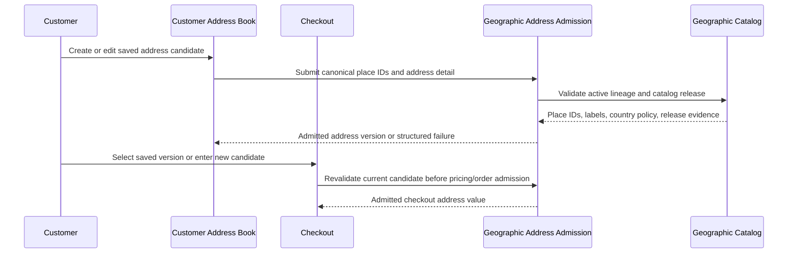
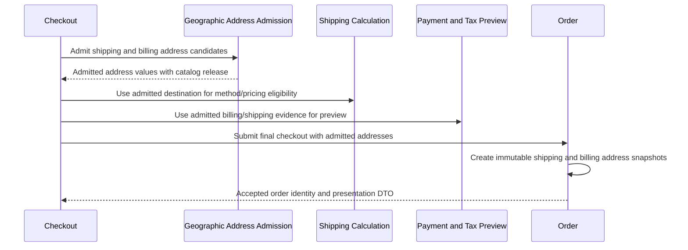
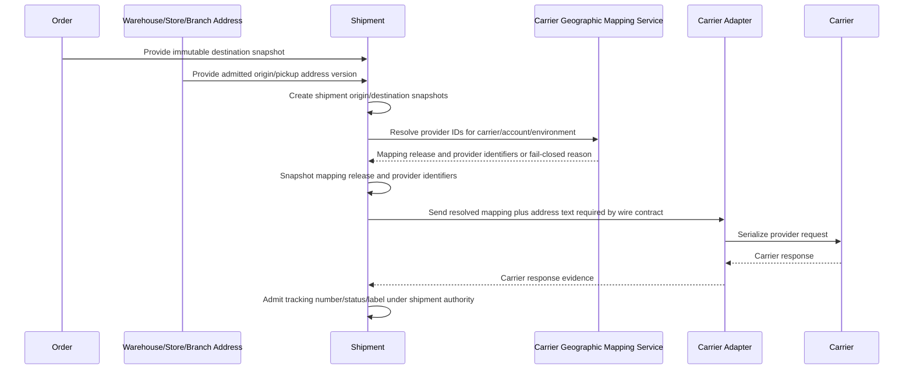
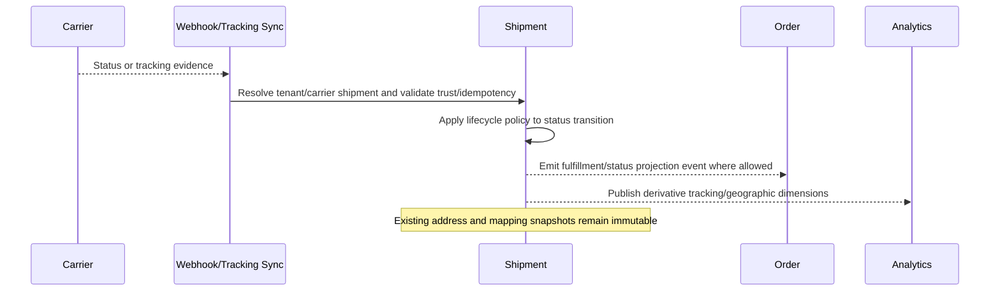
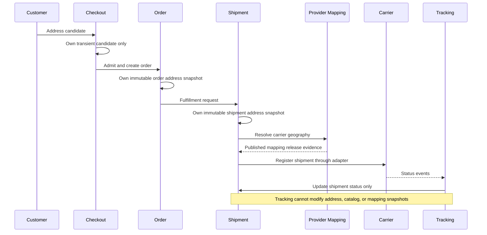

# GEO-1.5 - Geographic Domain Boundaries and Ownership

Status: Architecture boundary certification  
Date: 2026-07-05  
Governing ADR: `ADR-GEO-001_CANONICAL_GEOGRAPHIC_IDENTITY.md`  
Runtime impact: none  
SQL impact: none  
EF impact: none  
DTO/API impact: none

## Decision

Geographic Identity is a platform domain. It owns canonical place identity,
hierarchy policy, address admission rules, catalog releases, and provider
geographic mappings. It does not own every business address lifecycle.

Business domains own their address-bearing aggregate lifecycles. They submit
address candidates for Geographic admission and then store immutable admitted
snapshots where history, fulfillment, finance, tax, return, analytics, or
carrier execution requires evidence.

The boundary is:

- Geographic Catalog owns place meaning.
- Geographic Address Admission owns validation of selected place lineage and
  structured address detail.
- Provider Geographic Mapping owns provider-specific place identifiers and
  mapping releases.
- Customer, Store, Branch, Warehouse, Carrier Configuration, CommerceHub, and
  Affiliate domains own their reusable or channel-specific address records.
- Checkout owns transient address candidates only.
- Orders and Shipments own immutable address snapshots after admission.
- Carrier adapters consume resolved mapping snapshots only; they never infer,
  create, or repair geography.

## Non-Goals

This phase does not authorize runtime, SQL, EF, DTO, API, controller, adapter,
frontend, migration, or service implementation. GEO-1.5 only fixes aggregate
boundaries and ownership language before the GEO-2 SQL model can be designed.

## Boundary Rules

1. Place identity is never text. Names, aliases, street lines, postal codes,
   landmarks, coordinates, provider labels, and historical display strings are
   evidence or address detail only.
2. Provider IDs are never customer, checkout, order, or address-book fields.
   Provider IDs are resolved after carrier selection and snapshotted on the
   shipment registration boundary.
3. A mutable reusable address edit creates a new version. It never mutates an
   order, shipment, return, tax, payment, or marketplace snapshot.
4. Checkout address state is a candidate until backend admission. Recovery can
   preserve candidates, but it cannot make them authority.
5. Orders snapshot admitted shipping and billing address evidence at order
   creation. Later saved-address edits do not rewrite orders.
6. Shipments snapshot admitted destination, origin, return destination, and
   provider mapping evidence at shipment registration. Tracking events cannot
   rewrite those snapshots.
7. Catalog and mapping releases are immutable after publication. Corrections
   create a later release.
8. Redis, MongoDB, Elasticsearch, browser state, carrier metadata, analytics,
   webhook payloads, and configuration dictionaries are derivative or evidence.
   They cannot own, infer, or repair geographic identity.

## Aggregate Boundaries

### Geographic Catalog

Aggregate root: `GeographicPlace`.

Owns:

- canonical country, administrative-area, city, district, and zone identities;
- parent/child hierarchy membership;
- place lifecycle: draft, active, deprecated, merged, retired;
- localized names and aliases;
- country profile requirements;
- catalog release publication;
- catalog change audit and provenance.

Never owns:

- customer address books;
- checkout sessions;
- orders;
- shipments;
- carrier shipment status;
- provider IDs;
- operational-location business lifecycle.

### Address Admission

Aggregate/value boundary: admitted address value under the owning business
aggregate.

Owns:

- validation of selected canonical place lineage;
- address normalization rules;
- required address detail policy;
- postal and coordinate provenance policy;
- validation status and admission evidence.

Never owns:

- canonical place creation;
- saved-address lifecycle;
- order lifecycle;
- shipment lifecycle;
- provider mapping lifecycle.

### Provider Geographic Mapping

Aggregate root: provider mapping release.

Owns:

- provider/environment/account-scoped place mappings;
- provider place type, identifier, code, and provider display name;
- mapping cardinality policy;
- mapping freshness and release validity;
- raw provider sync evidence and reviewed mapping candidates;
- mapping release publication.

Never owns:

- canonical place meaning;
- checkout address selection;
- customer address books;
- order destination;
- shipment lifecycle status;
- adapter wire contract.

### Business Snapshots

Aggregate roots: Order, Shipment, Return, CommerceHub order/suborder, tax or
payment evidence, and operational-location history where applicable.

Own:

- immutable admitted address copy;
- selected canonical place IDs and resolved labels/codes;
- address details and coordinate provenance;
- catalog release used for admission;
- mapping release and provider identifiers actually used, for carrier
  execution snapshots.

Never own:

- current catalog rows;
- future catalog names;
- provider mapping release mutation;
- reusable saved-address mutation.

## Ownership Matrix

### Geographic Catalog

| Question | Answer |
|---|---|
| Who creates it? | Platform geographic administration through governed import, staging, review, and publication. |
| Who validates it? | Geographic hierarchy policy and catalog publication review. |
| Who updates it? | Platform geographic administration by creating draft changes and publishing a new catalog release. |
| Who owns it? | Geographic Identity platform domain. |
| Who snapshots it? | Address Admission and business snapshot factories copy catalog IDs, labels, codes, and release evidence into admitted snapshots. |
| Who consumes it? | Checkout, address books, Orders, Shipments, Returns, CommerceHub, Affiliate storefronts, Warehouses, Stores, Branches, Taxes, Analytics, Search, POS, carrier mapping, and Admin. |
| Who can never modify it? | Tenants, customers, checkout, Orders, Shipments, Returns, carrier adapters, provider sync without review, Redis, MongoDB, Elasticsearch, browser state, analytics, and webhooks. |

### Place

| Question | Answer |
|---|---|
| Who creates it? | Platform geographic administration as a catalog node. |
| Who validates it? | Geographic hierarchy policy validates type, parent chain, country profile, uniqueness, status, and release integrity. |
| Who updates it? | Platform geographic administration via new catalog row version/release, deprecation, merge, or successor workflow. |
| Who owns it? | Geographic Identity platform domain. |
| Who snapshots it? | Geographic snapshot factory when an address is admitted into Order, Shipment, Return, CommerceHub, operational-location, tax, or payment evidence. |
| Who consumes it? | Address admission, search, checkout, address books, operations, shipping, returns, carrier mapping, tax, analytics, and presentation. |
| Who can never modify it? | Address owners, checkout, order services, shipment services, carrier services, adapters, customers, vendors, warehouses, stores, branches, providers, projections, and caches. |

### Address

| Question | Answer |
|---|---|
| Who creates it? | The owning business domain creates an address candidate or durable address record; Geographic Admission creates the admitted address value. |
| Who validates it? | Geographic Address Admission validates canonical place lineage and address detail policy. The owning domain validates actor, tenant, and lifecycle permission. |
| Who updates it? | The owning business domain creates a new address version after re-admission. Existing admitted historical values are not edited in place. |
| Who owns it? | Shared boundary: Geographic owns admission rules and canonical binding; the business aggregate owns the lifecycle of its address record or snapshot. |
| Who snapshots it? | Order, Shipment, Return, CommerceHub, payment/tax, and operational-location snapshot factories at their admission boundaries. |
| Who consumes it? | Checkout, customer account/address book, Orders, Shipments, Returns, carriers through mapped shipment snapshots, tax, analytics, store operations, and support. |
| Who can never modify it? | Carrier adapters, tracking events, Redis, MongoDB, Elasticsearch, analytics, webhooks, provider responses, and unrelated domains. Prior snapshots are immutable to everyone. |

### Party Address

| Question | Answer |
|---|---|
| Who creates it? | Party-owning domain: Customer, Vendor, Supplier, Store, Branch, Warehouse, or other approved party owner after Geographic admission. |
| Who validates it? | Party domain validates actor/tenant/party authority; Geographic Admission validates address identity and detail. |
| Who updates it? | Party-owning domain by adding a new admitted version or retiring a saved version. |
| Who owns it? | Party-owning domain owns lifecycle; Geographic owns address admission truth. |
| Who snapshots it? | Checkout snapshots a selected version as a checkout candidate; Order and Shipment snapshot admitted copies during conversion and shipment registration. |
| Who consumes it? | Checkout, account profile, Storefront, POS, Orders, Shipping, Returns, support, tax, and analytics. |
| Who can never modify it? | Checkout after order submission, Orders, Shipments, carrier adapters, tracking, provider responses, projections, caches, and other party domains. |

### Checkout Address Candidate

| Question | Answer |
|---|---|
| Who creates it? | Storefront, POS, CommerceHub, Affiliate channel, or admin checkout flow as user/channel-submitted candidate state. |
| Who validates it? | Checkout validates session/cart/customer/tenant authority; Geographic Admission validates canonical place IDs and address detail before final acceptance. |
| Who updates it? | Checkout/session owner before final order admission; recovery may rehydrate it only as a candidate requiring current revalidation. |
| Who owns it? | Checkout domain owns transient candidate lifecycle. |
| Who snapshots it? | Checkout creates an admitted order shipping/billing snapshot during final order creation; Shipment later snapshots from the order/admitted destination and origin. |
| Who consumes it? | Shipping calculation, payment/tax preview, final checkout admission, abandoned-checkout recovery, and order creation. |
| Who can never modify it? | Orders after creation, Shipments, carrier adapters, provider mapping, tracking, Redis/Mongo projections as authority, analytics, and direct browser tampering. |

### Address Book

| Question | Answer |
|---|---|
| Who creates it? | Customer account, vendor/store/branch/warehouse administration, POS customer management, or approved party-owner workflow. |
| Who validates it? | Owner domain validates actor and scope; Geographic Admission validates each address version. |
| Who updates it? | Address-book owner creates new versions, sets defaults, retires entries, or marks review-required after catalog changes. |
| Who owns it? | The party/customer domain that owns the book. |
| Who snapshots it? | Checkout snapshots the selected saved version as a candidate; Orders and Shipments snapshot admitted copies. |
| Who consumes it? | Checkout, account/profile, POS, Storefront, CommerceHub where authorized, returns, support, and analytics. |
| Who can never modify it? | Orders, Shipments, carriers, provider mapping, tracking, payment, tax, Redis, MongoDB, Elasticsearch, and analytics. |

### Order Address Snapshot

| Question | Answer |
|---|---|
| Who creates it? | Order domain during final checkout/order creation after Checkout and Geographic admission. |
| Who validates it? | Checkout and Order validate session/cart/customer/payment/shipping authority; Geographic Admission validates address identity before snapshot. |
| Who updates it? | Nobody mutates it. Corrections require explicit order-level correction evidence or a new business event, not overwriting the original snapshot. |
| Who owns it? | Order domain. |
| Who snapshots it? | Order snapshots Checkout's admitted shipping and billing addresses. Shipment, return, tax, payment, and CommerceHub suborders may copy from it into their own immutable snapshots. |
| Who consumes it? | Shipment creation, fulfillment, customer service, payments, tax, refunds, returns, analytics, CommerceHub, Affiliate attribution, and customer order history. |
| Who can never modify it? | Customers after submission, address book edits, Checkout recovery, Shipments, carriers, tracking, Geographic Catalog, provider mapping, projections, caches, and analytics. |

### Shipment Address Snapshot

| Question | Answer |
|---|---|
| Who creates it? | Shipping/Shipment domain at shipment creation or external registration boundary. |
| Who validates it? | Shipment authority validates tenant/order/shipping-method/carrier lifecycle; Geographic Admission validates any new origin/destination/return address before snapshot; Carrier Geographic Mapping validates provider mapping before external call. |
| Who updates it? | Nobody mutates it after registration. A re-ship, carrier change, return shipment, or reroute creates a new shipment or explicit new immutable snapshot as its own business event. |
| Who owns it? | Shipment domain. |
| Who snapshots it? | Shipment snapshots order destination, warehouse/store/branch/carrier pickup origin, return destination, catalog release, and provider mapping release/identifiers actually used. |
| Who consumes it? | Carrier adapters, tracking, fulfillment, returns, support, analytics, customer shipment history, and carrier webhook admission. |
| Who can never modify it? | Checkout, Orders after handoff, address books, carrier adapters, provider responses, tracking events, webhooks, Redis, MongoDB, Elasticsearch, analytics, and direct browser tampering. |

### Warehouse Address

| Question | Answer |
|---|---|
| Who creates it? | Warehouse/Inventory operations administration after Geographic admission. |
| Who validates it? | Warehouse domain validates tenant/warehouse authority; Geographic Admission validates address identity. |
| Who updates it? | Warehouse domain creates a new admitted operational-location version. Existing shipment origin snapshots remain unchanged. |
| Who owns it? | Warehouse/Inventory operations domain owns lifecycle; Geographic owns admission rules. |
| Who snapshots it? | Shipment snapshots it as origin or return destination when used for fulfillment; inventory/operations may snapshot historical dispatch evidence. |
| Who consumes it? | Fulfillment, shipment creation, return logistics, stock movement, POS operations, analytics, and support. |
| Who can never modify it? | Checkout, customers, Orders, Shipments after snapshot, carriers, adapters, tracking, provider mapping, projections, caches, and analytics. |

### Store Address

| Question | Answer |
|---|---|
| Who creates it? | Store administration after Geographic admission. |
| Who validates it? | Store administration validates tenant/store authority; Geographic Admission validates address identity. |
| Who updates it? | Store administration creates a new admitted store-address version. Historical snapshots remain unchanged. |
| Who owns it? | Store administration domain owns lifecycle; Geographic owns admission rules. |
| Who snapshots it? | Shipment, CommerceHub, POS, branch/store operations, and published storefront evidence snapshot it when used for a business event. |
| Who consumes it? | Storefront display where allowed, pickup/dispatch, fulfillment, CommerceHub, POS, analytics, search, and support. |
| Who can never modify it? | Customers, Checkout, Orders, Shipments after snapshot, carriers, provider mapping, tracking, projections, caches, and analytics. |

### Branch Address

| Question | Answer |
|---|---|
| Who creates it? | Branch administration after Geographic admission. |
| Who validates it? | Branch/store administration validates tenant/branch authority; Geographic Admission validates address identity. |
| Who updates it? | Branch administration creates a new admitted branch-address version. |
| Who owns it? | Branch administration domain owns lifecycle; Geographic owns admission rules. |
| Who snapshots it? | Shipment, pickup, return, POS, CommerceHub, and operational events snapshot it when the branch is an origin, destination, or public/pickup location. |
| Who consumes it? | Fulfillment, POS, customer pickup, returns, analytics, support, and storefront/CommerceHub presentation where allowed. |
| Who can never modify it? | Checkout, customers, Orders, Shipments after snapshot, carriers, adapters, tracking, projections, caches, and analytics. |

### Carrier Pickup Address

| Question | Answer |
|---|---|
| Who creates it? | Carrier configuration/fulfillment administration after Geographic admission, usually from a warehouse, store, branch, or explicit carrier-pickup location. |
| Who validates it? | Carrier configuration authority validates tenant/carrier/account scope; Geographic Admission validates address identity; Provider Mapping validates provider pickup-place identifiers when required. |
| Who updates it? | Carrier configuration/fulfillment administration creates a new admitted pickup-location version or changes active selection under tenant/carrier authority. |
| Who owns it? | Carrier configuration/fulfillment operations domain owns lifecycle; Geographic owns admission; Provider Mapping owns provider identifiers. |
| Who snapshots it? | Shipment snapshots it as pickup/origin evidence when a carrier shipment is registered. |
| Who consumes it? | Carrier shipment registration, pickup workflows, fulfillment, support, carrier adapters as serialized resolved evidence, and analytics. |
| Who can never modify it? | Checkout, customers, Orders, Shipments after snapshot, adapters, provider responses, tracking, webhooks, projections, caches, and analytics. |

### CommerceHub Address

| Question | Answer |
|---|---|
| Who creates it? | CommerceHub marketplace order, vendor, store, or checkout workflow as a channel-specific address candidate, then admitted by Geographic before durable use. |
| Who validates it? | CommerceHub validates marketplace/vendor/order authority and channel isolation; Geographic Admission validates address identity. |
| Who updates it? | CommerceHub creates new admitted versions or new order/suborder snapshots according to marketplace lifecycle. Existing snapshots are immutable. |
| Who owns it? | CommerceHub owns channel address lifecycle and marketplace order snapshots; Geographic owns admission and catalog identity. |
| Who snapshots it? | CommerceHub order/suborder snapshot factory, Order creation, and Shipment registration as each aggregate crosses its admission boundary. |
| Who consumes it? | CommerceHub orders/suborders, vendor fulfillment, split orders, Shipping, returns, payouts/settlement context where allowed, analytics, and support. |
| Who can never modify it? | Affiliate attribution, carriers, adapters, tracking, Orders after snapshot, Shipments after snapshot, projections, caches, analytics, and unrelated marketplace participants. |

### Affiliate Checkout Address

| Question | Answer |
|---|---|
| Who creates it? | Affiliate storefront checkout flow as a normal checkout address candidate with affiliate attribution evidence kept separate. |
| Who validates it? | Checkout validates session/cart/customer/channel authority; Affiliate validates attribution only; Geographic Admission validates address identity. |
| Who updates it? | Checkout/session owner before final order admission. Affiliate domain cannot update the address because attribution is not address ownership. |
| Who owns it? | Checkout owns the candidate; Order owns the resulting snapshot; Affiliate owns only attribution lineage. |
| Who snapshots it? | Order snapshots the admitted address at checkout completion; Shipment snapshots from the order during fulfillment. Affiliate snapshots attribution evidence separately. |
| Who consumes it? | Checkout, shipping calculation, Order, Shipment, tax/payment preview, Affiliate commission lineage as read-only order context, analytics, and support. |
| Who can never modify it? | Affiliate attribution, affiliate dashboards, carriers, adapters, tracking, provider mapping, projections, caches, analytics, and direct browser tampering. |

### Provider Geographic Mapping

| Question | Answer |
|---|---|
| Who creates it? | Platform carrier geographic synchronization and mapping administration through staged import, candidate review, and published release. |
| Who validates it? | Provider mapping policy validates provider/environment/account scope, provider parent graph, canonical binding, cardinality, freshness, and release integrity. |
| Who updates it? | Mapping administration publishes a new immutable mapping release. Existing published releases are not edited. |
| Who owns it? | Provider Geographic Mapping subdomain inside Geographic Identity. |
| Who snapshots it? | Shipment registration snapshots mapping release ID and provider place identifiers actually used for the selected carrier/account/environment. |
| Who consumes it? | CarrierShipmentService before adapter invocation, shipping eligibility/preflight where approved, carrier adapters as resolved wire data, support, observability, and analytics. |
| Who can never modify it? | Checkout, address books, Orders, Shipments after snapshot, carrier adapters, provider responses without sync review, webhooks, tracking, Redis, MongoDB, Elasticsearch, analytics, and tenant users outside approved scoped override workflows. |

## Mutable vs Immutable Boundaries

### Mutable With Versioning

- Geographic catalog draft data before publication.
- Provider mapping draft/sync candidates before publication.
- Address-book entries, only by creating a new admitted version.
- Warehouse, store, branch, carrier pickup, and party addresses, only by
  creating a new admitted version.
- Checkout address candidates before final order admission.
- CommerceHub channel address candidates before order/suborder admission.

### Immutable After Publication or Admission

- Published catalog releases.
- Published provider mapping releases.
- Order shipping and billing address snapshots.
- Shipment origin, destination, return, and provider mapping snapshots.
- Return shipment snapshots.
- CommerceHub order/suborder snapshots.
- Payment/tax address evidence snapshots.
- Carrier registration provider identifiers used for a shipment.

### Correction Policy

Corrections never rewrite immutable snapshots. The allowed correction shapes are:

- create a new catalog release;
- create a new provider mapping release;
- create a new address version;
- create an explicit order correction event while preserving original evidence;
- create a new shipment/re-shipment/reroute snapshot while preserving original
  registration evidence;
- mark a legacy or recovered address as review-required instead of fabricating
  identity.

## Lifecycle Diagrams

### Customer Address to Checkout

### Checkout to Order Snapshot

### Order to Shipment and Carrier

### Tracking Without Geographic Mutation

### End-to-End Boundary

## Cross-Domain Consumption Rules

| Consumer | Allowed Use | Forbidden Use |
|---|---|---|
| Checkout | Candidate capture, revalidation, pricing inputs, order admission | Owning places, owning provider IDs, treating browser state as authority |
| Orders | Immutable shipping/billing snapshots | Rewriting snapshots from saved-address edits or tracking events |
| Shipments | Immutable origin/destination/return/mapping snapshots | Inferring geography from provider response or webhook text |
| Carrier adapters | Wire serialization of resolved mappings and address text | Mapping lookup, fuzzy matching, catalog mutation |
| Tracking | Shipment status evidence | Address correction or geographic remapping |
| CommerceHub | Channel candidate capture and marketplace snapshots | Owning platform catalog or affiliate address mutation |
| Affiliate | Attribution lineage and read-only order context | Address ownership or address mutation |
| Warehouses/Stores/Branches | Operational address lifecycle with versioning | Rewriting shipment/order history |
| Analytics/Search | Derivative dimensions and localized labels | Identity resolution, validation, or mutation |
| Redis/MongoDB/Elasticsearch | Cache/projection only | Geographic authority |

## GEO-2 Readiness

GEO-2 can safely begin after this document is accepted because the ownership
boundaries are now explicit enough to design the SQL model without smuggling
business aggregate ownership into the Geographic domain.

GEO-2 must stay inside its own scope: exact tables, constraints, indexes,
tenancy, release semantics, and snapshot storage design. It must not implement
runtime services, EF entities, DTOs, APIs, controllers, adapters, or frontend
behavior unless a later phase explicitly authorizes implementation.

## Certification Recommendation

Recommendation: proceed to GEO-2.

Reason: GEO-1.5 resolves the aggregate ownership ambiguity left open by the
canonical ADR. The safe design principle for GEO-2 is now fixed: Geographic
Identity owns canonical identity, admission, and provider mappings; business
domains own lifecycle and immutable snapshots.
