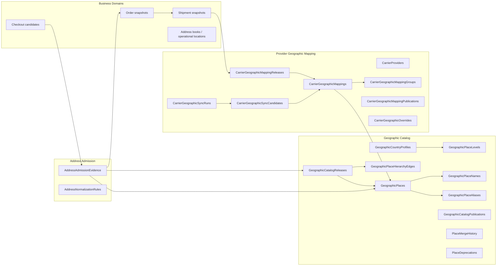

# GEO-2 - Canonical Geographic SQL Model

Status: Design freeze pending approval  
Date: 2026-07-05  
Governing architecture: `ADR-GEO-001_CANONICAL_GEOGRAPHIC_IDENTITY.md` and `GEO-1.5_GEOGRAPHIC_DOMAIN_BOUNDARIES.md`  
Runtime impact: none  
EF impact: none  
Migration impact: none  

## Executive Summary

Geographic Identity requires a PostgreSQL-backed, provider-independent SQL
model. The model below keeps the architecture boundary fixed:

- Geographic owns canonical place identity, hierarchy policy, localization,
  aliases, country profiles, address admission rules, catalog releases,
  provider mapping releases, sync staging, overrides, and audit.
- Business domains own checkout candidates, customer/vendor/store/warehouse
  address lifecycles, orders, shipments, returns, CommerceHub suborders, and
  immutable snapshots.
- Provider identifiers appear only in carrier geographic mapping tables and
  shipment registration mapping snapshots. They never appear in checkout,
  orders, customers, saved addresses, address books, or generic business
  address records.

No runtime, controller, DTO, service, carrier adapter, checkout, EF entity, or
migration change is implemented in GEO-2. The SQL model is stable enough to
freeze as architecture, but implementation belongs to a later phase.

## Entity Inventory

| Entity | Purpose | Aggregate owner |
|---|---|---|
| `GeographicPlaces` | Canonical provider-independent place nodes for all countries and levels | Geographic Catalog |
| `GeographicPlaceLevels` | Country-specific administrative level definitions and display policy | Geographic Catalog |
| `GeographicPlaceHierarchyEdges` | Published parent/child edges with release validity | Geographic Catalog |
| `GeographicPlaceNames` | Localized official/display/search/historical names | Geographic Catalog |
| `GeographicPlaceAliases` | Search and legacy matching aliases; candidate evidence only | Geographic Catalog |
| `GeographicCountryProfiles` | Country rules for required levels, postal code, address detail, and supported languages | Geographic Catalog |
| `GeographicCatalogReleases` | Immutable catalog release headers | Geographic Catalog |
| `GeographicCatalogReleasePlaces` | Places included in a release | Geographic Catalog |
| `GeographicCatalogReleaseEdges` | Hierarchy edges included in a release | Geographic Catalog |
| `GeographicCatalogPublications` | Publication, rollback, and activation history | Geographic Catalog |
| `CarrierProviders` | Registered carrier/provider identity for mapping scope | Provider Geographic Mapping |
| `CarrierGeographicMappingReleases` | Immutable provider/environment/account mapping release headers | Provider Geographic Mapping |
| `CarrierGeographicMappings` | Canonical place to provider place bindings | Provider Geographic Mapping |
| `CarrierGeographicMappingGroups` | Explicit many-to-one or one-to-many mapping policy | Provider Geographic Mapping |
| `CarrierGeographicMappingPublications` | Mapping publication and rollback history | Provider Geographic Mapping |
| `CarrierGeographicSyncRuns` | Provider catalog sync/import run evidence | Provider Geographic Mapping |
| `CarrierGeographicSyncCandidates` | Staged provider nodes and proposed mappings before review | Provider Geographic Mapping |
| `CarrierGeographicOverrides` | Reviewed scoped account/tenant override candidates | Provider Geographic Mapping |
| `PlaceMergeHistory` | Merge/split/deprecation lineage and successor proof | Geographic Catalog |
| `PlaceDeprecations` | Deprecation reason, successor, and effective release | Geographic Catalog |
| `AddressAdmissionEvidence` | Durable non-PII admission result and lineage proof | Geographic Address Admission |
| `AddressNormalizationRules` | Versioned country/language text and postal normalization rules | Geographic Address Admission |
| `GeographicAudit` | Durable audit for catalog, admission, mapping, sync, and publication events | Geographic Identity |

`PlaceRelationship` is intentionally not a separate generic graph table. GEO-1
requires one canonical administrative hierarchy, so hierarchy is modeled as
typed release edges. Non-hierarchical relationships can be added later only
after a new ADR.

## Aggregate Diagram



## SQL Schema

The DDL is written as target PostgreSQL design. Names use PascalCase to match
the existing EF style; a later migration may choose quoted or snake_case naming
consistently with the implementation standard.

```sql
CREATE TABLE GeographicCatalogReleases (
    Id uuid PRIMARY KEY,
    ReleaseNumber bigint NOT NULL,
    ReleaseKey varchar(64) NOT NULL,
    Status varchar(24) NOT NULL,
    CountryScopeIso2 char(2) NULL,
    SourceSummary varchar(512) NOT NULL,
    ChecksumSha256 char(64) NOT NULL,
    CreatedAtUtc timestamptz NOT NULL,
    CreatedByUserId uuid NOT NULL,
    PublishedAtUtc timestamptz NULL,
    PublishedByUserId uuid NULL,
    SupersedesReleaseId uuid NULL REFERENCES GeographicCatalogReleases(Id),
    RollbackOfReleaseId uuid NULL REFERENCES GeographicCatalogReleases(Id),
    CONSTRAINT CK_GeoCatalogRelease_Status CHECK (Status IN ('Draft','Validated','Published','Superseded','RolledBack','Rejected')),
    CONSTRAINT UQ_GeoCatalogRelease_Number UNIQUE (ReleaseNumber),
    CONSTRAINT UQ_GeoCatalogRelease_Key UNIQUE (ReleaseKey)
);

CREATE TABLE GeographicPlaces (
    Id uuid PRIMARY KEY,
    StableKey varchar(96) NOT NULL,
    PlaceKind varchar(24) NOT NULL,
    CountryPlaceId uuid NULL REFERENCES GeographicPlaces(Id),
    LevelCode varchar(64) NULL,
    CanonicalCode varchar(96) NOT NULL,
    ExternalStandard varchar(64) NULL,
    ExternalStandardCode varchar(96) NULL,
    Status varchar(24) NOT NULL,
    SuccessorPlaceId uuid NULL REFERENCES GeographicPlaces(Id),
    ValidFromUtc timestamptz NOT NULL,
    ValidToUtc timestamptz NULL,
    IntroducedCatalogReleaseId uuid NOT NULL REFERENCES GeographicCatalogReleases(Id),
    RetiredCatalogReleaseId uuid NULL REFERENCES GeographicCatalogReleases(Id),
    CentroidLatitude numeric(9,6) NULL,
    CentroidLongitude numeric(9,6) NULL,
    TimeZoneId varchar(96) NULL,
    Source varchar(128) NOT NULL,
    CreatedAtUtc timestamptz NOT NULL,
    CreatedByUserId uuid NOT NULL,
    UpdatedAtUtc timestamptz NOT NULL,
    UpdatedByUserId uuid NOT NULL,
    RowVersion bigint NOT NULL,
    CONSTRAINT CK_GeoPlace_Kind CHECK (PlaceKind IN ('Country','AdministrativeArea','Locality','District','Zone')),
    CONSTRAINT CK_GeoPlace_Status CHECK (Status IN ('Draft','Active','Deprecated','Merged','Retired','Rejected')),
    CONSTRAINT CK_GeoPlace_CountryParent CHECK ((PlaceKind = 'Country' AND CountryPlaceId IS NULL) OR (PlaceKind <> 'Country' AND CountryPlaceId IS NOT NULL)),
    CONSTRAINT CK_GeoPlace_Successor CHECK (SuccessorPlaceId IS NULL OR SuccessorPlaceId <> Id),
    CONSTRAINT CK_GeoPlace_ValidWindow CHECK (ValidToUtc IS NULL OR ValidToUtc > ValidFromUtc),
    CONSTRAINT CK_GeoPlace_Latitude CHECK (CentroidLatitude IS NULL OR (CentroidLatitude >= -90 AND CentroidLatitude <= 90)),
    CONSTRAINT CK_GeoPlace_Longitude CHECK (CentroidLongitude IS NULL OR (CentroidLongitude >= -180 AND CentroidLongitude <= 180)),
    CONSTRAINT UQ_GeoPlace_StableKey UNIQUE (StableKey),
    CONSTRAINT UQ_GeoPlace_CountryCode UNIQUE (ExternalStandard, ExternalStandardCode)
);

CREATE TABLE GeographicPlaceLevels (
    Id uuid PRIMARY KEY,
    CountryPlaceId uuid NOT NULL REFERENCES GeographicPlaces(Id),
    LevelCode varchar(64) NOT NULL,
    ParentLevelCode varchar(64) NULL,
    SortOrder int NOT NULL,
    PlaceKind varchar(24) NOT NULL,
    RequiredForDelivery boolean NOT NULL,
    RequiredForOperations boolean NOT NULL,
    RequiredForTax boolean NOT NULL,
    DisplayNameKey varchar(96) NOT NULL,
    AllowsChildren boolean NOT NULL,
    IsActive boolean NOT NULL,
    IntroducedCatalogReleaseId uuid NOT NULL REFERENCES GeographicCatalogReleases(Id),
    RetiredCatalogReleaseId uuid NULL REFERENCES GeographicCatalogReleases(Id),
    CONSTRAINT CK_GeoPlaceLevel_Kind CHECK (PlaceKind IN ('AdministrativeArea','Locality','District','Zone')),
    CONSTRAINT CK_GeoPlaceLevel_Sort CHECK (SortOrder > 0),
    CONSTRAINT UQ_GeoPlaceLevel_Code UNIQUE (CountryPlaceId, LevelCode),
    CONSTRAINT UQ_GeoPlaceLevel_Order UNIQUE (CountryPlaceId, SortOrder)
);

CREATE TABLE GeographicPlaceHierarchyEdges (
    Id uuid PRIMARY KEY,
    ParentPlaceId uuid NOT NULL REFERENCES GeographicPlaces(Id),
    ChildPlaceId uuid NOT NULL REFERENCES GeographicPlaces(Id),
    CountryPlaceId uuid NOT NULL REFERENCES GeographicPlaces(Id),
    Depth int NOT NULL DEFAULT 1,
    IntroducedCatalogReleaseId uuid NOT NULL REFERENCES GeographicCatalogReleases(Id),
    RetiredCatalogReleaseId uuid NULL REFERENCES GeographicCatalogReleases(Id),
    IsPrimary boolean NOT NULL DEFAULT true,
    CreatedAtUtc timestamptz NOT NULL,
    CONSTRAINT CK_GeoHierarchy_NoSelf CHECK (ParentPlaceId <> ChildPlaceId),
    CONSTRAINT CK_GeoHierarchy_Depth CHECK (Depth >= 1),
    CONSTRAINT UQ_GeoHierarchy_Active UNIQUE (ParentPlaceId, ChildPlaceId, IntroducedCatalogReleaseId)
);

CREATE TABLE GeographicPlaceNames (
    Id uuid PRIMARY KEY,
    PlaceId uuid NOT NULL REFERENCES GeographicPlaces(Id),
    LanguageTag varchar(35) NOT NULL,
    ScriptCode char(4) NULL,
    NameKind varchar(24) NOT NULL,
    Name text NOT NULL,
    NormalizedName text NOT NULL,
    SearchName text NOT NULL,
    DisplayPriority int NOT NULL DEFAULT 100,
    IsPreferred boolean NOT NULL,
    ValidFromUtc timestamptz NOT NULL,
    ValidToUtc timestamptz NULL,
    IntroducedCatalogReleaseId uuid NOT NULL REFERENCES GeographicCatalogReleases(Id),
    RetiredCatalogReleaseId uuid NULL REFERENCES GeographicCatalogReleases(Id),
    CONSTRAINT CK_GeoPlaceName_Kind CHECK (NameKind IN ('Official','Display','Short','Search','Historic','Transliteration','ProviderLabel')),
    CONSTRAINT CK_GeoPlaceName_Window CHECK (ValidToUtc IS NULL OR ValidToUtc > ValidFromUtc)
);

CREATE TABLE GeographicPlaceAliases (
    Id uuid PRIMARY KEY,
    PlaceId uuid NOT NULL REFERENCES GeographicPlaces(Id),
    CountryPlaceId uuid NOT NULL REFERENCES GeographicPlaces(Id),
    LanguageTag varchar(35) NULL,
    AliasKind varchar(24) NOT NULL,
    Alias text NOT NULL,
    NormalizedAlias text NOT NULL,
    SearchAlias text NOT NULL,
    Confidence smallint NOT NULL,
    Source varchar(128) NOT NULL,
    IsAmbiguous boolean NOT NULL,
    IntroducedCatalogReleaseId uuid NOT NULL REFERENCES GeographicCatalogReleases(Id),
    RetiredCatalogReleaseId uuid NULL REFERENCES GeographicCatalogReleases(Id),
    CONSTRAINT CK_GeoPlaceAlias_Kind CHECK (AliasKind IN ('Spelling','Legacy','Transliteration','Abbreviation','Historic','ProviderLabel','MigrationEvidence')),
    CONSTRAINT CK_GeoPlaceAlias_Confidence CHECK (Confidence BETWEEN 0 AND 100)
);

CREATE TABLE GeographicCountryProfiles (
    Id uuid PRIMARY KEY,
    CountryPlaceId uuid NOT NULL REFERENCES GeographicPlaces(Id),
    Iso2 char(2) NOT NULL,
    Iso3 char(3) NOT NULL,
    DefaultLanguageTag varchar(35) NOT NULL,
    SupportedLanguageTags text[] NOT NULL,
    RequiredLevelCodesForDelivery text[] NOT NULL,
    RequiredLevelCodesForOperations text[] NOT NULL,
    PostalCodePolicy varchar(24) NOT NULL,
    PostalCodeRegex text NULL,
    RequiresStreetLine1 boolean NOT NULL,
    AllowsCoordinates boolean NOT NULL,
    RequiresCoordinateProvenance boolean NOT NULL,
    OfflinePackageEnabled boolean NOT NULL,
    IsActive boolean NOT NULL,
    IntroducedCatalogReleaseId uuid NOT NULL REFERENCES GeographicCatalogReleases(Id),
    RetiredCatalogReleaseId uuid NULL REFERENCES GeographicCatalogReleases(Id),
    CONSTRAINT CK_GeoCountryProfile_Postal CHECK (PostalCodePolicy IN ('NotUsed','Optional','Required','Forbidden')),
    CONSTRAINT UQ_GeoCountryProfile_Country UNIQUE (CountryPlaceId),
    CONSTRAINT UQ_GeoCountryProfile_Iso2 UNIQUE (Iso2),
    CONSTRAINT UQ_GeoCountryProfile_Iso3 UNIQUE (Iso3)
);

CREATE TABLE GeographicCatalogReleasePlaces (
    CatalogReleaseId uuid NOT NULL REFERENCES GeographicCatalogReleases(Id),
    PlaceId uuid NOT NULL REFERENCES GeographicPlaces(Id),
    PlaceStatus varchar(24) NOT NULL,
    PRIMARY KEY (CatalogReleaseId, PlaceId)
);

CREATE TABLE GeographicCatalogReleaseEdges (
    CatalogReleaseId uuid NOT NULL REFERENCES GeographicCatalogReleases(Id),
    HierarchyEdgeId uuid NOT NULL REFERENCES GeographicPlaceHierarchyEdges(Id),
    PRIMARY KEY (CatalogReleaseId, HierarchyEdgeId)
);

CREATE TABLE GeographicCatalogPublications (
    Id uuid PRIMARY KEY,
    CatalogReleaseId uuid NOT NULL REFERENCES GeographicCatalogReleases(Id),
    PublicationKind varchar(24) NOT NULL,
    PublishedAtUtc timestamptz NOT NULL,
    PublishedByUserId uuid NOT NULL,
    ActivatedAtUtc timestamptz NULL,
    SupersededAtUtc timestamptz NULL,
    Reason varchar(512) NOT NULL,
    CONSTRAINT CK_GeoCatalogPublication_Kind CHECK (PublicationKind IN ('Initial','Publish','Rollback','Supersede'))
);

CREATE TABLE CarrierProviders (
    Id uuid PRIMARY KEY,
    CarrierCode varchar(64) NOT NULL,
    DisplayName varchar(128) NOT NULL,
    SupportsGeographicMappings boolean NOT NULL,
    RequiresMappingForDelivery boolean NOT NULL,
    IsActive boolean NOT NULL,
    CreatedAtUtc timestamptz NOT NULL,
    UpdatedAtUtc timestamptz NOT NULL,
    CONSTRAINT UQ_CarrierProvider_Code UNIQUE (CarrierCode)
);

CREATE TABLE CarrierGeographicMappingReleases (
    Id uuid PRIMARY KEY,
    CarrierProviderId uuid NOT NULL REFERENCES CarrierProviders(Id),
    ReleaseNumber bigint NOT NULL,
    ReleaseKey varchar(96) NOT NULL,
    Status varchar(24) NOT NULL,
    Environment varchar(24) NOT NULL,
    AccountScopeKind varchar(24) NOT NULL,
    AccountScopeId uuid NULL,
    TenantId uuid NULL,
    CatalogReleaseId uuid NOT NULL REFERENCES GeographicCatalogReleases(Id),
    SourceSummary varchar(512) NOT NULL,
    ChecksumSha256 char(64) NOT NULL,
    EffectiveFromUtc timestamptz NOT NULL,
    EffectiveToUtc timestamptz NULL,
    FreshnessExpiresAtUtc timestamptz NULL,
    CreatedAtUtc timestamptz NOT NULL,
    CreatedByUserId uuid NOT NULL,
    PublishedAtUtc timestamptz NULL,
    PublishedByUserId uuid NULL,
    SupersedesReleaseId uuid NULL REFERENCES CarrierGeographicMappingReleases(Id),
    RollbackOfReleaseId uuid NULL REFERENCES CarrierGeographicMappingReleases(Id),
    CONSTRAINT CK_CarrierGeoRelease_Status CHECK (Status IN ('Draft','Validated','Published','Superseded','RolledBack','Rejected')),
    CONSTRAINT CK_CarrierGeoRelease_Env CHECK (Environment IN ('Production','Sandbox','Test')),
    CONSTRAINT CK_CarrierGeoRelease_Scope CHECK (AccountScopeKind IN ('Global','ProviderAccount','TenantProviderAccount')),
    CONSTRAINT CK_CarrierGeoRelease_Window CHECK (EffectiveToUtc IS NULL OR EffectiveToUtc > EffectiveFromUtc),
    CONSTRAINT UQ_CarrierGeoRelease_Number UNIQUE (CarrierProviderId, Environment, AccountScopeKind, AccountScopeId, ReleaseNumber),
    CONSTRAINT UQ_CarrierGeoRelease_Key UNIQUE (ReleaseKey)
);

CREATE TABLE CarrierGeographicMappingGroups (
    Id uuid PRIMARY KEY,
    MappingReleaseId uuid NOT NULL REFERENCES CarrierGeographicMappingReleases(Id),
    GroupKey varchar(128) NOT NULL,
    CardinalityPolicy varchar(24) NOT NULL,
    CanonicalPlaceKind varchar(24) NOT NULL,
    ProviderPlaceType varchar(64) NOT NULL,
    Reason varchar(512) NOT NULL,
    CreatedAtUtc timestamptz NOT NULL,
    CONSTRAINT CK_CarrierGeoGroup_Cardinality CHECK (CardinalityPolicy IN ('OneToOne','ManyCanonicalToOneProvider','OneCanonicalToManyProvider')),
    CONSTRAINT UQ_CarrierGeoGroup_Key UNIQUE (MappingReleaseId, GroupKey)
);

CREATE TABLE CarrierGeographicMappings (
    Id uuid PRIMARY KEY,
    MappingReleaseId uuid NOT NULL REFERENCES CarrierGeographicMappingReleases(Id),
    MappingGroupId uuid NULL REFERENCES CarrierGeographicMappingGroups(Id),
    CarrierProviderId uuid NOT NULL REFERENCES CarrierProviders(Id),
    CanonicalPlaceId uuid NOT NULL REFERENCES GeographicPlaces(Id),
    CountryPlaceId uuid NOT NULL REFERENCES GeographicPlaces(Id),
    CanonicalPlaceKind varchar(24) NOT NULL,
    ProviderPlaceType varchar(64) NOT NULL,
    ProviderPlaceId varchar(256) NOT NULL,
    ProviderPlaceCode varchar(256) NULL,
    ProviderDisplayName text NOT NULL,
    ProviderNormalizedName text NOT NULL,
    ProviderParentMappingId uuid NULL REFERENCES CarrierGeographicMappings(Id),
    RequiredForOperation varchar(64) NOT NULL,
    MappingStatus varchar(24) NOT NULL,
    VerificationStatus varchar(24) NOT NULL,
    Source varchar(128) NOT NULL,
    EffectiveFromUtc timestamptz NOT NULL,
    EffectiveToUtc timestamptz NULL,
    CreatedAtUtc timestamptz NOT NULL,
    ReviewedAtUtc timestamptz NULL,
    ReviewedByUserId uuid NULL,
    CONSTRAINT CK_CarrierGeoMapping_Status CHECK (MappingStatus IN ('Draft','Active','Deprecated','Retired','Rejected')),
    CONSTRAINT CK_CarrierGeoMapping_Verification CHECK (VerificationStatus IN ('Imported','AutoCarried','Reviewed','ManuallyApproved','Rejected')),
    CONSTRAINT CK_CarrierGeoMapping_Window CHECK (EffectiveToUtc IS NULL OR EffectiveToUtc > EffectiveFromUtc),
    CONSTRAINT UQ_CarrierGeoMapping_ProviderId UNIQUE (MappingReleaseId, ProviderPlaceType, ProviderPlaceId),
    CONSTRAINT UQ_CarrierGeoMapping_CanonicalProvider UNIQUE (MappingReleaseId, CanonicalPlaceId, ProviderPlaceType, ProviderPlaceId)
);

CREATE TABLE CarrierGeographicMappingPublications (
    Id uuid PRIMARY KEY,
    MappingReleaseId uuid NOT NULL REFERENCES CarrierGeographicMappingReleases(Id),
    PublicationKind varchar(24) NOT NULL,
    PublishedAtUtc timestamptz NOT NULL,
    PublishedByUserId uuid NOT NULL,
    ActivatedAtUtc timestamptz NULL,
    SupersededAtUtc timestamptz NULL,
    Reason varchar(512) NOT NULL,
    CONSTRAINT CK_CarrierGeoPublication_Kind CHECK (PublicationKind IN ('Initial','Publish','Rollback','Supersede'))
);

CREATE TABLE CarrierGeographicSyncRuns (
    Id uuid PRIMARY KEY,
    CarrierProviderId uuid NOT NULL REFERENCES CarrierProviders(Id),
    Environment varchar(24) NOT NULL,
    AccountScopeKind varchar(24) NOT NULL,
    AccountScopeId uuid NULL,
    TenantId uuid NULL,
    SourceKind varchar(24) NOT NULL,
    SourceUri text NULL,
    SourceVersion varchar(128) NULL,
    SourceHashSha256 char(64) NULL,
    StartedAtUtc timestamptz NOT NULL,
    CompletedAtUtc timestamptz NULL,
    Status varchar(24) NOT NULL,
    RawEvidenceObjectKey text NULL,
    AddedCount int NOT NULL DEFAULT 0,
    ChangedCount int NOT NULL DEFAULT 0,
    RemovedCount int NOT NULL DEFAULT 0,
    AmbiguousCount int NOT NULL DEFAULT 0,
    ValidationErrorCount int NOT NULL DEFAULT 0,
    CONSTRAINT CK_CarrierGeoSync_Status CHECK (Status IN ('Started','Succeeded','Failed','Cancelled','ReviewRequired')),
    CONSTRAINT CK_CarrierGeoSync_Source CHECK (SourceKind IN ('ProviderApi','ProviderFile','ManualDocument','Seed','Migration'))
);

CREATE TABLE CarrierGeographicSyncCandidates (
    Id uuid PRIMARY KEY,
    SyncRunId uuid NOT NULL REFERENCES CarrierGeographicSyncRuns(Id),
    CarrierProviderId uuid NOT NULL REFERENCES CarrierProviders(Id),
    ProviderPlaceType varchar(64) NOT NULL,
    ProviderPlaceId varchar(256) NOT NULL,
    ProviderPlaceCode varchar(256) NULL,
    ProviderDisplayName text NOT NULL,
    ProviderNormalizedName text NOT NULL,
    ProviderParentPlaceId varchar(256) NULL,
    CandidateCanonicalPlaceId uuid NULL REFERENCES GeographicPlaces(Id),
    CandidateParentMappingId uuid NULL REFERENCES CarrierGeographicMappings(Id),
    CandidateStatus varchar(24) NOT NULL,
    Confidence smallint NOT NULL,
    ReviewReason varchar(512) NULL,
    ReviewedAtUtc timestamptz NULL,
    ReviewedByUserId uuid NULL,
    CONSTRAINT CK_CarrierGeoCandidate_Status CHECK (CandidateStatus IN ('New','AutoCarried','Ambiguous','Reparented','Removed','Rejected','Approved')),
    CONSTRAINT CK_CarrierGeoCandidate_Confidence CHECK (Confidence BETWEEN 0 AND 100),
    CONSTRAINT UQ_CarrierGeoCandidate_Provider UNIQUE (SyncRunId, ProviderPlaceType, ProviderPlaceId)
);

CREATE TABLE CarrierGeographicOverrides (
    Id uuid PRIMARY KEY,
    CarrierProviderId uuid NOT NULL REFERENCES CarrierProviders(Id),
    Environment varchar(24) NOT NULL,
    AccountScopeKind varchar(24) NOT NULL,
    AccountScopeId uuid NULL,
    TenantId uuid NULL,
    CanonicalPlaceId uuid NOT NULL REFERENCES GeographicPlaces(Id),
    ProviderPlaceType varchar(64) NOT NULL,
    ProviderPlaceId varchar(256) NOT NULL,
    OverrideStatus varchar(24) NOT NULL,
    Reason varchar(512) NOT NULL,
    EffectiveFromUtc timestamptz NOT NULL,
    EffectiveToUtc timestamptz NULL,
    CreatedAtUtc timestamptz NOT NULL,
    CreatedByUserId uuid NOT NULL,
    ApprovedAtUtc timestamptz NULL,
    ApprovedByUserId uuid NULL,
    CONSTRAINT CK_CarrierGeoOverride_Status CHECK (OverrideStatus IN ('Draft','Approved','Published','Retired','Rejected')),
    CONSTRAINT CK_CarrierGeoOverride_Window CHECK (EffectiveToUtc IS NULL OR EffectiveToUtc > EffectiveFromUtc)
);

CREATE TABLE PlaceMergeHistory (
    Id uuid PRIMARY KEY,
    SourcePlaceId uuid NOT NULL REFERENCES GeographicPlaces(Id),
    TargetPlaceId uuid NOT NULL REFERENCES GeographicPlaces(Id),
    CatalogReleaseId uuid NOT NULL REFERENCES GeographicCatalogReleases(Id),
    MergeKind varchar(24) NOT NULL,
    Reason varchar(512) NOT NULL,
    EffectiveAtUtc timestamptz NOT NULL,
    CreatedByUserId uuid NOT NULL,
    CONSTRAINT CK_PlaceMerge_NoSelf CHECK (SourcePlaceId <> TargetPlaceId),
    CONSTRAINT CK_PlaceMerge_Kind CHECK (MergeKind IN ('Merge','Split','RenameSuccessor','AdministrativeChange'))
);

CREATE TABLE PlaceDeprecations (
    Id uuid PRIMARY KEY,
    PlaceId uuid NOT NULL REFERENCES GeographicPlaces(Id),
    SuccessorPlaceId uuid NULL REFERENCES GeographicPlaces(Id),
    CatalogReleaseId uuid NOT NULL REFERENCES GeographicCatalogReleases(Id),
    DeprecationKind varchar(24) NOT NULL,
    Reason varchar(512) NOT NULL,
    EffectiveAtUtc timestamptz NOT NULL,
    CONSTRAINT CK_PlaceDeprecation_NoSelf CHECK (SuccessorPlaceId IS NULL OR SuccessorPlaceId <> PlaceId),
    CONSTRAINT CK_PlaceDeprecation_Kind CHECK (DeprecationKind IN ('Deprecated','Merged','Retired','ProviderOnlyRemoved'))
);

CREATE TABLE AddressNormalizationRules (
    Id uuid PRIMARY KEY,
    CountryPlaceId uuid NOT NULL REFERENCES GeographicPlaces(Id),
    LanguageTag varchar(35) NULL,
    RuleKind varchar(32) NOT NULL,
    RuleVersion bigint NOT NULL,
    RuleDefinition text NOT NULL,
    Status varchar(24) NOT NULL,
    IntroducedCatalogReleaseId uuid NOT NULL REFERENCES GeographicCatalogReleases(Id),
    RetiredCatalogReleaseId uuid NULL REFERENCES GeographicCatalogReleases(Id),
    CreatedAtUtc timestamptz NOT NULL,
    CreatedByUserId uuid NOT NULL,
    CONSTRAINT CK_AddressNormRule_Kind CHECK (RuleKind IN ('Unicode','Whitespace','PostalCode','PhoneLocality','StreetLine','SearchKey')),
    CONSTRAINT CK_AddressNormRule_Status CHECK (Status IN ('Draft','Active','Retired','Rejected')),
    CONSTRAINT UQ_AddressNormRule_Version UNIQUE (CountryPlaceId, LanguageTag, RuleKind, RuleVersion)
);

CREATE TABLE AddressAdmissionEvidence (
    Id uuid PRIMARY KEY,
    OwnerDomain varchar(64) NOT NULL,
    OwnerAggregateType varchar(64) NOT NULL,
    OwnerAggregateId uuid NULL,
    TenantId uuid NULL,
    CountryPlaceId uuid NOT NULL REFERENCES GeographicPlaces(Id),
    AdministrativeAreaPlaceId uuid NULL REFERENCES GeographicPlaces(Id),
    LocalityPlaceId uuid NULL REFERENCES GeographicPlaces(Id),
    DistrictPlaceId uuid NULL REFERENCES GeographicPlaces(Id),
    ZonePlaceId uuid NULL REFERENCES GeographicPlaces(Id),
    CatalogReleaseId uuid NOT NULL REFERENCES GeographicCatalogReleases(Id),
    CountryProfileId uuid NOT NULL REFERENCES GeographicCountryProfiles(Id),
    NormalizationRuleVersion bigint NOT NULL,
    AdmissionStatus varchar(24) NOT NULL,
    FailureCode varchar(96) NULL,
    FailureDetail text NULL,
    AddressFingerprintSha256 char(64) NOT NULL,
    RawInputRedactionKey text NULL,
    AdmittedAtUtc timestamptz NOT NULL,
    AdmittedByUserId uuid NULL,
    ExpiresAtUtc timestamptz NULL,
    CONSTRAINT CK_AddressAdmission_Status CHECK (AdmissionStatus IN ('Admitted','Rejected','ReviewRequired','LegacyUnresolved')),
    CONSTRAINT CK_AddressAdmission_Owner CHECK (OwnerDomain IN ('Checkout','Order','Shipment','Return','Customer','Supplier','Warehouse','Store','Branch','CarrierConfiguration','CommerceHub','Affiliate','Migration')),
    CONSTRAINT CK_AddressAdmission_Failure CHECK ((AdmissionStatus = 'Admitted' AND FailureCode IS NULL) OR (AdmissionStatus <> 'Admitted'))
);

CREATE TABLE GeographicAudit (
    Id uuid PRIMARY KEY,
    EventType varchar(96) NOT NULL,
    AggregateType varchar(96) NOT NULL,
    AggregateId uuid NOT NULL,
    TenantId uuid NULL,
    ActorUserId uuid NULL,
    ActorKind varchar(32) NOT NULL,
    OccurredAtUtc timestamptz NOT NULL,
    CatalogReleaseId uuid NULL REFERENCES GeographicCatalogReleases(Id),
    MappingReleaseId uuid NULL REFERENCES CarrierGeographicMappingReleases(Id),
    CorrelationId uuid NULL,
    Summary varchar(512) NOT NULL,
    EvidenceJson jsonb NULL
);
```

### Required Filtered/Partial Unique Indexes

```sql
CREATE UNIQUE INDEX UX_GeoPlace_ActiveSiblingCode
    ON GeographicPlaces (CountryPlaceId, PlaceKind, CanonicalCode)
    WHERE Status IN ('Draft','Active','Deprecated');

CREATE UNIQUE INDEX UX_GeoPlaceName_Preferred
    ON GeographicPlaceNames (PlaceId, LanguageTag)
    WHERE IsPreferred = true AND RetiredCatalogReleaseId IS NULL;

CREATE INDEX IX_GeoPlaceName_Search
    ON GeographicPlaceNames (LanguageTag, SearchName, PlaceId)
    WHERE RetiredCatalogReleaseId IS NULL;

CREATE INDEX IX_GeoPlaceAlias_Search
    ON GeographicPlaceAliases (CountryPlaceId, LanguageTag, SearchAlias, PlaceId)
    WHERE RetiredCatalogReleaseId IS NULL;

CREATE UNIQUE INDEX UX_GeoHierarchy_PrimaryChild
    ON GeographicPlaceHierarchyEdges (ChildPlaceId, IntroducedCatalogReleaseId)
    WHERE IsPrimary = true AND RetiredCatalogReleaseId IS NULL;

CREATE UNIQUE INDEX UX_CatalogPublication_Active
    ON GeographicCatalogPublications (CatalogReleaseId)
    WHERE SupersededAtUtc IS NULL;

CREATE UNIQUE INDEX UX_CarrierGeoRelease_PublishedActive
    ON CarrierGeographicMappingReleases (CarrierProviderId, Environment, AccountScopeKind, AccountScopeId)
    WHERE Status = 'Published' AND EffectiveToUtc IS NULL;

CREATE INDEX IX_CarrierGeoMapping_Resolve
    ON CarrierGeographicMappings (MappingReleaseId, CanonicalPlaceId, ProviderPlaceType, MappingStatus);

CREATE INDEX IX_CarrierGeoMapping_ProviderLookup
    ON CarrierGeographicMappings (MappingReleaseId, ProviderPlaceType, ProviderPlaceId);

CREATE INDEX IX_CarrierGeoSyncCandidate_Review
    ON CarrierGeographicSyncCandidates (CarrierProviderId, CandidateStatus, Confidence);

CREATE INDEX IX_AddressAdmissionEvidence_Owner
    ON AddressAdmissionEvidence (OwnerDomain, OwnerAggregateType, OwnerAggregateId, TenantId);

CREATE INDEX IX_AddressAdmissionEvidence_Lineage
    ON AddressAdmissionEvidence (CountryPlaceId, AdministrativeAreaPlaceId, LocalityPlaceId, DistrictPlaceId, ZonePlaceId, CatalogReleaseId);

CREATE INDEX IX_GeographicAudit_Aggregate
    ON GeographicAudit (AggregateType, AggregateId, OccurredAtUtc DESC);
```

## Relationship Diagram

```mermaid
erDiagram
    GeographicCatalogReleases ||--o{ GeographicPlaces : introduces
    GeographicCatalogReleases ||--o{ GeographicPlaceHierarchyEdges : introduces
    GeographicPlaces ||--o{ GeographicPlaceNames : has
    GeographicPlaces ||--o{ GeographicPlaceAliases : has
    GeographicPlaces ||--o{ GeographicPlaceLevels : defines_country_levels
    GeographicPlaces ||--o{ GeographicCountryProfiles : profiles
    GeographicPlaces ||--o{ GeographicPlaceHierarchyEdges : parent
    GeographicPlaces ||--o{ GeographicPlaceHierarchyEdges : child
    GeographicCatalogReleases ||--o{ GeographicCatalogPublications : publishes
    CarrierProviders ||--o{ CarrierGeographicMappingReleases : releases
    GeographicCatalogReleases ||--o{ CarrierGeographicMappingReleases : catalog_basis
    CarrierGeographicMappingReleases ||--o{ CarrierGeographicMappings : contains
    GeographicPlaces ||--o{ CarrierGeographicMappings : maps_from
    CarrierGeographicMappingReleases ||--o{ CarrierGeographicMappingGroups : cardinality
    CarrierProviders ||--o{ CarrierGeographicSyncRuns : syncs
    CarrierGeographicSyncRuns ||--o{ CarrierGeographicSyncCandidates : stages
    GeographicCatalogReleases ||--o{ AddressAdmissionEvidence : validates_against
    GeographicPlaces ||--o{ AddressAdmissionEvidence : selected_lineage
```



## Table Contracts

### GeographicPlaces

- Purpose: stable provider-independent place identity for any country and
  administrative level.
- Aggregate ownership: Geographic Catalog.
- Primary key: `Id`.
- Foreign keys: `CountryPlaceId`, `SuccessorPlaceId`,
  `IntroducedCatalogReleaseId`, `RetiredCatalogReleaseId`.
- Unique constraints: `StableKey`; active sibling code partial index; external
  standard code where used.
- Check constraints: place kind, status, country parent rule, coordinate range,
  successor not self, validity window.
- Indexes: active sibling code, country/kind/status, successor, centroid only
  if proximity is later approved.
- Soft delete policy: no soft delete. Retire or deprecate through status and
  release.
- Versioning strategy: append/change-by-release; do not rewrite published
  meaning.
- Release relationship: introduced and retired by catalog releases.
- Snapshot relationship: business snapshots copy IDs, codes, display names,
  and release evidence.
- Tenant scope: platform-global.
- Audit requirements: every create, status change, merge, retirement, and
  publication writes `GeographicAudit`.

### GeographicPlaceLevels

- Purpose: country-neutral hierarchy level policy; supports countries with
  skipped or additional administrative levels without separate tables.
- Aggregate ownership: Geographic Catalog.
- Primary key: `Id`.
- Foreign keys: `CountryPlaceId`, release IDs.
- Unique constraints: `(CountryPlaceId, LevelCode)` and `(CountryPlaceId,
  SortOrder)`.
- Check constraints: allowed place kind, positive sort.
- Indexes: country/sort, active country levels.
- Soft delete policy: retire through release.
- Versioning strategy: release-versioned profile changes.
- Release relationship: introduced/retired by catalog release.
- Snapshot relationship: snapshots store concrete place IDs, not level rows.
- Tenant scope: platform-global.
- Audit requirements: required-level changes audited because they affect
  checkout admission and carrier eligibility.

### GeographicPlaceHierarchyEdges

- Purpose: canonical parent-child hierarchy with publication validity.
- Aggregate ownership: Geographic Catalog.
- Primary key: `Id`.
- Foreign keys: parent place, child place, country place, release IDs.
- Unique constraints: active primary child per release; parent/child/release.
- Check constraints: no self edge, positive depth.
- Indexes: parent children, child parent, country traversal, release traversal.
- Soft delete policy: retire edge in a later release.
- Versioning strategy: release-versioned append/retire.
- Release relationship: included in catalog release edge set.
- Snapshot relationship: snapshots persist selected lineage, not live edge.
- Tenant scope: platform-global.
- Audit requirements: reparenting, split, merge, and edge retirement audited.

### GeographicPlaceNames

- Purpose: localized official, display, search, historic, transliterated, and
  provider-label names.
- Aggregate ownership: Geographic Catalog.
- Primary key: `Id`.
- Foreign keys: `PlaceId`, release IDs.
- Unique constraints: one active preferred name per place/language.
- Check constraints: name kind and validity window.
- Indexes: language/search name, place/language/preferred.
- Soft delete policy: retire by release, preserving historical names.
- Versioning strategy: name rows are versioned and never rewrite snapshots.
- Release relationship: introduced/retired by catalog releases.
- Snapshot relationship: order/shipment snapshots copy the display name used.
- Tenant scope: platform-global.
- Audit requirements: preferred-name changes audited.

### GeographicPlaceAliases

- Purpose: autocomplete, legacy matching, spelling variants, transliteration,
  and migration candidate search.
- Aggregate ownership: Geographic Catalog.
- Primary key: `Id`.
- Foreign keys: `PlaceId`, `CountryPlaceId`, release IDs.
- Unique constraints: none globally; aliases can be ambiguous.
- Check constraints: alias kind and confidence range.
- Indexes: country/language/search alias.
- Soft delete policy: retire by release.
- Versioning strategy: aliases are release-versioned candidate evidence.
- Release relationship: introduced/retired by catalog release.
- Snapshot relationship: no direct snapshot use; aliases never establish
  identity.
- Tenant scope: platform-global.
- Audit requirements: ambiguous alias changes and migration aliases audited.

### GeographicCountryProfiles

- Purpose: country-specific admission requirements, postal policy, languages,
  coordinate policy, and offline package availability.
- Aggregate ownership: Geographic Catalog and Address Admission policy.
- Primary key: `Id`.
- Foreign keys: `CountryPlaceId`, release IDs.
- Unique constraints: country, ISO2, ISO3.
- Check constraints: postal policy.
- Indexes: active country profile by ISO2/ISO3.
- Soft delete policy: retire by release.
- Versioning strategy: release-versioned profile rows.
- Release relationship: introduced/retired by catalog release.
- Snapshot relationship: admission evidence stores profile ID and release.
- Tenant scope: platform-global.
- Audit requirements: any change to required delivery levels audited.

### GeographicCatalogReleases

- Purpose: immutable catalog release header and checksum.
- Aggregate ownership: Geographic Catalog.
- Primary key: `Id`.
- Foreign keys: superseded and rollback release IDs.
- Unique constraints: release number and release key.
- Check constraints: release status.
- Indexes: status/published date/country scope.
- Soft delete policy: none. Releases are immutable.
- Versioning strategy: each publication creates a new release.
- Release relationship: root of catalog publication.
- Snapshot relationship: all admitted snapshots store the catalog release ID.
- Tenant scope: platform-global.
- Audit requirements: validation, publication, rollback, supersede.

### GeographicCatalogReleasePlaces / GeographicCatalogReleaseEdges

- Purpose: immutable membership of places and hierarchy edges in a release.
- Aggregate ownership: Geographic Catalog.
- Primary key: composite IDs.
- Foreign keys: release, place or edge.
- Unique constraints: primary key.
- Check constraints: inherited from referenced rows.
- Indexes: reverse place/edge to releases.
- Soft delete policy: none.
- Versioning strategy: immutable release membership.
- Release relationship: direct release membership.
- Snapshot relationship: admission validates selected IDs are in the release.
- Tenant scope: platform-global.
- Audit requirements: covered by release publication audit.

### GeographicCatalogPublications

- Purpose: active publication, supersede, and rollback history.
- Aggregate ownership: Geographic Catalog.
- Primary key: `Id`.
- Foreign keys: catalog release.
- Unique constraints: one active publication per release.
- Check constraints: publication kind.
- Indexes: active publication, published date.
- Soft delete policy: none.
- Versioning strategy: append-only publication history.
- Release relationship: points to immutable release.
- Snapshot relationship: snapshots remain tied to release, not publication
  mutable state.
- Tenant scope: platform-global.
- Audit requirements: publication and rollback reason mandatory.

### CarrierProviders

- Purpose: provider registry for mapping scope, separate from adapter runtime
  registration.
- Aggregate ownership: Provider Geographic Mapping.
- Primary key: `Id`.
- Foreign keys: none.
- Unique constraints: carrier code.
- Check constraints: active boolean only.
- Indexes: carrier code, active.
- Soft delete policy: deactivate, do not delete.
- Versioning strategy: ordinary guarded updates before provider release use.
- Release relationship: mapping releases reference provider.
- Snapshot relationship: shipment mapping snapshot stores carrier code/provider.
- Tenant scope: platform-global provider identity.
- Audit requirements: provider mapping capability changes audited.

### CarrierGeographicMappingReleases

- Purpose: immutable mapping release scoped by provider, environment, account,
  tenant override, and catalog release.
- Aggregate ownership: Provider Geographic Mapping.
- Primary key: `Id`.
- Foreign keys: carrier provider, catalog release, superseded/rollback release.
- Unique constraints: release number per scope, release key, one active
  published release per scope.
- Check constraints: status, environment, scope, effective window.
- Indexes: provider/scope/status, catalog release, freshness expiry.
- Soft delete policy: none.
- Versioning strategy: append-only immutable releases.
- Release relationship: root of mapping publication.
- Snapshot relationship: shipment registration snapshots mapping release ID.
- Tenant scope: global by default; tenant/account-specific only through explicit
  `AccountScopeKind`, `AccountScopeId`, and `TenantId`.
- Audit requirements: publication requires reviewer and checksum.

### CarrierGeographicMappings

- Purpose: reviewed canonical place to provider place binding used before
  adapter invocation.
- Aggregate ownership: Provider Geographic Mapping.
- Primary key: `Id`.
- Foreign keys: mapping release, group, provider, canonical place, country,
  provider parent mapping.
- Unique constraints: provider identity per release; canonical/provider pair.
- Check constraints: status, verification, effective window.
- Indexes: carrier resolution by release/place/type/status; provider lookup;
  parent mapping traversal.
- Soft delete policy: retire in a later mapping release.
- Versioning strategy: immutable within published release.
- Release relationship: child of mapping release.
- Snapshot relationship: shipment snapshot stores provider IDs/names/types
  actually used.
- Tenant scope: inherited from release scope.
- Audit requirements: manual approval, rejection, carry-forward, and retirement
  audited.

### CarrierGeographicMappingGroups

- Purpose: explicit policy for many-to-one or one-to-many provider granularity
  differences.
- Aggregate ownership: Provider Geographic Mapping.
- Primary key: `Id`.
- Foreign keys: mapping release.
- Unique constraints: group key per release.
- Check constraints: cardinality policy.
- Indexes: release/cardinality.
- Soft delete policy: immutable in release.
- Versioning strategy: new release for changes.
- Release relationship: release child.
- Snapshot relationship: shipment may store mapping group ID for forensics.
- Tenant scope: inherited from release.
- Audit requirements: required for non-one-to-one mapping review.

### CarrierGeographicMappingPublications

- Purpose: mapping release publication, supersede, rollback history.
- Aggregate ownership: Provider Geographic Mapping.
- Primary key: `Id`.
- Foreign keys: mapping release.
- Unique constraints: publication event identity.
- Check constraints: publication kind.
- Indexes: release/published date.
- Soft delete policy: none.
- Versioning strategy: append-only.
- Release relationship: activates an immutable mapping release.
- Snapshot relationship: shipment snapshots reference release, not publication.
- Tenant scope: inherited from mapping release.
- Audit requirements: four-eyes production publication evidence required.

### CarrierGeographicSyncRuns

- Purpose: imported provider catalog evidence and sync telemetry.
- Aggregate ownership: Provider Geographic Mapping.
- Primary key: `Id`.
- Foreign keys: carrier provider.
- Unique constraints: optional source hash per provider/scope can be added.
- Check constraints: status and source kind.
- Indexes: provider/scope/started/status, source hash.
- Soft delete policy: retain according to evidence retention; do not hard
  delete while referenced by candidates.
- Versioning strategy: append-only runs.
- Release relationship: candidates may produce a mapping release.
- Snapshot relationship: no business snapshot dependency.
- Tenant scope: provider/account/tenant scope when applicable.
- Audit requirements: raw evidence location, redaction, counts, and failures.

### CarrierGeographicSyncCandidates

- Purpose: staged provider nodes and proposed mappings requiring review.
- Aggregate ownership: Provider Geographic Mapping.
- Primary key: `Id`.
- Foreign keys: sync run, provider, candidate canonical place, parent mapping.
- Unique constraints: provider node per sync run.
- Check constraints: candidate status, confidence.
- Indexes: review queues by provider/status/confidence.
- Soft delete policy: no delete before run retention expiry.
- Versioning strategy: sync-run scoped staging.
- Release relationship: approved candidates are materialized into a later
  mapping release.
- Snapshot relationship: none.
- Tenant scope: inherited from sync run.
- Audit requirements: review reason and reviewer.

### CarrierGeographicOverrides

- Purpose: explicit provider/account/tenant override candidates without making
  the global catalog tenant-owned.
- Aggregate ownership: Provider Geographic Mapping.
- Primary key: `Id`.
- Foreign keys: provider and canonical place.
- Unique constraints: active override per scope/place/provider type should be
  enforced with a partial index during implementation.
- Check constraints: status and effective window.
- Indexes: provider/scope/place/status.
- Soft delete policy: retire, do not delete.
- Versioning strategy: approved override is included in a mapping release.
- Release relationship: override is source evidence, not runtime authority until
  published in a mapping release.
- Snapshot relationship: shipment snapshots published mapping output only.
- Tenant scope: explicit account/tenant scope.
- Audit requirements: approval reason and actor required.

### PlaceMergeHistory

- Purpose: preserve merge, split, successor, and administrative-change lineage.
- Aggregate ownership: Geographic Catalog.
- Primary key: `Id`.
- Foreign keys: source place, target place, catalog release.
- Unique constraints: source/target/release recommended.
- Check constraints: no self merge, merge kind.
- Indexes: source, target, release.
- Soft delete policy: none.
- Versioning strategy: append-only.
- Release relationship: effective in catalog release.
- Snapshot relationship: historical snapshots are not rewritten; future
  admission may use successor policy.
- Tenant scope: platform-global.
- Audit requirements: mandatory reason.

### PlaceDeprecations

- Purpose: explicit deprecation reason and successor proof.
- Aggregate ownership: Geographic Catalog.
- Primary key: `Id`.
- Foreign keys: place, successor, catalog release.
- Unique constraints: one deprecation per place/release recommended.
- Check constraints: no self successor, deprecation kind.
- Indexes: place, successor, release.
- Soft delete policy: none.
- Versioning strategy: append-only.
- Release relationship: effective in catalog release.
- Snapshot relationship: snapshots keep deprecated IDs; new admission applies
  review/successor policy.
- Tenant scope: platform-global.
- Audit requirements: mandatory reason.

### AddressAdmissionEvidence

- Purpose: durable proof that a candidate lineage and address detail passed or
  failed Geographic admission. It stores fingerprints and IDs, not full address
  text authority.
- Aggregate ownership: Geographic Address Admission.
- Primary key: `Id`.
- Foreign keys: selected places, catalog release, country profile.
- Unique constraints: optional owner/fingerprint idempotency per owning domain.
- Check constraints: owner domain, status, admitted failure rule.
- Indexes: owner lookup, lineage analytics, tenant/domain reporting.
- Soft delete policy: retain for audit according to privacy policy; redacted
  raw input can expire independently.
- Versioning strategy: append-only admission attempts.
- Release relationship: admission is tied to a catalog release.
- Snapshot relationship: business snapshots may store the admission evidence ID
  plus copied immutable address values.
- Tenant scope: nullable; platform for catalog/admin, tenant-scoped for business
  owners.
- Audit requirements: non-PII failure code, release, profile, and fingerprint.

### AddressNormalizationRules

- Purpose: versioned Unicode/search/postal/street normalization rules.
- Aggregate ownership: Geographic Address Admission.
- Primary key: `Id`.
- Foreign keys: country and release IDs.
- Unique constraints: country/language/kind/version.
- Check constraints: rule kind and status.
- Indexes: active country/language rule.
- Soft delete policy: retire by release.
- Versioning strategy: monotonic rule version.
- Release relationship: introduced/retired by catalog release.
- Snapshot relationship: admission evidence stores rule version.
- Tenant scope: platform-global.
- Audit requirements: rule definition changes audited.

### GeographicAudit

- Purpose: append-only audit across catalog, admission, mapping, sync, release,
  rollback, override, and migration events.
- Aggregate ownership: Geographic Identity.
- Primary key: `Id`.
- Foreign keys: optional catalog and mapping releases.
- Unique constraints: optional correlation/event identity at implementation.
- Check constraints: actor kind can be enum-constrained during implementation.
- Indexes: aggregate timeline, tenant timeline, release timeline.
- Soft delete policy: none within retention policy; evidence JSON can be
  redacted.
- Versioning strategy: append-only.
- Release relationship: optional release links.
- Snapshot relationship: business snapshots do not depend on audit rows.
- Tenant scope: nullable; global for catalog, scoped for business events.
- Audit requirements: this is the audit record.

## Hierarchy Strategy

The hierarchy supports any country through `GeographicPlaceLevels` and
`GeographicPlaceHierarchyEdges`.

- The base place kinds are broad: `Country`, `AdministrativeArea`, `Locality`,
  `District`, and `Zone`.
- Country-specific levels define display labels and required policies. Egypt
  can display "Governorate"; another country can display "Province",
  "State", "Prefecture", or skip the level entirely.
- `Locality` is used instead of hard-coding "City" for countries where towns,
  municipalities, communes, or localities are equivalent delivery nodes.
- A country can require `AdministrativeArea -> Locality -> District`, skip
  district, add a zone, or mark zone as provider-only and therefore absent from
  the canonical hierarchy.
- Cycle prevention and parent/type compatibility require publication-time
  graph validation in addition to SQL checks.
- Closure-table rows are not required for authority. If traversal performance
  demands it later, add a derivative `GeographicPlaceClosure` table populated
  only from published release edges.

## Localization Strategy

Localization is modeled as place data, not identity.

- `GeographicPlaceNames` stores official, display, short, search, historic,
  transliteration, and provider-label names.
- `GeographicPlaceAliases` stores ambiguous and non-authoritative search
  evidence. Alias matches return candidates only.
- Preferred display is unique per place/language for active names.
- Search uses normalized Unicode and search keys scoped by country and parent.
- Historical names remain queryable for migration and support, but snapshots
  preserve the name used at admission or registration time.
- Provider labels are allowed as names/aliases only for search/mapping review.
  They do not make provider identity canonical.

## Provider Mapping Strategy

Provider identifiers are isolated to the Provider Geographic Mapping aggregate.

- `CarrierGeographicMappings` owns provider place IDs, codes, types, labels,
  and provider parent relationships.
- Releases are scoped by provider, environment, provider account, and optional
  tenant override.
- Runtime resolution must use a published mapping release and must fail closed
  on missing, ambiguous, stale, unpublished, wrong-scope, inactive, or
  hierarchy-invalid mappings.
- Many-to-one and one-to-many mappings require `CarrierGeographicMappingGroups`
  with a reviewed cardinality policy.
- Provider sync data enters `CarrierGeographicSyncRuns` and candidates first.
  Name-based matching never auto-publishes.
- Overrides are source candidates only until included in an immutable mapping
  release.

Forbidden columns:

- no provider city/district/zone/region ID columns in orders;
- no provider identifiers in checkout sessions;
- no provider identifiers in customer/saved address/address-book rows;
- no provider identifiers in generic warehouse/store/branch address records;
- no provider identifiers in `CarrierMetadata` as authority.

## Release Strategy

Catalog releases and mapping releases are immutable.

Catalog publication:

1. Draft catalog changes are staged.
2. Validation checks cycles, parent/type policy, country profiles, uniqueness,
   preferred names, successor links, and release membership.
3. Publication writes `GeographicCatalogReleases`,
   `GeographicCatalogReleasePlaces`, `GeographicCatalogReleaseEdges`, and
   `GeographicCatalogPublications`.
4. Rollback activates a prior release through publication history. It does not
   edit the rolled-back release or rewrite business snapshots.

Mapping publication:

1. Provider catalog sync or manual mapping creates candidates.
2. Review approves exact mappings and cardinality policies.
3. Validation checks provider parent graph, canonical hierarchy, provider scope,
   uniqueness, and freshness.
4. Publication writes a new `CarrierGeographicMappingRelease` and mappings.
5. Rollback activates a prior release. Existing shipments keep their original
   mapping snapshot.

## Snapshot Strategy

Business snapshots must never depend on live catalog or mapping rows for
historical rendering or carrier forensics.

### Order snapshots

Order shipping and billing snapshots must persist:

- `AddressAdmissionEvidenceId`;
- `CatalogReleaseId`;
- selected canonical `CountryPlaceId`, `AdministrativeAreaPlaceId`,
  `LocalityPlaceId`, `DistrictPlaceId`, `ZonePlaceId`;
- stable place codes and localized display names used at order creation;
- country ISO2/ISO3;
- structured address detail: street line 1, street line 2, building, floor,
  apartment, landmark, postal code, delivery instructions where applicable;
- coordinate pair and provenance if provided;
- normalized display summary and raw legacy text fingerprint;
- admission timestamp and validation status.

Orders must not persist provider IDs.

### Shipment snapshots

Shipment origin, destination, return destination, and pickup snapshots must
persist everything in the order snapshot plus:

- shipment-specific snapshot role (`Origin`, `Destination`, `Return`,
  `Pickup`);
- origin owner evidence, such as warehouse/store/branch/carrier-pickup version
  ID when applicable;
- `CarrierProviderId` and carrier code selected for external registration;
- `CarrierGeographicMappingReleaseId`;
- provider place identifiers actually serialized: provider place type, ID,
  code, display name, parent provider IDs, and mapping group ID where used;
- mapping freshness timestamp and release key;
- carrier account/environment scope.

Tracking, webhook, sync, provider response, catalog rename, mapping rollback,
or saved-address edit must not update these snapshots.

## Migration Strategy

Migration is assisted admission, not automatic identity fabrication.

- Existing customers: create address candidates from current free text; bind
  only exact unique hierarchy-valid reviewed matches; otherwise
  `LegacyUnresolved`.
- Existing orders: preserve text snapshots; optionally attach new geographic
  snapshot evidence only after review. Historical order text remains the
  original display fallback.
- Existing warehouses: require operational review before enabling carrier
  origin mapping.
- Existing stores and branches: create new admitted address versions; do not
  rewrite historical shipment origins.
- Affiliate: treat affiliate checkout addresses as normal checkout candidates;
  attribution never owns geography.
- CommerceHub: migrate marketplace order/suborder address text into candidates
  and snapshots per channel; unresolved legacy rows stay unresolved.
- Legacy addresses: group by normalized country/state/city/area/postal/street
  fingerprint and count occurrences for review.
- Unknown places: create migration candidates, not catalog rows, until platform
  geographic administration approves a catalog release.
- Ambiguous places: require manual review; alias confidence cannot create
  identity.
- Bosta activation: publish Egypt catalog and Bosta mapping release, prove
  required city/district coverage, then rerun BOSTA-2 compatibility.

## Index Strategy

Checkout lookup:

- `IX_GeoPlaceName_Search`
- `IX_GeoPlaceAlias_Search`
- parent children index on `GeographicPlaceHierarchyEdges`
- active country profile by ISO2

Autocomplete:

- language/search name and country-scoped alias indexes;
- optional trigram indexes on `SearchName` and `SearchAlias` after measuring
  catalog size.

Hierarchy traversal:

- parent-child and child-parent hierarchy indexes;
- release membership indexes;
- optional derivative closure table for deep traversal.

Carrier resolution:

- active published release by provider/scope;
- mapping resolution by `(MappingReleaseId, CanonicalPlaceId,
  ProviderPlaceType, MappingStatus)`;
- provider parent mapping lookup.

Shipment creation:

- address admission owner lookup;
- shipment snapshot tables should index tenant/order/shipment/snapshot role in
  the later implementation;
- mapping release freshness index.

Analytics:

- address admission lineage index;
- snapshot dimensions by catalog release and place IDs in business-owned
  snapshot tables;
- audit release timelines.

## Performance Considerations

- Large catalogs are read mostly by country and parent. All search and child
  queries must include country or parent scope.
- Published releases are immutable, so release-keyed Redis caches are safe as
  derivative acceleration. SQL remains authority.
- Offline packages can be generated from published release membership and
  localized names. Backend admission still validates submitted IDs against SQL.
- Mapping resolution should be a small indexed lookup after carrier selection.
  It must not call provider APIs during shipment creation.
- Sync runs can store raw provider evidence out of row in protected object
  storage with a hash in SQL.
- Catalog publication validation can be offline/admin heavy; runtime reads
  consume only published rows.

## Risks

| Risk | Mitigation |
|---|---|
| Over-modeling administrative levels | Use country-specific levels over fixed per-level tables |
| Alias auto-resolution creates wrong identity | Aliases return candidates only; ambiguous rows require review |
| Provider mapping cardinality mismatch | Require explicit mapping groups and reviewed policy |
| Tenant override leaks into global catalog | Overrides are scoped mapping candidates, never catalog rows |
| Historical snapshots drift after catalog rename | Snapshots copy IDs, codes, names, and release evidence |
| Stale provider catalog | Freshness expiry and fail-closed mapping resolution |
| Large autocomplete cost | country/parent-scoped indexes, release-keyed cache, optional trigram/search projection |
| PII leakage | admission evidence stores fingerprints; full address text belongs to business snapshots under domain privacy controls |
| Premature runtime coupling | GEO-2 implements no runtime behavior |

## Alternatives Considered

### Separate table per level

Rejected. It would hard-code country assumptions and make skipped or extra
levels awkward.

### Generic graph table for every relationship

Rejected for GEO-2. The ADR requires canonical administrative hierarchy first.
Generic relationships can dilute publication validation.

### Put provider IDs on addresses or orders

Rejected. Provider selection can happen after checkout, providers can change,
and provider IDs are mapping release evidence only.

### Use provider catalog as canonical geography

Rejected. It gives carriers authority over Checkout, taxes, analytics, and
other providers.

### Store mapping JSON in carrier configuration

Rejected. JSON cannot enforce release immutability, hierarchy, uniqueness,
scope, or offline resolution.

### Implement EF entities now

Rejected for GEO-2. The ADR remains proposed and this phase is design-first.
The SQL model is ready for approval, but runtime and persistence
implementation require a later explicit phase.

## Final Recommendation

Approve this GEO-2 SQL model as the canonical design for Geographic Identity.
Proceed next to **GEO-3 - Geographic Catalog Administration Authority** only
after SQL model approval. GEO-3 should design governed administration,
publication, synchronization review, migration review, and operational
authority before runtime implementation.

## Explicit Success Answers

- Runtime files modified: **No**. GEO-2 is documentation and regression freeze
  only.
- SQL entities added: **No physical SQL entities added**. This document designs
  the target SQL entities listed in Entity Inventory.
- EF configurations added: **No**.
- Migration added: **No**.
- Regression tests added: **Yes, architecture regression only**:
  `PointOfSale.Tests/Architecture/GeographicSqlModelArchitectureTests.cs`.
- Architecture changes discovered: **Yes**. GEO-2 makes explicit that `Locality`
  is the canonical broad place kind while UI/profile labels can display City,
  Town, Municipality, or country-specific terms. This is consistent with ADR
  guidance not to encode Egypt-specific terminology.
- Backward compatible: **Yes as a design**. Existing free-text rows remain
  readable; unresolved legacy rows are not silently assigned IDs; provider-ID
  dependent carrier calls remain fail-closed until mappings exist.
- Production ready: **Design ready, implementation not production active**.
  The model is production-grade for approval, but no runtime table, EF model,
  migration, catalog data, mapping data, or service has been deployed.

