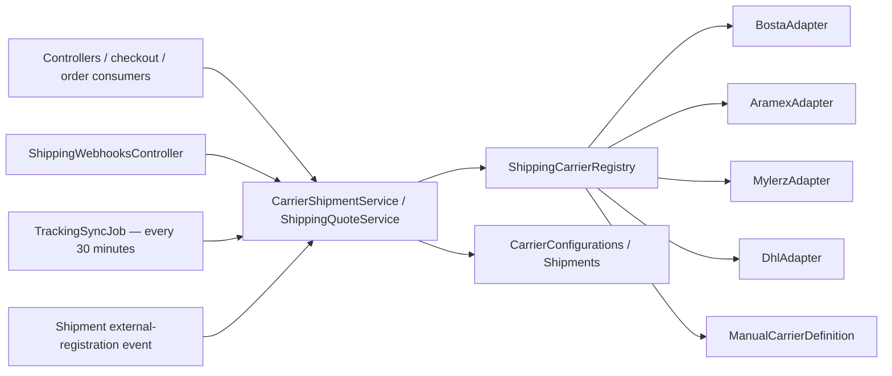

# PCC-0 — Shipping Provider Inventory & Version Freeze

Audit date: 5 July 2026  
Method: read-only solution discovery plus official vendor documentation.

No runtime, source behavior, tests, or provider payload contracts were modified or evaluated during this phase.

## Purpose

This document is the authoritative shipping-provider baseline for subsequent Provider Compatibility Certification phases:

- PCC-1 Official Documentation Audit
- PCC-2 Endpoint Audit
- PCC-3 Request Contract
- PCC-4 Response Contract
- PCC-5 Webhook Compatibility
- PCC-6 Status Mapping
- PCC-7 Security & Performance
- PCC-8 End-to-End Compatibility

## Authoritative provider inventory

Four external shipping adapters exist:

| Provider | Official product | Integration type | Runtime status |
|---|---|---|---|
| Bosta | Bosta Business API | REST/JSON | Partial |
| Aramex | Shipping Services, Tracking, Rate Calculator and Location Services APIs | Mixed: JSON endpoints over WCF/SOAP-style services | Partial |
| Mylerz | Mylerz shipping integration | REST/JSON | Partial / authority unknown |
| DHL | DHL Express — MyDHL API | REST/JSON | Partial |
| Manual | Internal Manual Fulfillment | Internal adapter | Implemented; not external |

No FedEx, UPS, Shippo, EasyPost, or other external `IShippingCarrierAdapter` implementation was found.

The authoritative carrier codes are:

- `manual`
- `bosta`
- `aramex`
- `mylerz`
- `dhl`

Source: `PointOfSale.Core/Constants/CarrierCodes.cs`.

## Provider architecture

The registry discovers all dependency-injection registrations implementing `IShippingCarrierAdapter`. Runtime registrations are explicit in `PointOfSale.API/Program.cs`.

## Supported operations

Legend:

- **Yes** — provider call implemented.
- **Partial** — indirect, synthetic, or incomplete.
- **No** — no dedicated operation.
- **Stub** — method exists but does not perform the provider operation.

| Operation | Bosta | Aramex | Mylerz | DHL |
|---|---:|---:|---:|---:|
| Create shipment | Yes | Yes | Yes | Yes |
| Cancel shipment | Yes | Stub | Yes | Yes |
| Track shipment | Yes | Yes | Yes | Yes |
| Print/receive label | No explicit label result | Yes | Yes | Yes |
| Rate quote | Synthetic | Yes | Yes | Yes |
| Pickup scheduling | No | No dedicated call | No | No dedicated call |
| Webhook receiver | Present | Present | Present | Present |
| Separate callback receiver | No | No | No | No |
| Proof of delivery | No dedicated operation | No | No | No |
| Return shipment creation | No | No | No | No |
| Status synchronization | Yes | Yes | Yes | Yes |

All external providers implement the common adapter surface defined in `PointOfSale.Infrastructure/Shipping/IShippingCarrierAdapter.cs`:

- Quote
- Shipment creation
- Cancellation
- Tracking
- Credential validation
- Service-level discovery
- Webhook parsing

## Bosta

### Identity and runtime version

- Carrier code: `bosta`
- Product: Bosta Business API
- Integration type: REST/JSON
- Runtime API version: `/api/v2`
- Production base URL: `https://api.bosta.co/api/v2`
- Sandbox base URL: `https://staging-api.bosta.co`
- Authentication: API key placed directly in the `Authorization` header

Source: `PointOfSale.Infrastructure/Shipping/Adapters/BostaAdapter.cs`.

### Implemented

- Create shipment using `POST /deliveries`
- Cancel shipment using `DELETE /deliveries/{trackingNumber}`
- Track shipment using `GET /deliveries/{trackingNumber}`
- Credential validation
- Webhook receiver
- Scheduled tracking synchronization

### Partial or missing

- `GetQuoteAsync` returns locally defined service levels and typical prices; it does not call Bosta.
- No label result is extracted by the adapter.
- No pickup-booking operation.
- No proof-of-delivery retrieval.
- No return-shipment creation operation.

### Official version freeze

The current official documentation uses `/api/v2`. Delivery webhook documentation additionally shows `apiVersion=1`.

- Official documentation: <https://docs.bosta.co/>
- Authentication: <https://docs.bosta.co/docs/how-to/get-your-api-key/>
- Delivery/webhook version reference: <https://docs.bosta.co/docs/how-to/get-delivery-status-via-webhook/>

Runtime status: **PARTIAL**

## Aramex

### Identity and runtime version

- Carrier code: `aramex`
- Products: Shipping Services, Tracking, Rate Calculator and Location Services APIs
- Integration type: mixed JSON/WCF with SOAP-style credentials
- Runtime root label: `ShippingAPI.V2`
- Operation paths: `Service_1_0.svc/json`
- Production base URL: `https://ws.aramex.net/ShippingAPI.V2`
- Sandbox base URL: `https://ws.sbx.aramex.net/ShippingAPI.V2`

Source: `PointOfSale.Infrastructure/Shipping/Adapters/AramexAdapter.cs`.

### Authentication

SOAP-style client credentials are embedded in request objects:

- Username/API key
- Password/API secret
- Account number
- Account PIN
- Account entity
- Account country code

### Implemented

- Rate calculator
- Shipment creation
- Label result
- Tracking
- Location call for credential validation
- Webhook receiver
- Scheduled tracking synchronization

### Stub or missing

`CancelShipmentAsync` makes no Aramex request. It returns success with a warning that cancellation must be verified through the Aramex portal.

Also missing:

- Dedicated pickup operation
- Proof-of-delivery retrieval
- Return-shipment creation

The unused `AramexCarrierDefinition` advertises pickup and cancellation capabilities that are not fully represented by the runtime adapter.

### Official version freeze

Public official material continues to identify `service_1_0.svc` contracts. Aramex does not publish a global current semantic API version.

- Official developer center: <https://www.aramex.com/be/en/developers-solution-center/aramex-apis>
- Official tracking manual: <https://www.aramex.com/content/uploads/109/232/42254/shipments-tracking-api-manual.pdf>

Runtime status: **PARTIAL**

## Mylerz

### Identity and runtime version

- Carrier code: `mylerz`
- Product: Mylerz shipping integration
- Integration type: REST/JSON
- Runtime API version: `v2`
- Production base URL: `https://api.mylerz.com/v2`
- Sandbox base URL: `https://sandbox-api.mylerz.com/v2`
- Authentication: `Authorization: Bearer <ApiKey>`

Source: `PointOfSale.Infrastructure/Shipping/Adapters/MylerzAdapter.cs`.

### Implemented

- Rate quote using `POST /shipping/rates`
- Shipment creation using `POST /shipments`
- Cancellation using `DELETE /shipments/{trackingNumber}`
- Tracking using `GET /shipments/{trackingNumber}/tracking`
- Label URL/base64 handling
- Account credential validation
- Webhook receiver
- Scheduled tracking synchronization

### Missing

- Pickup scheduling
- Proof-of-delivery retrieval
- Return-shipment creation

### Official version freeze

No publicly accessible official Mylerz developer authority, version register, or confirmation of the runtime URLs was found on the official site.

- Official site: <https://www.mylerz.com/>

The source comments' `developers.mylerz.com` authority could not be publicly validated.

Runtime status: **PARTIAL / OFFICIAL VERSION UNKNOWN**

## DHL

### Identity and runtime version

- Carrier code: `dhl`
- Product: DHL Express — MyDHL API
- Integration type: REST/JSON
- Runtime path: unversioned MyDHL endpoint
- Production base URL: `https://express.api.dhl.com/mydhlapi`
- Sandbox base URL: `https://express.api.dhl.com/mydhlapi/test`
- Authentication: HTTP Basic using API key as username and API secret as password

Source: `PointOfSale.Infrastructure/Shipping/Adapters/DhlAdapter.cs`.

### Implemented

- Rate quote using `POST /rates`
- Shipment creation using `POST /shipments`
- Cancellation using `DELETE /shipments/{trackingNumber}`
- Tracking
- PDF label extraction
- Credential validation
- Webhook receiver
- Scheduled tracking synchronization

### Partial or missing

- Shipment creation explicitly sets pickup as not requested.
- No dedicated pickup-booking call.
- No proof-of-delivery retrieval.
- No return-shipment creation.

### Official version freeze

The current official MyDHL API release is **3.3.1**, dated 28 June 2026. DHL publishes an official OpenAPI definition and release notes.

- Official MyDHL API: <https://developer.dhl.com/api-reference/dhl-express-mydhl-api>

Runtime status: **PARTIAL**

## Shared runtime components

### Controllers

- `PointOfSale.API/Controllers/AdminCarrierConfigController.cs`
- `PointOfSale.API/Controllers/ShipmentController.cs`
- `PointOfSale.API/Controllers/AdminShipmentsController.cs`
- `PointOfSale.API/Controllers/StorefrontShipmentController.cs`
- `PointOfSale.API/Controllers/StorefrontShippingQuotesController.cs`
- `PointOfSale.API/Controllers/ShippingWebhooksController.cs`
- `PointOfSale.API/Controllers/ShippingMethodsController.cs`
- `PointOfSale.API/Controllers/StorefrontShippingMethodsController.cs`

### Services and adapters

- `ShippingCarrierRegistry`
- `CarrierShipmentService`
- `ShippingQuoteService`
- `ShipmentService`
- `CarrierCredentialEncryptionService`
- `BostaAdapter`
- `AramexAdapter`
- `MylerzAdapter`
- `DhlAdapter`
- `ManualCarrierDefinition`

### Background execution

- `TrackingSyncJob`
  - Registered through Hangfire
  - Schedule: every 30 minutes
- `ShipmentAuthorityRecoveryHostedService`
- `ShipmentExternalRegistrationRequestedConsumer`
- `OrderShipmentOrchestrationConsumer`

### Persistence

Primary SQL tables/entities:

- `CarrierConfigurations`
- `Shipments`
- `ShippingMethods`
- `ShippingWebhookLogs`
- MassTransit outbox/inbox/state tables
- General `OutboxMessages`
- Marketplace event/projection outbox tables where shipment delivery events participate

Primary mapping source: `PointOfSale.Infrastructure/Data/ApplicationDbContext.cs`.

### Events

Shipping events include:

- Shipment created
- External registration requested
- Ready for pickup
- Picked up
- In transit
- Out for delivery
- Delivered
- Failed
- Cancelled
- Returned
- Status changed
- COD collected
- Packed
- Shipped

Definitions: `PointOfSale.Core/Events/ShipmentEvents.cs`.

### Provider-specific DTOs

Provider request and response DTOs are declared as internal classes inside each concrete adapter. No generated provider SDK clients were found.

## Configuration inventory

Provider settings are tenant-scoped database configuration rather than provider-specific `appsettings` sections:

- API key
- API secret
- Account ID
- Optional API URL
- Sandbox toggle
- Webhook URL and secret
- Pickup address
- Service levels
- Capability flags
- Fixed-rate and markup settings
- Validation status and timestamps

Entity: `PointOfSale.Core/Entities/CarrierConfiguration.cs`.

No provider-specific environment-variable names or provider credentials were found in tracked `appsettings*.json`.

## Version freeze

| Provider | Current runtime version | Current official version | Last documentation review | Compatibility review required |
|---|---|---|---|---:|
| Bosta | REST `/api/v2` | `/api/v2`; delivery `apiVersion=1` | 2026-07-05 | YES |
| Aramex | `ShippingAPI.V2` with `Service_1_0.svc/json` | Public contract `service_1_0`; no global semantic release | 2026-07-05 | YES |
| Mylerz | REST `v2` | Not publicly verifiable | 2026-07-05 | YES |
| DHL | MyDHL unversioned path | MyDHL API 3.3.1 | 2026-07-05 | YES |

Every provider remains marked `YES` because PCC-0 freezes identity and versions only. Endpoint, request, response, webhook, status, security, and end-to-end compatibility are intentionally deferred.

## Missing components

- No dedicated return-shipment operation for any external provider.
- No dedicated proof-of-delivery retrieval operation.
- No pickup-booking operation, including DHL and Aramex despite capability declarations.
- No Bosta label result.
- Bosta rate quoting is synthetic.
- Aramex cancellation is a stub that reports local success.
- No provider SDK dependency was found.

## Unknown components

- Mylerz's official API authority, current version, and official base URLs.
- Actual per-tenant provider enablement.
- Whether production credentials exist or have been validated.
- Whether configured webhook registrations exist at the providers.
- Whether any tenant relies on `CarrierConfiguration.ApiUrl`.
- Actual runtime use of individual service levels and provider capabilities.

These are runtime/database or later certification concerns and were not inferred from source.

## Potential risks

1. `BostaCarrierDefinition`, `AramexCarrierDefinition`, `MylerzCarrierDefinition`, and `DhlCarrierDefinition` advertise capabilities but are not registered with dependency injection. Runtime authority comes from the concrete adapters and tenant configuration.

2. `CarrierConfiguration.ApiUrl` is writable and propagated into `CarrierCredentials`, but concrete adapters select hard-coded base URLs. Tenant URL overrides do not appear to control adapter routing.

3. Credential consumption is inconsistent: shipment execution decrypts stored keys, while quote construction reads carrier configuration values directly. This is reserved for PCC-7.

4. Capability flags can disagree between unused definition classes, tenant database configuration, and actual adapter methods.

5. Aramex cancellation can return a successful local result without making an external cancellation request.

6. All four external adapters expose webhook receivers, but official webhook availability and payload compatibility were deliberately not assessed in PCC-0.

7. Mylerz cannot be certified against public official documentation until authoritative onboarding documentation is obtained from the vendor.

## Certification boundary

This PCC-0 report does not:

- Compare endpoints with official provider references
- Compare request or response contracts
- Evaluate webhook payloads
- Review status mappings
- Assess authentication security
- Execute provider calls
- Verify tenant configuration or credentials
- Modify runtime behavior

Those activities belong to PCC-1 through PCC-8.
