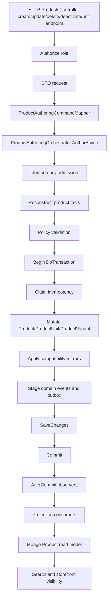
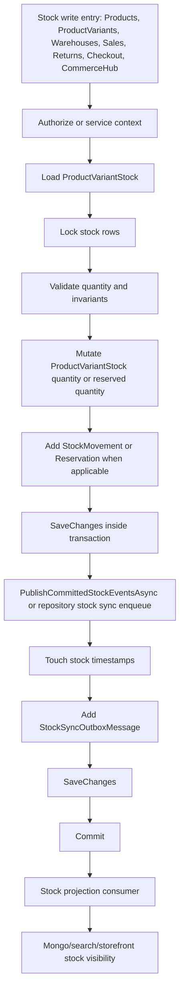
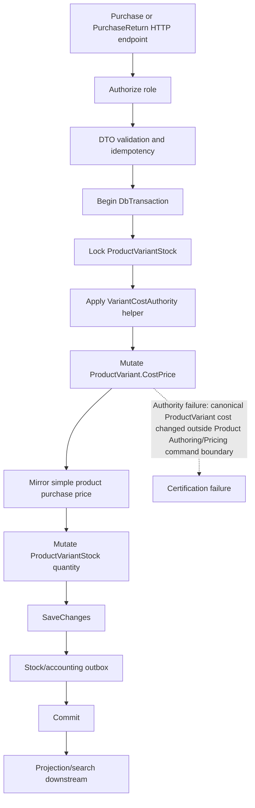
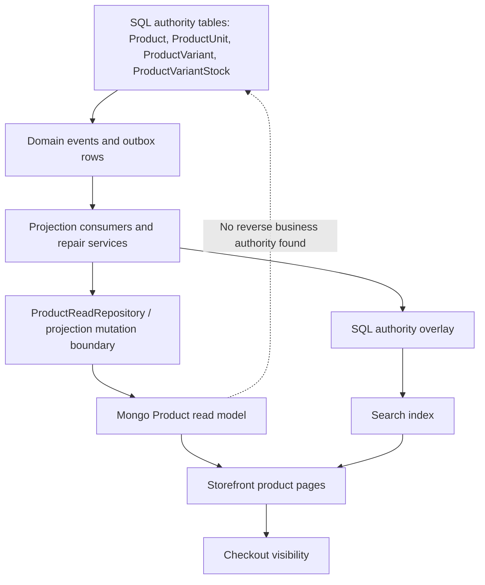
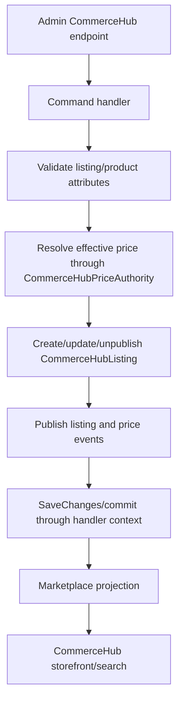
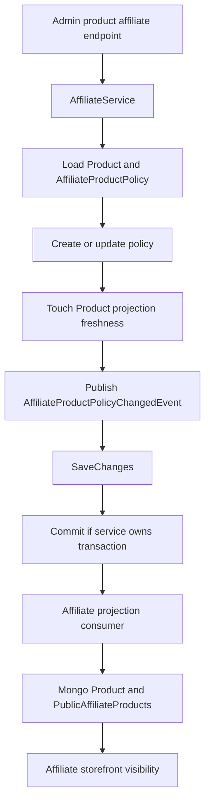
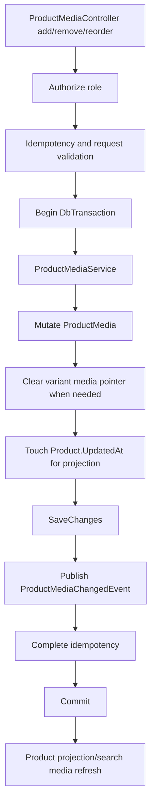
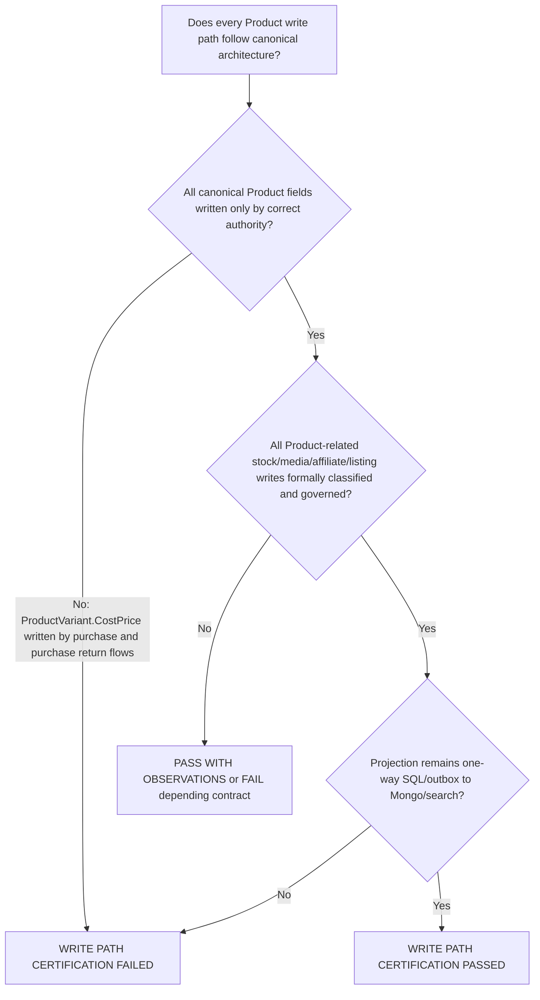

# Product Runtime Flow Diagrams

Date: 2026-07-30

Final certification: `WRITE PATH CERTIFICATION FAILED`

## Canonical Product Authoring Flow

Evidence:

- Product endpoints delegate to the authoring orchestrator at `PointOfSale.API/Controllers/ProductsController.cs:286-454` and `:1353-1643`.
- The orchestrator performs admission, reconstruction, policy, transaction, save, commit, and observer callbacks at `PointOfSale.API/Services/ProductAuthoring/ProductAuthoringOrchestrator.cs:66-96` and `:467-495`.
- Product events/outbox are staged before commit at `ProductAuthoringOrchestrator.cs:587-687`.

## Inventory and Stock Flow

Evidence:

- Product stock adjustment: `PointOfSale.API/Controllers/ProductsController.cs:771-909`.
- Variant stock update: `PointOfSale.API/Controllers/ProductVariantsController.cs:1398-1558`.
- Warehouse inventory service: `PointOfSale.API/Services/InventoryService.cs:36-92`, `:101-194`, `:227-363`.
- Stock event/outbox support: `PointOfSale.API/Services/Inventory/ProductVariantStockMutationSupport.cs:216-250`, `:388-390`.
- Checkout stock repository: `PointOfSale.Infrastructure/Data/Repositories/ProductVariantStockRepository.cs:112-227`, `:1115-1203`, `:1274-1289`.

## Purchase Cost Authority Failure Flow

Evidence:

- `ProductVariant.CostPrice` is canonical Product variant cost at `PointOfSale.Core/Entities/ProductVariant.cs:22-73`.
- Purchase create/update/delete-revert write cost at `PointOfSale.API/Controllers/PurchasesController.cs:219-223`, `:1133-1138`, and `:1461-1464`.
- Purchase return writes cost at `PointOfSale.API/Controllers/PurchaseReturnsController.cs:540-544`.
- Simple compatibility mirrors are applied after cost mutation at `PurchasesController.cs:224`, `:1468` and `PurchaseReturnsController.cs:550-553`.

## Projection Flow

Evidence:

- Projection writer allowlists and business-layer Mongo write checks are in `PointOfSale.Tests/Architecture/ProductProjectionGovernanceTests.cs:5-93`.
- Mongo Product writes are in projection repository methods at `PointOfSale.Infrastructure/MongoDB/Services/ProductReadRepository.cs:194`, `:551`, `:572`, and `:607`.
- Search overlay rehydrates from SQL authority at `PointOfSale.Infrastructure/Elasticsearch/Services/ProductSearchSqlAuthorityOverlay.cs:321-329`.
- Repair services use SQL authority overlay before search updates at `PointOfSale.API/Services/ReadModels/DiscountReadModelRepairService.cs:321-333`.

## CommerceHub Listing Flow

Evidence:

- Publish flow: `PointOfSale.API/CommerceHub/Handlers/CommerceHubCommandHandlers.cs:181-235`.
- Update flow: `CommerceHubCommandHandlers.cs:599-638`.
- Unpublish flow: `CommerceHubCommandHandlers.cs:751-785`.
- Pricing authority: `PointOfSale.Core/Pricing/CommerceHubPriceAuthority.cs:83-111`.
- Bulk listing observation: `PointOfSale.API/Controllers/AdminCommerceHubController.cs:365-494` mutates listing state in the controller.

## Affiliate Product Policy Flow

Evidence:

- Admin endpoints delegate to the affiliate service at `PointOfSale.API/Controllers/AdminProductAffiliateController.cs:171`, `:286`, `:326`, and `:366`.
- Affiliate service create/update/publish/save/commit paths are at `PointOfSale.Infrastructure/Services/Affiliate/AffiliateService.cs:408-444` and `:626-665`.
- Affiliate projection consumer writes downstream read models at `PointOfSale.Infrastructure/Consumers/Affiliate/AffiliateProductPolicyProjectionConsumer.cs:110`, `:521`, `:655`, `:1143`, `:1181`, `:1201`, and `:1409`.

## Product Media Flow

Evidence:

- Controller transaction/idempotency points: `PointOfSale.API/Controllers/ProductMediaController.cs:54-68`, `:119-148`, `:167-200`, and `:317-318`.
- Service mutations and projection touch: `PointOfSale.API/Services/ProductMediaService.cs:90-109`, `:125-181`, `:198-225`, `:289-301`.

## Decision Graph

The selected result is:

`WRITE PATH CERTIFICATION FAILED`

